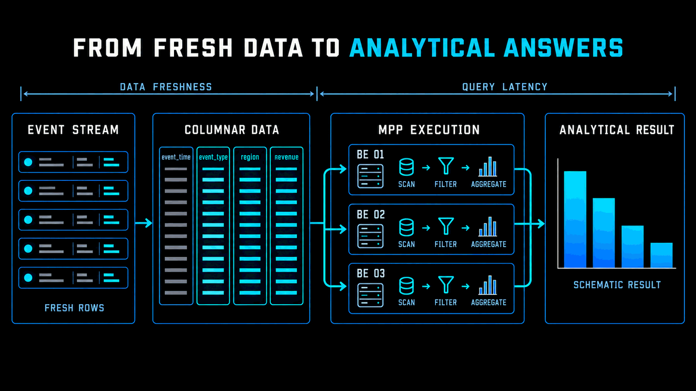
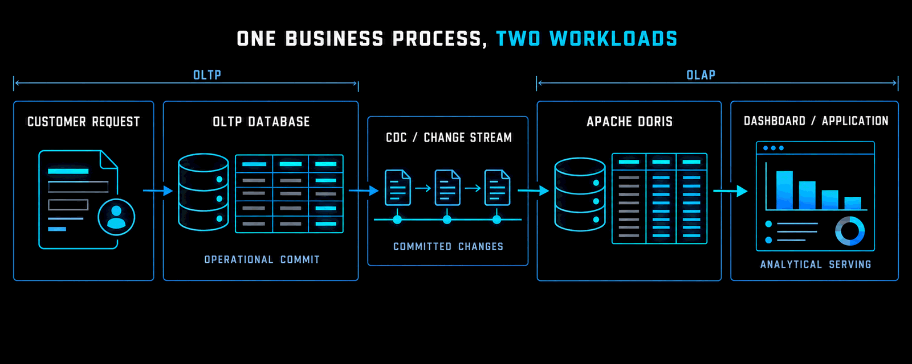
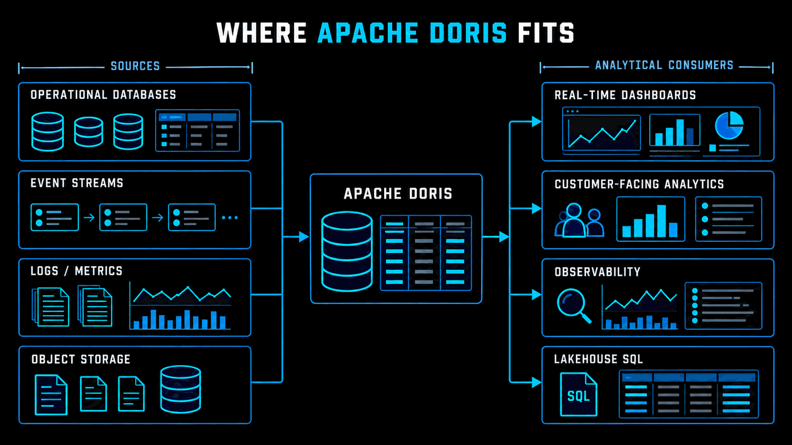
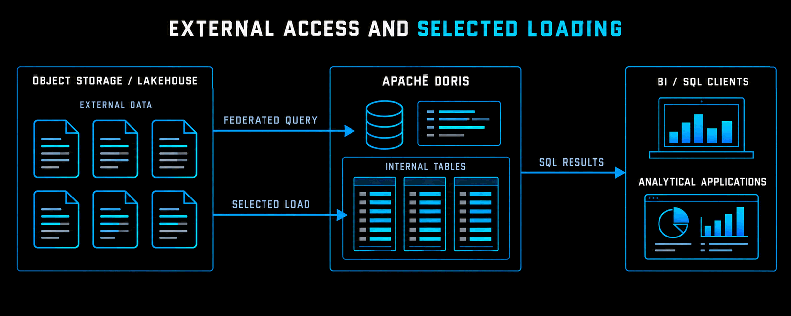
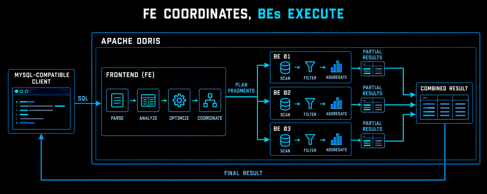
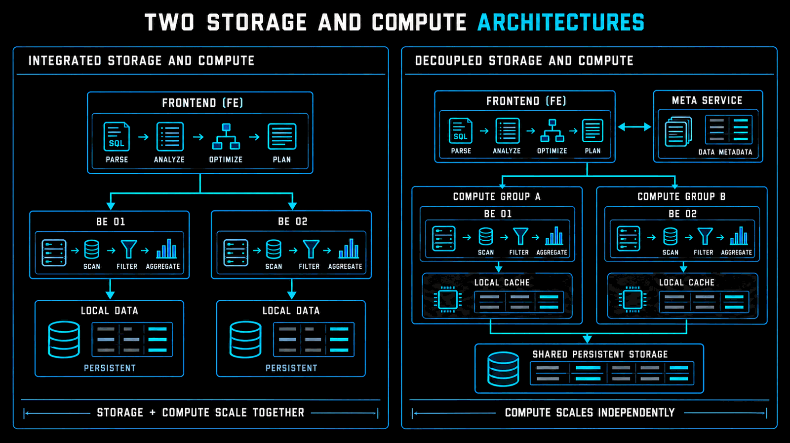

<a id="unit-u.4d3a955729cc4c5484d7e42953a2fbed"></a>

<a id="module-1-introduction-to-apache-doris"></a>

# 1-модуль: Apache Doris жүйесіне кіріспе

| Курс туралы ақпарат | Мәні |
| --- | --- |
| Курс | Apache Doris көмегімен нақты уақыттағы аналитика · 1-деңгей |
| Doris | Apache Doris 4.1.3 |
| Орта | 4 CPU және 8 GB жады бөлінген Docker; курстың сынақ ортасын 1-зертханалық жұмыс іске қосады |
| Болжалды уақыт | Шамамен 70 минут: оқу 30, зертханалық жұмыс 30, тест 10 |

[Курстың README файлы](../../README.md) · [1-зертханалық жұмысты ашу](lab01_start_doris_and_build_baseline.ipynb) · [1-тестті ашу](quiz01_doris_fundamentals.ipynb)

<a id="unit-u.0ffe4be11ff94022b130ece99397d4c4"></a>

<a id="module-goal"></a>

## Модуль мақсаты

Apache Doris деген не және ол қандай жұмыс жүктемелеріне арналғанын біліп, Doris сынақ ортасын іске қосыңыз да, кейінгі барлық модуль пайдаланатын оқиғалар жиынын жүктеңіз.

<a id="unit-u.a0224e9c4b814881b98280f0e5662713"></a>

<a id="learning-objectives"></a>

## Оқу мақсаттары

Осы модульді аяқтаған соң сіз:

1. Apache Doris жүйесін MPP архитектурасына негізделген, бастапқы коды ашық, нақты уақыттағы аналитика мен іздеуге арналған дерекқор ретінде сипаттай аласыз.
2. OLAP пен OLTP жүктемелерін сұрауды орындайтын өнімге емес, сұраудың атқаратын жұмысына қарай ажырата аласыз.
3. Нақты уақыттағы бақылау тақталары, тұтынушыларға арналған аналитика, жүйені бақылау, lakehouse аналитикасы және CDC негізіндегі есеп беру сияқты Doris жүйесіне сай жүктемелерді тани аласыз.
4. Frontend (FE) пен Backend (BE) сұрауды өңдегенде әрқайсысы не істейтінін түсіндіре аласыз.
5. Сақтау мен есептеуі біріктірілген архитектураны сақтау мен есептеуі ажыратылған архитектурадан ажырата аласыз.
6. Doris жүйесіне MySQL-мен үйлесімді протокол арқылы қосылып, кесте құрып, деректер жүктеп, нәтижені агрегаттау сұрауымен тексере аласыз.

<a id="unit-u.7d1ec445db7a405f80020e5272a4233a"></a>

<a id="module-structure"></a>

## Модуль құрылымы

| Бөлім | Уақыт | Нәтиже |
| --- | ---: | --- |
| 1.1 Apache Doris деген не? | 7 мин | Doris жүйесін жүктемесі, интерфейсі және орындау моделі арқылы сипаттау |
| 1.2 OLAP және OLTP жүктемелері | 8 мин | Сұрауды деректерді қалай оқитыны мен өзгертетініне қарай жіктеу |
| 1.3 Doris қайда қолданылады? | 7 мин | Doris жүйесіне сай жүктемелерді және басқа жүйелерге қалдыру керек жұмысты тану |
| 1.4 Doris архитектурасымен алғашқы танысу | 8 мин | FE, BE және екі орналастыру архитектурасын түсіндіру |
| 1-зертханалық жұмыс | 30 мин | Doris іске қосып, S3-тен 10,158,080 оқиғаны жүктеу және алғашқы агрегаттау сұрауын орындау |
| 1-тест | 10 мин | Осы мақсаттар бойынша алты сұрақ |

<a id="unit-u.f7ce7eb9b489402199030e611e49590b"></a>

<a id="11-what-is-apache-doris"></a>

## 1.1 Apache Doris деген не?

Apache Doris дегеніміз **MPP архитектурасына негізделген, бастапқы коды ашық, нақты уақыттағы аналитика мен іздеуге арналған дерекқор**. Ол MySQL-мен үйлесімді протокол арқылы SQL интерфейсін ұсынады және жаңа деректерді аз кідіріспен талдамалық сұрауларға қолжетімді етуге арналған.

Бұл анықтамада төрт негізгі ұғым бар.

<a id="unit-u.8369093b72d6497caef8168f221dbb15"></a>

<a id="open-source"></a>

### Бастапқы коды ашық

Apache Doris дегеніміз Apache Software Foundation ұйымының жоғарғы деңгейлі жобасы. Оның бастапқы коды, мәселелер тізімі, релиздері мен әзірлеу үдерісі ашық. «Бастапқы коды ашық» деген сипаттама жоба мен оны басқаруға қатысты; ол дерекқор орындайтын жүктемені сипаттамайды.

<a id="unit-u.4288e1982cb5494e8f0fec2a02b2e264"></a>

<a id="real-time-analytics"></a>

### Нақты уақыттағы аналитика

«Нақты уақыт» ұғымының екі жағы бар:

- **Деректердің өзектілігі:** жаңадан қабылданған деректерге тез арада сұрау жасауға болады.
- **Сұрау кідірісі:** талдау нәтижелері интерактивті бақылау тақтасына, қолданбаға немесе зерттеуге жеткілікті жылдам қайтады.

Деректерді күніне бір рет жаңартатын жүйе сұраулары жылдам болғаны үшін ғана нақты уақыттағы жүйе болып саналмайды. Әр оқиғаны бірден қабылдайтын жүйеде де әр сұрау бірнеше минутқа созылса, ол интерактивті аналитикаға жарамайды. Нақты уақыттағы талдамалық жүйе деректерді қабылдаудан талдау нәтижесіне дейінгі жолдың екі бөлігін де қамтуы керек.

<a id="unit-u.44d6f28ceed74037bd0d5864369f362b"></a>

<a id="mpp-execution"></a>

### MPP арқылы орындау

MPP дегеніміз **Massively Parallel Processing**, яғни жаппай параллель өңдеу. Үлкен сұрау бірнеше түйін мен CPU ядросында орындала алатын жұмыстарға бөлінеді. Кейін ішінара нәтижелер біріктіріліп, соңғы жауап алынады.

Мына талдамалық сұрақты қарастырайық:

```sql
SELECT
    region,
    COUNT(*) AS purchase_count,
    SUM(revenue) AS total_revenue
FROM events
WHERE event_type = 'purchase'
GROUP BY region;
```

Жауап шағын: әр аймаққа бір жолдан келеді. Бірақ оны алу үшін миллиондаған оқиға жолын сканерлеу қажет болуы мүмкін. Параллель орындау бұл жұмысты бір тапсырысты бастапқы кілті бойынша іздеуден едәуір өзгеше етеді.

<a id="unit-u.1db8934f97934c8bbd7352d620064e43"></a>

<a id="columnar-storage-and-vectorized-execution"></a>

### Бағандық сақтау және векторланған орындау

Талдамалық сұраулар көбіне көптеген жолдан аз ғана баған оқиды. Doris ішкі кесте деректерін бағандар бойынша сақтайды, сондықтан сұрау қатысы жоқ бағандарды оқымауы мүмкін. Векторланған орындау қозғалтқышы әр оператор арқылы жолдарды бір-бірден өткізудің орнына баған мәндерін топтамамен өңдейді. MPP арқылы орындаумен бірге бұл тәсіл үлкен көлемді сканерлеуді, сүзуді, біріктіруді және агрегаттауды қолдайды.



*Деректердің өзектілігі мен сұрау кідірісі талдамалық жауапқа дейінгі жолдың әртүрлі бөліктерін қамтиды.*

**Суреттегі жазулар:** From fresh data to analytical answers: жаңа деректерден талдамалық жауапқа дейін. Data freshness: деректердің өзектілігі; Query latency: сұрау кідірісі. Event stream: оқиғалар ағыны; Fresh rows: жаңа жолдар; Columnar data: бағандық деректер; MPP execution: MPP арқылы орындау. Әр BE 01/02/03 түйінінде Scan → Filter → Aggregate: сканерлеу → сүзу → агрегаттау. Analytical result: талдамалық нәтиже; Schematic result: шартты нәтиже. event_time, event_type, region, revenue баған атаулары өзгермейді.

> **Түсіну үлгісі:** Doris жай ғана «жылдамырақ MySQL» емес. Ол таныс SQL интерфейсін және MySQL-мен үйлесімді протоколды ұсынады, ал сақтау және орындау қозғалтқыштары талдамалық жүктемелерге арналған.

Өнімнің қазіргі анықтамасы мен мүмкіндіктері үшін негізгі дереккөздер: [Apache Doris жобасының README файлы](https://github.com/apache/doris) және [Apache Doris шолуы](https://doris.apache.org/docs/4.x/getting-started/what-is-apache-doris/).

<a id="unit-u.27ac6acc81ed470291606abfc5f7fa59"></a>

<a id="12-olap-and-oltp-workloads"></a>

## 1.2 OLAP және OLTP жүктемелері

OLTP және OLAP **жұмыс жүктемесінің үлгілерін** сипаттайды. Өнімді тек атауына қарап осы санаттардың біріне жатқызуға болмайды.

- **OLTP** дегеніміз Online Transaction Processing: транзакцияларды жедел өңдеу.
- **OLAP** дегеніміз Online Analytical Processing: деректерді жедел талдамалық өңдеу.

<a id="unit-u.471263ccbdf64a8db6b2c014ee0e4b51"></a>

<a id="compare-the-unit-of-work"></a>

### Жұмыс бірлігін салыстыру

| Сипаттама | Әдеттегі OLTP жүктемесі | Әдеттегі OLAP жүктемесі |
| --- | --- | --- |
| Бизнес мақсаты | Операциялық әрекетті тіркеу | Көптеген әрекеттегі заңдылықтарды түсіну |
| Бір сұрау қамтитын жолдар | Әдетте бір немесе аз ғана жол | Көбіне мыңдаған, миллиондаған немесе одан да көп жол |
| Қамтылатын бағандар | Көбіне жолдағы бағандардың көбі | Көбіне таңдалған бағандар жиыны |
| Сұрау пішіні | Кілтпен іздеу, шағын енгізу, нүктелік жаңарту | Сүзу, сканерлеу, біріктіру, топтау, агрегаттау, рангілеу |
| Жазу үлгісі | Бір уақытта орындалатын көптеген шағын транзакция | Пакеттік, шағын пакеттік, ағындық немесе CDC арқылы қабылдау |
| Нәтиже көлемі | Бір жазба немесе шағын операциялық жауап | Жиынтық, уақыттық қатар, когорта немесе егжей-тегжейлі талдау |
| Күтілетін кідіріс | Жеке әрекетті тез бекіту | Көбірек жұмыс орындалса да, интерактивті жауап беру |
| Мысал | `91827` тапсырысын рәсімдеу | Соңғы 24 сағаттағы аймақтар бойынша түсім |

Нәтижедегі жол саны шешуші өлшем емес. Талдамалық сұрау миллиондаған жолды сканерлеп, бір ғана сан қайтаруы мүмкін. Курс деректерінде мына сұрау 2019 жылғы желтоқсанның 4,768,620 оқиғасын оқып, бір мәнді қайтарады: 18,134,559.98.

```sql
SELECT SUM(revenue)
FROM events
WHERE event_time >= '2019-12-01 00:00:00'
  AND event_time <  '2020-01-01 00:00:00';
```

Курс деректері 2019 және 2020 жылдарға тиесілі, сондықтан курс сұрауларында бекітілген күндер қолданылады; `NOW()` мәніне қатысты сұрау ешбір жол таппайды.

Керісінше, көп жол қайтару автоматты түрде аналитика болып саналмайды. Белгілі идентификаторлары бойынша 1,000 тапсырысты экспорттау әлі де операциялық қолжеткізу үлгісі болуы мүмкін.

<a id="unit-u.bfad31b7da4046f3a0c0ed1769eec89c"></a>

<a id="one-business-process-two-workloads"></a>

### Бір бизнес үдерісі, екі жүктеме

Интернет-дүкендегі тапсырысты рәсімдеуді елестетіңіз:

1. Тұтынушы тапсырысты растайды.
2. Қолданба тауар қорын және төлемді тексереді.
3. Операциялық дерекқор тапсырысты бекітіп, оның күйін жаңартады.
4. Өзгеріс ағын немесе өзгерістерді тіркеу (CDC) арнасы арқылы Doris жүйесіне жеткізіледі. CDC бекітілген өзгерістерді операциялық дерекқордан кейінгі жүйелерге үздіксіз көшіреді; талдамалық оқу транзакциялық дерекқорға жүктелмейді.
5. Бақылау тақтасы түсімді, конверсияны және аймақтық сұранысты қайта есептейді.

Тапсырысты бекіту OLTP жұмысына жатады. Бақылау тақтасының сұраулары OLAP жұмысына жатады. Олар өзара байланысты, бірақ әртүрлі жұмыс бірліктеріне оңтайландырылған.



*CDC операциялық бекітулерді талдамалық сұраулармен байланыстырады, ал әр жүйе өз міндетін сақтайды.*

**Суреттегі жазулар:** One business process, two workloads: бір бизнес үдерісі, екі жүктеме. Customer request: тұтынушы сұрауы → OLTP database: OLTP дерекқоры (Operational commit: операциялық өзгерісті бекіту) → CDC / Change stream: CDC / өзгерістер ағыны (Committed changes: бекітілген өзгерістер) → Apache Doris → Dashboard / Application: бақылау тақтасы / қолданба (Analytical serving: талдамалық қызмет көрсету). Сол жақтағы бөлік OLTP, оң жақтағысы OLAP.

Doris транзакцияларды, жаңартуларды және жоюды қолдайды, бірақ бұл мүмкіндіктер әр операциялық жүктемені Doris жүйесіне қолайлы етпейді. Негізгі сұрақ: **Қолданбаға ең алдымен шағын операциялық транзакцияларды бекіту керек пе, әлде көптеген жазбаны бірге талдау керек пе?**

<a id="unit-u.097865358ebd4baf9cd6ec53ba65ce02"></a>

<a id="workload-classification-practice"></a>

### Жүктемелерді жіктеу жаттығуы

| Сұрау | Санаты | Себебі |
| --- | --- | --- |
| `91827` тапсырысының жеткізу мекенжайын жаңарту | OLTP | Бір бизнес нысанының күйін өзгертетін шағын транзакция |
| Сатып алуларды аймақ пен сағат бойынша санау | OLAP | Үлкен көлемді сканерлеу және топтық агрегаттау |
| Бір тұтынушының құпиясөзді қалпына келтіру токенін қайтару | OLTP | Құпия операциялық күйді нүктелік іздеу |
| 5,000 сатушы үшін 30 күндік конверсия үрдістерін көрсету | OLAP | Уақыт аралығын сканерлеу, топтау және көптеген қатарлас талдамалық сұрауға қызмет көрсету |

> **Шешім ережесі:** сұрауды SQL қолданатынына қарап емес, деректерді қалай оқитыны мен өзгертетініне қарап жіктеңіз.

<a id="unit-u.9a474378140a42dfa32e78c35f958d1f"></a>

<a id="13-where-doris-fits"></a>

## 1.3 Doris қайда қолданылады?

Жаңа немесе үлкен деректер жиындарына интерактивті SQL сұраулары қажет болғанда, әсіресе көптеген пайдаланушы не қолданба деректерге бір уақытта сұрау жасағанда, Doris тиімді жұмыс істейді.



*Apache Doris үздіксіз өзгеретін дереккөздер мен интерактивті талдамалық қызметтердің арасында орналасады.*

**Суреттегі жазулар:** Where Apache Doris fits: Apache Doris қайда қолданылады? Sources: дереккөздер. Operational databases: операциялық дерекқорлар; Event streams: оқиғалар ағындары; Logs / Metrics: журналдар / метрикалар; Object storage: объектілік сақтау. Барлығы Apache Doris жүйесіне бағытталады. Analytical consumers: талдамалық тұтынушылар. Real-time dashboards: нақты уақыттағы бақылау тақталары; Customer-facing analytics: тұтынушыларға арналған аналитика; Observability: жүйені бақылау; Lakehouse SQL: lakehouse деректеріне SQL сұраулары.

<a id="unit-u.4d37e2c35c634166b4812466f6bc0ca1"></a>

<a id="real-time-dashboards"></a>

### Нақты уақыттағы бақылау тақталары

Бақылау тақтасы тапсырыс көлемін, конверсия деңгейін, тауар қорының тәуекелін немесе түсімді үздіксіз көрсете алады. Негізгі деректер секунд сайын өзгереді, ал әр панель жуырдағы уақыт аралығы бойынша сүзу мен агрегаттауды орындайды.

**Сәйкестік белгісі:** жаңа деректер тез көрінуі, ал қайталанатын агрегаттау интерактивті жылдамдықта қалуы керек.

<a id="unit-u.2522851c79a44bcd98649d1a777b1fce"></a>

<a id="customer-facing-analytics"></a>

### Тұтынушыларға арналған аналитика

Тұтынушыларға арналған аналитикада сұрау нәтижелері тек ішкі BI құралында емес, өнімнің өзінде көрсетіледі. Оған сатушы порталдары, жарнама платформалары, пайдалану көрсеткіштерінің бақылау тақталары және серіктестік есеп беру API интерфейстері жатады.

Бұл жүктеме әдеттегі есеп беруге екі талап қосады:

- көптеген тұтынушы бір уақытта сұрау жасай алады;
- кідіріс өнімді пайдалану тәжірибесінің бір бөлігіне айналады.

Doris жүйесінің [тұтынушыларға арналған аналитика шолуы](https://doris.apache.org/use-cases/customer-facing-analytics/) жаңа деректерді, интерактивті кідірісті және жоғары қатарластықты бірге сипаттайды.

<a id="unit-u.b832127468694483b82146ad21bd688a"></a>

<a id="observability"></a>

### Жүйені бақылау

Журналдар, трассалар, метрикалар және қолданба оқиғалары үздіксіз келіп түседі. Инженерлерге іздеу де, аналитика да қажет: белгілі бір қатені табу, ақауларды қызмет бойынша топтау, кідіріс процентильдерін есептеу және орналастыруға дейінгі және кейінгі жұмысты салыстыру.

**Сәйкестік белгісі:** жүктемеде оқиғаларды жоғары өткізу қабілетімен қабылдау, сүзгілер, толық мәтіндік іздеу және агрегаттау қатар қолданылады. Ресми [жүйені бақылау архитектурасын](https://doris.apache.org/docs/4.x/observability/overview/) қараңыз.

<a id="unit-u.af338a667c1746b2b1caf1766f7f906c"></a>

<a id="lakehouse-analytics"></a>

### Lakehouse аналитикасы

Деректер объектілік сақтау жүйесінде және ашық кесте пішімдерінде бұрыннан сақталуы мүмкін. Doris каталогтар мен кестелік функциялар арқылы сыртқы деректерге сұрау жасай алады немесе тұрақты талдамалық қызмет көрсету үшін таңдалған деректерді ішкі кестелерге жүктей алады.



*Федеративті қолжеткізу мен таңдап жүктеу сыртқы деректерді талдамалық жұмыс үдерісіне қосудың бөлек тәсілдері.*

**Суреттегі жазулар:** External access and selected loading: сыртқы қолжеткізу және таңдап жүктеу. Object storage / Lakehouse: объектілік сақтау / lakehouse; External data: сыртқы деректер. Federated query: федеративті сұрау Apache Doris жүйесіне бағытталады; Selected load: таңдап жүктеу Internal tables: ішкі кестелерге бағытталады. SQL results: SQL нәтижелері → BI / SQL clients: BI / SQL клиенттері және Analytical applications: талдамалық қолданбалар.

**Сәйкестік белгісі:** команда сыртқы lakehouse деректері мен жаңа ішкі кестелерге ортақ SQL қабатын қалайды немесе ашық пішімдер бойынша сұрауларды жеделдетуі керек.

<a id="unit-u.f16ac4f37d3c41c5a361ee586b58a841"></a>

<a id="cdc-driven-reporting"></a>

### CDC негізіндегі есеп беру

Операциялық дерекқор негізгі есеп жүйесі болып қалады, ал өзгерістерді тіркеу енгізулерді, жаңартуларды және жоюларды Doris жүйесіне үздіксіз жеткізеді. Осылайша есептер транзакциялық дерекқорда үлкен талдамалық сканерлеуді орындамай-ақ жаңа операциялық өзгерістерді пайдаланады.

**Сәйкестік белгісі:** бастапқы жүйе транзакцияларға оңтайландырылған күйде қалуы керек, бірақ бизнеске оның өзгеретін деректерін нақты уақытқа жуық талдау қажет. Doris Flink CDC сияқты CDC интеграцияларын қолдайды; жүктеу тәсілдері 3-модульде таныстырылады және ресми [жүктеу шолуында](https://doris.apache.org/docs/4.x/data-operate/import/load-manual/) жинақталған.

<a id="unit-u.338ea093316c46019501eeecaa52322e"></a>

<a id="when-doris-is-not-the-first-component-to-choose"></a>

### Қай кезде Doris бірінші таңдау болмайды?

Әдетте Doris мына міндеттерді атқаратын жүйе болмауы керек:

- төлемді қысқа, оқшауланған бизнес транзакциясы ретінде авторизациялау;
- операциялық қызметтер арасындағы көп қадамды тапсырыс рәсімдеу үдерісін үйлестіру;
- тек файлдарға арналған бастапқы объектілік сақтау орны болу;
- диаграммалар мен бақылау тақталарын ұсынатын визуалдау қабатын алмастыру.

Ол осы жүйелердің артындағы аналитикаға қызмет көрсете алады. Дұрыс архитектурада әр компоненттің міндеті айқын болады.

<a id="unit-u.0c44570545814715bd09683676940bc2"></a>

<a id="14-a-first-look-at-doris-architecture"></a>

## 1.4 Doris архитектурасымен алғашқы танысу

Алғашқы жұмыс үдерісі екі компоненттің шекарасына сүйенеді: FE SQL қабылдап, жоспарлайды; BE тағайындалған жұмысты орындайды және сақтау мен есептеуі біріктірілген орналастыруда ішкі кесте деректерін басқарады.

<a id="unit-u.66977ba9bdad4e23a758cfc1789be610"></a>

<a id="frontend-fe"></a>

### Frontend (FE)

FE дегеніміз SQL кіру нүктесі және үйлестіру қабаты. Оның міндеттері:

- MySQL-мен үйлесімді клиент қосылымдарын қабылдау;
- пайдаланушыларды аутентификациялау және құқықтарды тексеру;
- SQL синтаксисін талдау және мағынасын тексеру;
- үлестірілген сұрау жоспарын құрып, оңтайландыру, содан кейін жоспар фрагменттерін орындау үшін BE түйіндеріне тағайындау;
- дерекқорлар, кестелер және схемалар сияқты SQL қабатының метадеректерін басқару;
- үлестірілген орындауды және түйіндерді басқаруды үйлестіру.

FE MySQL протоколы қосылымдарын сұрау портында қабылдайды; әдепкі порт: `9030`. Курстың сынақ ортасында хосттың `19030` порты сол портқа бағытталады, сондықтан `127.0.0.1:19030` мекенжайына қосылған MySQL клиенті FE компонентімен сөйлеседі. «Frontend» графикалық веб-интерфейс дегенді білдірмейді.

<a id="unit-u.34372e1abc9d46b48435cc5d7d4104bb"></a>

<a id="backend-be"></a>

### Backend (BE)

BE тағайындалған жоспар фрагменттерін векторланған орындау қозғалтқышымен орындайды. Сақтау мен есептеуі біріктірілген архитектурада ол ішкі кесте деректерін жергілікті сақтау орнында да сақтайды. Өндірістік кластерде бірнеше BE кестенің әртүрлі бөліктерін параллель сканерлеп, агрегаттай алады.



*FE SQL сұрауын жоспарлап, үйлестіреді, ал BE түйіндері тағайындалған жұмысты орындайды.*

**Суреттегі жазулар:** FE coordinates, BEs execute: FE үйлестіреді, BE түйіндері орындайды. MySQL-compatible client: MySQL-мен үйлесімді клиент SQL жібереді. Frontend (FE) ішінде Parse → Analyze → Optimize → Coordinate: синтаксистік талдау → мағыналық талдау → оңтайландыру → үйлестіру. Plan fragments: жоспар фрагменттері BE 01/02/03 түйіндеріне бөлінеді; олардың Scan → Filter → Aggregate қадамдары: сканерлеу → сүзу → агрегаттау. Partial results: ішінара нәтижелер → Combined result: біріктірілген нәтиже; Final result: соңғы нәтиже клиентке қайтады.

Ресми [жүйе архитектурасы құжаттамасында](https://doris.apache.org/docs/4.x/features-architecture/system-architecture/) FE және BE міндеттерінің толық моделі берілген.

<a id="unit-u.add8157f17c14d538e844b199c35f5a8"></a>

<a id="integrated-storage-and-compute-architecture"></a>

### Сақтау мен есептеуі біріктірілген архитектура

Сақтау мен есептеуі біріктірілген архитектурада BE күйді сақтайды: ол сұрауларды орындайды және ішкі кесте деректерін жергілікті дискілерде сақтайды. Сондықтан BE түйіндері қосылғанда сақтау сыйымдылығы мен есептеу қуаты бірге өседі.

Бұл архитектура мына жағдайларға қолайлы:

- пайдалану қарапайымдылығы маңызды;
- жергілікті енгізу/шығару мен болжамды аз кідіріс басымдыққа ие;
- деректер мен жүктеме көлемін тәуелсіз икемді масштабтаусыз басқаруға болады.

1-зертханалық жұмыстың All-in-One ортасы осы архитектураны пайдаланады, бірақ онда бір FE, бір BE және бір реплика ғана бар. Бұл **сақтау мен есептеуі біріктірілген бір түйінді Doris сынақ ортасы**, өндіріске дайын кластер емес.

<a id="unit-u.e0c2a41b562f467db0c8093374ef6973"></a>

<a id="decoupled-storage-and-compute-architecture"></a>

### Сақтау мен есептеуі ажыратылған архитектура

Кейбір Doris құжаттарында Shared Storage деп аталатын, сақтау мен есептеуі ажыратылған архитектурада кестенің тұрақты деректері объектілік сақтау не HDFS сияқты ортақ сақтау орнында болады. BE түйіндері күйді сақтамайтын есептеу түйіндері ретінде жұмыс істеп, жергілікті сақтау орнын кэш ретінде пайдаланады. Есептеу топтары (Compute Groups) тұрақты деректердің толық бөлек көшірмесін жасамай-ақ масштабталып, жүктемелерді оқшаулай алады.

Бұл архитектурада tablet, Rowset және жүктеу транзакциялары сияқты деректер қабатының метадеректеріне арналған Meta Service те бар. FE SQL кіру нүктесі, жоспарлау және SQL метадеректері қабаты болып қалады.

Бұл архитектура мына жағдайларға қолайлы:

- есептеу сұранысы сақталған деректер көлеміне тәуелсіз өзгереді;
- бірнеше жүктемеге ортақ деректер үстінде оқшауланған есептеу пулдары қажет;
- бұлтқа тән икемділік ең қарапайым орналастырудан маңыздырақ.



*Тұрақты деректердің орналасуы сақтау мен есептеудің бірге не тәуелсіз масштабталатынын анықтайды.*

**Суреттегі жазулар:** Two storage and compute architectures: сақтау мен есептеудің екі архитектурасы. Сол жақ: Integrated storage and compute: сақтау мен есептеуі біріктірілген; Local data: жергілікті деректер; Persistent: тұрақты; Storage + compute scale together: сақтау мен есептеу бірге масштабталады. Оң жақ: Decoupled storage and compute: сақтау мен есептеуі ажыратылған; Meta Service: метадеректер қызметі; Data metadata: деректер қабатының метадеректері; Compute Group A/B: A/B есептеу тобы; Local cache: жергілікті кэш; Shared persistent storage: ортақ тұрақты сақтау; Compute scales independently: есептеу тәуелсіз масштабталады. Екі жақтағы Frontend (FE) үшін Parse → Analyze → Optimize → Plan: синтаксистік талдау → мағыналық талдау → оңтайландыру → жоспарлау; BE 01/02 үшін Scan → Filter → Aggregate: сканерлеу → сүзу → агрегаттау.

<a id="unit-u.c6610b452cfa484ba3d01bdd1b6d7c44"></a>

<a id="compare-the-two-architectures"></a>

### Екі архитектураны салыстыру

| Сұрақ | Сақтау мен есептеуі біріктірілген архитектура | Сақтау мен есептеуі ажыратылған архитектура |
| --- | --- | --- |
| Кестенің тұрақты деректері қайда сақталады? | BE жергілікті сақтау орнында | Ортақ сақтау қабатында |
| BE не істейді? | Деректерді сақтап, сұрауларды орындайды | Сұрауларды орындап, жиі қолданылатын деректерді кэштейді |
| Қуат қалай өседі? | Сақтау мен есептеу бірге масштабталады | Сақтау мен есептеу тәуелсіз масштабталады |
| Пайдаланудағы негізгі артықшылық | Компонент моделі қарапайым және енгізу/шығару жергілікті | Икемді есептеу және жүктемелерді оқшаулау |
| Орналастыру мысалы | Бір түйінді біріктірілген сынақ ортасы | Ортақ сақтау үстіндегі есептеу топтары |

Екі архитектура да бірдей SQL интерфейсін ұсынады. Айырмашылығы деректердің қайда сақталатынында және сақтау мен есептеу ресурстарының бірге не тәуелсіз масштабталатынында.

<a id="unit-u.2d275674002745da8215d5f22215d244"></a>

<a id="lab-1-start-doris-and-build-a-baseline-dataset"></a>

## 1-зертханалық жұмыс: Doris іске қосу және бастапқы деректер жиынын құру

1-зертханалық жұмыс кейінгі модульдер пайдаланатын тұрақты ортаны және бастапқы деректер жиынын жасайды. Docker үшін кемінде 4 CPU, 8 GB жады және 20 GiB бос диск қажет; платформалар мен жүктеп алынатын файлдар курстың README файлында берілген. Шамамен 30 минут жоспарлаңыз; алғашқы орындауда көлемі шамамен 1.9 GB Doris бейнесі де жүктеледі.

Сіз:

1. Ресми All-in-One бейнесін қайта пайдаланылатын, сақтау мен есептеуі біріктірілген бір түйінді Doris сынақ ортасы ретінде іске қосасыз.
2. FE компонентіне MySQL-мен үйлесімді сұрау порты арқылы қосыласыз.
3. Екі компонентті `SHOW FRONTENDS` және `SHOW BACKENDS` арқылы тексересіз.
4. S3 кестелік функциясымен (S3 TVF) қашықтағы Parquet үлгісіне сұрау жасайсыз.
5. Бастапқы ішкі кесте ретінде `doris_course.events` кестесін құрасыз.
6. Интернет-сауда оқиғаларының 10,158,080 жолын жүктеп, тексересіз.
7. Оқиғалар мен түсім бойынша топтық сұрау орындайсыз.
8. Қаласаңыз, Docker атаулы томдары FE метадеректері мен BE кесте деректерін сақтайтынын тексеру үшін контейнерді тоқтатып, қайта іске қосасыз.

Ноутбукті ашыңыз:

[1-зертханалық жұмыс: Doris іске қосу және бастапқы деректер жиынын құру](lab01_start_doris_and_build_baseline.ipynb)

Зертханалық жұмыс жаттығумен аяқталады: сатып алу түсімі ең көп күнді табу. Алдымен нәтижені болжаңыз, содан кейін бос ұяшыққа код жазыңыз; одан кейінгі жиналған үлгі шешім Run All командасымен де орындалады және зертханалық жұмыс кестелерін өзгертпейді.

<a id="unit-u.2144307ae9cc49478c87436bf7d7c7c9"></a>

<a id="dataset-source-and-attribution"></a>

### Деректер жиынының көзі және авторлық деректер

Зертханалық жұмыста Michael Kechinov жариялаған және REES46 Marketing Platform ұсынған **eCommerce behavior data from multi-category store** деректерінің курсқа арнап түрлендірілген көшірмесі қолданылады.

- [Kaggle сайтындағы бастапқы деректер жиыны](https://www.kaggle.com/datasets/mkechinov/ecommerce-behavior-data-from-multi-category-store/data)
- [REES46 ашық деректер жиындары](https://rees46.com/en/datasets)
- [Firebolt E-Commerce Analytics Primer](https://www.firebolt.io/free-sample-datasets/e-commerce)

Түрлендіру `event_time`, `event_type`, `product_id` және `user_id` өрістерін сақтайды; тұрақты `event_id` жасайды; әр пайдаланушыға жасанды `region` тағайындайды; бағаны тек сатып алу оқиғалары үшін `revenue` ретінде жазады. Жасанды аймақтар пайдаланушылардың нақты орналасқан жерін білдірмейді.

Курс көшірмесі AWS `us-east-1` аймағындағы ашық `doris-public-dataset` bucket ішінде сақталған 40 Parquet файлынан тұрады (шамамен 72 MiB, 10,158,080 жол). Bucket анонимді оқуға рұқсат береді, сондықтан зертханалық жұмысқа AWS тіркелгісі немесе кіру деректері қажет емес.

<a id="unit-u.4b9ca60a4c9b40c8ae199bcf77190615"></a>

<a id="what-the-data-looks-like"></a>

### Деректердің құрылымы

Деректердің бірнеше ерекшелігі кейінгі модульдерде көретін нәтижелерді түсіндіреді:

| Ерекшелік | Мәні |
| --- | --- |
| Уақыт аралығы | Екі айдағы 26 күн: 2019-12-01 күнінен 2019-12-15 күніне дейін және 2020-03-01 күнінен 2020-03-11 күніне дейін; 2020 жылғы қаңтар мен ақпанда оқиғалар жоқ |
| Оқиға түрлері | 9,437,184 `view`, 589,824 `cart` және 131,072 `purchase` оқиғасы |
| Сатып алу бар күндер | Жеті күн: 2019-12-01 күнінен 2019-12-04 күніне дейін және 2020-03-01 күнінен 2020-03-03 күніне дейін; қалған 19 күндегі түсім 0.00 |
| Қарау бар күндер | Он үш күн: 2019-12-05 күнінен 2019-12-11 күніне дейін және 2020-03-03 күнінен 2020-03-08 күніне дейін |
| Себетке қосу бар күндер | Он бес күн: 2019-12-01 күнінен 2019-12-04 күніне дейін, 2019-12-12 күнінен 2019-12-15 күніне дейін, 2020-03-01 күнінен 2020-03-03 күніне дейін және 2020-03-08 күнінен 2020-03-11 күніне дейін |
| Аймақтар | `region_01` мәнінен `region_08` мәніне дейінгі сегіз жасанды мән; әрқайсысында шамамен 1.27 миллион оқиға бар |
| Пайдаланушылар мен өнімдер | 1,580,057 пайдаланушы және 204,231 өнім |

Курс көшірмесі бастапқы жарияланымның ішкі жиыны, сондықтан оның сандары бастапқы деректер жиынының сандарымен бірдей емес. Оқиға түрлері уақыт бойынша өте аз қиылысады: қарау, себетке қосу және сатып алу тек 2020-03-03 күні бірге бар, ал оған дейінгі сатып алу күндерінде қарау жоқ. Сондықтан бұл деректердегі күндік қараудан сатып алуға өту қатынасы мағынасыз; зертханалық жұмыстар оқиға түрлерін, аймақтар мен күндерді мұндай қатынассыз салыстырады.

<a id="unit-u.c0f0ec79d7a9429c8211c2eb7125c6c9"></a>

<a id="summary"></a>

## Қорытынды

- Apache Doris дегеніміз нақты уақыттағы аналитика мен іздеуге арналған, бастапқы коды ашық дерекқор: ол MPP арқылы орындауды, бағандық сақтауды және векторланған өңдеуді пайдаланып, жаңа деректерге тез сұрау жасауға мүмкіндік береді және талдамалық сұрауларға аз кідіріспен жауап береді.
- OLTP және OLAP жұмыс жүктемесінің үлгілерін сипаттайды. Бір бизнес нысанына қатысты шағын транзакция OLTP жұмысына жатады; көптеген жолды сканерлеу мен агрегаттау OLAP жұмысына жатады. Оны қандай өнім орындайтыны және қанша нәтиже жолын қайтаратыны шешуші емес.
- Doris жаңа деректерді интерактивті талдауға жарайды: нақты уақыттағы бақылау тақталары, тұтынушыларға арналған аналитика, жүйені бақылау, lakehouse аналитикасы және CDC негізіндегі есеп беру. Ол транзакциялық дерекқорды, бастапқы объектілік сақтауды немесе визуалдау қабатын алмастырмайды.
- FE SQL қабылдап, талдайды, үлестірілген сұрау жоспарын құрып, оңтайландырады және жоспар фрагменттерін тағайындайды; BE түйіндері сол фрагменттерді орындайды, ал біріктірілген архитектурада кесте деректерін де сақтайды.
- Сақтау мен есептеуі біріктірілген архитектурада BE деректерді жергілікті сақтайды, сақтау мен есептеу бірге өседі; ажыратылған архитектурада деректер ортақ сақтау орнында болады, ал есептеу топтары тәуелсіз масштабталады.
- 1-зертханалық жұмыста FE компонентіне MySQL протоколы арқылы қосылдық, S3 TVF көмегімен S3 ішіндегі Parquet файлдарын оқыдық, ішкі кестеге 10,158,080 оқиғаны жүктедік және оларды жол саны, уақыт аралығы және агрегаттау арқылы тексердік.

<a id="unit-u.b39451d803514ac392e5f8bbe625e556"></a>

<a id="quiz-1-introduction-to-apache-doris"></a>

## 1-тест: Apache Doris жүйесіне кіріспе

[1-тест: Apache Doris жүйесіне кіріспе](quiz01_doris_fundamentals.ipynb) ноутбугін ашыңыз. Онда бір дұрыс жауабы бар алты сұрақ берілген; жұмыс істеп тұрған орта қажет емес.

Келесі модуль: [2-модуль: Apache Doris архитектурасын тереңірек зерттеу](../module02-architecture/course.md).

<a id="unit-u.4e00fdb267c54f708b0c05577407f6df"></a>

<a id="references"></a>

## Дереккөздер

- [Apache Doris бастапқы код репозиторийі және жоба шолуы](https://github.com/apache/doris)
- [Apache Doris деген не?](https://doris.apache.org/docs/4.x/getting-started/what-is-apache-doris/)
- [Жүйе архитектурасы](https://doris.apache.org/docs/4.x/features-architecture/system-architecture/)
- [Тұтынушыларға арналған аналитика](https://doris.apache.org/use-cases/customer-facing-analytics/)
- [Doris көмегімен жүйені бақылау](https://doris.apache.org/docs/4.x/observability/overview/)
- [Жүктеу шолуы](https://doris.apache.org/docs/4.x/data-operate/import/load-manual/)
- [S3 кестелік функциясы](https://doris.apache.org/docs/4.x/sql-manual/sql-functions/table-valued-functions/s3/)
- [All-In-One бейнесі](https://doris.apache.org/community/developer-guide/all-in-one-image/)
