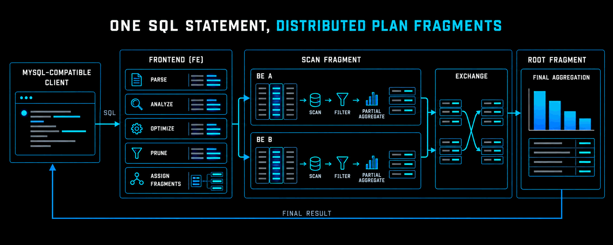
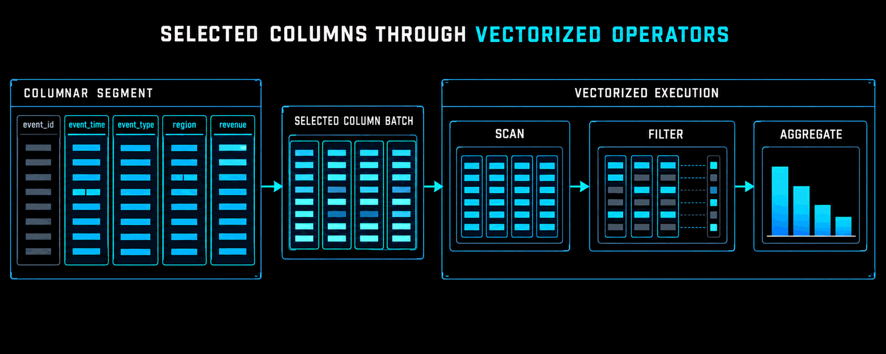
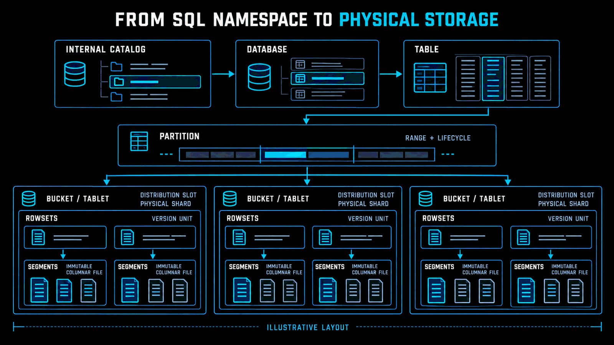
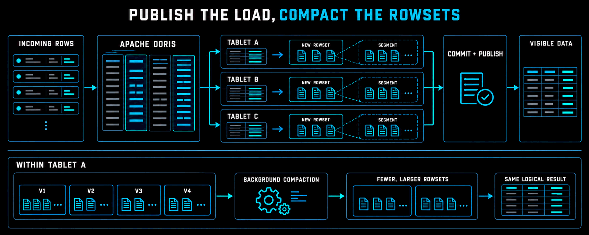
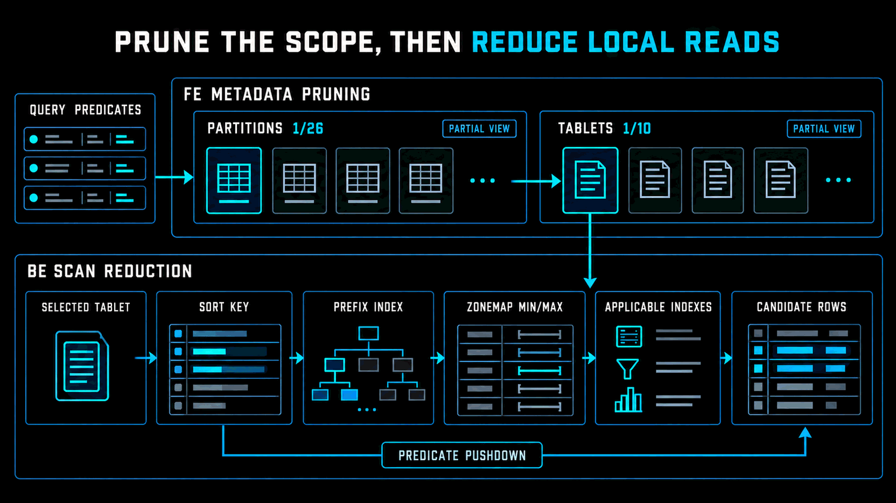

<a id="unit-u.57c3c32ddc9e4ffcb2b95a02f6d1c635"></a>

<a id="module-2-deep-dive-into-apache-doris-architecture"></a>

# 2-модуль: Apache Doris архитектурасын тереңірек зерттеу

| Курс туралы ақпарат | Мән |
| --- | --- |
| Курс | Apache Doris көмегімен нақты уақыттағы аналитика · 1-деңгей |
| Doris | Apache Doris 4.1.3 |
| Орта | Курс сынақ ортасы және 1-зертханалық жұмыстың `events` кестесі |
| Болжамды уақыт | Шамамен 75 минут: оқу 40, зертханалық жұмыс 25, тест 10 |

[Курстың README файлы](../../README.md) · [2-зертханалық жұмысты ашу](lab02_scan_less_data.ipynb) · [2-тестті ашу](quiz02_doris_architecture_and_physical_design.ipynb)

<a id="unit-u.bc03bdf3312c4696918b323c4516befd"></a>

<a id="module-goal"></a>

## Модуль мақсаты

Сұрауды FE жоспарынан BE сканерлеулеріне дейін қадағалаңыз және Doris кестені сақтау тәсілі сұраудың қанша дерек оқуын қалай анықтайтынын көріңіз.

<a id="unit-u.6684d4b91117453e944bd99cecaf3e60"></a>

<a id="learning-objectives"></a>

## Оқу мақсаттары

Осы модульді аяқтағаннан кейін сіз:

1. Сұрауды FE жоспарлауынан оның жоспар фрагменттері арқылы BE түйіндерінде орындалуына дейін қадағалай аласыз.
2. Бағандық сақтау мен векторлық орындау талдамалық сканерлеу жұмысын қалай азайтатынын түсіндіре аласыз.
3. Table, Partition, Tablet, Rowset және Segment иерархиясын және Compaction неліктен Rowset жиынтықтарын біріктіретінін түсіндіре аласыз.
4. Duplicate Key, Unique Key және Aggregate Key модельдерінің қайталанатын кілттерді қалай өңдейтінін сипаттай аласыз.
5. Partition бөлу, bucket-терге бөлу, сұрыптау кілті және Prefix Index құралдарын әрқайсысы шешетін мәселе бойынша ажырата аласыз.
6. `EXPLAIN` және Query Profile арқылы жоспарланған іріктеуді нақты орындалған сканерлеу жұмысынан ажырата аласыз.

<a id="unit-u.1a22af9cfd6b4fe6923d687d8d13d3cc"></a>

<a id="module-structure"></a>

## Модуль құрылымы

| Бөлім | Уақыт | Нәтиже |
| --- | ---: | --- |
| 2.1 SQL-ден үлестірілген Pipeline тізбектеріне дейін | 7 мин | Бір сұрау арқылы FE жоспарлауы мен BE орындауын қадағалау |
| 2.2 Бағандық және векторлық өңдеу | 6 мин | Doris неліктен бағандарды оқып, мәндерді топтамамен өңдейтінін түсіндіру |
| 2.3 Doris сақталған деректерді қалай ұйымдастырады | 8 мин | Кестені оның Partition, Tablet, Rowset және Segment иерархиясымен байланыстыру |
| 2.4 Жүктеу транзакциялары және Compaction | 6 мин | Жүктеуді жаңа Rowset жиынтықтарымен, оның көрінуімен және Compaction үдерісімен байланыстыру |
| 2.5 Кесте модельдері және қайталанатын кілттер | 5 мин | Әр кесте моделінің қайталанатын кілтпен не істейтінін болжау |
| 2.6 Doris артық жұмысты қалай өткізіп жібереді | 8 мин | Partition іріктеуін, Tablet іріктеуін және Tablet ішіндегі сканерлеуді азайтуды ажырату |
| 2-зертханалық жұмыс | 25 мин | Сол 10,158,080 жолдың физикалық құрылымын өзгертіп, жоспарлар мен сканерлеулерді салыстыру |
| 2-тест | 10 мин | Осы мақсаттар бойынша алты сұрақ |

<a id="unit-u.5c420da69cc54e118b2a5feb1e55f21f"></a>

<a id="21-from-sql-to-distributed-pipelines"></a>

## 2.1 SQL-ден үлестірілген Pipeline тізбектеріне дейін

1-модуль компоненттер шекарасын таныстырды: FE **үлестірілген сұрау жоспарын** құрып, оңтайландырады, содан кейін оның **жоспар фрагменттерін** BE түйіндеріне тағайындайды. BE түйіндері **тағайындалған жоспар фрагменттерін** орындайды. Бұл бөлім сол жолды егжей-тегжейлі қарастырады.

Курстың оқиғалар кестесіне сұрауды қарастырайық:

```sql
SELECT
    region,
    SUM(revenue) AS total_revenue
FROM events
WHERE event_time >= '2020-03-01 00:00:00'
  AND event_time <  '2020-03-02 00:00:00'
  AND event_type = 'purchase'
GROUP BY region;
```

Клиент бір SQL операторын жібереді, бірақ үлестірілген Doris кластері бүкіл операторды бір бөлінбейтін тапсырма ретінде орындамайды.

<a id="unit-u.2d0d200dd64b4c5e950fc054e1fbd2f0"></a>

<a id="fe-create-the-distributed-query-plan"></a>

### FE: үлестірілген сұрау жоспарын құру

FE SQL қабатының жұмысын орындайды:

1. **Синтаксистік және мағыналық талдау:** SQL құрылымын тану, атаулар мен типтерді анықтау және рұқсаттарды тексеру.
2. **Қайта жазу және оңтайландыру:** физикалық операторларды таңдау және ықтимал орындау стратегияларын салыстыру.
3. **Метадеректер бойынша іріктеу:** үйлесімді предикаттарды қанағаттандыра алмайтын Partition және Tablet нысандарын алып тастау.
4. **Үлестірілген сұрау жоспарын құру:** сканерлеу, сүзу, агрегаттау, деректер алмасу және нәтиже жинауды орналастыру.
5. **Жоспар фрагменттерін тағайындау:** тиісті жұмысты орындай алатын BE түйіндеріне жіберу.

**Жоспар фрагменті** — үлестірілген сұрау жоспарының таратуға болатын бөлігі. Мысалы, бір жоспар фрагменті бірнеше BE-де жолдарды сканерлеп, ішінара агрегаттауы мүмкін, ал екіншісі сол ішінара нәтижелерді қабылдап, агрегаттауды аяқтайды.

Терминдер Doris құжаттарында, `EXPLAIN` нәтижесінде және бастапқы кодта көрсетілетін атауларға былай сәйкес келеді:

| Курс термині | Doris жоспар термині | Байланысы |
| --- | --- | --- |
| Үлестірілген сұрау жоспары | `PLAN` / орындау жоспары | Бір SQL операторының толық физикалық жоспары |
| Жоспар фрагменті | `FRAGMENT` / `PlanFragment` | Толық жоспардың BE түйініне тағайындалған таратуға болатын бөлігі |
| Физикалық оператор | `PLAN NODE` / `PlanNode` | Жоспар фрагментінің ішіндегі сканерлеу, агрегаттау, біріктіру, алмасу немесе басқа амал |

Бұлар бір нысанның өзара алмастырылатын атаулары емес, бір құрылымның үш деңгейі.

<a id="unit-u.b9cb18174ca84c4ab0be9fca06dd6e38"></a>

<a id="be-execute-the-assigned-plan-fragments"></a>

### BE: тағайындалған жоспар фрагменттерін орындау

Қатысатын әр BE сканерлеу, сүзу, алмасу және агрегаттау сияқты физикалық операторлармен өзіне тағайындалған жоспар фрагменттерін орындайды. Келесі амал жолдарды қайта бөлуді немесе жинауды қажет етсе, **Exchange** аралық деректерді жоспар фрагменттері арасында тасымалдайды.



*Үлестірілген сұрау FE жоспарлауын BE фрагменттерінің орындалуынан және аралық деректер алмасуынан бөледі.*

Суреттегі ағылшын жазуларының сәйкестігі: One SQL statement, distributed plan fragments — бір SQL операторы, үлестірілген жоспар фрагменттері; MySQL-compatible client — MySQL үйлесімді клиент; Frontend (FE) — Frontend (FE); Parse — синтаксистік талдау; Analyze — мағыналық талдау; Optimize — оңтайландыру; Prune — артық деректер ауқымын алып тастау; Assign fragments — фрагменттерді тағайындау; Scan fragment — сканерлеу фрагменті; BE A, BE B — A және B BE түйіндері; Scan — сканерлеу; Filter — сүзу; Partial aggregate — ішінара агрегаттау; Exchange — деректер алмасу; Root fragment — түбірлік фрагмент; Final aggregation — соңғы агрегаттау; Final result — соңғы нәтиже. SQL өзгермейді. Суреттің түпнұсқа ағылшын жазулары сақталған.

Бұл — **жаппай параллель өңдеу (MPP)**: жұмыс BE түйіндері арасында таратылады. Бір BE ішінде **Pipeline орындау қозғалтқышы** операторларды CPU ядролары арасында параллель тапсырмалар ретінде жоспарлайды. MPP кластер көлеміндегі параллельдікті сипаттайды; Pipeline орындауы әр BE ішінде жұмыстың қалай тиімді жоспарланатынын сипаттайды.

Бастапқы код та осы шекараны көрсетеді. FE жоспарлау коды фрагменттерді орындау параметрлерін жасайды, ал BE ішкі қызметі кіріс фрагменттерін Pipeline орындауына арналған фрагмент менеджеріне жібереді. Жобаның [бастапқы код репозиторийін](https://github.com/apache/doris) және BE [`internal_service.cpp`](https://github.com/apache/doris/blob/4.1.3/be/src/service/internal_service.cpp) файлын қараңыз.

> **Түсіну үлгісі:** FE қандай үлестірілген жұмыс қайда орындалуы керектігін шешеді. BE түйіндері тағайындалған сканерлеу, сүзу, алмасу, біріктіру және агрегаттау жұмысын орындайды.

<a id="unit-u.180b78fe35b44317b2326c9bb5a7edcb"></a>

<a id="22-columnar-and-vectorized-processing"></a>

## 2.2 Бағандық және векторлық өңдеу

Талдамалық сұраулар көбіне көптеген жолдың шағын бағандар жиынын оқиды. Мысал сұрауға `event_time`, `event_type`, `region` және `revenue` қажет; оған `event_id`, `user_id` немесе `product_id` қажет емес.

<a id="unit-u.f9d13da5e2fc4b71bd7eb5fdb43bd431"></a>

<a id="row-oriented-and-column-oriented-access"></a>

### Жолдық және бағандық қатынау

Жолдық орналасуда бір жолдың мәндері бірге сақталады. Сұрау аз ғана жолдың көптеген бағандарын алғанда немесе өзгерткенде бұл пайдалы.

```text
Row 1: event_time | event_id | user_id | event_type | region | revenue
Row 2: event_time | event_id | user_id | event_type | region | revenue
```

Бағандық орналасуда бір бағанның мәндері бірге сақталады.

```text
event_time:  t1 | t2 | t3 | ...
event_type:  view | cart | purchase | ...
region:      region_01 | region_03 | region_01 | ...
revenue:     0.00 | 0.00 | 42.50 | ...
```

Doris ішкі кестелері әдепкіде бағандық сақтауды пайдаланады. Бұл тәсіл талдамалық сұрауларға үш жолмен көмектеседі:

- **Бағандарды іріктеу:** сканерлеу тек сұрауға қажетті бағандарды оқиды.
- **Сығу:** типі бірдей және таралуы ұқсас іргелес мәндер көбіне тиімді сығылады.
- **CPU деректерінің жақындығы:** мәндердің тығыз тізбегін толық жолдарды қайта-қайта ашпай өңдеуге болады.

<a id="unit-u.64c89f771ff24736aa7db6ad60260e93"></a>

<a id="vectorized-execution"></a>

### Векторлық орындау

Векторлық орындау әр жолы бір толық жолды түсіндірудің орнына операторлар арасында баған мәндерінің топтамасын өткізеді. `event_type` мәндерінің топтамасын сүзу немесе `revenue` мәндерінің топтамасын қосу әр жолға кететін қосымша шығынды азайтады және сәйкес жағдайда CPU векторлық нұсқауларын пайдалана алады.



*Бағандарды таңдау сақтау орнынан оқуды азайтады; векторлық операторлар таңдалған мәндерді топтамалармен өңдейді.*

Сурет жазулары: Selected columns through vectorized operators — таңдалған бағандардың векторлық операторлар арқылы өтуі; Columnar segment — бағандық Segment; Selected column batch — таңдалған бағандар топтамасы; Vectorized execution — векторлық орындау; Scan — сканерлеу; Filter — сүзу; Aggregate — агрегаттау. event_id, event_time, event_type, region, revenue баған атаулары өзгермейді. Суреттің ағылшын түпнұсқасы сақталған.

Бағандық сақтау мен векторлық орындау өзара байланысты, бірақ әртүрлі міндеттерді шешеді. Бағандық сақтау сақтау орнынан оқылатын байттарды азайтып, ұйымдастырады; векторлық орындау операторлардың сол мәндерді жадта өңдеуін жақсартады.

Doris кең нүктелік сұраулар басым жұмыс жүктемелеріне арналған қосымша жолдық сақтау көшірмесін де қолдайды. Бұл аралас мүмкіндік әдепкі талдамалық модельді өзгертпейді: бағандық көшірме қолжетімді болып қалады, ал басқа көріністі қосу сақтау мен жазу шығындары арасындағы таңдауды талап етеді. Ресми [сақтау құрылымына шолуды](https://doris.apache.org/docs/4.x/table-design/storage-layout-overview/) қараңыз.

<a id="unit-u.623b7340de2941b7856eac2dbb8c2784"></a>

<a id="23-how-doris-organizes-stored-data"></a>

## 2.3 Doris сақталған деректерді қалай ұйымдастырады

Doris алдымен деректерге логикалық атаулар кеңістігі арқылы атау береді:

Логикалық атаулар кеңістігінде Internal Catalog, оның дерекқорлары және олардың кестелері бар.

Мысалдар `internal.doris_course.events` пайдаланады:

- `internal` — Doris ішкі кестелеріне арналған Catalog.
- `doris_course` — дерекқор.
- `events` — кесте.

Ішкі кестенің ішінде деректер физикалық түрде ұйымдастырылады:



*Иерархия өмірлік цикл шекараларын, физикалық таратуды, нұсқа бірліктерін және өзгермейтін файлдарды ажыратады.*

Сурет жазулары: From SQL namespace to physical storage — SQL атаулар кеңістігінен физикалық сақтауға дейін; Internal Catalog — ішкі Catalog; Database — дерекқор; Table — кесте; Partition — бөлім; Range + lifecycle — ауқым және өмірлік цикл; Bucket / Tablet — bucket ұяшығы / Tablet; Distribution slot — тарату ұяшығы; Physical shard — физикалық шард; Rowsets — Rowset жиынтықтары; Version unit — нұсқа бірлігі; Segments — Segment файлдары; Immutable columnar file — өзгермейтін бағандық файл; Illustrative layout — түсіндірмелік орналасу сызбасы. Суреттің ағылшын түпнұсқасы сақталған.

<a id="unit-u.130bcd93e54b4f099b23512706c319c2"></a>

<a id="partition"></a>

### Partition

**Partition** — әдетте уақытпен немесе басқа өмірлік цикл шекарасымен анықталатын кестенің логикалық ішкі жиыны. Күнделікті оқиғалар кестесінде әр күнге бір Partition болуы мүмкін.

Partition бөлу екі негізгі міндетті қолдайды:

- мерзімі өткен деректерді Partition бойынша жою сияқты өмірлік цикл амалдары;
- FE сәйкес келмейтін Partition бөлімдерін үлестірілген сұрау жоспарынан алып тастай алатын ірі ауқымды іріктеу.

Partition бөлу міндетті емес. Айқын бөлінбеген кестеде де бір әдепкі Partition бар.

Partition бөлімдерін алдын ала жариялауға немесе деректерден жасауға болады. 2-зертханалық жұмыс **Auto Partitioning** пайдаланады: `AUTO PARTITION BY RANGE (date_trunc(event_time,
'day'))` кезінде жүктелген жолға сол күн алғаш қажет болғанда Doris күндік Partition жасайды, сондықтан 26 күн оқиғалары жүктелген кесте 26 Partition алады. 4-модуль (Apache Doris жүйесінде деректерді модельдеу) Partition жасау тәсілдерін салыстырады.

<a id="unit-u.50415795789e42f4b3b3cd0dfbc23222"></a>

<a id="bucket-and-tablet"></a>

### Bucket және Tablet

Әр Partition bucket-терге бөлу ережесі бойынша бөлінеді. **Bucket** — сол ереже жасайтын ұяшық; оған сәйкес физикалық деректер шарды — **Tablet**. Кестеде 26 Partition және әр Partition ішінде 10 Bucket болса, онда 260 Tablet бар.

Hash арқылы bucket-терге бөлу бірдей bucket кілті мәндерін детерминді түрде бір Bucket-ке орналастырады. Бұл FE түйініне үйлесімді теңдік предикаттары үшін Tablet нысандарын іріктеуге мүмкіндік береді. Random bucket бөлу кіріс жолдарды bucket кілтінсіз таратады, сондықтан дәл сондай кілтке негізделген bucket (tablet) іріктеуін қамтамасыз ете алмайды.

Tablet — деректерді тарату, теңгеру және параллель сканерлеудің негізгі бірлігі. Сақтау мен есептеуі біріктірілген архитектурада Tablet репликалары BE түйіндерінде орналасуы мүмкін. Бір түйінді сынақ ортасы бір реплика пайдаланады. Өндірістік орналастыру реплика санын қолжетімділік пен сақтау талаптарына қарай таңдайды.

<a id="unit-u.593f0c7f955e4e158e852a74535376e7"></a>

<a id="rowset"></a>

### Rowset

**Rowset** — бір Tablet ішіндегі нұсқаланған деректер жиынтығы. Бір жүктеу транзакциясы көптеген Tablet-ке тиіп, әр әсер етілген Tablet ішінде Rowset жасай алады. Ол бүкіл кестеге ортақ бір жаһандық Rowset жасамайды.

<a id="unit-u.2f7e383d5d914a02aff63308909cc71f"></a>

<a id="segment"></a>

### Segment

**Segment** — Rowset ішіндегі өзгермейтін бағандық деректер файлы. Ол баған деректерін, метадеректерді және сканерлеу кезінде қолданылатын индекс құрылымдарын қамтиды. Жазудың көлемі мен пішініне қарай Rowset бірнеше Segment қамтуы мүмкін.

Бұл атаулар өзара алмастырылмайды:

| Ұғым | Негізгі міндеті |
| --- | --- |
| Table | SQL нысаны және схема |
| Partition | Логикалық ауқым және өмірлік цикл шекарасы |
| Bucket | Partition ішіндегі тарату ережесі |
| Tablet | Bucket ұяшығына сәйкес физикалық шард |
| Rowset | Бір Tablet ішіндегі нұсқа бірлігі |
| Segment | Rowset ішіндегі өзгермейтін бағандық файл |

[Partition және bucket бөлу ұғымдарын](https://doris.apache.org/docs/4.x/table-design/data-partitioning/basic-concepts/) және [деректерді bucket-терге бөлуді](https://doris.apache.org/docs/4.x/table-design/data-partitioning/data-bucketing/) қараңыз.

<a id="unit-u.bfe84fbece5b4384ba647cfafba2e226"></a>

<a id="24-load-transactions-and-compaction"></a>

## 2.4 Жүктеу транзакциялары және Compaction

Сәтті жүктеу көптеген физикалық нысанды өзгертеді, бірақ бір транзакциялық нәтиже ретінде көрінетін болады.

<a id="unit-u.c5d7131f96e34f4a8affa1aa0b6e36be"></a>

<a id="from-incoming-rows-to-a-visible-version"></a>

### Кіріс жолдардан көрінетін нұсқаға дейін

Жалпы алғанда, біріктірілген жазу жолы мынадай:

1. Doris әр кіріс жолдың мақсатты Partition бөлімін анықтайды.
2. Bucket-терге бөлу ережесі жолды Tablet нысанына бағыттайды.
3. BE мақсатты Tablet үшін жолдарды буферлейді және ұйымдастырады, соның ішінде кестенің Key бағандары бойынша сұрыптайды.
4. Буферленген деректерді шығару Rowset ішінде өзгермейтін Segment файлдарын жасайды.
5. Жүктеу транзакциясы бекітіліп, көрінетін нұсқасын жариялайды.
6. Сұраулар жаңадан бекітілген деректерді оқи алады.



*Жариялау транзакцияны көрінетін етеді; кейінгі Compaction әр Tablet ішіндегі оқу көлемінің ұлғаюын азайтады.*

Сурет жазулары: Publish the load, compact the rowsets — жүктеуді жариялау, Rowset жиынтықтарын біріктіру; Incoming rows — кіріс жолдар; Apache Doris — Apache Doris; Tablet A/B/C — A/B/C Tablet нысандары; New rowset — жаңа Rowset; Segment — Segment файлы; Commit + publish — бекіту және жариялау; Visible data — көрінетін деректер; Within Tablet A — A Tablet ішінде; V1/V2/V3/V4 — нұсқа белгілері; Background compaction — фондық Compaction; Fewer, larger rowsets — саны аз, көлемі үлкен Rowset жиынтықтары; Same logical result — сол логикалық нәтиже. Суреттің ағылшын түпнұсқасы сақталған.

Rowset және Segment нақты саны — сақтау қозғалтқышының нәтижесі; қолданба оны тек SQL операторларының санынан шығармауы тиіс. Негізгі байланыс: нұсқалар Tablet нысандарына тиесілі, ал Segment — Rowset ішіндегі өзгермейтін файлдар.

<a id="unit-u.229c5aa531ef4ebbb77fa0de6a7fb38b"></a>

<a id="why-compaction-is-necessary"></a>

### Compaction неліктен қажет

Жиі шағын жүктеулер Tablet ішінде көптеген шағын Rowset қалдыруы мүмкін. Содан кейін сұрау көбірек кірісті ашып, үйлестіруі тиіс, бұл оқу көлемінің ұлғаюын және метадеректер шығынын арттырады.

**Compaction** — бір Tablet ішіндегі Rowset жиынтықтарын таңдап, оларды саны аз, көлемі үлкен Rowset жиынтықтарына қайта жазатын фондық BE амалы. Кесте моделіне қарай Compaction қайталанатын кілттердің мағынасын да қолданып, ескірген деректерді тазалайды. Ол өзара байланыссыз Tablet нысандарының деректерін біріктірмейді және логикалық сұрау нәтижесін өзгертпейді.

Compaction жұмыстың екі түрін теңгереді: Rowset қайта жазылғандағы қосымша фондық енгізу/шығару және кейінгі сұраулар үшін оқу көлемінің азырақ ұлғаюы. Сондықтан дұрыс жұмыс істейтін жүйе әр жеке жазудан кейін біріктірудің орнына Compaction үдерісін автоматты басқарады.

`SHOW TABLETS` көрінетін нұсқалар және `VersionCount` сияқты, нұсқалардың жиналуын анықтауға көмектесетін өрістерді көрсетеді. `VersionCount` — пайдалану кезіндегі дәлел; ол Rowset немесе Segment санының тікелей есебі емес.

Ресми [Compaction қағидалары](https://doris.apache.org/docs/4.x/admin-manual/trouble-shooting/compaction-principles/) және [Деректерді Compaction арқылы біріктіру](https://doris.apache.org/docs/4.x/key-features/data-compaction/) сақтау қозғалтқышының әрекетін тереңірек сипаттайды.

<a id="unit-u.baeb159923604885a475d1a3d4c378e0"></a>

<a id="25-table-models-and-repeated-keys"></a>

## 2.5 Кесте модельдері және қайталанатын кілттер

Әр Doris ішкі кестесінің **кесте моделі** бар. Сол кілт мәндерімен тағы бір жол келгенде кілттің нені білдіретінін модель анықтайды.

Мына үш кіріс жолды пайдаланыңыз:

```text
user_id | event_date | revenue
1001    | 2026-01-01 | 10.00
1002    | 2026-01-01 | 20.00
1001    | 2026-01-01 | 15.00   <- repeated Key
```

<a id="unit-u.7c7bf4f61ee9432b8279366035a94beb"></a>

<a id="duplicate-key-model"></a>

### Duplicate Key моделі

Duplicate Key моделі әр кіріс жолды сақтайды. Оның кілт бағандары сұрыптау кілтін анықтайды; олар бірегейлік шектеуін құрмайды.

```text
1001 | 2026-01-01 | 10.00
1001 | 2026-01-01 | 15.00
1002 | 2026-01-01 | 20.00
```

Бұл модель оқиғалар мен журналдар сияқты үстемелеп қосылатын егжей-тегжейлі деректерге сай келеді. Сондықтан Doris `DUPLICATE KEY` MySQL `PRIMARY KEY` кілтіне баламалы емес.

<a id="unit-u.c67677faaff34563a5476b0039362e78"></a>

<a id="unique-key-model"></a>

### Unique Key моделі

Unique Key моделі әр кілтке бір логикалық жол көрсетеді. Сол кілтке кейінірек жасалған upsert алдыңғы логикалық жолды ауыстырады.

```text
1001 | 2026-01-01 | 15.00
1002 | 2026-01-01 | 20.00
```

Бұл модель өзгеретін нысан күйіне немесе бизнес кілттің соңғы мәні көрінуі тиіс CDC арқылы жаңаратын кестелерге сай келеді.

<a id="unit-u.47e16c102b434797aa525154aa5507d3"></a>

<a id="aggregate-key-model"></a>

### Aggregate Key моделі

Aggregate Key моделі мән бағандарын DDL-де жарияланған агрегаттау функциясына сәйкес біріктіреді. `revenue` бағанына `SUM` жарияланса, қайталанатын кілттер мынаны береді:

```text
1001 | 2026-01-01 | 25.00
1002 | 2026-01-01 | 20.00
```

Мән бағандары үшін қолдау көрсетілетін басқа әрекеттерге `MIN`, `MAX` және `REPLACE` сияқты функциялар кіреді; арнайы типтер қосымша агрегаттау функцияларын қолдайды. Функция тек сұрау кезінде қосылатын нұсқау емес, сақталатын деректер келісімінің бөлігі болып табылады.

<a id="unit-u.3b94da44494a4f208c3c12c0758ae623"></a>

<a id="choose-by-row-semantics"></a>

### Жолдардың мағынасына қарай таңдау

| Талап | Бастапқы кесте моделі | Қайталанатын кілт әрекеті |
| --- | --- | --- |
| Әр бастапқы оқиғаны сақтау | Duplicate Key моделі | Барлық жолды сақтау |
| Әр бизнес кілтке бір ағымдағы жол ұстау | Unique Key моделі | Соңғы жолды көрсету |
| Кілт бойынша алдын ала агрегатталған метриканы сақтау | Aggregate Key моделі | Жарияланған мән бағандарын біріктіру |

Үш модель де сұрыптау үшін кілт бағандарын пайдалана алады. Модель таңдауы алдымен қажетті жол мағынасына сәйкес келуі тиіс; сұрауды жеделдету дұрыстықтан кейін келеді.

Ресми [Duplicate Key моделі](https://doris.apache.org/docs/4.x/table-design/data-model/duplicate/), [Unique Key моделі](https://doris.apache.org/docs/4.x/table-design/data-model/unique/) және [Aggregate Key моделі](https://doris.apache.org/docs/4.x/table-design/data-model/aggregate/) құжаттарын қараңыз.

<a id="unit-u.ad6ca07cc5af4bfba5dea8a0139b9ae7"></a>

<a id="26-how-doris-skips-work"></a>

## 2.6 Doris артық жұмысты қалай өткізіп жібереді

Жылдам аналитика сканерленген деректерді тез өңдеумен ғана шектелмейді. Ол физикалық деректер предикатқа сәйкес келе алмайтынын дәлелдеп, сол жұмысты мүлде орындамауды да қамтиды.

<a id="unit-u.e533920a50cc4539becf83cb839b4488"></a>

<a id="four-design-tools-four-responsibilities"></a>

### Құрылымның төрт құралы, төрт міндет

| Құрылым құралы | Ауқымы | Негізгі міндеті | Пайдасының мысалы |
| --- | --- | --- | --- |
| Partition бөлу | Кестенің өмірлік циклі және ірі деректер ауқымы | Деректерді логикалық шекараларға бөлу | Бір күндік предикат бір күндік Partition таңдайды |
| Hash арқылы bucket-терге бөлу | Әр Partition ішіндегі тарату | Жолдарды тұрақты кілтпен орналастырып, параллель жұмысты теңгеру | `user_id = 610871788` әр Partition ішінен бір сәйкес Tablet таңдай алады |
| Сұрыптау кілті | Tablet ішіндегі жол реті | Жиі сүзілетін бағандарды бірге топтау | Кілттің басындағы `user_id` сүзгісі жергілікті кілт ауқымдарын тарылтады |
| Prefix Index | Сұрыптау кілтінің бастапқы префиксі бойынша сирек индекс | Таңдалған Tablet ішіндегі үміткер жол ауқымдарын табу | Бастапқы кілт мәндері сәйкес келе алмайтын ауқымдарды өткізіп жіберу |

Бұл құралдар бірін-бірі толықтырады. Уақыт Partition бөлімі әр сүзгі үшін жақсы сұрыптау кілтін алмастыра алмайды. Басқа баған схеманың кейінгі жерінде кездеседі екен деп Prefix Index тұтас Tablet-ті алып тастай алмайды.

<a id="unit-u.4960f43cb1d44d6f97e0e998515907d6"></a>

<a id="prefix-index-and-leading-key-filters"></a>

### Prefix Index және кілттің басындағы бағандар бойынша сүзгілер

Doris сұрыптау кілтінің басынан сирек **Prefix Index** автоматты түрде құрады. Индекстелетін префикс қолдау көрсетілетін типтермен және индекс ұзындығымен шектеледі, сондықтан Key бағандарының реті маңызды.

Екі кестеде бірдей жолдар бар делік:

```sql
-- Baseline sort key
DUPLICATE KEY(event_time, event_id, user_id)

-- User-first sort key
DUPLICATE KEY(user_id, event_time, event_id)
```

`user_id` бойынша теңдік сүзгісі екінші кестенің сұрыптау кілтінің бастапқы префиксіне сәйкес келеді. Тек уақыт бойынша ауқым бірінші кестенің сұрыптау кілтінің бастапқы префиксіне сәйкес келеді. Бір ретті таңдау ымыраға әкеледі; ұзынырақ сұрыптау кілті әр предикатты бірдей тиімді етпейді.

[Prefix Index құжаты](https://doris.apache.org/docs/4.x/table-design/index/prefix-index/) автоматты индексті және оның префикс шектеулерін сипаттайды.

<a id="unit-u.3a0743a38bb64e7eb09c1f5a6811e57d"></a>

<a id="fe-pruning-and-be-scan-reduction"></a>

### FE іріктеуі және BE сканерлеуін азайту

Сұрау жолында деректерді азайтудың екі деңгейі бар:

1. **FE іріктеуі:** үлестірілген сұрау жоспарын құрғанда FE метадеректер арқылы Partition және Tablet нысандарын алып тастайды.
2. **BE сканерлеуін азайту:** тағайындалған жоспар фрагменттерін орындағанда BE таңдалған Tablet ішіндегі кіші деректер ауқымдарын өткізіп жіберу үшін сұрыптау кілтін, Prefix Index, Min/Max метадеректерін (ZoneMap) және қолдануға болатын қосымша индекстерді пайдаланады.

Бұл тұжырым маңызды. **Предикатты төменге итеру** BE әр жолды кейінгі Filter операторына жіберудің орнына предикатты сақтау орнына жақын сканерлеу операторында есептейтінін білдіреді. Бұл FE міндетті түрде Partition немесе Tablet алып тастады дегенді білдірмейді.



*FE жоспарланған сканерлеу ауқымын қысқартады; BE сол ауқым ішінде оқылатын аралықтарды азайтады.*

Сурет жазулары: Prune the scope, then reduce local reads — алдымен ауқымды іріктеп, содан кейін жергілікті оқуларды азайту; Query predicates — сұрау предикаттары; FE metadata pruning — FE метадеректер бойынша іріктеуі; Partitions 1/26 — 26 бөлімнің 1-і; Tablets 1/10 — 10 Tablet-тің 1-і; Partial view — ішінара көрініс; BE scan reduction — BE сканерлеуін азайту; Selected tablet — таңдалған Tablet; Sort key — сұрыптау кілті; Prefix Index — префикстік индекс; ZoneMap Min/Max — ZoneMap минимум/максимум мәндері; Applicable indexes — қолдануға болатын индекстер; Candidate rows — үміткер жолдар; Predicate pushdown — предикатты төменге итеру. Түпнұсқа сурет ағылшын тілінде сақталған.

<a id="unit-u.03a4b7cefb064db79bf3153ca6f8bcbe"></a>

<a id="read-explain-as-planned-evidence"></a>

### `EXPLAIN` нәтижесін жоспар дәлелі ретінде оқу

`EXPLAIN` талдамалық сұрауды орындамай, үлестірілген сұрау жоспарын көрсетеді. OLAP сканерлеуінде мынадай дәлелдерді іздеңіз:

```text
partitions=1/26
tablets=1/10
PREDICATES: event_time >= ... AND user_id = ...
```

- `partitions=1/26` FE 26 Partition ішінен біреуін таңдағанын білдіреді.
- `tablets=1/10` FE сол Partition ішіндегі 10 Tablet-тің біреуін таңдағанын білдіреді. Бөлім тек таңдалған Partition ішіндегі Tablet санын есептейді: барлық 26 күндегі тек пайдаланушы сүзгісі `tablets=26/260` көрсетеді.
- `PREDICATES` сканерлеу жағындағы предикат есептеуін көрсетеді; бұл таңдалған/жалпы іріктеу қатынастарынан бөлек.

Жоспар `partitions=26/26` көрсетсе, ешбір Partition алынбаған. Уақыт бойынша бөлінген кестедегі тек пайдаланушы предикаты үшін бұл дұрыс болуы мүмкін: Hash бөлу әр Partition ішіндегі Tablet санын азайтса да, сол пайдаланушы барлық күнде болуы ықтимал.

<a id="unit-u.7b87c9786fa347058aab6b2e3b45f93c"></a>

<a id="use-runtime-evidence-for-executed-work"></a>

### Орындалған жұмыс үшін орындалу кезіндегі дәлелдерді пайдалану

`EXPLAIN` жоспарланған сканерлеу ауқымын көрсетеді. Query Profile BE түйіндері тағайындалған жоспар фрагменттерін орындағанда не болғанын тіркейді. Сканерлеуге қатысты пайдалы дәлелдер:

- сканерлеу қарастырған жолдар;
- сканерлеу қарастырған байттар;
- сканерлеу жағындағы сүзуден кейін қайтарылған жолдар;
- сканерлеу мен оператор уақыты.

Метрика атаулары Doris нұсқасына қарай өзгеруі мүмкін, ал кэш күйі немесе Compaction нақты мәндерге әсер етеді. Бақыланатын сұрау жұптарын пайдаланыңыз:

1. деректер мен сұрау нәтижесін бірдей ұстаңыз;
2. физикалық құрылымның бір ғана таңдауын өзгертіңіз;
3. жоспардың таңдалған/жалпы қатынастарын және орындалу кезіндегі сканерлеу көлемін салыстырыңыз;
4. екі сұраудың бірдей нәтиже қайтаратынын растаңыз.

Ресми [Деректерді іріктеу](https://doris.apache.org/docs/4.x/key-features/data-pruning/), [`EXPLAIN`](https://doris.apache.org/docs/4.x/sql-manual/sql-statements/data-query/EXPLAIN/) және [Query Profile](https://doris.apache.org/docs/4.x/query-acceleration/query-profile/) құжаттары тексерудің толық жұмыс барысын береді.

<a id="unit-u.4d297a5ec368406aaf3f7a32cd5134c8"></a>

<a id="lab-2-make-doris-scan-less-data"></a>

## 2-зертханалық жұмыс: Doris сканерлейтін деректерді азайту

Зертханалық жұмыс физикалық құрылымды өзгерте отырып, логикалық деректер жиынын тұрақты ұстайды. Ол 1-зертханалық жұмыстың `doris_course.events` кестесіндегі барлық 10,158,080 жолды қайта пайдаланады, S3-тен оқымайды және оған жазбайды. Шамамен 25 минут жоспарлаңыз.

Сіз:

1. 1-зертханалық жұмыстың `events` кестесіне таңдалған әдепкі физикалық құрылымды тексересіз.
2. Кестені Partition, Tablet, Rowset және Segment иерархиясымен байланыстырасыз.
3. Сұрыптау кілтінің бастапқы бағаны `user_id` болатын `events_v2` құрасыз.
4. Бір Query Profile қолмен алып, содан кейін екі кестедегі пайдаланушы және уақыт сүзгілерінің сканерлеу санағыштарын салыстырасыз.
5. Күндік Auto Partitioning және `HASH(user_id)` bucket бөлуі бар `events_v3` құрасыз.
6. Сақтау метадеректері арқылы жүктеу транзакцияларын, Tablet нұсқаларын және Compaction үдерісін байланыстырасыз.
7. `EXPLAIN` арқылы FE Partition іріктеуі мен bucket (tablet) іріктеуін салыстырасыз.
8. Сканерлеу ауқымының кішіреюі сұрау нәтижесін өзгертпейтінін тексересіз.
9. Бірдей қайталанатын кілттерді Duplicate Key, Unique Key және Aggregate Key модельдерін қолданатын кестелерге жүктеп, логикалық нәтижелерін салыстырасыз.

Ноутбукты ашыңыз:

[2-зертханалық жұмыс — Doris сканерлейтін деректерді азайту](lab02_scan_less_data.ipynb)

Зертханалық жұмыс жаттығумен аяқталады: аймақ сүзгісі қандай Partition және Tablet нысандарын алып тастай алатынын болжаңыз. Алдымен нәтижені болжаңыз, содан кейін бос ұяшыққа код жазыңыз; одан кейінгі жиналған үлгі шешім де Run All арқылы орындалып, зертханалық жұмыс кестелерін бастапқы күйінде қалдырады.

<a id="unit-u.ed391c7e73b042609e22a76156185e41"></a>

<a id="summary"></a>

## Қорытынды

- FE SQL синтаксисі мен мағынасын талдайды, метадеректер негізінде артық ауқымдарды алып тастайды, үлестірілген сұрау жоспарын құрып, оңтайландырады және оның жоспар фрагменттерін тағайындайды; BE түйіндері оларды физикалық операторлармен орындайды, ал Exchange операторлары аралық жолдарды фрагменттер арасында тасымалдайды.
- Бағандық сақтау сканерлеуге тек сұрау пайдаланатын бағандарды оқуға мүмкіндік береді, ал векторлық орындау жеке жолдардың орнына баған мәндерінің топтамаларын өңдейді: екеуі де үлкен талдамалық сканерлеу жұмысын азайтады.
- Кесте ішінде Partition бөлімдері жол ауқымдарын ұстайды, Partition бөлімінің әр Bucket ұяшығы — Tablet, әр жүктеу өзі жазатын Tablet-терге өзгермейтін Segment файлдарынан тұратын нұсқаланған Rowset қосады, ал фондық Compaction сұрау нәтижелерін өзгертпей Tablet ішіндегі Rowset жиынтықтарын біріктіреді.
- Duplicate Key моделі барлық жолды сақтайды, Unique Key моделі әр кілтке бір ағымдағы жол көрсетеді, ал Aggregate Key моделі бірдей кілтті жолдардың мән бағандарын біріктіреді.
- Partition бөлу ауқымдар мен өмірлік цикл шекараларын белгілейді, Hash арқылы bucket-терге бөлу жолдарды кілт бойынша орналастырады, сұрыптау кілті әр Tablet ішіндегі жолдарды реттейді, ал оның бастапқы бағандары бойынша Prefix Index сканерлеу оқитын жолдарды тарылтады.
- `EXPLAIN` `partitions=1/26` және `tablets=1/10` сияқты жоспарланған ауқымды көрсетеді; Query Profile сканерлеудің нені оқығанын көрсетеді; предикатты төменге итеру деректер ауқымын іріктеумен бірдей емес.

<a id="unit-u.e09859955a4142c39cc7e02ae5e50981"></a>

<a id="quiz-2-deep-dive-into-apache-doris-architecture"></a>

## 2-тест: Apache Doris архитектурасын тереңірек зерттеу

[2-тест: Apache Doris архитектурасын тереңірек зерттеу](quiz02_doris_architecture_and_physical_design.ipynb) ашыңыз.
Онда бір жауап таңдалатын алты сұрақ бар және жұмыс істеп тұрған орта қажет емес.

Келесі модуль: [3-модуль: Apache Doris жүйесіне деректерді жүктеу](../module03-loading-data/course.md).

<a id="unit-u.c9fbaf43b8194075a320d7051651c83b"></a>

<a id="references"></a>

## Анықтамалар

- [Apache Doris бастапқы код репозиторийі](https://github.com/apache/doris)
- [Жүйе архитектурасы](https://doris.apache.org/docs/4.x/features-architecture/system-architecture/)
- [Сақтау құрылымына шолу](https://doris.apache.org/docs/4.x/table-design/storage-layout-overview/)
- [Partition және Bucket бөлу ұғымдары](https://doris.apache.org/docs/4.x/table-design/data-partitioning/basic-concepts/)
- [Деректерді Bucket ұяшықтарына бөлу](https://doris.apache.org/docs/4.x/table-design/data-partitioning/data-bucketing/)
- [Auto Partitioning](https://doris.apache.org/docs/4.x/table-design/data-partitioning/auto-partitioning/)
- [Duplicate Key моделі](https://doris.apache.org/docs/4.x/table-design/data-model/duplicate/)
- [Unique Key моделі](https://doris.apache.org/docs/4.x/table-design/data-model/unique/)
- [Aggregate Key моделі](https://doris.apache.org/docs/4.x/table-design/data-model/aggregate/)
- [Prefix Index](https://doris.apache.org/docs/4.x/table-design/index/prefix-index/)
- [Деректерді іріктеу](https://doris.apache.org/docs/4.x/key-features/data-pruning/)
- [Compaction қағидалары](https://doris.apache.org/docs/4.x/admin-manual/trouble-shooting/compaction-principles/)
- [Деректерді Compaction арқылы біріктіру](https://doris.apache.org/docs/4.x/key-features/data-compaction/)
- [EXPLAIN](https://doris.apache.org/docs/4.x/sql-manual/sql-statements/data-query/EXPLAIN/)
- [Query Profile](https://doris.apache.org/docs/4.x/query-acceleration/query-profile/)
- [BE жоспар фрагментін орындауының бастапқы коды (Doris 4.1.3)](https://github.com/apache/doris/blob/4.1.3/be/src/service/internal_service.cpp)
