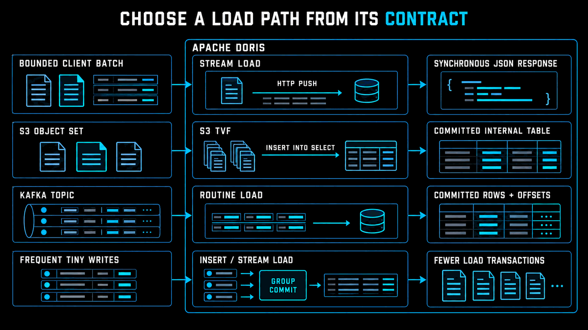
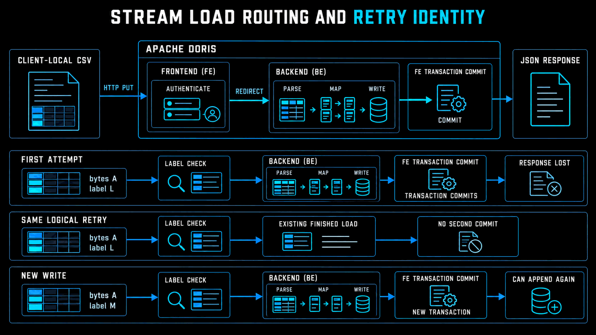
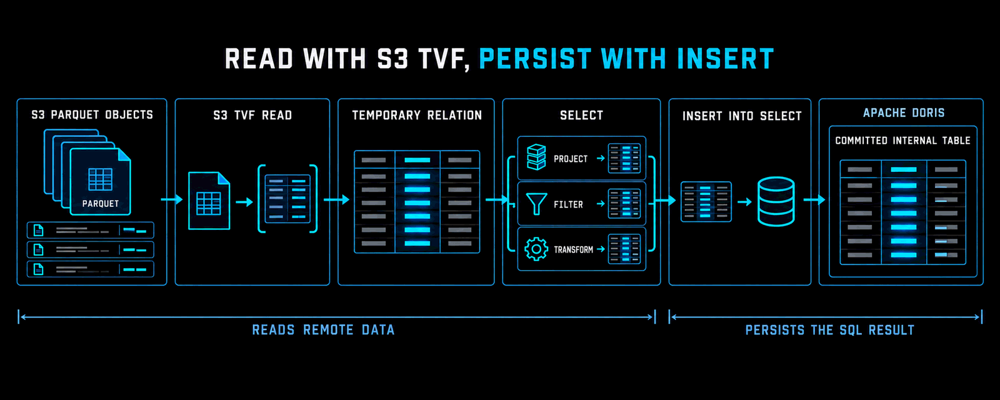
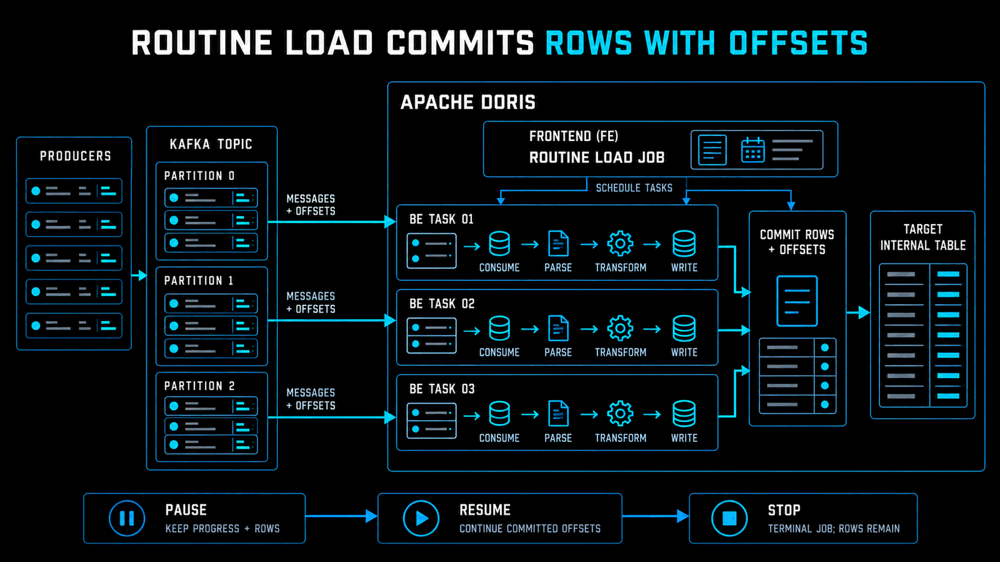
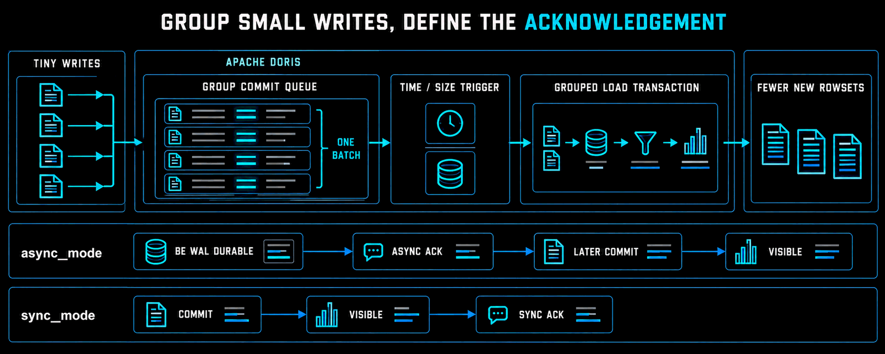

<a id="unit-u.a2f2dce8afde423ba5a0217bad854297"></a>

<a id="module-3-loading-data-into-apache-doris"></a>

# 3-модуль: Apache Doris жүйесіне деректерді жүктеу

| Курс туралы ақпарат | Мән |
| --- | --- |
| Курс | Apache Doris көмегімен нақты уақыттағы аналитика · 1-деңгей |
| Doris | Apache Doris 4.1.3 |
| Орта | 1-зертханалық жұмыстың курс сынақ ортасы; 3-зертханалық жұмыс Kafka брокерін де іске қосады |
| Болжамды уақыт | Шамамен 85 минут: оқу 45, зертханалық жұмыс 30, тест 10 |

[Курстың README файлы](../../README.md) · [3-зертханалық жұмысты ашу](lab03_load_data.ipynb) · [3-тестті ашу](quiz03_load_methods_and_retry_safety.ipynb)

<a id="unit-u.3664f67f5afa4fe3affac0706e3d1d81"></a>

<a id="module-goal"></a>

## Модуль мақсаты

Дереккөз бен оның тұтынушыларының талаптарына сай жүктеу әдісін таңдап, содан кейін әр жүктеу нәтижесін тексеріңіз және қайталауды қауіпсіз етіңіз.

Жүктеу — шарттар жиыны: деректердің қайда екені, шектелген бе әлде үздіксіз бе, қаншалықты тез көрінуі керектігі, қандай түрлендіру қажет екені, клиент қандай аяқталу дәлелін алатыны және қандай күй қайталауда сол деректерді екі рет жүктеуге жол бермейтіні.

<a id="unit-u.0d04634b74fe4a4da3aba8d71a3df6fe"></a>

<a id="learning-objectives"></a>

## Оқу мақсаттары

Осы модульді аяқтағаннан кейін сіз:

1. Жұмыс жүктемесінің дереккөзі, көлемі, кідірісі, түрлендіру және қайталау талаптары бойынша Doris жүктеу әдісін таңдай аласыз.
2. Stream Load, S3 TVF арқылы `INSERT INTO SELECT`, Routine Load және Group Commit рөлдерін түсіндіре аласыз.
3. Stream Load арқылы жергілікті CSV файлын жүктеп, оның синхронды JSON жауабын оқи аласыз.
4. S3 TVF арқылы Parquet нысандарына сұрау жасап, оларды `INSERT INTO SELECT` арқылы тұрақты сақтай аласыз.
5. Routine Load тапсырмасының Kafka хабарларын үздіксіз тұтынуға қашан сай келетінін және ілгерілеуді қалай қадағалайтынын түсіндіре аласыз.
6. Жүктелген және сүзілген жол сандарын тексеріп, қабылданбаған жүктеуді тани аласыз және топтаманы қауіпсіз қайталай аласыз.

<a id="unit-u.f918069e10e8454fae20405c281b6ab4"></a>

<a id="module-structure"></a>

## Модуль құрылымы

| Бөлім | Уақыт | Нәтиже |
| --- | ---: | --- |
| 3.1 Жұмыс жүктемесі шарты бойынша жүктеу әдісін таңдау | 7 мин | Дереккөз бен талаптарын жүктеу әдісіне сәйкестендіру |
| 3.2 Stream Load арқылы шектелген файлды жіберу | 10 мин | Талдауды, сәйкестендіруді, сапа сандарын және label негізіндегі қайталау қорғанысын түсіндіру |
| 3.3 S3 нысандарын оқу және SQL нәтижесін тұрақты сақтау | 7 мин | S3 TVF арқылы S3 оқуды жолдарды сақтайтын `INSERT INTO SELECT` операторынан ажырату |
| 3.4 Routine Load арқылы Kafka деректерін үздіксіз жүктеу | 10 мин | Ұзақ және қысқа тапсырмаларды, микротоптамаларды, бекітілген ығысуларды және тапсырма күйін түсіндіру |
| 3.5 Group Commit арқылы шағын жазулар қысымын азайту | 5 мин | Шағын жазуларды топтауды дереккөз коннекторынан ажырату |
| 3.6 Нәтижелерді тексеру және қауіпсіз қайталауды жобалау | 6 мин | Әр әдістің аяқталу, сапа және қайталау дәлелін таңдау |
| 3-зертханалық жұмыс | 30 мин | CSV файлын, Parquet нысандарын және Kafka JSON хабарларын үш әдіспен жүктеу |
| 3-тест | 10 мин | Осы мақсаттар бойынша алты сұрақ |

<a id="unit-u.5384046c40da4f1dba2619a71536d3f4"></a>

<a id="31-select-a-load-method-from-a-workload-contract"></a>

## 3.1 Жұмыс жүктемесі шарты бойынша жүктеу әдісін таңдау

Файл кеңейтімі жүктеу талабын толық сипаттамайды. CSV файлы ноутбуктан жүктелетін бес жол немесе қашықтағы сақтау орнындағы бірнеше терабайт нысандар жиыны болуы мүмкін. Екеуі де CSV жазбаларын қамтиды, бірақ пайдалану шарттары әртүрлі.

Жүктеу әдісін таңдамас бұрын мына сұрақтарды қарастырыңыз:

| Талап | Қойылатын сұрақ |
| --- | --- |
| Дереккөз | Деректер клиент хостында ма, объектілік сақтау орнында ма, әлде Kafka-ға келіп жатыр ма? |
| Көлем және шектелгендік | Бұл бір шектелген топтама, бекітілген нысандар жиыны, көптеген ұсақ жазу немесе үздіксіз ағын ба? |
| Кідіріс | Шақырушы қайтар алдында нәтижені білуі тиіс пе, әлде басқарылатын тапсырма деректерді асинхронды түрде көрінетін ете ала ма? |
| Жеткізу бағыты | Клиент байттарды жібере ме, Doris қашықтағы нысандарды оқи ма, әлде Doris хабарларды үздіксіз тұтына ма? |
| Түрлендіру | Бағандарды сәйкестендіру жеткілікті ме, әлде толық SQL сұрауы қажет пе? |
| Аяқталу дәлелі | Сәттілікті HTTP жауабы, SQL операторы немесе ұзақ жұмыс істейтін тапсырма күйі хабарлай ма? |
| Қайталау күйі | Doris label сақтай ма, оркестратор нысандар жиынын қадағалай ма, әлде тапсырма Kafka ығысуларын қадағалай ма? |

<a id="unit-u.9f2fbfb90cc847c588753f424b726dab"></a>

<a id="method-selection-map"></a>

### Әдісті таңдау картасы

| Жұмыс жүктемесінің шарты | Ұсынылатын бастапқы тәсіл | Шешуші талап |
| --- | --- | --- |
| Клиентте бір шектелген жергілікті CSV немесе JSON топтамасы бар және әр топтамаға дереу жауап қажет | Stream Load | Клиент байттарды жіберіп, синхронды транзакция және сапа дәлелін алады |
| Parquet нысандары S3 үйлесімді сақтау орнында бар және SQL оларды тексеруі немесе түрлендіруі тиіс | `INSERT INTO SELECT` арқылы S3 TVF | Doris уақытша қатынасты оқиды, ал бір SQL операторы оның нәтижесін тұрақты сақтайды |
| Kafka тақырыбына CSV немесе JSON хабарлары келіп тұрады | Routine Load | Doris басқаратын ұзақ жұмыс істейтін Kafka тұтынушы тапсырмасы үздіксіз ілгерілеуді сақтайды |
| Қолданба жиі ұсақ `INSERT INTO VALUES` немесе Stream Load жазуларын жібереді | Бар жазу әдісімен бірге Group Commit | Үйлесімді шағын жазулар сервер жағындағы саны аз жүктеу транзакцияларын ортақ пайдалануы тиіс |

Бұлар бір деректер құбырының төрт міндетті кезеңі емес, әртүрлі жүктемелер үшін таңдалатын баламалар. Мысалы, бекітілген Parquet нысандар жиынын көшіру үшін Routine Load тапсырмасы қажет емес, ал S3 TVF Kafka ығысуларын басқармайды.

<a id="unit-u.117a14d0333c44b0ba639f830b77da0c"></a>

<a id="bounded-and-continuous-sources"></a>

### Шектелген және үздіксіз дереккөздер

**Шектелген дереккөздің** соңы белгілі: бір клиент файлы, бір сұрау денесі немесе бір бекітілген нысандар жиыны. **Үздіксіз дереккөз** жүктеу басталғаннан кейін де жаңа жазбалар қабылдай алады.



*Дереккөз және аяқталу шарттары дербес жүктеу жолдарын таңдауға негіз болады.*

Сурет жазулары: Choose a load path from its contract — жүктеу жолын оның шартына сай таңдау; Bounded client batch — шектелген клиент топтамасы; S3 object set — S3 нысандар жиыны; Kafka topic — Kafka тақырыбы; Frequent tiny writes — жиі ұсақ жазулар; Apache Doris — Apache Doris; Stream Load — Stream Load; HTTP push — HTTP арқылы жіберу; Synchronous JSON response — синхронды JSON жауабы; S3 TVF — S3 TVF; INSERT INTO SELECT — INSERT INTO SELECT; Committed internal table — ішкі кестеге бекітілген деректер; Routine Load — Routine Load; Committed rows + offsets — бекітілген жолдар және ығысулар; INSERT / Stream Load — INSERT / Stream Load; Group Commit — Group Commit; Fewer load transactions — жүктеу транзакцияларының азаюы. Сурет ағылшын түпнұсқасында сақталған.

Төрт механизм де транзакциялық жазуға қатыса алады, бірақ басқару және аяқталу модельдері әртүрлі. Әр дереккөзді бір интерфейс арқылы өткізуге тырысудың орнына өндірушіге сай модельді таңдаңыз.

Жүктеу әдістерінің толық матрицасы үшін ресми [Жүктеуге шолуды](https://doris.apache.org/docs/4.x/data-operate/import/load-manual/) қараңыз.

<a id="unit-u.7b955be54afa47309b0d7b32e1b03d20"></a>

<a id="32-push-a-bounded-file-with-stream-load"></a>

## 3.2 Stream Load арқылы шектелген файлды жіберу

**Stream Load** — клиент жағындағы шектелген байт ағынына арналған HTTP негізіндегі жүктеу әдісі. Ол көбіне жергілікті CSV немесе JSON файлдары үшін және топтаманы HTTP сұрауымен жібере алатын қолданбалар үшін пайдаланылады.

Курс сынақ ортасында клиент Frontend (FE) HTTP портына сұрау жібереді. FE аутентификация жасап, сұрауды Backend (BE) түйініне қайта бағыттайды. BE жолдарды талдап, жазады, ал жүктеу транзакциясы FE арқылы бекітіледі. Клиент бір синхронды JSON жауабын алады.

`curl --location-trusted` аутентификацияланған FE-ден BE-ге қайта бағыттауға өтеді. Қорғалған ортада құпиясөзсіз жергілікті курс тіркелгісінің орнына TLS және тиісті шектелген рұқсаттары бар Doris тіркелгісін пайдаланыңыз.

<a id="unit-u.4314ceef608b408ea1e6f7c90778d5b6"></a>

<a id="make-the-parsing-contract-explicit"></a>

### Талдау шартын айқын көрсету

Сұрау тақырыптары Doris байт ағынын қалай түсіндіруі керектігін сипаттайды. Stream Load сұрауының пішіні мынадай:

```bash
curl --location-trusted -u root: \
  -H "label:module3_csv_<run_id>" \
  -H "format:csv" \
  -H "column_separator:|" \
  -H "strict_mode:true" \
  -H "max_filter_ratio:0" \
  -H "columns:event_time,event_id,user_id,event_type,region,product_id,revenue" \
  -T stream_events.csv \
  -X PUT http://127.0.0.1:18030/api/doris_course/events_stream/_stream_load
```

Сұрау FE HTTP портына барады (Doris ішінде `8030`; курс сынақ ортасында хост порты `18030`). FE BE түйініне қайта бағыттау жауабын береді, ал `--location-trusted` curl құралына сол тіркелгі деректерімен оған өтуге мүмкіндік береді.

| Тақырып | Міндеті |
| --- | --- |
| `label` | Қайталанудан қорғау және қайталауды тексеру үшін бір топтаманы анықтайды |
| `format` | Кіріс талдағышын таңдайды |
| `column_separator` | CSV өрістері арасындағы шекараны анықтайды; Stream Load әдепкісі — табуляция таңбасы |
| `strict_mode` | Жарамсыз тип түрлендірулері қалай өңделетінін басқарады |
| `max_filter_ratio` | Транзакция сәтсіз аяқталатын шекке дейінгі қате жолдардың рұқсат етілетін үлесін орнатады |
| `columns` | Бастапқы өрістерді мақсатты бағандарға сәйкестендіреді және туынды бағандарды анықтай алады |
| `where` | Қажет болса, мақсатты таңдауға кірмейтін жарамды жолдарды алып тастайды |

Бөлгіш деректер шартының бөлігі. Тік сызықпен бөлінген файлды да CSV талдағышы оқиды, бірақ байттар әдепкі табуляция бөлгішін пайдаланбайтындықтан, `column_separator:|` берілуі тиіс.

<a id="unit-u.1b66cdf7f3cd42b3b68fe645aab01c5a"></a>

<a id="map-transform-and-select-rows"></a>

### Жолдарды сәйкестендіру, түрлендіру және таңдау

`columns` тақырыбы алдымен бастапқы өрістерге уақытша атаулар беріп, содан кейін мақсатты бағандарды шығара алады:

```text
columns:
  event_time,event_id,user_id,event_type,region_raw,product_id,revenue_raw,
  region=upper(region_raw),
  revenue=cast(revenue_raw as decimal(12,2))
```

Бұл сәйкестендіру екі бөлек жұмыс орындайды:

- әр мәнді қай бастапқы өріс беретінін жариялайды;
- жол мақсатты кестеге жетпей тұрып өрнектерді қолданады.

`where` тақырыбы таңдау ережесін қолданады. `where` алып тастаған жарамды жол **таңдалмаған** болып саналады; ол қате жол емес.

<a id="unit-u.41f60c851c704537b97c151a8ca91629"></a>

<a id="read-the-synchronous-response"></a>

### Синхронды жауапты оқу

Сәтті Stream Load жауабы мынадай дәлелдер қамтиды:

```json
{
  "Status": "Success",
  "Label": "module3_csv_001",
  "TxnId": 1842,
  "NumberTotalRows": 1024,
  "NumberLoadedRows": 1024,
  "NumberFilteredRows": 0,
  "NumberUnselectedRows": 0
}
```

`TxnId` және уақыт мәндері әр орындауда өзгереді. Тұрақты өрістерді түсіндіріңіз:

| Өріс | Мағынасы |
| --- | --- |
| `Status` | Сұрау мен транзакцияның жалпы нәтижесі |
| `Label` | Клиент берген топтама идентификаторы |
| `ExistingJobStatus` | `Status` мәні `Label Already Exists` болғандағы алдыңғы топтама күйі |
| `TxnId` | Жүктеу әрекетінің Doris транзакция идентификаторы |
| `NumberTotalRows` | Сұрау өңдеген бастапқы жолдар |
| `NumberLoadedRows` | Жүктеу қабылдаған жолдар |
| `NumberFilteredRows` | Сапа ережелері алып тастаған қате немесе талапқа сәйкес емес жолдар |
| `NumberUnselectedRows` | `where` таңдауы алып тастаған жарамды жолдар |
| `ErrorURL` | Doris берген жағдайда, қате жол үлгілеріне арналған уақытша диагностикалық URL |

Сәтті таңдалған топтама үшін тек `Status` оқудың орнына жауапты сәйкестендіріңіз:

```text
total rows = loaded rows + filtered rows + unselected rows
```

<a id="unit-u.5d0a4778da6b4e029aadd929828ec109"></a>

<a id="distinguish-a-filtered-row-from-a-rejected-transaction"></a>

### Сүзілген жолды қабылданбаған транзакциядан ажырату

**Сүзілген жол** — талдау, тип немесе дерек сапасы шартын қанағаттандыра алмайтын жеке бастапқы жол. **Қабылданбаған транзакция** — сүзілген жол үлесі `max_filter_ratio` мәнінен асқандағы бүкіл топтаманың нәтижесі.

Бір `revenue` мәні `not-a-number`, ал `max_filter_ratio` мәні `0` болса, Doris түрлендіру мәселесін хабарлап, бүкіл жүктеу транзакциясын қабылдамайды. Сол сұраудың басқа жарамды жолдары көрінетін болмайды. Жауапта `ErrorURL` болса, оны дереу алыңыз:

```bash
curl "<ErrorURL from the Stream Load response>"
```

`ErrorURL` — тұрақты аудит қоймасы емес, қысқа мерзімді диагностикалық ресурс. Бастапқы деректер құбыры қабылданбаған деректері мен қате тарихын өзі сақтауы тиіс.

<a id="unit-u.2d9cbf4dc6514a54a120da631ebd66a7"></a>

<a id="retry-the-same-batch-with-the-same-label"></a>

### Сол топтаманы сол label мәнімен қайталау

HTTP қосылымы Doris бекіткеннен кейін, бірақ клиент жауап алғанға дейін үзілуі мүмкін. Онда клиент транзакцияның сәтсіз болғанын емес, нәтижесінің белгісіз екенін біледі.

Сол байттарды **сол label мәнімен** қайталаңыз. Алдыңғы жүктеу аяқталса, Doris label бұрыннан бар екенін хабарлап, топтаманы қайта қоспайды. `ExistingJobStatus` тексеріңіз: `FINISHED` алдыңғы топтаманың сәтті болғанын білдіреді, ал `RUNNING` клиент оның нәтижесін күтуі керектігін білдіреді. Басқа label жаңа жүктеу транзакциясын білдіреді және сол жолдарды Duplicate Key моделіндегі кестеге қайта қосуы мүмкін.



*Алғашқы жауап жоғалғанда label топтаманың бірегейлігін сақтайды.*

Сурет жазулары: Stream Load routing and retry identity — Stream Load бағыттауы және қайталау идентификаторы; Client-local CSV — клиенттегі жергілікті CSV; HTTP PUT — HTTP PUT; Apache Doris — Apache Doris; Frontend (FE) — Frontend (FE); Authenticate — аутентификация; Redirect — қайта бағыттау; Backend (BE) — Backend (BE); Parse — талдау; Map — сәйкестендіру; Write — жазу; FE transaction commit — FE транзакциясын бекіту; Commit — бекіту; JSON response — JSON жауабы; First attempt — алғашқы әрекет; bytes A — A байттары; label L — L белгісі; Label check — label тексеру; Transaction commits — транзакция бекітіледі; Response lost — жауап жоғалды; Same logical retry — сол логикалық әрекетті қайталау; Existing finished load — бар аяқталған жүктеу; No second commit — екінші бекіту болмайды; New write — жаңа жазу; label M — M белгісі; New transaction — жаңа транзакция; Can append again — қайта қосуы мүмкін. Сурет ағылшын түпнұсқасында сақталған.

Бұл бір Stream Load топтамасы үшін label негізіндегі At-Most-Once қайталанудан қорғауын береді. Ол әртүрлі бастапқы топтамалардағы мағыналық көшірмелерді анықтамайды.

Толық сұрау тақырыптары, жауап өрістері және label күйлері үшін ресми [Stream Load құжатын](https://doris.apache.org/docs/4.x/data-operate/import/import-way/stream-load-manual/) қараңыз.

<a id="unit-u.74fdebf0ab3243aa968e1f6cd5af5773"></a>

<a id="33-read-s3-objects-and-persist-a-sql-result"></a>

## 3.3 S3 нысандарын оқу және SQL нәтижесін тұрақты сақтау

**S3 кестелік функциясы (S3 TVF)** S3 үйлесімді объектілік сақтау орнындағы файлдарды уақытша қатынас ретінде көрсетеді. Ол Parquet, CSV, JSON және ORC пішімдерін қолдайды.

```sql
SELECT
    event_time,
    event_id,
    user_id,
    event_type,
    region,
    product_id,
    revenue
FROM S3(
    "uri" = "s3://course-bucket/events/*.parquet",
    "s3.endpoint" = "https://s3.us-east-1.amazonaws.com",
    "s3.region" = "us-east-1",
    "s3.access_key" = "<read-only access key>",
    "s3.secret_key" = "<read-only secret key>",
    "format" = "parquet"
)
LIMIT 10;
```

`SELECT` сұрау орындалғанда қашықтағы нысандарды оқиды. Ол ішкі кесте жасамайды және нәтижені Doris басқаратын сақтау орнында тұрақты сақтамайды.

Бұл мысал жабық bucket оқиды, сондықтан тек оқуға арналған кілт жұбын береді. 3-зертханалық жұмыстағы курс bucket-і ашық: онда екі кілт қасиеті `"s3.credentials_provider_type" = "ANONYMOUS"` мәнімен ауыстырылады; ол Doris жүйесіне тіркелгі деректерін іздеудің орнына қол қойылмаған сұраулар жіберуді айтады.

Курстың S3 шақырулары `"s3.connection.timeout" = "10000"` және `"s3.connection.request.timeout" = "30000"` (миллисекунд) мәндерін де орнатады. Әдепкіде қосылымды ашу 1 секундтан асса немесе оқу 3 секунд бойы дерек алмаса, Doris күтуді тоқтатады. Баяу желі немесе прокси екі шектен де асып, сұрау `curlCode: 28, Timeout was reached` қатесімен аяқталуы мүмкін. Ұзынырақ күту шектерімен сол желі тек оқуды баяулатады.

<a id="unit-u.3155ad7add984b85a4e0b3e8e1010a47"></a>

<a id="persist-the-result-with-insert-into-select"></a>

### Нәтижені `INSERT INTO SELECT` арқылы тұрақты сақтау

`INSERT INTO SELECT` сұрау нәтижесін мақсатты ішкі кестеге сақтайды:

```sql
INSERT INTO events_s3 (
    event_time,
    event_id,
    user_id,
    event_type,
    region,
    product_id,
    revenue
)
SELECT
    event_time,
    event_id,
    user_id,
    event_type,
    region,
    product_id,
    revenue
FROM S3(
    "uri" = "s3://course-bucket/events/*.parquet",
    "s3.endpoint" = "https://s3.us-east-1.amazonaws.com",
    "s3.region" = "us-east-1",
    "s3.access_key" = "<read-only access key>",
    "s3.secret_key" = "<read-only secret key>",
    "format" = "parquet"
);
```



*Қашықтағы нысандарды оқу және SQL нәтижесін тұрақты сақтау — бөлек міндеттер.*

Сурет жазулары: Read with S3 TVF, persist with INSERT — S3 TVF арқылы оқу, INSERT арқылы тұрақты сақтау; S3 Parquet objects — S3 Parquet нысандары; Parquet — Parquet; S3 TVF read — S3 TVF оқуы; Temporary relation — уақытша қатынас; SELECT — SELECT; Project — бағандарды таңдау; Filter — сүзу; Transform — түрлендіру; INSERT INTO SELECT — INSERT INTO SELECT; Apache Doris — Apache Doris; Committed internal table — ішкі кестеге бекітілген деректер; Reads remote data — қашықтағы деректерді оқиды; Persists the SQL result — SQL нәтижесін тұрақты сақтайды. Сурет ағылшын түпнұсқасында сақталған.

Міндеттер бөлек болып қалады:

- S3 TVF қашықтағы файлдарға қатынап, оларды талдайды;
- `SELECT` проекцияны, сүзуді, біріктірулерді немесе өрнектерді анықтайды;
- `INSERT INTO` сұрау нәтижесін тұрақты сақтайтын жүктеу транзакциясын жасайды.

Схема реті өзгергенде мәндер байқатпай қате бағандарға бағытталмауы үшін мақсатты бағандар тізімін айқын беріңіз. `CAST` тек бастапқы және мақсатты типтер түрлендіруді талап еткенде қосылсын; сәйкес Parquet схемасына тек көрініс үшін тип түрлендіру қажет емес.

<a id="unit-u.c12fc56d35ea46f98b9d52424ad207b2"></a>

<a id="completion-and-retry-state"></a>

### Аяқталу және қайталау күйі

`INSERT INTO SELECT` синхронды: SQL клиенті оператордың нәтижесін алады. Зертханалық жұмыстағы оператордың label мәні жоқ, сондықтан сәтті операторды ойланбай қайта орындау жаңа жүктеу транзакциясы болады: Duplicate Key моделінің мақсатты кестесіне әр жолдың тағы бір көшірмесі қосылады. `INSERT INTO <table> WITH LABEL <label>
SELECT ...` операторға Stream Load сұрауындағыдай label береді. Содан кейін Doris сәтті жүктеу қолданып қойған label бар екінші жүктеуді қабылдамайды (`Label [...] has already been used`), сондықтан сол топтаманы сол label мәнімен қайталау оның жолдарын екі рет жүктей алмайды.

Өндірістік топтамалық жұмыс барысы нысандардың нақты жиынын және оператор нәтижесін де тіркеп, қолжетімділік талаптарына сай идемпотентті құрылым қолдануы тиіс. Мысалы, әр іске қосуға бөлек аралық кестеге жүктеу, мақсатты Partition бөлімін атомарлы ауыстыру немесе қайталанатын кілт мағынасы деректерге сәйкес келетін кесте моделін және бизнес кілтті пайдалану.

Тек оқуға арналған объектілік сақтау тіркелгі деректерін пайдаланыңыз және құпия мәндерді ноутбуктан немесе SQL бастапқы кодынан тыс ұстаңыз. Ресми [S3 TVF](https://doris.apache.org/docs/4.x/sql-manual/sql-functions/table-valued-functions/s3/) және [`INSERT INTO SELECT`](https://doris.apache.org/docs/4.x/data-operate/import/import-way/insert-into-manual/) құжаттары толық параметрлерді береді.

<a id="unit-u.52499b114bfa452fab846fdbca64e03a"></a>

<a id="34-continuously-load-kafka-data-with-routine-load"></a>

## 3.4 Routine Load арқылы Kafka деректерін үздіксіз жүктеу

Kafka тақырыбы — Partition бөлімдеріне бөлінген, тұрақты сақталатын, реттелген хабар ағыны. Өндірушілер хабарларды соңына қосады; тұтынушылар оларды **ығысу (offset)** деп аталатын орын бойынша оқиды.

**Routine Load тапсырмасы** — Doris басқаратын ұзақ жұмыс істейтін Kafka тұтынушы тапсырмасы. Ол жаңа CSV немесе JSON хабарлары үздіксіз келіп, сыртқы үдеріс әр топтамаға бөлек жүктеу пәрменін жібермей-ақ аз кідіріспен сұрауға қолжетімді болуы тиіс жағдайда қолайлы.



*Routine Load басқарылатын тапсырмалар және бекітілген Kafka ығысулары арқылы үздіксіз ілгерілеуді сақтайды.*

Сурет жазулары: Routine Load commits rows with offsets — Routine Load жолдарды ығысуларымен бірге бекітеді; Producers — өндірушілер; Kafka topic — Kafka тақырыбы; Partition 0/1/2 — 0/1/2 бөлімдері; Messages + offsets — хабарлар және ығысулар; Apache Doris — Apache Doris; Frontend (FE) — Frontend (FE); Routine Load job — Routine Load ұзақ мерзімді тапсырмасы; Schedule tasks — қысқа тапсырмаларды жоспарлау; BE Task 01/02/03 — BE 01/02/03 тапсырмалары; Consume — тұтыну; Parse — талдау; Transform — түрлендіру; Write — жазу; Commit rows + offsets — жолдар мен ығысуларды бірге бекіту; Target internal table — мақсатты ішкі кесте; Pause — кідірту; Keep progress + rows — ілгерілеу мен жолдарды сақтау; Resume — жалғастыру; Continue committed offsets — бекітілген ығысулардан жалғастыру; Stop — тоқтату; Terminal job; rows remain — тапсырма түпкілікті тоқтайды, жолдар қалады. Сурет ағылшын түпнұсқасында сақталған.

<a id="unit-u.be40a2037e4346e88dafbc1f9b3f9321"></a>

<a id="job-and-task-responsibilities"></a>

### Ұзақ және қысқа тапсырмалардың міндеттері

Routine Load **job тапсырмасы** ұзақ мерзімді конфигурация мен ілгерілеуді ұстайды. Doris оны қысқа мерзімді **task тапсырмаларына** бөледі. Әр қысқа тапсырма Kafka хабарларының ауқымын тұтынып, бір микротоптамалық жүктеу транзакциясын жазады. Ол аяқталғанда, тұтыну жалғасуы үшін Doris келесі қысқа тапсырманы жоспарлайды.

FE және BE жұмысты былай бөледі:

- FE Routine Load ұзақ тапсырмасының күйін басқарады, қысқа тапсырмаларды жоспарлайды және жүктеу транзакцияларын бекітеді;
- BE түйіндері тағайындалған қысқа тапсырмаларды орындайды, Kafka хабарларын тұтынады, жолдарды талдап, түрлендіреді және мақсатты деректерді жазады.

Routine Load кесте деректері мен тиісті Kafka ығысу ілгерілеуін бір транзакциялық нәтиже ретінде бекітеді. Doris құжаттары мұны Exactly-Once тұтыну деп атайды: қалыпты тапсырма қайталауынан немесе қалпына келтіруден кейін бекітілген ығысулар қайта ойнатылмайды, ал бекітілмеген транзакция үшін ығысу ілгерілемейді. Бұл кепілдік өндіруші бизнес мазмұны бірдей етіп әдейі жазған екі бөлек хабарды біріктірмейді.

<a id="unit-u.4f5c3c3384fc4cb7b1f2b01d851098c6"></a>

<a id="map-nested-json-to-target-columns"></a>

### Ішкі JSON өрістерін мақсатты бағандарға сәйкестендіру

Kafka хабарлары көбіне жай кесте бағандарының орнына ішкі құрылымы бар JSON қамтиды:

```json
{
  "meta": {"occurred_at": "2019-12-01T03:08:44", "event_id": 1},
  "actor": {"user_id": 520569166},
  "event": {"type": "CART", "revenue": 0.0},
  "geo": {"region": "region_07"},
  "product_id": 1005115
}
```

`CREATE ROUTINE LOAD` ішінде:

- `format=json` JSON талдағышын таңдайды;
- `jsonpaths` ішкі мәндерді жарияланған ретпен шығарады, мысалы жоғарыдағы хабар үшін `$.meta.occurred_at`, `$.event.type` және `$.event.revenue`;
- `COLUMNS` алынған мәндерді уақытша атауларға немесе мақсатты бағандарға тағайындайды;
- өрнектер мақсатты кестеге жазбас бұрын уақыт белгілерін түрлендіреді, жолдарды қалыпқа келтіреді немесе сандық мәндерді түрлендіреді.

Сәйкестендіру **хабар құрылымы** мен **мақсатты кесте схемасы** арасында жасалады. Kafka хабар байттарын сақтайды; ол қай JSON өрісі `events_routine.event_time` болуы керектігін немесе `CART` қалай `cart` болуы керектігін білмейді.

<a id="unit-u.de0fa6d52c5e45dd8a84d9b4244d0c5f"></a>

<a id="observe-an-asynchronous-job"></a>

### Асинхронды тапсырманы бақылау

`CREATE ROUTINE LOAD` тапсырманы жасайды, бірақ дереккөз үздіксіз болғандықтан, шекті «аяқталды» күйін күтпейді. Пайдаланыңыз:

```sql
SHOW ROUTINE LOAD FOR module3_events_json;
```

Тексеріңіз:

- `NEED_SCHEDULE`, `RUNNING` немесе `PAUSED` сияқты тапсырма күйі;
- қысқа тапсырмалар саны және Kafka ілгерілеуі;
- жалпы, жүктелген, қате және таңдалмаған жол санағыштары;
- диагностика қажет болғанда `ReasonOfStateChanged` және `ErrorLogUrls`.

Бекітілген деректерді мақсатты кесте сұрауларымен бөлек тексеріңіз. Тапсырма ілгерілеуі «тұтынушы қай жерге дейін бекітті?» дегенге жауап береді. Кесте сұрауы «қазір неге сұрау жасауға болады?» дегенге жауап береді.

<a id="unit-u.140936ed42264be0b00e897434f37a5b"></a>

<a id="pause-resume-and-stop"></a>

### Кідірту, жалғастыру және тоқтату

`PAUSE ROUTINE LOAD` тапсырманы, бекітілген ығысуларды немесе мақсатты жолдарды жоймай, жаңа тұтыну тапсырмаларын тоқтатады. `RESUME ROUTINE LOAD` тұтынуды тапсырманың бекітілген ығысуларынан қайта жоспарлайды.

`STOP ROUTINE LOAD` сол тапсырманы түпкілікті тоқтатады. Оны жалғастыру мүмкін емес, бірақ мақсатты кестеге бекітіліп қойған жолдар қалады. Routine Load тапсырмасын тоқтату Kafka контейнерін немесе Doris сынақ ортасын тоқтатудан өзгеше: соңғылары үдерістердің қолжетімділігін өзгертеді, ал SQL пәрмені басқарылатын тұтынушының өмірлік циклін өзгертеді.

[Routine Load](https://doris.apache.org/docs/4.x/data-operate/import/import-way/routine-load-manual/) және [Routine Load қағидалары және үздік тәжірибелері](https://doris.apache.org/docs/4.x/data-operate/import/load-best-practices/routine-load-best-practices/) құжаттарын қараңыз.

<a id="unit-u.88c698b635044fe2bae9d758181ac264"></a>

<a id="35-reduce-small-write-pressure-with-group-commit"></a>

## 3.5 Group Commit арқылы шағын жазулар қысымын азайту

Көптеген қолданба жиі ұсақ `INSERT INTO VALUES` операторларын немесе Stream Load сұрауларын жібереді. Әр ұсақ жазу дербес жүктеу транзакциясы мен шағын Rowset жасаса, FE жоспарлау мен транзакция жұмысын қайта-қайта орындайды, ал BE сақтауында нұсқалар жиналады.

**Group Commit** — бір кестеге арналған үйлесімді шағын жазуларды ортақ жүктеу транзакциясына топтайтын серверлік оңтайландыру. Ол жай ғана «қатар жазу» емес және S3 немесе Kafka үшін дербес коннектор емес.



*Group Commit жаңа транзакциялар мен Rowset шығынын азайтады; оның режимі шақырушының қашан растау алатынын анықтайды.*

Сурет жазулары: Group small writes, define the acknowledgement — шағын жазуларды топтап, растау шартын анықтау; Tiny writes — ұсақ жазулар; Apache Doris — Apache Doris; Group Commit queue — Group Commit кезегі; One batch — бір топтама; Time / size trigger — уақыт / көлем бойынша іске қосылу; Grouped load transaction — топталған жүктеу транзакциясы; Fewer new rowsets — жаңа Rowset санының азаюы; BE WAL durable — BE WAL ішінде тұрақты сақталған; Async ack — асинхронды растау; Later commit — кейінгі бекіту; Visible — көрінетін; Commit — бекіту; Sync ack — синхронды растау. async_mode және sync_mode режим атаулары өзгермейді. Сурет ағылшын түпнұсқасында сақталған.

Group Commit үйлесімді `INSERT INTO VALUES`, JDBC дайындалған операторларының немесе Stream Load сұрауларының үстінен қолданылады. Ол әр жазуға кететін жоспарлау, транзакция және Rowset шығынын азайтады.

<a id="unit-u.a0c65cf63dc84103ba00c8d323f5199f"></a>

<a id="choose-the-acknowledgement-mode"></a>

### Растау режимін таңдау

| Режим | Сұрау қашан қайтады | Таңдау салдары |
| --- | --- | --- |
| `sync_mode` | Топталған жүктеу транзакциясы бекітіліп, жолдар көрінгеннен кейін | Біраз топтау кідірісімен берілетін күшті, дереу аяқталу дәлелі |
| `async_mode` | Жолдар BE алдын ала жазу журналында (WAL) тұрақты сақталғаннан кейін | Сұрау кідірісі төмен; топталған транзакция кейінірек бекітіліп, көрінеді |
| `off_mode` | Қалыпты, топталмаған жазу жолын пайдаланады | Сұрауға Group Commit әрекеті қолданылмайды |

Group Commit үйлесімді шағын жазулардың бірлігін және растау уақытын өзгертеді. Ол шектелген S3 нысандар жиынын ағынға айналдырмайды, Kafka ығысуларын басқармайды және қолданба деңгейіндегі дерек мағынасын алмастырмайды.

Қолдау көрсетілетін операторлар, режимдер, буфер шығару шарттары және балама жолға өту жағдайлары үшін ресми [Group Commit құжатын](https://doris.apache.org/docs/4.x/data-operate/import/load-best-practices/group-commit-manual/) қараңыз.

<a id="unit-u.5b70d7b5bb6d4140954865b68a2fbe7e"></a>

<a id="36-validate-results-and-design-safe-retries"></a>

## 3.6 Нәтижелерді тексеру және қауіпсіз қайталауды жобалау

«Пәрмен қайтты» — дұрыстықтың толық сынағы емес. Әр жүктеу әдісінің басқару деңгейіндегі дәлелі әртүрлі, ал әр мақсатты кестеге дерек деңгейіндегі тексеру қажет.

<a id="unit-u.a9d216c6faad45968215674c46218051"></a>

<a id="match-evidence-to-the-load-method"></a>

### Дәлелді жүктеу әдісіне сәйкестендіру

| Жүктеу әдісі | Негізгі аяқталу дәлелі | Дерек деңгейіндегі тексеру | Қайталау күйі |
| --- | --- | --- | --- |
| Stream Load | Күй, label, транзакция және сапа сандары бар синхронды JSON жауабы | Мақсатты сан, жиынтықтар, шекаралар және үлгі жолдар | Сол белгісіз топтама үшін сол label мәнін қайта пайдалану |
| `INSERT INTO SELECT` арқылы S3 TVF | SQL операторының нәтижесі | Бастапқы және мақсатты сандарды, агрегаттар мен күтілетін түрлендірулерді салыстыру | Сол белгісіз топтама үшін оператордың `WITH LABEL` белгісін қайта пайдалану; оркестратор нысандар жиынын және оператор нәтижесін тіркейді |
| Routine Load | `SHOW ROUTINE LOAD` күйі, ілгерілеуі, статистикасы және қате ақпараты | Бекітілген мақсатты жолдар мен бизнес жиынтықтарға сұрау жасау | Doris басқаратын тапсырма күйі және бекітілген Kafka ығысулары |
| Group Commit | Режимге тән растау | Таңдалған режим уәде еткен сәтте көрінетін мақсатты жолдарға сұрау жасау | Негізгі жазу және растау режиміне байланысты |

<a id="unit-u.6bd5a3ed8aa84730b00309bdfbaa14cf"></a>

<a id="validate-invariants-not-only-row-counts"></a>

### Тек жол санын емес, тұрақты шарттарды тексеру

Жол саны жетіспейтін немесе қайталанған топтаманы анықтай алады, бірақ сандардың теңдігі мәндердің дұрыс сәйкестендірілгенін дәлелдемейді. Аз ғана тұрақты шарттарды пайдаланыңыз:

```sql
SELECT
    COUNT(*) AS row_count,
    COUNT(DISTINCT event_id) AS distinct_events,
    MIN(event_time) AS min_event_time,
    MAX(event_time) AS max_event_time,
    SUM(revenue) AS total_revenue
FROM events_stream;
```

Дереккөз шартына сай тексерулерді таңдаңыз:

- жол саны толықтықты тексереді;
- бірегей бизнес идентификаторлар қайталанған немесе жетіспейтін жазбаларды көрсетеді;
- ең кіші және ең үлкен уақыт белгілері қысқарып қалған нысанды немесе ығысу ауқымын көрсетеді;
- сандық жиынтықтар сәйкестендіру, түрлендіру және әдепкі мән қателерін көрсетеді;
- шағын реттелген үлгі жолдарды қалыпқа келтіруді көрінетін етеді.

<a id="unit-u.a4502b7a15a448349cd3b328e1c95273"></a>

<a id="use-the-correct-meaning-of-retry"></a>

### «Қайталау» сөзінің дұрыс мағынасын пайдалану

| Әрекет | Сол логикалық әрекет пе? | Күтілетін салдар |
| --- | --- | --- |
| Сол Stream Load байттарын сол сәтті label мәнімен жіберу | Иә | Doris бар топтаманы анықтап, оны қайта бекітпейді |
| Сол Stream Load байттарын басқа label мәнімен жіберу | Жоқ | Doris оны жаңа жүктеу транзакциясы ретінде қарастырады |
| Сәтті `INSERT INTO SELECT` операторын ойланбай қайта орындау | Жоқ | Жаңа жүктеу транзакциясы сұрау нәтижесін қайта қосуы мүмкін |
| Бір Routine Load тапсырмасын кідіртіп, жалғастыру | Иә | Тұтыну бекітілген Kafka ығысуларынан жалғасады |
| Сол JSON мазмұнын Kafka-ға қайта жариялау | Жоқ | Kafka ішінде Routine Load тұтынатын жаңа хабарлар бар |

Қайталау қауіпсіздігі тұрақты сақталатын идентификатор мен ілгерілеу күйінен туындайды. Оның механизмі — екі сұраудың мәтіні кездейсоқ бірдей болуы емес, Stream Load label мәні, оркестратордың топтама жазбасы немесе бекітілген Kafka ығысулары.

<a id="unit-u.4239f8c0ef634ef0851143416d56d22d"></a>

<a id="lab-3-load-data-from-a-file-s3-and-kafka"></a>

## 3-зертханалық жұмыс: файлдан, S3 және Kafka жүйелерінен деректерді жүктеу

Зертханалық жұмыс 1 және 2-зертханалық жұмыстардың `doris_course` дерекқорын және электрондық сауда оқиғалары схемасын қайта пайдаланады. Әр жүктеу әдісінің жолдары мен аяқталу дәлелін басқасымен араластырмай байқау үшін дербес мақсатты кестелер жасалады. Оған 1-зертханалық жұмыстың курс сынақ ортасы қажет; ол Kafka брокерін де іске қосады (`apache/kafka:3.9.1`, жүктеу көлемі шамамен 0.2 GB). Шамамен 30 минут жоспарлаңыз.

Сіз:

1. Төрт жұмыс жүктемесі шартын Stream Load, `INSERT INTO SELECT` арқылы S3 TVF, Routine Load және Group Commit тәсілдеріне сәйкестендіресіз.
2. Дербес `events_stream`, `events_s3` және `events_routine` мақсатты кестелерін жасайсыз.
3. 1,024 жолдық оқиға үлгісін көрінетін жергілікті жолға жүктеп, оның тік сызықпен бөлінген CSV көрінісін Stream Load арқылы жібересіз.
4. Синхронды жауапты оқып, бекітілген жолдарды тексересіз.
5. Нәтижесі белгісіз сұрауды сол label мәнімен қайталап, жолдар қосылмағанын растайсыз.
6. Бөлек қате топтаманы `max_filter_ratio:0` арқылы жіберіп, оның `ErrorURL` мекенжайын алып, бүкіл транзакцияның қабылданбауын байқайсыз.
7. Толық Parquet деректер жиынын S3 TVF арқылы оқып, `INSERT INTO SELECT` арқылы тұрақты сақтайсыз.
8. Жергілікті Kafka брокерін іске қосып, Routine Load тапсырмасын жасап, ішкі JSON өрістерін мақсатты схемаға сәйкестендіресіз.
9. 256 хабардан тұратын төрт топтаманы жариялап, уақытша Kafka кезегін, бекітілген Routine Load ілгерілеуін және сұрауға қолжетімді мақсатты жолдарды байқайсыз.
10. Routine Load тапсырмасын кідіртіп, жалғастырып және тоқтатып, тапсырманың өмірлік циклін контейнердің өмірлік циклімен шатастырмайсыз.

Ноутбукты ашыңыз:

[3-зертханалық жұмыс — файлдан, S3 және Kafka жүйелерінен деректерді жүктеу](lab03_load_data.ipynb)

<a id="unit-u.a84a9c07481844209853e6cfb76d9a51"></a>

<a id="shared-dataset"></a>

### Ортақ деректер жиыны

Stream Load CSV және Routine Load JSON Lines сынақ деректері сол 1,024 логикалық электрондық сауда оқиғасын әртүрлі бастапқы пішімде көрсетеді. S3 жаттығуы 1-зертханалық жұмыста таныстырылған сол 10,158,080 жолдық Parquet деректер жиынын пайдаланады. Бөлек кестелер жүктеу әдістерін оқшаулайды; оқиға мағынасы 1-деңгей курсы бойы бірізді қалады.

Зертханалық жұмыс жаттығумен аяқталады: `max_filter_ratio:0.1` сол қате топтамамен не істейтінін болжаңыз. Алдымен нәтижені болжаңыз, содан кейін бос ұяшыққа код жазыңыз; одан кейінгі жиналған үлгі шешім де Run All арқылы орындалып, зертханалық жұмыс кестелерін бастапқы күйінде қалдырады.

<a id="unit-u.5499bd3d830e47ae87c036e1999f9ad8"></a>

<a id="summary"></a>

## Қорытынды

- Жүктеу әдісін файл кеңейтімінен емес, толық жұмыс жүктемесі шартынан таңдаңыз: клиент топтамасының, S3 нысандарының, Kafka тақырыбының және көптеген ұсақ жазудың әрқайсысына бастапқы тәсіл бар.
- Stream Load бір шектелген клиент топтамасын жібереді; S3 TVF қашықтағы нысандарды уақытша қатынас ретінде көрсетеді, оны `INSERT INTO SELECT` тұрақты сақтайды; Routine Load тапсырмасы Kafka хабарларын үздіксіз тұтынады; Group Commit үйлесімді шағын жазуларды саны азырақ жүктеу транзакцияларына топтайды.
- Stream Load сұрауы байттарын қалай талдау керектігін жариялайды, ал оның синхронды JSON жауабы транзакцияны және жалпы, жүктелген, сүзілген және таңдалмаған жолдарды хабарлайды.
- S3 TVF сұрауы файлдарды сақтамай оқиды; `INSERT INTO
  SELECT` сұрау нәтижесін бір жүктеу транзакциясында ішкі кестеге жазады, ал оны ойланбай қайта орындау жолдарды тағы жүктейді.
- Routine Load тапсырмасы ішкі JSON құрылымын `jsonpaths` және `COLUMNS` арқылы сәйкестендіреді, ал әр микротоптама жолдарын жеткен Kafka ығысуларымен бірге бекітеді, сондықтан кідірту мен жалғастыру тоқтаған жерден жалғасады.
- Әр жүктеуге сандар, бірегей идентификаторлар, уақыт ауқымдары және жиынтықтар сияқты дерек деңгейіндегі тексеру қажет; сүзілген жол үлесі `max_filter_ratio` мәнінен жоғары болса, бүкіл транзакция қабылданбайды, ал сол Stream Load label мәні нәтижесі белгісіз топтаманы қайталауды қауіпсіз етеді.

<a id="unit-u.e70746b66b7942c48b486487c501edaf"></a>

<a id="quiz-3-loading-data-into-apache-doris"></a>

## 3-тест: Apache Doris жүйесіне деректерді жүктеу

[3-тест: Apache Doris жүйесіне деректерді жүктеу](quiz03_load_methods_and_retry_safety.ipynb) ашыңыз.
Онда бір жауап таңдалатын алты сұрақ бар және жұмыс істеп тұрған орта қажет емес.

Келесі қадам: бұл — 1-деңгейдің соңғы модулі. 2-деңгей [4-модуль: Apache Doris жүйесінде деректерді модельдеу](../../level2/module04-modeling/course.md) бөлімінен басталады.

<a id="unit-u.bfff5f0e2770470fbf60ea99d4266786"></a>

<a id="references"></a>

## Анықтамалар

- [Apache Doris бастапқы код репозиторийі](https://github.com/apache/doris)
- [Жүктеуге шолу](https://doris.apache.org/docs/4.x/data-operate/import/load-manual/)
- [Stream Load](https://doris.apache.org/docs/4.x/data-operate/import/import-way/stream-load-manual/)
- [S3 кестелік функциясы](https://doris.apache.org/docs/4.x/sql-manual/sql-functions/table-valued-functions/s3/)
- [`INSERT INTO SELECT`](https://doris.apache.org/docs/4.x/data-operate/import/import-way/insert-into-manual/)
- [Routine Load](https://doris.apache.org/docs/4.x/data-operate/import/import-way/routine-load-manual/)
- [Routine Load қағидалары және үздік тәжірибелері](https://doris.apache.org/docs/4.x/data-operate/import/load-best-practices/routine-load-best-practices/)
- [Group Commit](https://doris.apache.org/docs/4.x/data-operate/import/load-best-practices/group-commit-manual/)
