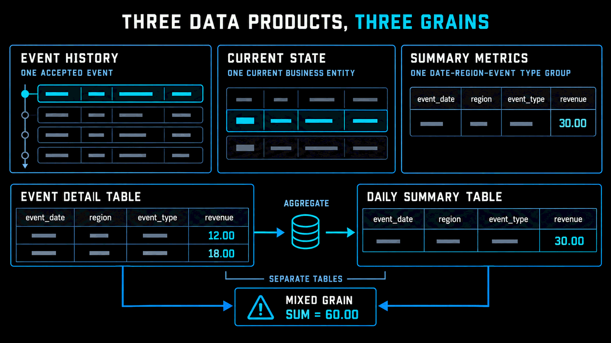
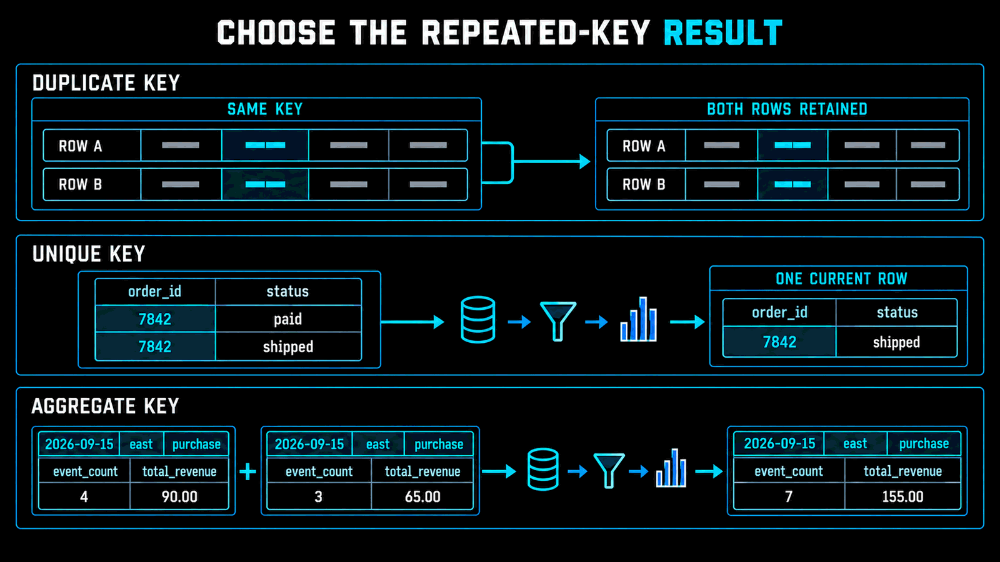
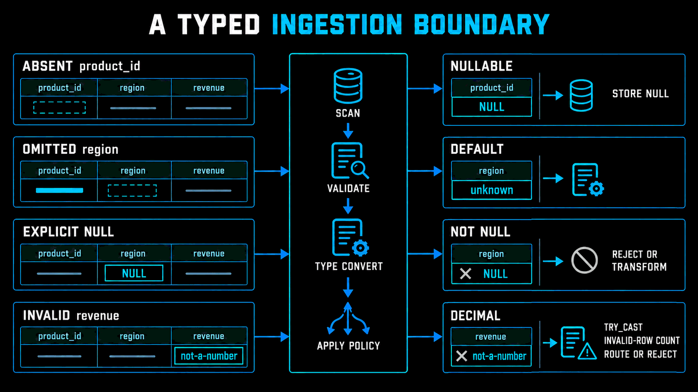
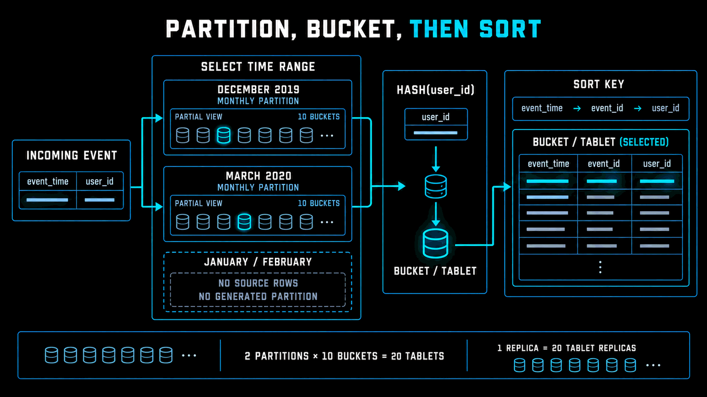

<a id="unit-u.d78631ed0c464f15bbac15c76d1ef17d"></a>

<a id="module-4-modeling-data-in-apache-doris"></a>

# 4-модуль: Apache Doris жүйесінде деректерді модельдеу

| Курс туралы ақпарат | Мән |
| --- | --- |
| Курс | Apache Doris көмегімен нақты уақыттағы аналитика · 2-деңгей |
| Doris | Apache Doris 4.1.3 |
| Орта | Курс сынақ ортасы және 1-зертханалық жұмыстың `events` кестесі |
| Болжамды уақыт | Шамамен 90 минут: оқу 50, зертханалық жұмыс 30, тест 10 |

[Курстың README файлы](../../README.md) · [4-зертханалық жұмысты ашу](lab04_model_data.ipynb) · [4-тестті ашу](quiz04_schema_and_modeling_choices.ipynb)

<a id="unit-u.712e5210b7994710b81cf0b7c8458a24"></a>

<a id="module-goal"></a>

## Модуль мақсаты

Курстың бастапқы оқиғалары мен есеп беру қажеттіліктерін Doris кестелеріне айналдырыңыз: бір жолдың мағынасын, қайталанатын кілттің әрекетін, әр баған рұқсат ететін типтер мен жетіспейтін мәндерді және Partition, Bucket пен сұрыптау кілті жолдарды қалай орналастыратынын шешіңіз.

Сценарий — бір мезгілде үш қажеттілігі бар электрондық сауда аналитикасы платформасы: ол әр қарау, себет және сатып алу оқиғасын сақтайды; тапсырыстар сияқты өзгеретін нысандардың ағымдағы күйін көрсетеді; және күн, аймақ, оқиға түрі түйіршіктілігіндегі бақылау тақтасына қызмет етеді. 4-зертханалық жұмыс осы өнімдердің екеуін құрады: егжей-тегжейлі оқиға деректері үшін `events_modelled`, ал күндік жиынтық үшін `daily_event_metrics`; 7-модуль ағымдағы күйді құрады.

<a id="unit-u.47c3bd962eca4adfb59046461b150398"></a>

<a id="learning-objectives"></a>

## Оқу мақсаттары

Осы модульді аяқтағаннан кейін сіз:

1. Кесте түйіршіктілігін оның дереккөз шартынан анықтап, егжей-тегжейлі деректер мен жиынтық түйіршіктілігін бөлек кестелерде сақтай аласыз.
2. Қайталанатын кілтке қажетті әрекетке қарай Duplicate Key, Unique Key немесе Aggregate Key моделін таңдай аласыз.
3. Есеп беру талабынан жиынтық өлшемдері мен қосылатын метрикаларын шығарып, оны егжей-тегжейлі деректермен салыстырып тексере аласыз.
4. Идентификатор, уақыт, ақша, санат және ішкі құрылымды мәндердің типтерін олардың мағынасы мен қажетті амалдарына қарай таңдай аласыз.
5. Жоқ, түсіріліп қалдырылған немесе жарамсыз мәндер үшін `NULL`, `NOT NULL` және `DEFAULT` ажырата аласыз.
6. Кесте Partition бөлімдерін, Bucket ұяшықтарын және сұрыптау кілтін уақыт сүзгілеріне, өмірлік цикліне, таратуына және көлеміне қарай жобалай аласыз.

<a id="unit-u.5f6a14e8039549f19add3bcbb6ca5ecc"></a>

<a id="module-structure"></a>

## Модуль құрылымы

| Бөлім | Уақыт | Нәтиже |
| --- | ---: | --- |
| 4.1 Бір жол нені білдіретінін анықтау | 5 мин | Әр деректер өніміне бір айқын түйіршіктілік беру |
| 4.2 Қайталанатын кілт мағынасына қарай кесте моделін таңдау | 6 мин | Қайталанатын кілт не істеуі тиіс екеніне қарай Duplicate, Unique немесе Aggregate Key таңдау |
| 4.3 Есеп беру талабынан жиынтық моделін шығару | 6 мин | Қосылатын метрикаларды жарияланған түйіршіктілікте сақтап, егжей-тегжейлі деректермен салыстырып тексеру |
| 4.4 Дерек типтерін бизнес мағынасына қарай таңдау | 7 мин | Идентификатор, уақыт, ақша және санат типтерін амалдарына қарай таңдау |
| 4.5 Жоқ, түсіріліп қалдырылған және жарамсыз мәндерге әртүрлі ереже беру | 6 мин | Әртүрлі күйге NULL рұқсатын, әдепкі мәндерді және түрлендіру тексерулерін пайдалану |
| 4.6 Уақыт Partition бөлімдерін сұрау мен өмірлік цикл шекараларынан таңдау | 6 мин | Partition түйіршіктілігін таңдап, Auto Partitioning қашан сай келетінін шешу |
| 4.7 Әр Partition ішіндегі деректерді тарату үшін Bucket пайдалану | 5 мин | Hash кілті мен Bucket санын таңдау |
| 4.8 Сұрыптау кілтін негізгі қатынау жолына сәйкестендіру | 4 мин | Сұрыптау кілтін жиі қолданылатын ауқым сүзгісінен бастау |
| 4.9 Қолданба құрылымынан күрделі типтерді сәйкестендіру | 5 мин | `ARRAY`, `MAP`, `STRUCT`, `JSON` немесе `VARIANT`, не қалыпты бағандарды таңдау |
| 4-зертханалық жұмыс | 30 мин | `events_modelled` және `daily_event_metrics` құрып, салыстырып тексеру |
| 4-тест | 10 мин | Осы мақсаттар бойынша алты сұрақ |

<a id="unit-u.c8198d136c4f4c79816b40508b60ba35"></a>

<a id="41-define-what-one-row-represents"></a>

## 4.1 Бір жол нені білдіретінін анықтау

Бағандарға атау бермес бұрын мына сөйлемді аяқтаңыз:

> Бұл кестедегі бір жол мынаны білдіреді ...

Осы тұжырым кестенің **түйіршіктілігін** анықтайды. Түйіршіктілік бизнес және дереккөз шартынан келеді. Ол бүгінгі үлгіде кездейсоқ бірегей болған кез келген бағанды таңдау арқылы табылмайды.

<a id="unit-u.94cd6f059b9748aebf28c0c6c8c3d347"></a>

<a id="separate-three-common-data-products"></a>

### Үш кең тараған деректер өнімін ажырату

Электрондық сауда платформасына жолдың үш түрлі мағынасы қажет:

| Деректер өнімі | Бір жол нені білдіреді | Сұрақ мысалы |
| --- | --- | --- |
| Оқиға тарихы | Бір қабылданған пайдаланушы немесе жүйе оқиғасы | 09:00 мен 10:00 арасында қандай сатып алулар болды? |
| Ағымдағы күй | Бір бизнес нысанының қазір көрінетін күйі | 7842 тапсырысының ағымдағы күйі мен жеткізу мекенжайы қандай? |
| Жиынтық метрикалар | Есеп өлшемдерінің бір жарияланған тіркесі | Әр күн, аймақ және оқиға түрі бойынша қанша сатып алу оқиғасы болды? |

Бұл өнімдер бір әрекеттен шығуы мүмкін, бірақ өзара алмастырылмайды. Оқиға тарихы жеке бақылаулардың ретін және атрибуттарын сақтайды. Ағымдағы күй ауыстырылған мәндерді қалыпты сұраудан әдейі жасырады. Жиынтық есептеріне қажет емес өлшемдер мен егжей-тегжейлі деректерді әдейі алып тастайды.

<a id="unit-u.784799f3221a4a239cdbd74aa2fc68df"></a>

<a id="do-not-mix-detail-and-summary-grain"></a>

### Егжей-тегжейлі деректер мен жиынтық түйіршіктілігін араластырмау

Екі сатып алу оқиғасының түсімі 12.00 және 18.00 делік. Сол оқиғалардың күндік жиынтығында 30.00 түсім бар:



*Егжей-тегжейлі деректер мен жиынтықты бөлек кестелерде сақтау сол әрекетті екі рет санауға жол бермейді.*

Сурет жазулары: Three data products, three grains — үш деректер өнімі, үш түйіршіктілік; Event history — оқиға тарихы; One accepted event — бір қабылданған оқиға; Current state — ағымдағы күй; One current business entity — бір ағымдағы бизнес нысаны; Summary metrics — жиынтық метрикалар; One date-region-event type group — бір күн-аймақ-оқиға түрі тобы; Event detail table — егжей-тегжейлі оқиға деректері кестесі; Aggregate — агрегаттау; Daily summary table — күндік жиынтық кестесі; Separate tables — бөлек кестелер; Mixed grain — аралас түйіршіктілік; SUM = 60.00 — қосынды 60.00. event_date, region, event_type, revenue атаулары және 12.00, 18.00, 30.00, 60.00 мәндері өзгермейді. Суреттің ағылшын түпнұсқасы сақталған.

Үш жолдың бәрі бір кестеге салынып, сұрау жай `SUM(revenue)` есептесе, нәтиже 60.00 болады. Сол әрекет бір рет егжей-тегжейлі оқиға дерегі ретінде, тағы бір рет жиынтық ретінде көрсетілген. Жол түрінің белгісі әр сұрауға бір көріністі сүзуге мүмкіндік берер еді, бірақ кестеде бәрібір аралас түйіршіктілік қалып, кездейсоқ қосарлап санау оңай болады.

Екі түйіршіктілікті бөлек кестелерде сақтаңыз. Жауапқа пайдаланушылар, өнімдер, уақыт белгілері немесе жеке оқиғалар қажет болса, егжей-тегжейлі оқиға деректеріне сұрау жасаңыз. Жарияланған өлшемдер мен сақталған метрикалар жеткілікті болса, жиынтыққа сұрау жасаңыз.

<a id="unit-u.9c279a7046ec4ac0953c5eb3fe30a143"></a>

<a id="use-observations-to-verify-a-declared-contract"></a>

### Жарияланған шартты бақылаулармен тексеру

Жол саны күтілетін дереккөздің қолжетімді екенін растай алады. Бірегей сандар, ең кіші және ең үлкен мәндер және қайталануды тексерулер бұзушылықтарды көрсете алады. Олар жолдың жарияланған мағынасын алмастырмайды.

Мысалы, қайталанған `event_id` нашар бастапқы деректі, басқа өріс ауқымына ғана тиесілі оқиға идентификаторын немесе заңды қайта жеткізуді білдіруі мүмкін. Қай түсінік дұрыс екенін тек дереккөз шарты айтады. Сондықтан 4-зертханалық жұмыс бастапқы жиынды `COUNT(*)` арқылы растап, оның баған метадеректерін оқиды; түйіршіктілік шарттың өзінен келеді.

<a id="unit-u.dcb253a85b2b400bb677b1b1687ea5b1"></a>

<a id="42-choose-a-table-model-from-repeated-key-semantics"></a>

## 4.2 Қайталанатын кілт мағынасына қарай кесте моделін таңдау

2-модуль (Apache Doris архитектурасын тереңірек зерттеу) бар кілтпен жол келгенде әр кесте моделінің не істейтінін көрсетті: Duplicate Key екі жолды да сақтайды, Unique Key соңғысын сақтайды, ал Aggregate Key мән бағандарын біріктіреді. Модельдеу кері сұрақ қояды: әр деректер өніміне қандай әрекет қажет?

| Деректер өнімі | Қайталанатын кілт не істеуі тиіс | Кесте моделі |
| --- | --- | --- |
| Оқиға тарихы | Әр қабылданған жолды сақтау | Duplicate Key |
| Ағымдағы күй | Бизнес кілттің көрінетін күйін ауыстыру | Unique Key |
| Жиынтық метрикалар | Әр есеп кілті бойынша өлшем үлестерін біріктіру | Aggregate Key |

Өнімділікті ойламас бұрын модельді жол мағынасына қарай таңдаңыз. Doris бар кестені басқа кесте моделіне айналдыра алмайды; өзгерген шартқа жаңа кесте және бақыланатын ауысу қажет. [Кесте модельдеріне шолу](https://doris.apache.org/docs/4.x/table-design/data-model/intro/) және [Кесте модельдерінің үздік тәжірибелері](https://doris.apache.org/docs/4.x/table-design/data-model/tips/) құжаттарын қараңыз.

<a id="unit-u.ceb57ff1b82d4952b96fb5704c9bf5af"></a>

<a id="event-history-duplicate-key"></a>

### Оқиға тарихы: Duplicate Key

Оқиға журналы әр қабылданған бақылауды, тіпті барлық кілт мәндері бірдей екі оқиғаны да сақтайды. Бұл модельде кілт бағандары сұрыптау кілтін орнатады, сондықтан

```sql
DUPLICATE KEY(event_time, event_id, user_id)
```

«әр `(event_time, event_id, user_id)` үшін бір жол» дегенді білдірмейді: `events_modelled` түйіршіктілігі бір қабылданған бастапқы оқиға болып қалады. [Duplicate Key моделі](https://doris.apache.org/docs/4.x/table-design/data-model/duplicate/) құжатын қараңыз.

<a id="unit-u.2e08f6e6f35740f3b447659581b3069f"></a>

<a id="current-state-unique-key"></a>

### Ағымдағы күй: Unique Key

Тапсырыс күйінің кестесінде басқа шарт бар:

| `order_id` | `status` | Мағынасы |
| ---: | --- | --- |
| 7842 | `paid` | Бұрын қабылданған күй |
| 7842 | `shipped` | Сол тапсырыстың жаңа ағымдағы күйі |

Қалыпты сұраулар `order_id = 7842` үшін бір ағымдағы жол көруі тиіс болса, `order_id` — Unique Key, ал оған әр жаңа жазба upsert болады. Doris 4.x әдепкіде Unique Key кестелерін Merge-on-Write арқылы жасайды, сондықтан жазудың өзі жаңа күйді көрінетін етеді. Келу реті әрдайым бизнес реті емес, өйткені CDC оқиғалары кешігіп келуі немесе қайталануы мүмкін: Sequence бағаны қай күй жеңетінін бастапқы нұсқаға анықтатуға мүмкіндік береді. 7-модуль upsert, ішінара жаңарту, Sequence бағандары және жою арқылы ағымдағы күйді құрады. [Unique Key моделі](https://doris.apache.org/docs/4.x/table-design/data-model/unique/) және [Merge-on-Write](https://doris.apache.org/docs/4.x/table-design/data-model/merge-on-write/) құжаттарын қараңыз.

<a id="unit-u.e508db9c2a3148afb129762f412af3a2"></a>

<a id="summary-metrics-aggregate-key"></a>

### Жиынтық метрикалар: Aggregate Key

Есеп құбыры бір `(event_date, region, event_type)` үшін бірнеше үлес жеткізуі мүмкін. `event_count` және `total_revenue` қосылуы тиіс болса, өлшемдер — Aggregate Key, ал метрикалар — `SUM` жарияланған мән бағандары:



*Қайталанатын кілт әрекеті деректер өнімінің жол шартына сәйкес келуі тиіс.*

Сурет жазулары: Choose the repeated-key result — қайталанатын кілт нәтижесін таңдау; Duplicate Key — Duplicate Key; Same key — бірдей кілт; Row A / Row B — A жолы / B жолы; Both rows retained — екі жол да сақталған; Unique Key — Unique Key; One current row — бір ағымдағы жол; Aggregate Key — Aggregate Key. order_id, status, paid, shipped, event_count, total_revenue өріс/мәндері, 7842, 2026-09-15, east, purchase және 4 + 3 = 7, 90.00 + 65.00 = 155.00 мәндері түпнұсқада сақталған. Сурет ағылшын тілінде қалады.

Кілт бағандары агрегаттау тобы да, сұрыптау кілті де болады және әр мән бағаны үлестердің қалай бірігетінін жариялайды. Мұндай кесте оқиға идентификаторларын немесе уақыт белгілерін сақтамайды, сондықтан егжей-тегжейлі деректерді алмастыра алмайды, ал екі рет жүктелген үлес екі рет қосылады: қайталау қауіпсіздігі әлі де 3-модульдің жүктеу шарттарынан келеді. [Aggregate Key моделі](https://doris.apache.org/docs/4.x/table-design/data-model/aggregate/) құжатын қараңыз.

<a id="unit-u.94d6ebc5900b465895966b48ebcda001"></a>

<a id="43-derive-a-summary-model-from-the-reporting-requirement"></a>

## 4.3 Есеп беру талабынан жиынтық моделін шығару

Бақылау тақтасына күн сайын аймақ пен оқиға түрі бойынша оқиға саны және жалпы түсім қайта-қайта қажет. Сол нәтижеден бастап, содан кейін кесте шартын шығарыңыз.

<a id="unit-u.5ff1af1cf60441c08aadee843a718b09"></a>

<a id="define-dimensions-and-measures-separately"></a>

### Өлшемдер мен метрикаларды бөлек анықтау

Бір жиынтық жолы мына бір тіркесті білдіреді:

```text
(event_date, region, event_type)
```

Осы үш өлшем Aggregate Key болады. Кесте екі Value бағанын сақтайды:

- `event_count BIGINT SUM` топқа үлес қосатын оқиғалар санын білдіреді.
- `total_revenue DECIMAL(18,2) SUM` олардың қосылатын түсімін білдіреді.

`DECIMAL(18,2)` жинақталған жиынтыққа әр оқиғалық `DECIMAL(12,2)` дереккөзінен кеңірек бүтін ауқым береді. Қажетті дәлдік егжей-тегжейлі дерек типін автоматты көшірудің орнына күтілетін топ көлемі мен түсім ауқымына сай болуы тиіс.

Жиынтық `event_id`, `user_id` немесе `product_id` ұстамайды, өйткені олар оның түйіршіктілігін өзгертер еді. Сондықтан ол қай пайдаланушы сатып алғанын айта алмайды, жеке оқиғаны қалпына келтіре алмайды немесе өнім бойынша дәл топтай алмайды.

<a id="unit-u.3f3761085f3542608c0377c5387cd4d2"></a>

<a id="store-only-measures-that-combine-correctly"></a>

### Тек дұрыс бірігетін метрикаларды сақтау

Сандар мен жалпы түсім қиылыспайтын оқиға үлестері арасында қосылады. Бірнеше кең тараған метриканы қауіпсіз қосу мүмкін емес:

- Бірегей пайдаланушы саны бір пайдаланушыны бірнеше топтамада немесе топта санауы мүмкін. Сол сандардың кәдімгі `SUM` қосындысы біріктірілген жиынды артық көрсетеді. Талапқа қарай біріктірілетін Bitmap немесе HyperLogLog (HLL) күйі жуық не дәл бірегей санау құрылымына сай келуі мүмкін.
- Орташа мәнді әдетте қосуға болмайды. Үйлесімді алым мен бөлімді сақтап, содан кейін салмақталған нәтижені есептеңіз.
- Қатынастар мен пайыздарға әдетте олардың негізіндегі қосылатын құрамдастар қажет.
- Минимум мен максимум өздеріне сай агрегаттау мағынасымен біріге алады, бірақ қосынды сияқты әрекет етпейді.

Есеп сұрағы кейінгі топтамалар мен ірілендірілген жиынтықтардың қалай бірігетінін анықтауы тиіс. `SUM` жариялау — жай баған синтаксисі емес, мағыналық уәде.

<a id="unit-u.6bdf99a6e3014d2a8c11b2e419672e9f"></a>

<a id="reconcile-at-the-summary-grain"></a>

### Жиынтық түйіршіктілігінде салыстырып тексеру

Екі модельде `COUNT(*)` әртүрлі мағына береді:

| Кесте | `COUNT(*)` нені санайды | Бір жол білдіретін оқиғалар жиыны |
| --- | --- | --- |
| `events_modelled` | Егжей-тегжейлі оқиға жолдары | Бір оқиға |
| `daily_event_metrics` | Күн-аймақ-оқиға түрі топтары | `event_count` оқиға |

4-зертханалық жұмыс 10,158,080 егжей-тегжейлі дерек жолын және 280 жиынтық жолын көреді: 280 — SQL қайтаратын жиынтық топтар саны.

Екі модель де көрсете алатын метрикалармен оларды салыстырып тексеріңіз:

```text
COUNT(*) from events_modelled
        = SUM(event_count) from daily_event_metrics
        = 10,158,080 represented events

SUM(revenue) from events_modelled
        = SUM(total_revenue) from daily_event_metrics
        = 39,984,455.64 represented revenue
```

> **Дәлел шекарасы:** сәйкес жиынтықтар осы жүктеу үшін жарияланған қосылатын метрикаларды тексереді. 4-зертханалық жұмыс жиынтықты бір алдын ала топталған енгізумен жазады, сондықтан бөлек топтамалардың бірігуі мұнда сипатталады, бірақ бақыланбайды; зертханалық жұмыс жылдамдықты өлшемейді.

<a id="unit-u.2adb8d867a7a4b92897fe84eb97da5be"></a>

<a id="44-choose-data-types-from-business-meaning"></a>

## 4.4 Дерек типтерін бизнес мағынасына қарай таңдау

Дерек типі өрістің жарамды мәндер ауқымын көрсетіп, маңызды амалдарды қолдауы тиіс. Бір файлда көрінетін мәндерге қарап таңдау болашақ ауқым, дәлдік немесе құрылым қажеттіліктерін кем бағалауы мүмкін.

Алдымен қажетті амалдар мен дұрыстықтан бастап, содан кейін сақтау және есептеу шығынын қарастырыңыз:

| Бизнес мәні және қажетті әрекет | Сай келетін бастапқы тип | Бағаланатын негізгі таңдау |
| --- | --- | --- |
| Бүтін сандар, мөлшерлер немесе сан ретінде анықталған идентификаторлар | Болашаққа қауіпсіз ауқымы бар ең кіші бүтін тип | Тар тип аз орын алады, бірақ кем бағаланған ауқым толып кетуі мүмкін |
| Ақша, шот қалдығы, салық мөлшерлемесі немесе жарияланған масштабы қажет басқа ондық мөлшер | `DECIMAL(p, s)` | Дәл ондық әрекетке жеткілікті дәлдік қажет және дәлдік өскенде кеңірек арифметика қолданылуы мүмкін |
| Жуықтауға болатын сенсор өлшемдері, ғылыми бақылаулар, координаттар немесе модель ұпайлары | `FLOAT` немесе `DOUBLE` | Кең ауқым мен қалыпты жылжымалы нүктелі есептеу көрсету қатесімен, ассоциативті емес агрегаттаумен және дәл теңдікке жарамсыз мағынамен келеді |
| Ішкі мағынасы ашылмайтын идентификаторлар немесе санат белгілері | Шектелген `VARCHAR` | Пішім мен сандық емес сәйкестікті сақтайды, бірақ әр сұрау талдауы тиіс санды алмастырмауы керек |
| Күнтізбелік күн немесе оқиға уақыт белгісі | `DATE` немесе `DATETIME(p)` | Дәлдік пен уақыт белдеуі мағынасы дереккөзге және есеп шекараларына сай болуы тиіс |

`DOUBLE` арифметикасы кең `DECIMAL` арифметикасынан арзанырақ болуы мүмкін. Бұл — өкілдік деректерде өлшенетін өнімділік мәселесі, ақшаны жуық сақтаудың себебі емес: алдымен жуықтауға мүлде бола ма, соны шешіңіз.

<a id="unit-u.65ba8d58d930424b8eed28e85feed8fb"></a>

<a id="keep-identifiers-consistent"></a>

### Идентификаторларды бірізді ұстау

Идентификатор мөлшер болмаса да, цифрлар қамтуы мүмкін. Оның типін дереккөз шартына қарай таңдаңыз:

- Идентификатор сан ретінде анықталып, таңдалған ауқымға сыйса және бастапқы нөлдер сияқты пішімдеу қажет болмаса, бүтін тип пайдаланыңыз.
- Әріптер, бастапқы нөлдер, құрама пішімдеу немесе сыртқы ішкі мағынасы ашылмайтын келісім сәйкестікке тиесілі болса, жолдық тип пайдаланыңыз.

Бір бизнес Key факт, өлшем және күй кестелерінде үйлесімді типтер қолдануы тиіс. `product_id` бір кестеде `BIGINT`, ал басқасында еркін пішімделген мәтін ретінде сақталса, қайталанатын түрлендірулер пайда болып, Join шарттары күрделенуі мүмкін. Сирек көшірудегі түрлендіру қалыпты; әр өндірістік сұраудағы сол түрлендіру схема шекарасының шешілмегенін көрсетеді.

<a id="unit-u.8cb73e7d39464ad2b7bb7673706bfc0a"></a>

<a id="represent-time-at-the-required-precision"></a>

### Уақытты қажетті дәлдікпен көрсету

Мән тәулік уақыты мағынасы жоқ күнтізбелік күн болса, `DATE` пайдаланыңыз. Дереккөз бен талдауға күн және уақыт қажет болса, `DATETIME` пайдаланыңыз. Doris `DATETIME(p)` ішінде секундтың бөлшек дәлдігін қолдайды; `p` мәнін дереккөз бермейтін дәлдікті ойдан қосудың орнына нақты дереккөз шартынан таңдаңыз.

Уақыт типі бизнес уақыт белдеуін анықтамайды. Мәннің Үйлестірілген әмбебап уақытты (UTC), жергілікті бизнес белдеуін немесе басқа келісімді білдіретінін құжаттаңыз. Ол келісім белгілі болмайынша күндік шекаралар екіұшты. [DATETIME](https://doris.apache.org/docs/4.x/sql-manual/basic-element/sql-data-types/date-time/DATETIME/) құжатын қараңыз.

<a id="unit-u.e079dbcf4cec4b4b87110c0c43e66fb8"></a>

<a id="use-exact-fixed-point-values-for-money-and-deliberate-approximation-for-measurements"></a>

### Ақшаға дәл бекітілген нүктелі мәндерді, өлшемдерге саналы жуықтауды пайдалану

`DECIMAL(p, s)` дәл бекітілген нүкте шартын береді:

- `p`, дәлдік — маңызды ондық цифрлардың жалпы саны.
- `s`, масштаб — ондық нүктеден кейінгі цифрлар саны.

`DECIMAL(12,2)` үшін екі цифр центке тиесілі, ал қалған сыйымдылық бүтін бөлік ауқымын қолдайды. Болашақ жарамды мәндерге, аралық есептеулерге және қажетті жиынтықтарға жеткілікті дәлдік таңдаңыз.

`FLOAT` және `DOUBLE` — IEEE 754 стандартының жуық екілік жылжымалы нүктелі типтері. Оларды температура, сигнал күші, координаттар немесе статистикалық ұпай сияқты мәндер үшін тек шағын көрсету айырмашылықтары рұқсат етілгенде таңдаңыз. `DOUBLE` `FLOAT` типіне қарағанда көбірек дәлдік пен ауқым береді, бірақ бәрібір әр ондық бөлшекті дәл көрсетпейді. Жылжымалы нүктелі қосу қатаң ассоциативті емес, сондықтан үлестірілген агрегаттау реті де шағын айырмашылықтарды көрсете алады. Жылжымалы нүктелі бағандарды дәл Join кілттері немесе теңдікке негізделген бизнес идентификаторлар ретінде пайдаланбаңыз.

Ақша үшін жеткілікті үлкен жылжымалы нүктелі мәндер әр центті көрсете алмай қалады. Мәтін таңбаларды сақтайды, бірақ жарамды соманы кепілдемейді және сандық амалдар алдында түрлендіруді міндеттейді. 4-зертханалық жұмыс екі мәселені де көрсетеді: бір мәтін мәні түрленбейді, ал үлкен `DOUBLE` мәніне бір цент қосу дәл ондық нәтиже бермейді. [DECIMAL](https://doris.apache.org/docs/4.x/sql-manual/basic-element/sql-data-types/numeric/DECIMAL/) және [Жылжымалы нүктелі типтер](https://doris.apache.org/docs/4.x/sql-manual/basic-element/sql-data-types/numeric/FLOATING-POINT/) құжаттарын қараңыз.

<a id="unit-u.113bb7e8ba174db1a0faff271dc2c434"></a>

<a id="bound-category-strings-without-confusing-two-concepts"></a>

### Екі ұғымды шатастырмай санат жолдарын шектеу

`event_type` және `region` қысқа санаттар, сондықтан шектелген `VARCHAR` типтері күтілетін ең үлкен ұзындықты білдіреді. Жол ұзындығы мен кардиналдық әртүрлі:

- **Ұзындық** — бір мәннің тип шартына қажетті ең көп таңба немесе байт саны.
- **Кардиналдық** — деректерде кездесетін бірегей мәндер саны.

Аймақ кардиналдығы төмен болғанымен, әр белгісіне бірнеше таңба қажет болуы мүмкін. Шектен үлкен `VARCHAR` көбірек санат мәнін жасамайды, бірақ шартты әлсіретіп, қажетсіз сақтау немесе өңдеу шығынын арттыра алады. Әдетпен ең үлкен жариялауды қолданудың орнына бақыланатын болашақ мәндерге орынды қор қалдырыңыз. [VARCHAR](https://doris.apache.org/docs/4.x/sql-manual/basic-element/sql-data-types/string-type/VARCHAR/) құжатын қараңыз.

<a id="unit-u.c8cbd287ad744bce8eeb14cd988b14c1"></a>

<a id="45-give-missing-omitted-and-invalid-values-different-rules"></a>

## 4.5 Жоқ, түсіріліп қалдырылған және жарамсыз мәндерге әртүрлі ереже беру

Мына бастапқы жағдайлар бірдей емес:

1. Өнім оқиғаға қолданылмайды.
2. Аймақ түсіріліп қалдырылған және бизнес оны `unknown` санатына жатқызуға келіскен.
3. Түсімде `not-a-number` бар және ол ақшалай мән шартына сай емес.

Бәріне ортақ бір `NULL` немесе әдепкі ереже бұл айырмашылықтарды жасырар еді.

<a id="unit-u.bc5874e434c24162ae179b973d28959d"></a>

<a id="choose-nullability-from-allowed-business-states"></a>

### NULL рұқсатын рұқсат етілетін бизнес күйлерден таңдау

Белгісіз, әлі берілмеген немесе қолданылмайтын сияқты жоқтық жарамды күй болғанда NULL рұқсат етілетін бағанды пайдаланыңыз. Сонда сұраулар сол күйдің сүзгілерде, топтарда, сандарда және Join амалдарында қалай әрекет ететінін анықтауы тиіс. Мысалы, `COUNT(product_id)` `NULL` елемейді, ал `COUNT(*)` оқиға жолын бәрібір санайды.

Әр қабылданған жолда жарамды мән болуы міндетті болса, `NOT NULL` пайдаланыңыз. Бұл дерек сапасының ең төменгі талабын кесте шартына қосады. Бастапқы талдағыш жетіспейтін мән шығара алады екен деп әр өрісті NULL рұқсат етілетін етіп жарияламаңыз. Бұл шешілмеген таңдауларды әр кейінгі сұрауға жүктейді.

<a id="unit-u.58c7e7204fc048c1bcf045973b576832"></a>

<a id="use-default-only-for-an-agreed-omission-rule"></a>

### `DEFAULT` мәнін тек келісілген түсіріп қалдыру ережесі үшін пайдалану

Енгізу кезінде мақсатты баған түсіріліп қалдырылса, әдепкі мән беріледі. Мысалы:

```sql
region VARCHAR(16) NOT NULL DEFAULT "unknown"
```

түсірілген аймақ `unknown` есеп санатына жататын шартты қолдайды. Бұл айқын берілген `NULL` байқатпай түрленуі тиіс дегенді білдірмейді және қате аймақ мәнін түзетпейді.

Бұл айырмашылық пайдалану кезінде маңызды:

| Кіріс шарты | Зертханалық жұмыс шартына сай нәтиже |
| --- | --- |
| `product_id` жоқ және жоқтық рұқсат етілген | NULL рұқсат етілетін бағанға `NULL` сақтау |
| `region` түсіріліп қалдырылған және `unknown` келісілген | Әдепкі мән қолданылуы үшін мақсатты бағанды түсіріп қалдыру |
| `NOT NULL` бағанында `region` айқын `NULL` | Қабылдау саясатына сай енгізуден бұрын қабылдамау немесе түрлендіру |
| Түсім мәтіні `DECIMAL(12,2)` бола алмайды | Жарамсыз жолды санап, бағыттау немесе қабылдамау; оны жарамды жетіспейтін түсім деп санамау |

<a id="unit-u.aef32464655d486e8b251d60fbb1ea9e"></a>

<a id="establish-a-typed-ingestion-boundary"></a>

### Типтелген қабылдау шекарасын орнату

Қабылдау кестесі еркін бастапқы мәтінді сақтауы тиіс болса, `TRY_CAST` пайдалы. Түрлендіру орындалмаса, ол `NULL` қайтарады. Бұл қабылдау сұрауына жарамды типтелген мәндерді таңдамас бұрын жарамсыз жолдарды санауға мүмкіндік береді.

Тек `SUM(TRY_CAST(revenue_text AS DECIMAL(12,2)))` есептеп, сәтті деп жарияламаңыз. `SUM` сияқты агрегат функциялары `NULL` елемейді, сондықтан қате мәндер жиынтықтан жоғалып кетуі мүмкін. Есептеуді жарамсыз жол санымен және айқын саясатпен жұптаңыз. Жарамды жолдар типтелген талдамалық кестеге кіргеннен кейін, кейінгі сұраулар талдау логикасын қайталамай `SUM(revenue)` қолдана алады. [CAST және TRY_CAST](https://doris.apache.org/docs/4.x/sql-manual/basic-element/sql-data-types/conversion/cast-expr/) құжатын қараңыз.



*Қабылдау шекарасында жоқ, түсіріліп қалдырылған және жарамсыз кірісті әртүрлі күй ретінде өңдеңіз.*

Сурет жазулары: A typed ingestion boundary — типтелген қабылдау шекарасы; Absent product_id — product_id жоқ; Omitted region — region түсіріліп қалдырылған; Explicit NULL — айқын NULL; Invalid revenue — жарамсыз revenue; Scan — сканерлеу; Validate — тексеру; Type convert — типті түрлендіру; Apply policy — саясат қолдану; Nullable — NULL рұқсат етіледі; Store NULL — NULL сақтау; DEFAULT — әдепкі мән; NOT NULL — NULL рұқсат етілмейді; Reject or transform — қабылдамау немесе түрлендіру; DECIMAL — DECIMAL; TRY_CAST — TRY_CAST; Invalid-row count — жарамсыз жол саны; Route or reject — бағыттау немесе қабылдамау. product_id, region, revenue, NULL, unknown және not-a-number атау/мәндері өзгермейді. Суреттің ағылшын түпнұсқасы сақталған.

<a id="unit-u.d1c61297a4e14063955b1282762b4c87"></a>

<a id="46-choose-time-partitions-from-query-and-lifecycle-boundaries"></a>

## 4.6 Уақыт Partition бөлімдерін сұрау мен өмірлік цикл шекараларынан таңдау

Оқиға сұрауларының көбі соңғы уақыт ауқымдарын оқиды, ал сақтау мерзімі, ауыстыру және кері толықтыру толық күнтізбелік кезеңдермен жұмыс істейді. Range Partition әр жолды жарияланған мән аралығына сәйкестендіріп, Doris жүйесіне кесте ішіндегі деректерді басқару шекарасын береді.

<a id="unit-u.b04d92f26635454a83123d6f3f8288d1"></a>

<a id="treat-partition-as-a-value-range-that-contains-tablets"></a>

### Partition ұғымын Tablet қамтитын мән ауқымы ретінде қарастыру

2-модуль иерархияны таныстырды: `[2020-03-01, 2020-04-01)` сияқты ереже қай жолдардың Partition бөліміне тиесілі екенін шешеді және әр Partition әр Bucket үшін бір Tablet ұстайды. `events_modelled` үшін екі деңгей әртүрлі сұраққа жауап береді:



*Уақыт ауқымы, шардқа орналастыру және жолдарды реттеу орналасуға қатысты үш түрлі сұраққа жауап береді.*

Сурет жазулары: Partition, bucket, then sort — Partition, bucket бөлу, содан кейін сұрыптау; Incoming event — кіріс оқиға; Select time range — уақыт ауқымын таңдау; December 2019 — 2019 жылғы желтоқсан; March 2020 — 2020 жылғы наурыз; Monthly partition — айлық Partition; Partial view — ішінара көрініс; 10 buckets — 10 Bucket; January / February — қаңтар / ақпан; No source rows — бастапқы жолдар жоқ; No generated partition — жасалған Partition жоқ; HASH(user_id) — HASH(user_id); Bucket / Tablet — Bucket / Tablet; Sort key — сұрыптау кілті; Bucket / Tablet (selected) — таңдалған Bucket / Tablet. event_time, event_id, user_id атаулары өзгермейді. 2 Partitions × 10 Buckets = 20 Tablets — 2 Partition × 10 Bucket = 20 Tablet; 1 replica = 20 Tablet replicas — 1 реплика = 20 Tablet репликасы. Суреттің ағылшын түпнұсқасы сақталған.

Уақыт сүзгісі FE түйініне Partition бөлімін өткізіп жіберуге мүмкіндік береді, ал сақтау мерзімі немесе кері толықтыру оны тұтас жояды не ауыстырады. 2-модуль іріктеуді өлшеді, сондықтан 4-зертханалық жұмыс тек жасалған ауқымдарды тексереді.

<a id="unit-u.7d3ce41d819c40d1be91d2906f68ac71"></a>

<a id="choose-a-useful-time-grain"></a>

### Пайдалы уақыт түйіршіктілігін таңдау

Partition түйіршіктілігі жұмыс жүктемесіне сай болады:

- Күндік Partition бөлімдері өмірлік циклді ұсақ деңгейде басқаруға мүмкіндік береді, бірақ көбірек метадерек және кішірек физикалық бірліктер жасайды.
- Айлық Partition бөлімдері Partition нысандарының санын азайтады, бірақ тұтас айды табиғи өмірлік цикл шекарасына айналдырады.
- Өте ірі Partition дәл сақтау мерзімі немесе ауыстыру жұмысы үшін тым көп дерек қамтуы мүмкін.

Күн немесе ай жөнінде әмбебап жауап жоқ. Әр кезеңдегі дерек көлемін, жиі сүзілетін ауқымдарды, сақтау мерзімі саясатын, кері толықтыру көлемін және күтілетін Partition нысандарының санын ескеріңіз.

<a id="unit-u.6ebb5fa7e7c44c199b336aa42b717567"></a>

<a id="use-auto-range-partitioning-for-rule-driven-arrival"></a>

### Ережеге сай келетін деректер үшін Auto Range Partitioning пайдалану

Жаңа уақыт мәндері үздіксіз келіп, шекаралары тұрақты ережеге бағынса, Auto Range Partitioning деректерге қажет болғанда тиісті Partition жасай алады. Зертханалық жұмыс жариялауы мынаны пайдаланады:

```sql
AUTO PARTITION BY RANGE (date_trunc(event_time, 'month'))
```

Курс деректерінде 2019 жылғы желтоқсан мен 2020 жылғы наурыз оқиғалары бар, сондықтан Doris сол екі айлық ауқымды жасайды; қаңтар мен ақпанда оқиғалар жоқ және оларға Partition жасалмайды.

Шекаралар алдын ала мақұлдауды, арнайы атауларды немесе қатаң бақыланатын өмірлік цикл үдерісін қажет етсе, Partition басқаруын айқын таңдаңыз. Auto Partitioning ауқымдар жасайды; кесте моделі, түйіршіктілік, Bucket кілті және сұрыптау кілті сіздің шешіміңіз болып қалады. [Auto Partitioning](https://doris.apache.org/docs/4.x/table-design/data-partitioning/auto-partitioning/) құжатын қараңыз.

<a id="unit-u.fcafc8f1f325456fb93783ddee261745"></a>

<a id="47-use-buckets-to-distribute-data-within-every-partition"></a>

## 4.7 Әр Partition ішіндегі деректерді тарату үшін Bucket пайдалану

Бір айлық Partition ішінде де миллиондаған жол болуы мүмкін. Doris әр Partition бөлімін Bucket ұяшықтарына бөледі, олардың әрқайсысын Tablet көрсетеді. Tablet — Backend (BE) түйіндері тарататын және өңдейтін физикалық деректер шарды.

<a id="unit-u.968a402829954ae59c5c9eac5b67f399"></a>

<a id="choose-a-hash-key-that-can-spread-the-workload"></a>

### Жұмыс жүктемесін тарата алатын Hash кілтін таңдау

Hash тарату кезінде Doris жолдың Partition ішіндегі Bucket ұяшығын таңдау үшін таңдалған тарату бағандарын хэштейді. Кілтте жүктемеге жеткілікті бірегей және жеткілікті таралған мән болуы тиіс.

Курс деректерінде екі үміткер бар:

| Үміткер | Дерек пішіні | Тарату салдары |
| --- | --- | --- |
| `region` | Әрқайсысында шамамен 1.27 миллион оқиға бар сегіз жасанды мән | Partition ішіндегі он Bucket-тің ең көбі сегізі жол алады және аймақ қанша өссе де, сол Partition ішіндегі аймақтың барлық жолы бір Tablet-ке түседі |
| `user_id` | Барлық оқиғаларда шамамен 1.58 миллион пайдаланушы | Hash мәндері жолдарды барлық Bucket бойынша таратады |

Сондықтан `events_modelled` `HASH(user_id)` пайдаланады. Хэштеу кілттің қай Bucket-ке түсетінін шешеді; әр Tablet қанша жол алатыны әр кілттің қаншалықты жиі кездесетініне бәрібір байланысты. Мәні аз кілт, мұндағыдай мәндер біркелкі пайдаланылса да, таратуды шектейді; қисайған мәндер жағдайды нашарлатады, өйткені басым мәндердің Bucket ұяшықтары ең тез өседі.

Random тарату кілтке негізделген орналасу байланысын сақтамай жолдарды тарата алады. Doris 4.x нұсқасында ол Duplicate Key кестелеріне және мән бағандары `REPLACE` немесе `REPLACE_IF_NOT_NULL` қолданбайтын Aggregate Key кестелеріне қолданылады; Unique Key кестелері және сондай бағандары бар Aggregate Key кестелері Hash таратуды қолдануы тиіс, ал Doris олар жасалғанда `DISTRIBUTED BY RANDOM` қабылдамайды. Таңдалған бағандар бойынша тұрақты орналасу сүзуге немесе Join құрылымына пайдалы болса, Hash тарату пайдалы. 6-модуль үйлесімді таратудың Join амалына көмегін түсіндіреді; бәрібір Hash кілтін бір болашақ Join үшін емес, бүкіл жүктеме мен оның қисықтығына қарай таңдаңыз.

<a id="unit-u.620f8325a66c43c888f380486f057c43"></a>

<a id="choose-bucket-count-as-a-capacity-decision"></a>

### Bucket санын сыйымдылық шешімі ретінде таңдау

Bucket саны Tablet өлшеміне, жоспарлауға және қолжетімді параллель жұмысқа әсер етеді:

- Bucket тым аз болса, өте үлкен Tablet жасап, параллельдікті шектеуі мүмкін.
- Bucket тым көп болса, шағын Tablet және қажетсіз метадерек пен жоспарлау шығынын тудыруы мүмкін.

Әр Partition ішіндегі жолдар мен байттарды, кластер өлшемін, күтілетін өсуді, қатар орындалуды, Compaction қысымын және пайдалы параллельдік деңгейін ескеріңіз. 4-зертханалық жұмыс он Bucket пайдаланады, өйткені олар курс деректеріне сай және орналасуды оқуға жеңіл етеді.

Бақыланған кесте үшін:

```text
2 generated Partitions × 10 Buckets per Partition = 20 Tablets
20 Tablets × 1 replica in the sandbox = 20 Tablet replicas
```

> **Дәлел шекарасы:** бір BE бар сынақ ортасы Tablet санын және жолдардың таралуын көрсетеді, көп түйінді орналасуды немесе параллель жылдамдықты көрсетпейді; 9-модуль бірнеше BE бар кластерді іске қосады. [Деректерді Bucket ұяшықтарына бөлу](https://doris.apache.org/docs/4.x/table-design/data-partitioning/data-bucketing/) құжатын қараңыз.

<a id="unit-u.eeca3ea2df06423ca4666108db44be42"></a>

<a id="48-align-the-sort-key-with-the-main-access-path"></a>

## 4.8 Сұрыптау кілтін негізгі қатынау жолына сәйкестендіру

Doris кесте деректерін Key бағандары анықтаған ретпен сақтайды. Бұл рет префикске негізделген дерекке қатынауды және сығу әрекетін қолдайды. Кесте моделі сол Key бағандарының қосымша мағынасын анықтайды:

| Кесте моделі | Кілттің қосымша міндеті |
| --- | --- |
| Duplicate Key | Жолдарды сұрыптау; кілттердің сәйкес келуі бірегейлікті білдірмейді |
| Unique Key | Жолдарды сұрыптау және логикалық upsert кілтін анықтау |
| Aggregate Key | Жолдарды сұрыптау және агрегаттау тобын анықтау |

<a id="unit-u.138108a0f9704ae09818c9be058b2ca9"></a>

<a id="begin-the-event-sort-key-with-the-common-range-filter"></a>

### Оқиға сұрыптау кілтін жиі қолданылатын ауқым сүзгісінен бастау

`events_modelled` кестесіне сұраулардың көбі алдымен `event_time` шектейді. Сондықтан сұрыптау кілті

```sql
DUPLICATE KEY(event_time, event_id, user_id)
```

уақыттан басталып, одан кейін тұрақты егжей-тегжейлі дерек идентификаторлары келеді; Duplicate Key кестесінде бұл бағандар тек жолдарды реттейді.

Реттеу барлық ықтимал сүзгі бағандарын қосу әрекетіне емес, нақты қатынау үлгілеріне сай болуы тиіс. Басында тұрған іріктеу қабілеті төмен өріс жиі предикаттар үшін кейінгі өрістердің пайдасын әлсіретуі мүмкін. Керісінше, тек сирек сұрауларда қолданылатын өрісті басына қою ақталмауы мүмкін.

<a id="unit-u.52270bb7545743efafbf7899bfd519dc"></a>

<a id="keep-the-three-layout-questions-separate"></a>

### Орналасудың үш сұрағын бөлек ұстау

| Құрылым қабаты | Оқиға жолы үшін жауап беретін сұрақ |
| --- | --- |
| Partition | Жол қай уақыт ауқымына кіреді? |
| Bucket / Tablet | Сол Partition ішіндегі қай шард жолды қабылдайды? |
| Сұрыптау кілті | Кесте сақтауында деректер қандай баған ретімен ұйымдастырылады? |

Үш таңдау бірге жұмыс істейді, бірақ әрқайсысы өз сұрағына жауап береді: сұрыптау кілті Partition жасамайды, уақыт Partition бөлімі жолдарды реттемейді, ал Hash кілті бірегейлікті міндеттемейді. 4-зертханалық жұмыс жариялау мен орналасуды тексереді; 2-зертханалық жұмыс екі сұрыптау кілтінің сканерлеу жұмысын Query Profile арқылы салыстырды.

<a id="unit-u.e460d711b55f4119b983549350c088c1"></a>

<a id="49-map-complex-types-from-the-application-structure"></a>

## 4.9 Қолданба құрылымынан күрделі типтерді сәйкестендіру

Кей атрибут табиғи түрде бір оқиға жолының ішіне тиесілі. Күрделі типті дереккөз ішкі құрылымды болғандықтан немесе бір тип икемдірек көрінгендіктен емес, сол құрылым мен талдамалық амалдарына қарай таңдаңыз.

| Қолданба пішіні | Үміткер Doris типі | Мысал |
| --- | --- | --- |
| Бір элемент типінің реттелген мәндері | `ARRAY` | Бір оқиғаға қосылған тегтер немесе эксперимент идентификаторлары |
| Типтері белгілі бекітілген атаулы өрістер | `STRUCT` | Құрылғының операциялық жүйесі, нұсқасы және пішін түрі |
| Динамикалық кілт-мән атрибуттары | `MAP` | Атаулары оқиғаға қарай өзгеретін науқан қасиеттері |
| JSON ретінде сақталып, сұралатын JSON құжаты | `JSON` | Құжат құрылымы қолжетімді қалуы тиіс дерек мазмұны |
| Икемді ішкі өрістері қажет өзгермелі жартылай құрылымды құжат | `VARIANT` | Атрибуттары өндірушіге қарай өзгеретін серіктес оқиғалары |

`ARRAY` бір жолда реттелген жинақ сақтайды; ол бірнеше дербес оқиға жолын білдірмейді. `STRUCT` тұрақты атаулы ішкі өрістер жиынына сай. `MAP` кілттері өзгерсе де, кілт пен мән типтерінің шарты мағыналы қалатын жағдайға сай. `JSON` және `VARIANT` құжаттық және өзгермелі деректерді қолдайды, бірақ икемділік басқару қажеттілігін жоймайды.

<a id="unit-u.4eda0935f93e4658bba14f91404c3339"></a>

<a id="promote-stable-analytical-fields"></a>

### Тұрақты талдамалық өрістерді бөлек шығару

Сүзу, Partition бөлу, bucket бөлу, сұрыптау, Join, топтау немесе метрикалар үшін жиі пайдаланылатын өрістер әдетте қалыпты типтелген бағандарға лайық. `event_time`, `user_id`, `region` және `revenue` өрістерін икемді дерек мазмұнының ішінде қалдыру әр сұрауға сол шартты қайта қалпына келтіруді міндеттер еді.

Ішкі құрылымы бір жолға тиесілі қосалқы атрибуттар үшін күрделі мәндер қолайлы. Өндірісте пайдаланбас бұрын ағымдағы Doris нұсқасынан мыналарды тексеріңіз:

- қолдау көрсетілетін ішкі құрылым мен элемент типтері;
- қолжетімді қатынау, түрлендіру және жаю функциялары;
- NULL рұқсаты және түрлендіру әрекеті;
- Key, Partition, тарату, индекс және Join қолдану шектеулері;
- қабылдау пішімі және схема эволюциясының әрекеті.

Бұл мүмкіндіктер өзгеріп отырады. Үміткерлерді таңдау үшін қолданба пішімін пайдаланып, содан кейін ағымдағы [ARRAY](https://doris.apache.org/docs/4.x/sql-manual/basic-element/sql-data-types/semi-structured/ARRAY/), [MAP](https://doris.apache.org/docs/4.x/sql-manual/basic-element/sql-data-types/semi-structured/MAP/), [STRUCT](https://doris.apache.org/docs/4.x/sql-manual/basic-element/sql-data-types/semi-structured/STRUCT/), [JSON](https://doris.apache.org/docs/4.x/sql-manual/basic-element/sql-data-types/semi-structured/JSON/) және [VARIANT](https://doris.apache.org/docs/4.x/sql-manual/basic-element/sql-data-types/semi-structured/VARIANT/) құжаттарынан синтаксис пен шектеулерді растаңыз. 4-зертханалық жұмыс күрделі типті бағандар жасамайды; 5-зертханалық жұмыс оқиға схемасын өзгертпей, жол және элемент амалдарын көрсету үшін шағын массив литералын пайдаланады.

<a id="unit-u.17aed910c96a450897759a55d6384323"></a>

<a id="lab-4-model-data-for-analytical-workloads"></a>

## 4-зертханалық жұмыс: талдамалық жүктемелерге деректерді модельдеу

1-деңгейдің бастапқы `events` жиыны қолжетімді болғаннан кейін [4-зертханалық жұмыс — талдамалық жүктемелерге деректерді модельдеу](lab04_model_data.ipynb) ашыңыз. Шамамен 30 минут жоспарлаңыз. Ноутбук 4-модульдің төрт мақсатты кестесін пайдаланады және бастапқы жиынды ауыстырмайды не жоймайды:

- `modeling_raw_events` бес жолдық еркін қабылдау үлгісін қамтиды.
- `modeling_typed_events` төрт жарамды типтелген үлгі жолын қамтиды.
- `events_modelled` 5, 6, 8 және 10-модульдерге арналған толық оқиға моделін қамтиды.
- `daily_event_metrics` күндік есеп жиынтығын қамтиды.

Бес нөмірленген зертханалық қадам мына бақылауларды береді:

| Зертханалық қадам | Не істейсіз | Нәтиже нені дәлелдейді |
| --- | --- | --- |
| 1 | Бастапқы 10,158,080 жолды растап, баған метадеректерін тексеру | Дереккөз қолжетімді және оның сақталған типтерін, NULL рұқсатын, әдепкі мәндерін тексеруге болады; түйіршіктілік әлі дереккөз шартынан келеді |
| 2 | Мәтіндік түсімге `TRY_CAST` арқылы сұрау жасап, `DOUBLE` мен `DECIMAL` салыстыру | Еркін жол жарамсыз соманы қабылдайды; сәтсіз түрлендіруге бөлек сан қажет; жуық арифметика цент дәлдігін жоғалта алады |
| 3 | Типтелген шекара арқылы жарамды мәндерді енгізу | Төрт жол қалады, бір түсірілген аймақ `unknown` алады, бір жарамды өнім `NULL` болып қалады және түсім жиынтығы 39.94 |
| 4 | `events_modelled` құрып, тексеру | Duplicate Key 10,158,080 оқиғаны сақтайды; екі айлық Partition бөлімінің әрқайсысы 10 Hash Bucket қамтып, осы сынақ ортасында 20 Tablet береді |
| 5 | `daily_event_metrics` құрып, салыстырып тексеру | 280 көрінетін топ барлық 10,158,080 оқиғаны және сол 39,984,455.64 түсімді білдіреді |

4-қадамда жасалған екі Partition тек дереккөзде кездесетін айларды көрсетеді: 2019 жылғы желтоқсан және 2020 жылғы наурыз; қаңтар мен ақпанда оқиғалар жоқ, сондықтан Auto Partitioning оларға ауқым жасамады. Tablet қорытындысы — ағымдағы орналасудың метадеректері.

5-қадамда үш мөлшерді ажыратыңыз:

- `COUNT(*)` ішінен алынған `stored_rows` — әр кестедегі SQL арқылы көрінетін логикалық жолдар саны.
- `represented_event_rows` егжей-тегжейлі деректерде әр жолға біреу, ал жиынтықта `SUM(event_count)` арқылы алынады.
- `represented_revenue` әр түйіршіктіліктегі үйлесімді түсім метрикасынан алынады.

Сынақ ортасының ресурстарын босатып, кейін қалпына келтіргіңіз келгенде ғана қосымша тоқтату және қайта іске қосу ұяшықтарын орындаңыз. Docker атаулы томдары бастапқы жиынды және 4-зертханалық жұмыс кестелерін сақтайды. `events_modelled` 5, 6, 8 және 10-модульдер үшін қолжетімді қалуы тиіс.

Зертханалық жұмыс жаттығумен аяқталады: жиынтықтың бір күнін егжей-тегжейлі деректермен салыстырып тексеріңіз. Алдымен нәтижені болжаңыз, содан кейін бос ұяшыққа код жазыңыз; одан кейінгі жиналған үлгі шешім де Run All арқылы орындалып, зертханалық жұмыс кестелерін бастапқы күйінде қалдырады.

<a id="unit-u.9890128a298a4a65a7d6bd3c7c45417c"></a>

<a id="summary"></a>

## Қорытынды

- Кесте түйіршіктілігі дереккөз шартынан келеді: бір қабылданған оқиға, бір ағымдағы нысан немесе бір жарияланған өлшемдер тобы. Егжей-тегжейлі және жиынтық жолдар бөлек кестелерге тиесілі, әйтпесе `SUM` сол әрекетті екі рет санайды.
- Duplicate Key моделі әр қабылданған жолды сақтайды, Unique Key моделі әр кілтке бір ағымдағы жол көрсетеді, ал Aggregate Key моделі мән бағандарын жарияланған функциясымен біріктіреді; кілт бағандары сұрыптау кілтін де құрайды.
- Жиынтық өлшемдерін Aggregate Key бағандары ретінде жариялап, тек дұрыс бірігетін сан мен жиынтық сияқты метрикаларды сақтайды; `daily_event_metrics` барлық 10,158,080 оқиғаны және 39,984,455.64 түсімді 280 жолда көрсетеді.
- Типтер мағынаға сай: идентификаторларға бүтін немесе жолдық типтер, уақытқа `DATE` немесе `DATETIME`, ақшаға `DECIMAL`, санаттарға шектелген `VARCHAR`, ал күрделі типтер тек ішкі құрылымы бір жолға тиесілі атрибуттарға арналған.
- `NULL` — NULL рұқсат етілетін бағандағы жарамды жоқтық, `NOT NULL` мәнді міндетті етеді, `DEFAULT` тек баған түсірілгенде қолданылады, ал түрленбейтін мән жарамсыз және оның жеке саны мен саясаты қажет.
- Partition бөлімдері уақыт сүзгілері мен өмірлік циклге сай, көп мәні бар кілттегі Hash Bucket әр Partition деректерін Tablet нысандарына таратады, ал сұрыптау кілті жиі қолданылатын ауқым сүзгісінен басталады; 4-зертханалық жұмыстың он Bucket бар екі айлық Partition бөлімі 20 Tablet береді.

<a id="unit-u.c433df2a7eb341bf95789a2e96f8014a"></a>

<a id="quiz-4-modeling-data-in-apache-doris"></a>

## 4-тест: Apache Doris жүйесінде деректерді модельдеу

[4-тест: Apache Doris жүйесінде деректерді модельдеу](quiz04_schema_and_modeling_choices.ipynb) ашыңыз.
Онда бір жауап таңдалатын алты сұрақ бар және жұмыс істеп тұрған орта қажет емес.

Келесі модуль: [5-модуль: Apache Doris жүйесінде деректерді талдау](../module05-analyzing/course.md).

<a id="unit-u.c3c3b0ff17014be6ba2d71cef1bb9e0b"></a>

<a id="references"></a>

## Анықтамалар

- Кестені жобалау барысы: [Кестені жобалау нұсқаулығы](https://doris.apache.org/docs/4.x/table-design/overview/) және [Кесте модельдерінің үздік тәжірибелері](https://doris.apache.org/docs/4.x/table-design/data-model/tips/).
- Қайталанатын кілт мағынасы: [Кесте модельдеріне шолу](https://doris.apache.org/docs/4.x/table-design/data-model/intro/), [Duplicate Key](https://doris.apache.org/docs/4.x/table-design/data-model/duplicate/), [Unique Key](https://doris.apache.org/docs/4.x/table-design/data-model/unique/), [Merge-on-Write](https://doris.apache.org/docs/4.x/table-design/data-model/merge-on-write/) және [Aggregate Key](https://doris.apache.org/docs/4.x/table-design/data-model/aggregate/).
- Doris 4.1.3 іске асыру терминдері: [`KeysType.java`](https://github.com/apache/doris/blob/4.1.3/fe/fe-core/src/main/java/org/apache/doris/catalog/KeysType.java) модель типтерін `DUPLICATE KEY`, `UNIQUE KEY` және `AGGREGATE KEY` түрлеріне сәйкестендіреді; [`AggregateType.java`](https://github.com/apache/doris/blob/4.1.3/fe/fe-core/src/main/java/org/apache/doris/catalog/AggregateType.java) `SUM`, `MIN`, `MAX`, `BITMAP_UNION` және `HLL_UNION` сияқты қолдау көрсетілетін сақталатын агрегаттау типтерін анықтайды.
- Баған шарттары: [Дерек типтері](https://doris.apache.org/docs/4.x/table-design/data-type/), [DECIMAL](https://doris.apache.org/docs/4.x/sql-manual/basic-element/sql-data-types/numeric/DECIMAL/), [DATETIME](https://doris.apache.org/docs/4.x/sql-manual/basic-element/sql-data-types/date-time/DATETIME/), [VARCHAR](https://doris.apache.org/docs/4.x/sql-manual/basic-element/sql-data-types/string-type/VARCHAR/) және [CAST және TRY_CAST](https://doris.apache.org/docs/4.x/sql-manual/basic-element/sql-data-types/conversion/cast-expr/).
- Физикалық құрылым: [CREATE TABLE](https://doris.apache.org/docs/4.x/sql-manual/sql-statements/table-and-view/table/CREATE-TABLE/), [Auto Partitioning](https://doris.apache.org/docs/4.x/table-design/data-partitioning/auto-partitioning/) және [Деректерді Bucket ұяшықтарына бөлу](https://doris.apache.org/docs/4.x/table-design/data-partitioning/data-bucketing/).
- Күрделі типтер: [ARRAY](https://doris.apache.org/docs/4.x/sql-manual/basic-element/sql-data-types/semi-structured/ARRAY/), [MAP](https://doris.apache.org/docs/4.x/sql-manual/basic-element/sql-data-types/semi-structured/MAP/), [STRUCT](https://doris.apache.org/docs/4.x/sql-manual/basic-element/sql-data-types/semi-structured/STRUCT/), [JSON](https://doris.apache.org/docs/4.x/sql-manual/basic-element/sql-data-types/semi-structured/JSON/) және [VARIANT](https://doris.apache.org/docs/4.x/sql-manual/basic-element/sql-data-types/semi-structured/VARIANT/).
