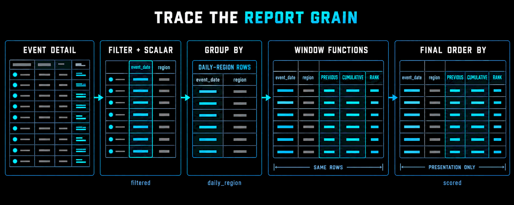
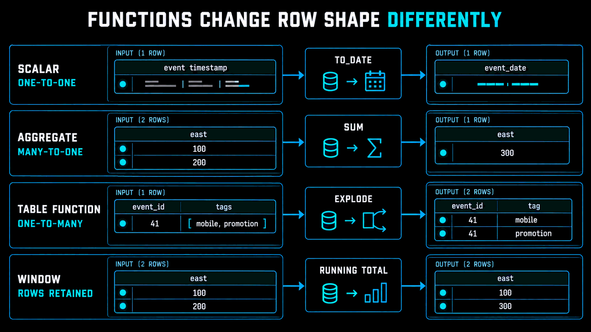
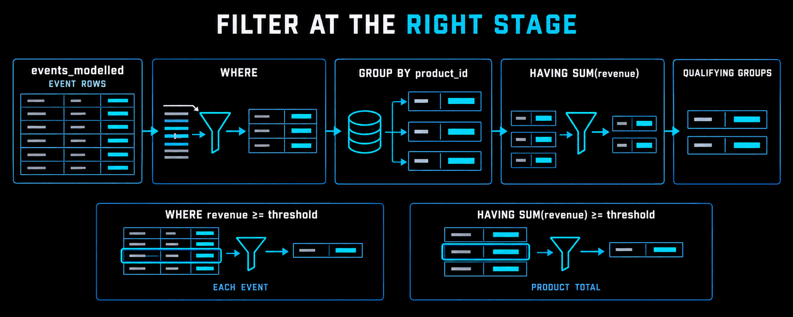
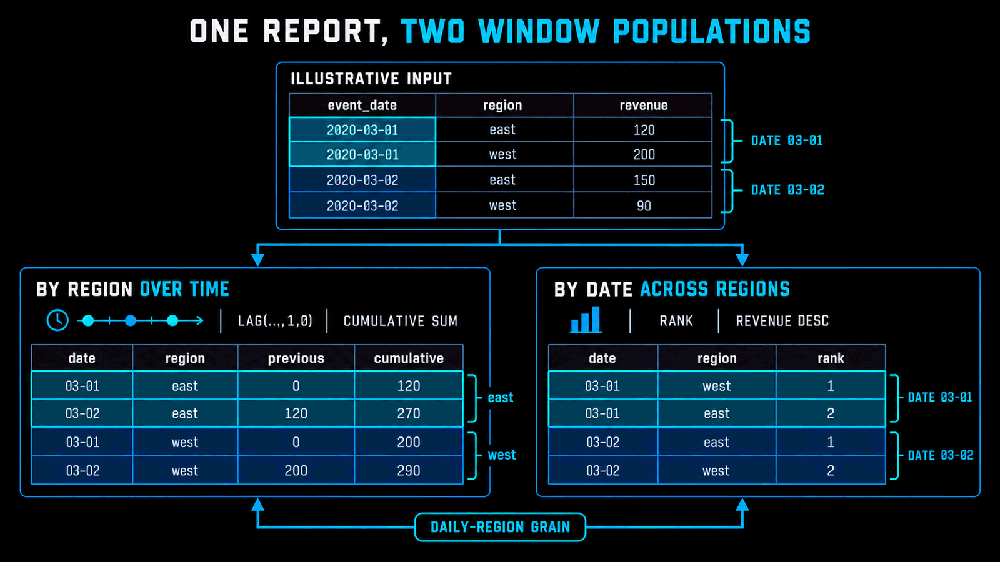
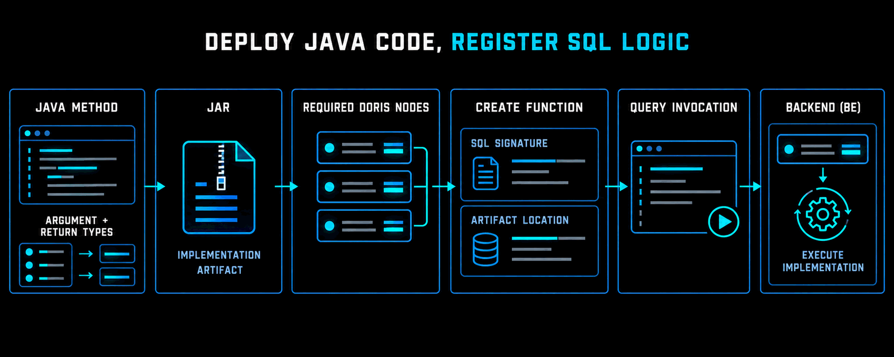

<a id="unit-u.c14161775230459e838cb3679610d7f4"></a>

<a id="module-5-analyzing-data-in-apache-doris"></a>

# 5-модуль: Apache Doris жүйесінде деректерді талдау

| Курс туралы ақпарат | Мән |
| --- | --- |
| Курс | Apache Doris көмегімен нақты уақыттағы аналитика · 2-деңгей |
| Doris | Apache Doris 4.1.3 |
| Орта | Курс сынақ ортасы және 4-зертханалық жұмыстың `events_modelled` кестесі |
| Болжамды уақыт | Шамамен 90 минут: оқу 50, зертханалық жұмыс 30, тест 10 |

[Курстың README файлы](../../README.md) · [5-зертханалық жұмысты ашу](lab05_analyze_data.ipynb) · [5-тестті ашу](quiz05_analytical_query_semantics.ipynb)

<a id="unit-u.3541274eba4943f7a761d40c4b915927"></a>

<a id="module-goal"></a>

## Модуль мақсаты

Егжей-тегжейлі оқиғаларды мағынасын негіздей алатын талдамалық нәтижеге айналдырыңыз: алдымен нәтижені анықтап, содан кейін функцияларды жолдарға жасайтын жұмысына қарай таңдаңыз және сұрауды түйіршіктілігі көрініп тұратын кезеңдермен құрыңыз.

Операциялық топ әр күн мен аймаққа оқиға көлемі, белсенді пайдаланушылар, сатып алушылар, сатып алу түсімі, алдыңғы күн түсімі, жинақталған түсім және сол күнгі аймақ орны бар бір жол алғысы келеді. 5-зертханалық жұмыс сол есепті 4-модульдің оқиға кестесі `events_modelled` негізінде құрады.

<a id="unit-u.87fa4be906824841b1a9251bbea32688"></a>

<a id="learning-objectives"></a>

## Оқу мақсаттары

Осы модульді аяқтағаннан кейін сіз:

1. Скалярлық, агрегаттық, терезелік, Table Function немесе TVF сияқты функция санатын кірісі, шығысы және жол саны әрекетіне қарай таңдай аласыз.
2. Шартты агрегаттармен әр метриканың жиынын анықтап, кіріс жолдарын `WHERE`, ал топтарды `HAVING` арқылы сүзе аласыз.
3. `ANY_VALUE` тек кез келген өкілдік мән топ мағынасына сай келгенде пайдалана аласыз.
4. Талдаудың әр кезеңіне CTE арқылы атау беріп, нәтижесінің түйіршіктілігін айта аласыз.
5. Алдыңғы мән, жинақтау және орын сұрақтарына терезе бөліктерін, ретін, фреймдерін және орын беру функцияларын таңдай аласыз.
6. Жетіспейтін қайта пайдаланылатын логика үшін кіріктірілген функциялар, Lambda өрнектері, Alias Function және пайдаланушы функциялары арасынан таңдай аласыз.

<a id="unit-u.e0416158b406495ca7c5b0622657547d"></a>

<a id="module-structure"></a>

## Модуль құрылымы

| Бөлім | Уақыт | Нәтиже |
| --- | ---: | --- |
| 5.1 Функцияларды таңдамас бұрын талдамалық жауапты анықтау | 6 мин | Нәтиженің жиынын, түйіршіктілігін, метрикаларын және ретін жазу |
| 5.2 Қажетті жұмысқа қарай функция санатын таңдау | 6 мин | Функцияларды кірісі, шығысы, жол саны және тәуелділігі бойынша жіктеу |
| 5.3 Түсіндіруге болатын өлшемдерді скалярлық функциялармен шығару | 5 мин | Әр оқиға жолын сақтай отырып күндер, сағаттар және белгілер шығару |
| 5.4 Агрегат функцияларымен анықталған метрика сұрақтарына жауап беру | 9 мин | Әр метриканың жиынын анықтап, дұрыс кезеңде сүзу |
| 5.5 Мәндерді жолдарға жаю үшін Table Function пайдалану | 5 мин | Table Function мен TVF ажыратып, жаюдан кейін түйіршіктілікті қайта бағалау |
| 5.6 Күрделі талдау кезеңдерін CTE арқылы көрсету | 6 мин | Сұраудың әр кезеңіне бір міндет пен бір түйіршіктілік беру |
| 5.7 Жолдардың түйіршіктілігін жоғалтпай терезелік функциялармен салыстыру | 8 мин | Бөліктерді, ретті, фреймдерді және тең мәндер әрекетін таңдау |
| 5.8 Жетіспейтін қайта пайдаланылатын логикаға дұрыс кеңейтуді таңдау | 5 мин | Алдымен кіріктірілген функцияларды, содан кейін Lambda, Alias Function немесе UDF таңдау |
| 5-зертханалық жұмыс | 30 мин | Күн-аймақ есебін кезеңдермен құрып, әр кезеңнің түйіршіктілігін оқу |
| 5-тест | 10 мин | Осы мақсаттар бойынша алты сұрақ |

<a id="unit-u.a4f29fef6bac4c34b59dc668f627c77a"></a>

<a id="51-define-the-analytical-answer-before-choosing-functions"></a>

## 5.1 Функцияларды таңдамас бұрын талдамалық жауапты анықтау

«Аймақтардың нәтижесін көрсету» әлі сұрау шарты емес. Ол бірнеше сұрақты шешпей қалдырады:

- Есепке қай оқиғалар кіреді?
- Бір шығыс жолы нені білдіреді?
- Әр метрикаға қай оқиғалар үлес қосады?
- Талапқа сай оқиғалары жоқ күндер немесе аймақтар көрсетілуі тиіс пе?
- «Алдыңғы», «жинақталған» және «орын» ұғымдарын қай тізбек анықтайды?
- Нәтиже интерактивті қарауға ма, әлде кейінгі файлдық жұмыс барысына ма арналған?

Функция атауларын таңдамас бұрын осы таңдауларды шешіңіз. Осы модуль сценарийінің бір ықтимал шарты:

| Шешім | Талап |
| --- | --- |
| Кіріс жиыны | 1 наурызды қоса, 4 наурызды қоспайтын оқиғалар |
| Нәтиже түйіршіктілігі | Әр `event_date` және `region` үшін бір жол |
| Белсенділік метрикалары | Әр күн-аймақ тобындағы барлық оқиғалар және бірегей пайдаланушылар |
| Сатып алу метрикалары | Сол топтағы бірегей сатып алушы пайдаланушылар және сатып алу түсімі |
| Уақыт салыстыруы | Әр аймақ ішіндегі алдыңғы байқалған күндік түсім және жинақталған түсім |
| Аймақаралық салыстыру | Сол күндегі аймақтар арасындағы түсім орны |
| Соңғы реттеу | Тұрақты көрсетілім үшін күн, орын, содан кейін аймақ |

Бұл шарт сырттай қисынды қателерге жол бермейді. Тек күн бойынша топтау аймақ түйіршіктілігін алып тастар еді. `event_count` есептемес бұрын тек сатып алуды сүзу сол бағанды сатып алу оқиғаларының санына айналдырар еді. Барлық 24 жолды бірге реттеп орын беру әр күнде сегіз аймаққа дербес орын беруден басқа сұраққа жауап береді.

<a id="unit-u.46548748f3fa4221a30e87ff4140ca77"></a>

<a id="trace-the-report-grain-through-the-query"></a>

### Сұрау бойымен есеп түйіршіктілігін қадағалау

Сұрауды жол пішіндерінің тізбегі ретінде түсінуге болады:



*Топтау түйіршіктілікті өзгертеді; терезелер оны сақтайды, ал реттеу көрсетілімді өзгертеді.*

Сурет жазулары: Trace the report grain — есеп түйіршіктілігін қадағалау; Event detail — егжей-тегжейлі оқиғалар; Filter + scalar — сүзгі және скалярлық есептеу; GROUP BY — GROUP BY; Daily-region rows — күн-аймақ жолдары; Window functions — терезелік функциялар; Previous — алдыңғы; Cumulative — жинақталған; Rank — орын; Same rows — сол жолдар; Final ORDER BY — соңғы ORDER BY; Presentation only — тек көрсетілім. event_date, region, filtered, daily_region және scored атаулары өзгермейді. Сурет ағылшын түпнұсқасында сақталған.

Сүзу жолдарды алып тастай алады. Топтау әдетте көптеген егжей-тегжейлі жолды саны азырақ топталған жолдарға азайтады. Терезелік есептеу алған жолдарын сақтап, әрқайсысына мән қосады. Соңғы реттеу түйіршіктілікті емес, олардың көрсетілім тізбегін өзгертеді.

<a id="unit-u.32028e65fabb405998b2c2750540f0a8"></a>

<a id="separate-result-meaning-from-result-delivery"></a>

### Нәтиже мағынасын нәтижені жеткізуден ажырату

MySQL үйлесімді клиент және Jupyter ноутбугы сол SQL нәтижесін әртүрлі пішінде көрсете алады. MySQL пәрмен жолы клиентінде `\G` тік көрсетілімді сұрайды; ол ноутбук көмекшісі арқылы жіберілетін сұраудың бөлігі емес, клиент пәрменінің аяқтауышы. Баған бүркеншік атаулары оқуға ыңғайлылықты жақсарта алады, бірақ сұрау есептейтін жолдар мен мәндерді өзгертпейді.

Басқа жүйеге файлдар қажет болғанда, Doris үтірмен бөлінген мәндер (CSV), Parquet және Optimized Row Columnar (ORC) сияқты пішімдері бар `SELECT INTO OUTFILE` қолдайды. Экспорт мақсаты, пішімі, рұқсаттары және тіркелгі деректері жеткізу шартын құрайды. Олар қате анықталған метриканы немесе түйіршіктілікті түзетпейді. 5-зертханалық жұмыс нәтижелерді көрсетеді және экспорт жасамайды. [SELECT INTO OUTFILE](https://doris.apache.org/docs/4.x/data-operate/export/outfile/) құжатын қараңыз.

<a id="unit-u.b8dc31eea42144e2846424ddac6203e2"></a>

<a id="52-choose-a-function-category-from-the-required-work"></a>

## 5.2 Қажетті жұмысқа қарай функция санатын таңдау

Алдымен амал нені қабылдайтынын, не қайтаратынын және жол санына не болатынын сұрасаңыз, Doris SQL функциялар каталогын бағдарлау жеңілдейді. Санаттар жай атаулар тізімі емес.

| Функция санаты | Негізгі кіріс пен шығыс байланысы | Сай сценарий | Өкілдік пішін |
| --- | --- | --- | --- |
| Скалярлық функция | Бір кіріс жолының аргументтері бір мән береді | Күн шығару немесе белгіні қалыпқа келтіру | `TO_DATE(event_time)` |
| Агрегат функциясы | Бірнеше жолдың мәндері топқа бір мән береді | Аймақ түсімін есептеу | `SUM(revenue)` |
| Комбинатор | Агрегат күй, біріктіру немесе массив орны әрекетімен бейімделеді | Агрегат күйлерін біріктіру немесе сәйкес массив элементтерін агрегаттау | `SUM_FOREACH(metric_array)` |
| Талдамалық (терезелік) функция | Байланысты нәтиже жолдары әр сақталған жолға бір мәнге үлес қосады | Күндік жолды алдындағы жолмен салыстыру | `LAG(revenue) OVER (...)` |
| Table Function | Әр ағымдағы кіріс жолының мәні нөлден көпке дейін жол береді | Оқиғаға тіркелген тегтерді жаю | `LATERAL VIEW` арқылы `EXPLODE(tags)` |
| Table-Valued Function (TVF) | Функцияның өзі `FROM` тармағына қатынас береді | Сандар жасау немесе файлдарды жолдар мен бағандар ретінде сұрау | `NUMBERS(...)` немесе `S3(...)` |
| AI функциясы | Doris AI Resource арқылы модель шақырады | Мәтінді жіктеу, алу, аудару, жинақтау немесе талдау | `AI_SENTIMENT(resource, text)` |

<a id="unit-u.14aa479fd6fa49ceb2b62e536ad11cfe"></a>

<a id="follow-the-row-shape-through-the-analysis"></a>

### Талдау бойымен жол пішінін қадағалау

Пайдалы бастапқы жуықтау негізгі функция пішіндерін байланыстырады:



*Функция санаттары нені қабылдайтыны, қайтаратыны және жол пішініне не істейтіні бойынша ерекшеленеді.*

Сурет жазулары: Functions change row shape differently — функциялар жол пішінін әртүрлі өзгертеді; Scalar — скалярлық; One-to-one — бірден бірге; Input (1 row) — кіріс (1 жол); Output (1 row) — шығыс (1 жол); Aggregate — агрегаттық; Many-to-one — көптен бірге; Input (2 rows) — кіріс (2 жол); Table Function — жолды жаятын функция; One-to-many — бірден көпке; Output (2 rows) — шығыс (2 жол); Window — терезелік; Rows retained — жолдар сақталады; Running total — жинақталған қосынды. TO_DATE, SUM, EXPLODE функциялары, event_timestamp, event_date, event_id, tags, tag атаулары, east, mobile, promotion мәндері және 41, 100, 200, 300 сандары өзгермейді. Сурет ағылшын түпнұсқасында сақталған.

Қысқаша, бұлар **бірден бірге**, **көптен бірге** және **бірден көпке**. Олар толық SQL операторы дәл сол жол санын сақтайтынын кепілдемейді, функцияның сұрауға қосатын үлесін сипаттайды. `WHERE` тармағы жолдарды алып тастай алады, Join оларды көбейте алады, ал `GROUP BY` қанша агрегат тобы қалатынын анықтайды.

Кейінгі бөлімдер осы жол пішінінің өзгерісін қадағалайды. 5.3-бөлім оқиға жолдарын сақтай отырып мәндер шығарады. 5.4-бөлім көптеген оқиғаны әр күн-аймақ жолына әдейі біріктіреді. 5.5-бөлім бір жолды бірнеше элемент жолына жаяды. Одан кейін 5.6-бөлім сол түрлендірулерге айқын кезеңдер береді, ал 5.7-бөлім сақталған әр нәтиже жолына бір мән есептеу үшін байланысты жолдар терезесін пайдаланады:

Жоғарыдағы жол пішіні көрнекілігі де осы ретпен жүреді: оқиға жолдарында мәндер шығару, күн-аймақ топтарына агрегаттау, содан кейін түйіршіктілікті өзгертпей терезелік мәндер қосу.

<a id="unit-u.5d9350a41bdd4576ae76bda224d5dd4b"></a>

<a id="some-categories-describe-different-dimensions"></a>

### Кей санат әртүрлі қырларды сипаттайды

Жол пішіні мен мүмкіндік көзі қабаттасуы мүмкін. `AI_SENTIMENT` әр жолдық скалярлық есептеу сияқты әрекет етеді, бірақ «AI функциясы» оған бапталған AI Resource және сыртқы модель шақыруы қажет екенін де айтады. Ал `AI_AGG` топталған мәтінмен жұмыс істейді. Сондықтан `AI_*` атауын көру жол саны әрекетін шығаруға жеткіліксіз.

Сол сияқты, `SUM(revenue)` топты қорытқанда агрегат функциясы болады. Агрегат `OVER` арқылы жазылса, терезе мағынасына сай әр сақталған кіріс нәтиже жолына бір мән береді. SQL контексті амалдың нәтижеге қалай қатысатынын анықтайды.

Table Function және TVF екеуі де жол жасайды, бірақ бастапқы нүктелері әртүрлі. Table Function ағымдағы жолдағы бір нәрсені жаяды; TVF кесте көзі болады. 5.5-бөлім осы айырмашылықты нақты жол пішіндерімен ашады.

<a id="unit-u.df56cd7488b840d09980dc463d741e4d"></a>

<a id="treat-ai-calls-as-an-external-dependency"></a>

### AI шақыруларын сыртқы тәуелділік ретінде қарастыру

AI функциясы қолданба модель жеткізушісін, AI Resource, тіркелгі деректерін, желі қолжетімділігін, күтілетін кідірісті, сәтсіздік саясатын, деректерді басқару ережелерін және рұқсат етілетін шығынды анықтағаннан кейін ғана қолайлы. Сыртқы модель қайтарған эмоциялық реңк белгісі детерминді жергілікті жол түрлендіруіне баламалы емес.

Зертханалық жұмыс `AI_SENTIMENT` жіктейді, бірақ орындамайды. Бұл жұмысты дербес ұстап, курс деректерін сыртқы жеткізушіге жібермеуге мүмкіндік береді. Қолданбас бұрын [AI функцияларына шолуды](https://doris.apache.org/docs/4.x/sql-manual/sql-functions/ai-functions/overview/) және таңдалған функцияның ағымдағы шартын қараңыз.

<a id="unit-u.6f451e6d1f9a4e3eab0183e3ee280a79"></a>

<a id="53-use-scalar-functions-to-derive-explainable-dimensions"></a>

## 5.3 Түсіндіруге болатын өлшемдерді скалярлық функциялармен шығару

Оқиға кестесі `event_time`, `region` және `event_type` мәндерін типтелген бағандарда сақтап тұр. Есепке әлі оқиға күні, сағат шекарасы, сағат нөмірі немесе көрсету белгісі қажет болуы мүмкін. Скалярлық функциялар сол мәндерді әр таңдалған кіріс жолы үшін дербес шығарады.

<a id="unit-u.dac24d5876c6494ca0ac903707b7d145"></a>

<a id="distinguish-time-meaning-from-time-presentation"></a>

### Уақыт мағынасын уақыт көрсетілімінен ажырату

Әртүрлі уақыт өрнектері әртүрлі сұраққа жауап береді:

| Қажеттілік | Өрнек рөлі | Мысал |
| --- | --- | --- |
| Топтауға арналған күнтізбелік күн | Уақыт белгісін `DATE` мәніне түрлендіру | `TO_DATE(event_time)` |
| Оқиға сағатының басы | Сағаттық уақыт шекарасына қалыпқа келтіру | `DATE_TRUNC(event_time, 'hour')` |
| Таралуға арналған сағат құрамдасы | Бір құрамдасты шығару | `EXTRACT(HOUR FROM event_time)` |
| Адам оқитын белгі | Көрсету үшін пішімдеу | `DATE_FORMAT(event_time, ...)` |

Пішімделген жол күнге ұқсауы мүмкін, бірақ оның шарты әлі жолдық тип. Кейінгі амалдар күндерді салыстыруы, аралықтар есептеуі немесе күнтізбелік мағынаны сақтауы тиіс болса, уақыт мәнін таңдаңыз. Тұтынушыға нақты белгі қажет болғанда мәнді пішімдеңіз.

Сұраудың уақыт белдеуі және шекара келісімі метрика шартының бөлігі. Бастапқы уақыт белгісі мен бизнес есеп белдеуі әртүрлі болса, «күндік» сөзі екіұшты. Функция бұл бизнес шешімді өздігінен шеше алмайды.

<a id="unit-u.07fe2228c42448739b6c6c6ca993fe53"></a>

<a id="separate-normalization-labeling-and-matching"></a>

### Қалыпқа келтіру, белгілеу және сәйкестікті тексеруді ажырату

Жол амалдары да бөлек мақсаттарға қызмет етеді:

- `LOWER`, `UPPER` және `TRIM` мәндерді жарияланған салыстыру немесе көрсету ережесіне сай қалыпқа келтіре алады.
- Түрлендіру нақты механикалық болса, `REPLACE` көрсетілім белгісін құра алады.
- `LIKE` және `REGEXP` қай жолдар жарамды екенін шешетін предикаттар; олар сақталған мәнді стандарттамайды.

Шарт бойынша әріп регистріне тәуелді идентификаторды себепсіз қалыпқа келтірмеңіз. Бір санаттың бірнеше жазылуы болса, қабылдау бір канондық мән орнатуы керектігін шешіңіз. Әр талдамалық сұрауда тазалау логикасын қайталау дерек шекарасының тым еркін екенін білдіруі мүмкін.

Скалярлық өрнектер өздігінен жолдарды топтамайды. `TO_DATE(event_time)` және `UPPER(region)` бар проекцияға сегіз оқиға жолы кірсе, одан сегіз жол әлі де шыға алады. Кейінгі `GROUP BY` түйіршіктілікті өзгертеді.

<a id="unit-u.dc42b49a65af4c0abe7c381360744785"></a>

<a id="54-use-aggregate-functions-to-answer-defined-metric-questions"></a>

## 5.4 Агрегат функцияларымен анықталған метрика сұрақтарына жауап беру

Агрегат функциясы бақылауларды біріктіреді. Дұрыс функция математикалық амалға да, бақыланатын жиынға да байланысты.

<a id="unit-u.ba71a5e8d5e04fa79665cc5811cfeabc"></a>

<a id="define-the-population-for-every-measure"></a>

### Әр метрикаға үлес қосатын жиынды анықтау

Бір күн-аймақ жолындағы төрт метриканы қарастырайық:

| Метрика | Үлес қосатын жиын | Сай өрнек үлгісі |
| --- | --- | --- |
| Оқиға саны | Топтағы барлық таңдалған оқиғалар | `COUNT(*)` |
| Белсенді пайдаланушылар | Барлық таңдалған оқиғалардағы `NULL` емес бірегей пайдаланушылар | `COUNT(DISTINCT user_id)` |
| Сатып алушылар | Тек сатып алу оқиғаларындағы бірегей пайдаланушылар | `COUNT(DISTINCT CASE WHEN event_type = 'purchase' THEN user_id END)` |
| Сатып алу түсімі | Тек сатып алу оқиғаларының түсімі | `SUM(CASE WHEN event_type = 'purchase' THEN revenue ELSE 0 END)` |

Шартты өрнектер үлес қосатын жиындары әртүрлі метрикаларға бір күн-аймақ нәтижесінің түйіршіктілігін ортақ пайдалануға мүмкіндік береді. Бүкіл сұрауды тек сатып алуларға сүзу `event_count` және `active_users` ішінен сатып алу емес оқиғаларды да алып тастап, олардың мағынасын өзгертер еді.

Бірегей сандар жалпы жағдайда қосылмайды. Екі аймақта немесе екі күнде белсенді пайдаланушы әр тиісті топқа үлес қосады, бірақ жалпы бірегей пайдаланушы санында бір рет көрінуі тиіс. Күн-аймақ бірегей сандарын қосу жаһандық бірегей жиынды бермейді.

<a id="unit-u.14afe54569ea489ea8e4ff16c69767d2"></a>

<a id="choose-the-statistic-that-matches-the-question"></a>

### Сұраққа сай статистиканы таңдау

`COUNT`, `SUM`, `AVG`, `MIN` және `MAX` әртүрлі сұраққа жауап береді. Орташа мәнге анықталған бақылау мен бөлім қажет. «Орташа түсім» әр сатып алу оқиғасына, әр сатып алушыға немесе әр күнге орташа мәнді білдіруі мүмкін; бұл мәндер өзара алмастырылмайды.

Дисперсия бір сандық метриканың шашырауын сипаттайды. Ковариация екі метриканың өз бірліктерінде бірге қалай өзгеретінін сипаттайды. Корреляция сол байланысты өлшемсіз шкалаға қалыпқа келтіреді. Ешқайсысы себептілікті анықтамайды. Статистикалық агрегатты қолданбас бұрын бақылау түйіршіктілігін, іріктеме не жалпы жиын түсінігін, жетіспейтін мән саясатын және шеткі мәндердің ауқымда қалуы керектігін анықтаңыз.

<a id="unit-u.a59f75a28a59442c985ecca525eaa05e"></a>

<a id="put-filters-at-the-stage-they-are-meant-to-affect"></a>

### Сүзгілерді әсер етуі тиіс кезеңге орналастыру

`WHERE` және `HAVING` әртүрлі жол пішіндерінде жұмыс істейді:



*`WHERE` кіріс жолдарын тексереді; `HAVING` агрегаттар пайда болғаннан кейін топтарды тексереді.*

Сурет жазулары: Filter at the right stage — дұрыс кезеңде сүзу; Event rows — оқиға жолдары; Qualifying groups — талапқа сай топтар; Each event — әр оқиға; Product total — өнім жиынтығы. events_modelled, WHERE, GROUP BY product_id, HAVING SUM(revenue), WHERE revenue >= threshold және HAVING SUM(revenue) >= threshold жазулары SQL мағынасын сақтау үшін түпнұсқада қалады; threshold — шек. Сурет ағылшын түпнұсқасында сақталған.

Бір күнде сатып алу түсімі шекке жететін өнімдерді табу үшін `WHERE` сол күннің сатып алу оқиғаларын, ал `HAVING SUM(revenue)` талапқа сай өнім топтарын таңдауы тиіс. `WHERE revenue >= 120000` сияқты предикат әр жеке оқиғаның шекке жететінін сұрайды. Ол өнім жиынтығын тексермейді.

<a id="unit-u.0be6c42f499f439782203e6930658114"></a>

<a id="use-any_value-only-under-a-real-constraint"></a>

### `ANY_VALUE` тек нақты шектеу болғанда пайдалану

Баған топты анықтамаса, топталған сұрау мәні топ ішінде өзгеретін кәдімгі бағанды көрсете алмайды. Doris тек `region` бойынша топтап, `event_time` таңдау сияқты екіұшты проекцияны қабылдамайды.

`ANY_VALUE(expression)` бар болса, кез келген `NULL` емес өкілдік мәнді айқын сұрайды; барлық үміткер `NULL` болса, `NULL` қайтарады. Бұл нақты таңдалған мән бизнес мағынасын өзгерте алмағанда мағыналы. Мысалы, предикат барлық кіріс жолын бір күнтізбелік күнмен шектегеннен кейін әр аймақтағы кез келген оқиға күні сол күн болады. Топ бірнеше күнді қамтып, нәтиже олардың бірін анықтауы тиіс болса, бұл мағыналы емес. Онда күнді түйіршіктілікке қосыңыз немесе түсіндіруге болатын мағынасы бар `MIN` не `MAX` сияқты ереже айтыңыз.

`ANY_VALUE` кездейсоқ қай жарамды жолды таңдайтынына ешқашан тәуелді болмаңыз. Оның мақсаты — болжамды алғашқы немесе соңғы мәнге қысқа жол беру емес, бәрібір екенін білдіру. [ANY_VALUE](https://doris.apache.org/docs/4.x/sql-manual/sql-functions/aggregate-functions/any-value/) құжатын қараңыз.

<a id="unit-u.e0d3e4ac0329429d9486900134bd5b1a"></a>

<a id="introduce-a-combinator-only-for-its-specialized-behavior"></a>

### Комбинаторды тек арнайы әрекеті үшін енгізу

Комбинатор агрегат функциясының көрсетілуін немесе қолданылуын өзгертеді. Күй және біріктіру пішіндері аралық агрегат күйлерін сақтайтын немесе біріктіретін жұмыс барыстарын қолдайды. `FOREACH` пішіні агрегатты жолдар арасындағы массив мәндерінің сәйкес орындарына дербес қолданады.

Деректер өнімінде біріктірілетін агрегат күйлері немесе орны мағыналы массивтер нақты болса, бұлар пайдалы. Кәдімгі жалпы түсім үшін қажет емес. Арнайы талап пайда болғанға дейін тікелей әрі оқуға ыңғайлы `SUM(revenue)` таңдаңыз. Қолдау көрсетілетін тіркестер мен тип шектеулері үшін [STATE](https://doris.apache.org/docs/4.x/sql-manual/sql-functions/combinators/state/), [MERGE](https://doris.apache.org/docs/4.x/sql-manual/sql-functions/combinators/merge/) және [FOREACH](https://doris.apache.org/docs/4.x/sql-manual/sql-functions/combinators/foreach/) құжаттарын қараңыз.

<a id="unit-u.3946e818f6f04cdb9dbf62005e810835"></a>

<a id="55-use-a-table-function-to-expand-values-into-rows"></a>

## 5.5 Мәндерді жолдарға жаю үшін Table Function пайдалану

Оқиға бір жолда бірнеше тег, map жазбасын немесе бөлгішпен бөлінген мән сақтауы мүмкін. Талдауға әр нәтиже жолында сол элементтердің бірі қажет болса, бастапқы жолмен байланысын сақтай отырып мәнді жаю үшін Table Function пайдаланыңыз.

<a id="unit-u.ee0a6a0b880249e5a2bf7b3929bc4acd"></a>

<a id="expand-a-value-belonging-to-each-input-row"></a>

### Әр кіріс жолына тиесілі мәнді жаю

Оқиғаның тегтер массиві бар делік:

| `event_id` | `tags` |
| ---: | --- |
| 41 | `['mobile', 'promotion']` |
| 42 | `['desktop']` |

`EXPLODE(tags)` және `LATERAL VIEW` әр жасалған тегті өзінің бастапқы оқиғасымен байланыстырады:

| `event_id` | `tag` |
| ---: | --- |
| 41 | `mobile` |
| 41 | `promotion` |
| 42 | `desktop` |

Нәтиже түйіршіктілігі енді әр оқиғаға бір жол емес, әр оқиға-тег кездесуіне бір жол. Осы жаюдан кейін оқиға түсімін қосу, метрика әдейі тегке жатқызуды өлшемесе немесе сұрау алдымен тиісті түйіршіктілікке оралмаса, 41-оқиғаны екі рет санар еді. Бос және `NULL` жинақтары үшін де сақтау шешімі айқын болуы тиіс; таңдалған Table Function шартын қараңыз.

Table Function жолға тәуелді талдауға немесе жаюға сай келеді. Мысалдар — массивті жаю және бөлгіші бар мәнді бөлу. Doris оларды көбіне `LATERAL VIEW` арқылы қолданады. [EXPLODE](https://doris.apache.org/docs/4.x/sql-manual/sql-functions/table-functions/explode/) құжатын қараңыз; оның жанында басқа Table Function функциялары да тізілген.

> **Table Function және TVF — әртүрлі санат.** `EXPLODE(tags)` сияқты Table Function әр ағымдағы кіріс жолында орындалып, сол жолға байланысты нөлден көпке дейін жол жасайды. `NUMBERS(...)` немесе `S3(...)` сияқты Table-Valued Function (TVF) `FROM` ішіндегі қатынас көзінің өзі болады; өз қатынасын жасау үшін оған `events_modelled` жолы қажет емес. 3-модуль сыртқы файлдарды уақытша қатынас ретінде көрсету үшін S3 TVF пайдаланды. 5-зертханалық жұмыс `NUMBERS("number" = "4")` өрнегін тек шағын дербес салыстыру ретінде пайдаланады және S3 қатынауын немесе тұрақты сақтауды қайта қарастырмайды. [NUMBERS](https://doris.apache.org/docs/4.x/sql-manual/sql-functions/table-valued-functions/numbers/) және [S3](https://doris.apache.org/docs/4.x/sql-manual/sql-functions/table-valued-functions/s3/) құжаттарын қараңыз.

<a id="unit-u.a15490de763a4c328cf245e40ff2e989"></a>

<a id="56-use-ctes-to-express-the-stages-of-a-complex-analysis"></a>

## 5.6 Күрделі талдау кезеңдерін CTE арқылы көрсету

Common Table Expression бір SQL операторы ішінде уақытша нәтиже жиынына атау береді. Ол әр кезеңнің түйіршіктілігі мен міндетін көрінетін ете алады. Тұрақты кесте жасамайды.

Күн-аймақ сценарийі үшін жұмысты былай бөліңіз:

| Кезең | Міндеті | Нәтиже түйіршіктілігі |
| --- | --- | --- |
| `filtered` | Үш күндік кіріс жиынын таңдап, `event_date` шығару | Әр таңдалған оқиғаға бір жол |
| `daily_region` | Күн және аймақ бойынша топтап, белсенділік пен сатып алу метрикаларын есептеу | Әр күн мен аймаққа бір жол |
| `scored` | Алдыңғы түсімді, жинақталған түсімді және күндік орынды қосу | Әр күн мен аймаққа бір жол |
| Соңғы `SELECT` | Көрінетін бағандарды және көрсетілім ретін таңдау | Әр күн мен аймаққа бір жол |

Барлық амалды бірден жасауға тырысатын бір сұрау қабатына қарағанда құрылым сұлбасын тексеру жеңілірек:

```sql
WITH filtered AS (
    -- select the input population and derive event_date
),
daily_region AS (
    -- establish the daily-region grain and calculate measures
),
scored AS (
    -- retain those rows and add window calculations
)
SELECT ...
FROM scored
ORDER BY ...;
```

Бұл ұйымдастыру қателердің орнын табуды жеңілдетеді. Сатып алу түсімі қате болса, кіріс предикаты мен шартты агрегатты тексеріңіз. Жол саны үш күн көбейтілген сегіз аймаққа тең болмаса, `daily_region` топтауын тексеріңіз. «Алдыңғы» бір аймақтан басқасына өтсе, терезе бөлігін тексеріңіз.

CTE — мағына мен оқуға ыңғайлылық шекарасы. Оның болуы Doris нәтижені материалдандыратынын, әр атаулы блокты бөлек орындайтынын немесе сұрауды жылдамдататынын кепілдемейді. Физикалық орындау маңызды болса, `EXPLAIN` және Query Profile пайдаланыңыз; тек синтаксистен өнімділік қасиетін шығармаңыз. [Common Table Expressions](https://doris.apache.org/docs/4.x/query-data/cte/) құжатын қараңыз.

<a id="unit-u.73ae5b66c9b440e0975ae309c162f976"></a>

<a id="preserve-missing-period-meaning"></a>

### Жетіспейтін кезең мағынасын сақтау

Егжей-тегжейлі оқиғаларды топтау тек талапқа сай кірісте бар топтар үшін жол жасайды. Аймақта бір күнде таңдалған оқиға болмаса, тек оқиғаларға негізделген агрегаттау сол тіркеске нөлдік жолды автоматты ойдан қоспайды.

Бұл кейінгі терезелер үшін маңызды. `LAG` реттелген терезесіндегі алдыңғы нәтиже жолын оқиды, ол алдыңғы күнтізбелік күн болмауы мүмкін. Әр күнтізбелік күнді көрсетуі тиіс есепке күнтізбе қатынасы және сыртқы Join немесе басқа айқын бос аралық толтыру құрылымы қажет. Нөлдік белсенділік пен нәтиже жолының жоқтығы — әртүрлі күй.

<a id="unit-u.7ea8386bf8464b0a9a03c51ee6204b0f"></a>

<a id="57-use-window-functions-to-compare-rows-without-losing-their-grain"></a>

## 5.7 Жолдардың түйіршіктілігін жоғалтпай терезелік функциялармен салыстыру

Агрегаттаудан кейін әр жол күн мен аймақты білдіреді. Терезелік функциялар сол жолдарды сақтай отырып салыстырады. Үш тармақ салыстыру шартын орнатады:



*Сол күн-аймақ жолдары түйіршіктілігін өзгертпей әртүрлі терезе жиындарына қатыса алады.*

Сурет жазулары: One report, two window populations — бір есеп, екі терезе жиыны; Illustrative input — түсіндірмелік кіріс; By region over time — уақыт бойымен аймақ бойынша; By date across regions — күн бойынша аймақтар арасында; Cumulative SUM — жинақталған SUM; Revenue DESC — түсімнің кему реті; Daily-region grain — күн-аймақ түйіршіктілігі; Date 03-01 / Date 03-02 — 03-01 / 03-02 күндері; date — күн; previous — алдыңғы; cumulative — жинақталған; rank — орын. event_date, region, revenue, LAG(...,1,0), RANK, east, west, 2020-03-01, 2020-03-02 және 0, 1, 2, 90, 120, 150, 200, 270, 290 мәндері түпнұсқада сақталған. Сурет ағылшын тілінде қалады.

| Терезе құрамдасы | Жауап беретін сұрағы |
| --- | --- |
| `PARTITION BY` | Қай жолдар дербес салыстыру жиынын құрайды? |
| Терезенің `ORDER BY` тармағы | Алдыңғы, келесі және жинақталған орындар қандай тізбекте анықталады? |
| Терезе фреймі | Ағымдағы жол айналасындағы қай орындар фреймге тәуелді есептеуге үлес қосады? |

<a id="unit-u.0aeaabdec550432c97ad0aa9085ac8a0"></a>

<a id="compare-each-region-with-its-previous-observed-row"></a>

### Әр аймақты алдыңғы байқалған жолымен салыстыру

Аймақ түсімінің үрдістері үшін дербес тізбек — әр аймақ:

```sql
LAG(purchase_revenue, 1, 0) OVER (
    PARTITION BY region
    ORDER BY event_date
)
```

`1` ығысуы бір алдыңғы нәтиже жолын білдіреді, ал `0` — ондай жол болмағандағы әдепкі мән. Сондықтан зертханалық жұмыста алғашқы көрсетілген күн нөл алады. Ол мән таңдалған ауқымға дейінгі түсім нөл болды деп мәлімдемейді. Тек шекара әрекетін айқын етеді.

Күндер жетіспесе де, `LAG` алдыңғы жолды оқиды. Сұрау қатар күнтізбелік қатынасты кепілдемесе, оны «алдыңғы байқалған күн» деп сипаттаңыз.

<a id="unit-u.8fedf148650242279a2c082d064f735d"></a>

<a id="state-the-cumulative-frame"></a>

### Жинақтау фреймін айқын көрсету

Әр аймақ үшін жинақталған қосынды мынаны қолдана алады:

```sql
SUM(purchase_revenue) OVER (
    PARTITION BY region
    ORDER BY event_date
    ROWS BETWEEN UNBOUNDED PRECEDING AND CURRENT ROW
)
```

`ROWS` фреймі сол аймақтағы бірінші таңдалған жолдан басталып, ағымдағы жолда аяқталады. Бұрынғы күндерді кірістен сүзу оларды жинақталған жиынтықтан да алып тастайды. «Жинақталған» сөзі әрдайым бастапқы ауқымын атауы тиіс.

`ROWS BETWEEN 2 PRECEDING AND CURRENT ROW` сияқты фрейм ең көбі үш жол орнын қамтиды. Кірісте әр қатар күнге бір жол болғанда ғана ол үш күнтізбелік күнді білдіреді.

<a id="unit-u.addc30655ed849139dbacc44014d7f9f"></a>

<a id="choose-the-intended-tie-behavior"></a>

### Тең мәндер үшін көзделген әрекетті таңдау

`ROW_NUMBER` бөлек тізбекті орындар тағайындайды. Орын детерминді болуы тиіс болса, теңдікті шешетін қосымша кілт беріңіз. `RANK` бірдей реттеу мәндеріне бір орын беріп, теңдіктен кейін бос орын қалдырады:

| Аймақ | Түсім | Аймақты теңдік шешуші ететін `ROW_NUMBER` | Тек түсім бойынша `RANK` |
| --- | ---: | ---: | ---: |
| East | 100 | 1 | 1 |
| West | 100 | 2 | 1 |
| North | 80 | 3 | 3 |

Нәтижеге әр жол үшін бір детерминді орын қажет болса, `ROW_NUMBER` таңдаңыз. Бірдей метрика мәндері ортақ бизнес орнын алуы тиіс болса, `RANK` таңдаңыз. Модуль сценарийінде `PARTITION BY event_date` жарысты күн сайын қайта бастайды, ал `ORDER BY purchase_revenue DESC` ең үлкен мәнге 1-орын береді.

Терезе реті мен соңғы нәтиже реті әртүрлі мақсатқа қызмет етеді. Терезе түсім орнын анықтауы мүмкін, ал соңғы `ORDER BY` күнді, орынды және аймақты көрсетеді. Көрсетілім реті терезе мәндерін қайта есептемейді. [Талдамалық (терезелік) функциялар](https://doris.apache.org/docs/4.x/query-data/window-function/) құжатын қараңыз.

<a id="unit-u.adc0f67899d24c2c8a29e1c9e6cb89db"></a>

<a id="58-choose-the-right-extension-for-missing-reusable-logic"></a>

## 5.8 Жетіспейтін қайта пайдаланылатын логикаға дұрыс кеңейтуді таңдау

Doris кіріктірілген функциялары мен айқын SQL өрнектерінен бастаңыз. Олар осы модульдегі күн түрлендірулерін, топтауды, шартты метрикаларды, жаюды және терезелерді әлдеқашан қамтиды. Өрнек синтаксисінің жай қайталануы пайдаланушы кодын орналастыруды ақтамайды.

<a id="unit-u.5064cf83fb964e41b08040441baf602d"></a>

<a id="compare-reuse-and-extension-choices"></a>

### Қайта пайдалану және кеңейту таңдауларын салыстыру

| Талап | Сай бастапқы тәсіл |
| --- | --- |
| Doris амалды әлдеқашан береді | Кіріктірілген функция |
| Бір сұрауға бар өрнектердің оқуға ыңғайлы тіркесі қажет | Қалыпты SQL өрнегі немесе CTE |
| Жоғары ретті массив амалына қысқа элемент өрнегі қажет | Кіріктірілген функцияға берілетін Lambda өрнегі |
| Қолдау көрсетілетін өрнектерге қайта пайдаланылатын SQL сигнатурасы қажет | Alias Function |
| Қажетті қайта қолданылатын әрекетті қолдау көрсетілетін SQL арқылы өрнектеу мүмкін емес | Тиісті пайдаланушы анықтайтын функция тобы |

`ARRAY_MAP(x -> x * 2, [1, 2, 3, 4])` ішінде Lambda өрнегі әр массив элементімен не болатынын анықтайды. `ARRAY_FILTER` қай элементтер қайтарылған массивте қалатынын шешу үшін Lambda предикатын пайдаланады. Бұл өрнектердің ешқайсысы басқа сұраулар үшін жаңа функция тіркемейді және массив элементтерін сүзу айналасындағы кесте жолдарын сүзбейді.

Alias Function қолдау көрсетілетін функциялардан құралған өрнекке қайта пайдаланылатын атау береді. Ол өрнекті қайта пайдалану болып қалады. Сыртқы меншікті алгоритмді жасыру орнын бермейді. [Alias Function](https://doris.apache.org/docs/4.x/query-data/udf/alias-function/) құжатын қараңыз.

<a id="unit-u.683d0795b7f34b8982a4ae6ce20cabc3"></a>

<a id="match-the-user-defined-family-to-its-row-behavior"></a>

### Пайдаланушы функциясының тобын жол әрекетіне сәйкестендіру

Жетіспейтін логика іске асыру артефактісін қажет етсе, кіріс және шығыс шартына сай топты таңдаңыз:

| Кеңейту | Кіріс және шығыс әрекеті | Сай мысал |
| --- | --- | --- |
| Пайдаланушы анықтайтын функция (UDF) | Бір кіріс жолы бір мән береді | Меншікті тұтынушы тәуекел ұпайын қолдану |
| Пайдаланушы анықтайтын агрегат функциясы (UDAF) | Топтағы жолдар бір нәтиже беру үшін күй ұстап, біріктіреді | Компанияға тән топталған индексті есептеу |
| Пайдаланушы анықтайтын терезелік функция (UDWF) | Терезе күйі әр сақталған жолға мән береді | Арнайы жылжымалы күй және қалпына келтіру ережесін қолдану |
| Пайдаланушы анықтайтын Table Function (UDTF) | Бір кіріс жолы нөлден көпке дейін жол береді | Меншікті кодталған мазмұнды талдап, жаю |

Java скалярлық UDF орналастыру шекарасын көрсетеді:



*SQL сигнатурасын тіркеу және орындалатын кодты орналастыру — бөлек міндеттер.*

Сурет жазулары: Deploy Java code, register SQL logic — Java кодын орналастыру, SQL логикасын тіркеу; Java method — Java әдісі; Argument + return types — аргумент және қайтару типтері; JAR — JAR; Implementation artifact — іске асыру артефактісі; Required Doris nodes — қажетті Doris түйіндері; CREATE FUNCTION — CREATE FUNCTION; SQL signature — SQL сигнатурасы; Artifact location — артефакт орны; Query invocation — сұрауда шақыру; Backend (BE) — Backend (BE); Execute implementation — іске асыруды орындау. Сурет ағылшын түпнұсқасында сақталған.

`CREATE FUNCTION` іске асыруға сілтейтін метадеректерді тіркейді; оператор алгоритмді қамтымайды. Шартқа аргумент және қайтару типтері, null әрекеті, іске асыру орны, рұқсаттар және функция қасиеттері кіреді. `immutable` деп жарияланған функция сол кірістер үшін сол нәтижені қайтаруы тиіс. Өзгеретін сыртқы күйді оқитын логика бұл уәдеге сай емес.

Backend (BE) тіркелген іске асыруды сұрауды орындаудың бөлігі ретінде орындайды. Сондықтан орналастыру артефакт қолжетімділігі, қауіпсіздік, ресурс пайдалану, сәтсіздікті өңдеу, үйлесімділік және жаңарту міндеттерін қосады. Кеңейтуді кіріктірілген каталог таныс болмағандықтан емес, әрекет әрі жетіспейтін, әрі қайта пайдаланылатын болғандықтан таңдаңыз.

Doris 4.1.3 құжаттары Python UDF, UDAF және UDTF қолдауын эксперименттік деп белгілейді. Зертханалық жұмыс құжатталған Java өмірлік циклін орындалмайтын үлгі ретінде пайдаланады және JAR құрмайды, функция тіркемейді. Ағымдағы іске асыру шарттары үшін [Java UDF, UDAF, UDWF және UDTF](https://doris.apache.org/docs/4.x/query-data/udf/java-user-defined-function/), [Python UDF тобы](https://doris.apache.org/docs/4.x/query-data/udf/python-user-defined-function/) және [CREATE FUNCTION](https://doris.apache.org/docs/4.x/sql-manual/sql-statements/function/CREATE-FUNCTION/) құжаттарын қараңыз.

<a id="unit-u.feb1f0dc35534199b813bf85d7da2f17"></a>

<a id="lab-5-explore-doris-functions-and-build-analytical-queries"></a>

## 5-зертханалық жұмыс: Doris функцияларын зерттеу және талдамалық сұраулар құру

4-зертханалық жұмысты аяқтағаннан кейін [5-зертханалық жұмыс — Doris функцияларын зерттеу және талдамалық сұраулар құру](lab05_analyze_data.ipynb) ашып, шамамен 30 минут жоспарлаңыз. Ол 10,158,080 оқиға жолы бар тұрақты `doris_course.events_modelled` кестесін пайдаланады. 6-модуль сол оқиғаларды байыта алуы үшін модельді ауыстырмай оқиды.

Зертханалық жұмыс осы модуль таңдауларын бақыланатын нәтижелерге айналдырады:

| Зертханалық қадам | Не істейсіз | Нәтиже нені дәлелдейді |
| --- | --- | --- |
| 1 | Жеті функция санатын сәйкестендіру | Кіріс, шығыс, жол әрекеті және тәуелділіктер санаттарды ажыратады |
| 2 | `EXPLODE` және `NUMBERS` орындау | Table Function ағымдағы жолды жаяды; TVF қатынас береді |
| 3 | Күндер, сағаттар және белгілер шығару | Скалярлық функциялар егжей-тегжейлі оқиға жолдарын сақтай отырып мәндер қосады |
| 4 | Күн-аймақ метрикаларын есептеу | Агрегаттау түйіршіктілікті оқиғадан топқа өзгертеді |
| 5 | `WHERE` және `HAVING` қолдану | Кіріс жолы мен топ сүзгілері әртүрлі сұраққа жауап береді |
| 6 | Жарамсыз проекцияны `ANY_VALUE` функциясымен салыстыру | Өкілдік мән тек оны қолдайтын бизнес шектеуі болғанда жарамды |
| 7 | Атаулы күндік CTE көрсету | CTE аралық нәтижені және түйіршіктілігін көрсетеді |
| 8 | `LAG`, жинақталған `SUM` және `ROW_NUMBER` қосу | Терезелік есептеулер сегіз күндік жолды сақтайды |
| 9 | Толық күн-аймақ талдауын орындау | Үш күн мен сегіз аймақ белсенділік, үрдіс және орын метрикалары бар 24 жол береді |
| 10 | Массив Lambda өрнектерін қолдану | Элементтерді түрлендіру мен сүзу жаңа массив мәндерін қайтарады |
| 11 | Шектелген таңдаулардан сұрау жинау | Түйіршіктілік, кіріс сүзгісі және метрика таңдаулары көрінетін SQL-ге сәйкестенеді |
| 12 | UDF, UDAF, UDWF және UDTF салыстыру | Кеңейту түрі жетіспейтін қайта пайдаланылатын логикаға және жол әрекетіне сай |

9-қадамда `region_02` аймағын үш күн бойымен қадағалаңыз. Оның 2 наурыз жолы `LAG` арқылы 1 наурыз түсімін оқиды, 2 наурыз түсімін аймақтық жинақталған жиынтығына қосады және 2 наурыз бөлігінде 1-орын алады. Бұл мәндер — тікелей сұрау нәтижелері. Зертханалық жұмыс CTE материалдандырылғанын немесе бір сұрау пішіні жылдамырақ екенін мәлімдемейді.

Басқарылатын құрастырғышты өзгерткенде, мәндерін оқымас бұрын екі нәрсені айтыңыз: бір жол нені білдіреді және таңдалған метрикаға қай оқиғалар үлес қосады. Әртүрлі күн түйіршіктілігі, оқиға сүзгісі немесе метрика барлық сұрау сәтті орындалса да, басқа бизнес жауабын береді.

Зертханалық жұмыс жаттығумен аяқталады: `LAG` және `RANK` кезеңдерімен бір күннен келесісіне ең көп өскен аймақты табыңыз. Алдымен нәтижені болжаңыз, содан кейін бос ұяшыққа код жазыңыз; одан кейінгі жиналған үлгі шешім де Run All арқылы орындалып, зертханалық жұмыс кестелерін бастапқы күйінде қалдырады.

<a id="unit-u.cc52799467d240f2ad388790ee5dfabf"></a>

<a id="summary"></a>

## Қорытынды

- Скалярлық функциялар әр жолға бір мән шығарады, агрегат функциялары топты қорытындылайды, терезелік функциялар әр сақталған жолға мән қосады, Table Function әр кіріс жолын нөл немесе одан көп жолға жаяды, ал TVF `FROM` тармағына қатынас береді; AI функциясы сыртқы модельге де тәуелді.
- Әр метриканың өз жиыны бар: шартты агрегаттар барлық оқиғалар мен сатып алуларға бір күн-аймақ жолын ортақ пайдалануға мүмкіндік береді. `WHERE` кіріс жолдарын топтаудан бұрын, ал `HAVING` топтарды агрегат мәндері бойынша алып тастайды.
- `ANY_VALUE` топтың кез келген мәнін қайтарады, сондықтан оны бір күндік сүзгіден кейінгі күн сияқты әр үміткер бір мағына бергенде ғана пайдаланыңыз; «соңғы» немесе «алғашқы» үшін `MAX` не `MIN` пайдаланыңыз.
- CTE сүзілген оқиғалар, күн-аймақ топтары және бағаланған жолдар сияқты сұраудың бір кезеңіне атау береді; материалдандыру не жылдамдық уәде етпейді және тек оқиғаға негізделген агрегаттау оқиғасы жоқ күнге жол жасамайды.
- `PARTITION BY` әр терезенің жиынын орнатады, оның `ORDER BY` тармағы «алдыңғы» мен «жинақталғанды» анықтайды, фрейм жинақталған қосындыға қай жолдар кіретінін шешеді, ал `ROW_NUMBER` мен `RANK` тек мәндер тең болғанда ерекшеленеді.
- Кіріктірілген функциялар мен SQL өрнектерінен бастаңыз; Lambda жоғары ретті функцияға элемент логикасын береді, Alias Function бар өрнекке атау береді, ал UDF, UDAF, UDWF немесе UDTF орналастыру шығынымен бірге сыртқы код енгізеді.

<a id="unit-u.ec3c69cf76b34c90b7e3bece9817aded"></a>

<a id="quiz-5-analyzing-data-in-apache-doris"></a>

## 5-тест: Apache Doris жүйесінде деректерді талдау

[5-тест: Apache Doris жүйесінде деректерді талдау](quiz05_analytical_query_semantics.ipynb) ашыңыз.
Онда бір жауап таңдалатын алты сұрақ бар және жұмыс істеп тұрған орта қажет емес.

Келесі модуль: [6-модуль: Apache Doris жүйесінде деректерді біріктіру](../module06-joining/course.md).

<a id="unit-u.af83e3a8fbf5442c94a8091c3f7adcfa"></a>

<a id="references"></a>

## Анықтамалар

- Функция топтары: [STATE](https://doris.apache.org/docs/4.x/sql-manual/sql-functions/combinators/state/), [MERGE](https://doris.apache.org/docs/4.x/sql-manual/sql-functions/combinators/merge/) және [FOREACH](https://doris.apache.org/docs/4.x/sql-manual/sql-functions/combinators/foreach/) комбинаторлары, сондай-ақ [AI функцияларына шолу](https://doris.apache.org/docs/4.x/sql-manual/sql-functions/ai-functions/overview/). [SHOW FUNCTIONS](https://doris.apache.org/docs/4.x/sql-manual/sql-statements/function/SHOW-FUNCTIONS/) дерекқордың өз функцияларын, ал `SHOW BUILTIN FUNCTIONS` кіріктірілгендерін тізеді.
- Жол жасайтын функциялар: [EXPLODE](https://doris.apache.org/docs/4.x/sql-manual/sql-functions/table-functions/explode/) Table Function және [NUMBERS](https://doris.apache.org/docs/4.x/sql-manual/sql-functions/table-valued-functions/numbers/) пен [S3](https://doris.apache.org/docs/4.x/sql-manual/sql-functions/table-valued-functions/s3/) TVF функциялары.
- Талдамалық сұрау құрылымы: [SELECT](https://doris.apache.org/docs/4.x/sql-manual/sql-statements/data-query/SELECT/), [Common Table Expressions](https://doris.apache.org/docs/4.x/query-data/cte/) және [Талдамалық (терезелік) функциялар](https://doris.apache.org/docs/4.x/query-data/window-function/).
- Топтау және жоғары ретті әрекет: [ANY_VALUE](https://doris.apache.org/docs/4.x/sql-manual/sql-functions/aggregate-functions/any-value/), [ARRAY_MAP](https://doris.apache.org/docs/4.x/sql-manual/sql-functions/scalar-functions/array-functions/array-map/) және [ARRAY_FILTER](https://doris.apache.org/docs/4.x/sql-manual/sql-functions/scalar-functions/array-functions/array-filter/).
- Қайта қолданылатын кеңейтулер: [Alias Function](https://doris.apache.org/docs/4.x/query-data/udf/alias-function/), [Java UDF, UDAF, UDWF және UDTF](https://doris.apache.org/docs/4.x/query-data/udf/java-user-defined-function/), [Python UDF тобы](https://doris.apache.org/docs/4.x/query-data/udf/python-user-defined-function/) және [CREATE FUNCTION](https://doris.apache.org/docs/4.x/sql-manual/sql-statements/function/CREATE-FUNCTION/).
- Нәтижені жеткізу: [SELECT INTO OUTFILE](https://doris.apache.org/docs/4.x/data-operate/export/outfile/).
