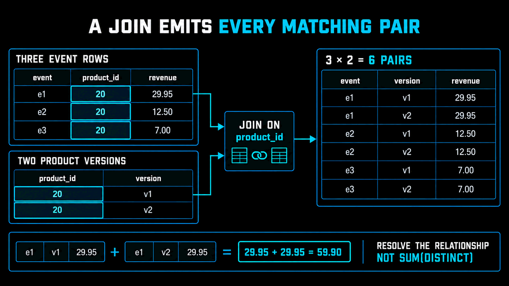
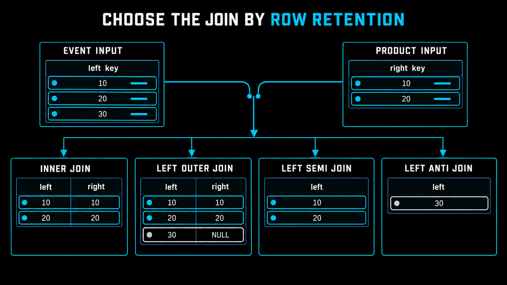
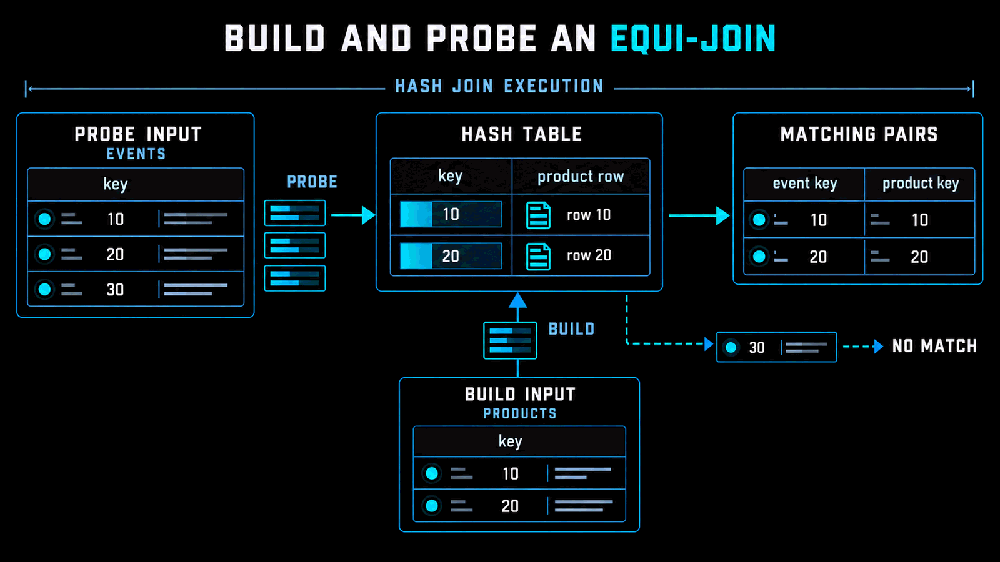
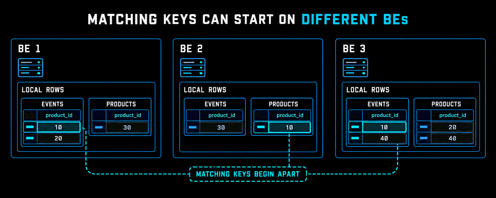
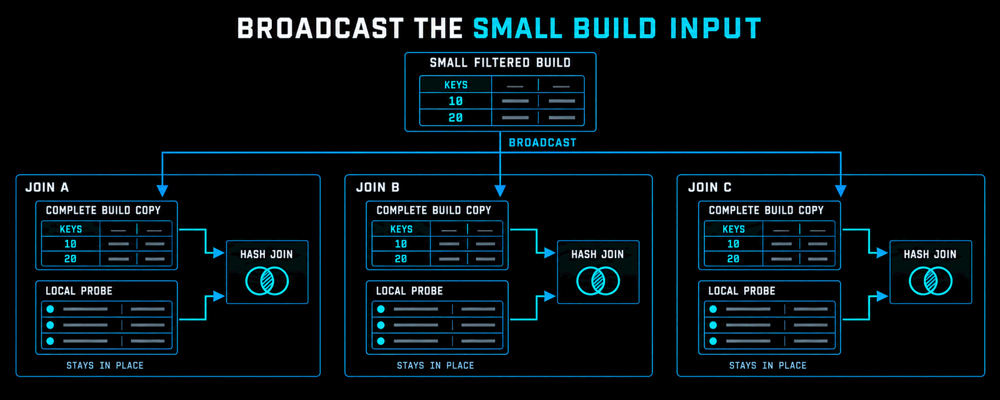
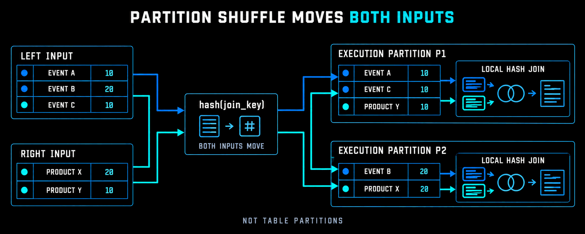
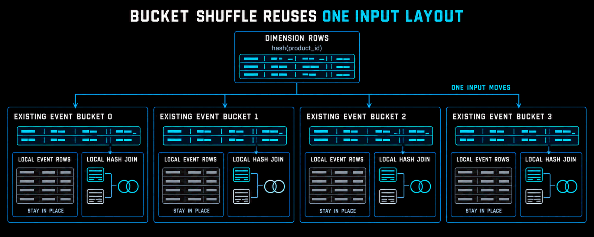
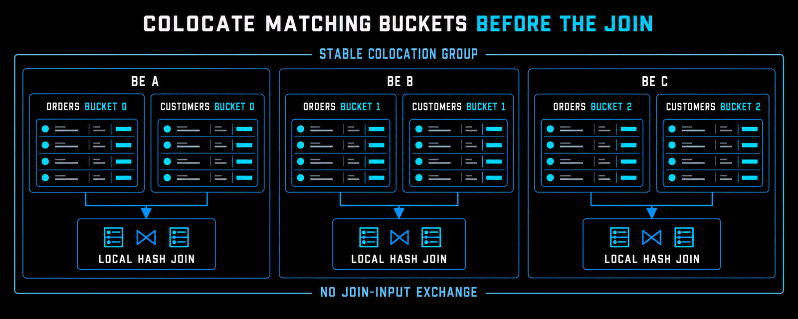
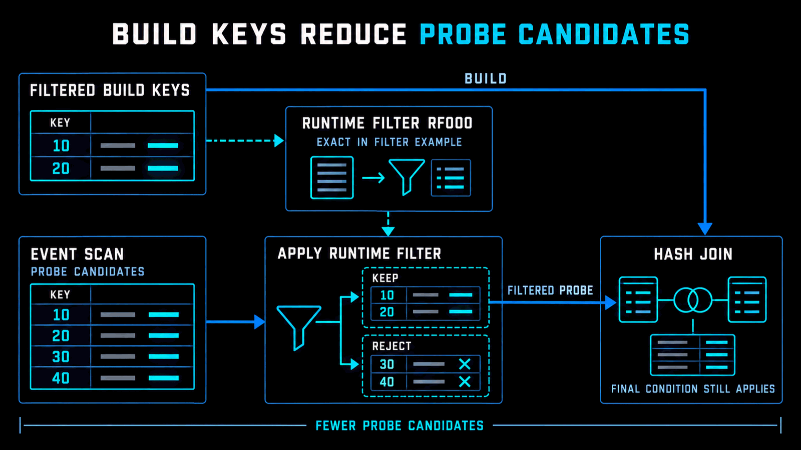

<a id="unit-u.9db410248dfa47c9a4524686205a14c4"></a>

<a id="module-6-joining-data-in-apache-doris"></a>

# 6-модуль: Apache Doris жүйесінде деректерді біріктіру

| Курс туралы ақпарат | Мән |
| --- | --- |
| Курс | Apache Doris көмегімен нақты уақыттағы аналитика · 2-деңгей |
| Doris | Apache Doris 4.1.3 |
| Орта | Курс сынақ ортасы және 4-зертханалық жұмыстың `events_modelled` кестесі |
| Болжамды уақыт | Шамамен 95 минут: оқу 55, зертханалық жұмыс 30, тест 10 |

[Курстың README файлы](../../README.md) · [6-зертханалық жұмысты ашу](lab06_join_data.ipynb) · [6-тестті ашу](quiz06_join_semantics_and_execution.ipynb)

<a id="unit-u.046dbf5fc5ea4e22a1b265134e81394f"></a>

<a id="module-goal"></a>

## Модуль мақсаты

Нәтиже түйіршіктілігін бақылаудан шығармай байланысты деректерді біріктіріңіз: бизнес байланысынан және жауап сақтауы тиіс жолдардан бастап, содан кейін Doris Join амалын қалай іске асыратынын және сәйкес жолдар кездесу үшін деректерді қалай тасымалдайтынын көріңіз.

Операциялық топқа өнім санаты және аймақ бойынша сатып алу түсімі қажет. Оқиғаларда `product_id` бар, ал өнім атрибуттары 6-зертханалық жұмыс Unique Key арқылы әр өнімге бір жолмен жасайтын `dim_products` өлшемінде сақталады. Ол сәйкес емес байланысты көрсету үшін бір өнімді әдейі түсіріп қалдырады. Бөлек шағын `join_product_cases` кестесі қайталанатын сәйкестіктердің оқиға жолдарын қалай көбейтетінін көрсету үшін өнім кілтін қайталайды.

<a id="unit-u.6a014657351941e9b024efa062381232"></a>

<a id="learning-objectives"></a>

## Оқу мақсаттары

Осы модульді аяқтағаннан кейін сіз:

1. Екі кірістің түйіршіктілігі мен кілт кардиналдығынан Join нәтиже түйіршіктілігі мен еселігін болжай аласыз.
2. Жауап сақтауы тиіс жолдарға қарай Inner, Outer, Semi, Anti, Cross немесе ASOF Join таңдай аласыз.
3. `NULL` кілттері қалай сәйкес келетінін және оң жақ шарты `ON` не `WHERE` ішіне тиесілі екенін шеше аласыз.
4. Doris Hash Join немесе Nested Loop Join қашан қолданатынын және құру мен тексеру жақтарының не істейтінін түсіндіре аласыз.
5. Broadcast, Partition Shuffle, Bucket Shuffle және Colocate Join тәсілдерін әрқайсысы тасымалдайтын дерек пен қажетті орналасу бойынша салыстыра аласыз.
6. `EXPLAIN` ішіндегі Join стратегиясы мен Runtime Filter жазбаларын Query Profile тіркейтін әрекеттен бөлек оқи аласыз.

<a id="unit-u.c3a1a95699bf44278935c69e88d77360"></a>

<a id="module-structure"></a>

## Модуль құрылымы

| Бөлім | Уақыт | Нәтиже |
| --- | ---: | --- |
| 6.1 Атрибуттар қоспас бұрын байланысты анықтау | 6 мин | Екі түйіршіктіліктен бірден бірге, бірден көпке немесе көптен көпке нәтижелерді болжау |
| 6.2 Жауап сақтауы тиіс жолдарға қарай логикалық Join операторын таңдау | 6 мин | Inner, Outer, Semi, Anti, Cross немесе ASOF мағынасын таңдау |
| 6.3 Жетіспейтін кілттер мен предикаттардың мағынасын анықтау | 6 мин | `=` немесе `<=>` таңдап, оң жақ предикаттарын `ON` не `WHERE` ішіне қою |
| 6.4 Join шартын физикалық іске асырумен байланыстыру | 7 мин | Hash Join мен Nested Loop Join, құру жағы мен тексеру жағын ажырату |
| 6.5 Құру кірісі көшіріп таратуға жеткілікті шағын болғанда Broadcast пайдалану | 5 мин | Шағын құру кірісін әр қатысушыға көшіру |
| 6.6 Екі кірісті де қайта тарату қажет болғанда Partition Shuffle пайдалану | 5 мин | Екі кірісті Join кілтімен бағыттау |
| 6.7 Бар орналасудың бірін қайта пайдалануға болатын кезде Bucket Shuffle пайдалану | 5 мин | Бір үйлесімді bucket-ке бөлінген кірісті орнында қалдыру |
| 6.8 Тұрақты, қайталанатын Join байланысы үшін Colocate пайдалану | 4 мин | Екі кірісті сәйкес Bucket ұяшықтарымен алдын ала сақтау |
| 6.9 Runtime Filter арқылы тексеру үміткерлерін азайту | 6 мин | Тексеру жағының сканерлеуін сүзуге құру жағының кілттерін пайдалану |
| 6.10 Жоспар дәлелін орындалу әсерінен бөлек оқу | 5 мин | Жоспар, Profile және hint нені көрсететінін оқу |
| 6-зертханалық жұмыс | 30 мин | Бақыланатын жағдайларда Join түрлерін орындап, жоспарлар мен Profile оқу |
| 6-тест | 10 мин | Осы мақсаттар бойынша алты сұрақ |

<a id="unit-u.1787945b123b4c8a96f94dc8be40d615"></a>

<a id="61-establish-the-relationship-before-adding-attributes"></a>

## 6.1 Атрибуттар қоспас бұрын байланысты анықтау

**Факт кестесі** бақылауларды немесе әрекетті тіркейді. **Өлшем кестесі** сол фактілерді түсіндіруге арналған бизнес нысандарын сипаттайды. Бұл модульде:

- бір `events_modelled` жолы бір бастапқы оқиғаны білдіреді;
- бір жарамды `dim_products` жолы бір өнім анықтамасын білдіреді.

Екі кестеде де `product_id` бар, бірақ баған атауының ортақтығы қауіпсіз байланысты кепілдемейді. SQL жазбас бұрын сұраңыз:

1. Әр жақтағы бір жол нені білдіреді?
2. Join шартын қай бағандар құрайды?
3. Әр жақта сол Join кілті қанша жолда қайталана алады?
4. Бір кіріс жолы нөл, бір немесе бірнеше нәтиже жолын беруі тиіс пе?
5. Байланыс бірнеше жұп берсе, қай метрикалар қайталанар еді?

<a id="unit-u.f36618dbb0f54b089e720a164d426a10"></a>

<a id="predict-matching-multiplicity"></a>

### Сәйкес жұптар еселігін болжау

Бір теңдік кілті үшін сәйкес жұптар саны екі жақтағы сәйкес жол сандарының көбейтіндісі болады:



*Join әр сәйкес жұпты шығарады, сондықтан қайталанатын кілттер жолдарды да, метрикаларды да көбейте алады.*

Сурет жазулары: A Join emits every matching pair — Join әр сәйкес жұпты шығарады; Three event rows — үш оқиға жолы; Two product versions — екі өнім нұсқасы; JOIN ON product_id — product_id бойынша JOIN; 3 × 2 = 6 pairs — 3 × 2 = 6 жұп; event — оқиға; product_id — product_id; revenue — түсім; version — нұсқа; Resolve the relationship, not SUM(DISTINCT) — SUM(DISTINCT) қолданудың орнына байланысты шешу. e1/e2/e3, v1/v2 белгілері, 20, 29.95, 12.50, 7.00 және 29.95 + 29.95 = 59.90 мәндері өзгермейді. Сурет ағылшын түпнұсқасында сақталған.

Бұл — жарамды реляциялық әрекет. Join «өлшем» деп аталған кестеде әр кілтке бір жол болуы тиіс деп өзі қорытпайды.

| Байланыс | Мағынасы | Нәтижеге ықтимал әсері |
| --- | --- | --- |
| Бірден бірге | Әр кілт екі жақтың әрқайсысында ең көбі бір рет кездеседі | Әр кілтке бір сәйкес жұп |
| Көптен бірге | Көптеген оқиға бір өнім жолына сілтейді | Әр сәйкес оқиға бір байытылған жол болып қалады |
| Бірден көпке | Бір оқиға кілті бірнеше өлшем немесе тарих жолына сәйкес | Оқиға әр сәйкестік үшін бір рет қайталанады |
| Көптен көпке | Екі жақ та кілтті қайталайды | Әр жарамды сол-оң тіркес пайда болады |

Негізгі `dim_products` кестесі көзделген көп оқиғадан бір өнімге байланысын қолдайтын `product_id` бойынша Unique Key пайдаланады. 6-зертханалық жұмыс `product_id = 20` үшін екі өнім-нұсқа жолы бар шағын Duplicate Key сынақ жиынын да жасайды. Сәйкес оқиға Join нәтижесінде екі рет пайда болады.

<a id="unit-u.03752d661a2f4ff1acba9a4671f5b97a"></a>

<a id="protect-measures-as-well-as-row-count"></a>

### Жол санымен бірге метрикаларды да қорғау

Оқиға түсімі 29.95 болып, екі өлшем нұсқасына сәйкес келеді делік. Join кейін топтайтын сұрау алдымен оқиғаға тиесілі бір нұсқаны таңдамаса, 59.90 қосуы мүмкін.

Мұны ойланбай `SUM(DISTINCT revenue)` арқылы түзетпеңіз. Екі нақты оқиғаның түсімі бірдей болуы мүмкін, сондықтан бірегей мәндер бірегей оқиғаларды анықтамайды. Байланысты бизнес ережесімен шешіңіз: бір ағымдағы өлшем жолын міндеттеу, нұсқа шартын қосу, нақты уақыт сәтіне сәйкестендіру немесе әр сәйкестікті әдейі қамтитын түйіршіктілікте агрегаттау.

<a id="unit-u.5a76a64866864a9b9768582dd613d420"></a>

<a id="separate-enrichment-from-existence"></a>

### Атрибуттармен байытуды бар-жоғын тексеруден ажырату

Жауапқа санат пен бренд қажет болса, қалыпты Join оң жақ бағандарды қайтара алады. Жауап тек өнім анықтамасының бар-жоғын сұраса, Semi Join өлшем бағандарын қайтармай-ақ осы талапты білдіреді. Бірнеше оң жақ жол бар-жоқ шартын қанағаттандырды екен деп сол жолды да көбейтпейді.

Join пішінін таңдамас бұрын қажетті шығысты анықтаңыз.

<a id="unit-u.7e18886bcf134f30a724b94ad0d486c9"></a>

<a id="62-choose-the-logical-join-operator-from-the-rows-the-answer-must-retain"></a>

## 6.2 Жауап сақтауы тиіс жолдарға қарай логикалық Join операторын таңдау

Логикалық Join операторы алдымен жолдарды сақтау шешімі. `INNER`, `OUTER`, `SEMI` және `ANTI` жауапқа қай сәйкес немесе сәйкес емес жолдар кіретінін сипаттайды. Олар сол жолдардың қайда сақталғанын немесе орындауда Doris оларды қалай тасымалдайтынын айтпайды. Ең қысқа синтаксистен емес, қажетті нәтижеден бастаңыз.

<a id="unit-u.97b4736359e64797bdcbdd9ff7554466"></a>

<a id="choose-among-matched-and-unmatched-rows"></a>

### Сәйкес және сәйкес емес жолдар арасынан таңдау

| Бизнес талабы | Сай Join | Нәтиже әрекеті |
| --- | --- | --- |
| Тек өнімі белгілі оқиғаларды талдау | `INNER JOIN` | Тек сәйкес жұптарды қайтару |
| Әр оқиғаны сақтап, бар болса өнім деректерін тіркеу | `LEFT OUTER JOIN` | Барлық сол жолды сақтау; сәйкес емес оң бағандар `NULL` |
| Әр өнімді сақтап, бар болса оқиға деректерін тіркеу | `RIGHT OUTER JOIN` | Барлық оң жолды сақтау; сәйкес емес сол бағандар `NULL` |
| Екі жақты салыстырып, сәйкес емес жолдардың екі түрін де сақтау | `FULL OUTER JOIN` | Екі жақтың сәйкес емес жолдарын сақтау |
| Тек өнімі бар оқиғаларды қайтару | `LEFT SEMI JOIN` | Жарамды сол жолдарды оң бағандарсыз қайтару |
| Тек өнімі жоқ оқиғаларды қайтару | `LEFT ANTI JOIN` | Сәйкес емес сол жолдарды қайтару |
| Әр тіркесті әдейі жасау | `CROSS JOIN` | Декарт көбейтіндісін қайтару |



*Join мағынасы қай жолдар мен бағандардың қалатынын таңдайды.*

Сурет жазулары: Choose the Join by row retention — Join амалын сақталатын жолдарға қарай таңдау; Event input — оқиға кірісі; Product input — өнім кірісі; left_key — сол кілт; right_key — оң кілт; left — сол; right — оң; INNER JOIN — ішкі біріктіру; LEFT OUTER JOIN — сол сыртқы біріктіру; LEFT SEMI JOIN — сол жартылай біріктіру; LEFT ANTI JOIN — сол қарсы біріктіру. 10, 20, 30 және NULL мәндері өзгермейді. Сурет ағылшын түпнұсқасында сақталған.

100 сол жол және 20 оң жол болса, Cross Join кейінгі сүзуге дейін 2,000 тіркес береді. Оны әр тіркес сұраққа кіргенде ғана, мысалы шағын күн-аймақ есеп торын жасағанда пайдаланыңыз. Жетіспейтін шарттың кездейсоқ алмастырушысы етпеңіз.

Right Semi және Right Anti Join қай жақ қайтарылатынын кері аударады. Сақталатын жақ сұрақтың нысанына сай болуы тиіс. Оқиғалар сол жақта тұрса, «қай оқиғалардың өнімі бар?» табиғи түрде Left Semi Join арқылы оқиға бағандарын қайтарады.

<a id="unit-u.726deb80b8844eb0a2f9350e771e37a5"></a>

<a id="match-historical-attributes-at-the-correct-time"></a>

### Тарихи атрибуттарды дұрыс уақытқа сәйкестендіру

Ағымдағы күй өлшемі «өнім санаты қазір қандай?» дегенге жауап береді. Ол «оқиға болғанда қай санат күшінде болды?» дегенге жауап бермеуі мүмкін. Өнім тарихында күшіне ену уақыттары болса, оқиға мен күй уақытын дәл теңестіру әдетте қате, өйткені күй жолы көптеген кейінгі оқиғадан бұрын басталуы мүмкін.

ASOF Join уақыт бойынша ең жақын көрші мағынасын береді. Мысалы:

```sql
FROM product_events e
ASOF LEFT JOIN product_history h
MATCH_CONDITION(e.event_time >= h.effective_time)
ON e.product_id = h.product_id
```

Әр тең `product_id` ішінде бұл бағыт күшіне ену уақыты оқиға уақытына тең немесе одан бұрын болған ең жақын тарих жолын таңдайды. «Ең жақын» берілген салыстыру бағытына сай; ол ең кіші абсолют уақыт айырмасын білдірмейді. ASOF Left Join сәйкес тарих жолы жоқ оқиғаны сақтап, оң жақ бағандарды `NULL` толтырады; ASOF Inner Join оны алып тастайды.

6-зертханалық жұмыс ағымдағы өнім анықтамалығын пайдаланады және екінші тарихи өлшем қоспайды. Қолдау көрсетілетін уақыт типтері, салыстыру бағыттары және шектеулер үшін [ASOF Join](https://doris.apache.org/docs/4.x/query-data/asof-join/) құжатын қараңыз.

<a id="unit-u.20ba50b11be24b72b7079e02c5d07809"></a>

<a id="63-define-what-missing-keys-and-predicates-mean"></a>

## 6.3 Жетіспейтін кілттер мен предикаттардың мағынасын анықтау

Жетіспейтін мәндер сәйкестендіруге де, алып тастауға да әсер етеді. `NULL` «салыстыруға келетін кілт жоқ» дегенді білдіре ме, әлде екі жетіспейтін мән бір әдейі белгісіз топқа жатуы тиіс пе, соны шешіңіз.

<a id="unit-u.d7e887b079a94216ac01844425859566"></a>

<a id="choose-ordinary-or-null-safe-equality"></a>

### Қалыпты немесе NULL-қа қауіпсіз теңдікті таңдау

Қалыпты SQL теңдігі екі операндтың бірі `NULL` болғанда сәйкес жұп жасамайды:

```text
9 = 9       → TRUE
9 = NULL    → UNKNOWN
NULL = NULL → UNKNOWN
```

Doris NULL-қа қауіпсіз теңдікті де қолдайды:

```text
9 <=> 9       → TRUE
9 <=> NULL    → FALSE
NULL <=> NULL → TRUE
```

Байланыс әр жақтағы жетіспейтін кілт бір сәйкестенетін топты білдіретінін айқын айтқанда ғана `e.key <=> d.key` пайдаланыңыз. `NULL` нысанның анықталмағанын білдірсе, барлық жетіспейтін жолдарды сәйкестендіру үлкен әрі жалған көптен көпке байланыс жасай алады.

Зертханалық сынақ жиынында `product_id` мәндері `10`, `20`, `30` және `NULL` болатын төрт оқиға жолы бар; бұл бір құрама кілт емес, төрт жол. Өнім жолдарында да бір `NULL` бар. `product_id` мәні `NULL` болатын бір оқиға үшін `=` нөл жұп, ал `<=>` бір жұп жасайды.

<a id="unit-u.9348b27b784d4f2abdb46e9b524c1a5b"></a>

<a id="distinguish-anti-join-from-not-in-with-null"></a>

### Anti Join амалын NULL бар `NOT IN` шартынан ажырату

Left Anti Join өз Join шарты бойынша сәйкес оң жақ жолы жоқ сол жақ жолдарды сұрайды. `NOT IN` ішкі сұрауы SQL үш мәнді логикасын қолданады: үміткер жиында `NULL` болса, қалыпты салыстырулар true орнына unknown болуы мүмкін.

Doris тиісті NULL-aware мағына үшін `NULL AWARE LEFT ANTI JOIN` береді. Ресми Join шарты оның `NULL` ерекше өңдейтінін және сәйкестік бағаны `NULL` сол жақ жолдарды елемейтінін айтады. Қажетті NULL әрекеті анықталғанша `NOT IN` шартын қалыпты Anti Join ретінде қайта жазбаңыз.

<a id="unit-u.c96ed4a4e8334dbc9725ee830a4e29ab"></a>

<a id="place-outer-join-predicates-deliberately"></a>

### Outer Join предикаттарын саналы орналастыру

Есеп әр оқиғаны сақтап, тек белсенді өнім жолдарын тіркеуі тиіс делік. Мына екі үлгі әртүрлі:

```sql
-- Preserve every event; only active product rows can match.
LEFT JOIN dim_products d
  ON e.product_id = d.product_id
 AND d.is_active = 1
```

```sql
-- The WHERE predicate removes the NULL-extended unmatched rows.
LEFT JOIN dim_products d
  ON e.product_id = d.product_id
WHERE d.is_active = 1
```

Біріншісі өнімі жоқ немесе белсенді емес оқиғаны оң жақ бағандары `NULL` күйінде сақтайды. Екіншісі сол нәтижені кейін сүзіп, осы предикат үшін Inner Join сияқты әрекет етеді. `ON` жарамды сәйкестіктерді анықтайды; `WHERE` Join жасаған нәтиже жолдарын сүзеді.

<a id="unit-u.860d621d09324718b4484f37c692b135"></a>

<a id="64-connect-the-join-condition-to-its-physical-implementation"></a>

## 6.4 Join шартын физикалық іске асырумен байланыстыру

Doris физикалық іске асыру ретінде Hash Join және Nested Loop Join қолдайды. Шарт теңдік кілтінің үміткер сәйкестіктерді ұйымдастыра алатынын анықтайды.

6.2 және 6.3-бөлімдер логикалық нәтижені анықтады: қай жолдар қалады, `NULL` қалай әрекет етеді және предикаттар қайда қолданылады. Физикалық жоспарлау осы жерден басталып, екі бөлек сұраққа жауап береді:

1. **Бір Join орындау данасы сәйкес үміткерлерді қалай табады?** Hash Join теңдік кілтін пайдаланады; Nested Loop Join онсыз да байланыстарды есептей алады.
2. **Үлестірілген кластерде сәйкес жолдар бір орындау данасына қалай жетеді?** Broadcast, Partition Shuffle, Bucket Shuffle және Colocate — 6.5–6.8-бөлімдерде қарастырылатын деректерді тарату стратегиялары.

Тарату стратегиясын таңдау Inner Join амалын Outer Join амалына айналдырмайды және теңдік шартын өзгертпейді. Ол таңдалған Join іске асыруы жұмыс істейтін физикалық кірістерді береді.

<a id="unit-u.05b2e502fd3140a4bdf0fa0257f13bb2"></a>

<a id="build-and-probe-an-equi-join"></a>

### Теңдік Join үшін құру және тексеру

Мынадай теңдік шарты үшін

```sql
e.product_id = d.product_id
```

Doris физикалық оң жақ кірістен жадтағы hash кестесін құрып, физикалық сол жақ жолдарды одан ағынмен өткізе алады:



*Құру кірісі тексеру кірісі пайдаланатын іздеу құрылымын жасайды.*

Сурет жазулары: Build and probe an equi-Join — теңдік Join үшін құру және тексеру; Hash Join execution — Hash Join орындауы; Probe input — тексеру кірісі; Events — оқиғалар; Key — кілт; Probe — тексеру; Hash table — hash кестесі; Product row — өнім жолы; Build — құру; Build input — құру кірісі; Products — өнімдер; Matching pairs — сәйкес жұптар; Event key — оқиға кілті; Product key — өнім кілті; Row 10 / Row 20 — 10 / 20 жолы; No match — сәйкестік жоқ. 10, 20, 30 кілттері өзгермейді. Суреттің ағылшын түпнұсқасы сақталған.

**Құру жағы** және **тексеру жағы** — Join операторының ішіндегі рөлдер. Олар факт не өлшем кестесінің тұрақты қасиеттері емес және бір BE данасы әрдайым «құру BE», екіншісі әрдайым «тексеру BE» дегенді білдірмейді. Әр қатысатын Join орындау данасы үлестірілген жоспар тағайындаған кірістерді алып, өзінің құру және тексеру жұмысын орындайды.

Оңтайландырғыш осы физикалық рөлдерді тағайындамас бұрын логикалық кірістердің ретін өзгерте алады. Тек SQL мәтіні оларды бекітеді деп ойламай, жоспарды оқыңыз. Сүзілген өлшемнің hash кестесі кішірек болғандықтан, ол көбіне құру кірісіне айналады, бірақ шешім Join мағынасына, статистикаға, сүзгілерге және проекцияларға байланысты.

<a id="unit-u.ea7a557a48004132bfd835c5fc08526a"></a>

<a id="recognize-when-nested-loop-evaluation-is-needed"></a>

### Nested Loop бағалауы қашан қажет екенін тану

Мынадай таза теңдік емес шарт

```sql
e.amount > band.minimum_amount
```

үміткер hash топтарын құратын теңдік кілтін бермейді. Doris Nested Loop Join қолданып, шартты үміткер жұптар арасында есептеуі мүмкін. Декарт көбейтіндісі — тағы бір Nested Loop жағдайы.

`>` болуының өзі Nested Loop Join міндеттемейді. Мына шартта әлі теңдік кілті бар:

```sql
e.product_id = d.product_id
AND e.event_time > d.effective_time
```

Doris Hash Join үміткерлерін сәйкестендіру үшін `product_id` пайдаланып, уақыт шартын қосымша предикат ретінде есептей алады. SQL ішінен ауқым операторын іздеудің орнына қандай да бір жарамды теңдік шарты үміткерлерді ұйымдастыра ма, соны сұраңыз.

Nested Loop Join жалпылама, бірақ әлдеқайда көп жұпты салыстыруы мүмкін. 6-зертханалық жұмыс таза теңдік емес салыстыруды шағын ұстап, `EXPLAIN SHAPE PLAN` пайдаланады; он миллион оқиғаға шектелмеген теңдік емес Join орындамайды. [Doris Join амалдары](https://doris.apache.org/docs/4.x/query-data/join/) құжатын қараңыз.

<a id="unit-u.2bfe784e4b0d41e58edd979f24b9cbb2"></a>

<a id="move-rows-so-matching-keys-can-meet"></a>

### Сәйкес кілттер кездесу үшін жолдарды тасымалдау

Қатысатын деректер мен Join орындауы бірнеше Backend (BE) түйіні немесе орындау данасы арасында таралғанда, деректерді тасымалдау үлестірілген Join мәселесіне айналады. Бір BE-дегі жол екінші кірістен тиісті жолды ешқашан алмайтын Hash Join данасында сәйкестендіріле алмайды.

Үш BE бастапқыда өзара байланыссыз мына бөліктерді ұстайды делік:



*Ортақ Join кілттері үйлесімді физикалық орналасуды білдірмейді.*

Сурет жазулары: Matching keys can start on different BEs — сәйкес кілттер бастапқыда әртүрлі BE-де болуы мүмкін; BE 1/2/3 — 1/2/3 BE түйіндері; Local rows — жергілікті жолдар; Events — оқиғалар; Products — өнімдер; Matching keys begin apart — сәйкес кілттер бастапқыда бөлек. product_id бағаны және 10, 20, 30, 40 кілттері өзгермейді. Сурет ағылшын түпнұсқасында сақталған.

Тек жергілікті Join жарамды сәйкестіктерді жіберіп алар еді: 10 кілтінің өнім жолы BE 2 ішінде, ал 10 кілтті оқиға жолдары BE 1 және BE 3 ішінде. Сондықтан үлестірілген жоспар сәйкес кілттерді кездестіруі тиіс:

Бұл таңдаулар желі тасымалын, әр дана жадын, қисықтықты және бар орналасуды қайта пайдалану мүмкіндігін теңгереді:

- **Broadcast** үлкен тексеру кірісін жылжытпайды, бірақ әр қатысатын дана кіші кірістің толық көшірмесін алып, құрады. Ол сүзуден және проекциядан кейінгі құру кірісі әр қатысушының жад бюджетіне сыйғанда ғана қауіпсіз. Бұл шектеулі жадқа үлкен құру кірісін сыйғызу тәсілі емес.
- **Partition Shuffle** — ешбір жақты көшіруге болмайтын үлкеннен үлкенге жалпы таңдау. Әр дана тек өзінің Join кілті бөлігін алып, сол ішкі жиында құру немесе тексеру жасайды; жұмыс пен hash күйі кластерге таралады. Екі кіріс те желіден өтуі мүмкін және қисайған кілт тым үлкен бөлік жасай алады.
- **Bucket Shuffle** бұрыннан үйлесімді бір кірісті орнында қалдырып, тек екіншісін жылжыту арқылы тасымалды азайтады.
- **Colocate** қайталанатын байланыс үшін екі кіріс үйлесімді Bucket орналасуымен әдейі сақталса, Join кезіндегі тасымалды болдырмай алады.

Бір BE сынақ ортасында да `EXPLAIN` таңдалған тарату стратегиясын анықтай алады және жергілікті алмасулар орындау даналарын байланыстыра алады, бірақ зертханалық жұмыс нақты BE аралық тасымалды өлшей алмайды. Бұл стратегияларды оқудың себебі — өндірістегі бірнеше BE жағдайы.

<a id="unit-u.b546dacc818d4c4281afe8f4a60e51da"></a>

<a id="65-use-broadcast-when-the-build-input-is-small-enough-to-replicate"></a>

## 6.5 Құру кірісі көшіріп таратуға жеткілікті шағын болғанда Broadcast пайдалану

Жаппай параллель өңдеу (MPP) кластерінде тең кілттер бір Join орындау орнында кездесуі тиіс. Broadcast физикалық сол/тексеру кірісін орнында қалдырып, толық физикалық оң/құру кірісін Join амалына қатысатын әр түйінге жібереді.



*Broadcast құру кірісін әр қатысатын орындау орнына көшіреді.*

Сурет жазулары: Broadcast the small build input — шағын құру кірісін Broadcast арқылы тарату; Small filtered build — шағын сүзілген құру кірісі; Keys — кілттер; Broadcast — көшіріп тарату; Join A/B/C — A/B/C Join даналары; Complete build copy — құру кірісінің толық көшірмесі; Local probe — жергілікті тексеру кірісі; Stays in place — орнында қалады; Hash Join — Hash Join. 10 және 20 кілттері өзгермейді. Сурет ағылшын түпнұсқасында сақталған.

Бұл стратегияда үлкен факт кірісі әр BE түйініне көшірілмейді. Көшірілетін деректер — құру қатынасы. Әр қатысатын данаға жергілікті тексеру жолдарын сәйкестендіру үшін өзінің толық құру жағы жиыны қажет.

<a id="unit-u.42daf08e44dc4f5ca5b453eaa02dfbd0"></a>

<a id="compare-post-filter-inputs"></a>

### Сүзуден кейінгі кірістерді салыстыру

Broadcast жарамдылығы бастапқы кесте атауына емес, Join амалына кіретін деректерге байланысты:

- Үлкен өлшем іріктейтін предикат пен баған проекциясынан кейін кішіреюі мүмкін.
- Өлшем деп аталған кесте бәрібір қауіпсіз көшіруге тым үлкен болуы мүмкін.
- Қатысатын дана көбейген сайын құру деректерінің көшірмелеріне жалпы желілік тасымал мен жад артады.
- Join түрі маңызды; ресми Doris шарты Broadcast тәсілін Right Outer, Right Anti немесе Right Semi Hash Join үшін қолданбайды.

6-зертханалық жұмыста `dim_products` ішінде 10,158,080 оқиға жолымен салыстырғанда 204,231 жол бар, ал сұрау өлшемді одан әрі бір санатқа сүзеді. Әдепкі Doris 4.1.3 жоспары `hashJoin[INNER_JOIN broadcast]` көрсетеді. Бір BE сынақ ортасында бұл — таңдалған стратегияның жоспар дәлелі. Түйінаралық Broadcast шығынының өлшемі емес.

<a id="unit-u.a1354f7f54474d09baf4b6c9e8b268f5"></a>

<a id="66-use-partition-shuffle-when-both-inputs-need-redistribution"></a>

## 6.6 Екі кірісті де қайта тарату қажет болғанда Partition Shuffle пайдалану

Екі үлкен кіріс үйлесімсіз сақтау орналасуларын қолдануы мүмкін және ешқайсысын көшіру қауіпсіз болмауы мүмкін. Partition Shuffle екі кірісте де Join кілті хэшін есептеп, әр жолды сәйкес орындау бөлігіне жібереді.

Түсіндіру үшін мақсатты бағыттау ережесі `hash(product_id) mod 3` делік:

| Кіріс жолы | Өнім кілті | Мақсатты орындау бөлігі |
| --- | ---: | --- |
| A оқиғасы | 10 | P1 |
| B оқиғасы | 20 | P2 |
| C оқиғасы | 10 | P1 |
| X өнімі | 20 | P2 |
| Y өнімі | 10 | P1 |

Бастапқыда қай BE сақтағанына қарамай, 10 кілті бар екі жол P1 ішінде, ал 20 кілті бар жолдар P2 ішінде кездеседі. Содан кейін әр мақсатты Join данасы жергілікті бөлігінде құру және тексеру жасайды.



*Partition Shuffle сәйкес кілттерді кездестіру үшін екі кірісті де жылжытады.*

Сурет жазулары: Partition Shuffle moves both inputs — Partition Shuffle екі кірісті де жылжытады; Left input — сол кіріс; Right input — оң кіріс; Event A/B/C — A/B/C оқиғалары; Product X/Y — X/Y өнімдері; hash(join_key) — hash(join_key); Both inputs move — екі кіріс те жылжиды; Execution partition P1/P2 — P1/P2 орындау бөліктері; Local Hash Join — жергілікті Hash Join; Not table partitions — кесте Partition бөлімдері емес. 10 және 20 кілттері өзгермейді. Суреттің ағылшын түпнұсқасы сақталған.

Бұл — дерек алмасу үшін жасалған орындау бөліктері. Олар 4-модульдегі айлық кесте Partition бөлімдері емес. Кесте Partition бөлімі сақталған жолдың өмірлік циклін және іріктеу ауқымын шешеді; Partition Shuffle осы Join орындауы үшін кіріс жолының қайда баратынын шешеді.

Partition Shuffle — жалпы үлкеннен үлкенге теңдік Join стратегиясы, өйткені бар үйлесімді орналасуға сүйенбей сәйкес кілттерді кездестіре алады. Оның құны — екі кірістің жолдары Exchange шекараларынан өтуі мүмкін. Орташа кіріс өлшемі орынды көрінсе де, қисайған Join кілттері жұмысты бір мақсатты бөлікте шоғырландыра алады.

Нақты кардиналдық пен қисықтықты бағалау үшін кесте статистикасы мен Query Profile пайдаланыңыз. Бір BE зертханалық жұмысы бағыт пен жоспар құрылымын түсіндіреді, бірақ нақты Partition Shuffle үшін түйінаралық байттарды жасанды есептемейді.

<a id="unit-u.cfcc1d7f774a4700a4a8e136281e2046"></a>

<a id="67-use-bucket-shuffle-when-one-existing-layout-can-be-reused"></a>

## 6.7 Бар орналасудың бірін қайта пайдалануға болатын кезде Bucket Shuffle пайдалану

Бір физикалық кіріс Join шартына үйлесімді Hash bucket бөлуімен орналасқан болса, Bucket Shuffle тасымалды азайтады. Ол кіріс бар Bucket орындарында қалады; екіншісі сол Join кілті бойынша сол орындарға қайта таратылады.

`product_id` бойынша bucket-ке бөлінген жорамал оқиға кестесі үшін:



*Bucket Shuffle бір кірістің орналасуын қайта пайдаланып, екіншісін қайта таратады.*

Сурет жазулары: Bucket Shuffle reuses one input layout — Bucket Shuffle бір кіріс орналасуын қайта пайдаланады; Dimension rows — өлшем жолдары; hash(product_id) — hash(product_id); One input moves — бір кіріс жылжиды; Existing event Bucket 0/1/2/3 — бар оқиға Bucket 0/1/2/3 ұяшықтары; Local event rows — жергілікті оқиға жолдары; Stay in place — орнында қалады; Local Hash Join — жергілікті Hash Join. Сурет ағылшын түпнұсқасында сақталған.

Жалпы Partition Shuffle тәсілімен салыстырғанда тек бір кіріске қайта тарату қажет. Бұл азаю тек сақталатын жақтың Bucket бағаны мен Join кілті стратегияға сай болып, Join бағыты, түрі, Bucket сәйкестендіруі және деректер орналасуы қолдануға жарағанда мүмкін.

«Екі кесте де бір жерде Hash тарату қолданады» жеткілікті дәлел емес. Тексеріңіз:

- Join теңдігі тиісті Bucket бағанын қамти ма;
- оңтайландырылған жоспар қай физикалық кіріс орналасуын сақтайды;
- Bucket саны мен сәйкестендіруі;
- Join түрі және таңдалған физикалық бағыты;
- нақты `EXPLAIN` тарату белгісі.

6-зертханалық жұмыста `dim_products` `product_id` бойынша Hash bucket-ке бөлінген. SQL мәтінінің сол кестесі `events_modelled` `user_id` бойынша бөлінген, сондықтан тек мәтін реті қайта пайдаланылатын орналасуды дәлелдемейді. Оңтайландырғыш физикалық бағытты таңдай алады. Сыналған Doris 4.1.3 жоспарында қабылданған `[shuffle]` салыстыруы `hashJoin[INNER_JOIN shuffleBucket]` көрсетеді; бұл сол жоспар үшін Bucket Shuffle таңдалғанының дәлелі.

Осы бір жоспарды тұрақты ережеге айналдырмаңыз. Статистика, предикаттар, схема орналасуы және оңтайландырғыш өзгерістері басқа жоспар беруі мүмкін. [Join Shuffle режимін реттеу](https://doris.apache.org/docs/4.x/query-acceleration/tuning/tuning-plan/adjusting-join-shuffle/) құжатын қараңыз.

<a id="unit-u.53664c308eb047d190ba0b90ba5d0434"></a>

<a id="68-use-colocate-for-a-stable-repeated-join-relationship"></a>

## 6.8 Тұрақты, қайталанатын Join байланысы үшін Colocate пайдалану

Colocate Join күштірек және тұрақтырақ талапты шешеді. Сол тұрақты кілтпен үлкеннен үлкенге Join жиі орындайтын екі кесте бір Colocation Group ішінде орналастырыла алады. Үйлесімді Bucket ұяшықтары бірге сақталады, сондықтан әр жергілікті орындау орнында сәйкес жолдар бар болады.



*Тұрақты бірге орналастыру шарты Join кірістерінің екеуін де алдын ала орналастырады.*

Сурет жазулары: Colocate matching buckets before the Join — сәйкес Bucket ұяшықтарын Join алдында бірге орналастыру; Stable colocation group — тұрақты Colocation Group; BE A/B/C — A/B/C BE түйіндері; Orders Bucket 0/1/2 — тапсырыстардың 0/1/2 Bucket ұяшықтары; Customers Bucket 0/1/2 — тұтынушылардың 0/1/2 Bucket ұяшықтары; Local Hash Join — жергілікті Hash Join; No Join-input exchange — Join кірістері алмаспайды. Суреттің ағылшын түпнұсқасы сақталған.

Кестелер ағымдағы бірге орналастыру шартына, соның ішінде үйлесімді тарату бағандары мен типтеріне, Bucket санына, реплика бөлуге және топ мүшелігіне сай болуы тиіс. Сәйкес Bucket репликалары нақты бірге орналасуы үшін топ тұрақты болуы тиіс. Қайта теңгеру немесе тұрақсыз топ кезінде тек кесте қасиеті бар екен деп жергілікті орындауды болжауға болмайды.

Colocate — қайталанатын жүктемеге арналған физикалық деректер құрылымының міндеттемесі. Ол бір сұрауға арналған әмбебап hint емес. Қатаңырақ орналасу қайталанатын Join тасымалын азайта алады, бірақ кесте құрылымы мен орналастыру амалдарын да шектейді.

6-зертханалық жұмыс Colocation Group жасамайды. Бір BE әр Tablet-ті жергілікті етіп, көп түйінді орналастыру пайдасын көрсетпес еді. Курс сценарийі Colocate қашан қарастырылатынын анықтайды; өндірістік шешімге кесте анықтамалары, топ тұрақтылығы, жоспар, жүктеме жиілігі және орындалу дәлелі қажет.

<a id="unit-u.4240834b665145e4878c78b4facdf8e0"></a>

<a id="compare-the-four-strategies"></a>

### Төрт стратегияны салыстыру

| Стратегия | Орнында қалатын кіріс | Жылжитын кіріс | Қажетті бастапқы орналасу |
| --- | --- | --- | --- |
| Broadcast | Тексеру/физикалық сол кіріс | Толық құру/физикалық оң кіріс қатысушыларға көшіріледі | Көшіруге жеткілікті шағын құру кірісі; қолдау көрсетілетін Join түрі |
| Partition Shuffle | Ешқайсысы міндетті емес | Екі кіріс те Join кілті бойынша қайта бөлінеді | Теңдік Join кілті; қайта пайдаланылатын орналасу қажет емес |
| Bucket Shuffle | Бір үйлесімді bucket-ке бөлінген кіріс | Басқа кіріс сақталған Bucket ұяшықтарына бағытталады | Join шарты мен бір Bucket орналасуы стратегия талаптарына сай |
| Colocate | Екі үйлесімді кіріс те | Join деректері жергілікті қала алады | Тұрақты ортақ бірге орналастыру шарты және сәйкес Bucket орналасуы |

Бұл атаулар сәйкес деректердің қайда кездесетінін сипаттайды. Олар Inner, Outer, Semi немесе Anti Join логикалық мағынасын өзгертпейді.

<a id="unit-u.d545e2f28e5245fd82f8255c213de7aa"></a>

<a id="69-reduce-probe-candidates-with-a-runtime-filter"></a>

## 6.9 Runtime Filter арқылы тексеру үміткерлерін азайту

Талдаушыға бір күнде `category_1` санатындағы өнімдердің оқиға саны қажет делік. Оқиға кірісі үлкен, бірақ санат предикаты өлшем жағында өнім кілттерінің тек ішкі жиынын қалдырады:

```sql
SELECT COUNT(*)
FROM events_modelled AS e
INNER JOIN dim_products AS d
  ON e.product_id = d.product_id
WHERE d.category = 'category_1'
  AND e.event_time >= '2020-03-01 00:00:00'
  AND e.event_time <  '2020-03-02 00:00:00';
```

Статикалық оқиға Scan өлшем предикатынан қай `product_id` мәндері өтетінін білмейді. Doris бұл мәндерді Join құру кезінде біледі. Содан кейін қалған құру жағы кілттерінен Join Runtime Filter жасап, оны тексеру жағы Scan операторына қолдана алады. Өнім кілттері сәйкес келе алмайтын оқиға жолдары Hash Join амалына әрі қарай өтпеуі мүмкін.

Бұл үлгі мынада пайдалы:

- тексеру кірісінде көп жол бар;
- құру жағындағы предикаттар Join кілттерінің едәуір шағын жиынын қалдырады;
- сүзгі тексеру Scan операторына жетуге жеткілікті ерте дайын болады;
- үміткерлерді азайту сүзгіні құру, біріктіру, жариялау және қолдану шығынын өтеуге жеткілікті Scan, Exchange немесе тексеру жұмысын үнемдейді.

Тексеру кірісі шағын болса, құру жағы тексеру кілттерінің көбін қамтыса немесе сүзгі Scan көп бөлігі өткеннен кейін келсе, пайдасы аз болуы мүмкін. Жуық Bloom Filter кей сәйкес емес үміткерді де өткізуі мүмкін. Статистика іріктеу қабілеті төмен екенін көрсетсе, Doris Runtime Filter алып тастай алады.

Runtime Filter қай жолдардың Join шартына сай екенін өзгертпейді. Тек нәтижеге үлес қоса алмайтын үміткерлерді қабылдамайды. Ол Join таратудан да бөлек: Broadcast, Partition Shuffle, Bucket Shuffle немесе Colocate сәйкес кірістердің қайда кездесетінін шешеді, ал Runtime Filter сол кейінгі операторларға жететін жолдарды азайтуға тырысады. Сондықтан бір жоспарда Broadcast Join және Runtime Filter бірге болуы мүмкін.

<a id="unit-u.3419b0e1984d423b88e01ed525168b36"></a>

<a id="follow-the-build-keys-to-the-probe-scan"></a>

### Құру кілттерін тексеру Scan операторына дейін қадағалау

Hash Join үшін Join мағынасы рұқсат еткенде Doris құру жағының Join мәндерінен Runtime Filter шығарып, оны тексеру жағы Scan операторына қолдана алады:



*Runtime Filter тексеру үміткерлерін азайтады; нәтижені соңғы Join шарты бәрібір анықтайды.*

Сурет жазулары: Build keys reduce probe candidates — құру кілттері тексеру үміткерлерін азайтады; Filtered build keys — сүзілген құру кілттері; Key — кілт; Build — құру; Runtime Filter RF000 — RF000 орындалу сүзгісі; Exact In Filter example — дәл In Filter мысалы; Event Scan — оқиға Scan операторы; Probe candidates — тексеру үміткерлері; Apply Runtime Filter — Runtime Filter қолдану; Keep — қалдыру; Reject — қабылдамау; Filtered probe — сүзілген тексеру кірісі; Hash Join — Hash Join; Final condition still applies — соңғы шарт әлі қолданылады; Fewer probe candidates — тексеру үміткерлері аз. 10, 20, 30, 40 кілттері және RF000 белгісі өзгермейді. Сурет ағылшын түпнұсқасында сақталған.

Жоспар `RF000`, `RF0` немесе басқа жасалған белгі сияқты идентификаторды көрсетуі мүмкін. Ол белгі жоспарланған не Profile ішіндегі сүзгіні анықтайды; кесте, Partition, Bucket немесе бекітілген бизнес нысаны емес. Идентификатор нөмірлеуі жоспармен бірге өзгеруі мүмкін.

Runtime Filter типі түсіндіруге әсер етеді. Дәл In Filter жиынына кірмейтін кілттерді қабылдамауы мүмкін. Bloom Filter жуық: хэш қақтығыстары сәйкес емес үміткерді өткізуі мүмкін. Ауқым шегі пайдалы болса, Doris Min-Max Runtime Filter де қолдана алады. Соңғы Join шарты бәрібір қажет.

<a id="unit-u.3da1061b5fc7422fb0e9f196d45e9552"></a>

<a id="610-read-plan-evidence-separately-from-runtime-effect"></a>

## 6.10 Жоспар дәлелін орындалу әсерінен бөлек оқу

Frontend (FE) үлестірілген сұрау жоспарын құрып, оңтайландырады және жоспар фрагменттерін тағайындайды. BE түйіндері тағайындалған жоспар фрагменттерін орындайды. Қойған сұрағыңызға жауап беретін артефактіні пайдаланыңыз.

| Сұрақ | Дәлел |
| --- | --- |
| Қай Join түрі мен шарты жоспарланған? | `EXPLAIN` немесе `EXPLAIN SHAPE PLAN` |
| Қай тарату және Exchange пішіні жоспарланған? | `EXPLAIN` жоспар ағашы |
| Runtime Filter қайда жасалып, қайда тұтынылады? | Жоспардағы `build RFs` және `apply RFs` |
| Орындалған Join амалына қанша жол жетті? | Query Profile ішіндегі Hash Join санағыштары |
| Нақты Runtime Filter қанша жолды қабылдамады? | Сәйкес `RF... InputRows` және `RF... FilterRows` Profile санағыштары |
| Қанша уақыт және желі жұмысы кетті? | Query Profile ішіндегі тиісті оператор және Exchange санағыштары |

`EXPLAIN` ішінде `apply RFs` көру тек жоспардың тұтынушыны орналастырғанын дәлелдейді. Ол сүзгінің ерте келгенін, жолдарды қабылдамағанын немесе сақтау оқуларын болдырмағанын дәлелдемейді. Сұрауды орындап, Profile жазбасын тексеріңіз.

<a id="unit-u.fd53d29b9cdf46ec83234eba917a57a5"></a>

<a id="read-the-lab-profile-without-overstating-it"></a>

### Зертханалық Profile жазбасын артық тұжырымдамай оқу

Көмекші құрал өңделмеген MergedProfile қысқартылған үзіндісін шығарады. `events_modelled` сканерлеуіндегі әр Runtime Filter үшін:

- `RF... InputRows` сол сүзгіге ұсынылған жолдарды санайды.
- `RF... FilterRows` сол сүзгі қабылдамаған жолдарды санайды.
- `RowsProduced` сканерлеу әрі қарай өткізген жолдарды санайды.
- Hash Join `ProbeRows` Join тексеру жолына жеткен жолдарды санайды.
- `ScanRows` Scan операторы сканерлеген жолдарды санайды.

Бір сыналған орындауда бір сүзгі 75,259 кіріс жолдың 61,934 жолын қабылдамады, екіншісі нөл жолды қабылдамады, ал Scan `RowsProduced` және Join `ProbeRows` екеуі де 13,325 болды. Бұл — сол орындауда үміткерлердің Join операторына дейін алынғанының тікелей дәлелі.

Бұл 61,934 жол сақтау орнынан мүлде оқылмады деген дәлел емес: `ScanRows` әлі 75,259 болды. Runtime Filter идентификаторлары, келу уақыты, орындау даналары және сандары әр орындауда не ортада өзгеруі мүмкін. Үлгі мәндерін тұрақты шарт деп қабылдамай, қазір көрсетілген Profile жазбасын түсіндіріңіз. [Runtime Filter](https://doris.apache.org/docs/4.x/query-acceleration/optimization-technology-principle/runtime-filter/) құжатын қараңыз.

<a id="unit-u.f233209c7f044e4aa01d98b2e9d180f1"></a>

<a id="use-hints-as-controlled-comparisons"></a>

### Hint құралдарын бақыланатын салыстыру ретінде пайдалану

Doris әдетте ретті және таратуды таңдау үшін статистика, предикаттар, Join мағынасы және орналасуларды пайдаланады. `[broadcast]` немесе `[shuffle]` hint оңтайландырғыштан салыстыру немесе анықталған баптау қажеттілігі үшін берілген таратуды қарастыруды сұрайды. Ол жай айқын болғандықтан сұрауды жақсартпайды.

Hint тек мынадан кейін пайдаланылсын:

1. ағымдағы жоспарды тексеру;
2. нақты жоспар немесе орындалу мәселесін анықтау;
3. тиісті сүзілген кіріс өлшемдері мен оператор әрекетін өлшеу;
4. өкілдік деректер мен қатар орындауда hint бар жоспарды салыстыру;
5. дерек өсуінің таңдауды қалай жарамсыз ете алатынын қарастыру.

6-зертханалық жұмыс жоспарларды салыстыру үшін `[shuffle]` пайдаланып, Hint журналын тексереді. Ол hint құралын өндірісте ұсынылатын пішінге айналдырмайды.

<a id="unit-u.7959214f34ec473aab3a959ea7942afe"></a>

<a id="lab-6-joining-data-in-apache-doris"></a>

## 6-зертханалық жұмыс: Apache Doris жүйесінде деректерді біріктіру

4 және 5-модульдерден кейін [6-зертханалық жұмыс — Apache Doris жүйесінде деректерді біріктіру](lab06_join_data.ipynb) ашып, шамамен 30 минут жоспарлаңыз. Ноутбук тұрақты `events_modelled` кестесін оқып, 6-модульдің үш кестесін жасайды:

- `dim_products` — жергілікті өнім идентификаторларынан жасалған детерминді 204,231 жолдық өнім өлшемі;
- `join_event_cases` — төрт жолдық оқиға сынақ жиыны;
- `join_product_cases` — қайталанатын кілт және `NULL` кілті бар бес жолдық сынақ жиыны.

Ол сырттан файл жүктемейді және Amazon S3 оқымайды.

| Зертханалық қадам | Не істейсіз | Нәтиже нені дәлелдейді |
| --- | --- | --- |
| 1 | Бақыланатын өнім байланысын құру | Әр өнімге бір өлшем жолы оқиғаны байытуды қолдайды, ал әдейі сәйкес емес кілттер жетіспеудің екі бағытын көрсетеді |
| 2 | Inner, Left Outer, Left Semi және Left Anti Join орындау | Join түрі жауап сақтауы тиіс жолдар мен бағандарға сай |
| 3 | Санат және аймақ бойынша сатып алу түсімін агрегаттау | Көп оқиғадан бір өнімге байланысы агрегаттауға дейін әр оқиғаға бір сәйкес жол сақтайды |
| 4 | Бір оқиғаны қайталанатын өнім-нұсқа кілттерімен біріктіру | Join әр сәйкес жұпты шығарып, метриканы қайталай алады |
| 5 | `NULL` оқиға кілті үшін `=` және `<=>` салыстыру | Қалыпты теңдік NULL-NULL жұбын жасамайды; NULL-қа қауіпсіз теңдік сынақ шартына сай бір жұп жасайды |
| 6 | Теңдік және таза теңдік емес жоспарларды салыстыру | Сыналған жоспарда теңдік шарты Hash Join, ал таза ауқым шарты Nested Loop Join қолданады |
| 7 | Тарату жоспарларын салыстырып, Query Profile тексеру | Әдепкі жоспар Broadcast қолданады, қабылданған салыстыру Bucket Shuffle көрсетеді және Profile санағыштары тексеру жағындағы нақты сүзуді көрсетеді |

Зертханалық жұмыс тек шектелген логикалық жағдайларды орындайды. Right, Full, Cross, NULL-aware Anti, ASOF, жалпы Partition Shuffle бағыттауы және Colocate сабақта түсіндіріледі, өйткені олардың әрқайсысын үлкен кестеде орындау қажетті дәлелді жақсартпай, қайталау қосар еді.

6-зертханалық жұмыс нәтижелерін үш деңгейде оқыңыз:

1. Сұрау нәтиже жолдары логикалық Join мағынасын анықтайды.
2. `EXPLAIN SHAPE PLAN` орындамай-ақ таңдалған физикалық жоспарды анықтайды.
3. Query Profile санағыштары бір орындауда не болғанын анықтайды.

Көп түйінді тарату стратегияларына орын беру үшін бір BE өткен уақытын пайдаланбаңыз. Талдамалық ағын үшін `events_modelled` сақтаңыз; 6-модуль тек өз өлшемін және бақыланатын Join кестелерін иеленеді әрі қайта құра алады.

Зертханалық жұмыс жаттығумен аяқталады: шарт `ON` ішінен `WHERE` ішіне ауысқанда Outer Join жолдарын болжаңыз. Алдымен нәтижені болжаңыз, содан кейін бос ұяшыққа код жазыңыз; одан кейінгі жиналған үлгі шешім де Run All арқылы орындалып, зертханалық жұмыс кестелерін бастапқы күйінде қалдырады.

<a id="unit-u.0ba2f7a9b704426da30d84ab97acb100"></a>

<a id="summary"></a>

## Қорытынды

- Join әр сәйкес жұпқа бір жол қайтарады: екі жақта да қайталанатын кілт жолдар мен метрикаларды көбейтеді, сондықтан жиынтыққа сенбес бұрын екі түйіршіктілік пен кілт кардиналдығын айтыңыз.
- Join түрі жауап сақтауы тиіс жолдарға сай: сәйкес жұптар (Inner), бір жақтың әр жолы (Outer), сәйкестігі бар не жоқ жолдар (Semi, Anti), әр тіркес (Cross) немесе ең жақын бұрынғы күй (ASOF).
- `=` `NULL` кілттерін ешқашан сәйкестендірмейді, ал `<=>` оларды бір топ ретінде сәйкестендіреді; `ON` ішіндегі оң жақ шарты қай жолдар сәйкес келетінін шектейді, ал сол шарт `WHERE` ішінде Outer Join сақтаған сәйкес емес жолдарды алып тастайды.
- Теңдік кілті Doris жүйесіне бір кірістен hash кестесін құрып, екіншісімен тексеруге мүмкіндік береді; таза теңдік емес шартқа Nested Loop Join қажет; құру және тексеру жақтарын SQL мәтіні емес, оңтайландырғыш тағайындайды.
- Broadcast шағын құру кірісін әр қатысушыға көшіреді, Partition Shuffle екі кірісті Join кілтімен бағыттайды, Bucket Shuffle бір үйлесімді bucket-ке бөлінген кірісті орнында ұстап, екіншісін бағыттайды, ал Colocate екі кірісті сәйкес Bucket ұяшықтарымен алдын ала сақтайды.
- `EXPLAIN` жоспарланған Join, таратуын және жасап, қолданатын Runtime Filter жазбаларын көрсетеді; тек Query Profile бір орындауда сүзгі қанша жол алып тастағанын көрсетеді, ал hint — бақыланатын салыстыру құралы.

<a id="unit-u.3060f0624e6c447999e27f869f9229c8"></a>

<a id="quiz-6-joining-data-in-apache-doris"></a>

## 6-тест: Apache Doris жүйесінде деректерді біріктіру

[6-тест: Apache Doris жүйесінде деректерді біріктіру](quiz06_join_semantics_and_execution.ipynb) ашыңыз.
Онда бір жауап таңдалатын алты сұрақ бар және жұмыс істеп тұрған орта қажет емес.

Келесі модуль: [7-модуль: Apache Doris жүйесінде деректерді жаңарту және жою](../module07-updating-deleting/course.md).

<a id="unit-u.2ae3ddceec97468caa0bd5053d057037"></a>

<a id="references"></a>

## Анықтамалар

- Логикалық және физикалық Join әрекеті: [Doris Join амалдары](https://doris.apache.org/docs/4.x/query-data/join/) және [SELECT Join синтаксисі](https://doris.apache.org/docs/4.x/sql-manual/sql-statements/data-query/SELECT/).
- Уақыт сәтіне сәйкестендіру: [ASOF Join](https://doris.apache.org/docs/4.x/query-data/asof-join/).
- Жоспар және тарату басқаруы: [EXPLAIN](https://doris.apache.org/docs/4.x/sql-manual/sql-statements/data-query/EXPLAIN/) және [Join Shuffle режимін реттеу](https://doris.apache.org/docs/4.x/query-acceleration/tuning/tuning-plan/adjusting-join-shuffle/).
- Орындалу дәлелі: [Runtime Filter](https://doris.apache.org/docs/4.x/query-acceleration/optimization-technology-principle/runtime-filter/).
- Doris 4.1.3 іске асыру терминдері: [`HashJoinNode.java`](https://github.com/apache/doris/blob/4.1.3/fe/fe-core/src/main/java/org/apache/doris/planner/HashJoinNode.java) `BROADCAST`, `PARTITIONED` және `BUCKET_SHUFFLE` тарату режимдерін және Colocate жоспар белгісін анықтайды; [`RuntimeFilter.java`](https://github.com/apache/doris/blob/4.1.3/fe/fe-core/src/main/java/org/apache/doris/planner/RuntimeFilter.java) FE жоспарлағышы пайдаланатын Runtime Filter типі мен жоспар метадеректерін қамтиды.
