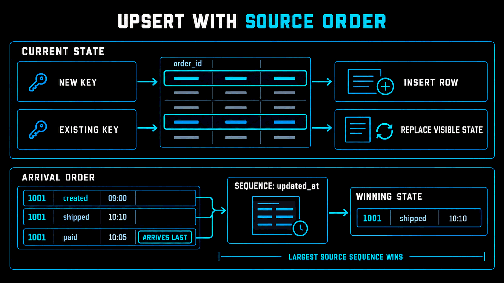
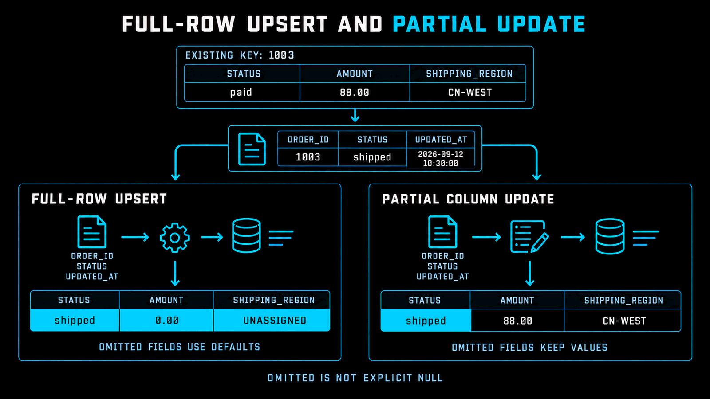
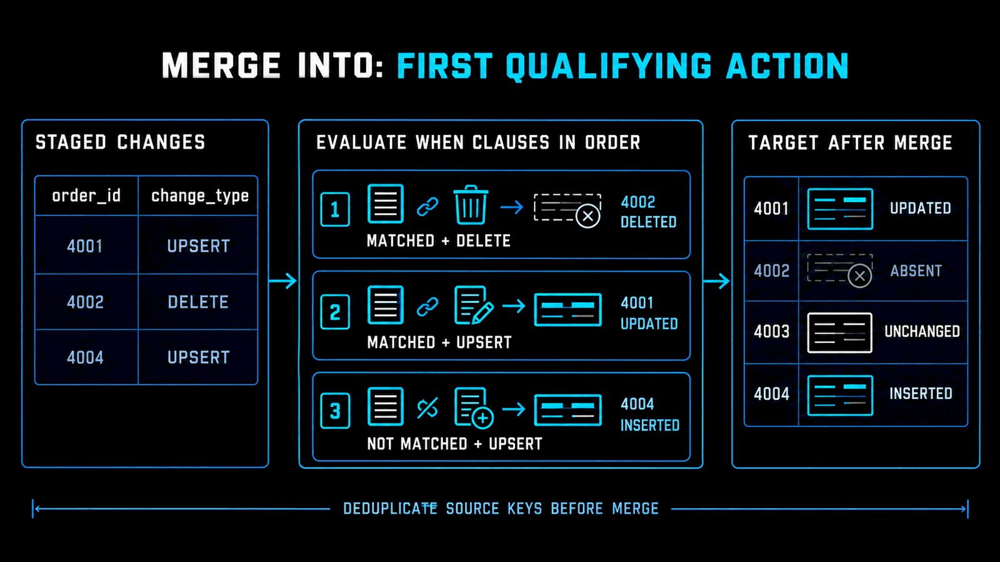
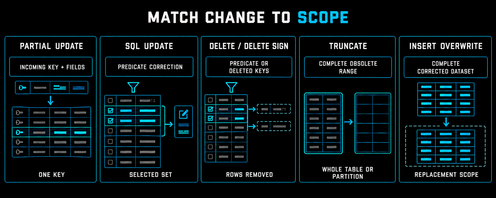
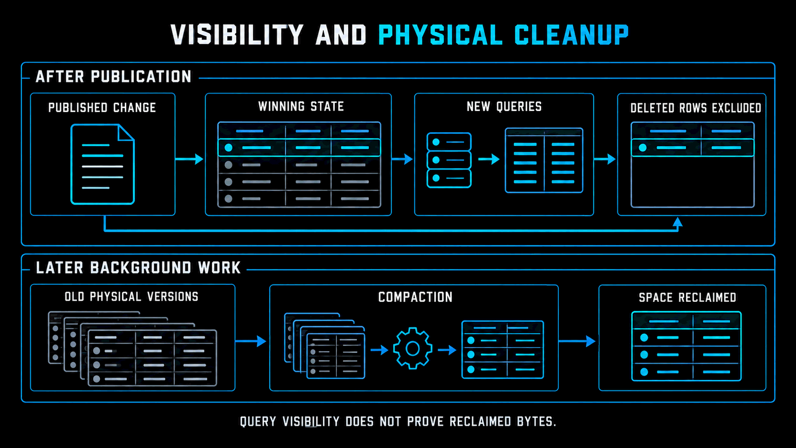

<a id="unit-u.16a27f12e77048e092bf640ce9d3e788"></a>

<a id="module-7-updating-and-deleting-data-in-apache-doris"></a>

# 7-модуль: Apache Doris жүйесінде деректерді жаңарту және жою

| Курс туралы ақпарат | Мән |
| --- | --- |
| Курс | Apache Doris көмегімен нақты уақыттағы аналитика · 2-деңгей |
| Doris | Apache Doris 4.1.3 |
| Орта | 1-зертханалық жұмыстың курс сынақ ортасы |
| Болжамды уақыт | Шамамен 65 минут: оқу 30, зертханалық жұмыс 25, тест 10 |

[Курстың README файлы](../../README.md) · [7-зертханалық жұмысты ашу](lab07_update_delete_data.ipynb) · [7-тестті ашу](quiz07_state_changes_and_deletion.ipynb)

<a id="unit-u.bc1c0e914ed743f2acdf686089a979a8"></a>

<a id="module-goal"></a>

## Модуль мақсаты

Doris ішінде өзгеретін бизнес нысандарының ағымдағы күйін дұрыс ұстаңыз: амалды өзгерістердің келу тәсіліне қарай таңдап, әрқайсысынан кейін сұрау не көретінін тексеріңіз.

4–6-модульдер тек өсетін оқиға тарихымен жұмыс істеді: болған оқиға ешқашан жаңартылмайды және `events_modelled` ішіндегі 10,158,080 жол сол күйінде қалады. Жаңарту мен жою күйлері өзгеретін тапсырыстар сияқты ағымдағы күй кестелеріне тиесілі. Сондықтан бұл модуль оқиғаларды қозғамай, әр амалды әр жолда көру үшін аз ғана жолы бар шағын тапсырыс кестелерін пайдаланады: тапсырыс платформасы толық тапсырыс көріністерін, логистика түзетулерін, жөндеулер мен жою жазбаларын жібереді, ал күндік Partition мерзімі өтуі немесе толық кері толықтыруды қажет етуі мүмкін.

<a id="unit-u.b871a74c7a134289a85f86529885d97c"></a>

<a id="learning-objectives"></a>

## Оқу мақсаттары

Осы модульді аяқтағаннан кейін сіз:

1. Кіріс өзгерістердің пішіні мен иелігіне қарай толық жолдық upsert, ішінара баған жаңарту, SQL `UPDATE` немесе `MERGE INTO` таңдай аласыз.
2. Қай күй жеңетінін келу реті емес, дереккөз реті шешуі үшін Sequence бағанын пайдалана аласыз.
3. Толық жолдық және ішінара жазулар түсірілген бағандарға не істейтінін және түсіріп қалдырудың `NULL` мәнінен айырмасын болжай аласыз.
4. Жойылатын жолдардың анықталуына қарай предикаттық `DELETE` немесе Delete Sign таңдай аласыз.
5. Толық Partition жою немесе ауыстыру үшін `TRUNCATE` немесе `INSERT OVERWRITE` таңдай аласыз.
6. Жарияланған өзгерістің көрінуін кейінгі Compaction физикалық тазалауынан ажырата аласыз.

<a id="unit-u.71805878763d4feb948a05394ab67fd9"></a>

<a id="module-structure"></a>

## Модуль құрылымы

| Бөлім | Уақыт | Нәтиже |
| --- | ---: | --- |
| 7.1 Амалды таңдамас бұрын күй шартын анықтау | 4 мин | Тарихты ағымдағы күйден және әр кесте моделінің рөлін ажырату |
| 7.2 Unique Key upsert арқылы толық күйлерді синхрондау | 4 мин | Толық күйлерге upsert жасап, оларды Sequence бағанымен реттеу |
| 7.3 Ішінара баған жаңартуымен иелік етпейтін өрістерді сақтау | 5 мин | Кей бағандарды өзгертіп, басқаларын сақтау |
| 7.4 SQL UPDATE арқылы шағын таңдалған жиынды түзету | 3 мин | Предикат таңдаған жолдарды түзету |
| 7.5 MERGE INTO арқылы шартты әрекеттерді қолдану | 5 мин | Бір дайындалған өзгерістер жиынынан жаңарту, жою және енгізу |
| 7.6 Жойылатын жолдардың қалай анықталатынын таңдау | 3 мин | Предикатпен немесе кіріс кілттермен жою |
| 7.7 Амалды толық өмірлік цикл ауқымына сәйкестендіру | 3 мин | Тұтас Partition тазарту немесе үстінен жазу |
| 7.8 Логикалық көрінуді физикалық тазалаудан ажырату | 3 мин | Сұраулар, жасырын белгілер және метадеректер нені көрсететінін оқу |
| 7-зертханалық жұмыс | 25 мин | Шағын тапсырыс кестелерінде upsert, ішінара жаңарту, түзету, біріктіру, жою және ауыстыру |
| 7-тест | 10 мин | Осы мақсаттар бойынша алты сұрақ |

<a id="unit-u.9e1f145cdc484bdc9ccd48f5841ba99e"></a>

<a id="71-define-the-state-contract-before-choosing-an-operation"></a>

## 7.1 Амалды таңдамас бұрын күй шартын анықтау

Оқиға тарихы кестесі **не болды** дегенге жауап береді. Ағымдағы күй кестесі **қазір қандай күйде** дегенге жауап береді. Тапсырыстың `created` күйінен `paid`, содан кейін `shipped` күйіне өтуі үш тарих оқиғасын, бірақ бір ағымдағы тапсырыс жолын бере алады.

| Кесте моделі | Сол кілтпен тағы бір жолдың мағынасы | Өзгерістерді өңдеу рөлі |
| --- | --- | --- |
| Duplicate Key | Тағы бір қабылданған жолды сақтау | Тарих және аудит деректері; тағы бір енгізу ескі жолды жасырмайды |
| Unique Key | Сол бизнес кілттің көрінетін күйін ауыстыру | Ағымдағы күй және бастапқы кілт синхрондауы |
| Aggregate Key | Value бағандарын жарияланған агрегат функцияларымен біріктіру | Метрика үлестері немесе арнайы ауыстыру агрегаттары |

Unique Key негізгі орында, өйткені толық жолдық upsert, Sequence реттеуі, SQL `UPDATE`, Delete Sign және `MERGE INTO` бастапқы кілт күйін қолдауға арналған. Бұл әр жоюды тек Unique моделіне тән етпейді. Предикаттық `DELETE` модельге тән шектеулермен әртүрлі модельге қолданылады, ал тұтас Partition амалдарының ауқымы бөлек. Aggregate Key `REPLACE_IF_NOT_NULL` сияқты арнайы үлгілерді пайдалана алады; бұл — мұндағы тапсырыс күйінің шарты емес, агрегат моделі әрекеті.

Жазбас бұрын сұраңыз:

1. Мақсатты күйді қай бизнес кілт анықтайды?
2. Дереккөз толық жол, таңдалған өрістер, предикат немесе толық алмастыру жиынын бере ме?
3. Ретті қай бастапқы мән орнатады?
4. Бір топтамада бірнеше бастапқы жол сол кілтке бағыттала ала ма?
5. Ауқым бір кілт пе, таңдалған жиын ба, бір Partition бе, әлде кесте ме?

<a id="unit-u.1b30b63d90804eeaad96442be108ba34"></a>

<a id="72-synchronize-complete-states-with-unique-key-upsert"></a>

## 7.2 Unique Key upsert арқылы толық күйлерді синхрондау

Дереккөз толық ағымдағы көріністі берсе, Unique Key кестесіне жүктеу upsert әрекетін береді:



*Upsert ағымдағы күйді өзгертеді, ал беделді дереккөз реті қай күй жеңетінін анықтайды.*

Сурет жазулары: Upsert with source order — дереккөз ретімен upsert; Current state — ағымдағы күй; New key — жаңа кілт; Existing key — бар кілт; Insert row — жол енгізу; Replace visible state — көрінетін күйді ауыстыру; Arrival order — келу реті; Arrives last — соңынан келеді; Sequence: updated_at — Sequence: updated_at; Winning state — жеңетін күй; Largest source sequence wins — ең үлкен бастапқы Sequence жеңеді. order_id, updated_at, created, shipped, paid атаулары, 1001 және 09:00, 10:10, 10:05 мәндері өзгермейді. Сурет ағылшын түпнұсқасында сақталған.

Бұл CDC толық көріністерінің топтамаларына немесе әр мақсатты Value бағанына иелік ететін өндірушіге сай келеді. Қалыпты сұрау нәтижелерінде әр тарихи нұсқаны сақтамайды.

<a id="unit-u.208e645abad74ddabcaa145ed13a5698"></a>

<a id="make-source-order-explicit"></a>

### Дереккөз ретін айқын ету

Келу реті сенімсіз. Кешіккен `paid` хабары жаңарақ `shipped` хабарынан кейін келуі мүмкін. Sequence бағаны бастапқы нұсқаны, уақыт белгісін немесе ығысуды кесте шартының бөлігі етеді:

7-зертханалық жұмыс `"function_column.sequence_col" = "updated_at"` жариялайды. Бағанды жай `updated_at` деп атау реттеу мағынасын жасамас еді. Әр бизнес кілт үшін монотонды және беделді дереккөз беретін мән таңдаңыз. Тең Sequence мәндеріне қосымша дереккөз саясаты қажет; келу ретін қауіпсіз теңдік шешуші деп ойламаңыз.

Үздіксіз өзгерістер әдетте топталуы тиіс. Жеке жазулардың тығыз циклі көп транзакция мен сақтау нұсқасын жасайды. Өзектілік, топтама өлшемі, сәтсіздіктен қалпына келтіру және қайталау қауіпсіздігі қабылдау шартының бөлігі болып қалады.

<a id="unit-u.9133feebe5d046429e6f72c4da72cc41"></a>

<a id="73-preserve-unowned-fields-with-partial-column-update"></a>

## 7.3 Ішінара баған жаңартуымен иелік етпейтін өрістерді сақтау

Логистика ағыны `status` және `updated_at` өрістеріне иелік етіп, `amount` немесе `shipping_region` өрістеріне иелік етпеуі мүмкін. Толық жолды қайта құру басқа жүйелердің мәндерін үстінен жазуы мүмкін.

| Режим | Бар кілт тек күй мен уақыт алады | Түсірілген Value бағандары |
| --- | --- | --- |
| Толық жолдық upsert | Толық алмастыру құру | Схема әдепкілерін немесе рұқсат етілген `NULL` пайдалану |
| Ішінара баған жаңарту | Бар күйді ішінара өзгерту | Көрінетін мәндерді сақтау |



*Түсірілген бағандар толық жолдық upsert кезінде ауысады, ал ішінара жаңартуда сақталады.*

Сурет жазулары: Full-row upsert and partial update — толық жолдық upsert және ішінара жаңарту; Existing key: 1003 — бар кілт: 1003; Full-row upsert — толық жолдық upsert; Partial column update — ішінара баған жаңарту; Omitted fields use defaults — түсірілген өрістер әдепкілерді қолданады; Omitted fields keep values — түсірілген өрістер мәндерін сақтайды; Omitted is not explicit NULL — түсіріп қалдыру айқын NULL емес. ORDER_ID, STATUS, AMOUNT, SHIPPING_REGION, UPDATED_AT атаулары, paid, shipped, CN-WEST, UNASSIGNED, 1003, 88.00, 0.00, 2026-09-12 10:30:00 мәндері өзгермейді. Суреттің ағылшын түпнұсқасы сақталған.

7-зертханалық жұмыс толық жолдық жазудың түсірілген сома мен аймақты `0.00` және `UNASSIGNED` етіп өзгертетінін, ал ішінара жаңартудың `88.00` және `CN-WEST` сақтайтынын көрсетеді.

Түсіріп қалдыру `NULL` айқын беруден өзгеше. Айқын `NULL` — NULL рұқсат етілетін баған үшін сұралған мән; жазудан бұрын түрленбесе, `NOT NULL` бағанында жарамсыз. Әдепкі мән берілген жарамсыз мәнді әмбебап түзетуші емес.

<a id="unit-u.7277bdb59b014188882f2cd0e3c021b1"></a>

<a id="turn-on-partial-updates-for-sql-or-for-a-load"></a>

### SQL немесе жүктеу үшін ішінара жаңартуды қосу

Ішінара баған жаңарту Merge-on-Write бар Unique Key кестелерінде жұмыс істейді; бұл — 4.x әдепкісі. Жазу оны сұрамаса, өшірулі және екі жиі жол оны әртүрлі сұрайды:

- **Баған тізімі бар `INSERT INTO`.** Баптаусыз бағандардың тек бір бөлігін атайтын `INSERT` әлі толық жолдық upsert болады. Алдымен `enable_unique_key_partial_update` сеанс айнымалысын `true` орнатыңыз; 7-зертханалық жұмыс осылай жасап, кейін кері орнатады:

  ```sql
  SET enable_unique_key_partial_update = true;
  INSERT INTO order_state (order_id, status, updated_at)
  VALUES (1003, 'shipped', '2026-09-12 10:30:00');
  ```

- **Stream Load.** `partial_columns:true` тақырыбын жіберіп, `columns` тақырыбында файл бағандарын тізіңіз; Broker Load және Routine Load сол қасиетті қабылдайды:

  ```bash
  curl --location-trusted -u root: \
    -H "Expect:100-continue" \
    -H "partial_columns:true" \
    -H "column_separator:," \
    -H "columns:order_id,status" \
    -T status_patch.csv \
    -X PUT http://127.0.0.1:18030/api/doris_course/order_state/_stream_load
  ```

Doris өзгертілетін жолды табуы үшін әр жол барлық Key бағанын қамтуы тиіс және бір жазудың барлық жолы бірдей бағандар жиынын жаңартады. Кілті әлі жоқ жолда сақтайтын ескі мәндер жоқ: әдепкіде (`partial_update_new_key_behavior = APPEND`) Doris оны енгізіп, басқа бағандарды әдепкілерімен немесе `NULL` толтырады, ал `NOT
NULL` бағанының әдепкісі болмаса, жазуды сәтсіз аяқтайды. Ішінара жаңарту ешқашан тапсырыс жасамауы тиіс болса, айнымалыны немесе аттас жүктеу қасиетін `ERROR` орнатыңыз; сонда жазу "Can't append new rows in partial update" қатесімен аяқталады. [Бағанды жаңарту](https://doris.apache.org/docs/4.x/data-operate/update/partial-column-update/) беті жүктеудің әр JSON жолы әртүрлі бағанды өзгерте алатын икемді баған жаңартуларын да қамтиды.

<a id="unit-u.988ada40901e428e898f0ef0b24f2261"></a>

<a id="74-correct-a-small-selected-set-with-sql-update"></a>

## 7.4 SQL UPDATE арқылы шағын таңдалған жиынды түзету

Алмастыру жазбалары жоқ болып, мәселені SQL предикаты анықтаса, тікелей түзету пайдаланыңыз:

```sql
UPDATE order_state
SET shipping_region = 'CN-NORTH'
WHERE order_id = 1001;
```

`WHERE` мақсатты жолдарды таңдайды; `SET` өзгертілетін Value бағандарын атайды. SQL `UPDATE` Unique Key кестесіне бағытталады және Key бағандарын өзгерте алмайды. Бизнес кілт өзгерісі ескі кілтті жойып, жаңасын енгізуі тиіс.

Бұл жол сирек түзетулерге сай. Жоғары жиілікті қолданба цикліне қолайсыз, өйткені әр оператор жолдар тауып, транзакция жариялайды. Кіріс жазбалары кілттерді анықтап тұрса, топтамалық толық жолдық немесе ішінара жүктеулерді пайдаланыңыз.

<a id="unit-u.d3e18f7aa2a342458abe043638ae310f"></a>

<a id="75-apply-conditional-actions-with-merge-into"></a>

## 7.5 MERGE INTO арқылы шартты әрекеттерді қолдану

Дайындалған қатынас аралас өзгеріс түрлерін қамтуы мүмкін:

| `order_id` | `change_type` | Қажетті әрекет |
| ---: | --- | --- |
| 4001 | UPSERT | Бар тапсырысты жаңарту |
| 4002 | DELETE | Бар тапсырысты жою |
| 4004 | UPSERT | Жаңа тапсырыс енгізу |



*`MERGE INTO` алғашқы жарамды әрекетті қолданып, тек мақсатта бар жолдарды өзгертпейді.*

Сурет жазулары: MERGE INTO: first qualifying action — MERGE INTO: алғашқы жарамды әрекет; Staged changes — дайындалған өзгерістер; Evaluate WHEN clauses in order — WHEN тармақтарын ретімен бағалау; Matched + delete — сәйкес және жою; Matched + upsert — сәйкес және upsert; Not matched + upsert — сәйкес емес және upsert; Target after merge — merge кейінгі мақсат; Deleted / absent — жойылған / жоқ; Updated — жаңартылған; Unchanged — өзгермеген; Inserted — енгізілген; Deduplicate source keys before merge — merge алдында бастапқы кілттердің қайталануын жою. order_id, change_type, UPSERT, DELETE, 4001–4004 және 1/2/3 әрекет белгілері сақталған. Сурет ағылшын түпнұсқасында қалады.

`MERGE INTO` сол қатынасты Merge-on-Write бар Unique Key болуы тиіс мақсатты кестемен біріктіреді; басқа кестеде Doris операторды қабылдамайды ("merge into command only support MOW unique key olapTable"):

```sql
MERGE INTO order_merge_target AS t
USING order_merge_changes AS s
ON t.order_id = s.order_id
WHEN MATCHED AND s.change_type = 'DELETE' THEN DELETE
WHEN MATCHED AND s.change_type = 'UPSERT' THEN UPDATE SET
    status = s.status,
    amount = s.amount,
    shipping_region = s.shipping_region,
    updated_at = s.updated_at
WHEN NOT MATCHED AND s.change_type = 'UPSERT' THEN INSERT
    (order_id, status, amount, shipping_region, updated_at)
VALUES
    (s.order_id, s.status, s.amount, s.shipping_region, s.updated_at);
```

Doris `WHEN` тармақтарын ретімен бағалап, шарты орындалатын алғашқысына сай әрекет етеді:

- `WHEN MATCHED` тармақтары кілті мақсатта бар бастапқы жолдарды өңдейді; әрқайсысы аталған бағандарды дереккөз не мақсат мәндерімен жаңартады немесе жолды жояды.
- `WHEN NOT MATCHED` тармақтары мақсатты жолы жоқ бастапқы жолдарды өңдейді; әрқайсысы дереккөз мәндерінен жаңа жол енгізеді.
- `AND` шарты жоқ тармақ өз түрінің соңғысы болуы тиіс, өйткені одан кейінгі тармақ ешқашан орындала алмас еді.

Бастапқы жолы жоқ мақсатты жол өзгермейді: зертханалық жұмыста 4003 тапсырысы мақсатта бар, өзгерістер жиынында жоқ, сондықтан күйін сақтайды. Операторды орындауға мақсат пен дереккөзде `SELECT_PRIV` және мақсатта `LOAD_PRIV` қажет.

Бұл кесте немесе ішкі сұрау түрінде берілген жиынға негізделген топтамаға сай. Қарапайым upsert бере алмайтын шартты сәйкес және сәйкес емес әрекеттерді қосады. Бұл — үздіксіз жоғары өткізу қабілетті ағындық жүктеудің алмастырушысы емес, Data Manipulation Language операторы.

<a id="unit-u.fd3f7558f7fa45479ffab9071ae3aed6"></a>

<a id="require-deterministic-source-matching"></a>

### Детерминді дереккөз сәйкестігін талап ету

Doris 4.x бірнеше бастапқы жолдың сол мақсатты жолға сәйкес келгенін анықтамайды. Ондайда нәтиже анықталмаған: `INSERT` сияқты, Sequence бағаны қай жазу жеңетінін шешеді, ал онсыз кез келгені жеңуі мүмкін. Merge алдында топтаманы беделді реттілік бойынша қайталанудан тазартыңыз немесе қабылдамаңыз. 7-зертханалық жұмыс операторды орындамас бұрын бастапқы жол санын бірегей бастапқы кілт санымен салыстырады.

<a id="unit-u.039721904ed74ab5b9867de627fd26a4"></a>

<a id="76-choose-how-deleted-rows-are-identified"></a>

## 7.6 Жойылатын жолдардың қалай анықталатынын таңдау

SQL `status = 'test'` сияқты мақсатты жиынды анықтағанда предикаттық `DELETE` пайдаланыңыз. Ол Duplicate, Unique және Aggregate Key кестелеріне қолданыла алады, бірақ Aggregate Key жою шарттары Key бағандарымен шектелген.

Топтама немесе CDC жазбасы жойылған Unique Key мәнін алып келсе, Delete Sign пайдаланыңыз. Жасырын `__DORIS_DELETE_SIGN__ = 1` орнату жойылған кілттерге жүктеу жолын қолдануға мүмкіндік береді. `NULL` жазу, Value бағандарын түсіріп қалдыру немесе қалыпты upsert жіберу жоюды білдірмейді.

Delete Sign — Merge-on-Write сипаттайтын әр Rowset ішкі delete bitmap құрылымы емес, кіріске арналған жасырын баған. 7-зертханалық жұмыс `2003` мәнін предикатпен, `2002` мәнін Delete Sign арқылы жояды, содан кейін қалыпты сұрау тек `2001` қайтарады.

<a id="unit-u.ee91c86f25c54ba5b0b8dc8d84dd7fd4"></a>

<a id="77-match-the-operation-to-a-complete-lifecycle-scope"></a>

## 7.7 Амалды толық өмірлік цикл ауқымына сәйкестендіру



*Бір кілттен толық Partition бөліміне дейін кіріс өзгерісіне сай ауқымы бар амалды таңдаңыз.*

Сурет жазулары: Match change to scope — өзгерісті ауқымға сәйкестендіру; Partial update — ішінара жаңарту; Incoming key + fields — кіріс кілт пен өрістер; One key — бір кілт; SQL update — SQL жаңарту; Predicate correction — предикатпен түзету; Selected set — таңдалған жиын; DELETE / Delete Sign — DELETE / жою белгісі; Predicate or deleted keys — предикат немесе жойылған кілттер; Rows removed — жолдар жойылған; TRUNCATE — TRUNCATE; Complete obsolete range — толық ескірген ауқым; Whole table or Partition — тұтас кесте не Partition; INSERT OVERWRITE — INSERT OVERWRITE; Complete corrected dataset — толық түзетілген деректер жиыны; Replacement scope — ауыстыру ауқымы. Сурет ағылшын түпнұсқасында сақталған.

| Талап | Бастапқы амал |
| --- | --- |
| Толық кесте немесе Partition ескірген | `TRUNCATE TABLE/PARTITION` |
| Толық түзетілген деректер жиыны ауқымды ауыстырады | `INSERT OVERWRITE` |
| Тек шектелген предикат таңдаған жиын жоғалады | Предикаттық `DELETE` |

`TRUNCATE PARTITION` толық күнтізбелік ауқымдардың сақтау мерзіміне сай. `INSERT OVERWRITE` қажетті толық мазмұнды қамтитын кері толықтыруға сай; алмастыруда жоқ жолдар қалмайды. Duplicate Key кестесінде қалыпты `INSERT INTO` қосар еді және ескі ауқымды қайталауы мүмкін.

Doris overwrite амалын атомарлы ауыстыру деп құжаттайды. 7-зертханалық жұмыс соңғы мазмұнды байқайды, бірақ қатар орындалатын оқу сұрауларын іске қоспайды, сондықтан ауысудың өзін байқадық деп мәлімдемейді. Мақсатты ауқымды әрдайым тексеріңіз: қате Partition ішіне жазылған толық жиын бәрібір қате деректердің толық алмастырылуы болады.

<a id="unit-u.a9cb969fc44549409893064dd0ef6ff0"></a>

<a id="78-separate-logical-visibility-from-physical-cleanup"></a>

## 7.8 Логикалық көрінуді физикалық тазалаудан ажырату

Жариялаудан кейін жаңа қалыпты сұраулар жеңген Unique Key күйін көріп, логикалық жойылған жолдарды алып тастайды. Оларға Compaction күту қажет емес. Ауыстырылған физикалық нұсқалар фондық Compaction оларды босатқанша қалуы мүмкін.



*Логикалық көріну жариялаудан кейін бірден болады; физикалық босату — кейінгі фондық жұмыс.*

Сурет жазулары: Visibility and physical cleanup — көріну және физикалық тазалау; After publication — жариялаудан кейін; Published change — жарияланған өзгеріс; Winning state — жеңген күй; New queries — жаңа сұраулар; Deleted rows excluded — жойылған жолдар алынған; Later background work — кейінгі фондық жұмыс; Old physical versions — ескі физикалық нұсқалар; Compaction — Compaction; Space reclaimed — орын босатылған; Query visibility does not prove reclaimed bytes — сұрауда көріну байттардың босатылғанын дәлелдемейді. Суреттің ағылшын түпнұсқасы сақталған.

| Дәлел | Қолдайтын қорытынды | Қолдамайтын қорытынды |
| --- | --- | --- |
| Қалыпты `SELECT` | Ағымдағы көрінетін жолдар мен мәндер | Ескі байттардың босатылғаны |
| Жасырын Delete Sign | Ағымдағы жасырын жою белгілері | Ішкі delete bitmap мазмұны |
| `SHOW TABLETS` нұсқалары | Кейінгі Tablet нұсқасы жарияланған | Нақты көрінетін жол саны немесе болашақ нұсқа саны |
| Ресми құжаттар | Жобаланған MoW және Compaction әрекеті | Ішкі құрылымдарды ноутбукта тікелей байқау |

Фондық жұмыс дербес болғандықтан, зертханалық жұмыс кезінде `VersionCount` өзгеруі мүмкін. Tablet `RowCount` — `COUNT(*)` емес. Жиі ұсақ жазулар транзакция, нұсқа және Rowset қысымын да тудырады, сондықтан үздіксіз өзгерістерді топтап, тұтас ауқымдарға Partition деңгейіндегі амалдарды пайдаланыңыз.

<a id="unit-u.1ff71c2f893447619c7acb6a2bc71a0f"></a>

<a id="lab-7-maintain-current-state-and-remove-data-safely"></a>

## 7-зертханалық жұмыс: ағымдағы күйді қолдау және деректерді қауіпсіз жою

[7-зертханалық жұмыс — ағымдағы күйді қолдау және деректерді қауіпсіз жою](lab07_update_delete_data.ipynb) ашып, шамамен 25 минут жоспарлаңыз. Оған тек курс сынақ ортасы қажет және тек 7-модуль кестелерін жасайды:

- upsert, Sequence, ішінара жаңарту және SQL түзетуі үшін `order_state`;
- жергілікті `MERGE INTO` үшін `order_merge_target` және `order_merge_changes`;
- предикаттық DELETE және Delete Sign үшін `order_deletions`;
- Partition тазарту және үстінен жазу үшін `order_lifecycle`.

| Қадам | Бақылау |
| --- | --- |
| 1 | Жаңа және бар кілттер upsert бойынша әрекет етеді; үлкен Sequence жеңеді |
| 2 | Толық жолда түсіріп қалдыру әдепкілерді қолданады; ішінара жаңарту мәндерді сақтайды |
| 3 | SQL `UPDATE` тек таңдалған Value бағанын өзгертеді |
| 4 | Бір merge сәйкес жаңарту, сәйкес жою және сәйкес емес енгізуді орындайды |
| 5 | Предикаттық және кіріс кілтпен жоюлар көзделген көрінетін күйді береді |
| 6 | Truncate мерзімі өткен ауқымды жояды, overwrite кері толықтыру ауқымын ауыстырады |

Сыртқы CDC жүйесі, объектілік сақтау немесе жүктелетін деректер жиыны қолданылмайды.

Зертханалық жұмыс жаттығумен аяқталады: тапсырыстарды ішінара жаңарту Stream Load арқылы өзгертіңіз. Алдымен нәтижені болжаңыз, содан кейін бос ұяшыққа код жазыңыз; одан кейінгі жиналған үлгі шешім де Run All арқылы орындалып, зертханалық жұмыс кестелерін бастапқы күйінде қалдырады.

<a id="unit-u.142afbbe94874d8f9fdea3acdbac80ed"></a>

<a id="summary"></a>

## Қорытынды

- Өзгерту жолын дереккөзге қарай таңдаңыз: толық күйлер үшін толық жолдық upsert, кей бағандарға иелік ететін түзетулер үшін ішінара баған жаңарту, предикат таңдаған сирек түзету үшін SQL `UPDATE`, ал жаңарту, жою және енгізу бірге қажет дайындалған жиын үшін `MERGE INTO`.
- Sequence бағаны кілттің қай күйі жеңетінін дереккөз нұсқасына шешкізеді, сондықтан кешіккен ескі күй жаңасын ауыстырмайды.
- Толық жолдық upsert түсірілген мән бағандарын әдепкісімен немесе `NULL` толтырады; ішінара баған жаңарту олардың бар мәндерін сақтайды; айқын `NULL` — түсіріп қалдыру емес, мән.
- Предикаттық `DELETE` SQL шарты таңдаған жолдарды жояды; Delete Sign дерек ретінде, мысалы CDC-ден келген кілттерді жояды.
- `TRUNCATE` толық кестені немесе Partition бөлімін тазартады, ал `INSERT OVERWRITE` толық ауқымды түзетілген деректермен бір атомарлы ауысуда алмастырады.
- Өзгеріс жарияланғаннан кейін жаңа сұраулар жаңа күйді бірден көреді, ал ескі физикалық нұсқалар фондық Compaction оларды босатқанша қалуы мүмкін.

<a id="unit-u.2f6e4eb2476548709620474c0e6ab7b2"></a>

<a id="quiz-7-updating-and-deleting-data-in-apache-doris"></a>

## 7-тест: Apache Doris жүйесінде деректерді жаңарту және жою

[7-тест: Apache Doris жүйесінде деректерді жаңарту және жою](quiz07_state_changes_and_deletion.ipynb) ашыңыз.
Онда бір жауап таңдалатын алты сұрақ бар және жұмыс істеп тұрған орта қажет емес.

Келесі қадам: бұл — 2-деңгейдің соңғы модулі. 3-деңгей [8-модуль: Apache Doris жүйесінде сұрауларды жеделдету](../../level3/module08-query-acceleration/course.md) бөлімінен басталады.

<a id="unit-u.44fd238255e741429ab78b85b87c24ce"></a>

<a id="references"></a>

## Анықтамалар

- [Деректерді жаңарту және жою](https://doris.apache.org/docs/4.x/key-features/data-update-delete/) және [Unique Key](https://doris.apache.org/docs/4.x/key-features/unique-key/)
- [Unique моделі үшін жүктеу арқылы жаңартулар](https://doris.apache.org/docs/4.x/data-operate/update/update-of-unique-model/) және [Бағанды жаңарту](https://doris.apache.org/docs/4.x/data-operate/update/partial-column-update/)
- [`UPDATE`](https://doris.apache.org/docs/4.x/sql-manual/sql-statements/data-modification/DML/UPDATE/) және [`MERGE INTO`](https://doris.apache.org/docs/4.x/sql-manual/sql-statements/data-modification/DML/MERGE-INTO/)
- [Жою амалы](https://doris.apache.org/docs/4.x/data-operate/delete/delete-manual/) және [Жүктеу арқылы топтамалық жою](https://doris.apache.org/docs/4.x/data-operate/delete/batch-delete-manual/)
- [Truncate амалы](https://doris.apache.org/docs/4.x/data-operate/delete/truncate-manual/) және [`INSERT OVERWRITE`](https://doris.apache.org/docs/4.x/sql-manual/sql-statements/data-modification/DML/INSERT-OVERWRITE/)
- Doris 4.1.3 терминдері: [`OlapTable.java`](https://github.com/apache/doris/blob/4.1.3/fe/fe-core/src/main/java/org/apache/doris/catalog/OlapTable.java) және [`InternalCatalog.java`](https://github.com/apache/doris/blob/4.1.3/fe/fe-core/src/main/java/org/apache/doris/datasource/InternalCatalog.java)
