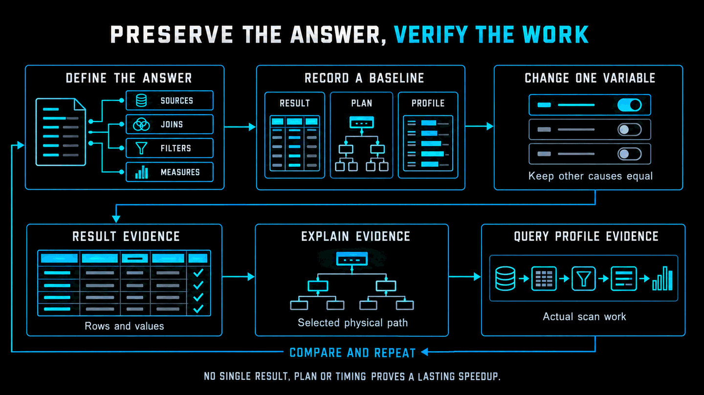
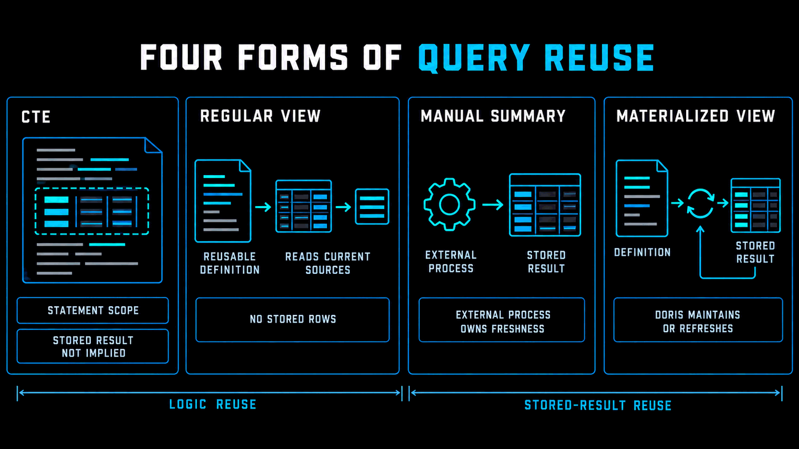
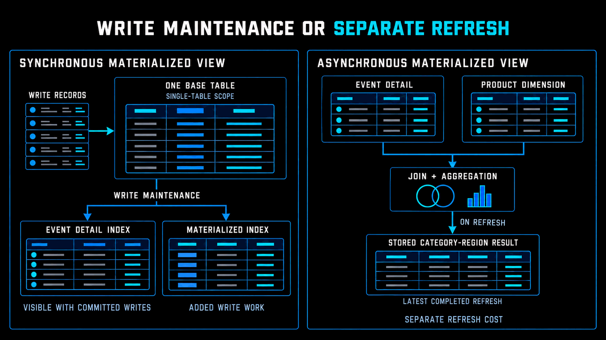
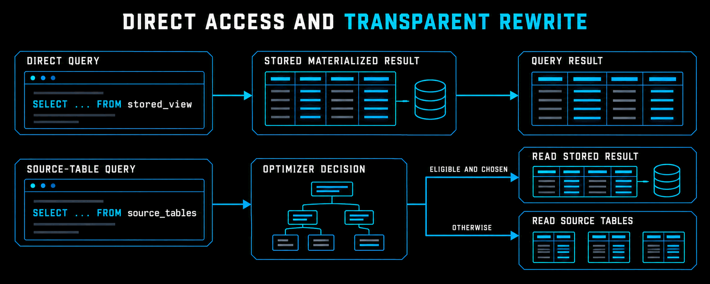
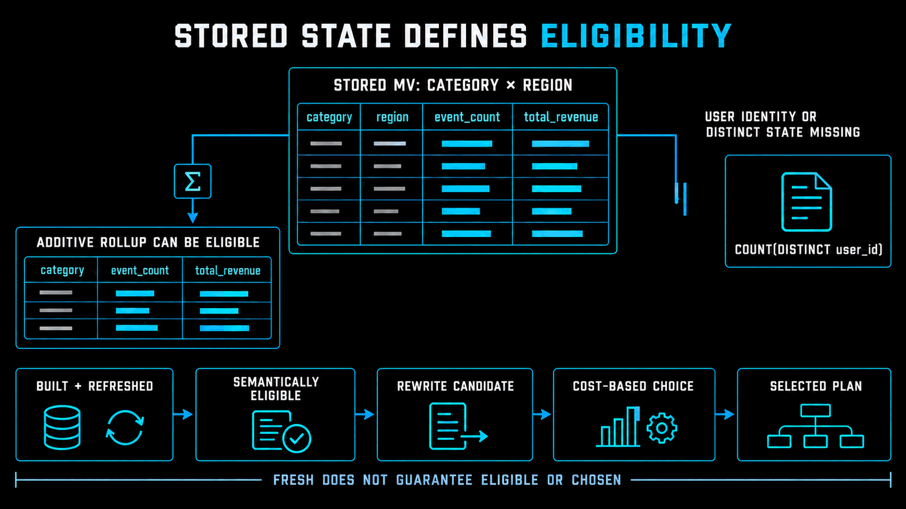
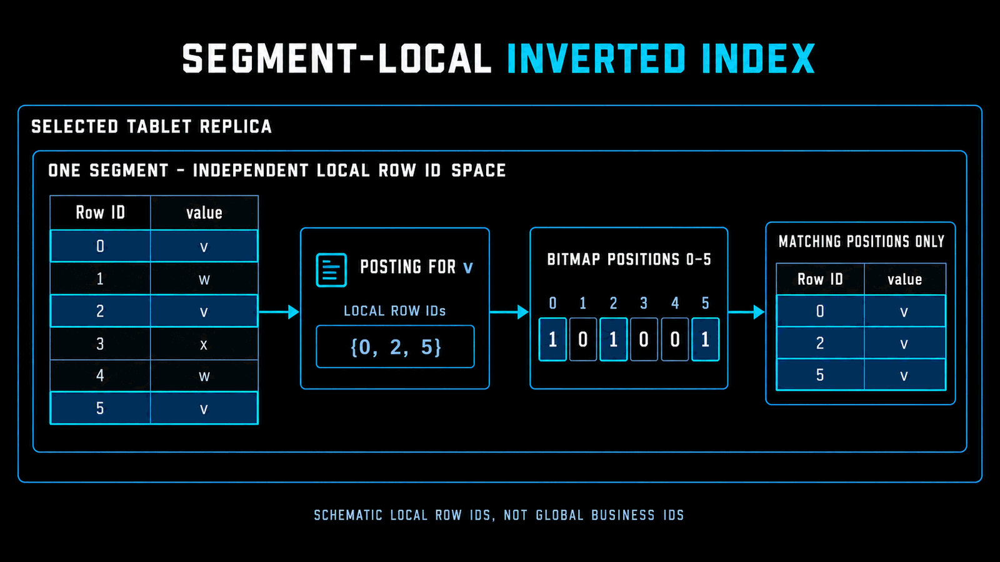

<a id="unit-u.844a87f9213841dab097eac61fe64e46"></a>

<a id="module-8-accelerating-queries-in-apache-doris"></a>

# 8-модуль: Apache Doris жүйесінде сұрауларды жеделдету

| Курс туралы ақпарат | Мән |
| --- | --- |
| Курс | Apache Doris көмегімен нақты уақыттағы аналитика · 3-деңгей |
| Doris | Apache Doris 4.1.3 |
| Орта | Курс сынақ ортасы, 4-зертханалық жұмыстың `events_modelled` және 6-зертханалық жұмыстың `dim_products` кестелері |
| Болжамды уақыт | Шамамен 120 минут: оқу 55, зертханалық жұмыс 55, тест 10 |

[Курстың README файлы](../../README.md) · [8-зертханалық жұмысты ашу](lab08_accelerate_queries.ipynb) · [8-тестті ашу](quiz08_acceleration_choices.ipynb)

<a id="unit-u.26900436955345e68df9e473019b9697"></a>

<a id="module-goal"></a>

## Модуль мақсаты

Жауаптарын өзгертпей сұраулардың қайталанатын жұмысын азайтыңыз: сұрау пішіні, өзектілігі және шығыны бойынша көрініс, материалданған көрініс немесе индекс таңдап, әрқайсысын нәтиже, жоспар және Query Profile арқылы тексеріңіз.

Электрондық сауда аналитикасы тобының дұрыс аймақтық түсім бақылау тақтасы бар, бірақ жүктеме өзгеріп жатыр: сатып алу анықтамасын көбірек есеп пайдаланады, сол агрегаттаулар жиірек орындалады, санат талдауы өнім Join амалын қосады және зерттеушілер жеке өнім оқиғаларын іздейді. Әр бөлім осы өзгерістердің бірін алып, Doris қандай қайталанатын жұмысты болдырмауы тиіс екенін сұрайды. Дұрыс нәтиже мағынаны, `EXPLAIN` таңдалған жоспарды, ал Query Profile бір орындаудың нені сканерлегенін анықтайды; олардың ешқайсысы жалғыз өзі тұрақты жеделдеуді дәлелдемейді.

<a id="unit-u.f0ff6d2292414db1881c6b8a3d1940e3"></a>

<a id="learning-objectives"></a>

## Оқу мақсаттары

Осы модульді аяқтағаннан кейін сіз:

1. Қалыпты көріністі, қолмен толтырылатын жиынтық кестені, синхронды және асинхронды материалданған көріністі ажырата аласыз.
2. SQL ауқымы, өзектілік талабы және жазу не жаңарту шығыны бойынша синхронды немесе асинхронды материалдандыруды таңдай аласыз.
3. Материалданған нәтиже басқа сұрауға жауап беруге қажетті өлшемдер мен метрика күйін сақтайтынын анықтай аласыз.
4. Қызмет етуі тиіс предикатқа қарай инверттелген индекс, BloomFilter индексі немесе NGram BloomFilter индексін таңдай аласыз.
5. Жеделдету құрылымын тексергенде құру күйін, жоспар таңдауын, статистиканы және орындалу дәлелін ажырата аласыз.
6. Құрылымның оқу үнемі сақтау, жазу және жаңарту шығынын ақтайтынын шеше аласыз.

<a id="unit-u.8d88bc642e5544c38dd907cf94be392b"></a>

<a id="module-structure"></a>

## Модуль құрылымы

| Бөлім | Уақыт | Нәтиже |
| --- | ---: | --- |
| 8.1 Жұмысты азайтпас бұрын жауапты анықтау | 6 мин | Жиын мен түйіршіктілікті бекітіп, нәтиже, жоспар және орындалу дәлелін ажырату |
| 8.2 Қалыпты көрініспен сұрау логикасын қайта пайдалану | 5 мин | Сақталған нәтиже деп мәлімдемей анықтаманы қайта пайдалану |
| 8.3 Қолдау көрсетілетін бір кестелік жиынтықты өзекті ұстау | 8 мин | Синхронды материалданған көріністі өз ауқымында пайдалану |
| 8.4 Көп кестелік нәтижені асинхронды материалданған көріністе сақтау | 8 мин | Join нәтижесін сақтап, жаңарту мен өзектілігін анықтау |
| 8.5 Материалданған нәтиже сұрауға жауап бере алатынын шешу | 7 мин | Қайта жазуды күтпес бұрын өлшемдер, түйіршіктілік және метрика күйін тексеру |
| 8.6 Қосымша индекспен іріктемелі егжей-тегжейлі іздеулерді тарылту | 9 мин | Индексті предикатқа қарай таңдап, әділ сынау |
| 8.7 Оңтайландырғышқа сенімді кірістер беру | 6 мин | Жоспарды мәжбүрлемес бұрын жарамдылық, күй және статистиканы тексеру |
| 8.8 Оқу үнемі шығынды ақтайтынын шешу | 6 мин | Оқу үнемін сақтау, жазу және жаңарту шығынымен салыстыру |
| 8-зертханалық жұмыс | 55 мин | Көрініс, екі материалданған көрініс және индекс құрып, статистика мен жоспарларды оқу |
| 8-тест | 10 мин | Осы мақсаттар бойынша алты сұрақ |

<a id="unit-u.82c499254a4c4423952e358c40f77f84"></a>

<a id="81-define-the-answer-before-reducing-the-work"></a>

## 8.1 Жұмысты азайтпас бұрын жауапты анықтау

Аймақтық түсім бақылау тақтасы қабылданған жауапты беріп тұр, бірақ қолдану өскен сайын орындау шығыны артады. Топ қай жауап өзгермей қалуы тиіс және қай жұмысты азайтқысы келетінін айта алмайынша көрініс немесе индекс таңдамауы тиіс.

Жеделдету құрылымы көзделген жауапты сақтағанда ғана пайдалы. Сұрау шартынан бастаңыз:

| Шарт сұрағы | Жауап мысалы |
| --- | --- |
| Қай жолдар жарамды? | Таңдалған уақыт ауқымындағы сатып алу оқиғалары |
| Бір шығыс жолы нені білдіреді? | Бір аймақ немесе бір өнім санаты |
| Қай метрикалар қажет? | Оқиға саны және дәл түсім жиынтығы |
| Нәтиже қаншалықты өзекті болуы тиіс? | Әр бекітілген жазу немесе ең соңғы аяқталған жаңарту |
| Сұрау қаншалықты жиі орындалады? | Қайталанатын бақылау тақтасы сұрауы немесе сирек зерттеу |
| Қай ресурстар шектелген? | Сканерлеу, Join, сақтау, жүктеу немесе жаңарту қуаты |

<a id="unit-u.ec1d7143b6024bbfaa035d32cd36cd9d"></a>

<a id="keep-the-population-explicit"></a>

### Жиынды айқын ұстау

Екі жарамды есеп әртүрлі жиын қолдана алады. Аймақ есебі сатып алу оқиғаларын тікелей оқуы, ал санат есебі өнім өлшеміне Inner Join қолдануы мүмкін. Өнімі өлшемге сәйкес келмейтін оқиғалар бірінші жиында қалып, екіншісінен жоғалады.

Бұл айырмашылық — Join мағынасы. Көрініс, материалданған көрініс немесе индекс дерек жоғалтты деген дәлел емес. Жеделдетілген нәтижені бастапқы нұсқамен салыстырмас бұрын екі сұраудың мынасы бірдей екенін растаңыз:

- бастапқы қатынастар;
- Join түрі мен шарты;
- жол сүзгілері;
- топтау өлшемдері;
- метрика анықтамалары;
- `NULL` өңдеуі.

<a id="unit-u.abeb765418634f758e473ed1e15a435c"></a>

<a id="separate-three-kinds-of-evidence"></a>

### Дәлелдің үш түрін ажырату

| Дәлел | Жауап беретін сұрақ | Жауап бермейтін сұрақ |
| --- | --- | --- |
| Толық сұрау нәтижесі | Бұл SQL көзделген жолдар мен мәндерді қайтарды ма? | Оларды қай физикалық жол берді? |
| `EXPLAIN` | Оңтайландырғыш қай сканерлеу, индекс, материалданған көрініс, сүзгі және Exchange жоспарлады? | Нақты қанша жол өңделді? |
| Query Profile | Аталған операторлар мен даналар бір орындауда не істеді? | Бизнес жауабы барлық жағдайда дұрыс па? |

Жоспардағы болжамды `cardinality` нақты сканерлеу саны емес. Орындалу `ScanRows` санағышы соңғы есеп жолдарының саны емес. Өткен уақытқа жоспарлау, кэштер, қатар жұмыс және сынақ ортасы да әсер етеді.

Қауіпсіз жұмыс барысы:



*Жауапты сақтаңыз, бір айнымалыны өзгертіңіз және әр дәлел тексеруін қайталаңыз.*

Сурет жазулары: Preserve the answer, verify the work — жауапты сақтау, жұмысты тексеру; Define the answer — жауапты анықтау; Sources — дереккөздер; Joins — біріктірулер; Filters — сүзгілер; Measures — метрикалар; Record a baseline — бастапқы нұсқаны тіркеу; Result — нәтиже; Plan — жоспар; Profile — Profile; Change one variable — бір айнымалыны өзгерту; Keep other causes equal — басқа әсерлерді бірдей ұстау; Result evidence — нәтиже дәлелі; Rows and values — жолдар мен мәндер; EXPLAIN evidence — EXPLAIN дәлелі; Selected physical path — таңдалған физикалық жол; Query Profile evidence — Query Profile дәлелі; Actual scan work — нақты сканерлеу жұмысы; Compare and repeat — салыстыру және қайталау; No single result, plan or timing proves a lasting speedup — жалғыз нәтиже, жоспар немесе уақыт өлшемі тұрақты жеделдеуді дәлелдемейді. Сурет ағылшын түпнұсқасында сақталған.

Бастапқы нұсқа енді бақылау тақтасының мағынасын қорғайды. Бірақ алғашқы пайдалану мәселесі қайталанатын есептеуден қарапайым: бірнеше есеп сатып алу ережесін көшіріп, алшақтауы мүмкін. Сондықтан физикалық жеделдетуден бұрын логикалық қайта пайдалану келеді.

<a id="unit-u.7ee8289b96b54b99a5ece605d57b97ff"></a>

<a id="82-reuse-query-logic-with-a-regular-view"></a>

## 8.2 Қалыпты көрініспен сұрау логикасын қайта пайдалану

Аймақтық бақылау тақтасы енді сатып алу деректерінің жалғыз тұтынушысы емес. Бірнеше есепке сол сатып алу анықтамасы қажет. Әр есепке предикатты көшіру қолдау мәселесін жасайды: кейін бір есеп басқа оқиға түрін, түсім ережесін немесе алып тастауды қолдануы мүмкін.

Қалыпты көрініс анықтамаға қайта пайдаланылатын реляциялық атау береді:

```sql
CREATE VIEW purchase_events AS
SELECT event_time, event_id, user_id, product_id, region, revenue
FROM event_detail
WHERE event_type = 'purchase';
```

Есеп енді сол анықтамаға жүгіне алады:

```sql
SELECT region,
       COUNT(*) AS event_count,
       SUM(revenue) AS total_revenue
FROM purchase_events
GROUP BY region;
```

Көрініс өзінің `SELECT` нәтижесі болатын жолдарды сақтамайды. Doris анықтаманы есеп жоспарына жайып, астындағы кестені сканерлеуді жалғастыра алады. Пайдасы — автоматты алдын ала есептеу емес, бірізді логика мен тұрақты интерфейс.

<a id="unit-u.6c8bbce4ef7141f58b0d0655c946c90d"></a>

<a id="do-not-confuse-four-forms-of-reuse"></a>

### Қайта пайдаланудың төрт пішінін шатастырмау

| Пішін | Не қайта пайдаланылады | Сақталған нәтиже | Қолдау байланысы |
| --- | --- | --- | --- |
| Common Table Expression (CTE) | Бір оператор ішіндегі атаулы кезең | Көзделмейді | Тек сол оператор ішінде бар |
| Қалыпты көрініс | Қайта пайдаланылатын сұрау анықтамасы | Жоқ | Сұрағанда ағымдағы бастапқы деректерді оқиды |
| Қолмен толтырылатын жиынтық кесте | Бөлек үдеріс жазған жолдар | Бар | Үдеріс оны өзекті ұстауы тиіс |
| Материалданған көрініс | Анықтама және басқарылатын сақталған деректер | Бар | Doris көрініс түріне сай қолдайды немесе жаңартады |



*Логиканы қайта пайдалану мен сақталған нәтижені қайта пайдалану әртүрлі мәселені шешеді және өзектілік иелері бөлек.*

Сурет жазулары: Four forms of query reuse — сұрауды қайта пайдаланудың төрт пішіні; CTE — CTE; Statement scope — оператор ауқымы; Stored result not implied — сақталған нәтиже көзделмейді; Regular view — қалыпты көрініс; Reusable definition — қайта пайдаланылатын анықтама; Reads current sources — ағымдағы дереккөздерді оқиды; No stored rows — сақталған жолдар жоқ; Manual summary — қолмен жасалған жиынтық; External process — сыртқы үдеріс; Stored result — сақталған нәтиже; External process owns freshness — өзектілікке сыртқы үдеріс жауапты; Materialized view — материалданған көрініс; Definition — анықтама; Doris maintains or refreshes — Doris қолдайды немесе жаңартады; Logic reuse — логиканы қайта пайдалану; Stored-result reuse — сақталған нәтижені қайта пайдалану. Сурет ағылшын түпнұсқасында сақталған.

Қолмен толтырылатын жиынтық жақсы деректер өнімі болуы мүмкін. Пайдаланушылар айқын иесі, кестесі және салыстырып тексеру ережесі болмаса да оны өзекті деп ойлағанда ғана қауіпті болады.

<a id="unit-u.c526618187c9488c9332faa1342eba65"></a>

<a id="what-the-evidence-should-show"></a>

### Дәлел не көрсетуі тиіс

Қалыпты көрініс үшін:

1. Толық нәтижені тікелей анықтама сұрауымен салыстырыңыз.
2. `EXPLAIN` таңдаған сканерлеуді тексеріңіз.
3. Query Profile ішіндегі негізгі кесте Scan операторын тексеріңіз.

Тең нәтижелер мағыналық қайта пайдалануды дәлелдейді. Екі жоспарда да негізгі кесте сканерлеуі және ұқсас сканерлеу жұмысы қалыпты көріністің есеп нәтижесін сақтамағанын көрсетеді.

Қалыпты көрініс анықтама алшақтығын түзетеді, бірақ дәлел әр сұрауда оқиға сканерлеуі мен агрегаттау барын әлі көрсетеді. Аймақтық бақылау тақтасы жиі орындалып, әр бекітілген жазуды қамтуы тиіс болғандықтан, келесі шешім — Doris қолдау көрсетілетін сақталған жиынтықты синхронды қолдай ала ма?

<a id="unit-u.bcbb46dba37649c6b4423dfcc62a1962"></a>

<a id="83-keep-a-supported-single-table-summary-current"></a>

## 8.3 Қолдау көрсетілетін бір кестелік жиынтықты өзекті ұстау

Аймақтық бақылау тақтасы жиі орындалып, әр бекітілген сатып алуды бірден қамтуы тиіс делік. Оқиға деректерінен сол топтауды қайта есептеу — қайталанатын жұмыс. Синхронды материалданған көрініс қолдау көрсетілетін бір кестелік агрегаттауды сақтап, негізгі кесте жазуларымен бірге қолдай алады.

Ұғымдық тұрғыдан Doris негізгі кестенің астында екінші физикалық көрініс сақтайды:



*Синхронды және асинхронды материалдандырудың ауқымы мен өзектілік шарттары әртүрлі.*

Сурет жазулары: Write maintenance or separate refresh — жазумен қолдау немесе бөлек жаңарту; Synchronous materialized view — синхронды материалданған көрініс; Write records — жазу жазбалары; One base table — бір негізгі кесте; Single-table scope — бір кестелік ауқым; Write maintenance — жазумен қолдау; Event detail index — егжей-тегжейлі оқиға индексі; Materialized index — материалданған индекс; Visible with committed writes — бекітілген жазулармен бірге көрінеді; Added write work — қосылған жазу жұмысы; Asynchronous materialized view — асинхронды материалданған көрініс; Event detail — егжей-тегжейлі оқиғалар; Product dimension — өнім өлшемі; Join + aggregation — Join және агрегаттау; On refresh — жаңарту кезінде; Stored category-region result — сақталған санат-аймақ нәтижесі; Latest completed refresh — соңғы аяқталған жаңарту; Separate refresh cost — бөлек жаңарту шығыны. Сурет ағылшын түпнұсқасында сақталған.

Анықтама мынадай топтау күйін алдын ала есептей алады:

```sql
CREATE MATERIALIZED VIEW regional_event_metrics AS
SELECT region AS mv_region,
       event_type AS mv_event_type,
       COUNT(*) AS mv_event_count,
       SUM(revenue) AS mv_total_revenue
FROM event_detail
GROUP BY region, event_type;
```

Есеп әлі негізгі кестеге сұрау жасайды:

```sql
SELECT region,
       COUNT(*) AS event_count,
       SUM(revenue) AS total_revenue
FROM event_detail
WHERE event_type = 'purchase'
GROUP BY region;
```

Оңтайландырғыш материалданған индексті таңдаса, Scan белгісі негізгі кесте мен таңдалған индексті бірге анықтай алады. Бұл Doris сол кестенің басқа индексін таңдағанын білдіреді; пайдаланушы бөлек синхронды көрініс қатынасына тікелей сұрау жасаған жоқ.

<a id="unit-u.6a8bcfe70d3c46088057532ab18d0f7e"></a>

<a id="check-the-supported-scope-first"></a>

### Алдымен қолдау көрсетілетін ауқымды тексеру

Осы курстағы Doris 4.x синхронды материалданған көрініс шарты үшін:

- анықтама — бір кестелік `SELECT`;
- `JOIN`, `HAVING`, `LIMIT` және `LATERAL VIEW` оның қолдау көрсетілетін анықтама ауқымынан тыс;
- агрегат өрнектері мен баған бүркеншік атаулары құжатталған ережелерге сай болуы тиіс;
- Unique Key кестесі баған ретін өзгертуге синхронды көрініс қолдана алады, бірақ агрегаттауға қолдана алмайды;
- Doris негізгі көрініс пен қолдау табатын көріністерін бірге жаңартатындықтан, әр қосымша синхронды көрініс жүктеу жұмысын қоса алады.

Анықтаманы қолданбас бұрын ағымдағы [синхронды материалданған көрініс құжатын](https://doris.apache.org/docs/4.x/query-acceleration/materialized-view/sync-materialized-view/) пайдаланыңыз. Қалыпты сұрау ретінде жарамды SQL қолдау көрсетіледі деп қорытпаңыз.

<a id="unit-u.ea33c7791c7949298cea3923c876b957"></a>

<a id="build-completion-plan-selection-and-maintenance-are-separate"></a>

### Құрудың аяқталуы, жоспардың таңдауы және қолдау — бөлек нәрселер

Анықтама жасау құру тапсырмасын бастайды. Сол атаудағы алдыңғы сәтті тапсырма ағымдағы құру аяқталғанын дәлелдей алмайды. Жаңа job ID, негізгі кесте, rollup индекс атауы, соңғы күй және қате хабарын тексеріңіз.

Құру сәтті аяқталғаннан кейін:

1. Бастапқы негізгі кесте есебін орындап, толық жауабын салыстырып тексеріңіз.
2. Таңдалған материалданған индексті `EXPLAIN` арқылы растаңыз.
3. Query Profile арқылы тиісті сканерлеу жұмысын бастапқы нұсқамен салыстырыңыз.
4. Бірегей анықталатын, қайталауы қауіпсіз бір бастапқы өзгерісті бекітіңіз.
5. Жаңарту бермей сол есепті орындаңыз.
6. Нақты бизнес нәтиже өзгерісі мен таңдалған индексті бөлек тексеріңіз.

Соңғы тексеру негізгі өзектілік қасиетін көрсетеді: қолдау көрсетілетін бастапқы жазулар мен синхронды көрініс бірге көрінетін болады. Оның бағасы — екінші көріністі қолдаудың жазу және сақтау шығыны.

Бұл ағымдағы бір кестелік аймақтық агрегаттауды шешеді. Келесі сұрау басқа: санат түсіміне басқа кестеден өнім атрибуты қажет. Ол Join мұндағы синхронды анықтамадан тыс, сондықтан топ бөлек жаңартылатын нәтиженің бизнес өзектілік мақсатына сай екенін шешуі тиіс.

<a id="unit-u.84e23986e33848a9a9ecf413e89c989d"></a>

<a id="84-store-a-multi-table-result-with-an-asynchronous-materialized-view"></a>

## 8.4 Көп кестелік нәтижені асинхронды материалданған көріністе сақтау

Өнім тобы енді санат түсімін сұрайды. Аймақтық бақылау тақтасынан айырмашылығы, бұл есепке оқиға метрикалары да, өнім атрибуты да қажет:

Оқиға–өнім Join және санат-аймақ агрегаттауы жоғарыдағы материалдандыру салыстыруында көрсетілген.

Бұл жоғарыдағы синхронды көріністің бір кестелік ауқымынан тыс. Есеп шектелген ескіруді көтере алса, асинхронды материалданған көрініс Join және агрегаттау нәтижесін сақтап, бастапқы жазулардан бөлек жаңарта алады.

Асинхронды көріністе кемінде үш шарт бар:

| Шарт | Шешім |
| --- | --- |
| Құру | Бірден құру немесе алғашқы құруды кейінге қалдыру |
| Жаңарту іске қосқышы | Қолмен, кестемен немесе басқа қолдау көрсетілетін іске қосқыш |
| Жаңарту есебі | Толық қайта есептеу немесе қолдау көрсетілетін инкременттік/Partition стратегиясы |

Зертханалық жұмыс кейінге қалдырылған құруды, қолмен іске қосуды және толық жаңартуды таңдайды, өйткені бұл тіркес әр күй ауысуын көрінетін етеді; өндірістік көрініс оларды өзектілігі мен шығынына қарай таңдайды.

<a id="unit-u.9ae9605e77cc4f80aa5cfb3d679d7f7a"></a>

<a id="direct-query-and-transparent-rewrite-are-different-paths"></a>

### Тікелей сұрау мен мөлдір қайта жазу — бөлек жолдар

Асинхронды материалданған көрініске сақталған қатынас ретінде тікелей сұрау жасауға болады. Ол басқа сұрау негізгі қатынастарға бағытталғанда мөлдір қайта жазуға да қатыса алады.



*Сақталған қатынасқа тікелей қатынау және оңтайландырғыштың мөлдір алмастыруы — әртүрлі сұрау жолдары.*

Сурет жазулары: Direct access and transparent rewrite — тікелей қатынау және мөлдір қайта жазу; Direct query — тікелей сұрау; Stored materialized result — сақталған материалданған нәтиже; Query result — сұрау нәтижесі; Source-table query — бастапқы кесте сұрауы; Optimizer decision — оңтайландырғыш шешімі; Eligible and chosen — жарамды және таңдалған; Otherwise — басқа жағдайда; Read stored result — сақталған нәтижені оқу; Read source tables — бастапқы кестелерді оқу. SELECT ... FROM stored_view және SELECT ... FROM source_tables өрнектері өзгермейді. Суреттің ағылшын түпнұсқасы сақталған.

Сақталған нәтиженің өзін тексергенде сол салыстыру үшін мөлдір қайта жазуды өшіріңіз. Әйтпесе оңтайландырғыш түрлендіруі тексерудің әр жағын қай жол жасағанын түсініксіз етуі мүмкін.

<a id="unit-u.ec09265f03aa4ae0b569b277b3f98cf6"></a>

<a id="freshness-includes-dimension-changes"></a>

### Өзектілік өлшем өзгерістерін де қамтиды

Өзектілік тек жаңа факт жолдары туралы емес. Өнім санатын өзгертсе, ағымдағы бастапқы Join оның оқиғаларын басқа топқа жылжытады. Асинхронды көрініс жаңарғанша сақталған нәтижесі ескі санатты сақтауы мүмкін.

Жаңарту кідірісін қауіпсіз көрсету үшін мына ретті пайдаланыңыз:

1. Көріністі жаңартып, әр сақталған топты бастапқы сұраумен салыстырып тексеріңіз.
2. Көріністі жаңартпай, өзіңізге тиесілі бір өлшем атрибутын өзгертіңіз.
3. Өзгерген бастапқы топты және өзгермеген сақталған топты көрсетіңіз.
4. Қайта жіктеу кезінде жалпы сан мен түсімнің сақталатынын растаңыз.
5. Жаңа жаңарту тапсырмасын жіберіп, ескі сәттілікті емес, сол жаңа тапсырманы күтіңіз.
6. Әр топты қайта салыстырып тексеріңіз.

Жаңарту тапсырмасының сәттілігі оның аяқталғанын анықтайды. Толық нәтиже салыстыруы сақталған жауаптың ағымдағы бастапқы сұрауға сай екенін анықтайды. Мөлдір қайта жазу жарамдылығы әлі басқа сұрақ.

<a id="unit-u.66a850b96fe647318247e6a118c830df"></a>

<a id="define-the-tolerated-staleness"></a>

### Рұқсат етілетін ескіруді анықтау

Ішкі кестелер үшін мөлдір қайта жазу материалданған деректердің негізгі кестелерге сәйкестігін және рұқсат етілген `grace_period` мәнін ескереді. Нөлдік grace period қайта жазуға толық сәйкестік талап етеді. Оң мән құжатталған ережелер бойынша шектелген кідіріске рұқсат етуі мүмкін.

Асинхронды көрініске тікелей сұрау оның сақталған мазмұнын әлі қайтара алады. Сондықтан қолданба нені сұрайтынын білуі тиіс:

- ағымдағы бастапқы кесте мағынасын;
- ең соңғы аяқталған материалданған көшірмені;
- шектелген ескірген дерек пайдалануға рұқсат етілген мөлдір қайта жазуды.

Қолдау көрсетілетін жаңарту мен өзектілік әрекеті үшін ағымдағы [асинхронды материалданған көрініске шолу](https://doris.apache.org/docs/4.x/query-acceleration/materialized-view/async-materialized-view/overview/) және [жиі сұрақтар](https://doris.apache.org/docs/4.x/query-acceleration/materialized-view/async-materialized-view/faq/) құжаттарын қараңыз.

Жаңарту шарты сақталған санат нәтижесінің қашан өзекті болатынын түсіндіреді. Ол сол дереккөздерге әр кейінгі сұрау сол нәтижені пайдалана алатынын кепілдемейді. Бақылау тақтасы түйіршіктілігін өзгертсе немесе жаңа метрика сұраса, топ алдымен сақталған күйде сұралған жауапты шығаруға жеткілікті ақпарат барын анықтауы тиіс.

<a id="unit-u.a624c04cbb91494299834cf45eddeaca"></a>

<a id="85-decide-whether-a-materialized-result-can-answer-the-query"></a>

## 8.5 Материалданған нәтиже сұрауға жауап бере алатынын шешу

Санат көрінісі жаңарғаннан кейін өзекті және топ оны көбірек есепке қайта пайдаланғысы келеді. Бір есеп `region` алып тастап, тек санат жиынтықтарын сұрайды. Екіншісі дәл бірегей сатып алушыларды сұрайды. Қажетті күй сақталмаса, материалданған көрініс өзекті болса да жаңа сұрауларға жауап бере алмауы мүмкін.

Оңтайландырғышта сұралған нәтижені шығаратын жеткілікті ақпарат болуы тиіс.

Төрт бөлікті тексеріңіз:

| Сұрау талабы | Қойылатын сұрақ |
| --- | --- |
| Жиын | Көрініс сол бастапқы жолдар мен Join мағынасын көрсете ме? |
| Өлшемдер | Сұралған топтау және сүзу өлшемдері сақталған не шығарылатын ба? |
| Түйіршіктілік | Сақталған түйіршіктілікті жойылған егжей-тегжейлі дерексіз сұралғанына ірілендіруге бола ма? |
| Метрикалар | Көрініс әр сұралған метрикаға біріктірілетін күй сақтай ма? |

<a id="unit-u.80bdee5109804a52962f58c85b9f60d9"></a>

<a id="a-coarser-additive-report-can-be-eligible"></a>

### Ірілеу қосылатын есеп жарамды болуы мүмкін

Көрініс әр `(category, region)` үшін бір жол сақтайды делік, оның ішінде:

- `event_count = COUNT(*)`;
- `total_revenue = SUM(revenue)`.

Тек `category` бойынша топталған есеп сақталған аймақ жолдарын қоса алады:



*Өзектіліктің өзі сақталған нәтижені жарамды етпейді және оңтайландырғыштың оны таңдауын кепілдемейді.*

Сурет жазулары: Stored state defines eligibility — сақталған күй жарамдылықты анықтайды; Stored MV: category × region — сақталған MV: санат × аймақ; Additive rollup can be eligible — қосылатын ірілендіру жарамды болуы мүмкін; User identity or distinct state missing — пайдаланушы сәйкестігі немесе бірегей күй жоқ; Built + refreshed — құрылған және жаңартылған; Semantically eligible — мағыналық тұрғыдан жарамды; Rewrite candidate — қайта жазу үміткері; Cost-based choice — шығынға негізделген таңдау; Selected plan — таңдалған жоспар; Fresh does not guarantee eligible or chosen — өзектілік жарамдылықты немесе таңдауды кепілдемейді. category, region, event_count, total_revenue және COUNT(DISTINCT user_id) өрнегі өзгермейді. Сурет ағылшын түпнұсқасында сақталған.

Екі метрика да алынған `region` өлшемі бойынша қосылады. Жиын мен өзектіліктің басқа шарттары сәйкес болса, оңтайландырғыш көріністі қарастыра алады.

<a id="unit-u.0b358ff9bf77470c93e3046f2f6d0844"></a>

<a id="a-missing-distinct-state-makes-another-query-ineligible"></a>

### Бірегей күйдің жоқтығы басқа сұрауды жарамсыз етеді

Сол көрініс тек сан мен түсім жиынтықтарынан дәл `COUNT(DISTINCT user_id)` шығара алмайды. Әртүрлі негізгі пайдаланушы жиындарының жол саны бірдей болуы мүмкін:

```text
group A users: {10, 20}
group B users: {10, 30}

COUNT(*) states do not reveal that user 10 appears in both groups.
```

Көрініске тиісті пайдаланушы деректері немесе қолдау көрсетілетін біріктірілетін дәл қайталанудан тазарту күйі қажет болар еді. Бұл — нақты анықтаманың қасиеті, Doris материалданған көріністері бірегей сандарды ешқашан жеделдете алмайды деген мәлімдеме емес.

<a id="unit-u.011775b9710643e783f3c3752a432829"></a>

<a id="read-the-rewrite-decision-in-stages"></a>

### Қайта жазу шешімін кезеңдермен оқу

Жоғарыдағы жарамдылық суреті аяқталған жаңартуды, мағыналық сәйкестікті, үміткер жасауды, шығынға негізделген таңдауды және таңдалған жоспарды ажыратады.

Бұл кезеңдерді «көрініс бар, демек қолданылды» деп біріктірмеңіз. Асинхронды көрініс үшін `EXPLAIN` ішіндегі `MATERIALIZATIONS` бөлімі сәтті әрі таңдалған қайта жазуды, сәйкес келгенімен таңдалмаған үміткерлерді және сәйкестенуден өтпеген анықтамаларды ажырата алады. Жоспардағы таңдалған сканерлеуді және орындалу Scan операторын да тексеріңіз.

Қайта жазу мүмкіндіктері мен шектеулері үшін [асинхронды материалданған көріністермен мөлдір қайта жазу](https://doris.apache.org/docs/4.x/query-acceleration/tuning/tuning-plan/transparent-rewriting-with-async-mv/) құжатын қараңыз.

Қосылатын санат есебі сақталған нәтижені қайта пайдалана алады, ал дәл бірегей сатып алушы сұрауы сатып алушы сәйкестігін немесе тиісті біріктірілетін күйді сақтайтын деректерге қайтуы тиіс. Өнім зерттеушілеріне байланысты, бірақ басқа нәрсе қажет: тағы бір жиынтық емес, бастапқы оқиға жолдарының шағын жиыны. Бұл шешімді материалдандырудан іріктемелі егжей-тегжейлі қатынауға өзгертеді.

<a id="unit-u.f518a876315e4ff9a359bcb44567fe25"></a>

<a id="86-narrow-selective-detail-lookups-with-a-secondary-index"></a>

## 8.6 Қосымша индекспен іріктемелі егжей-тегжейлі іздеулерді тарылту

Материалданған көріністер бақылау тақтасының қайталанатын есептеуін азайтты, бірақ зерттеу жүктемесіне бір өнімнің бастапқы оқиғалары әлі қажет. Тағы бір агрегатты материалдандыру ол сұрауға жауап бермейді. Қосымша индекс басқа мәселені шешеді: кестенің негізгі сұрыптау және тарату құрылымын өзгертпей егжей-тегжейлі жолдардың іріктемелі ішкі жиынын табу.

Уақытқа бағытталған оқиға кестесін қарастырайық. Көп жүктеме уақыт ауқымдарын пайдаланғандықтан, Key оқиға уақытынан басталады. Ал өнім зерттеуі мынаны сұрайды:

```sql
SELECT event_time, event_id, user_id, event_type, region, revenue
FROM event_detail
WHERE product_id = ?;
```

Осы бір жүктеме үшін `product_id` бастапқы Key немесе Bucket бағаны болуы міндетті емес. Инверттелген индекс бөлек қатынау құрылымын қоса алады.

<a id="unit-u.ebcc85612a9e42e6bf29d09b37e010e2"></a>

<a id="understand-the-segment-local-lookup"></a>

### Segment ішіндегі жергілікті іздеуді түсіну

Segment ішінде токенге бөлінбейтін инверттелген индекс толық мәнді Row ID жиынына сәйкестендіреді:



*Тізім бір Segment ішіндегі Row ID ауқымын тарылтады; кестенің ірі сақтау орналасуын қайта анықтамайды.*

Сурет жазулары: Segment-local inverted index — Segment ішіндегі жергілікті инверттелген индекс; Selected Tablet replica — таңдалған Tablet репликасы; One Segment – independent local Row ID space — бір Segment, дербес жергілікті Row ID кеңістігі; Row ID — жол идентификаторы; Value — мән; Posting for v — v мәнінің тізімі; Local Row IDs — жергілікті Row ID мәндері; Bitmap positions 0–5 — bitmap орындары 0–5; Matching positions only — тек сәйкес орындар; Schematic local Row IDs, not global business IDs — сызбалық жергілікті Row ID, жаһандық бизнес ID емес. v/w/x мәндері, 0–5 орындары, 0, 2, 5 сәйкестіктері және 1, 0, 1, 0, 0, 1 биттері өзгермейді. Сурет ағылшын түпнұсқасында сақталған.

Биттер сол Segment ішінен қай жол орындарын оқуға болатынына жауап береді. Олар Partition нөмірлері, Bucket нөмірлері, Tablet орындары немесе жаһандық бизнес ID емес. Әр тиісті Segment өзінің Row ID кеңістігі мен индексіне ие.

Жеңілдетілген оқу жолы: Partition іріктеуі, Tablet репликасын таңдау, Segment тексеру, индекс іздеуі және сәйкес Row ID орындарындағы сұралған мәндерді оқу.

Индекс кестенің қайда Partition немесе bucket-ке бөлінетінін өзгертпейді. Ірі орналасу шешімдері сәйкестік болуы мүмкін сақтауды анықтағаннан кейін жолдарды тарылтады.

<a id="unit-u.a467045563d6478687ecffb0f9d06b1e"></a>

<a id="choose-the-index-from-the-predicate"></a>

### Индексті предикатқа қарай таңдау

| Құрылым | Негізгі рөлі | Сай бастапқы тәсіл | Маңызды шектеу |
| --- | --- | --- | --- |
| Prefix Index | Key бастапқы префиксінен құрылады | Сұрыптау кілтіне сәйкес жиі сүзгілер | Key ретін өзгерту әдетте кестені қайта құруды қажет етеді |
| ZoneMap | 2-модульдің Min/Max метадеректері: әр блоктың минимумы, максимумы және байланысты метадеректері | Блок мәндерінің пайдалы бөлінуі бар кезде ауқымдарды алып тастау | Қабаттасқан ауқымдар іріктеуді азайтады |
| Инверттелген индекс | Мән/терминнен Row ID тізімдеріне сәйкестік | Іріктемелі теңдік, ауқым, `IN`, массив мүшелігі немесе қолдау көрсетілетін толық мәтін предикаттары | Сақтау мен жазу/құру жұмысын қосады; кең сәйкестік аз үнемдеуі мүмкін |
| BloomFilter индексі | Блок деңгейіндегі ықтималдық мүшелік тексеруі | Іріктемелі теңдік немесе `IN`, көбіне жоғары кардиналды өрістерде | Жалған оң нәтижелер блоктарды қалдырады; дәл жол орындарын қайтармайды |
| NGram BloomFilter | Жолдар үшін n-грамма мүшелігі | Басында wildcard бар `LIKE` сияқты қолдау көрсетілетін ішкі жол сүзуі | N-грамма өлшемі мен жалған оң нәтиже баптаулары шығын мен тиімділікке әсер етеді |

BloomFilter блокта мән анық жоқ немесе болуы мүмкін деп айта алады. Ықтимал сәйкестік әлі тексерілуі тиіс. Инверттелген индекс Segment ішіндегі үміткер Row ID мәндерін қайтара алады. Бұл айырмашылық өткізіп жіберудің дәлдігіне де, индекс көлеміне де әсер етеді.

Токендерге бөлінген мәтін толық бастапқы жолдың орнына терминдер қолданады. Мысалы, қолдау көрсетілетін талдағыш `payment failed` мәтінін `payment` және `failed` тізімдеріне сәйкестендіруі мүмкін. Бұл терминге бағытталған `MATCH_*` мағынасына қызмет етеді. Ол `LIKE '%fail%'` арқылы еркін ішкі жол іздеумен бірдей емес.

<a id="unit-u.b9daf384c03a477090f8a3958d3777f5"></a>

<a id="keep-persistent-indexes-separate-from-runtime-filters"></a>

### Тұрақты индекстерді Runtime Filter жазбаларынан ажырату

Кесте индексі болашақ сұраулар іздей алуы үшін кесте деректерімен бірге құрылып, сақталады. Join Runtime Filter сұрау кезінде құру жағында байқалған мәндерден жасалып, тексеру жағының сканерлеулеріне жіберіледі. Екеуі де жолдарды азайта алады, бірақ өмірлік циклдері әртүрлі:

```text
persistent index: created before the query, maintained with table data
Runtime Filter:   created by one query execution, discarded afterward
```

<a id="unit-u.33a4e263bcc945e89c97596365accaf3"></a>

<a id="use-a-controlled-comparison"></a>

### Бақыланатын салыстыру пайдалану

Индекстің әсерін оқшаулау үшін индекстелген және индекстелмеген сынақ кестелері мынадай бірдей қасиеттерді сақтауы тиіс:

- бағандар мен типтер;
- кесте моделі және Key реті;
- Partition және Bucket анықтамалары;
- кіріс жолдары мен жүктеу үдерісі;
- сұрау предикаты мен проекциясы.

Содан кейін сканерлеу операторларын салыстырмас бұрын толық жауапты тексеріңіз. Индекстелген орындауда `RowsInvertedIndexFiltered` сияқты санағыштар сол деректер үшін сол орындауда индекстің жолдарды қабылдамағанын дәлелдейді.

Тарихи қамту да маңызды. Жүктеуден бұрын жарияланған индекс жаңа деректермен бірге құрылуы мүмкін. Бар деректерге индекс қосу ескі Segment қамтылмас бұрын құжатталған құру үдерісін қажет етуі мүмкін. Қабылданған DDL барлық тарихи дерек индекстелді деген болжамның орнына құру күйін растаңыз.

[Инверттелген индекс](https://doris.apache.org/docs/4.x/key-features/inverted-index/), [BloomFilter индексі](https://doris.apache.org/docs/4.x/table-design/index/bloomfilter/) және [Индексті оңтайландыру](https://doris.apache.org/docs/4.x/query-acceleration/tuning/tuning-plan/optimizing-table-index/) құжаттарын қараңыз.

Индекс құру материалданған көрініс құру сақталған нәтижені қолжетімді еткендей, жаңа қатынау жолын қолжетімді етеді; оны пайдалануды оңтайландырғыш әлі шешеді. Күтілетін жол жоспарда болмаса, таңдауды мәжбүрлемес бұрын мағыналық жарамдылық пен оңтайландырғыш кірістерін тексеріңіз.

<a id="unit-u.1ecceb161aba4d8b9161e307f3abfe0b"></a>

<a id="87-give-the-optimizer-reliable-inputs"></a>

## 8.7 Оңтайландырғышқа сенімді кірістер беру

Топ пайдалы материалданған нәтижелер мен іріктемелі индекс жасады, бірақ жарамды құрылым нақты жоспарда бәрібір болмауы мүмкін. Қолжетімді құрылым автоматты түрде ең арзаны емес. Шығынға негізделген оңтайландырғыш үміткерлерді сұрау пішіні, кесте қасиеттері және статистика бойынша салыстырады.

Статистика жол саны, бірегей мән саны, `NULL` саны және мән ауқымдары сияқты ақпаратты сипаттай алады. Ол кардиналдық пен шығынды болжауға көмектеседі. Орындалу бақылауы емес.

```text
statistics estimate likely input sizes
EXPLAIN shows the resulting chosen plan
Query Profile reports one actual execution
```

Күтілетін құрылым таңдалмаса, мына ретпен тексеріңіз:

1. **Мағыналық жарамдылық:** көрініс немесе индекс осы SQL пішіні мен предикатты қолдай ма?
2. **Өзектілік және күй:** ағымдағы құру не жаңарту аяқталды ма және құрылым пайдалануға жарамды ма?
3. **Статистика:** тиісті кесте мен баған статистикасы бар ма және жүктемеге жеткілікті жаңа ма?
4. **Үміткер мен таңдау:** қайта жазу сәйкестігі сәтті болып, оңтайландырғыш басқа үміткерді таңдады ма?
5. **Орындалу дәлелі:** орындалған жоспар тексерілген жоспарға сәйкес пе?

Шешімге қатысатын кестелер мен бағандар үшін статистика жинаңыз. Сұрау зерттеуін ортақ дерекқор бойынша шексіз күтім амалына айналдырмаңыз. `ANALYZE TABLE ... WITH SYNC` жинап, жинау аяқталғанда қайтады; `SHOW COLUMN STATS` Doris әр баған үшін тіркеген жол санын, бірегей мән санын (`ndv`), `NULL` мәндерін, минимум мен максимумды көрсетеді.

Статистика бағанды қорытындылайды; әр предикатты сипаттамайды. 8-зертханалық жұмыс әдеттегі алшақтықты көрсетеді: көшірілген күнде екі оқиға түрі бар, сондықтан `ndv` — 2, ал әр мән жиілігінсіз оңтайландырғыш жолдардың жартысын сатып алу деп болжайды. Оның Join болжамы нақты саннан шамамен екі есе. Жоспар бәрібір негізді, өйткені өнім жағы екі жағдайда да Broadcast үшін жеткілікті шағын, бірақ бұл алшақтық `EXPLAIN` болжамының өлшем емес, Query Profile арқылы салыстырылатын жорамал екенін түсіндіреді.

Hint бақыланатын салыстыруға немесе жедел диагностикаға пайдалы болуы мүмкін, бірақ жарамсыз анықтаманы, жоқ деректерді немесе ескірген статистиканы түзетпейді. Өндірістік таңдау өкілдік дерек көлемі мен қатар орындауда бәрібір сыналуы тиіс.

[Статистика жинау және басқару](https://doris.apache.org/docs/4.x/query-acceleration/optimization-technology-principle/statistics/) және [`EXPLAIN`](https://doris.apache.org/docs/4.x/sql-manual/sql-statements/data-query/EXPLAIN/) құжаттарын қараңыз.

Топ бір орындауда жолдың неліктен жарамды, таңдалған және тиімді болғанын түсіндіре алғанда, бір шешім қалады: қайталанатын оқу үнемі жүктеме бар уақыт бойы құрылымды пайдалануды ақтауға жеткілікті үлкен бе?

<a id="unit-u.850eaf14c1714c8dbf811ab8b3ab6527"></a>

<a id="88-decide-whether-the-read-savings-justify-the-cost"></a>

## 8.8 Оқу үнемі шығынды ақтайтынын шешу

Бақылау тақтасы мен зерттеу жолдарында енді бірнеше ықтимал жеделдету құрылымы бар. Бәрін сақтау қарапайымдылықты да, жалпы жүйе тиімділігін де барынша арттырмайды. Ең жылдам көрінетін сканерлеу автоматты түрде ең жақсы жүйе құрылымы емес. Әр қосымша көрініс өмірлік цикл жасайды.

| Таңдау | Оқу пайдасы | Негізгі шығын немесе тәуекел |
| --- | --- | --- |
| Қалыпты көрініс | Бірізді қайта пайдаланылатын логика | Өзі сканерлеу не есептеуді алып тастамайды |
| Қолмен жасалған жиынтық кесте | Сақталған нәтижені тікелей басқару | Сыртқы жаңарту иелігі және ескірген дерек тәуекелі |
| Синхронды материалданған көрініс | Өзекті бір кестелік алдын ала есептеу | Қосымша жүктеу жұмысы, сақтау және анықтама шектеулері |
| Асинхронды материалданған көрініс | Күрделі немесе көп кестелік есептеуді қайта пайдалану | Жаңарту ресурстары, ескіру саясаты, сақтау және қайта жазу күрделілігі |
| Инверттелген индекс | Қолдау көрсетілетін предикаттарға дәл үміткер жолдар | Индекс сақтау және жүктеу/құру күтімі |
| BloomFilter индексі | Мүшелік предикаттарына шығыны төмен блок алып тастау | Жалған оң нәтижелер және дәл Row ID тізімінің жоқтығы |

Шешімнің төрт сұрағын пайдаланыңыз:

1. **Жиілік:** қымбат сұрау құрылым шығынын өтеуге жеткілікті жиі қайталана ма?
2. **Іріктеу қабілеті немесе азаю:** құрылым өкілдік деректерде жұмыстың елеулі бөлігін алып тастай ма?
3. **Өзектілік:** бизнес қолдау немесе жаңарту моделін көтере ала ма?
4. **Өмірлік цикл:** сәтсіздікті кім байқайды, нәтижені кім тексереді және жүктеме өзгергенде құрылымды кім жояды?

<a id="unit-u.dd5bf8086e8547769fe6623b12e6ba7d"></a>

<a id="control-caches-without-overstating-the-experiment"></a>

### Экспериментті артық сипаттамай кэштерді бақылау

Орындалу дәлелін жинағанда тиісті сеанс баптауларын тіркеп, бұрынғы сұрау нәтижелерін немесе сүзу ақпаратын қайта пайдалана алатын мүмкіндіктерді басқарыңыз. Түсіру сәтсіз болса да, сол баптауларды қалпына келтіріңіз.

SQL, query немесе condition деңгейіндегі қайта пайдалануды өшіру мынаны тазартпайды:

- операциялық жүйенің бет кэшін;
- Doris сақтау кэштерін;
- инверттелген индекс файлдары немесе кэштерін;
- ортақ ортаның басқа фондық күйін.

Сондықтан 8-зертханалық жұмыс — суық кэш уақыт сынағы емес, сканерлеу жұмысын салыстыру. Оператор санағыштарын өзінің аталған операторы мен данасы ауқымында түсіндіру керек. Қабаттасатын merged және detail санағыштарын қоспаңыз және параллель өткен уақыттарды тізбектей өткендей қоспаңыз.

<a id="unit-u.e5750945c9724a5996c1c5c80bc761ee"></a>

<a id="record-the-final-decision"></a>

### Соңғы шешімді тіркеу

Пайдалы қорытынды қолдау табатын шешімді де, оның шегін де айтады:

```text
The selected structure preserved the complete answer and reduced the relevant
scan rows in this controlled execution. It adds storage and maintenance work.
The experiment does not establish a production latency ratio or concurrency
capacity.
```

Бұл тұжырым «сұрау жылдамырақ» дегеннен пайдалырақ, өйткені басқа топ дәлелдерді қарап, таңдау өз жүктемесіне сай екенін шеше алады.

<a id="unit-u.45ec40aea1b5418b8e40ef0c571f8f3c"></a>

<a id="lab-8-accelerate-queries-with-views-and-indexes"></a>

## 8-зертханалық жұмыс: көріністер және индекстермен сұрауларды жеделдету

4 және 6-зертханалық жұмыстарды аяқтағаннан кейін [8-зертханалық жұмыс — көріністер және индекстермен сұрауларды жеделдету](lab08_accelerate_queries.ipynb) ашып, шамамен 55 минут жоспарлаңыз: жұмыс бірнеше минутта орындалады, бірақ әр қадамда оқылатын бірнеше дәлел бар. Ол сұрауға дайын оқиға кестесін және өнім өлшемін оқып, содан кейін `doris_course` дерекқорында тек 8-модуль нысандарын жасайды. Бастапқы кестелер өзгермейді.

Бақыланатын оқиға ауқымы 75,259 жол қамтиды. Өнім өлшемі бос емес. 6-зертханалық жұмыс бір өнімді әдейі түсіргендіктен, 501 сатып алу оқиғасына сәйкес өнім жолы жоқ. Бұл тікелей оқиға есебі мен Inner Join санат есебінің жиыны неге бірдей емес екенін түсіндіреді; жеделдету қатесі емес.

| Зертханалық бөлім | Не істейсіз | Нәтиже нені дәлелдейді |
| --- | --- | --- |
| **1. Өз кестелерін дайындау** | Шектелген оқиға ауқымын және сілтенген өнімдерді 8-модуль кестелеріне көшіріп, сәйкес емес сатып алуларды тексеру. | Әр кейінгі өзгеріс осы модульге тиесілі және екі есеп жиыны айқын. |
| **2. Қалыпты көрініс пайдалану** | Тікелей сатып алу есебін көрініс арқылы сол есеппен салыстырып, жоспар және Profile сканерлеулерін тексеру. | Көрініс анықтаманы қайта пайдаланып, жауапты сақтайды, ал екі жол да оқиға негізгі индексін сканерлейді. |
| **3. Синхронды материалданған көрініс құру** | Жаңа құру тапсырмасын күтіп, өзгермеген есепті қайта орындау, сканерлеу жұмысын салыстыру және қайталауы қауіпсіз бір сатып алуды бекіту. | Оңтайландырғыш материалданған индексті таңдайды, сканерлеу жұмысы сақталған түйіршіктілікте азаяды және бекітілген өзгеріс жаңартусыз көрінеді. |
| **4. Асинхронды материалданған көрініс құрып, жаңарту** | Оқиға–өнім санат есебін сақтау, бір өнімді қайта жіктеу, ескірген сақталған топтарды байқау және қайта жаңарту. | Бастапқы және сақталған нәтижелер жаңартулар арасында алшақтап, жаңа толық жаңарту сәтті өткеннен кейін сәйкес келеді. |
| **5. Мөлдір қайта жазуды сынау** | Қосылатын санат жиынтықтары үшін қайта жазудың өшірулі және қосулы күйін салыстырып, кейін бірегей сатып алушыларды сұрау. | Қосылатын жиынтықтар асинхронды көріністі қолданады; бірегей пайдаланушы күйінің жоқтығы екінші сұрауды бастапқы кестелерде қалдырады. |
| **6. Инверттелген индексті оқшаулау** | Бірдей индекстелген және индекстелмеген оқиға көшірмелерін жүктеп, сол іріктемелі өнім предикатын орындау. | Нәтижелер тең қалады; индекстелген орындау индекс сүзуін және тиісті сканерлеу жұмысының азаюын тіркейді. |
| **7. Таңдалған жоспардың артындағы статистиканы оқу** | Санат есебінің екі кестесіне статистика жинап, баған статистикасын оқу және `EXPLAIN` ішіндегі Join болжамын нақты одан шыққан жолдармен салыстыру. | Статистика бақылауды емес, болжамды береді: оңтайландырғыш сатып алуларды шамамен екі есе артық күтіп, бәрібір Broadcast Join таңдайды. |

Зертханалық дәлелдерді мына ретпен оқыңыз:

1. Нәтиже салыстырулары толық сыналған шығыс үшін дұрыстықты анықтайды.
2. Қысқартылған `EXPLAIN` сканерлеулері таңдалған қатынау жолын анықтайды.
3. Қысқартылған Query Profile санағыштары бір орындаудағы нақты жұмысты анықтайды.
4. Job және task кестелері ағымдағы құру не жаңартудың аяқталғанын анықтайды.

Зертханалық жұмыс уақытша егжей-тегжейлі Profile жинауды қосып, таңдалған сеанс кэштерін өшіреді, кейін баптауларды қалпына келтіреді. Сақтау, операциялық жүйе және инверттелген индекс кэштері жылы қалады және сынақ ортасында бір BE бар, сондықтан жұмыс суық кэш немесе үлестірілген жылдамдықты емес, сканерлеу жұмысын салыстырады.

Соңғы Stop және Restart басқару элементтері сынақ ортасының ресурстарын босатып, қалпына келтіреді; атаулы Docker томдары 8-модуль нысандарын сақтайды.

Зертханалық жұмыс жаттығумен аяқталады: асинхронды материалданған көріністен өзі сақтамайтын түйіршіктілікті сұраңыз. Алдымен нәтижені болжаңыз, содан кейін бос ұяшыққа код жазыңыз; одан кейінгі жиналған үлгі шешім де Run All арқылы орындалып, зертханалық жұмыс кестелерін бастапқы күйінде қалдырады.

<a id="unit-u.2aa44a48e60d4ae780bbc5b65a542c70"></a>

<a id="summary"></a>

## Қорытынды

- Қалыпты көрініс анықтаманы қайта пайдаланады және нәтиже сақтамайды; қолмен жасалған жиынтық иесі өзекті ұстауы тиіс жолдарды сақтайды; синхронды және асинхронды материалданған көріністер Doris қолдайтын не жаңартатын нәтижелерді сақтайды.
- Синхронды материалданған көрініс қолдау көрсетілетін бір кестелік агрегаттауды әр жазумен өзекті ұстап, жүктеу жұмысын қосады; асинхрондысы көп кестелік нәтиже сақтай алады және мөлдір қайта жазу рұқсат ететін `grace_period` ішінде соңғы жаңартуы сияқты өзекті.
- Материалданған нәтиже тек сұраудың жиынын, өлшемдерін және біріктірілетін метрика күйін сақтағанда жауап береді: қосылатын жиынтықтар ірі түйіршіктілікке бірігеді, ал дәл бірегей санға идентификаторлар немесе біріктірілетін күй қажет.
- Инверттелген индекс әр Segment ішінде теңдік, ауқым және термин предикаттарына үміткер Row ID қайтарады; BloomFilter индексі теңдік пен `IN` үшін блоктарды арзан алып тастайды; NGram BloomFilter ішкі жол сәйкестігіне қызмет етеді.
- Аяқталған құру, таңдалған жоспар, статистика және Profile санағыштары әртүрлі сұраққа жауап береді: статистика оңтайландырғыш болжамдарын береді, `EXPLAIN` оның таңдауын көрсетеді және тек Profile бір орындаудың не істегенін хабарлайды.
- Құрылымды қайталанатын оқу үнемі сақтау, жүктеу және жаңарту шығынын ақтап, бизнес өзектілігін қабылдағанда ғана сақтаңыз және шешіммен бірге дәлел мен шектеулерін тіркеңіз.

<a id="unit-u.9d4de20fd1e9483799f7f2c0b5dad862"></a>

<a id="quiz-8-accelerating-queries-in-apache-doris"></a>

## 8-тест: Apache Doris жүйесінде сұрауларды жеделдету

[8-тест: Apache Doris жүйесінде сұрауларды жеделдету](quiz08_acceleration_choices.ipynb) ашыңыз.
Онда бір жауап таңдалатын алты сұрақ бар және жұмыс істеп тұрған орта қажет емес.

Келесі модуль: [9-модуль: Apache Doris жүйесінде шардтау, репликация және үлестірілген орындау](../module09-sharding-replication/course.md).

<a id="unit-u.31f54d20b7934c258f78a1eb0dbdaf5a"></a>

<a id="references"></a>

## Анықтамалар

- Материалданған көріністі таңдау: [Материалданған көрініс](https://doris.apache.org/docs/4.x/query-acceleration/materialized-view/intro/) және [Синхронды материалданған көрініс](https://doris.apache.org/docs/4.x/query-acceleration/materialized-view/sync-materialized-view/)
- Асинхронды өмірлік цикл: [Асинхронды материалданған көрініске шолу](https://doris.apache.org/docs/4.x/query-acceleration/materialized-view/async-materialized-view/overview/), [Асинхронды материалданған көріністерді басқару және сұрау](https://doris.apache.org/docs/4.x/query-acceleration/materialized-view/async-materialized-view/functions-and-demands/) және [Асинхронды материалданған көріністер туралы жиі сұрақтар](https://doris.apache.org/docs/4.x/query-acceleration/materialized-view/async-materialized-view/faq/)
- Қайта жазу: [Асинхронды материалданған көріністермен мөлдір қайта жазу](https://doris.apache.org/docs/4.x/query-acceleration/tuning/tuning-plan/transparent-rewriting-with-async-mv/)
- Индекстер: [Инверттелген индекс](https://doris.apache.org/docs/4.x/key-features/inverted-index/), [BloomFilter индексі](https://doris.apache.org/docs/4.x/table-design/index/bloomfilter/), [NGram BloomFilter индексі](https://doris.apache.org/docs/4.x/table-design/index/ngram-bloomfilter-index/) және [Индексті оңтайландыру](https://doris.apache.org/docs/4.x/query-acceleration/tuning/tuning-plan/optimizing-table-index/)
- Оңтайландырғыш дәлелі: [Статистика жинау және басқару](https://doris.apache.org/docs/4.x/query-acceleration/optimization-technology-principle/statistics/) және [`EXPLAIN`](https://doris.apache.org/docs/4.x/sql-manual/sql-statements/data-query/EXPLAIN/)
