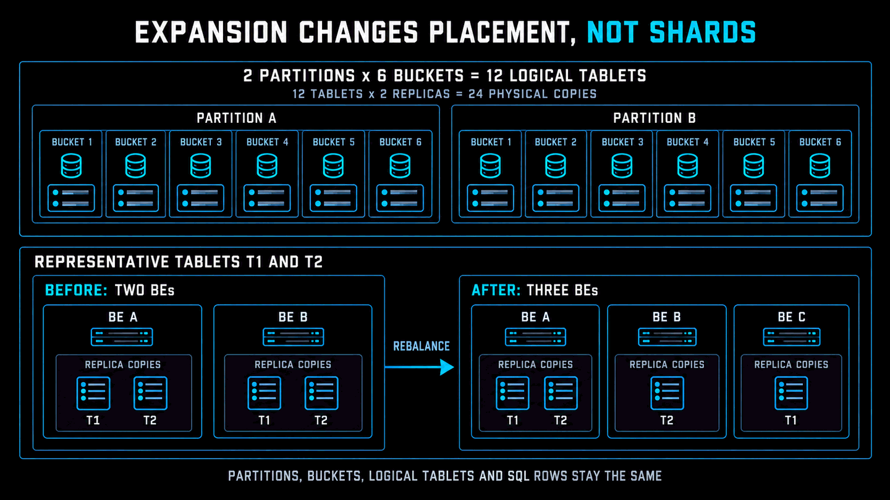
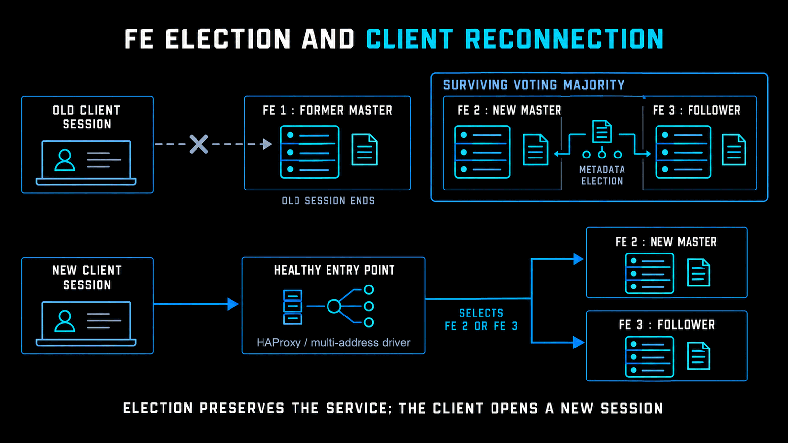
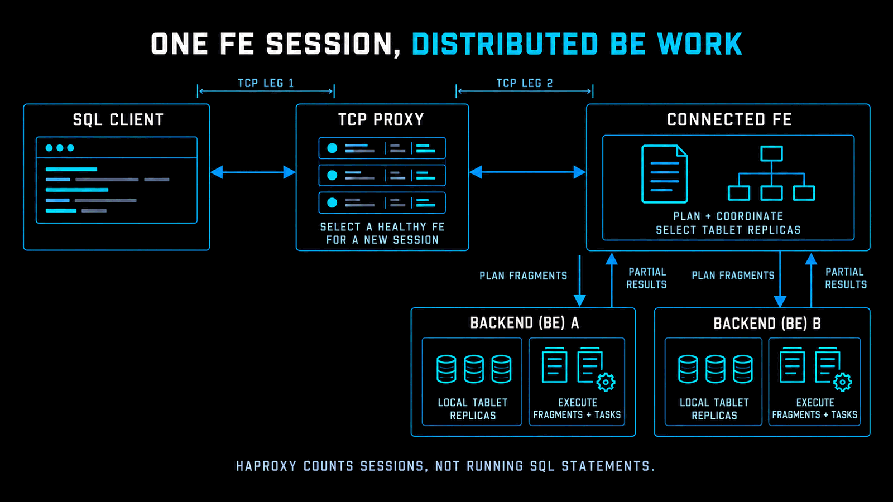
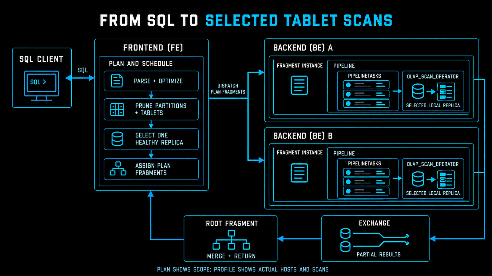
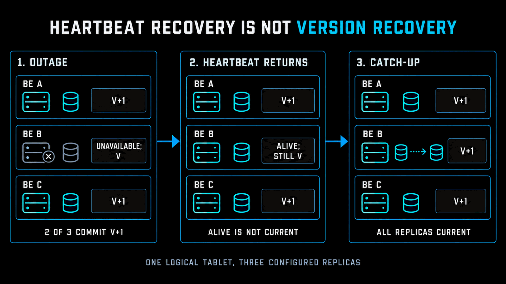
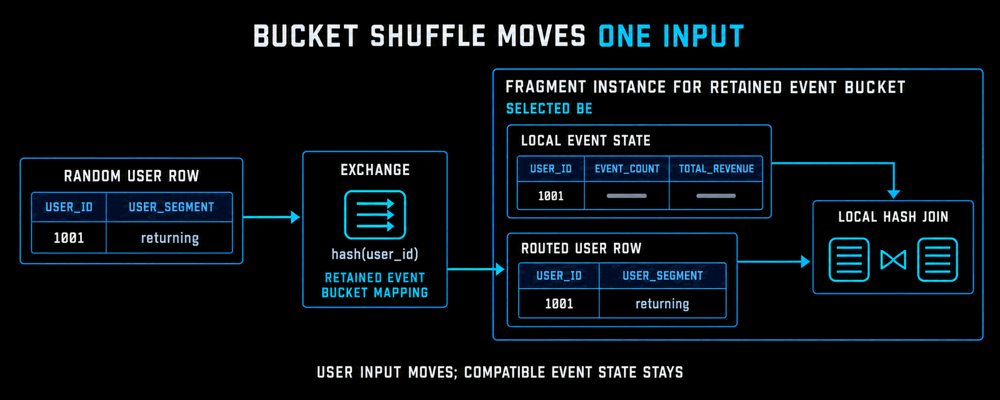
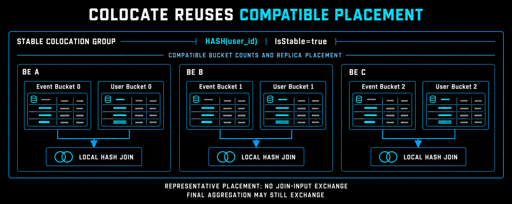

<a id="unit-u.1a2c61276cc741aca789124e70891e8c"></a>

<a id="module-9-sharding-replication-and-distributed-execution-in-apache-doris"></a>

# 9-модуль: Apache Doris жүйесінде шардтау, репликация және үлестірілген орындау

| Курс туралы ақпарат | Мән |
| --- | --- |
| Курс | Apache Doris көмегімен нақты уақыттағы аналитика · 3-деңгей |
| Doris | Apache Doris 4.1.3 |
| Орта | 9-зертханалық жұмыс бастайтын үш FE, үш BE және HAProxy кластері; бір түйінді сынақ ортасы тоқтатылған, 4 CPU және 8 GB жады бар Docker |
| Болжамды уақыт | Шамамен 145 минут: оқу 65, зертханалық жұмыс 70, тест 10 |

[Курстың README файлы](../../README.md) · [9-зертханалық жұмысты ашу](lab09_observe_sharding_and_replication.ipynb) · [9-тестті ашу](quiz09_distribution_and_availability.ipynb)

<a id="unit-u.9320d69c96f54960828a88954a9cea15"></a>

<a id="module-goal"></a>

## Модуль мақсаты

Doris бір кестені бірнеше BE бойынша қалай таратып, қолжетімді ұстайтынын көріңіз: Tablet және репликалары қалай орналасады, BE қосылғанда, FE істемегенде немесе жазу кезінде BE тоқтағанда не болады және үлестірілген Join қай жолдарды жылжытады.

Электрондық сауда оқиға қызметі бұрынғы модульдердің бір FE, бір BE сынақ ортасынан өсті. Операторларға кесте шардтарын өзгертпей BE қуатын қосу, жаңа клиент сеанстарына істемеген FE айналып өту, қолдау көрсетілетін реплика ақауында жазуды жалғастыру және қайталанатын оқиға–пайдаланушы есебінде қажетсіз желі тасымалын болдырмау қажет. Үш мәселе бүкіл модуль бойы бөлек қалады: клиенттерге дұрыс FE кірісін беру, Tablet репликаларын BE арасында орналастырып, қалпына келтіру және аралық жолдарды тек сұрау қажет еткен жерге жылжыту.

<a id="unit-u.35cb389540dd4c909c6bd178f844b1ae"></a>

<a id="learning-objectives"></a>

## Оқу мақсаттары

Осы модульді аяқтағаннан кейін сіз:

1. Partition, Bucket, Tablet және репликалардың байланысын түсіндіріп, кесте үшін санай аласыз.
2. BE қосу кестенің Partition немесе Bucket құрылымын өзгертпей бар репликаларды неге жылжытатынын түсіндіре аласыз.
3. FE метадерек сайлауын клиенттің FE істемегеннен кейін қайта ашылуы тиіс қосылымынан ажырата аласыз.
4. Сұрауды Tablet таңдаудан Query Profile тіркейтін BE Scan тапсырмаларына дейін қадағалай аласыз.
5. Әдепкі көпшілікпен жазу ережесін қолданып, үзілістен кейін тірі BE мен өзекті репликаны ажырата аласыз.
6. Bucket Shuffle және Colocate Join үлестірілген Join тасымалдайтын деректерді қалай азайтатынын түсіндіре аласыз.

<a id="unit-u.2cd3b9fec8434f62b2973289a75bdca0"></a>

<a id="module-structure"></a>

## Модуль құрылымы

| Бөлім | Уақыт | Нәтиже |
| --- | ---: | --- |
| 9.1 Үлестірілген Doris сұрауындағы рөлдерді анықтау | 7 мин | Клиент, FE, BE және прокси міндеттерін ажырату |
| 9.2 Partition, Bucket, Tablet және репликаларды байланыстыру | 10 мин | Логикалық Tablet пен репликаларды санап, кеңейтуден кейінгі орналасуды оқу |
| 9.3 FE сайлауын клиент жүктемесін теңгеруден ажырату | 9 мин | Метадеректерді қолжетімді ұстап, клиенттерді басқа FE арқылы қайта қосу |
| 9.4 Сұрауды SQL-ден BE сканерлеу тапсырмаларына дейін қадағалау | 9 мин | Жоспарланған Tablet ауқымын және нақты орындалған Scan тапсырмаларын оқу |
| 9.5 Көпшілік арқылы бекіту және кейін қалған репликаны қалпына келтіру | 8 мин | Көпшілік ережесін қолданып, heartbeat қалпына келуін нұсқа қалпына келуінен ажырату |
| 9.6 Bucket Shuffle және Colocate Join дерек тасымалын салыстыру | 12 мин | Bucket орналасуын қайта пайдаланып, бір Join кірісін жылжыту немесе ешқайсысын жылжытпау |
| 9.7 Қолжетімділік пен өнімділік шекарасын айту | 6 мин | Әр бақылау нені қолдайтынын және бір хост нені сынай алмайтынын айту |
| 9.8 Реплика күйінен деректер өмірлік цикліне өту | 4 мин | Репликацияны сақтау мерзімі, қалпына келтіру және сақтық көшірмеден ажырату |
| 9-зертханалық жұмыс | 70 мин | Кластерді кеңейту, FE істен шығару, жазу кезінде BE тоқтату және екі Join салыстыру |
| 9-тест | 10 мин | Осы мақсаттар бойынша алты сұрақ |

<a id="unit-u.4da134c9f8b64bad97af3b10ba97f7b4"></a>

<a id="91-identify-the-roles-in-a-distributed-doris-request"></a>

## 9.1 Үлестірілген Doris сұрауындағы рөлдерді анықтау

Оқиға қызметі бір FE және бір BE шегінен шығып жатыр. Топологияны өзгертпес бұрын топ қай компонент клиент сеансын қабылдайтынын, қайсысы сұрауды жоспарлайтынын және қай компоненттер деректерді сақтап, сканерлейтінін анықтауы тиіс. SQL жіберетін клиент әр BE түйініне тікелей қосылмайды. Ол FE query портына немесе сол сеансқа FE таңдайтын проксиге MySQL протоколы сеансын ашады.

<a id="unit-u.061e7ff5dab445b488b5b24aa14432c7"></a>

<a id="frontend-responsibilities"></a>

### Frontend міндеттері

FE кластер метадеректерін қолдап, пайдаланады, SQL талдайды, үлестірілген сұрау жоспарын құрады, орындау орындарын таңдайды, жоспар фрагменттерін жібереді және нәтижені үйлестіреді. Жоғары қолжетімді FE орналастыруында:

- Follower FE метадерек репликациясы мен сайлауға қатысады;
- бір Follower ағымдағы Master болады;
- басқа дұрыс Follower FE дауыс беру тобының бөлігі болып қалады;
- Observer оқу масштабтауы үшін метадерек көшіре алады, бірақ сайлауға қатыспайды.

Ақаудан кейін Master рөлі ауыса алады. Қолданба пайдаланған хост атауы онымен бірге ауыспайды.

<a id="unit-u.ebb396ea038a4c66ac9d0da9c8832254"></a>

<a id="backend-responsibilities"></a>

### Backend міндеттері

BE Tablet репликаларын сақтап, тағайындалған операторларды орындайды. BE ішіндегі Scan Fragment Instance таңдалған жергілікті Tablet репликаларын оқиды және кейінгі операторлар аралық деректерді агрегаттай, біріктіре, сұрыптай немесе алмастыра алады.

Көбірек BE қосу мынаны бере алады:

- Tablet репликаларына көбірек сақтау орны;
- көбірек ықтимал Scan және орындау орындары;
- нақты көп хостты кластерде көбірек жиынтық CPU, жад және енгізу/шығару қуаты.

Бұл бар кестеге Bucket автоматты қоспайды және әр сұрау әр BE қолданатынын кепілдемейді.

<a id="unit-u.9390ab0907964581be0c07b6e324a432"></a>

<a id="proxy-and-client-responsibilities"></a>

### Прокси және клиент міндеттері

TCP прокси немесе бірнеше мекенжайлы драйвер жаңа сеансқа FE таңдайды. Ол Doris жоспарларын жасамайды, метадеректерін сақтамайды және BE операторларын орындамайды. Үзілген қосылым не сұрау үшін қайталау саясаты қолданбаға тиесілі.

Мына күй сұрақтарын бөлек ұстаңыз:

| Бақылау | Нені анықтайды |
| --- | --- |
| Контейнер үдерісі жұмыс істейді | Docker деңгейінде үдеріс бар |
| `SHOW FRONTENDS` `Alive=true` көрсетеді | Doris FE мүшелік көрінісі сол FE тірі деп көреді |
| `SHOW BACKENDS` `Alive=true` көрсетеді | Doris FE мүшелік көрінісі сол BE тірі деп көреді |
| Прокси нысанасы `UP` | Бапталған прокси күй тексеруі қазір сәтті |
| SQL сұрауы сәтті | Осы жаңа не сақталған клиент жолы сол сұрауды аяқтады |
| Реплика өзекті | Белгілі Tablet көшірмесінде толық ағымдағы нұсқа бар |

Әр жол тек өз сұрағына жауап береді; ешқайсысы қалған бесеуіне жауап бермейді.

Міндеттер енді бөлек. Дерек қабаты екі BE және екі репликадан басталады; алғашқы өзгеріс оқиға кестесінің Partition немесе Bucket орналасуын қайта анықтамай үшінші BE қосады.

<a id="unit-u.bd35e1fb90f249e389841082d9816f57"></a>

<a id="92-relate-partitions-buckets-tablets-and-replicas"></a>

## 9.2 Partition, Bucket, Tablet және репликаларды байланыстыру

4-модуль Partition және Bucket құрылымын таныстырды. Бірнеше BE кластері физикалық салдарын көрінетін етеді.

Әр Partition ішіндегі Bucket саны бекітілген кестенің негізгі индексі үшін:

Мысалы, әр Partition ішінде алты Bucket бар екі бөлімдік кестенің негізгі индексінде он екі логикалық Tablet бар. Екі реплика болса, Doris әр логикалық Tablet-тің екі физикалық көшірмесін қолдайды.



*Кеңейту реплика орналасуын өзгертеді, ал логикалық шардтар мен бизнес жолдары сол күйінде қалады.*

Сурет жазулары: Expansion changes placement, not shards — кеңейту шардтарды емес, орналасуды өзгертеді; 2 Partitions × 6 Buckets = 12 logical Tablets — 2 Partition × 6 Bucket = 12 логикалық Tablet; 12 Tablets × 2 replicas = 24 physical copies — 12 Tablet × 2 реплика = 24 физикалық көшірме; Partition A/B — A/B Partition; Bucket 1–6 — 1–6 Bucket; Representative Tablets T1 and T2 — үлгі T1 және T2 Tablet; Before: two BEs — бұрын: екі BE; After: three BEs — кейін: үш BE; BE A/B/C — A/B/C BE; Replica copies — реплика көшірмелері; Rebalance — қайта теңгеру; Partitions, Buckets, logical Tablets and SQL rows stay the same — Partition, Bucket, логикалық Tablet және SQL жолдары өзгермейді. Сурет ағылшын түпнұсқасында сақталған.

SQL Tablet A0 білдіретін логикалық жолдарды бір рет оқиды. Репликация бизнес жауабын екі еселемейді.

<a id="unit-u.0248bbf6d4f0421f975fb515596cc448"></a>

<a id="when-every-be-stores-every-tablet"></a>

### Әр BE әр Tablet сақтағанда

Қолжетімді орналастыру нысаналары реплика санына тең болса, әр логикалық Tablet-ке әр BE ішінде бір реплика қажет. Екі BE және екі реплика кезінде екі BE де логикалық Tablet толық жиынын қамтиды.

Бұл Doris әр BE ішінде кестенің бір бөлінбейтін көшірмесін сақтайды деген емес. Сақтау бірлігі әлі Tablet репликасы және әр Tablet-тің өз ID, нұсқа, өлшем және күйі бар.

<a id="unit-u.f414d694cb17432a803f665dadde6a0e"></a>

<a id="when-bes-store-different-tablet-subsets"></a>

### BE түйіндері әртүрлі Tablet ішкі жиындарын сақтағанда

Әр Tablet-ке екі реплика сақтай отырып үшінші BE қосылғаннан кейін Doris орналастыру нысаналарын көшірмелерден көп алады. Tablet жоспарлағышы бапталған реплика санын сақтап, кей бар репликаларды жаңа BE түйініне жылжыта алады:

Жоғарыдағы кеңейту суреті бір Tablet көшірмесінің BE B ішінен BE C ішіне жылжуын, ал екіншісінің орналасуы өзгермейтінін көрсетеді.

Нақты теңгерілген таралу жоспарлағыш күйіне, диск қолдануына, орналастыру шектеулеріне және кластер жүктемесіне байланысты. Жаңа BE `Alive=true` көрсетуі оның қолжетімді топологияға қосылғанын білдіреді. Бар репликалар жылжып қойғанын дәлелдемейді.

<a id="unit-u.3bb651a3789b43d49e7ca3f2ea3f95a0"></a>

<a id="expansion-does-not-reshard-the-table"></a>

### Кеңейту кестені қайта шардтамайды

BE қосу реплика орналасуын өзгерте алады. Ол мынаны автоматты өзгертпейді:

- Partition шекараларын;
- кестенің тарату бағанын;
- бар Partition ішіндегі Bucket санын;
- логикалық Tablet ID мәндерін;
- SQL арқылы көрінетін жолдарды.

Көбірек орналастыру нысанасы мен көбірек логикалық шард — әртүрлі өзгерістер. Bucket тым аз кесте BE қосылғаннан кейін де сканерлеу параллельдігін шектей алады.

<a id="unit-u.b81ea586546c40c8b5a7fb693edb6f6d"></a>

<a id="read-placement-metadata-with-the-correct-scope"></a>

### Орналасу метадеректерін дұрыс ауқымда оқу

| Дәлел | Тиісті қолдану |
| --- | --- |
| `SHOW BACKENDS` | Түйін мүшелігі, heartbeat күйі, сыйымдылық өрістері, нұсқа |
| `SHOW REPLICA DISTRIBUTION` | Кесте репликалары қайда орналасқанының қорытындысы |
| `SHOW TABLETS` | Tablet деңгейіндегі реплика ID, BE ID, нұсқалар және күй метадеректері |
| `SELECT COUNT(*)` | SQL арқылы көрінетін логикалық жол саны |

Ортақ Docker файлдық жүйесінде әр BE контейнері көрсететін сыйымдылық мәнін әрқайсысы тәуелсіз диск сияқты қоспаңыз. Сол сияқты Tablet метадеректерінің `RowCount` мәні дәл SQL санауын алмастырмайды.

Теңгеруді бақылағанда шектелген күту пайдаланыңыз. Бекітілген ұйқы жоспарлағыш әрекет етпей аяқталуы немесе теңгеру біткен соң уақыт ысырап етуі мүмкін. Шағын кесте бақылау терезесінде көзге көрінетіндей жылжымаса, қолмен жылжытып, оны автоматты теңгеру деудің орнына шектеуді айтыңыз.

[Икемді кеңейту](https://doris.apache.org/docs/4.x/admin-manual/cluster-management/elastic-expansion/) және [Дерек репликаларын басқару](https://doris.apache.org/docs/4.x/admin-manual/maint-monitor/tablet-repair-and-balance/) құжаттарын қараңыз.

Кеңейту репликалардың қайда тұра алатынын өзгертеді. Бірақ қолданба әлі бір FE түйініне тікелей қосылған. Оны тоқтату келесі шекараны сынайды: Doris метадерек сайлауы клиенттің бар желілік сеансын да сақтай ма?

<a id="unit-u.36ed7058861843b39ec5ed5a50cbf8c9"></a>

<a id="93-separate-fe-election-from-client-load-balancing"></a>

## 9.3 FE сайлауын клиент жүктемесін теңгеруден ажырату

Үш Follower FE дауыс беру тобын құрып, клиент ағымдағы Master түйініне тікелей қосылған делік. Ол FE тоқтаса, қалған көпшілік басқа Master сайлап, FE метадерек қызметінің қолжетімділігін сақтай алады.

Бар MySQL TCP сеансы бәрібір аяқталады:



*Сайлау FE қызметін сақтай алады, бірақ қолданба дұрыс кіріс арқылы жаңа сеанс жасауы тиіс.*

Сурет жазулары: FE election and client reconnection — FE сайлауы және клиенттің қайта қосылуы; Old client session — ескі клиент сеансы; FE 1: former Master — FE 1: бұрынғы Master; Old session ends — ескі сеанс аяқталады; Surviving voting majority — қалған дауыс беретін көпшілік; FE 2: new Master — FE 2: жаңа Master; FE 3: Follower — FE 3: Follower; Metadata election — метадерек сайлауы; New client session — жаңа клиент сеансы; Healthy entry point — дұрыс кіріс нүктесі; HAProxy / multi-address driver — HAProxy / бірнеше мекенжайлы драйвер; Selects FE 2 or FE 3 — FE 2 не FE 3 таңдайды; Election preserves the service; the client opens a new session — сайлау қызметті сақтайды, клиент жаңа сеанс ашады. Сурет ағылшын түпнұсқасында сақталған.

Қолданба басқа мекенжай немесе тұрақты кіріс арқылы жаңа сеанс орнатуы тиіс.

<a id="unit-u.34860e90a6424693a8f2bea4b4fa4c00"></a>

<a id="choose-an-entry-mechanism"></a>

### Кіріс механизмін таңдау

| Механизм | Нысана қайда таңдалады | Негізгі пайдалану ескерімі |
| --- | --- | --- |
| JDBC load-balance URL | Әр Java клиентінде | Әр қолданба мен қосылым пулы дұрыс драйвер конфигурациясын пайдалануы тиіс |
| Nginx TCP прокси | Жалпы мақсаттағы проксиде | Бар Nginx пайдалануына сай; stream/TCP күйі мен бағыттау баптауы қажет |
| HAProxy | Арнайы TCP жүктеме теңгерушісінде | Кең күй тексерулері мен қосылым статистикасын береді |
| ProxySQL | MySQL түсінетін проксиде | Көбірек пайдалану ауқымымен протоколды түсінетін қосылым және бағыттау мүмкіндіктерін қосады |

9-зертханалық жұмыс HAProxy пайдаланады, өйткені ноутбук клиенті JDBC емес, Python және экспериментке көрінетін TCP күйі мен қосылым санағыштары қажет. Бұл — Doris талабы немесе әмбебап ұсыныс емес, орта таңдауы.

<a id="unit-u.e066f874cb2d42b1a81d0219cc1c8f41"></a>

<a id="understand-what-haproxy-counts"></a>

### HAProxy нені санайтынын түсіну

Прокси арқылы MySQL сеансының екі TCP бөлігі бар:



*Клиент бір FE сеансына жетеді; FE таңдалған BE орындайтын жұмысты жоспарлап, үйлестіреді.*

Сурет жазулары: One FE session, distributed BE work — бір FE сеансы, үлестірілген BE жұмысы; SQL client — SQL клиенті; TCP leg 1/2 — TCP 1/2 бөлігі; TCP proxy — TCP прокси; Select a healthy FE for a new session — жаңа сеансқа дұрыс FE таңдау; Connected FE — қосылған FE; Plan + coordinate — жоспарлау және үйлестіру; Select Tablet replicas — Tablet репликаларын таңдау; Plan fragments — жоспар фрагменттері; Partial results — ішінара нәтижелер; Backend (BE) A/B — A/B BE; Local Tablet replicas — жергілікті Tablet репликалары; Execute fragments + tasks — фрагменттер мен тапсырмаларды орындау; HAProxy counts sessions, not running SQL statements — HAProxy орындалып жатқан SQL операторларын емес, сеанстарды санайды. Сурет ағылшын түпнұсқасында сақталған.

Жұмыс статистикасы мына өрістерді пайдаланады:

| Өріс | Мағынасы | Бұлай түсінбеңіз |
| --- | --- | --- |
| `active connections` | Қазір HAProxy сол FE түйініне бағыттап отырған сеанстар | Орындалып жатқан SQL сұрауларының саны |
| `total connections` | Осы HAProxy үдерісі басталғалы сол FE түйініне тағайындалған сеанстар | Doris бүкіл уақыттағы сұрау саны |
| `L4OK` | TCP күй тексеруі FE портына сәтті қосылды | Сәтті аутентификация, SQL орындау немесе Master сәйкестігі |

Round-robin бір тұрақты сеанстың ішіндегі жеке операторларды емес, жаңадан жасалған сеанстарды таратады. Сондықтан жаңа сеанстар баптауға сай таралса да, қосылым пулы оператор сандарын біркелкі емес етіп көрсетуі мүмкін.

<a id="unit-u.2761e6a18c9846c7900c640331176780"></a>

<a id="use-distinct-evidence-for-distinct-behavior"></a>

### Әртүрлі әрекетке бөлек дәлел пайдалану

Бақыланатын FE ақауы төрт фактіні бөлек анықтауы тиіс:

1. Тоқтатудан бұрын тікелей қосылған FE анықталды.
2. Ескі қосылым көрінбей көшпей, үзілді.
3. Қалған FE дауыс беру көпшілігін сақтап, біреуі Master болды.
4. Жаңадан жасалған прокси сеансы істемеген нысананы айналып өтіп, бизнес сұрауын аяқтады.

Бұл «бір істемеген FE айналасынан жаңа қосылымдарды қайта орнатуға болады» дегенді қолдайды. «Орындалып жатқан сұраулар көшеді» немесе «жүйе үзіліссіз» дегенді қолдамайды. Бір HAProxy контейнері де проксидің жалғыз ақау нүктесі.

[FE жүктемесін теңгеру](https://doris.apache.org/docs/4.x/admin-manual/cluster-management/load-balancing/) құжатын қараңыз.

Істемеген FE оралғаннан кейін қызметте қайта толық FE дауыс беру тобы, тұрақты клиент кірісі және үш BE ішіндегі репликалар болады. Енді топ бір аймақ агрегатын FE жоспарынан нақты BE Scan тапсырмаларына дейін қадағалай алады.

<a id="unit-u.f2bcf59f35fa4285b15fffb50f4460b3"></a>

<a id="94-follow-a-query-from-sql-to-be-scan-tasks"></a>

## 9.4 Сұрауды SQL-ден BE сканерлеу тапсырмаларына дейін қадағалау

Реплика орналасуы Doris Tablet-ті қайдан оқи алатынын көрсетеді. Бір сұрау нақты қай көшірмені пайдаланғанын көрсетпейді.

Оқиға кестесіндегі аймақтық агрегатты қарастырыңыз:

```sql
SELECT region,
       COUNT(*) AS event_count,
       SUM(revenue) AS total_revenue
FROM event_detail
GROUP BY region
ORDER BY region;
```

Жеңілдетілген үлестірілген жол:



*Орналасу ықтимал көшірмелерді анықтайды; орындалған сканерлеу таңдалған репликалар мен жоспарланған тапсырмаларды пайдаланады.*

Сурет жазулары: From SQL to selected Tablet scans — SQL-ден таңдалған Tablet сканерлеулеріне дейін; SQL client — SQL клиенті; Frontend (FE) — Frontend (FE); Plan and schedule — жоспарлау және тағайындау; Parse + optimize — талдау және оңтайландыру; Prune Partitions + Tablets — Partition және Tablet іріктеу; Select one healthy replica — бір дұрыс реплика таңдау; Assign / dispatch plan fragments — жоспар фрагменттерін тағайындау / жіберу; Backend (BE) A/B — A/B BE түйіндері; Fragment Instance — фрагмент данасы; Pipeline — Pipeline; PipelineTasks — Pipeline тапсырмалары; OLAP_SCAN_OPERATOR — OLAP_SCAN_OPERATOR; Selected local replica — таңдалған жергілікті реплика; Exchange — дерек алмасу; Partial results — ішінара нәтижелер; Root Fragment — түбірлік фрагмент; Merge + return — біріктіру және қайтару; Plan shows scope; Profile shows actual hosts and scans — жоспар ауқымды, Profile нақты хосттар мен сканерлеулерді көрсетеді. Сурет ағылшын түпнұсқасында сақталған.

<a id="unit-u.71133d3e21824bd3b35e7568c9a81b0d"></a>

<a id="distinguish-the-execution-units"></a>

### Орындау бірліктерін ажырату

| Термин | Мағынасы |
| --- | --- |
| Plan Fragment | Дерек алмасу шекараларымен бөлінген үлестірілген физикалық жоспардың қайта пайдаланылатын бөлігі |
| Fragment Instance | Бір BE ішіндегі сол Fragment жоспарланған бір орындалуы |
| Pipeline | Instance ішіндегі pipeline ретінде орындала алатын байланысқан оператор жолы |
| PipelineTask | Pipeline үшін жоспарланатын параллель тапсырма |
| Tablet репликасы | Логикалық Tablet сканерлеуіне таңдалған физикалық жергілікті сақтау |

Бір BE бірнеше PipelineTask орындай алады. PipelineTask блоктарын санау қанша реплика барын немесе қанша BE қатысқанын айтпайды. Жергілікті pipeline параллельдігі үлестірілген түйін параллельдігінен өзгеше.

<a id="unit-u.06780dde54264fc9874ca75ea818d5dd"></a>

<a id="read-the-plan-from-the-scan-upward"></a>

### Жоспарды сканерлеуден жоғары қарай оқу

Қысқартылған жоспарда мынадай құрылым болуы мүмкін:

```text
PLAN FRAGMENT: scan and partial aggregation
  TABLE: event_detail(base index)
  partitions = selected/total
  tablets = selected/total
  numNodes = planned node count

EXCHANGE

PLAN FRAGMENT: merge or final aggregation
```

Бұл жоспарланған Tablet ауқымын, Fragment шекараларын және дерек таратуын анықтайды. Бір орындаудың нақты хостын немесе нақты сканерлеу санын анықтамайды.

<a id="unit-u.a11803d4854948a69eb4bbc5056a960e"></a>

<a id="read-the-detailprofile-as-runtime-evidence"></a>

### DetailProfile жазбасын орындалу дәлелі ретінде оқу

Profile содан кейін мынаны көрсете алады:

```text
Fragment
  Pipeline(host=<BE address>)
    PipelineTask
      OLAP_SCAN_OPERATOR
        TabletIds: [...]
        ScanRows: ...
```

Әр BE хосты үшін сәйкес Scan операторы ішінен Tablet ID және `ScanRows` оқыңыз. BE жарамды репликаны сақтаса да, осы Scan ауқымында көрінбесе, ол осы орындауда бұл кестені сканерлемеген.

FE әдетте әр қажетті логикалық Tablet үшін бір реплика таңдайды. Ол әр репликаны сканерлеп, кейін бизнес жолдарының қайталануын жоймайды. Реплика таңдауы түйін күйі, жоспарлау және орналасу өзгергенде әр орындауда өзгеруі мүмкін.

Мыналарды қатаң бекітпеңіз:

- контейнер IP мекенжайлары;
- Tablet ID мәндері;
- әр BE нақты сканерлеу жолдары;
- әр қолжетімді BE міндетті түрде қатысуы.

Scan Profile ішіндегі бірнеше BE хосты жұмыстың үлестірілгенін анықтайды; 9.7-бөлім бір Docker хосты нені сынай алмайтынын айтады.

Жоспар иерархиясы үшін [Өнім ұғымдары](https://doris.apache.org/docs/4.x/features-architecture/product-concepts/) және [`EXPLAIN`](https://doris.apache.org/docs/4.x/sql-manual/sql-statements/data-query/EXPLAIN/) құжаттарын қараңыз.

Аймақ агрегаты дұрыс репликалардың үлестірілген оқуға қалай көмектесетінін көрсетеді. Келесі пайдалану сұрағы — бір BE қолжетімсізде қызмет жаңа оқиғаны да жариялай ала ма және жазудан кейін оралған көшірме қалай өзекті болады?

<a id="unit-u.c069d6d323bd43f1a2b66acea2bd9141"></a>

<a id="95-commit-through-a-majority-and-recover-the-lagging-replica"></a>

## 9.5 Көпшілік арқылы бекіту және кейін қалған репликаны қалпына келтіру

Репликация оқу қолжетімділігіне, жазу бекіту ережелеріне, сақтау шығынына және ақауға төзімділікке әсер етеді. Бұл қасиеттер бапталған реплика санына байланысты.

Әдепкіде Doris репликалардың жартысынан көбі сәтті жазылғанда жүктеуді сәтті деп санайды:

| Реплика саны | Қажетті әдепкі сәтті репликалар | Бір реплика қолжетімсіз |
| ---: | ---: | --- |
| 1 | 1 | Жазуды қабылдайтын қалған көшірме жоқ |
| 2 | 2 | Әдепкі көпшілік құрыла алмайды |
| 3 | 2 | Екі қалған реплика көпшілік құра алады |

Сондықтан 9-зертханалық жұмыс бір BE үзілісінде сәтті жазуды уәде ету үшін екі репликалық талдау кестесін қолданбайды. Үш BE дұрыс жұмыс істегеннен кейін бөлек үш репликалық оқиға кестесін жасайды.

`min_load_replica_num` мүмкіндігі құжатталған кесте және жаһандық баптау басымдығына сай қажетті санды өзгерте алады. Шекті төмендету жүктеу қолжетімділігінің орнына жедел реплика қамтуын азайтады. Орта оны қайта анықтаса, әдепкі көпшілік ережесін болжамаңыз.

<a id="unit-u.5b6b8068dbd740b888b379cc20574fe6"></a>

<a id="follow-the-commit-and-recovery-states"></a>

### Бекіту және қалпына келу күйлерін қадағалау



*Тірі BE және өзекті Tablet репликасы — қалпына келудің бөлек кезеңдері.*

Сурет жазулары: Heartbeat recovery is not version recovery — heartbeat қалпына келуі нұсқа қалпына келуі емес; 1. Outage — 1. Үзіліс; 2. Heartbeat returns — 2. Heartbeat оралады; 3. Catch-up — 3. Қуып жету; BE A/B/C — A/B/C BE; Unavailable; V — қолжетімсіз, V; Alive; still V — тірі, әлі V; 2 of 3 commit V+1 — үшеудің екеуі V+1 бекітеді; Alive is not current — тірі болу өзекті болу емес; All replicas current — барлық реплика өзекті; One logical Tablet, three configured replicas — бір логикалық Tablet, бапталған үш реплика. V және V+1 белгілері өзгермейді. Сурет ағылшын түпнұсқасында сақталған.

Нақты сандар маңызды емес. Нұсқаларды бір-біріне қатысты салыстырыңыз. Үзіліс кезінде FE метадеректері тоқтаған репликаның соңғы белгілі нұсқасын сақтауы мүмкін. Бұл ноутбук тоқтаған үдерістен файл оқыды дегенді білдірмейді.

<a id="unit-u.1fd2ca1399ec4c58a91786f4b1915479"></a>

<a id="heartbeat-recovery-is-not-data-recovery"></a>

### Heartbeat қалпына келуі дерек қалпына келуі емес

Екі кезең бөлек тексерілуі тиіс:

1. `SHOW BACKENDS` оралған BE тірі екенін көрсетеді.
2. Әр мақсатты Tablet репликасы толық ағымдағы нұсқаны көрсетеді.

Екіншісі соншалықты тез болуы мүмкін, дереу үлгіде нұсқалар тең болып көрінеді. Ондайда ауысу түсірілмегенін айтыңыз; ескі мән ойдан қоспаңыз. Шектелген реплика күйін күту тек көзделген репликалар дұрыс әрі өзекті болғанда аяқталуы тиіс.

Нұсқаны қуып жетуді оқытқанда BE деректерін сақтайтын `stop/start` немесе басқа үдеріс деңгейіндегі үзіліс қолданыңыз. Контейнер мен сақтауды жою бөлек алмастыру репликасы эксперименті болар еді.

Репликалардың сәйкесуі сақтық көшірме емес. Логикалық қате жазу әр BE түйініне сәтті көшіріле алады. 10-модуль онлайн көшірмелерді recycle bin қалпына келтіруінен және тәуелсіз сақтық көшірмеден ажыратады.

[Жүктеудің жоғары қолжетімділігі](https://doris.apache.org/docs/4.x/data-operate/import/load-best-practices/load-high-availability/) және [Дерек репликаларын басқару](https://doris.apache.org/docs/4.x/admin-manual/maint-monitor/tablet-repair-and-balance/) құжаттарын қараңыз.

Үш реплика қайта өзекті болғанда, уақытша қалпына келу күйі келесі жоспар салыстыруына кедергі болмайды. Топ тұрақты орналасумен қайталанатын есеп үшін қанша оқиға–пайдаланушы Join кірісі жылжуы тиіс екенін сұрай алады.

<a id="unit-u.c16d229f30994f7c9b192bb53cf4fbb6"></a>

<a id="96-compare-bucket-shuffle-and-colocate-join-data-movement"></a>

## 9.6 Bucket Shuffle және Colocate Join дерек тасымалын салыстыру

Қалпына келген кластер оқиға метрикаларын пайдаланушы сегменттерімен `user_id` бойынша қайта-қайта біріктіреді. Логикалық Inner Join мен бизнес жауабы бекітілген болып қалады. Шешім — үлестірілген орындауда қанша Join кірісі тасымалдануы тиіс.

<a id="unit-u.ad013ba862324ad6ab16dfa7733337dc"></a>

<a id="reuse-the-event-side-layout-with-bucket-shuffle"></a>

### Bucket Shuffle арқылы оқиға жағы орналасуын қайта пайдалану

6-модуль логикалық Join мағынасын, физикалық Hash Join және Join дерек таратуын ажыратты. Мұнда бизнес сұрау бекітілген, сондықтан тарату жолы — көзделген жалғыз өзгеріс.

Есеп пайдаланушы сегменті бойынша оқиға саны мен түсімді сұрайды:

1. бір оқиға уақыты Partition бөлімін таңдау;
2. оқиға жолдарын әр `user_id` үшін бір аралық жолға агрегаттау;
3. әр пайдаланушыны `new`, `returning` немесе `loyal` сегментіне біріктіру;
4. біріктірілген метрикаларды `user_segment` бойынша агрегаттау.

Оқиға жағының аралық қатынасы мына пішінде:

```text
(user_id, event_count, total_revenue)
```

Оқиға кестесі `user_id` бойынша Hash таратылғандықтан, әр пайдаланушы агрегаттауы бар `user_id` Bucket орналасуын сақтай алады. Бірінші пайдаланушы өлшемі RANDOM таратуды әдейі қолданады:

Келесі Bucket Shuffle суреті сақталған Bucket ішіндегі оқиға күйін және RANDOM таратылған Tablet ішінен келетін пайдаланушы жолын көрсетеді.

Сәйкес жолдар бастапқыда сол Join орындау орнында болмауы мүмкін.

<a id="unit-u.977b6837bfa549c1b8b2e2748ec68148"></a>

<a id="route-only-the-user-side"></a>

#### Тек пайдаланушы жағын бағыттау

Bucket Shuffle үйлесімді оқиға жағы орналасуын сақтайды. Join жағындағы Exchange әр пайдаланушы жолын оқиға Bucket сәйкестендіруіне қарай бағыттайды:



*Bucket Shuffle үйлесімді оқиға жағы аралық орналасуын сақтап, пайдаланушы кірісін жылжытады.*

Сурет жазулары: Bucket Shuffle moves one input — Bucket Shuffle бір кірісті жылжытады; Random user row — RANDOM пайдаланушы жолы; Exchange — алмасу; hash(user_id) — hash(user_id); Retained event Bucket mapping — сақталған оқиға Bucket сәйкестендіруі; Fragment Instance for retained event Bucket — сақталған оқиға Bucket үшін Fragment Instance; Selected BE — таңдалған BE; Local event state — жергілікті оқиға күйі; Routed user row — бағытталған пайдаланушы жолы; Local Hash Join — жергілікті Hash Join; User input moves; compatible event state stays — пайдаланушы кірісі жылжиды, үйлесімді оқиға күйі қалады. USER_ID, USER_SEGMENT, EVENT_COUNT, TOTAL_REVENUE, 1001 және returning мәндері өзгермейді. Сурет ағылшын түпнұсқасында сақталған.

Пайдаланушы жағы жылжиды; сақталған оқиға жағының аралық жолдары жалпы қайта бөлуді қажет етпейді. Bucket нөмірі — тұрақты BE мекенжайы емес, сақталған орналасудағы логикалық орын. FE осы сұрау үшін нақты Tablet репликалары мен орындау хосттарын әлі таңдайды.

Жұмыс бір физикалық оқиға Partition бөлімін сүзеді, өйткені құжатталған тікелей физикалық кесте Bucket Shuffle шарттарына сол жақта пайдалануға болатын бір Partition орналасуы қажет. Кеңірек Doris анықтамасы тарату қасиеті сақталса, аралық оператор нәтижесіне де сақталатын bucket-ке бөлінген қатынас болуға рұқсат етеді.

<a id="unit-u.489647eaf7a44140a73822a274c8da72"></a>

<a id="read-the-plan-evidence-locally-around-the-join"></a>

#### Join айналасындағы жоспар дәлелін жергілікті оқу

Күтілетін дәлелдің пішіні мынадай:

```text
VHASH JOIN
  join op: INNER JOIN(BUCKET_SHUFFLE)
  equal join conjunct: user_id = user_id
  input VEXCHANGE for the moved side

event scan: one selected time Partition
user scan: RANDOM-distributed table
```

Join үстіндегі Exchange соңғы `GROUP BY user_segment` нәтижелерін біріктіру немесе шығысты реттеу үшін әлі қажет болуы мүмкін. «Bucket Shuffle бір Join кірісін жылжытады» деген «бүкіл сұрауда Exchange жоқ» деген емес. Exchange операторын Hash Join және оның екі кіріс тармағына қатысты оқыңыз.

Зертханалық жұмыстағы `[shuffle]` hint шағын пайдаланушы өлшемінің орынды Broadcast жолын таңдауына жол бермей, Shuffle салыстыруын көрінетін етеді. Hint Bucket Shuffle дәлелдемейді. Нақты `INNER JOIN(BUCKET_SHUFFLE)` жоспар белгісі — дәлел.

[Doris Join амалдары](https://doris.apache.org/docs/4.x/query-data/join/) және [Join оңтайландыруы](https://doris.apache.org/docs/4.x/query-acceleration/join-optimization-intro/) құжаттарын қараңыз.

<a id="unit-u.b6ee8f624bb8407e9c1a4b86b67ee512"></a>

<a id="pre-position-both-inputs-for-colocate-join"></a>

### Colocate Join үшін екі кірісті де алдын ала орналастыру

Bucket Shuffle бір сұрауға бір орналасуды қайта пайдаланады. Екі үлкен кесте тұрақты кілтпен жиі біріктірілсе, кесте құрылымы байланысты тұрақты ете алады.

Colocation Group қатысатын кестелерге үйлесімді Bucket тізбегін және реплика орналасуын береді. Оқиға–пайдаланушы байланысы үшін:



*Colocate үйлесімді сақталған орналастыру шарты арқылы Join кіріс алмасуын алып тастайды.*

Сурет жазулары: Colocate reuses compatible placement — Colocate үйлесімді орналасуды қайта пайдаланады; Stable Colocation Group — тұрақты Colocation Group; Compatible Bucket counts and replica placement — үйлесімді Bucket саны мен реплика орналасуы; BE A/B/C — A/B/C BE; Event Bucket 0/1/2 — оқиға 0/1/2 Bucket; User Bucket 0/1/2 — пайдаланушы 0/1/2 Bucket; Local Hash Join — жергілікті Hash Join; Representative placement: no Join-input exchange — үлгі орналасу: Join кіріс алмасуы жоқ; Final aggregation may still exchange — соңғы агрегаттау әлі алмаса алады. HASH(user_id) және IsStable=true өзгермейді. Сурет ағылшын түпнұсқасында сақталған.

Бірдей `user_id` жолдары сәйкес Bucket ұяшықтарына түседі, ал олардың репликалары үйлесімді BE ішінде орналасады. Hash Join сол орындарда жергілікті орындала алады.

<a id="unit-u.1ab4ddef110e4e96a1e310dd467e4c52"></a>

<a id="matching-ddl-is-necessary-but-insufficient"></a>

#### Бірдей DDL қажет, бірақ жеткіліксіз

Сол Colocation Group ішіндегі физикалық кестелер үшін растаңыз:

- кестелер сол топқа тиесілі;
- тарату бағандарының типтері мен сандары үйлесімді;
- Bucket сандары сәйкес;
- реплика сандары үйлесімді;
- Join теңдігі Bucket кілтін қамтиды;
- топ күйі `IsStable=true` көрсетеді.

Екі кесте де `DISTRIBUTED BY HASH(user_id)` деп айтуы олардың міндетті түрде бірге орналасқанын білдірмейді. Ортақ тұрақты орналастыру шарты болмаса, сәйкес Bucket әртүрлі BE ішінде тұра алады.

<a id="unit-u.48a0fd559cd8434689e7b244d72b0274"></a>

<a id="compare-the-same-business-answer"></a>

#### Сол бизнес жауабын салыстыру

Bucket Shuffle және Colocate сұраулары мынаны бірдей ұстауы тиіс:

- уақыт ауқымы және таңдалған оқиға Partition;
- оқиға жағындағы әр пайдаланушы агрегаттауы;
- Join кілті және логикалық Join түрі;
- пайдаланушы сегменті деректері;
- шығыс топтауы мен метрикалары;
- толық күтілетін нәтиже.

Тек пайдаланушы кестесі өзгереді: орналасуы Colocation Group ішіндегі `HASH(user_id)` болады және кілті `user_id` бойынша Unique Key болады. Әр пайдаланушыда бір жол бар, сондықтан кілт Join кірісін өзгертпейді. Colocate жоспары мынаны көрсетуі тиіс:

```text
INNER JOIN(COLOCATE)
```

Сол Hash Join мен екі кіріс сканерлеуінің арасында `VEXCHANGE` болмауы тиіс. Join үстіндегі Exchange соңғы агрегаттау немесе нәтиже біріктіруге әлі қызмет ете алады.

Colocate әр жүктемеге автоматты жылдамырақ емес. Шағын Bucket саны параллельдікті шектей алады, Colocation Group орналастыру мен теңгеруді шектейді және байланысты қолдаудың пайдалану шығыны бар. Оны қайталанатын Join тасымалы дәлелденген тар орын болғанда және қатысатын кесте құрылымдары үйлесімді қала алғанда қолданыңыз.

[Colocation Join](https://doris.apache.org/docs/4.x/query-acceleration/colocation-join/) құжатын қараңыз.

Екі жоспар сол бизнес сұраққа әртүрлі орналастыру шартымен жауап береді және әр Join жанындағы `VEXCHANGE` қай кіріс жылжитынын көрсетеді. Топ енді әр топология, жоспар және орындалу бақылауы нені қолдайтынын дәл айтуы тиіс.

<a id="unit-u.9ae35fb244dc46ccb515376abc90c3d2"></a>

<a id="97-state-the-availability-and-performance-boundary"></a>

## 9.7 Қолжетімділік пен өнімділік шекарасын айту

9-модуль бірнеше сәтті бақылауды біріктіреді, бірақ әрқайсысы шектеулі қорытындыны қолдайды.

| Дәлел | Қолдайтын қорытынды | Қолдамайтын қорытынды |
| --- | --- | --- |
| Бір FE тоқтағаннан кейін FE сайлауы | Қалған дауыс беру көпшілігі Master таңдады | Үзілген клиент сеансы көшті немесе әр сұрау үзіліссіз болды |
| HAProxy жаңа сеанстарды тек `UP` нысаналарына жібереді | Осы күй тексеруінде жаңа қосылымдар істемеген FE айналып өте алады | Проксидің өзі артық даналы немесе әр SQL операторы бірдей таралған |
| Жаңадан қосылған BE ішінде репликалар пайда болады | Бар физикалық көшірмелер басқа нысанаға қайта теңгерілді | Бар Bucket бөлінді немесе логикалық жолдар өзгерді |
| Scan Profile ішінде бірнеше BE хосты бар | Осы орындауда сол BE сканерлеуді орындады | Әр реплика немесе әр қолжетімді BE қатысты |
| Бір BE тоқтағанда көпшілік жазуы сәтті | Сыналған транзакция қалған репликалар арқылы көрінетін болды | Кез келген реплика саны бар әр кесте сол үзілісті қабылдай алады |
| Оралған реплика нұсқалары сәйкеседі | Сыналған Tablet көшірмелері қайта өзекті болды | Қате бизнес жазуы кері қайтты немесе сақтық көшірме бар |
| Colocate жоспары Join кіріс Exchange алып тастайды | Таңдалған Join жергілікті үйлесімді орналасуды қолдана алады | Өндірістік кідіріс жақсаруы өлшенді |

<a id="unit-u.731684b3412b415698288c1ea6a258a0"></a>

<a id="shared-host-limitations"></a>

### Ортақ хост шектеулері

9-модульдің барлық контейнері мынаны ортақ пайдаланады:

- бір Docker Engine;
- бір физикалық хост пен жад пулы;
- бір физикалық ақау домені;
- хост желісі және сақтау инфрақұрылымы;
- бір HAProxy контейнері.

Бір үдерісті тоқтату Doris күй ауысуларын байқауға пайдалы. Ол хост үзілісін, rack немесе availability zone оқшаулауын, өндірістік желі өткізу қабілетін, тәуелсіз дискілерді немесе прокси жоғары қолжетімділігін сынамайды.

Үлестірілген стратегияларға орын беру үшін бір хост өткен уақытын салыстырмаңыз. Жұмысты таңдалған жоспарлар, дерек тасымалы, орындау орындары және реплика күйлерін анықтауға пайдаланыңыз. Өндірістік өнімділікті тек өкілдік деректер, қатар орындау, хосттар және ақау домендерімен өлшеңіз.

<a id="unit-u.2e90daf2874a4f9e9b1f6f357f07685c"></a>

<a id="preserve-the-intended-failure-experiment"></a>

### Көзделген ақау экспериментін сақтау

Контейнер пәрмендері де дәлел шекарасын анықтайды:

- `stop/start` оралу және қуып жету эксперименті үшін контейнер мен жазылатын деректерін сақтайды;
- контейнерді немесе сақтауын жою алмастыру деректер экспериментін жасайды;
- деректер сыртқа бекітілмесе, `docker compose down` оқшауланған ортаны жоя алады.

Сондықтан жұмыс `stop/start` пайдаланып, жоятын тазалауды ешқашан уақытша түйін ақауы деп қабылдамайды.

<a id="unit-u.8bf1e0425979492d8775904a01fed222"></a>

<a id="98-move-from-replica-health-to-data-lifecycle"></a>

## 9.8 Реплика күйінен деректер өмірлік цикліне өту

Оқиға қызметінде енді дұрыс FE дауыс беру тобы, қайта пайдаланылатын клиент кірісі, қолжетімді BE арасында орналасқан дұрыс онлайн репликалар және түсінікті Join тарату таңдаулары бар. Бұл қасиеттер ағымдағы деректерді қолжетімді ұстап, ағымдағы сұрау жұмысын орналастырады. Олар тарихи оқиғалардың қанша уақыт онлайн қалуын немесе әр репликаға жеткен жарамды, бірақ қате амалды қалай кері қайтаруды шешпейді.

Келесі міндеттер жиынын бөлек ұстаңыз:

| Ағымдағы 9-модуль механизмі | Нені қорғайды | Нені бермейді |
| --- | --- | --- |
| FE метадерек репликациясы және сайлауы | Қолдау көрсетілетін FE ақауынан кейінгі метадерек қызметі | Бар клиент TCP сеансының көшуі |
| Tablet репликалары | Қолдау көрсетілетін BE ақауларына онлайн көшірмелер | Тарихи нұсқалар немесе тәуелсіз сақтық көшірме |
| Реплика теңгеруі және нұсқа жөндеуі | Ағымдағы деректердің дұрыс орналасуы мен сәйкесуі | Қате бекітілген жазуды кері қайтару |
| Bucket Shuffle немесе Colocate | Үлестірілген Join дерек тасымалы таңдауы | Сақтау мерзімі, мұрағаттау немесе қалпына келтіру саясаты |

Сондықтан 10-модуль басқа бизнес сұрақтан басталады: оқиға тарихы өскен сайын топ сақтау шығынын қалай басқарып, тұтас уақыт ауқымдарын онлайн кестеден алып тастап, кеш деректерді өңдеп, жарамды қате жоюдан қалай қалпына келуі тиіс?

<a id="unit-u.e45c2f2d5fd043048fdf415692da551b"></a>

<a id="lab-9-observe-sharding-replication-and-distributed-execution"></a>

## 9-зертханалық жұмыс: шардтау, репликация және үлестірілген орындауды бақылау

8-зертханалық жұмыстан кейін [9-зертханалық жұмыс — шардтау, репликация және үлестірілген орындауды бақылау](lab09_observe_sharding_and_replication.ipynb) ашып, шамамен 70 минут, баяу желіде сәл көбірек жоспарлаңыз. Ол 1–8-модульдердің бір түйінді `doris-rta` контейнерінің орнына оқшауланған 9-модуль Compose жобасын пайдаланады.

Бастамас бұрын ортаны тексеріңіз:

- Жұмыс бір Docker хостында үш FE, үш BE және HAProxy контейнерін іске қосады. Docker кемінде 4 CPU, 8 GB жад және 20 GiB бос диск орнын қажет етеді. Бірінші ұяшық 9-модуль контейнерлерін бастамас бұрын осы мәндерді тексеріп, біреуі жеткіліксіз болса, түсіндірмемен тоқтайды. Сыналған орындауда жеті контейнер ең көп шамамен 6.4 GiB жад пайдаланды.
- Алдымен бір түйінді сынақ ортасын `docker stop doris-rta` арқылы тоқтатыңыз. Жұмыс оны тексеріп, өзі тоқтатудың орнына тоқтайды.
- Doris образы жүктеліп тұрса, алғашқы іске қосу HAProxy образын жүктеуді қоса шамамен бір минут алады. Жаңа компьютерде Doris образын жүктеу ұзағырақ.

Қайта пайдаланылатын жергілікті бастапқы жиын жоқ болса, алғашқы толық орындау тек оқуға арналған шектелген жеті сағаттық курс үлгісін импорттайды. Оның 12,062 жолы барлық 40 курс файлына таралған, сондықтан Doris шамамен 59 MB оқиды: баяу желіде бұл жүктеу 1-зертханалық жұмыстағы толық жүктеудің жартысынан көп уақыт алуы мүмкін. Кейінгі орындаулар тек 12,062 бекітілген логикалық оқиға жолын уақытша жергілікті дереккөз ретінде сақтап, бақыланатын физикалық оқиға кестесін қайта құра алады. Басқа 9-модуль бизнес нысандарын оларға иелік ететін бөлімдер қайта құрады. Бұл екі BE орналастыру экспериментінің көзделген DDL бастапқы күйінен басталуын қамтамасыз етіп, қайталанатын S3 оқуларын болдырмайды.

| Зертханалық бөлім | Не істейсіз | Нәтиже нені дәлелдейді |
| --- | --- | --- |
| **1.1 Екі тірі BE орнату** | Үш дауыс беретін FE бастау, екі BE қайта іске қосу, үшінші BE мен HAProxy тоқтату және анықталған FE кірісіне тікелей қосылу. | Алғашқы дерек қабатында дәл екі тірі орналастыру нысанасы және прокси жолы жоқ кезде FE кворумы бар. |
| **1.2 Қайта құру және кеңейту** | Екі BE ішінде екі Partition, алты Bucket, екі репликасы бар оқиға кестесін қайта құрып, үшінші BE бастап, репликалар жылжығанша күту. | Он екі логикалық Tablet он екі, 24 физикалық реплика 24 болып қалады және жаңа BE бар репликаларды автоматты алады. |
| **1.3 Тікелей FE қосылымын үзу** | Үш тірі FE тексерілгеннен кейін ғана тікелей қосылған Master тоқтатып, оны қалпына келтірмей HAProxy бастау. | Ескі TCP сеансы үзіледі; жаңа прокси сеанстары тек қалған дұрыс FE түйіндерін қолданып, 12,062 оқиғаны әлі сұрайды. |
| **1.4 FE қалпына келтіру** | Тоқтаған FE қайта бастап, Doris мүшелігі мен прокси күйін күту. | Үш FE оралады, біреуі Master, ал `L4OK` SQL сәттілігін емес, TCP қолжетімділігін көрсетеді. |
| **2.1 Физикалық орналасуды тексеру** | Partition, Bucket, Tablet, реплика және жол ауқымы метадеректерін көрсету. | Сақтау орналасуы мен логикалық жол саны — бөлек мөлшерлер. |
| **2.2 Үлестірілген сканерлеуді қадағалау** | Аймақ агрегатын орындап, қысқартылған `EXPLAIN` нәтижесін host ауқымындағы DetailProfile Scan тапсырмаларымен салыстыру. | Жоспар қажетті Tablet нысандарын қамтиды; Profile нақты сканерлеген BE және репликаларды анықтайды. |
| **2.3 Бір BE істемегенде бекіту** | Үш репликалық оқиға кестесін жасап, `be-2` тоқтату және бір белгілі сатып алу енгізу. | Екі қалған реплика әдепкі көпшілікті құрып, оқиғаны жариялайды, ал тоқтаған реплика ескі нұсқада қалады. |
| **2.4 Репликаны қалпына келтіру** | `be-2` қайта бастау, бірден үлгі алу, кейін үш реплика өзекті болғанша күту. | `Alive=true` және ағымдағы реплика нұсқасы — бөлек қалпына келу кезеңдері. |
| **3.1 Bucket Shuffle пайдалану** | RANDOM таратылған 6,706 пайдаланушы жолын құрып, оларды `user_id` таратылған аралық оқиға нәтижесімен біріктіру. | Бекітілген бизнес жауап `INNER JOIN(BUCKET_SHUFFLE)` қолданып, пайдаланушы кірісін Exchange арқылы жылжытады. |
| **3.2 Colocate пайдалану** | Сол пайдаланушыларды үйлесімді `HASH(user_id)` Bucket, реплика және топ мүшелігімен қайта құру. | Топ тұрақты болғанда сол жауап Join кіріс Exchange операторынсыз `INNER JOIN(COLOCATE)` қолданады. |

9-зертханалық жұмыс дәлелін төрт қабатта оқыңыз:

1. SQL жауаптары көрінетін бизнес деректерін анықтайды.
2. FE және BE метадеректері мүшелікті, орналасуды және реплика нұсқаларын анықтайды.
3. `EXPLAIN` жоспарланған Fragment, Scan, Join стратегиясы және Exchange анықтайды.
4. DetailProfile бір орындаудың BE хосттарын, Tablet ID мәндерін және сканерлеу жолдарын анықтайды.

Stop және Restart басқару элементтері оқшауланған контейнерлерді сақтап, сақталған бастапқы оқиғаларды, пайдаланушы өлшемін және үзілістегі сатып алуды тексереді. Бұл сақтық көшірме сынағы емес. Кластер қажет кезде `down` орындамаңыз.

9-модуль кластері жұмыс қалпына келтіре алмайтын күйге жетсе, мысалы контейнер жойылса немесе FE көпшілігін жоғалтса, оны қалпына келтіріңіз. Курс каталогынан орындаңыз:

```bash
docker compose --file level3/module09-sharding-replication/compose.multinode.yml down
```

Содан кейін жұмысты 1.1-бөлімнен қайта орындаңыз. Пәрмен тек 9-модуль контейнерлерін, олардың ішіндегі деректерді және желісін жояды; бір түйінді `doris-rta` контейнеріне әсер етпейді. Келесі орындау жеті сағаттық үлгіні қайта импорттайды. Курсты аяқтағанда кластерді жою үшін де сол пәрменді пайдаланыңыз.

Жұмыс жаттығумен аяқталады: екі кестенің Tablet және репликаларын қарамас бұрын санаңыз. Алдымен нәтижені болжаңыз, содан кейін бос ұяшыққа код жазыңыз; одан кейінгі жиналған үлгі шешім де Run All арқылы орындалып, зертханалық жұмыс кестелерін бастапқы күйінде қалдырады.

<a id="unit-u.464a2218d6d54701b89ac336608c3a50"></a>

<a id="summary"></a>

## Қорытынды

- Кестеде әр Partition ішіндегі әр Bucket-ке бір логикалық Tablet бар, ал репликация әр Tablet көшірмелерін сақтайды: алты Bucket бар екі Partition және екі реплика — 12 Tablet пен 24 реплика, ал SQL әр жолды әлі бір рет қайтарады.
- BE қосу орналастыру нысанасын қосады: Tablet жоспарлағышы кей бар репликаларды соған жылжытып, реплика санын сақтайды, ал Partition, Bucket және логикалық Tablet сол күйінде қалады.
- FE істемегенде қалған FE көпшілігі Master сайлай алады, бірақ клиенттің сол FE сеансы аяқталады; прокси немесе бірнеше мекенжайлы драйвер арқылы жаңа сеанс дұрыс FE түйініне жетеді, ал HAProxy санағыштары Doris сұрауларын емес, TCP сеанстарын сипаттайды.
- FE сұрауға қажетті әр Tablet-тің бір дұрыс репликасын таңдап, BE түйіндеріне Fragment Instance жібереді; жоспар жоспарланған Tablet ауқымын, ал тек Profile қай BE қай Tablet сканерлегенін көрсетеді.
- Әдепкіде жүктеу репликалардың жартысынан көбі сәтті болғанда бекітіледі, сондықтан үш реплика бір тоқтаған BE көтереді, ал екеуі көтермейді; оралған BE репликалары ағымдағы нұсқаға жетпей тірі болады және репликация сақтық көшірме емес.
- Bucket Shuffle бір үйлесімді bucket-ке бөлінген кірісті орнында ұстап, басқасын соған бағыттайды; Colocate екі кірістің сәйкес Bucket ұяшықтарын алдын ала бірге орналастырады, сондықтан Join кірістеріне Exchange қажет емес.

<a id="unit-u.bf9009ee762a41e6a979ed7ccca957c9"></a>

<a id="quiz-9-sharding-replication-and-distributed-execution-in-apache-doris"></a>

## 9-тест: Apache Doris жүйесінде шардтау, репликация және үлестірілген орындау

[9-тест: Apache Doris жүйесінде шардтау, репликация және үлестірілген орындау](quiz09_distribution_and_availability.ipynb) ашыңыз.
Онда бір жауап таңдалатын алты сұрақ бар және жұмыс істеп тұрған орта қажет емес.

Келесі модуль: [10-модуль: Apache Doris жүйесінде сақтау шығындары мен деректердің өмірлік циклін басқару](../module10-managing-data/course.md).

<a id="unit-u.81f8147da0f347a4a1aa1ded6e4efa46"></a>

<a id="references"></a>

## Анықтамалар

- Архитектура және орындау: [Өнім ұғымдары](https://doris.apache.org/docs/4.x/features-architecture/product-concepts/) және [`EXPLAIN`](https://doris.apache.org/docs/4.x/sql-manual/sql-statements/data-query/EXPLAIN/)
- FE кіріс нүктелері: [FE жүктемесін теңгеру](https://doris.apache.org/docs/4.x/admin-manual/cluster-management/load-balancing/)
- BE кеңейтуі мен репликалар: [Икемді кеңейту](https://doris.apache.org/docs/4.x/admin-manual/cluster-management/elastic-expansion/) және [Дерек репликаларын басқару](https://doris.apache.org/docs/4.x/admin-manual/maint-monitor/tablet-repair-and-balance/)
- Жазу қолжетімділігі: [Жүктеудің жоғары қолжетімділігі](https://doris.apache.org/docs/4.x/data-operate/import/load-best-practices/load-high-availability/)
- Join тасымалы: [Doris Join амалдары](https://doris.apache.org/docs/4.x/query-data/join/), [Join оңтайландыруы](https://doris.apache.org/docs/4.x/query-acceleration/join-optimization-intro/) және [Colocation Join](https://doris.apache.org/docs/4.x/query-acceleration/colocation-join/)
- Зертханалық орта: [All-in-One образы](https://doris.apache.org/community/developer-guide/all-in-one-image)
