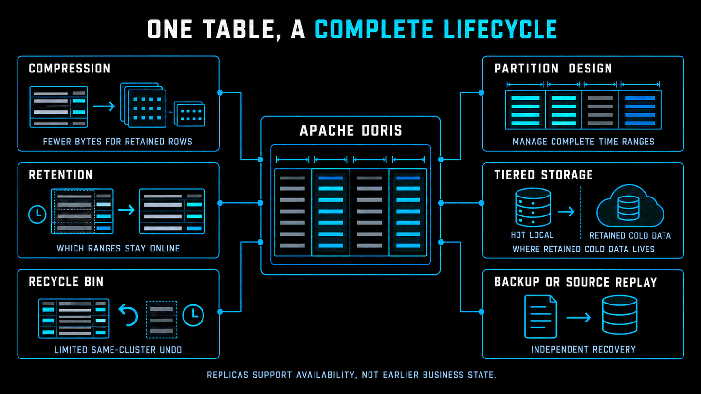
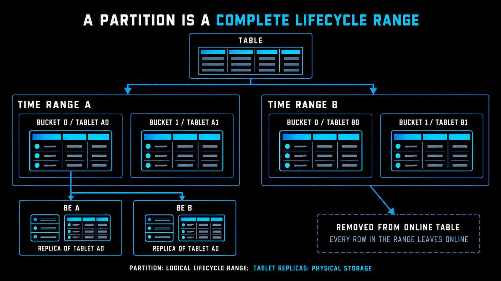
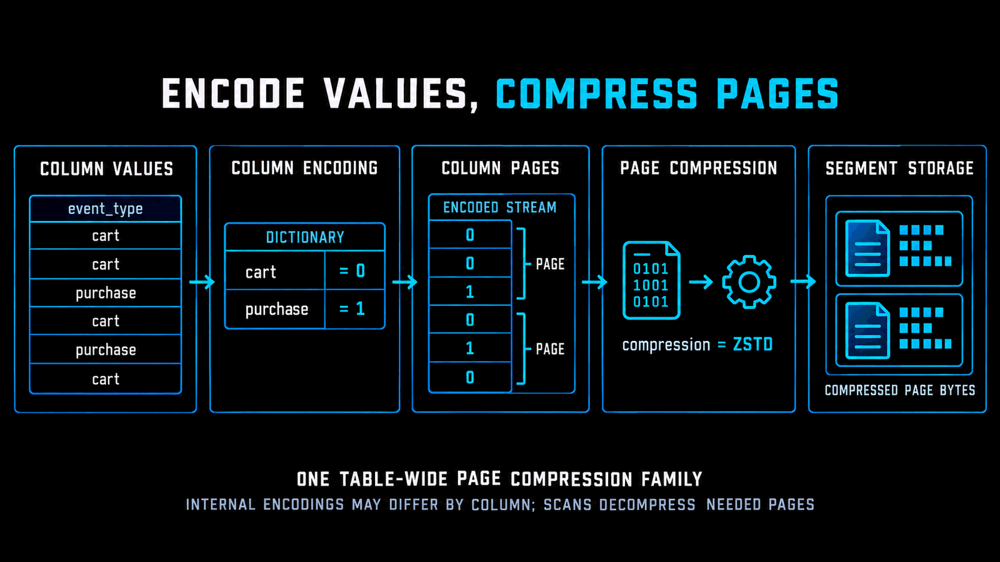
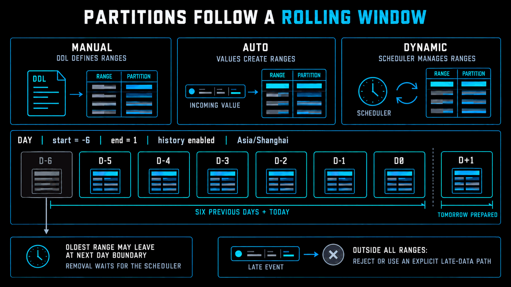
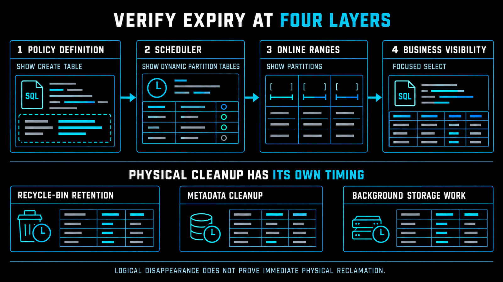
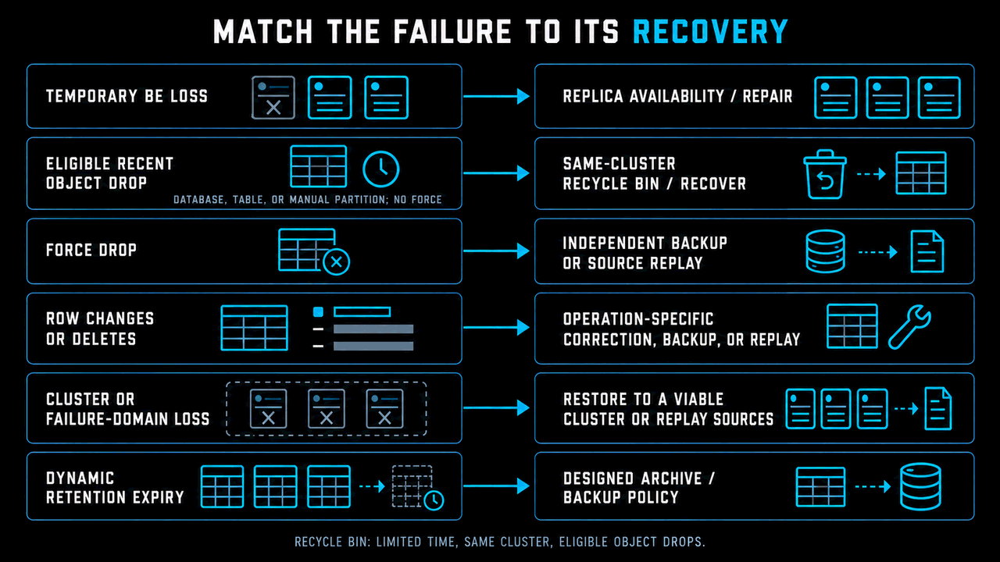

<a id="unit-u.42379e5be1684626bcaf37a739fe25e8"></a>

<a id="module-10-controlling-storage-cost-and-data-lifecycle-in-apache-doris"></a>

# 10-модуль: Apache Doris жүйесінде сақтау шығындары мен деректердің өмірлік циклін басқару

| Курс туралы ақпарат | Мән |
| --- | --- |
| Курс | Apache Doris көмегімен нақты уақыттағы аналитика · 3-деңгей |
| Doris | Apache Doris 4.1.3 |
| Орта | Курс сынақ ортасы және 4-зертханалық жұмыстың `events_modelled` кестесі, 9-модуль кластері тоқтатылған |
| Болжамды уақыт | Шамамен 115 минут: оқу 60, зертханалық жұмыс 45, тест 10; жұмыстың қосымша нақты сағат бөлігі шамамен бір сағатқа дейін күту қосады |

[Курстың README файлы](../../README.md) · [10-зертханалық жұмысты ашу](lab10_manage_data.ipynb) · [10-тестті ашу](quiz10_data_lifecycle_and_recovery.ipynb)

<a id="unit-u.ce2a94b0af79458aa26000533be382f5"></a>

<a id="module-goal"></a>

## Модуль мақсаты

Өсіп жатқан бір оқиға кестесіне өмірлік цикл беріңіз: онлайн қалуы тиіс жолдарды азырақ байтпен сақтаңыз, толық ескі уақыт ауқымдарын кестемен жойыңыз және қателесіп жойылған деректерді қалай қалпына келтіруді біліңіз.

Онлайн сауда қызметі іске қосылғалы әр оқиғаны сақтаған. Бақылау тақталары көбіне соңғы оқиғаларды оқиды, сақтау өседі, кей оқиға кеш келеді және кездейсоқ жою қалпына келмейтін оқиғаға айналмауы тиіс. Топ төрт байланысты шешім қабылдайды: Doris сақталған Page қалай сығады, оқиға уақыты басқарылатын Partition қалай анықтайды, толық ескі ауқымдар онлайн кестеден қашан кетеді және жойылғаннан кейін қай қалпына келтіру механизмі қолданылады. 9-модуль BE ақауында ағымдағы деректерді қолжетімді ұстау үшін репликалар қолданды; бұл модуль ескі дерек әдейі жойылғанда немесе жарамды жою бизнес қатесі болғанда не болатынын сұрайды.

<a id="unit-u.813b089adb8941f7806fac5ce08ba203"></a>

<a id="learning-objectives"></a>

## Оқу мақсаттары

Осы модульді аяқтағаннан кейін сіз:

1. Баған кодтауы мен Page сығуының бөлек рөлдерін түсіндіріп, шектелген ресурсқа қарай сығу алгоритмін таңдай аласыз.
2. Кіріс, орналасу, жүктеу және репликалар бірдей қалатын әділ сығу салыстыруын жобалай аласыз.
3. Partition не жасайтыны және не жоятыны бойынша Manual, Auto немесе Dynamic Partitioning таңдай аласыз.
4. Dynamic Partition терезесін уақыт бірлігі, ығысулар және уақыт белдеуі бойынша оқып, кеш деректермен не болатынын болжай аласыз.
5. Partition мерзімі өткенде қабылданған конфигурацияны, жоспарлағыш әрекетін, SQL көрінуін және сақтау орнын босатуды ажырата аласыз.
6. Recycle bin қашан жеткілікті және қашан тәуелсіз сақтық көшірме не дереккөзден қайта ойнату қажет екенін шеше аласыз.

<a id="unit-u.3e19e1d635fe4a8b91652ff7dc34dfa3"></a>

<a id="module-structure"></a>

## Модуль құрылымы

| Бөлім | Уақыт | Нәтиже |
| --- | ---: | --- |
| 10.1 Мүмкіндікті таңдамас бұрын өмірлік циклді анықтау | 6 мин | Алдымен ыстықтық, сақтау мерзімі, кеш дерек және қалпына келу талаптарын айту |
| 10.2 Doris деректерді қайда сығатынын түсіну | 9 мин | Баған кодтауын Page сығуымен байланыстырып, шектелген ресурсқа қарай таңдау |
| 10.3 Бақыланатын кіріспен сығу таңдауларын салыстыру | 8 мин | Кіріс пен орналасуды бірдей ұстап, сақтау есебін сақтықпен оқу |
| 10.4 Partition қалай жасалып, жойылатынын таңдау | 7 мин | Manual, Auto немесе Dynamic Partitioning таңдау |
| 10.5 Жылжымалы терезе мен кеш дерек саясатын анықтау | 9 мин | Терезе ауқымдарын оқып, кеш оқиғалармен не болатынын шешу |
| 10.6 Конфигурация, жоспарлау, көріну және босатуды ажырату | 8 мин | Мерзім өтуді төрт қабатта тексеру |
| 10.7 Деңгейлі сақтауды орналастыру шешімі ретінде қарастыру | 5 мин | Сақталған суық деректерді тек нақты деңгейлерге орналастыру |
| 10.8 Деректер жойылмас бұрын қалпына келтіру шекарасын анықтау | 8 мин | Нақты ақауға recycle bin, сақтық көшірме немесе қайта ойнату қолдану |
| 10-зертханалық жұмыс | 45 мин | Үш сығу баптауын салыстыру, сағаттық Partition мерзімін өткізу және жойылғанын қалпына келтіру |
| 10-тест | 10 мин | Осы мақсаттар бойынша алты сұрақ |

<a id="unit-u.91b8223d739a4803afa34b90ff4d3cfe"></a>

<a id="101-define-the-lifecycle-before-choosing-a-feature"></a>

## 10.1 Мүмкіндікті таңдамас бұрын өмірлік циклді анықтау

«Ескі деректерді басқару» бірнеше түрлі талапты сипаттай алады. Алдымен оларды ажыратыңыз.

| Талап | Негізгі Doris механизмі | Жауап беретін сұрағы |
| --- | --- | --- |
| Сол жолдарды азырақ байтпен сақтау | Баған кодтауы және кесте деңгейіндегі сығу | Сақталған дерек қанша орын алады? |
| Жолдарды басқарылатын уақыт ауқымдарына ұйымдастыру | Partition құрылымы | Қай толық ауқымды қосуға, сканерлеуге, жылжытуға немесе жоюға болады? |
| Тек жылжымалы онлайн терезені сақтау | Dynamic Partitioning немесе сыртқы өмірлік цикл үдерісі | Қай уақыт ауқымдары қазір сұрауға қолжетімді болуы тиіс? |
| Жарамды жақындағы нысан жоюын кері қайтару | Catalog recycle bin және `RECOVER` | Жақында жойылған дерекқор, кесте немесе Partition қайтара ала ма? |
| Кластер жоғалуы немесе ескі логикалық қатеден қалпына келу | Repository сақтық көшірмесі немесе беделді дереккөзді қайта ойнату | Деректерді осы тірі кластерден тәуелсіз қалпына келтіруге бола ма? |
| Суықтау деректерді арзанырақ ортаға жылжыту | Жергілікті не қашықтағы деңгейлі сақтау | Сақталған суық деректер қайда тұруы тиіс? |



*Толық өмірлік цикл бірнеше механизм қолданады; ешқайсысы қалғанның бәрін алмастырмайды.*

Сурет жазулары: One table, a complete lifecycle — бір кесте, толық өмірлік цикл; Apache Doris — Apache Doris; Compression — сығу; Fewer bytes for retained rows — сақталған жолдарға аз байт; Retention — сақтау мерзімі; Which ranges stay online — қай ауқымдар онлайн қалады; Recycle bin — жойылған нысандар себеті; Limited same-cluster undo — сол кластердегі шектеулі кері қайтару; Partition design — Partition құрылымы; Manage complete time ranges — толық уақыт ауқымдарын басқару; Tiered storage — деңгейлі сақтау; Hot local — ыстық жергілікті; Retained cold data — сақталған суық дерек; Where retained cold data lives — сақталған суық деректердің орны; Backup or source replay — сақтық көшірме не дереккөзді қайта ойнату; Independent recovery — тәуелсіз қалпына келтіру; Replicas support availability, not earlier business state — репликалар бұрынғы бизнес күйін емес, қолжетімділікті қолдайды. Сурет ағылшын түпнұсқасында сақталған.

Бұл механизмдер біріктіріле алады, бірақ бірін-бірі алмастырмайды. Сығу ескі жолдарды жоймайды. Реплика бұрынғы бизнес күйді сақтамайды. Recycle bin кластерден тәуелсіз емес. Деңгейлі сақтау орын мен шығынды өзгертеді; дерек қанша уақыт қажет екенін анықтамайды.

<a id="unit-u.58ba32900d6a41cd8348051e259acc21"></a>

<a id="ask-the-operational-questions-first"></a>

### Алдымен пайдалану сұрақтарын қою

Оқиға кестесі үшін жазып алыңыз:

- қай уақыт ауқымы жиі сұрауларды қолдайды;
- оқиғаның күтілетін ең ұзақ келу кідірісі;
- қалыпты сақтау терезесіне заңдық немесе бизнес ерекшеліктер;
- шектелген ресурс сақтау байттары, оқу енгізу/шығаруы, жазу CPU не сұрау CPU ма;
- рұқсат етілетін Recovery Point Objective (RPO), яғни қанша соңғы деректі жоғалтуға болады;
- рұқсат етілетін Recovery Time Objective (RTO), яғни қалпына келтіру қанша уақыт ала алады;
- беделді жоғары тұрған оқиға журналы жетіспейтін ауқымды қайта ойната ала ма.

Бұл жауаптар саясатты анықтайды. SQL қасиеттері тек іске асырады.

<a id="unit-u.6abab93e66f741c78945d363bab431e9"></a>

<a id="use-partition-as-the-lifecycle-unit"></a>

### Partition өмірлік цикл бірлігі ретінде пайдалану

4-модуль сұрау іріктеуі мен тарату үшін Partition және Bucket таныстырды. Сол иерархия енді дерек басқаруына қызмет етеді:



*Partition — өмірлік цикл ауқымы; Tablet репликалары — оның астындағы физикалық сақтау бірліктері.*

Сурет жазулары: A Partition is a complete lifecycle range — Partition толық өмірлік цикл ауқымы; Table — кесте; Time range A/B — A/B уақыт ауқымы; Bucket 0 / Tablet A0 — Bucket 0 / Tablet A0; Bucket 1 / Tablet A1 — Bucket 1 / Tablet A1; Bucket 0 / Tablet B0 — Bucket 0 / Tablet B0; Bucket 1 / Tablet B1 — Bucket 1 / Tablet B1; BE A/B — A/B BE; Replica of Tablet A0 — Tablet A0 репликасы; Removed from online table — онлайн кестеден алынған; Every row in the range leaves online — ауқымдағы әр жол онлайн күйден кетеді; Partition: logical lifecycle range; Tablet replicas: physical storage — Partition: логикалық өмірлік цикл ауқымы, Tablet репликалары: физикалық сақтау. Сурет ағылшын түпнұсқасында сақталған.

Сақтау мерзімі амалы бір толық Partition тиімді жоя алады. Әр мерзімі өткен оқиғаны жеке анықтап, жою қажет емес. Бұл пайда шекара да жасайды: таңдалған Partition ішіндегі әр жол онлайн кестеден бірге кетеді.

7-модуль жол деңгейіндегі жаңарту, жою, `TRUNCATE` және `INSERT OVERWRITE` қамтыды. Бұл модуль сол таңдау түрлерін қайталамай, сақтау мен ауқым өмірлік цикліне көңіл бөледі.

Саясат енді алғашқы шығын мәселесін анықтайды: қажетті онлайн жолдар сақтау орнын алады және сұраулар оларды оқуы тиіс. Тарихты жоймас бұрын топ Doris сол сақталатын жолдарды қалай ұстайтынын түсінуі тиіс.

<a id="unit-u.bfd1aa9515544e2d9fcbdd276c518ce1"></a>

<a id="102-understand-where-doris-compresses-data"></a>

## 10.2 Doris деректерді қайда сығатынын түсіну

Doris деректерді бағанмен сақтайды. Бір баған мәндерінің типтері мен үлгілері көбіне ұқсас, бұл сақтау қозғалтқышына толық жолдарды араластырып сақтаудан көбірек сығу мүмкіндігін береді.

Пайдалы жеңілдетілген жол:



*Баған кодтауы мәндерді тиімді көрсетеді; Page сығуы алынған кодталған байттарды азайтады.*

Сурет жазулары: Encode values, compress Pages — мәндерді кодтау, Page сығу; Column values — баған мәндері; Column encoding — баған кодтауы; Dictionary — сөздік; Column Pages — баған Page беттері; Encoded stream — кодталған ағын; Page — Page; Page compression — Page сығуы; Segment storage — Segment сақтауы; Compressed Page bytes — сығылған Page байттары; One table-wide Page compression family — кесте бойынша бір Page сығу тобы; Internal encodings may differ by column; scans decompress needed Pages — ішкі кодтаулар бағанға қарай ерекшеленуі мүмкін, сканерлеулер қажетті Page ашады. event_type, cart, purchase, cart = 0, purchase = 1, 0/1 ағыны және compression = ZSTD өзгермейді. Сурет ағылшын түпнұсқасында сақталған.

Ортадағы екі қадам байланысты, бірақ бөлек мәселені шешеді.

<a id="unit-u.94dff0eaed2d4948b5e579e1c1dd0f6d"></a>

<a id="column-encoding-represents-values-efficiently"></a>

### Баған кодтауы мәндерді тиімді көрсетеді

Кодтау жалпы Page сығуынан бұрын мәндердің көрінісін өзгертеді. Мысалдар:

- қайталанатын жолдарды кішірек сөздік идентификаторларымен алмастыратын сөздік кодтауы;
- қатар қайталануды мән және қайталану саны ретінде көрсете алатын Run-Length Encoding (RLE).

`event_type` бағанын қарастырайық:

```text
cart, cart, purchase, cart, purchase, cart, ...
```

Сөздік `cart -> 0` және `purchase -> 1` тағайындаса, кодталған ағын ықшам идентификаторлар қолдана алады. Бұл «Doris сөзді бір рет сақтап, әр жолды соған сілтетеді» дегеннен дәлірек. Segment әр жол мәнін қалпына келтіруге жеткілікті метадерек пен кодталған орындарды әлі қажет етеді және Doris кодтауды сақтау пішімі мен дерек қасиеттеріне қарай таңдайды.

<a id="unit-u.6599b7b8acf04c109689eb3ff2016124"></a>

<a id="page-compression-finds-repeated-byte-patterns"></a>

### Page сығуы қайталанатын байт үлгілерін табады

Кодтаудан кейін әр баған Page беттеріне бөлінеді. Бапталған сығу алгоритмі әр Page ішіндегі байттармен жұмыс істейді. Сұрау кезінде Doris тұтас кестені алдын ала ашудың орнына сканерлеуге қажетті Page беттерін ашады.

Сығылатын құрылымы болуы үшін жол толық мән ретінде қайталануы міндетті емес. Бұл екі хабардың оқиға ID мәндері әртүрлі, бірақ көптеген байты ортақ:

```text
{"source":"commerce-web","schema":"event-v1","event_id":"101",...}
{"source":"commerce-web","schema":"event-v1","event_id":"102",...}
```

Толық мәндер бірегей. Өріс атаулары мен сипаттама мәтіні әлі қайталанады. Page сығуы қайталанатын байт тізбектерін пайдалана алады, ал баған кодтауы `event_type` сияқты төмен кардиналды бағанға дербес пайдалы бола алады.

<a id="unit-u.9d8ba28f50134aa9941c9d3dc5d32ce9"></a>

<a id="the-table-property-chooses-one-compression-family"></a>

### Кесте қасиеті бір сығу тобын таңдайды

Doris сығуды кесте қасиеті ретінде береді:

```sql
PROPERTIES (
    "compression" = "ZSTD"
)
```

Қасиет таңдалған сығу алгоритмін кестенің баған Page беттеріне қолданады. Бұл әр бағанның codec жариялауы емес. Кесте бағанға тән ішкі кодтауларды әлі қолдана алады, бірақ бұл DDL курста әр бағанға бөлек сығу алгоритмін тағайындауға мүмкіндік бермейді.

Apache Doris `none`, `LZ4`, `LZ4F`, `LZ4HC`, `ZSTD`, `Snappy` және `Zlib` қолдайды. Жұмыс қолданатын жергілікті Doris 4.1.3 жинағы Page сығусыз баптауды `NO_COMPRESSION` деп қабылдап, көрсетеді. Doris 4.x ішінде Frontend (FE) әдепкісі ZSTD; әкімші `default_compression_type` өзгерте алатындықтан, мақсатты жинақтағы нақты мәнді растаңыз.

<a id="unit-u.60ddd388848c41429b8fb377e048d44c"></a>

<a id="choose-from-the-constrained-resource"></a>

### Шектелген ресурсқа қарай таңдау

Төмендегі үміткерлер Doris Data Compression бетінің жылдам таңдау нұсқаулығына сай. Оның алгоритм кестесі LZ4 өте жылдам, орташа қатынасты, LZ4F жылдам, орташа қатынасты, ZSTD жоғары қатынасты және жылдам ашылатын деп сипаттайды; нұсқаулық сақтау шығыны мен сұрау өнімділігі теңгеріміне ZSTD жанында LZ4F тізеді.

| Қажеттілік | Сыналатын үміткер | Сынау себебі | Әлі қажетті дәлел |
| --- | --- | --- | --- |
| Жиі оқуға жылдам ашу | LZ4 немесе Snappy | Ашу шығыны төмен етіп жасалған | Нақты жүктемедегі сұрау CPU, енгізу/шығару, қатар орындау және кідіріс |
| Сақтау мен сұрау шығынын теңгеру | ZSTD немесе LZ4F | Нұсқаулықта осы теңгерім үшін бірге берілген; ZSTD әдепкі ұсыныс | Сақталған байттар және жүктеме өлшемдері |
| Суықтау деректерге сақтау тиімділігі | ZSTD, Zlib немесе LZ4HC | Сығу қатынасын қолдауы мүмкін | Жүктеу CPU, оқу кідірісі және пайдалану шығыны |
| Page сығуының бастапқы нұсқасын орнату | Сығусыз | Page сығуының бақыланған әсерін бөледі | Кодтау мен кесте шығыны әлі қалатынын есте ұстау |

«Кішірек» автоматты түрде «жылдамырақ» емес. Аз байт оқу енгізу/шығаруды азайта алады, ал ашу CPU жұмсайды. Нәтиже деректерге, таңдалған бағандарға, сақтау құрылғысына, кэш күйіне, қатар орындауға және хост ресурстарына байланысты.

[Деректерді сығу](https://doris.apache.org/docs/4.x/table-design/column-compression/) және FE [`default_compression_type`](https://doris.apache.org/docs/4.x/admin-manual/config/fe-config/) құжаттарын қараңыз.

Сығудың екі қабатын түсіну үнемнің қайдан келетінін түсіндіреді. Бірақ әдепкіні өзгерту өз оқиғаларына көмектесе ме, айтпайды; келесі қадам — бақыланатын салыстыру.

<a id="unit-u.b1d31877b6c347389cb210aaf48e63dc"></a>

<a id="103-compare-compression-choices-with-controlled-input"></a>

## 10.3 Бақыланатын кіріспен сығу таңдауларын салыстыру

Топ ағымдағы әдепкіні ауыстыруды қарастырып жатыр делік. Әділ сынақ сығу алгоритмін өзгертіп, сақтау өлшемінің басқа себептерін тұрақты ұстайды.

Мына айнымалыларды бірдей ұстаңыз:

- бағандар, типтер және NULL рұқсаты;
- кесте моделі және Key реті;
- Partition шекаралары;
- тарату бағаны және Bucket саны;
- реплика саны;
- кіріс жолдары және жасалған мәндер;
- жүктеу топтамаларының саны мен пішіні;
- сақтау метадеректері алынатын уақыт.

Бір кесте екі рет жүктелсе, репликалары көп немесе Segment көбірек жасалса, жалпы өлшемі басқалармен бақыланатын салыстыру емес.

Сол детерминді `INSERT ... SELECT` қайта пайдаланып, тең жол санын растау көзделген салыстыруды қолдайды.

<a id="unit-u.e4c40964404a43fb9c1ef2a456d163fb"></a>

<a id="design-data-that-exposes-two-different-patterns"></a>

### Екі түрлі үлгіні көрсететін деректерді жобалау

10-зертханалық жұмыс шектелген оқиға күнін көшіріп, жасалған `event_context` жолын қосады. Әр толық жолда бірегей `event_id` бар, сондықтан толық контексттер қайталанбайды. JSON кілттері, source, schema, pipeline және хабар мәтіні қайталанады.

Сондықтан салыстыру екі сұрақ қояды:

1. `event_type` сияқты төмен кардиналды мән кодтауға мүмкіндік бере ме?
2. Тұтас жолдар бірегей болғанда, ортақ байт үлгілері Page сығуына әлі пайдалы жұмыс бере ме?

SQL мән пішінін анықтай алады:

```sql
SELECT event_type,
       COUNT(*) AS event_count,
       COUNT(DISTINCT event_context) AS distinct_contexts
FROM compression_example
GROUP BY event_type;
```

`distinct_contexts = event_count` болса, толық хабарлар бірегей. Бұл сығудың бірегей жолдарда да құрылым таба алатынын түсіндіреді; қай баған қанша байт үнемдегенін айтпайды.

<a id="unit-u.f08598d9114448d289d6ebd92d6eea27"></a>

<a id="read-the-storage-report-conservatively"></a>

### Сақтау есебін сақтықпен оқу

Жарияланған не нақты алгоритмді анықтау үшін `SHOW CREATE TABLE` пайдаланыңыз. Doris ағымдағы сақталған өлшем есебін оқу үшін `SHOW DATA` және байланысты метадеректерді пайдаланыңыз. `SHOW DATA` барлық репликаның жалпы дерек көлемін қамтиды, сондықтан реплика саны бірдей қалуы не есепке алынуы тиіс.

Бақыланатын салыстыру үшін пайдалы нәтиже пішіні:

| Алгоритм | Логикалық жолдар | Partition | Tablet | Әр Tablet репликасы | Көрсетілген сақталған өлшем |
| --- | ---: | ---: | ---: | ---: | ---: |
| Page сығусыз | бірдей | бірдей | бірдей | бірдей | өлшенген мән |
| LZ4F | бірдей | бірдей | бірдей | бірдей | өлшенген мән |
| ZSTD | бірдей | бірдей | бірдей | бірдей | өлшенген мән |

Тең өрістер бақыланатын орналасуды анықтайды. Өлшем өрісі Doris тұтас кестеге қазір не көрсететінін анықтайды. Файл тақырыптары, индекстер, Segment саны, шағын кесте шығыны, метадерек хабарлау кідірісі және дөңгелектеу нәтижеге әсер ете алады.

<a id="unit-u.749c7fe522af4df8881adeed83cac48e"></a>

<a id="make-only-the-decision-supported-by-the-test"></a>

### Тек сынақ қолдайтын шешімді қабылдау

Салыстыру мына тұжырымдарды қолдай алады:

- сығылған кестелер сол көзделген логикалық кірісті сақтайды;
- бір алгоритм осы кіріс пен орналасу үшін азырақ көрсетілген байт пайдаланды;
- айырмашылық тек сақтау дәлелі бойынша әдепкіні өзгертуді ақтауға тым шағын болды.

Мына тұжырымдарды қолдай алмайды:

- барлық үнемделген байт бір өріске тиесілі;
- өлшенген пайыз өндірістік дерекке қолданылады;
- ең кіші кестенің сұрау кідірісі ең төмен;
- ең жылдам бір орындау ең жақсы алгоритмді анықтайды.

Өндірістік әдепкіні өзгерту үшін салыстыруды өкілдік дерек көлемі, жүктеу топтамасы пішіні, таңдалатын баған үлгілері, қатар сұраулар және хост ресурстарымен қайталаңыз. Сақтауды, жүктеу шығынын, сұрау CPU, оқылған байттар мен кідірісті өлшеңіз.

Ең жақсы сығу нәтижесі де тек сақталған жолдарды кішірейтеді. Ешбір ескі ауқым онлайн жиыннан кетпесе, кесте шексіз өсе береді. Топ енді Partition өмірлік циклін таңдауы тиіс.

[`SHOW DATA`](https://doris.apache.org/docs/4.x/sql-manual/sql-statements/table-and-view/data-and-status-management/SHOW-DATA/) құжатын қараңыз.

<a id="unit-u.5c70f46164d546498761a8ecad38614f"></a>

<a id="104-choose-how-partitions-are-created-and-removed"></a>

## 10.4 Partition қалай жасалып, жойылатынын таңдау

Сығу сақталған жолдар қолданатын байттарды азайтады. Сақтау мерзімі қай жолдар онлайн қалатынын басқарады. Doris ішінде сақтау мерзімі құрылымы көбіне оқиға уақыты бағанындағы Range Partition бөлімдерінен басталады.

Үш Partition режимі жасауға қатысты әртүрлі сұраққа жауап береді:

| Режим | Partition не жасайды? | Сай сценарий | Өмірлік цикл салдары |
| --- | --- | --- | --- |
| Manual Partitioning | Айқын кесте DDL немесе `ALTER TABLE` | Дәл бақылау қажет тұрақты не бизнес анықтаған ауқымдар | Кейінгі қосу мен жоюды қолданба не оператор да басқарады |
| Auto Partitioning | Қабылдау кезіндегі кіріс Partition мәні | Сирек, болжамсыз не дерекке негізделген мәндер | Жетіспейтін Partition сұраныспен жасайды; AUTO RANGE кестелері тек ең жаңа N тарихи ауқымды сақтау үшін `partition.retention_count = N` қолдана алады |
| Dynamic Partitioning | Ағымдағы уақыт пен кесте қасиеттерін түсіндіретін жоспарлағыш | Болашақ алдын ала жасау және жылжымалы мерзім өтуі бар болжамды уақыт қатары терезесі | Ығысулар бойынша толық уақыт ауқымдарын жасап, жояды |

Ағымдағы Doris құжаттарында автоматты жасауға жалпы ұсынылатын тәсіл — Auto Partitioning. Талапқа арнайы сағатқа негізделген жылжымалы терезе кірсе, Dynamic Partitioning тиісті таңдау болып қалады: ағымдағы уақыттан кері саналатын ауқымдар және алдын ала жасалған болашақ ауқымдар.

<a id="unit-u.2633c4c4b0f04e5899748a6468aa657d"></a>

<a id="keep-partition-creation-and-retention-separate"></a>

### Partition жасауды сақтау мерзімінен ажырату

Кеш файлдарда кез келген тарихи күн болуы мүмкін делік. Auto Partitioning кіріс мәндерінен ауқым жасай алады. Бұл болжамсыз жасауды шешеді. Сақтау мерзімі — бөлек баптау: Auto Range Partition кестесі `partition.retention_count` орната алады және Dynamic Partitioning орындайтын сол FE жоспарлағышы тек ең соңғы мәндері бар сонша тарихи ауқымды ұстап, ағымдағы және болашақ ауқымдарды әрдайым сақтайды. Бұл ереже ауқымдарды санайды; бүгінге қатысты күн терезесін анықтамайды және бір кестеде Dynamic Partitioning тәсілімен біріктірілмейді.

Сауда оқиға кестесі әрдайым соңғы жеті күнтізбелік күн ауқымын қамтып, ертеңгі Partition дайындауы тиіс делік. Dynamic Partitioning сол жылжымалы сағат ережесін көрсетеді. Оқиға уақыты барлық ағымдағы Partition ауқымынан тыс жолды қабылдамауы мүмкін.

Қаржы кестесі есеп кезеңін тек мақұлдаудан кейін жапсын делік. Manual Partitioning шекараны айқын бизнес бақылауында ұстай алады.

<a id="unit-u.69f8360e75144173868f6735ac8e79b4"></a>

<a id="understand-the-dynamic-partition-limits"></a>

### Dynamic Partition шектеулерін түсіну

Dynamic Partitioning мынаны қолдайды:

- Range Partitioning;
- бір `DATE` немесе `DATETIME` Partition кілті;
- `HOUR`, `DAY`, `WEEK`, `MONTH` немесе `YEAR` жоспарлау бірліктері.

Ол әр жолға тәуелсіз мерзім өту уақытын есептемейді: әр жолдық time to live және минут деңгейіндегі Dynamic Partition бірлігі жоқ.

[Manual Partitioning](https://doris.apache.org/docs/4.x/table-design/data-partitioning/manual-partitioning/), [Auto Partitioning](https://doris.apache.org/docs/4.x/table-design/data-partitioning/auto-partitioning/) және [Dynamic Partitioning](https://doris.apache.org/docs/4.x/table-design/data-partitioning/dynamic-partitioning/) құжаттарын қараңыз.

Бұл қызметте оқиға ауқымдары болжамды және талап сағатқа негізделген жоюды қамтиды, сондықтан Dynamic Partitioning негізгі жолға сай. Режим таңдау тек бастамасы; топ нақты бизнес терезесін және кеш дерек саясатын көрсетуі тиіс.

<a id="unit-u.04135411eea842a58756a8e2c1c0deae"></a>

<a id="105-define-a-rolling-window-and-its-late-data-policy"></a>

## 10.5 Жылжымалы терезе мен кеш дерек саясатын анықтау

Dynamic Partition қасиеттері жоспарлағыштың ағымдағы уақытына қатысты терезені сипаттайды. Сауда тобы бүгінге дейінгі жеті күнтізбелік күн ауқымы және ертеңге дайындалған бір ауқымы бар өндірістік саясат таңдайды.

Қарастырыңыз:

```sql
PROPERTIES (
    "dynamic_partition.enable" = "true",
    "dynamic_partition.time_unit" = "DAY",
    "dynamic_partition.start" = "-6",
    "dynamic_partition.end" = "1",
    "dynamic_partition.create_history_partition" = "true",
    "dynamic_partition.time_zone" = "Asia/Shanghai"
)
```

`D0` күнтізбелік күнінде көзделген терезе мынаны қамтиды:



*Dynamic Partitioning толық уақыт ауқымдарын басқарады, сондықтан жол жеке TTL бойынша емес, Partition бөлімімен бірге мерзімінен шығады.*

Сурет жазулары: Partitions follow a rolling window — Partition жылжымалы терезеге сай; Manual — қолмен; DDL defines ranges — DDL ауқымдарды анықтайды; Auto — автоматты; Values create ranges — мәндер ауқым жасайды; Incoming value — кіріс мән; Dynamic — динамикалық; Scheduler manages ranges — жоспарлағыш ауқымдарды басқарады; Range — ауқым; Partition — Partition; Scheduler — жоспарлағыш; History enabled — тарих қосылған; Six previous days + today — алдыңғы алты күн және бүгін; Tomorrow prepared — ертең дайын; Oldest range may leave at next day boundary — ең ескі ауқым келесі күн шекарасында кетуі мүмкін; Removal waits for the scheduler — жою жоспарлағышты күтеді; Late event — кеш оқиға; Outside all ranges: reject or use an explicit late-data path — барлық ауқымнан тыс: қабылдамау немесе айқын кеш дерек жолын қолдану. DAY, start = -6, end = 1, Asia/Shanghai, D-6–D-1, D0 және D+1 белгілері сақталған. Сурет ағылшын түпнұсқасында қалады.

Тарихи жасау қосылғанда, бұл баптаулар сегіз күндік Partition жасайды: алдыңғы алты күн, ағымдағы күн және бір болашақ күн. Әр Range Partition солы жабық, оңы ашық аралық қолданады:

```text
[2026-09-22 00:00:00, 2026-09-23 00:00:00)
```

Алғашқы жеті ауқым ағымдағы онлайн сақтау терезесін құрайды; сегізіншісі ертеңгі ерте жазуларды қабылдайды. Дәл `2026-09-23 00:00:00` оқиғасы сол уақытта аяқталатынға емес, келесі Partition бөліміне тиесілі.

<a id="unit-u.5fcfc461f2a447a49bea3434e26ab8a3"></a>

<a id="read-each-property-as-a-decision"></a>

### Әр қасиетті шешім ретінде оқу

| Қасиет | Шешім |
| --- | --- |
| `time_unit` | Толық ауқымдар жасалып, жойылатын түйіршіктілік |
| `start` | Ең ерте сақталатын салыстырмалы ауқым; ескілері жоюға жарамды болады |
| `end` | Doris болашаққа қаншалықты алыс ауқымдарды алдын ала жасайды |
| `time_zone` | Шекараларды есептеуге қолданылатын сағат |
| `create_history_partition` | Алғашқы баптауда `start` пен қазіргі уақыт арасындағы ауқымдар жасала ма |
| `reserved_history_periods` | Қалыпты жоюдан босатылған айқын тарихи ауқымдар |

Апталық және айлық бірліктер үшін басталу күні қасиеттері шекараны қосымша анықтайды. Оқиға уақыт белгілерін жасауға қолданылатын сеанс уақыт белдеуі мен Dynamic Partition уақыт белдеуі әдейі сәйкестенуі тиіс, әйтпесе оператор жолдың қай Partition бөліміне тиесілі екенін қате оқуы мүмкін.

<a id="unit-u.cb5336dffb2d4065ba70f3ba0c2bb049"></a>

<a id="a-row-expires-with-its-whole-day"></a>

### Жол тұтас күнімен бірге мерзімінен шығады

`Asia/Shanghai` ағымдағы күні `2026-09-28`, ал оқиға уақыты `2026-09-22 09:20:00` делік. `start = -6` кезінде ол ең ескі сақталған Partition `[2026-09-22, 2026-09-23)` ішіне кіреді. `2026-09-29` түн ортасында салыстырмалы терезе жылжып, сол толық Partition жоюға жарамды болады.

Оқиға өз уақытынан дәл жеті 24 сағаттық кезең өткенде жоғалмайды. Сол күнтізбелік күн ауқымының әр басқа жолы сол өмірлік циклді ортақ пайдаланады. Жою жоспарлағыштың келесі тексеруін де күтеді.

<a id="unit-u.fbf43ff0f51444a58560d91b32e39476"></a>

<a id="define-what-happens-to-late-data"></a>

### Кеш деректермен не болатынын анықтау

Кеш оқиға үш жағдайдың біріне түсе алады:

1. Уақыты әлі онлайн Partition ішінде, сондықтан қалыпты жазылады.
2. Уақыты әдейі сақталған тарихи кезеңге кіреді, сондықтан ерекшелік онлайн қала алады.
3. Уақыты ешбір Partition ішінде емес, өйткені ауқым мерзімі өткен немесе ешқашан жасалмаған; сондықтан қалыпты енгізу жетіспейтін Partition қатесімен аяқталады.

Үшінші жағдайға бизнес таңдауы қажет: оқиғаны қабылдамау, бөлек кеш дерек жолына жіберу, тарихи Partition айқын жасап, басқару немесе басқа беделді жүйеге қайта ойнату. Dynamic Partitioning сол саясатты өзі шығара алмайды.

<a id="unit-u.0b248af9ea5a4a31881f6a3938967898"></a>

<a id="map-the-policy-to-an-observable-lab-window"></a>

### Саясатты бақыланатын зертханалық терезеге сәйкестендіру

Толық күн күту нашар басқарылатын жаттығу болар еді. 10-зертханалық жұмыс сол шекара логикасын `HOUR`, `start = -3` және `end = 1` арқылы қолданады. Белгілі оқиғаны ең ескі сағаттық Partition ішіне қойып, терезені бір сағат алға жылжытады немесе қосымша ретінде нақты сағаттың келесі толық сағат шекарасын күтеді. Бұл Dynamic Partitioning мағынасын емес, көрсетілім ауқымын өзгертеді. Сағаттық зертханалық баптау бұл сауда қызметіне өндірістік ұсыныс емес.

Терезені анықтау Doris әрекет еткенін әлі дәлелдемейді. Топ енді қабылданған саясатты жоспарлағыш белсенділігінен, онлайн дерек көрінуінен және соңғы сақтау босатуынан ажыратуы тиіс.

<a id="unit-u.b8bb2266a001490288fbed95836189b6"></a>

<a id="106-separate-configuration-scheduling-visibility-and-reclamation"></a>

## 10.6 Конфигурация, жоспарлау, көріну және босатуды ажырату

Қабылданған `CREATE TABLE` немесе `ALTER TABLE ... SET` Doris қасиеттерді қабылдағанын дәлелдейді. Жоспарлағыш көзделген Partition жасап не жойып қойғанын дәлелдемейді.

Dynamic Partition ағыны FE `dynamic_partition_check_interval_seconds` баптауы бойынша кестелерді тексереді. Құжатталған әдепкі — 600 секунд, бірақ орналастырулар өзгерте алады. Аралық жоспарлағыш жұмысты қашан байқайтынын анықтайды; бапталған `DAY` шекарасын өзгертпейді және әр жолға жеке мерзім өту уақытын бермейді. Dynamic Partitioning ең ұсақ бірлік ретінде `HOUR` қолдайды, ал осы курс өндірістік саясаты `DAY` қолданады.

<a id="unit-u.2bb0884d75cb4d44a7b92f8bc991cf1d"></a>

<a id="use-a-four-layer-evidence-sequence"></a>

### Төрт қабатты дәлел ретін пайдалану

| Қабат | Дәлел | Не туралы жауап береді |
| --- | --- | --- |
| Саясат анықтамасы | `SHOW CREATE TABLE` немесе кесте қасиеттері | Қай ереже бапталған? |
| Жоспарлағыш бақылауы | `SHOW DYNAMIC PARTITION TABLES` | Жоспарлау қосылған ба, қашан орындалды, жасау/жою қате көрсетті ме? |
| Онлайн ауқымдар | `SHOW PARTITIONS` | Қазір қай Partition шекаралары бар? |
| Бизнес көрінуі | Нысаналы `SELECT` | Күтілетін жолдарға қазір сұрау жасауға бола ма? |



*Логикалық мерзім өтуді төрт қабатта тексеріп, физикалық босатуды бөлек бақылау ретінде ұстаңыз.*

Сурет жазулары: Verify expiry at four layers — мерзім өтуді төрт қабатта тексеру; 1 Policy definition — 1 Саясат анықтамасы; 2 Scheduler — 2 Жоспарлағыш; 3 Online ranges — 3 Онлайн ауқымдар; 4 Business visibility — 4 Бизнес көрінуі; Focused SELECT — нысаналы SELECT; Physical cleanup has its own timing — физикалық тазалаудың өз уақыты бар; Recycle-bin retention — recycle bin сақтау мерзімі; Metadata cleanup — метадерек тазалау; Background storage work — фондық сақтау жұмысы; Logical disappearance does not prove immediate physical reclamation — логикалық жоғалу жедел физикалық босатуды дәлелдемейді. SHOW CREATE TABLE, SHOW DYNAMIC PARTITION TABLES және SHOW PARTITIONS өзгермейді. Сурет ағылшын түпнұсқасында сақталған.

Пайдалы жоспарлағыш өрістері: `Enable`, `State`, `LastSchedulerTime`, `LastCreatePartitionMsg` және `LastDropPartitionMsg`. `NORMAL` күйі нақты ауқымдарды тексеруді немесе бизнес жолына сұрауды алмастырмайды.

<a id="unit-u.8a0691787d804cf7ac1500118a32cd00"></a>

<a id="observe-expiry-by-moving-the-window-or-by-waiting-for-the-clock"></a>

### Терезені жылжытып немесе сағатты күтіп мерзім өтуді бақылау

Екі бақылау жоспарлағыштың мерзімі өткен ауқымды жоюын көрсетеді; ешқайсысы қолмен `DROP PARTITION` бермейді:

- **Терезені жылжыту.** `start` бір бірлікке тарылту сағат бір бірлік кейін жасайтын өзгерісті жасайды: ең ескі сақталған ауқым терезеден тыс қалады. Жоспарлағыш келесі тексеруде жояды. Курс ортасында `dynamic_partition_check_interval_seconds` бірнеше секундқа орнату тексеруді дерлік бірден жасатады, өйткені жоспарлағыш өзгерген аралықты бірнеше секундта байқайды. Баптау тұтас FE-ге қолданылады, сондықтан жұмыс кейін қалпына келтіреді. Бұл шекараның өздігінен келуін емес, жоюды көрсетеді.
- **Сағатты күту.** Ең ескі Partition шекарасын тіркеп, бапталған бірліктің келесі шекарасына дейін күтіңіз, содан кейін ережені өзгертпей шектелген жоспарлағыш күтуін орындаңыз. Шекара келмесе, жұмыс қашан оралу керектігін айтып, тоқтайды; кейін шектелген күту өткен уақыт пен соңғы белгілі жоспарлағыш күйін көрсетеді. Күту әр жол TTL ұзақтығын емес, жарамдылықтан кейінгі жоспарлау кідірісін өлшейді.

Өндірісте бұл өзгерістердің ешқайсысы деректерді ерте жою тәсілі емес: `start` тарылту алып тастаған әр ауқымды жояды, ал FE аралығы әр Dynamic Partition кестесіне әсер етеді.

<a id="unit-u.5412a7fe16d34dc1aea9765061a377f5"></a>

<a id="logical-disappearance-is-not-physical-reclamation"></a>

### Логикалық жоғалу физикалық босату емес

Partition `SHOW PARTITIONS` ішінен жоғалып, жолдары SQL ішінде көрінбесе, онлайн логикалық ауқым жойылған. Бұл астындағы әр байт BE сақтауынан жоғалып қойғанын дәлелдемейді.

Recycle bin сақтау мерзімі, метадерек тазалау және фондық сақтау жұмысы әртүрлі кестемен жүруі мүмкін. Мынадан жедел физикалық босату шығармаңыз:

- нөл жолдық SQL нәтижесі;
- онлайн кестеде Partition болмауы;
- бір көрсетілген өлшемнің өзгеруі;
- жұмыс тікелей байқамаған Compaction.

Бұл дәлел реті деректердің онлайн жиыннан қашан кеткенін айтады. Ескі деректер мерзімі өту орнына сұрауға қолжетімді қалуы тиіс болса, келесі шешім — нақты арзанырақ сақтау деңгейі бар ма?

<a id="unit-u.dd09ee04c5e2497dae605adf78174e42"></a>

<a id="107-treat-tiered-storage-as-a-deployment-decision"></a>

## 10.7 Деңгейлі сақтауды орналастыру шешімі ретінде қарастыру

Сақтау мерзімі ауқымды онлайн кестеден алып тастайды. Деңгейлеу деректерді қолжетімді ұстап, қайда сақталатынын өзгертеді.

<a id="unit-u.3b9d2467860243cb9d3d91c2ec3fa0e4"></a>

<a id="local-ssd-and-hdd-tiering"></a>

### Жергілікті SSD және HDD деңгейлеуі

Нақты SSD және HDD дерек жолдары бар сақтау мен есептеуі біріктірілген орналастыруда Partition SSD ішінде басталып, салқындау уақытынан кейін HDD ішіне жылжи алады. Таңдау `storage_medium` және `storage_cooldown_time` сияқты Partition сақтау қасиеттерін қолданады.

Бұған SSD және HDD сақтау жолдары дұрыс бапталған BE қажет.

<a id="unit-u.ed361be658474839800c3e192e5a53c4"></a>

<a id="local-and-remote-tiering"></a>

### Жергілікті және қашықтағы деңгейлеу

Сақтау мен есептеуі біріктірілген архитектурада Storage Policy ыстық деректер жергілікті қалғанда, суықтау деректерді S3 үйлесімді объектілік сақтау немесе HDFS ішіне жылжыта алады. Бұл жергілікті сақтау шығынын азайта алады, бірақ қашықтағы сақтау қолжетімділігі, желі, қауіпсіздік және сұрау кідірісі ескерімдерін қосады.

Қашықтағы деңгейлеу сақтық көшірмеден өзгеше:

- деңгейленген деректер тірі кестенің бөлігі болып қалады;
- сақтық көшірме — Repository ішіндегі белгілі уақыт сәтінің көшірмесі;
- storage policy кестелерінің ағымдағы Doris нұсқасында тексерілуі тиіс backup/restore шектеулері бар.

Сақтау мен есептеуі ажыратылған архитектураның өзінің сақтау және кэш моделі бар. Оның жорамалдарын сақтау мен есептеуі біріктірілген осы жұмыспен араластырмаңыз.

10-зертханалық жұмыс объектілік сақтау жоқ бір Docker дискісінде орындалады, сондықтан деңгейлер арасында дерек жылжуын көрсете алмайды; осы бөлім деңгейлеуді зертханалық қадамсыз орналастыру таңдауы деп қарайды.

Деңгейлеу тірі кестеде қалатын дерек шығынын азайта алады, бірақ бұрынғы бизнес күйді сақтамайды. Соңғы өмірлік цикл шешімі — жарамды жою қате болса немесе тірі кластер қалпына келтіру көзі ретінде жарамсыз болса, қалай қалпына келу.

[Деңгейлі сақтауға шолуды](https://doris.apache.org/docs/4.x/table-design/tiered-storage/overview/) қараңыз.

<a id="unit-u.68a67ff0f6e24fb998dc971b9b686815"></a>

<a id="108-establish-the-recovery-boundary-before-data-is-removed"></a>

## 10.8 Деректер жойылмас бұрын қалпына келтіру шекарасын анықтау

9-модуль түйін қолжетімсізде репликалардың қолжетімділікті қорғайтынын көрсетті. Жарамды `DROP PARTITION` бекітілсе, әр дұрыс реплика жаңа логикалық күйге сәйкеседі. Көбірек реплика ескі бизнес күйді қалпына келтірмейді.

Сондықтан сауда тобы қалыпты мерзімдік жоюды қоспас немесе операторларға ауқымдарды жоюға рұқсат бермес бұрын қалпына келтіру жолын анықтайды. Бір кластер ішіндегі қысқа мерзімді кері қайтару механизмі мен тәуелсіз апаттық көшірме әртүрлі ақауды шешеді.

Қалпына келтіруді ақауға сай таңдаңыз:

| Ақау | Тиісті қалпына келтіру жолы |
| --- | --- |
| BE уақытша тоқтайды | Реплика қолжетімділігі және жөндеу |
| Жақында дерекқор, кесте немесе қолмен Partition `FORCE` қолданбай жойылған | Жарамды кезде catalog recycle bin және `RECOVER` |
| Нысан `FORCE` арқылы жойылған | Тәуелсіз сақтық көшірме немесе беделді дереккөзден қайта ойнату |
| Жолдар басқа дерек амалымен өзгерген немесе жойылған | Амалға тән түзету, сақтық көшірме немесе қайта ойнату; `RECOVER` қолданылады деп болжамау |
| Тұтас кластер немесе ақау домені жоғалған | Жарамды кластерге қалпына келтірілген Repository сақтық көшірмесі немесе дереккөзді қайта ойнату |
| Dynamic сақтау мерзімі ескі ауқымды алып тастаған | Жобаланған мұрағат/сақтық көшірме саясатын ұстану; кездейсоқ recycle bin мүмкіндігіне тәуелді болмау |



*Recycle bin — бір кластердегі шектеулі кері қайтару жолы; тәуелсіз сақтық көшірме не дереккөзді қайта ойнату кеңірек ақауларды қамтиды.*

Сурет жазулары: Match the failure to its recovery — ақауды қалпына келтіруіне сәйкестендіру; Temporary BE loss — BE уақытша жоғалуы; Replica availability / repair — реплика қолжетімділігі / жөндеу; Eligible recent object drop — жарамды жақындағы нысан жоюы; Database, table, or manual Partition; no FORCE — дерекқор, кесте не қолмен Partition, FORCE жоқ; Same-cluster recycle bin / RECOVER — сол кластер recycle bin / RECOVER; FORCE drop — FORCE жоюы; Independent backup or source replay — тәуелсіз сақтық көшірме не дереккөзді қайта ойнату; Row changes or deletes — жол өзгерістері не жоюлары; Operation-specific correction, backup, or replay — амалға тән түзету, сақтық көшірме не қайта ойнату; Cluster or failure-domain loss — кластер не ақау доменінің жоғалуы; Restore to a viable cluster or replay sources — жарамды кластерге қалпына келтіру не дереккөздерді қайта ойнату; Dynamic retention expiry — Dynamic сақтау мерзімінің өтуі; Designed archive / backup policy — жобаланған мұрағат / сақтық көшірме саясаты; Recycle bin: limited time, same cluster, eligible object drops — recycle bin: шектеулі уақыт, сол кластер, жарамды нысан жоюлары. Сурет ағылшын түпнұсқасында сақталған.

<a id="unit-u.c9b0710675c647f683fb52ee7c3dfa3c"></a>

<a id="use-the-recycle-bin-for-an-eligible-object-drop"></a>

### Жарамды нысан жоюына recycle bin пайдалану

`FORCE` болмаса, жойылған дерекқор, кесте немесе тұрақты Partition catalog recycle bin ішіне кіре алады. Қалпына келтірмес бұрын тексеріңіз:

```sql
SHOW CATALOG RECYCLE BIN
WHERE NAME = 'p_recover';
```

Тиісті сәйкестік өрістері:

- нысан `Type` және `Name`;
- `DbId`, `TableId` және `PartitionId`;
- `DropTime`.

Құжатталған `catalog_trash_expire_second` әдепкісі — 86,400 секунд немесе 24 сағат. Бұл қалпына келтіру кепілі емес, бапталатын ең үлкен сақтау мерзімі. Жазба жарамсыз болып не тазартылуы мүмкін, ал `DROP ... FORCE` осы қалпына келтіру жолын айналып өтеді.

<a id="unit-u.6c4e8e7ee81848cbb06ab5546b456e68"></a>

<a id="understand-name-only-recovery"></a>

### Тек атаумен қалпына келтіруді түсіну

Doris нысан ID бермей атаумен қалпына келтіруге рұқсат етеді. Бірнеше жойылған нысанның атауы бірдей болса, тек атаумен қалпына келтіру ең соңғы жойылған сәйкес метадеректерді таңдайды.

Мақсат жаңа жойылған бақыланатын жаттығуда бұл пайдалы. Нақты оқиғада екіұшты болуы мүмкін. ID мен `DropTime` тексеріп, қажет болса көзделген нысанды айқын анықтаңыз. `RECOVER` кейін құрылымды және белгілі бизнес деректерін тексеріңіз; жалғыз пәрмен сәттілігі дұрыс тарихи нысан оралғанын анықтамайды.

<a id="unit-u.d6c278db630149a79fcf302f47fe9c2d"></a>

<a id="keep-cleanup-syntax-out-of-the-recovery-lesson"></a>

### Тазалау синтаксисін қалпына келтіру сабағынан бөлек ұстау

Идемпотентті зертханалық жұмыс мынаны қолдана алады:

```sql
DROP TABLE IF EXISTS lab_owned_table FORCE;
```

қайта құру алдында өзіне тиесілі ескірген нысанды жою үшін. Бұл — бастапқы күйге келтіру логикасы. Қалпына келтіру көрсетілімі бөлек, әдейі `FORCE` жоқ жою қолдануы тиіс:

```sql
ALTER TABLE recovery_example
DROP PARTITION p_recover;
```

Сынақ ортасын қалпына келтіруден өндірістік жою ұсынысын шығармаңыз.

<a id="unit-u.d0f18c694c674cf0bdb646c26d79a143"></a>

<a id="the-recycle-bin-is-not-a-backup"></a>

### Recycle bin сақтық көшірме емес

Recycle bin метадеректері мен деректері сол Doris кластеріне тиесілі және сақтау терезесі шектеулі. Repository сақтық көшірмесі тәуелсіз қашықтағы сақтау ішінде белгілі уақыт сәтінің көшірмесін жасайды және кездейсоқ жоюдан қалпына келтіруді, кластерлер арасында көшіруді немесе апаттан қалпына келуді қолдай алады.

Ағымдағы Doris backup/restore құжаттары осы курс ретіне әсер ететін шектеулерді де тізеді: бұл сақтық көшірме жолы сақтау мен есептеуі ажыратылған архитектураны және Storage Policy қолданатын кестелерді қолдамайды; асинхронды материалданған көріністер қайта құрылуы тиіс; `colocate_with` сақталмайды; Dynamic Partitioning қалпына келтіруден кейін қайта қосылуы тиіс. Қалпына келтіру нұсқаулығын жазбас бұрын мақсатты шығарылымды қайта тексеріңіз.

RPO мен RTO екеуін де сынаңыз. Бар, бірақ ешқашан қалпына келтірілмеген сақтық көшірме топтың қалпына келу мақсатына жете алатынын анықтамайды.

[Recycle bin ішінен қалпына келтіру](https://doris.apache.org/docs/4.x/admin-manual/data-admin/recyclebin/), [`RECOVER`](https://doris.apache.org/docs/4.x/sql-manual/sql-statements/recycle/RECOVER/) және [Сақтық көшірме және қалпына келтіру](https://doris.apache.org/docs/4.x/admin-manual/data-admin/backup-restore/overview/) құжаттарын қараңыз.

<a id="unit-u.cc9e4f31bba04fd7b6c10eb1dd040d1d"></a>

<a id="lab-10-compare-compression-and-verify-a-partition-lifecycle"></a>

## 10-зертханалық жұмыс: сығуды салыстыру және Partition өмірлік циклін тексеру

9-зертханалық жұмысты аяқтағаннан кейін [10-зертханалық жұмыс — сығуды салыстыру және Partition өмірлік циклін тексеру](lab10_manage_data.ipynb) ашып, шамамен 45 минут жоспарлаңыз; қосымша нақты сағат бөлігі келесі толық сағаттан кейін қайта оралуды қажет етеді. Жұмыс 1–8-модульдердің бір түйінді `doris-rta` контейнеріне және `doris_course` дерекқорына оралады. `events_modelled` ішінен бір шектелген күнді оқиды, дереккөзді өзгертпейді және тек 10-модуль нысандарын жасайды. Amazon S3 қатынаспайды.

| Зертханалық бөлім | Не істейсіз | Нәтиже нені дәлелдейді |
| --- | --- | --- |
| **1. Құрылымды оқиға журналдарында сығу таңдауларын салыстыру** | Шектелген күнді тексеру, бірдей `NO_COMPRESSION`, `LZ4F`, `ZSTD` көшірмелерін жүктеу, оқиға санын бірегей жасалған хабарлармен салыстыру және сақтау есептерін күту. | Page сығу баптауы өзгергенде орналасу, жолдар, жүктеу пішіні және реплика саны бірдей; Doris осы үлгінің тұтас кесте сақтау айырмасын көрсетеді, бұл бір бағанды оқшауламайды және CPU өнімділігіне орын бермейді. |
| **2. Сағаттық Dynamic Partition терезесін жасау** | `HOUR`, `start=-3`, `end=1`, тарих жасау және `Asia/Shanghai` бар Dynamic Partition кестесін қайта құрып, үш сағат бұрынғы, екі сағат бұрынғы және қазіргі оқиғаларды енгізу. | Бес толық сағаттық ауқым жылжымалы ережені білдіреді; терезе жылжып, жоспарлағыш әрекет еткенше жол тұтас сағатымен онлайн қалады. |
| **3. Терезені алға жылжытып, автоматты мерзім өтуді бақылау** | `start` `-3` мәнін `-2` етіп тарылту, FE аралығын 10 секунд ету, ең ескі сағат жоғалуын күту, аралықты қалпына келтіру және нысаналы SQL қайталау. | Қолмен жою емес, жоспарлағыш `start` мәнінен ескі әр толық ауқымды жояды; ең ескі оқиға онлайн кестеден кетеді, бірақ бұл байттары босатылып қойғанын дәлелдемейді. |
| **Ағымдағы терезеден тыс оқиғаны сынау** | Терезеден ескі оқиғаны енгізіп, жетіспейтін Partition қатесін талап ету. | Dynamic Partitioning мерзімі өткен тарихты үнсіз қайта жасамайды. |
| **Қосымша: сол мерзім өтуді нақты сағатпен бақылау** | 2-бөлім терезесін қайта құрып, 3-бөлім қысқа жолын өткізіп, көрсетілген шекарадан кейін шектелген жоспарлағыш күтуіне оралу. | Табиғи мерзім өту ережені өзгертпей ең ескі ауқымды жояды; күту жол TTL дәлдігін емес, жоспарлау кідірісін көрсетеді. |
| **4. Алдын ала тіркелген ID жоқ қолмен жойылған Partition қалпына келтіру** | Бөлек қолмен бөлінген кесте жасап, бір Partition `FORCE` қолданбай жою, recycle bin тексеру, атаумен қалпына келтіру және бизнес жиынтығын қайта орындау. | Қалпына келтіру мысалы жоспарлағыштан оқшау; осы бақыланатын жағдайда атаумен қалпына келтіру жаңа жойылған нысанды қайтарады, ал атаулар екіұшты болса ID әлі қажет. |
| **Тоқтату және қайта бастау** | Қажет болса контейнер тоқтату, қайта бастау, қайта қосылу және жұмыс кестелерін санау. | Атаулы том тұрақтылығы жергілікті нысандарды сақтайды; сақтық көшірме не кластерлер арасындағы қалпына келуді дәлелдемейді. |

Дәлелді мына ретпен оқыңыз:

1. дереккөз және жол тексерулері логикалық кірісті анықтайды;
2. DDL және FE конфигурациясы нақты сығу не сақтау мерзімі ережесін анықтайды;
3. сақтау немесе жоспарлағыш метадеректері ағымдағы физикалық не жоспарлау күйін көрсетеді;
4. `SHOW PARTITIONS` онлайн ауқымдарды көрсетеді;
5. SQL көрінетін бизнес жауабын көрсетеді;
6. recycle bin метадеректері жарамды жойылған нысанды анықтайды.

Тек қосымша сағатқа тәуелді қадам екі ноутбук сеансына созыла алады. Онда шекарадан кейін баптауды қайта орындамаңыз, өйткені кестені қайта құру дәлелді жаңа тереземен ауыстырар еді.

Жұмыс жаттығумен аяқталады: күндік Dynamic Partition терезесін жасамас бұрын болжаңыз. Алдымен нәтижені болжаңыз, содан кейін бос ұяшыққа код жазыңыз; одан кейінгі жиналған үлгі шешім де Run All арқылы орындалып, зертханалық жұмыс кестелерін бастапқы күйінде қалдырады.

<a id="unit-u.5f67c6dbc2a74534af579688c59ab361"></a>

<a id="summary"></a>

## Қорытынды

- Doris әр баған мәндерін, мысалы сөздік немесе қайталану ұзындығымен кодтап, содан кейін кодталған байттарды кесте алгоритмімен Page бойынша сығады; алгоритмді шектелген ресурсқа қарай таңдаңыз: әдепкі ZSTD, ашу CPU тар орын болса LZ4 немесе Snappy.
- Әділ салыстыру тек `compression` қасиетін өзгертеді: бірдей жолдар мен жүктеу топтамалары, сол кесте моделі, Partition, Bucket және репликалар; сақтау есебі содан кейін сұрау жылдамдығын емес, сол үлгі айырмасын көрсетеді.
- Manual Partitioning жасау мен жоюды айқын бақылауда ұстайды. Auto Partitioning кіріс мәндерінен Partition жасайды; AUTO RANGE кестелері `partition.retention_count` арқылы ең жаңа N тарихи ауқымды сақтай алады. Dynamic Partitioning ағымдағы уақытқа қатысты терезені ұстап, болашақ ауқымдарды алдын ала жасайды.
- Dynamic Partition терезесі — `time_unit` және `time_zone` ішінде `start` мәнінен `end` мәніне дейін саналатын жартылай ашық ауқымдар жиыны; жол тұтас ауқымымен кетеді, ал барлық ауқымнан тыс кеш оқиға кеш дерек жолы өңдемесе жүктелмейді.
- Қабылданған `ALTER` ережені орнатады, жоспарлағыш келесі тексеруде қолданады, `SHOW PARTITIONS` пен сұрау онлайн деректі көрсетеді және ешқайсысы BE байттарды қашан босатқанын көрсетпейді.
- Recycle bin `FORCE` қолданбай жақында жасалған жоюды шектеулі уақытта және сол кластер ішінде қалпына келтіре алады; репликалар жоюды да көшіреді, сондықтан `FORCE` жойылған ауқымға, мерзімі өткен терезеге немесе жоғалған кластерге тәуелсіз сақтық көшірме не дереккөзді қайта ойнату қажет.

<a id="unit-u.b770545de2004fde81431525e22f5db1"></a>

<a id="quiz-10-controlling-storage-cost-and-data-lifecycle-in-apache-doris"></a>

## 10-тест: Apache Doris жүйесінде сақтау шығындары мен деректердің өмірлік циклін басқару

[10-тест: Apache Doris жүйесінде сақтау шығындары мен деректердің өмірлік циклін басқару](quiz10_data_lifecycle_and_recovery.ipynb) ашыңыз.
Онда бір жауап таңдалатын алты сұрақ бар және жұмыс істеп тұрған орта қажет емес.

Келесі қадам: бұл — курстың соңғы модулі.

<a id="unit-u.6966cbc3d81f47ddb786217876d774b6"></a>

<a id="where-the-course-leaves-you"></a>

## Курс соңында не меңгердіңіз

Он модуль бойы бір оқиғалар жиыны Doris нақты уақыттағы аналитика жүйесінің жұмысынан өткізді:

- **1-деңгей** сынақ ортасын бастады, FE жоспарлауын BE сақтауы мен орындауынан ажыратты және Stream Load, S3 TVF, Routine Load арқылы дерек жүктеп, әр жүктеуді тексерді және қайталауын қауіпсіз етті.
- **2-деңгей** оқиғаларды егжей-тегжейлі және жиынтық кестелерге модельдеді, функциялар мен терезелер арқылы кезеңдермен талдады, өнім өлшемімен біріктірді және жаңарту мен жою арқылы тапсырыстардың ағымдағы күйін дұрыс ұстады.
- **3-деңгей** жауаптарды өзгертпей сұрауларды жеделдетті, бір кестені істемеген FE мен тоқтаған BE көтерген кластерге таратты және деректерге сыналған қайтару жолы бар өмірлік цикл берді.

Бүкіл курс бойы әр нәтиже үш жолмен тексерілді: бизнес жауабы, `EXPLAIN` көрсететін жоспар және Query Profile тіркейтін жұмыс. Осы әдетті сақтаңыз: ол өз деректеріңізде Doris құрылымына сенуге мүмкіндік береді.

Аяқтағанда, [курс README](../../README.md) ішіндегі Clean up бөлімі пәрмендерімен курс контейнерлерін, томдарын және желісін жойыңыз. Әрі қарай [Apache Doris құжаттары](https://doris.apache.org/docs/4.x/getting-started/what-is-apache-doris/) осы курстың әр мүмкіндігін терең қамтиды. Бұл репозиторийдегі деректер қоймасы, жүйені бақылау және AI интеграциясы курстары сол Doris дағдыларын басқа сценарийлерде дамытады; әрқайсысы дербес.

<a id="unit-u.442c9b718d664970ab39f9ed0894ad7d"></a>

<a id="references"></a>

## Анықтамалар

- Сығу: [Деректерді сығу](https://doris.apache.org/docs/4.x/table-design/column-compression/), [FE конфигурациясы](https://doris.apache.org/docs/4.x/admin-manual/config/fe-config/) және [`SHOW DATA`](https://doris.apache.org/docs/4.x/sql-manual/sql-statements/table-and-view/data-and-status-management/SHOW-DATA/)
- Partition режимдері: [Manual Partitioning](https://doris.apache.org/docs/4.x/table-design/data-partitioning/manual-partitioning/), [Auto Partitioning](https://doris.apache.org/docs/4.x/table-design/data-partitioning/auto-partitioning/) және [Dynamic Partitioning](https://doris.apache.org/docs/4.x/table-design/data-partitioning/dynamic-partitioning/)
- Деңгейлеу: [Деңгейлі сақтау](https://doris.apache.org/docs/4.x/table-design/tiered-storage/overview/)
- Қалпына келтіру: [Recycle bin ішінен қалпына келтіру](https://doris.apache.org/docs/4.x/admin-manual/data-admin/recyclebin/), [`SHOW CATALOG RECYCLE BIN`](https://doris.apache.org/docs/4.x/sql-manual/sql-statements/recycle/SHOW-CATALOG-RECYCLE-BIN/), [`RECOVER`](https://doris.apache.org/docs/4.x/sql-manual/sql-statements/recycle/RECOVER/) және [Сақтық көшірме және қалпына келтіру](https://doris.apache.org/docs/4.x/admin-manual/data-admin/backup-restore/overview/)
