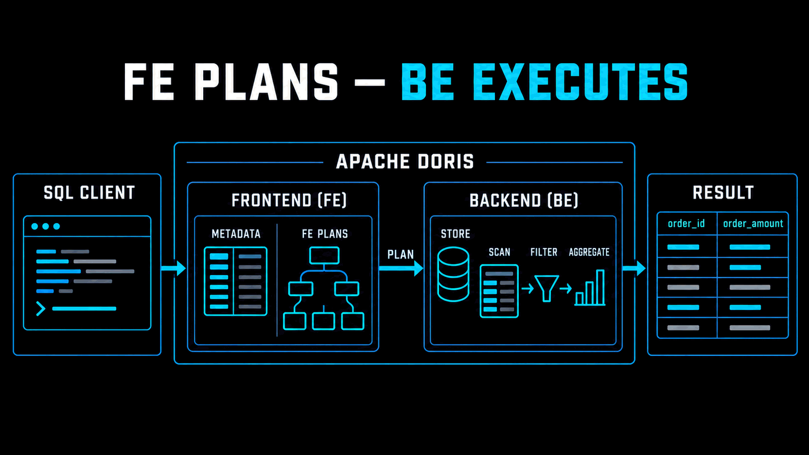
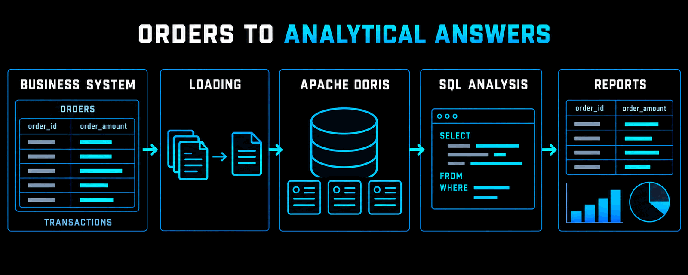
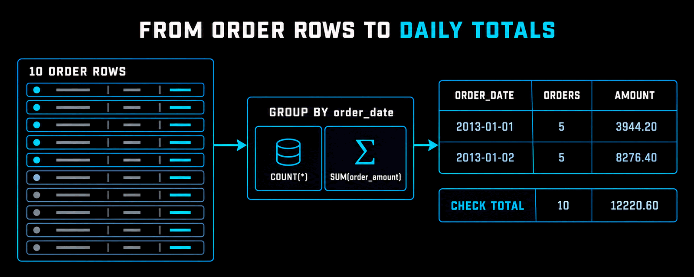

<a id="unit-u.2d7d53864a584dedb6a303261465230e"></a>

<a id="module-1-meet-doris-and-analyze-your-first-orders"></a>

# 1-модуль: Doris-пен танысу және алғашқы тапсырыстарды талдау

| Курс туралы ақпарат | Мәні |
| --- | --- |
| Курс | Apache Doris көмегімен деректер қоймасын құру · 1-деңгей |
| Doris | Apache Doris 4.1.3 |
| Орта | 1-зертханалық жұмыс іске қосатын курстың сынақ ортасы |
| Болжалды уақыт | Шамамен 55 минут: оқу 20, зертханалық жұмыс 25, тест 10 |

[Курстың README файлы](../../README.md) · [1-зертханалық жұмысты ашу](lab01_connect_and_query.ipynb) · [1-тестті ашу](quiz01_doris_fundamentals.ipynb)
<a id="unit-u.4854fe35b38947769df5cd5b9c38dd53"></a>

<a id="module-goal"></a>

## Модуль мақсаты

Doris-ті іске қосып, кестеге он тапсырыс жүктеңіз және SQL арқылы алғашқы бизнес сұрағына жауап беріңіз: әр күні қанша тапсырыс бар және олардың сомасы қанша?
<a id="unit-u.838733405ed94000b9ce73e5b60308dc"></a>

<a id="learning-objectives"></a>

## Оқу мақсаттары

Осы модульді аяқтағаннан кейін сіз:

1. Транзакцияны аяқтауды тапсырыстар тобын талдаудан ажыратасыз.
2. Бизнес дерекқорлары мен аналитика пайдаланушылары арасындағы Doris рөлін түсіндіресіз.
3. Сақтау мен есептеуі біріктірілген орналастыруда Frontend (FE) және Backend (BE) міндеттерін түсіндіресіз.
4. MySQL хаттамасы арқылы қосылу нені беретінін және нені бермейтінін түсіндіресіз.
5. Тапсырыстарды сүзетін және күн бойынша қорытындылайтын SQL жазасыз.
6. Тапсырыстың салыққа дейінгі сомасы нені өлшейтінін және үлгінің жалпы сомасы нені көрсете алатынын және көрсете алмайтынын айтасыз.
<a id="unit-u.1cff05e1f2d341e180e47d2306a03863"></a>

<a id="module-structure"></a>

## Модуль құрылымы

| Бөлім | Уақыт | Нәтиже |
| --- | ---: | --- |
| 1.1 Apache Doris деген не? | 5 мин | Транзакциялар мен аналитика, FE мен BE міндеттері |
| 1.2 Тапсырыс деректер қоймасындағы Doris | 5 мин | Doris орны және MySQL хаттамасының мүмкіндіктері |
| 1.3 Тапсырыстар кестесі | 4 мин | Әр тапсырысқа бір жол және кесте анықтамасы |
| 1.4 Тапсырыстарды сүзу және қорытындылау | 6 мин | WHERE, GROUP BY және нәтижені тексеру |
| 1-зертханалық жұмыс | 25 мин | Сынақ ортасын іске қосу, кесте жасау және он тапсырысты күн бойынша қорытындылау |
| 1-тест | 10 мин | Осы мақсаттарға арналған алты сұрақ |

Сынақ ортасын алғаш іске қосқанда Doris бейнесі жүктеледі, оған қосымша бірнеше минут кетеді.
<a id="unit-u.25769e30042e4f9a850131be26dba05f"></a>

<a id="11-what-is-apache-doris"></a>

## 1.1 Apache Doris деген не?

Apache Doris — ашық бастапқы коды бар нақты уақыттағы талдамалық дерекқор. SQL арқылы егжей-тегжейлі деректерді сұрайсыз, деректерді біріктіресіз және қорытындыларды есептейсіз.
Бұл курста ол алдымен қарапайым сұраққа жауап береді: **әр күні қанша тапсырыс бар және олардың жалпы сомасы қанша?**
[Өніммен танысу](https://doris.apache.org/docs/4.x/getting-started/what-is-apache-doris/)
<a id="unit-u.7c347f467ded451aa5efe106a03f7fc0"></a>

<a id="how-do-transactions-differ-from-analytics"></a>

### Транзакциялар аналитикадан қалай ерекшеленеді?

| Жұмыс | Мысал | Негізгі назар |
| --- | --- | --- |
| Транзакциялық өңдеу (OLTP) | Тұтынушы тапсырыс береді | Сол бір тапсырыс дұрыс сақталды ма |
| Талдамалық өңдеу (OLAP) | Тапсырыстар санын және олардың жалпы сомасын күн бойынша есептеу | Тапсырыстар жиынының жалпы көрінісі |

Жұмыстың екі түрі де `SELECT` қолдануы мүмкін. Тұтынушы өзгерте алуы үшін бір тапсырыстың мекенжайын іздеу транзакцияға қызмет етеді;
тапсырыс сомаларын күн бойынша қорытындылау — нәтиже тек екі жол болса да, талдау.
<a id="unit-u.96d31e824d174c4abb26eec93910ea64"></a>

<a id="what-do-the-fe-and-the-be-do"></a>

### FE мен BE не істейді?

Курстың бір контейнерлі сынақ ортасында бір **Frontend** (FE) және бір **Backend** (BE) жұмыс істейді. Ол **сақтау мен есептеуі біріктірілген** архитектураны қолданады: BE деректерді әрі сақтайды, әрі олармен есептеулер жүргізеді. (Doris-те деректер ортақ сақтауда орналасатын сақтау мен есептеуі ажыратылған архитектура да бар; бұл курста ол қолданылмайды.)

| Компонент | Негізгі міндеттері |
| --- | --- |
| Frontend (FE) | SQL қабылдайды, кесте анықтамалары сияқты метадеректерді басқарады, сұрауларды жоспарлап, үйлестіреді |
| Backend (BE) | Кестелердің деректерін сақтайды, оларды сканерлейді, сүзеді және агрегаттайды |

Сұрау жолын былай елестетіңіз: **клиент SQL жібереді → FE жұмысты жоспарлайды → BE оқып, есептейді → нәтиже қайтарылады.**
2-модуль бұл жолды толығырақ қарастырады.



*FE жоспарлайды, ал BE сақтап, есептейді.*

Суреттегі жазулар: FE PLANS – BE EXECUTES — FE жоспарлайды, BE орындайды; SQL CLIENT — SQL клиенті; APACHE DORIS — Apache Doris; FRONTEND (FE) — Frontend (FE); BACKEND (BE) — Backend (BE); METADATA — метадеректер; FE PLANS — FE жоспарлары; PLAN — жоспар; STORE — сақтау; SCAN — сканерлеу; FILTER — сүзу; AGGREGATE — агрегаттау; RESULT — нәтиже. order_id және order_amount — өзгермейтін баған атаулары.
<a id="unit-u.f2fa0f21c1c14518acca1af1c8a19a3e"></a>

<a id="12-doris-in-an-order-data-warehouse"></a>

## 1.2 Тапсырыс деректер қоймасындағы Doris

Бұл курста бизнес жүйесі тапсырыс беру сияқты транзакцияларды орындайды, ал Doris талдаушылар мен есептер сұрау жасай алуы үшін тапсырыс деректерінің көшірмелерін қабылдайды.
Тапсырыс деректер қоймасы тапсырыстарды және оларды талдауға қажет деректерді біріктіреді, соның арқасында сұраулар мен қорытындыларды қайта-қайта оңай орындауға болады.



*Doris қайталанып орындалатын талдау үшін көшірмелерді қабылдайды.*

Суреттегі жазулар: ORDERS TO ANALYTICAL ANSWERS — тапсырыстардан талдамалық жауаптарға; BUSINESS SYSTEM — бизнес жүйесі; ORDERS — тапсырыстар; TRANSACTIONS — транзакциялар; LOADING — жүктеу; APACHE DORIS — Apache Doris; SQL ANALYSIS — SQL талдауы; REPORTS — есептер. order_id, order_amount, SELECT, FROM және WHERE техникалық атаулары өзгермейді.

Тапсырыстарды талдау кезінде Doris мыналарға көмектеседі:

- **Егжей-тегжейлі деректерді сұрау**: тапсырысты, оның тұтынушысын, күнін және сомасын табу.
- **Қорытындылау**: тапсырыстарды санау және сомаларын күн немесе тұтынушы бойынша қосу.
- **Біріктіру**: тапсырыстарды тұтынушылармен, өнімдермен және басқа деректермен бірге сұрау.

Бұл модульде алғашқы екі әрекет үшін бір тапсырыс кестесі қолданылады; жүктеу, сыртқы деректер, сапаны тексеру және күй өзгерістері 4–7-модульдерде қарастырылады.
<a id="unit-u.cb95b07a3d7543c1b21765d2507a89b0"></a>

<a id="what-the-mysql-protocol-gives-you"></a>

### MySQL хаттамасы не береді?

Doris MySQL хаттамасын қолданады: MySQL клиенті, MySQL драйвері бар BI құралы немесе зертханалық жұмыстарда қолданылатын Python `pymysql` кітапханасы FE-ге қосылып, SQL жібере алады. Хаттаманың берері осы:

- **Бұл MySQL емес.** Doris-тің SQL синтаксисі, кесте модельдері және параметрлері өзіне тән; MySQL-де жұмыс істейтін оператор Doris-те жұмыс істемеуі мүмкін және керісінше. `SELECT VERSION()` командасы Doris MySQL клиенттеріне хабарлайтын хаттама нұсқасы — `5.7.99` мәнін қайтарады; Doris нұсқасы `SHOW FRONTENDS` және `SHOW BACKENDS` нәтижелерінің `Version` бағанында берілген, сынақ ортасында ол — `doris-4.1.3-rc02-7126cf65d96`.
- **Ол деректерді көшірмейді.** Құралды қосу бизнес дерекқорынан Doris-ке ештеңені көшірмейді; мұны 5-модульден бастап қарастырылатын жүктеу немесе синхрондау атқарады.
<a id="unit-u.9d5529a87a5145f9a35c73ea650856b3"></a>

<a id="13-the-order-table"></a>

## 1.3 Тапсырыстар кестесі

Бұл курс Microsoft жариялайтын, модельденген көтерме сауда бизнесі — Wide World Importers (WWI) жүйесіндегі он тарихи тапсырыстан басталады.
Үлгі `orders_sample` кестесінде берілген, мұнда **әр тапсырысқа бір жол** келеді:

| Өріс | Мағынасы |
| --- | --- |
| order_id | Тапсырыс идентификаторы |
| customer_id | Тұтынушы идентификаторы |
| order_date | Тапсырыс күні |
| order_amount | Тапсырыстың тауар жолдарындағы сан × бірлік бағасы қосындысы: салыққа дейінгі тапсырыс сомасы |
| line_count | Тапсырыстағы тауар жолдарының саны |
| data_source | Дереккөзі, мұнда WWI |

Бір тапсырыста бірнеше тауар жолы болуы мүмкін, бірақ осы кестеде ол бір жол алады.
Сома — тұтынушының салыққа дейін тапсырыс берген құны; бұл алынған ақша емес. Тапсырыс төленгенін білу үшін төлем немесе шот деректері қажет, ал бұл кестеде олар жоқ.
<a id="unit-u.60134d3a7ea440e8a36b2b60e3e37267"></a>

<a id="the-table-definition-in-the-lab"></a>

### Зертханалық жұмыстағы кесте анықтамасы

1-зертханалық жұмыс толық `CREATE TABLE` және `INSERT` операторларын көрсетіп, орындайды. Мына бөліктерді танып алыңыз:

| Синтаксис | Осы зертханалық жұмыстағы мағынасы |
| --- | --- |
| BIGINT, DATE, DECIMAL(18,2) | Бүтін сандар, күндер және үтірден кейін екі таңбасы бар сомалар |
| NOT NULL | Өріс бос бола алмайды |
| DUPLICATE KEY(order_id) | Әр енгізілген жол сақталады; бірдей тапсырыс идентификаторы бар қайталанулар жойылмайды |
| BUCKETS 1 | Кесте деректері бір tablet ішінде сақталады; он тапсырысқа артығы қажет емес |
| replication_num=1 | Бір көшірме сақталады: әр репликаға жеке BE қажет, ал сынақ ортасында бір BE бар |

3-модуль модельдерді, бөлімдерді және бакеттерді қамтиды. Кестені жасағаннан кейін оның анықтамасын мына командамен қарай аласыз:

```sql
SHOW CREATE TABLE orders_sample;
```
<a id="unit-u.5e48ccf9ab1b4ca2a39bb63a8ebf2833"></a>

<a id="14-filter-and-summarize-orders"></a>

## 1.4 Тапсырыстарды сүзу және қорытындылау

**Бұл сұрауларды 1-зертханалық жұмыста кесте жасалып, он жол енгізілгеннен кейін**, сол зертханалық дерекқорда орындаңыз.
<a id="unit-u.03a05e4a89704d21ad4bdc8d9a4a9392"></a>

<a id="view-one-order"></a>

### Бір тапсырысты қарау

```sql
SELECT order_id, customer_id, order_date, order_amount, line_count
FROM orders_sample
WHERE order_id = 4;
```

`FROM` кестені атайды, `WHERE` 4-тапсырысты таңдайды, ал `SELECT` көрсетілетін өрістерді атайды. Бір жол күтіледі:

| order_id | customer_id | order_date | order_amount | line_count |
| --- | --- | --- | --- | --- |
| 4 | 57 | 2013-01-01 | 445.20 | 3 |

57-тұтынушы бұл тапсырысты 2013-01-01 күні берген; онда үш тауар жолы бар, салыққа дейінгі сомасы — 445.20.
<a id="unit-u.63e7b092542f4afd9437081bc8c6efd7"></a>

<a id="filter-higher-value-orders"></a>

### Сомасы жоғары тапсырыстарды сүзу

Сомасы кемінде 1000 болатын тапсырыстарды табыңыз:

```sql
SELECT order_id, order_date, order_amount
FROM orders_sample
WHERE order_amount >= 1000.00
ORDER BY order_id;
```

`>=` «үлкен немесе тең» дегенді білдіреді, ал `ORDER BY` нәтижені тапсырыс идентификаторы бойынша сұрыптайды. Үш тапсырыс күтіледі:

| order_id | order_date | order_amount |
| --- | --- | --- |
| 1 | 2013-01-01 | 2300.00 |
| 80 | 2013-01-02 | 1138.00 |
| 83 | 2013-01-02 | 6220.40 |

Үш тапсырыстың жалпы сомасы — 9658.40. 1-зертханалық жұмыстың бірінші жаттығуында осы сұрауды өзіңіз жазасыз.
<a id="unit-u.b8db71805dd1439ba230f9d90f12fad1"></a>

<a id="count-orders-and-total-their-amounts-by-day"></a>

### Тапсырыстар санын және олардың жалпы сомасын күн бойынша есептеу

```sql
SELECT order_date,
       COUNT(*) AS sample_orders,
       SUM(order_amount) AS order_amount
FROM orders_sample
GROUP BY order_date
ORDER BY order_date;
```

Нәтижедегі әр тапсырысқа бір жолдың орнына әр күнге бір жол шығады:

- `GROUP BY` бір күннің тапсырыстарын бір топқа біріктіреді.
- `COUNT(*)` топтағы жолдарды санайды; кестеде әр тапсырысқа бір жол болғандықтан, бұл — тапсырыстар саны.
- `SUM` топтың сомаларын қосады, ал `AS` нәтиже бағанына атау береді.
- `ORDER BY` күндерді сұрыптайды; ол тек сұрыптайды, агрегаттамайды.

| Күн | Үлгідегі тапсырыстар саны | Салыққа дейінгі тапсырыс сомасы |
| --- | ---: | ---: |
| 2013-01-01 | 5 | 3944.20 |
| 2013-01-02 | 5 | 8276.40 |
| Барлығы | 10 | 12220.60 |

SQL күндерге арналған екі жолды қайтарады; «Барлығы» жолы қолмен тексеру үшін берілген. Осылайша 1.1 бөліміндегі сұраққа жауап алынады.



*Агрегаттау әр тапсырысқа бір жолды әр күнге бір жолға айналдырады.*

Суреттегі жазулар: FROM ORDER ROWS TO DAILY TOTALS — тапсырыс жолдарынан күндік қорытындыларға; 10 ORDER ROWS — 10 тапсырыс жолы; GROUP BY order_date — order_date бойынша топтау; COUNT(*) — жолдар саны; SUM(order_amount) — тапсырыс сомаларының қосындысы; ORDER_DATE — тапсырыс күні; ORDERS — тапсырыстар; AMOUNT — сома; CHECK TOTAL — жалпы соманы тексеру. Суреттегі күндер мен мәндер жоғарыдағы кестеге сәйкес келеді.
<a id="unit-u.2ea17c67f99447728148a4be1ef46137"></a>

<a id="check-the-result-and-what-it-means"></a>

### Нәтижені және оның мағынасын тексеру

```sql
SELECT COUNT(*) AS order_count,
       SUM(order_amount) AS total_amount
FROM orders_sample;
```

Қалыпты орындаудан кейін **10 жол және 12220.60** күтіледі. 1-зертханалық жұмыс әр өрісті де үлгімен салыстырады: бірі артық, бірі кем екі қате сома жалпы соманы өзгеріссіз қалдыруы мүмкін. Сондықтан жалпы соманың сәйкес келуі — алғашқы тексеру ғана, дәлел емес.

Бұл жалпы соманың мағынасына екі шектеу бар: ол сол күндердегі бүкіл бизнестің сомасы емес, үлгідегі он тапсырыстың салыққа дейінгі сомасы және төлемдер туралы ештеңе айтпайды.

Он жолдық `INSERT` операторын жеке қайта орындамаңыз: Duplicate Key кестесі жолдарды қоса береді, сондықтан жиырма жол және 24441.20 сомасын көресіз.
Қайта бастау үшін зертханалық жұмыстың `orders_sample` кестесін қалпына келтіретін кесте жасау қадамын, содан кейін енгізу қадамын қайта орындаңыз. Қайта әрекет жасау мен қайталануларды жою кейінгі модульдерде қарастырылады.
<a id="unit-u.884f878405c644f9b93d7996b8e66f53"></a>

<a id="lab-1-connect-to-doris-and-query-your-first-orders"></a>

## 1-зертханалық жұмыс: Doris-ке қосылу және алғашқы тапсырыстарды сұрау

[1-зертханалық жұмыс: Doris-ке қосылу және алғашқы тапсырыстарды сұрау](lab01_connect_and_query.ipynb) файлын ашыңыз. Сіз:

1. Зертханалық құралдарды жүктеп, курстың бір контейнерлі сынақ ортасын іске қосасыз және зертханалық дерекқорға қосыласыз.
2. FE мен BE жұмыс істеп тұрғанын тексеріп, Doris нұсқасын қарайсыз.
3. `orders_sample` кестесін жасап, он тапсырысты енгізесіз және оларды үлгімен әр өріс бойынша салыстырасыз.
4. Тапсырыстарды күн бойынша қорытындылайсыз.
5. Жаттығу: алдымен сомасы кемінде 1000.00 болатын, содан кейін екінші күннің сомасы кемінде 300 болатын тапсырыстарын сүзесіз.

Сынақ ортасы үшін шамамен 8 GB жады бар Docker қажет. Үлгі MIT лицензиясымен берілген [Microsoft-тың ресми шығарылымынан](https://github.com/microsoft/sql-server-samples/releases/tag/wide-world-importers-v1.0) алынған; ол курстың README файлындағы [Деректер жиыны](../../README.md#dataset) бөлімінде сипатталған.
<a id="unit-u.0bb0c33b8d9b46cb83f9fd17bffbb6fd"></a>

<a id="summary"></a>

## Қорытынды

- Транзакция бір бизнес операциясын аяқтайды; талдау аз жол қайтарса да, деректер жиынын қорытындылайды.
- Бұл курста бизнес жүйесі транзакцияларды орындайды, ал Doris деректерді қабылдап, талдамалық сұрауларға жауап береді.
- Сақтау мен есептеуі біріктірілген сынақ ортасында FE сұрауларды жоспарлап, үйлестіреді, ал BE деректерді сақтап, олармен есептеулер жүргізеді.
- MySQL хаттамасы MySQL құралдарына Doris-ке SQL жіберуге мүмкіндік береді; ол Doris-ті MySQL-ге айналдырмайды және деректерді жүктемейді.
- `WHERE` жолдарды сүзеді, `GROUP BY` және `COUNT`, `SUM` оларды күн бойынша қорытындылайды, ал `ORDER BY` нәтижені сұрыптайды.
- Он үлгі тапсырыстың салыққа дейінгі жалпы сомасы — 12220.60: бұл алынған төлемдер де, бүкіл бизнестің сомасы да емес, үлгідегі тапсырыс сомасы; жалпы сомамен қатар егжей-тегжейлі деректерді де тексеріңіз.
<a id="unit-u.3568763a9a1b40039d95e02f9b7a018d"></a>

<a id="quiz-1"></a>

## 1-тест

[1-тест: Doris-пен танысу және алғашқы тапсырыстарды талдау](quiz01_doris_fundamentals.ipynb) файлын ашыңыз. Онда бір дұрыс жауабы бар алты сұрақ бар және іске қосылған орта қажет емес.

Келесі модуль: [2-модуль: Doris сақтау архитектурасы және жазу механизмдері](../module02-architecture/course.md).
<a id="unit-u.cdbfec83bd534b13ab6f0b0ae65dae53"></a>

<a id="references"></a>

## Дереккөздер

- [Apache Doris: Apache Doris деген не](https://doris.apache.org/docs/4.x/getting-started/what-is-apache-doris/)
- [Apache Doris: Жүйе архитектурасы](https://doris.apache.org/docs/4.x/features-architecture/system-architecture/)
- [Apache Doris: SELECT](https://doris.apache.org/docs/4.x/sql-manual/sql-statements/data-query/SELECT/)
- [Apache Doris: Duplicate Key моделі](https://doris.apache.org/docs/4.x/table-design/data-model/duplicate/)
- [Apache Doris: Деректер түрлері](https://doris.apache.org/docs/4.x/table-design/data-type/)
- [Apache Doris: All-in-One бейнесі](https://doris.apache.org/community/developer-guide/all-in-one-image/)
