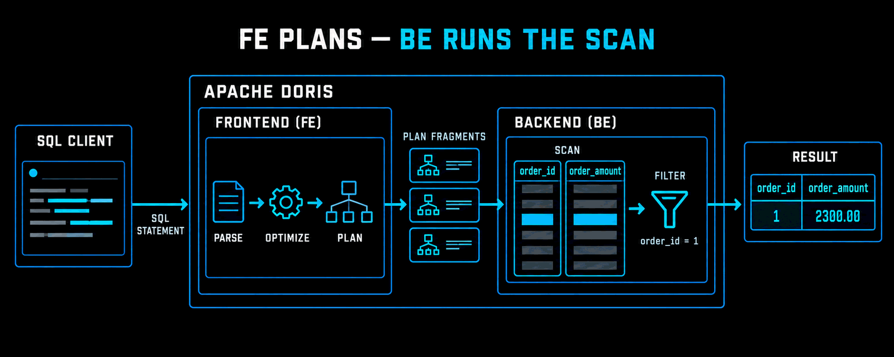
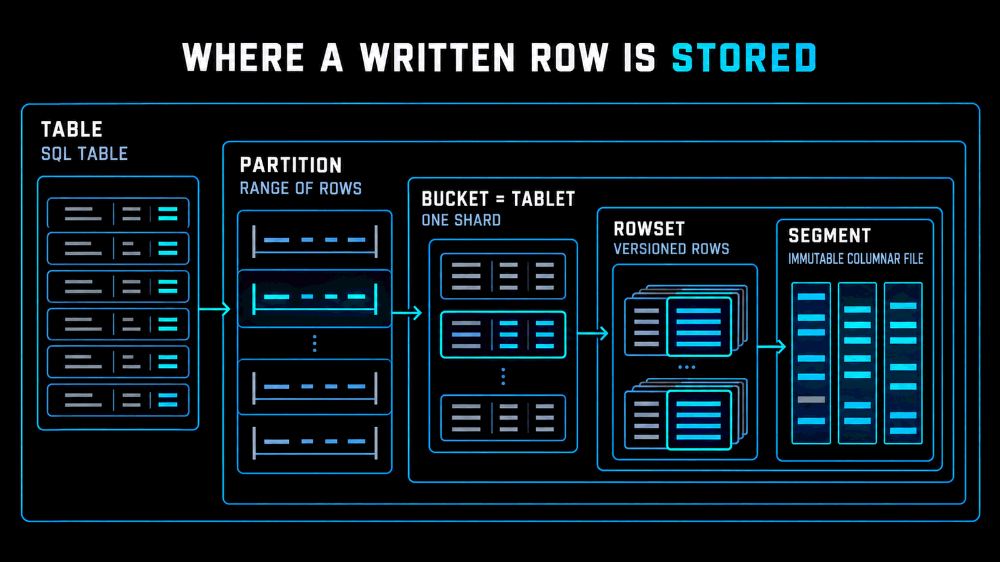
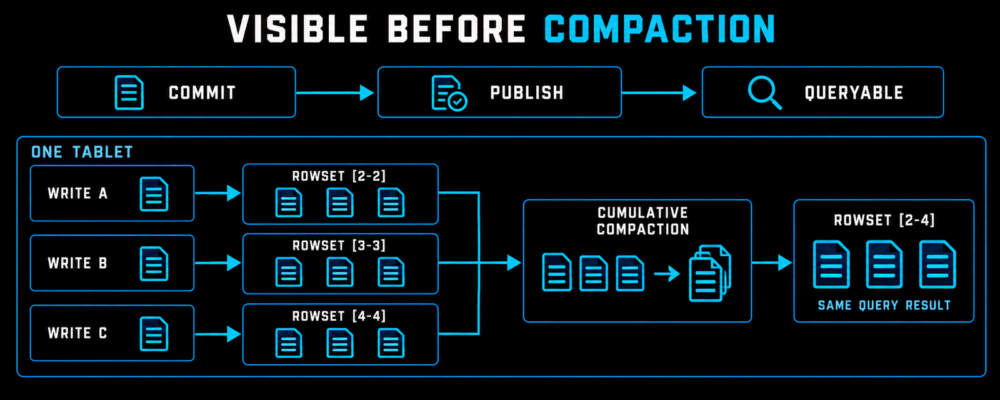

<a id="unit-u.be6056b681dd464fb09f6403c794e220"></a>

<a id="module-2-doris-storage-architecture-and-write-mechanisms"></a>

# 2-модуль: Doris сақтау архитектурасы және жазу механизмдері

| Курс туралы ақпарат | Мәні |
| --- | --- |
| Курс | Apache Doris көмегімен деректер қоймасын құру · 1-деңгей |
| Doris | Apache Doris 4.1.3 |
| Орта | 1-модульдегі курстың сынақ ортасы |
| Болжалды уақыт | Шамамен 55 минут: оқу 25, зертханалық жұмыс 20, тест 10 |

[Курстың README файлы](../../README.md) · [2-зертханалық жұмысты ашу](lab02_observe_storage.ipynb) · [2-тестті ашу](quiz02_storage_and_write_batches.ipynb)
<a id="unit-u.3c54b29ac45d49c2b3591fda5d010b69"></a>

<a id="module-goal"></a>

## Модуль мақсаты

Сұраудың FE-ден BE-ге дейінгі жолын бақылап, Doris жазылған деректерді қалай сақтайтынын көріңіз: tablet ішінде, бағандық сегменттерден тұратын нұсқаланған rowset түрінде, кейін оларды compaction біріктіреді.
<a id="unit-u.a6cd2e53169a493db6db1bbd036e4032"></a>

<a id="learning-objectives"></a>

## Оқу мақсаттары

Осы модульді аяқтағаннан кейін сіз:

1. Сұрау жолын қадағалап, FE жоспарлауын және BE орындауын түсіндіресіз.
2. Кесте, бөлім, tablet, rowset және сегмент иерархиясын түсіндіресіз.
3. Жүктелген жолдар қашан көрінетінін және кейін compaction нені өзгертетінін түсіндіресіз.
4. Қалған жағдайларды тұрақты ұстап, пакеттік және жол сайынғы жазуды салыстырасыз.
5. Tablet нұсқалары мен rowset-ін оқып, олардың жазу пакеттері мен compaction туралы нені көрсететінін түсіндіресіз.
6. Сұраудың жоспарын көру үшін EXPLAIN, ал сканерлеу не оқығанын көру үшін Query Profile қолданасыз.
<a id="unit-u.5b7d115a3d0a47ce9be2412a249ce1e5"></a>

<a id="module-structure"></a>

## Модуль құрылымы

| Бөлім | Уақыт | Нәтиже |
| --- | ---: | --- |
| 2.1 Сұрау жолы және бағандық сақтау | 5 мин | Бір сұрау үшін FE мен BE не істейді және неліктен ол аз баған оқиды |
| 2.2 Tablet, rowset және сегменттер | 6 мин | Жазылған жол қайда түседі |
| 2.3 Көріну және compaction | 4 мин | Жолдарды қашан сұрауға болады және compaction нені өзгертеді |
| 2.4 Бір пакет немесе он жазу | 4 мин | Әділ салыстыру және нұсқалар мен rowset көрсететін мәліметтер |
| 2.5 Жоспар және орындалған жұмыс | 6 мин | EXPLAIN мен Query Profile сканерлеу есептегіштерін салыстыру |
| 2-зертханалық жұмыс | 20 мин | Он тапсырысты екі тәсілмен жазу, нұсқаларды, rowset пен сканерлеуді қарау |
| 2-тест | 10 мин | Осы мақсаттарға арналған алты сұрақ |
<a id="unit-u.0a43872ccc3b4cc5800e0306913de64d"></a>

<a id="21-the-query-path-and-columnar-storage"></a>

## 2.1 Сұрау жолы және бағандық сақтау

Талдаушыға бүкіл тапсырыс кестесі емес, 1-тапсырыстың сомасы қажет делік. 2-зертханалық жұмыстан кейін мынаны орындауға болады:

```sql
SELECT order_id, order_amount
FROM orders_batch
WHERE order_id = 1;
```

Бір жол күтіледі: 1-тапсырыс, 2300.00. Клиент бір SQL операторын жібереді; Doris ішінде жұмыс бөлінеді:



*FE жоспарлайды; BE орындайды.*

Суреттегі жазулар: FE PLANS – BE RUNS THE SCAN — FE жоспарлайды, BE сканерлеуді орындайды; SQL CLIENT — SQL клиенті; SQL STATEMENT — SQL операторы; APACHE DORIS — Apache Doris; FRONTEND (FE) — Frontend (FE); PARSE — синтаксистік талдау; OPTIMIZE — оңтайландыру; PLAN — жоспарлау; PLAN FRAGMENTS — жоспар фрагменттері; BACKEND (BE) — Backend (BE); SCAN — сканерлеу; FILTER — сүзу; RESULT — нәтиже. order_id, order_amount, order_id = 1 және 1, 2300.00 нәтиже мәндері өзгермейді.

FE қандай жұмыс орындалатынын шешеді; әр BE өз үлесін орындайды. Үлкен сұрау бірнеше BE-де сканерлеп, агрегаттап, олардың нәтижелерін біріктіре алады; курстағы жалғыз түйін масштабталуды емес, рөлдерді көрсетеді. Жоспарлау мен орындау — бөлек кезеңдер: FE жоспарлаған сұрау BE өз бөлігін орындағанда әлі де қате аяқталуы мүмкін.
<a id="unit-u.c7cfa63615f143089e3c8f799ecebe42"></a>

<a id="why-analysis-reads-only-some-columns"></a>

### Неліктен талдау тек кейбір бағандарды оқиды?

Тапсырыс кестесінде тұтынушы, күн, жолдар саны және дереккөзі де бар, бірақ бұл сұрауға тек екі баған қажет. **Бағандық сақтау** әр бағанның мәндерін бірге сақтайды, сондықтан сканерлеу тек сұрау қолданатын бағандарды оқи алады. Аз баған оқу (бағандарды алып тастау) және сәйкес келмейтін жолдар не блоктарды өткізіп жіберу (сүзу) — үнемдеудің екі бөлек түрі; 2.5 бөлімі екеуін де өлшейді.
<a id="unit-u.384cf7c7b8c94611be111c3ab72013e6"></a>

<a id="22-tablets-rowsets-and-segments"></a>

## 2.2 Tablet, rowset және сегменттер

Жолдар Doris-ке келгенде, кестені бөлімдеу мен бакеттерге бөлу әр жолды қай tablet сақтайтынын анықтайды, ал BE оларды бағандық файлдарға жазады.



*Жолдар tablet-терге және нұсқаланған бағандық файлдарға ұйымдастырылады.*

Суреттегі жазулар: WHERE A WRITTEN ROW IS STORED — жазылған жол қайда сақталады; TABLE — кесте; SQL TABLE — SQL кестесі; PARTITION — бөлім; RANGE OF ROWS — жолдар ауқымы; BUCKET = TABLET — бакет = tablet; ONE SHARD — бір шард; ROWSET — жолдар жиыны; VERSIONED ROWS — нұсқаланған жолдар; SEGMENT — сегмент; IMMUTABLE COLUMNAR FILE — өзгермейтін бағандық файл.

| Қабат | Тапсырыс кестелерінде | Мынамен шатастырмаңыз |
| --- | --- | --- |
| Бөлім | Тапсырыс күндерінің бір ауқымы; `PARTITION BY` жоқ кестеде бір бөлім бар | BE түйінімен |
| Бакет / Tablet | Бөлімнің бір шарды; әр бөлімнің әр бакеті — tablet | Репликамен: репликалар — tablet көшірмелері |
| Rowset | Бір жазудың tablet-ке қосқаны, өз нұсқасымен бірге | Бүкіл кестеге ортақ файлмен |
| Сегмент | Rowset бағандарын сақтайтын файл; үлкен rowset-те бірнешеуі бар | Бизнес тапсырыспен |

Әрқайсысында төрт бакет бар екі күндік екі бөлім сегіз tablet береді. Репликалар жаңа деректер емес, басқа BE түйіндерінде әр tablet-тің көшірмелерін қосады; курс сынақ ортасында бір BE болғандықтан, бір реплика бар. Жоғарыдағы есеп тек кестенің өз деректерін, яғни негізгі индексін ескереді: синхронды материалданған көрініс не rollup өз көшірмесін қосымша tablet-терде сақтайды.

2-зертханалық жұмыстың бір бакетті кестесінде он тапсырысты бір рет жазу жалғыз tablet-ке бір rowset қосады; бір тапсырыстан он рет жазу он rowset қосады. Үлкен жазу бірнеше сегмент тудыруы мүмкін. Бизнес жолдары, жазу сұраулары және файлдар — үш бөлек сан.
<a id="unit-u.ea67223cecdb49c6bacef710db1630e2"></a>

<a id="23-visibility-and-compaction"></a>

## 2.3 Көріну және compaction

Жазу — жүктеу транзакциясы. Ол бекітіліп, жаңа **нұсқа** ретінде жарияланғаннан кейін сұраулар оның жолдарын оқи алады. Алдымен басқа ештеңенің орындалуы қажет емес.

Көп шағын жазу көп шағын rowset қалдырады, ал tablet-ке жасалған сұрау олардың бәрін оқып, біріктіруі керек. **Compaction** фондық режимде rowset-терді саны аз, өлшемі үлкен rowset-терге біріктіреді:



*Compaction rowset-терді біріктірмей тұрып-ақ жарияланған жолдарды сұрауға болады.*

Суреттегі жазулар: VISIBLE BEFORE COMPACTION — compaction-ға дейін көрінеді; COMMIT — бекіту; PUBLISH — жариялау; QUERYABLE — сұрауға болады; ONE TABLET — бір tablet; WRITE A, WRITE B, WRITE C — A, B, C жазулары; ROWSET [2-2], ROWSET [3-3], ROWSET [4-4] — тиісті нұсқалардың rowset-тері; CUMULATIVE COMPACTION — жинақтаушы compaction; ROWSET [2-4] — біріктірілген [2-4] rowset-і; SAME QUERY RESULT — сұрау нәтижесі өзгермейді.

Compaction жолдардың сақталу тәсілін өзгертеді, бірақ сұрау қайтаратын жолдарды ешқашан өзгертпейді: жүктеудің көрінуі мен оның файлдарының compaction арқылы біріктірілуі — екі бөлек мәселе. Жүктеу жоғалғандай көрінсе, алдымен оның транзакциясын, содан кейін файлдарын тексеріңіз. Біріктірілген ескі rowset-тер BE оларды жойғанға дейін біраз уақыт **stale** (ескірген) ретінде тізіледі. [Compaction қағидалары](https://doris.apache.org/docs/4.x/admin-manual/trouble-shooting/compaction-principles/) бөлімін қараңыз.
<a id="unit-u.d787e230fe62477996aa510e1d3076f8"></a>

<a id="24-one-batch-or-ten-writes"></a>

## 2.4 Бір пакет немесе он жазу

2-зертханалық жұмыс бірдей он тапсырысты тек жазылу тәсілімен ерекшеленетін екі кестеге жазады:

| Салыстырылатын сипат | orders_batch | orders_rowwise |
| --- | --- | --- |
| Деректер мен бағандар | Бірдей он тапсырыс | Бірдей он тапсырыс |
| Бакеттер мен репликалар | Бір бакет, бір реплика | Бір бакет, бір реплика |
| Жазулар | Он жолдан тұратын бір `INSERT` | Бір жолдан тұратын он `INSERT` операторы |
| Group Commit | off_mode | off_mode |
| Бизнес нәтижесі | Он жол, 12220.60 | Он жол, 12220.60 |

Тек жазулар өзгереді: бакеттер санын не деректерді қатар өзгерту қай өзгеріс қандай әсер бергенін анықтауға мүмкіндік бермес еді. Сервердегі шағын жазуларды біріктіре алатын Group Commit (5-модуль) өшірулі, сондықтан әр жазу жеке бекітіледі.
<a id="unit-u.5f3cc05033154459a4c8925a7db74800"></a>

<a id="what-versions-and-rowsets-show"></a>

### Нұсқалар мен rowset нені көрсетеді?

Алдымен бизнес нәтижесін, содан кейін сақтауды тексеріңіз:

```sql
SHOW PARTITIONS FROM orders_batch;
SHOW TABLETS FROM orders_batch;
SHOW TABLETS FROM orders_rowwise;
```

| Өріс | Қалай түсіндіріледі | Нені білдірмейді |
| --- | --- | --- |
| TabletId | Әрі қарай тексеру үшін tablet-ті анықтайды | Тапсырыс идентификаторы емес |
| Version | Соңғы бекітілген нұсқа: бос tablet 1-ден басталады, әр жүктеу бір нұсқа қосады | Файлдар саны емес; compaction оны азайтпайды |
| VersionCount | BE соңғы есебінде хабарлаған нұсқалар саны, есеп шамамен минутына бір рет келеді | Жазулар не сегменттер саны емес |

Пакеттік кестенің нұсқасы — 2, ал жол сайын жазылған кестенікі — 11: он жазу, он транзакция. Tablet-тің rowset тізімін оны сақтайтын BE береді: `SHOW TABLET <TabletId>` командасы tablet репликаларын тізетін `SHOW PROC` операторы — `DetailCmd` қайтарады және әр репликаның өз BE-сінде `CompactionStatus` URL-і бар. 2-зертханалық жұмыс оны екі кесте үшін де оқиды:

| Кесте | Жазулардан кейінгі rowset | Жинақтаушы compaction-нан кейін |
| --- | --- | --- |
| orders_batch | Бос бастапқы күй — `[0-1]` және он жол — `[2-2]` | Өзгермейді: бір жүктеудің rowset-ін біріктіретін басқа rowset жоқ |
| orders_rowwise | `[0-1]` және әр жазуға біреуден `[2-2]` … `[11-11]` | `[0-1]` және `[2-11]`, ал он ескі rowset ескірген ретінде тізіледі |

`[2-11]` — он тапсырыс емес, нұсқалар ауқымы. Сынақ ортасында compaction әдетте он шағын rowset-ті бірнеше секунд ішінде біріктіреді, сондықтан көретін күйіңіз қараған уақытқа байланысты; бизнес нәтижесі оған байланысты емес. Мұнда тек күйді оқыңыз: compaction-ды қолмен іске қоспаңыз және сақтау файлдарына тимеңіз. [Tablet күйіне қатынау](https://doris.apache.org/docs/4.x/admin-manual/trouble-shooting/tablet-local-debug/) бөлімін қараңыз.

Он жол өткізу қабілетін емес, механизмді көрсетеді: жазу өнімділігін өлшеу үшін үлкен деректер, тұрақты параллельдік және нұсқаларды, кідірісті, compaction-ның жүктемеге үлгеруін уақыт бойы бақылау қажет.
<a id="unit-u.deecbc42a8f547d5a9bbde9011989286"></a>

<a id="25-the-plan-and-the-work"></a>

## 2.5 Жоспар және орындалған жұмыс

`EXPLAIN` FE құрған жоспарды орындамай көрсетеді: кестені, бағандарды, сүзгіні және қанша бөлім мен tablet оқитынын.

```sql
EXPLAIN SELECT order_id, order_amount
FROM orders_batch
WHERE order_id = 1;
```

Жоспар — өлшеу емес: ол сканерлеу іс жүзінде қанша жол не байт оқығанын айтпайды. Мұны **Query Profile** тіркейді. Сеанста `enable_profile = true` болса, Doris әр сұрауға Profile сақтайды; сұраудан кейін бірден `SELECT last_query_id()` орындау оның сұрау идентификаторын қайтарады, ол Profile идентификаторы да болады. FE Profile мәтінін береді және оны Web UI ішіндегі QueryProfile бетінде көрсетеді. 2-зертханалық жұмыс өз сеансы үшін Profile-дарды қосады, қайталанған сұрау шынымен сканерлеуі үшін SQL кэшін өшіреді және кейін екі параметрді де қалпына келтіреді.

Сканерлеудің жол есептегіштері оның жолдарды қалай тапқанын көрсетеді:

| Есептегіш | Нені санайды |
| --- | --- |
| ScanRows | Сканерлеу сегменттерінен оқыған жолдар |
| RowsKeyRangeFiltered | Сұрыптау кілтінің индексі оқымай өткізіп жіберуге мүмкіндік берген жолдар |
| RowsVectorPredFiltered | Оқылып, кейін сүзгі алып тастаған жолдар |
| RowsRead | Сүзгіден өткен жолдар |

2-зертханалық жұмыстың үш сұрауы да 1-тапсырысты қайтарады, бірақ әртүрлі жұмыс істейді. `WHERE order_id = 1` бір жол оқиды: `order_id` — сұрыптау кілті, оның индексі ауқымды тарылтады. `WHERE customer_id = 832` он жолдың бәрін оқып, тоғызын алып тастайды. Бірдей сүзгімен екі бағанның орнына барлық бағанды таңдау көбірек байт оқиды. Он жолда бұл есептегіштер жылдамдықты емес, жұмыс түрін сипаттайды; жылдамдықты тек бірдей машинада, деректерде және кэш жағдайында салыстырыңыз. [Query Profile](https://doris.apache.org/docs/4.x/query-acceleration/query-profile/) бөлімін қараңыз.
<a id="unit-u.d80f04e2f9a442c18b3ceafdb558d2c4"></a>

<a id="lab-2-observe-storage-and-write-batches"></a>

## 2-зертханалық жұмыс: сақтауды және жазу пакеттерін бақылау

[2-зертханалық жұмыс: сақтауды және жазу пакеттерін бақылау](lab02_observe_storage.ipynb) файлын ашыңыз. Сіз:

1. Анықтамасы бірдей екі кесте жасап, бірдей он тапсырысты бір пакет ретінде және бір жолдан он жазу ретінде жазасыз.
2. Екі кестеде де он жол және 12220.60 бар екенін тексересіз.
3. Бөлімдер мен tablet нұсқаларын, содан кейін әр tablet-тің rowset-ін және compaction оларды қалай өзгерткенін қарайсыз.
4. Сұрау жоспарын оның Query Profile ішіндегі сканерлеу есептегіштерімен салыстырасыз.
5. Жаттығу: екі кестеде бір күнді сұрайсыз және сұрыптау кілті бұл сүзгіге неліктен көмектеспейтінін түсіндіресіз.

1-модульдегі курстың сынақ ортасы қажет. Таңдау бойынша [пакеттер, бөлімдер және Profile туралы кеңейтілген зертханалық жұмыс](../extensions/extension23_physical_design.ipynb) осы бақылауларды 100,000 жолда қайталайды.
<a id="unit-u.b35c7da5816e43f29b8bb48b42b7950f"></a>

<a id="summary"></a>

## Қорытынды

- Клиент SQL жібереді, FE сұрауды жоспарлап, таратады, ал BE қажетті бағандарды оқып, сүзеді және агрегаттайды; жоспарланған сұрау орындалу барысында әлі де қате аяқталуы мүмкін.
- Кесте бөлімдері жолдар ауқымын қамтиды, бөлімнің әр бакеті — tablet, әр жазу tablet-ке нұсқаланған rowset қосады, ал rowset бағандары сегмент файлдарында орналасады.
- Транзакция жарияланғаннан кейін жолдар көрінеді; кейін compaction rowset-терді біріктіреді және сұрау қайтаратын жолдарды ешқашан өзгертпейді.
- Жазу әдістерін бірдей деректермен, кесте анықтамасымен және параметрлермен салыстырыңыз: 2-зертханалық жұмыстың екі кестесінде де он жол және 12220.60 бар.
- Бір пакет 2-нұсқаны және бір rowset жасады; он жазу 11-нұсқаны және он rowset жасады, оларды compaction `[2-11]` түрінде біріктіреді.
- EXPLAIN сұраудың не оқуды жоспарлайтынын, ал Query Profile сканерлеудің не оқып, нені өткізіп жібергенін көрсетеді; он жол жылдамдықты емес, механизмдерді көрсетеді.
<a id="unit-u.422fbe3de3dc4ca48cbee9a8748acc3c"></a>

<a id="quiz-2"></a>

## 2-тест

[2-тест: Doris сақтау архитектурасы және жазу механизмдері](quiz02_storage_and_write_batches.ipynb) файлын ашыңыз. Онда бір дұрыс жауабы бар алты сұрақ бар және іске қосылған орта қажет емес.

Келесі модуль: [3-модуль: Doris кесте модельдері, бөлімдеу және бакеттерге бөлу](../module03-table-design/course.md).
<a id="unit-u.a1b239fd052845a5bb54930c298407b6"></a>

<a id="references"></a>

## Дереккөздер

- [Apache Doris: Жүйе архитектурасы](https://doris.apache.org/docs/4.x/features-architecture/system-architecture/)
- [Apache Doris: Бөлімдеу және бакеттерге бөлу негіздері](https://doris.apache.org/docs/4.x/table-design/data-partitioning/basic-concepts/)
- [Apache Doris: Compaction қағидалары](https://doris.apache.org/docs/4.x/admin-manual/trouble-shooting/compaction-principles/)
- [Apache Doris: EXPLAIN](https://doris.apache.org/docs/4.x/sql-manual/sql-statements/data-query/EXPLAIN/)
- [Apache Doris: Query Profile](https://doris.apache.org/docs/4.x/query-acceleration/query-profile/)
- [Apache Doris: Group Commit](https://doris.apache.org/docs/4.x/data-operate/import/load-best-practices/group-commit-manual/)
