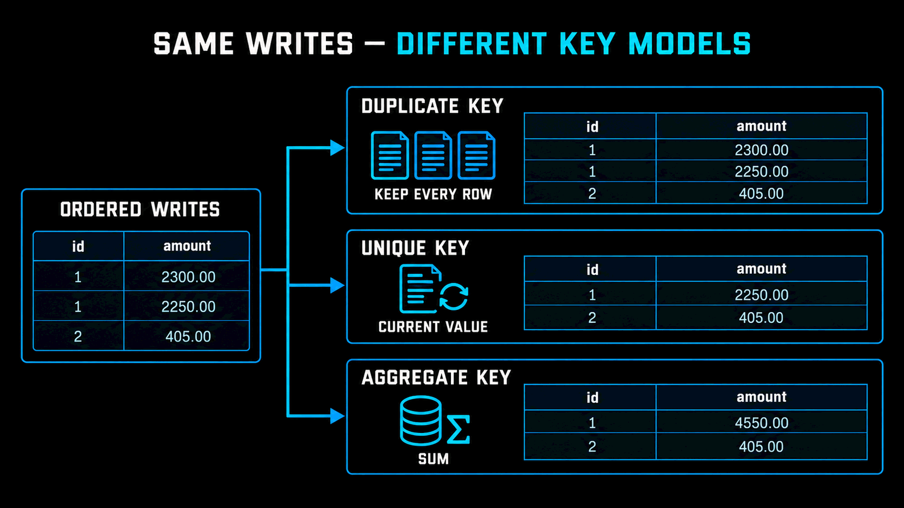
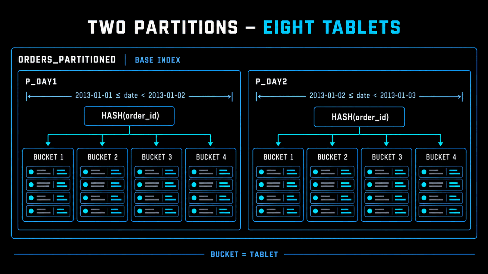
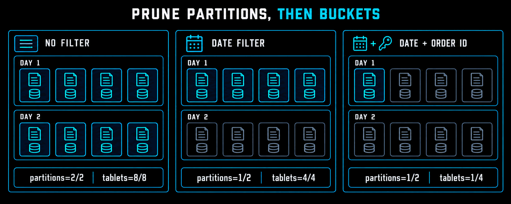

<a id="unit-u.cfc3e4c821ce4b259d57dd9b3088f6fa"></a>

<a id="module-3-doris-table-models-partitioning-and-bucketing"></a>

# 3-модуль: Doris кесте модельдері, бөлімдеу және бакеттерге бөлу

| Курс туралы ақпарат | Мәні |
| --- | --- |
| Курс | Apache Doris көмегімен деректер қоймасын құру · 1-деңгей |
| Doris | Apache Doris 4.1.3 |
| Орта | 1-модульдегі курстың сынақ ортасы |
| Болжалды уақыт | Шамамен 60 минут: оқу 25, зертханалық жұмыс 25, тест 10 |

[Курстың README файлы](../../README.md) · [3-зертханалық жұмысты ашу](lab03_models_and_pruning.ipynb) · [3-тестті ашу](quiz03_models_and_data_distribution.ipynb)
<a id="unit-u.4d79ad24f36841f188271a9fe830807d"></a>

<a id="module-goal"></a>

## Модуль мақсаты

Жазулар дұрыс бизнес нәтижесін сақтауы және сұраулар тек қажетті деректерді оқуы үшін кестенің бірдей кілтті жолдарға қалай қарайтынын және жолдарды қайда сақтайтынын таңдаңыз.
<a id="unit-u.338c76e120334ae88b93752f3f88a495"></a>

<a id="learning-objectives"></a>

## Оқу мақсаттары

Осы модульді аяқтағаннан кейін сіз:

1. Бірдей кірістің Duplicate, Unique және Aggregate Key модельдеріндегі нәтижесін болжайсыз.
2. Егжей-тегжейлі жазбалар, ағымдағы күй немесе қосылатын метрикалар үшін кілт моделін және кілт бағандарын таңдайсыз.
3. Бөлімдерді, бакеттерді, сұрыптау кілттерін және бизнестің бірегей кілттерін ажыратасыз.
4. EXPLAIN арқылы бөлімдерді оқудан алып тастауды бакеттерді оқудан алып тастаудан ажыратасыз.
5. Merge-on-Write Unique Key кестесі үшін не істейтінін түсіндіресіз.
6. Кішірек жоспарды өлшенген жылдамдаудан ажыратасыз.
<a id="unit-u.f889dd7bf53544be8781338ee71f4879"></a>

<a id="module-structure"></a>

## Модуль құрылымы

| Бөлім | Уақыт | Нәтиже |
| --- | ---: | --- |
| 3.1 Үш кілт моделі | 7 мин | Бірдей жазулар әр модельде не қалдырады |
| 3.2 Модельді жолдың мағынасына қарай таңдау | 4 мин | Егжей-тегжейлі деректер, ағымдағы күй және метрикалар кілттері |
| 3.3 Merge-on-Write | 3 мин | Unique Key кестесі тек соңғы жолды қалай сақтайды |
| 3.4 Бөлімдер, бакеттер және сұрыптау кілттері | 6 мин | Жолдар қайда сақталады және бұл неліктен бірегейлік емес |
| 3.5 Жоспарды оқу | 5 мин | Бөлімдер мен бакеттерді оқудан алып тастау және жоспар нені дәлелдемейді |
| 3-зертханалық жұмыс | 25 мин | Үш модельді және бөлімделген кестенің үш жоспарын салыстыру |
| 3-тест | 10 мин | Осы мақсаттарға арналған алты сұрақ |
<a id="unit-u.30e0ede26de34498a80bfa913890aa97"></a>

<a id="31-three-key-models"></a>

## 3.1 Үш кілт моделі

Кесте жасалғанда таңдалған кілт моделі бірдей кілтті жолдармен не болатынын анықтайды. Бастапқы кіріс кестесі әр кірісті, ағымдағы тапсырыс кестесі соңғы соманы сақтауы, ал сату қорытындысы метрикаларын қосуы керек: егжей-тегжейлі деректерді сақтау, кілт бойынша жаңарту және функция бойынша агрегаттау. Алдымен бір жол нені білдіретінін шешіп, содан кейін модельді таңдаңыз.

WWI 1-тапсырысының сомасы — 2300.00, ал 2-тапсырыстың сомасы — 405.00. Бөлек зертханалық кестелерде 1-тапсырысты 2250.00-ге түзетуді модельдеңіз: үш жолды осы ретпен жазып, әр жазудың аяқталуын күтіңіз:

| Жазу | id | amount | Мағынасы |
| --- | ---: | ---: | --- |
| 1 | 1 | 2300.00 | 1-тапсырыстың бастапқы сомасы |
| 2 | 1 | 2250.00 | 1-тапсырыстың түзетілген сомасы |
| 3 | 2 | 405.00 | 2-тапсырыстың сомасы |

**Duplicate Key әр жолды сақтайды.** Оның кілті сұрыптау ретін анықтайды; ол бірегейлік шектеуі емес.

| id | amount |
| ---: | ---: |
| 1 | 2250.00 |
| 1 | 2300.00 |
| 2 | 405.00 |

**Unique Key әр кілттің ағымдағы мәнін сақтайды.** Жолдар бірінен кейін бірі жазылса және Sequence бағаны болмаса, кейінгі жол сол кілттің алдыңғы жолын ауыстырады; 7-модуль ретсіз келетін оқиғалар үшін нұсқалар қосады.

| id | amount |
| ---: | ---: |
| 1 | 2250.00 |
| 2 | 405.00 |

**Aggregate Key мәндерді жарияланған функциямен біріктіреді**, мұнда `SUM`:

| id | amount |
| ---: | ---: |
| 1 | 4550.00 |
| 2 | 405.00 |

4550.00 — 2300.00 + 2250.00. Doris қосындыны дұрыс есептеді, бірақ бұл 1-тапсырыста ешқашан болмаған сома: бір соманың екі нұсқасы екі сату емес.



*Кілт моделі бірдей жазулардан қандай мағына сақталатынын анықтайды.*

Суреттегі жазулар: SAME WRITES – DIFFERENT KEY MODELS — бірдей жазулар, әртүрлі кілт модельдері; ORDERED WRITES — ретімен орындалған жазулар; DUPLICATE KEY — Duplicate Key; KEEP EVERY ROW — әр жолды сақтау; UNIQUE KEY — Unique Key; CURRENT VALUE — ағымдағы мән; AGGREGATE KEY — Aggregate Key; SUM — қосынды. id және amount — баған атаулары; суреттегі барлық сома жоғарыдағы модель нәтижелеріне сәйкес келеді.

3-зертханалық жұмыстан кейін әр нәтижені тексеріңіз:

```sql
SELECT id, amount FROM orders_duplicate ORDER BY id, amount;
SELECT id, amount FROM orders_unique ORDER BY id;
SELECT id, amount FROM orders_aggregate ORDER BY id;
```
<a id="unit-u.2fb851cad6564e5984b3ae19779adf1b"></a>

<a id="32-choose-a-model-by-what-a-row-means"></a>

## 3.2 Модельді жолдың мағынасына қарай таңдау

| Не сақталады | Оның идентификаторы | Осы курстағы модель |
| --- | --- | --- |
| Әр бастапқы жеткізілім | Жеткізілім идентификаторы | Duplicate Key әр жолды сақтайды |
| Тапсырыстың ағымдағы күйі | order_id | Unique Key, 7-модульде бизнес нұсқаларымен |
| Әр бөлек бизнес оқиғасы | event_id | Unique Key қайта жеткізілген оқиғаны бір рет сақтайды |
| Өлшемдер бойынша қосылатын метрикалар | Күн мен өнім сияқты тіркесім | Aggregate Key, SUM сияқты айқын функциямен |

Ағымдағы күй де, тарих та әртүрлі кілттермен Unique Key қолдана алады: `order_id` кілтімен сақталған тарих бір тапсырыстың әртүрлі оқиғаларын бірінің үстіне бірін жазар еді. Әр модельдің нақты ережелері дереккөздерде берілген.
<a id="unit-u.b888c0197c674960aca92ab7f1dc49c0"></a>

<a id="33-merge-on-write"></a>

## 3.3 Merge-on-Write

Unique Key кестесі бір кілттің ескі жолдары бұрынғы rowset-терде әлі бар болса да (2-модуль), сұрауға әр кілттің тек соңғы жолын беруі керек. **Merge-on-Write** (MoW) мұны жол жазылған кезде шешеді: Doris сол кілттің ескі жолын тауып, ауыстырылған деп белгілейді, сондықтан сұрау оқу кезінде біріктірмей, әр кілттің соңғы жолын оқиды. Doris 4.x нұсқасында жаңа Unique Key кестелері үшін бұл әдепкі тәсіл, ал 3-зертханалық жұмыс оны айқын орнатады:

```text
UNIQUE KEY(id)
"enable_unique_key_merge_on_write" = "true"
```

Белгіленген жолдар файлдардан бірден жойылмайды: оларды кейін compaction жояды. Merge-on-Write қай жол жеңетінін емес, біріктіру қашан орындалатынын өзгертеді: мұнда Sequence бағаны болмағандықтан, соңғы жазу жеңеді. 7-модуль оны қай жол жаңарақ екенін анықтайтын нұсқа бағанымен бірге тапсырыстың ағымдағы күйі үшін қолданады.
<a id="unit-u.cbf0bf05996944f5bfc3ebcc8d973a75"></a>

<a id="34-partitions-buckets-and-sort-keys"></a>

## 3.4 Бөлімдер, бакеттер және сұрыптау кілттері

Бірдей кілтті жолдарды қалай өңдеуді шешкеннен кейін оларды қайда сақтау керегін шешіңіз. Күндік тапсырыс есептері үшін күн бойынша бөлімдеңіз, сонда кешегі күннің сұрауы кешегі деректерді оқиды; содан кейін әр күнді тапсырыс ID-і бойынша бакеттерге бөліп, қатар сканерлеуге болатын бірнеше tablet-ке таратыңыз.

| Жобалау тәсілі | Жауап беретін сұрағы | 3-зертханалық жұмыстағы мысал |
| --- | --- | --- |
| Бөлімдеу | Қандай жолдар бір ауқымға жатады және сұрау қай ауқымдарды өткізіп жібере алады | order_date бойынша әр күнге бір бөлім |
| Бакеттерге бөлу | Бөлім жолдары tablet-терге қалай таралады | HASH(order_id), әр бөлімге төрт бакет |
| Сұрыптау кілті | Сақтауда жолдар қалай сұрыпталады | order_date, order_id |
| Бизнестің бірегей кілті | Бір бизнес нысанын не анықтайды | order_id бойынша тапсырыстың ағымдағы күйі |

Бөлімделген кесте — тарихи егжей-тегжейлі деректерді сақтайтын, күн мен тапсырыс ID-і бойынша сұрыпталған Duplicate Key кестесі. Ағымдағы тапсырыс кестесіне жеке бизнес кілті қажет: тапсырыс күні түзетілуі мүмкін болса, күн кіретін кілт түзетуге дейінгі және кейінгі тапсырысты екі тапсырыс деп қабылдар еді.

**Оқуға арналған SQL мысалы: 3-зертханалық жұмыс жасайтын кесте. Оны жұмыстан кейін қайта орындамаңыз.**
Зертханалық жұмыс оны жасап, қалпына келтіреді; орналасуын түсіну үшін алдымен оқыңыз:

<!-- reading-only-example -->
```sql
CREATE TABLE orders_partitioned (
    order_date DATE, order_id BIGINT, amount DECIMAL(18,2)
) DUPLICATE KEY(order_date, order_id)
PARTITION BY RANGE(order_date) (
    PARTITION p_day1 VALUES [('2013-01-01'), ('2013-01-02')),
    PARTITION p_day2 VALUES [('2013-01-02'), ('2013-01-03'))
)
DISTRIBUTED BY HASH(order_id) BUCKETS 4
PROPERTIES("replication_num"="1");
```

- `DUPLICATE KEY(order_date, order_id)` жолдарды күн мен тапсырыс ID-і бойынша сұрыптайды; ол тапсырыс ID-лерін бірегей етпейді.
- `PARTITION BY RANGE` күн бойынша бөлімдейді; әр ауқым сол жақ шетін қамтып, оң жақ шетін қамтымайды.
- `DISTRIBUTED BY HASH(order_id) BUCKETS 4` әр бөлімге тапсырыс ID-інің хэші бойынша төрт бакет береді: әр бөлімге төрт tablet, төрт BE емес.
- `replication_num=1` бір көшірме сақтайды; бұл өндіріс үшін емес, бір BE бар сынақ ортасына сай.

Сондықтан 2013-01-02 тапсырыстары `p_day2` бөліміне жатады, ал әр тапсырыс ID-інің хэші сол бөлімнің бір бакетін таңдайды. Кестеде тек өзінің деректері, яғни **негізгі индексі** бар; қосымша tablet-терде басқа көшірме сақтайтын rollup не синхронды материалданған көрініс жоқ:



*Әрқайсысында төрт бакет бар екі бөлім сегіз tablet жасайды.*

Суреттегі жазулар: TWO PARTITIONS – EIGHT TABLETS — екі бөлім, сегіз tablet; ORDERS_PARTITIONED — orders_partitioned кестесі; BASE INDEX — негізгі индекс; P_DAY1, P_DAY2 — p_day1, p_day2 бөлімдері; HASH(order_id) — order_id хэші; BUCKET 1, BUCKET 2, BUCKET 3, BUCKET 4 — 1, 2, 3, 4-бакеттер; BUCKET = TABLET — бакет = tablet. Күн ауқымдары: 2013-01-01 ≤ date < 2013-01-02 және 2013-01-02 ≤ date < 2013-01-03, яғни сол шеті кіреді, оң шеті кірмейді.

Көбірек бакет қатар сканерлеуге көбірек шард және басқаруға көбірек tablet береді: санын дерек көлеміне қарай таңдаңыз. [Бөлімдеу және бакеттерге бөлу](https://doris.apache.org/docs/4.x/table-design/data-partitioning/basic-concepts/) бөлімін қараңыз.
<a id="unit-u.0c1b5e89d60649318bf4bc9edece770e"></a>

<a id="35-read-the-plan"></a>

## 3.5 Жоспарды оқу

Хэш-бакет бакеттерге бөлу бағанының мәнінен есептеледі, сондықтан бір бөлімде бірдей тапсырыс идентификаторы әрқашан бір бакетке түседі. Демек, күнді де, тапсырыс идентификаторын да бекітетін сұрау бір бөлімді және оның ішіндегі бір бакетті оқи алады. 3-зертханалық жұмыс үш жоспарды салыстырады:

```sql
EXPLAIN SELECT * FROM orders_partitioned;
EXPLAIN SELECT * FROM orders_partitioned WHERE order_date = '2013-01-01';
EXPLAIN SELECT * FROM orders_partitioned
WHERE order_date = '2013-01-01' AND order_id = 1;
```

| Сұрау | `partitions=` | `tablets=` | Себебі |
| --- | --- | --- | --- |
| Сүзгісіз | 2/2 | 8/8 | Ешбір шарт күнді не тапсырысты алып тастамайды |
| Күн | 1/2 | 4/4 | Екінші күн сәйкес келмейді: **бөлімдерді оқудан алып тастау** |
| Күн және тапсырыс ID-і | 1/2 | 1/4 | 1-тапсырыс тек бір бакетте болуы мүмкін: **бакеттерді оқудан алып тастау** |

`VOlapScanNode` сканерлеу түйінінде `tablets=` қалған бөлімдердің tablet-терін санайды, сондықтан бөлшектің бөліміндегі сан 8-ден 4-ке түседі. Өріс атаулары нұсқалар арасында өзгеруі мүмкін; сканерлеу түйінін және осы екі жолды іздеңіз.



*Күн бойынша алып тастау бөлімді таңдайды; хэш теңдігі оның tablet-терін тарылтады.*

Суреттегі жазулар: PRUNE PARTITIONS, THEN BUCKETS — алдымен бөлімдерді, содан кейін бакеттерді оқудан алып тастау; NO FILTER — сүзгісіз; DATE FILTER — күн сүзгісі; DATE + ORDER ID — күн + тапсырыс ID-і; DAY 1, DAY 2 — 1-күн, 2-күн. partitions=2/2 және tablets=8/8 барлық деректерді, partitions=1/2 және tablets=4/4 бір күнді, partitions=1/2 және tablets=1/4 сол күннің бір бакетін оқуды білдіреді.
<a id="unit-u.d761b94f0a004411a2dbbe6b27157202"></a>

<a id="pruning-must-not-change-the-answer-and-is-not-yet-a-speedup"></a>

### Артық деректерді оқудан алып тастау жауапты өзгертпеуі керек және әлі жылдамдау емес

```sql
SELECT COUNT(*) AS sample_orders, SUM(amount) AS order_amount
FROM orders_partitioned
WHERE order_date = '2013-01-01';
```

Күн сүзгісі бес тапсырыс және 3944.20 қайтарады. `order_id = 1` қосу жауапты бір тапсырысқа және оның бастапқы 2300.00 сомасына тарылтады; бөлек кестелер қолданылған модель тәжірибесіндегі 2250.00 сомасына емес. Артық деректерді оқудан алып тастау бірдей SQL предикаттарының жауабын сақтауы керек; бизнес сүзгісін қосу жауапты өзгерте алады.

Tablet-тердің төрттен бірін оқитын жоспар міндетті түрде төрт есе жылдам орындалмайды: уақыт әр tablet-тегі дерек көлеміне, кэштеуге және тұрақты шығындарға да байланысты, ал он тапсырыста үш сұраудың уақыты шамамен бірдей. Кішірек жоспар азырақ жұмыс күтуге негіз береді; жылдамдау бірдей деректер мен машинада өлшенеді, ал 2-модульдің Query Profile есебі әр сканерлеудің не оқығанын көрсетеді.
<a id="unit-u.d7866b02a4ae4c87a48c38ab81f0dc5e"></a>

<a id="lab-3-model-semantics-partitioning-and-bucketing"></a>

## 3-зертханалық жұмыс: модель семантикасы, бөлімдеу және бакеттерге бөлу

[3-зертханалық жұмыс: модель семантикасы, бөлімдеу және бакеттерге бөлу](lab03_models_and_pruning.ipynb) файлын ашыңыз. Сіз:

1. Бірдей үш жолды Duplicate, Unique және Aggregate Key кестелеріне жазып, әрқайсысы не сақтайтынын салыстырасыз.
2. Бөлімделген кестені жасап, сүзгісіз сұрау, күн сүзгісі және күн мен тапсырыс ID-і бар сұрау жоспарларын салыстырасыз.
3. Жаттығу: «1-тапсырыстың қазіргі сомасы қандай?» сұрағына қай модель жауап беретінін анықтап, содан кейін екі тапсырыстың ағымдағы сомалары үшін модель таңдайсыз.

1-модульдегі курстың сынақ ортасы қажет. Таңдау бойынша [пакеттер, бөлімдер және Profile туралы кеңейтілген зертханалық жұмыс](../extensions/extension23_physical_design.ipynb) сол жобалау тәсілдерін 100,000 жолда салыстырады.
<a id="unit-u.613a47212bbb4635b221cc048a9ce0bc"></a>

<a id="summary"></a>

## Қорытынды

- Бірдей үш жазудан Duplicate Key үш жолды, Unique Key әр кілттің ағымдағы мәнін, ал SUM қолданатын Aggregate Key 1-тапсырыс үшін 4550.00 сақтайды; бұл тапсырыста ешқашан болмаған сома.
- Модельді таңдамас бұрын бір жол нені білдіретінін шешіңіз: ағымдағы күй үшін order_id, бөлек оқиғалар үшін event_id, қосылатын метрикалар үшін өлшемдер тіркесімі.
- Бөлімдер жолдарды ауқымдарға бөледі, бакеттер бөлімді tablet-терге таратады, сұрыптау кілті жолдардың ретін анықтайды; бұлардың ешқайсысы бизнес кілтін бірегей етпейді.
- EXPLAIN ішінде күн сүзгісі `partitions=` мәнін 1/2-ге, ал бакеттерге бөлу бағанындағы теңдік сүзгісі `tablets=` мәнін 1/4-ке азайтады.
- Merge-on-Write жаңа жол жазылған кезде сол кілттің ескі жолын ауыстырылған деп белгілейді, сондықтан сұраулар тек соңғы жолды оқиды.
- Аз tablet оқитын жоспар өлшенген жылдамдауды емес, азырақ жұмысты болжайды: алдымен нәтижені тексеріп, содан кейін бірдей деректер мен машинада өлшеңіз.
<a id="unit-u.59050995601947d08054c5f8a8ef73d7"></a>

<a id="quiz-3"></a>

## 3-тест

[3-тест: Doris кесте модельдері, бөлімдеу және бакеттерге бөлу](quiz03_models_and_data_distribution.ipynb) файлын ашыңыз. Онда бір дұрыс жауабы бар алты сұрақ бар және іске қосылған орта қажет емес.

Келесі модуль: [4-модуль: сыртқы деректерді сұрау және деректер көлі кестелерін біріктіру](../module04-external-access/course.md).
<a id="unit-u.d6ffe4f50bdc414fa442f4bad036923e"></a>

<a id="references"></a>

## Дереккөздер

- [Apache Doris: Duplicate Key моделі](https://doris.apache.org/docs/4.x/table-design/data-model/duplicate/)
- [Apache Doris: Unique Key моделі](https://doris.apache.org/docs/4.x/table-design/data-model/unique/)
- [Apache Doris: Aggregate Key моделі](https://doris.apache.org/docs/4.x/table-design/data-model/aggregate/)
- [Apache Doris: Бөлімдеу және бакеттерге бөлу негіздері](https://doris.apache.org/docs/4.x/table-design/data-partitioning/basic-concepts/)
- [Apache Doris: Деректерді бакеттерге бөлу](https://doris.apache.org/docs/4.x/table-design/data-partitioning/data-bucketing/)
- [Apache Doris: EXPLAIN](https://doris.apache.org/docs/4.x/sql-manual/sql-statements/data-query/EXPLAIN/)
