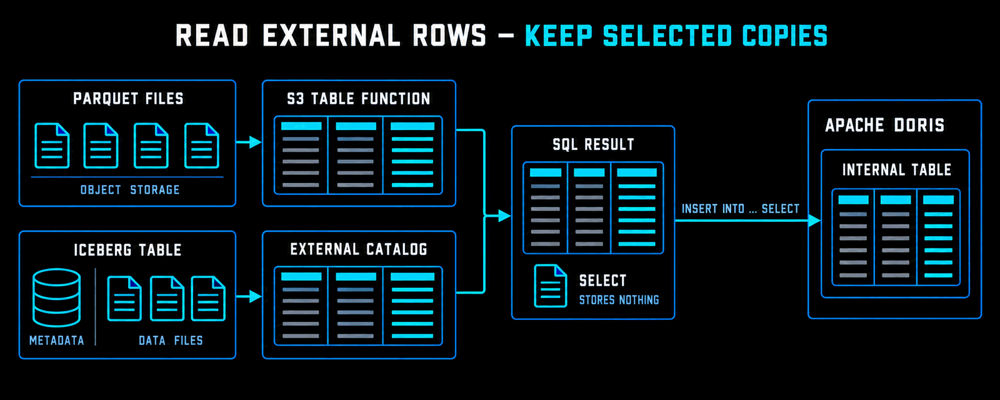
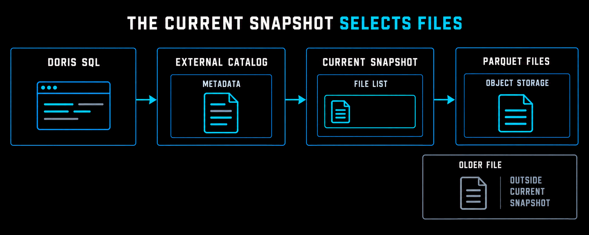
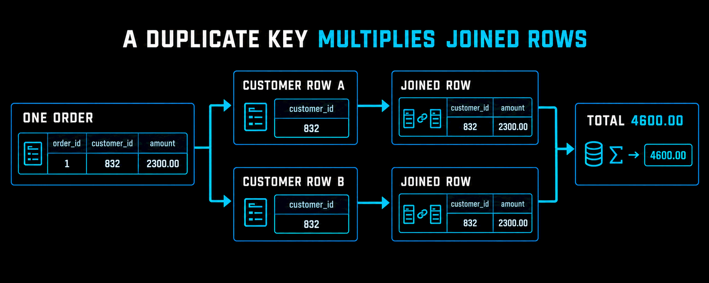

<a id="unit-u.e9b38596711b45a4a49a8c54e8bc245f"></a>

<a id="module-4-querying-external-data-and-joining-lake-tables"></a>

# 4-модуль: сыртқы деректерді сұрау және деректер көлі кестелерін біріктіру

| Курс туралы ақпарат | Мәні |
| --- | --- |
| Курс | Apache Doris көмегімен деректер қоймасын құру · 1-деңгей |
| Doris | Apache Doris 4.1.3 |
| Орта | 1-модульдегі курстың сынақ ортасы және 4-зертханалық жұмыс іске қосатын жергілікті деректер көлі ортасы |
| Болжалды уақыт | Шамамен 65 минут: оқу 25, зертханалық жұмыс 30, тест 10 |

[Курстың README файлы](../../README.md) · [4-зертханалық жұмысты ашу](lab04_query_iceberg.ipynb) · [4-тестті ашу](quiz04_internal_files_and_lake_tables.ipynb)
<a id="unit-u.c4bba1fa38974991b08f4d311b562bc1"></a>

<a id="module-goal"></a>

## Модуль мақсаты

Деректерді қазіргі орналасқан жерінде — объектілік сақтаудағы Iceberg кестесі мен оның файлдарында — сұраңыз, Doris кестелерімен біріктіріңіз және қашан оның орнына Doris-ке жүктеу керегін шешіңіз.
<a id="unit-u.b364a694ccfa4a5a8083b81b9c337abb"></a>

<a id="learning-objectives"></a>

## Оқу мақсаттары

Осы модульді аяқтағаннан кейін сіз:

1. Doris ішкі кестелерін, Parquet файлдарын, Iceberg кестелерін және External Catalog-тарды ажыратасыз.
2. Деректер көлі кестесін Catalog арқылы тауып, catalog.database.table түрінде атайсыз.
3. Iceberg кестесінің snapshot-тары мен файлдарын оқып, кесте сұрауы қай файлдарды оқитынын түсіндіресіз.
4. Сыртқы деректерді орнында сұрау мен ішкі кестеге жүктеудің бірін таңдайсыз.
5. Объектілік сақтаудағы файлдарды S3 кестелік функциясымен оқып, INSERT INTO SELECT арқылы жүктейсіз.
6. Біріктіруге дейінгі және кейінгі нәтижелерді салыстырып, өлшем кестесіндегі қайталанған не жетіспейтін жолдарды табасыз.
<a id="unit-u.6e836f75636e4c24a8e41dbbc5481b28"></a>

<a id="module-structure"></a>

## Модуль құрылымы

| Бөлім | Уақыт | Нәтиже |
| --- | ---: | --- |
| 4.1 Файлдар, кестелер және Catalog-тар | 5 мин | Төрт нысанның әрқайсысы не екені |
| 4.2 Catalog-қа қосылу және кестені табу | 6 мин | CREATE CATALOG, оның екі мекенжайы және catalog.database.table |
| 4.3 Snapshot-тар және деректер файлдары | 4 мин | Iceberg кестесінің сұрауы қай файлдарды оқиды |
| 4.4 Орнында сұрау немесе жүктеу | 3 мин | Әрқайсысы қашан жарайды және жүктеу нені істемейді |
| 4.5 Кестесі жоқ файлдар: S3 кестелік функциясы | 3 мин | Бекітілген файлдар жиынын оқу және жолдарын сақтау |
| 4.6 Біріктіруді тексеру | 4 мин | Өлшемдегі қайталанған және жетіспейтін жолдар |
| 4-зертханалық жұмыс | 30 мин | Catalog арқылы өту, snapshot-тар мен файлдарды оқу, біріктіру және екі тәсілмен жүктеу |
| 4-тест | 10 мин | Осы мақсаттарға арналған алты сұрақ |
<a id="unit-u.48225ec38d734d278c0e600293595228"></a>

<a id="41-files-tables-and-catalogs"></a>

## 4.1 Файлдар, кестелер және Catalog-тар

Тарихи тапсырыстар деректер көлінде, ал тұтынушылар Doris-те орналасқан делік. Талдаушылар бүкіл тарихты алдымен Doris-ке көшірмей, бірге сұрағысы келеді. Нысандардың төрт түрі қатысады:

| Нысан | Не екені | Басқаларымен байланысы |
| --- | --- | --- |
| Doris ішкі кестесі | Анықтамасы мен деректерін Doris сақтап, басқаратын кесте | Жүктеу осыған жазады |
| Parquet файлы | Бағандық деректер файлы | Жеке оқылады немесе деректер көлі кестесінің бір файлы болады |
| Iceberg кестесі | Метадеректер, snapshot-тар және олар тізетін деректер файлдары | Метадеректері сұрау қай файлдарды оқитынын анықтайды |
| External Catalog | Doris-тің басқа жүйе метадеректері мен кестелеріне кіретін нүктесі | Сыртқы кестелерді Doris SQL арқылы сұрауға мүмкіндік береді |

Parquet бір файлдағы бағандар мен жолдарды сипаттайды; Iceberg көп файлды өзгере алатын бір кестеге айналдырады. Сондықтан Iceberg кестесін сұрау үшін метадеректері де, файлдары да қажет.



*Сыртқы SQL орнында оқиды; INSERT қайтарылған жолдарды сақтайды.*

Суреттегі жазулар: READ EXTERNAL ROWS – KEEP SELECTED COPIES — сыртқы жолдарды оқу, таңдалған көшірмелерді сақтау; PARQUET FILES — Parquet файлдары; OBJECT STORAGE — объектілік сақтау; S3 TABLE FUNCTION — S3 кестелік функциясы; ICEBERG TABLE — Iceberg кестесі; METADATA — метадеректер; DATA FILES — деректер файлдары; EXTERNAL CATALOG — сыртқы Catalog; SQL RESULT — SQL нәтижесі; SELECT STORES NOTHING — SELECT ештеңе сақтамайды; INSERT INTO ... SELECT — жолдарды енгізу операторы; APACHE DORIS — Apache Doris; INTERNAL TABLE — ішкі кесте.
<a id="unit-u.e3973b6c5ecc421688123e1922c8a730"></a>

<a id="42-connect-a-catalog-and-find-a-table"></a>

## 4.2 Catalog-қа қосылу және кестені табу

External Catalog Doris-ке басқа жүйенің кестелері қайда екенін хабарлайды. REST catalog қызметі бар Iceberg үшін екі түрлі мекенжай қажет: кестелерді, snapshot-тар мен файлдар тізімдерін табуға арналған метадеректер қызметі және файлдарды оқуға арналған объектілік сақтау. 4-зертханалық жұмыстың дайындық ұяшығы курс мекенжайларымен Catalog жасап, орындаған операторын көрсетеді; оны көшіре аласыз.

**Сыртқы орта мысалы; оны зертханалық жұмыспен қатар орындамаңыз.** Бұл — өз қызметтеріңіздің орнына толтырылатын мәндері бар сол оператор. Зертханалық жұмыс өз Catalog-ын зертханалық дерекқордың атымен атап, сол арқылы сұрайды; бір кестелерге екінші Catalog жасамаңыз, әйтпесе атаулар араласып кетеді.

<!-- external-service-example -->
```sql
CREATE CATALOG <catalog_name> PROPERTIES (
    "type"="iceberg", "iceberg.catalog.type"="rest",
    "iceberg.rest.uri"="<rest_service_url>",
    "warehouse"="s3://<warehouse_bucket>/",
    "s3.endpoint"="<object_storage_url>", "s3.region"="us-east-1",
    "s3.access_key"="<access_key>", "s3.secret_key"="<secret_key>",
    "use_path_style"="true", "iceberg.rest.view-enabled"="false"
);
```

| Қасиет | Осы курстағы мақсаты |
| --- | --- |
| type, iceberg.catalog.type | REST метадеректер қызметі бар Iceberg кесте пішімі |
| iceberg.rest.uri | Doris кестелерді, snapshot-тар мен файлдар тізімдерін қайдан табады |
| warehouse | Кесте файлдарының объектілік сақтаудағы орны; REST қызметінің параметріне сәйкес келуі керек |
| s3.endpoint, s3.region, keys | BE түйіндеріне файлдарды оқуға мүмкіндік береді |
| use_path_style | Бакет атауын URL жолына қояды, мұны курстың Silo қызметі күтеді |
| iceberg.rest.view-enabled | Курста қолданылмайтын Iceberg көріністерін өшіреді |

Курстың Docker желісінде қызметтер — `http://course-lake-rest:8181` және `http://course-lake-silo:9000`: бұлар ноутбук машинасының localhost мекенжайлары емес, Doris шешетін атаулар. Объектілік сақтау — Pigsty жобасы қолдайтын MinIO серверінің ашық бастапқы кодты тармағы [Silo](https://github.com/pgsty/silo); ол S3 API қолданады, сондықтан Doris оған Amazon S3 үшін қолданылатын қасиеттермен қатынайды. Курста Silo қолданылуының себебі — MinIO енді қауымдастық контейнер бейнелерін жарияламайды. Doris кесте анықтамасын тауып, жолдарын оқи алмаса, екі мекенжайды бөлек тексеріңіз. Нақты тіркелгі деректерін жазбаларда не ноутбуктерде емес, тек ортада қолданыңыз. [Iceberg Catalog](https://doris.apache.org/docs/4.x/lakehouse/catalogs/iceberg-catalog/) бөлімін қараңыз.
<a id="unit-u.a660b170e6754441b84d5c5ae2ee39df"></a>

<a id="catalogdatabasetable"></a>

### catalog.database.table

Doris-тің өз кестелері `internal` Catalog-ында. Басқа Catalog кестесінің үш бөлікті `catalog.database.table` атауы бар: мысалы `wwi_lake.sales.orders`, мұнда `wwi_lake` — Doris ішіндегі Catalog, `sales` — сыртқы дерекқор, `orders` — деректер көлі кестесі. Бұл файл жолы емес, атау. `SHOW CATALOGS`, `SHOW DATABASES FROM <catalog>` және `SHOW TABLES FROM <catalog>.<database>` үш бөлікпен төмен өтеді, ал `SHOW CREATE TABLE` деректер көлі кестесінің түрі мен орнын көрсетеді: `ENGINE=ICEBERG_EXTERNAL_TABLE` және объектілік сақтаудағы `LOCATION`.

```sql
SELECT order_date, COUNT(*) AS sample_orders, SUM(order_amount) AS amount
FROM wwi_lake.sales.orders
GROUP BY order_date
ORDER BY order_date;
```

Курстың он тапсырысында бірінші күні бес тапсырыс және 3944.20, екінші күні бес тапсырыс және 8276.40 күтіледі. Сұрау деректер көлі кестесін оқиды; Doris-те ештеңе сақталмайды. Жұмыс кестенің толық атауын `source` айнымалысында сақтайды.
<a id="unit-u.8e086ab6a3274a0ab6f2122f48c0ae0a"></a>

<a id="43-snapshots-and-data-files"></a>

## 4.3 Snapshot-тар және деректер файлдары

Iceberg кестесіне әр бекіту, мысалы `INSERT`, жаңа деректер файлдарын және жаңа **snapshot**, яғни сол сәттегі кестені құрайтын файлдар тізімін жазады. Кесте сұрауы оның ағымдағы snapshot-ының файлдарын оқиды. Doris Iceberg метадеректерін атауы кесте атауына жұрнақ қосу арқылы жасалған кестелер ретінде көрсетеді:



*Iceberg метадеректері кестенің ағымдағы snapshot файлдарын таңдайды.*

Суреттегі жазулар: THE CURRENT SNAPSHOT SELECTS FILES — ағымдағы snapshot файлдарды таңдайды; DORIS SQL — Doris SQL; EXTERNAL CATALOG — сыртқы Catalog; METADATA — метадеректер; CURRENT SNAPSHOT — ағымдағы snapshot; FILE LIST — файлдар тізімі; PARQUET FILES — Parquet файлдары; OBJECT STORAGE — объектілік сақтау; OLDER FILE — ескі файл; OUTSIDE CURRENT SNAPSHOT — ағымдағы snapshot-қа кірмейді.

| Метадеректер кестесі | Нені тізеді |
| --- | --- |
| `<table>$snapshots` | Әр snapshot: уақыты, ата-анасы және `append` сияқты операциясы |
| `<table>$files` | Ағымдағы snapshot деректер файлдары, пішімі және жазбалар санымен |
| `<table>$history` | Қай snapshot қашан ағымдағы болғаны |

Курста **деректер көлі кестесіне Doris жазады**: 4-зертханалық жұмыстың дайындығы он тапсырысты енгізіп, бір `append` snapshot-ын және бір Parquet файлын жасайды. Нақты деректер көлінде кестелерді әдетте Spark не Flink сияқты басқа қозғалтқыштар жазады, ал Doris оларды дәл сондай Catalog арқылы оқиды. Iceberg кестесін сканерлеуді жоспарлағанда Doris сүзгілерді Iceberg-ке де береді; Iceberg баған статистикасы сәйкес келмейтінін көрсететін файлдарды өткізіп жібере алады: жоспарда олар `icebergPredicatePushdown` ретінде көрсетіледі.
<a id="unit-u.8431d07f917e4dabb6c38632f838e1c5"></a>

<a id="44-query-in-place-or-load"></a>

## 4.4 Орнында сұрау немесе жүктеу

| Жағдай | Алғашқы таңдау | Нені ескеру керек |
| --- | --- | --- |
| Тарихты алғаш зерттеу | Catalog арқылы орнында сұрау | Сыртқы қызметтердің қолжетімділігі, желі, рұқсаттар |
| Көл тарихын Doris тұтынушыларымен біріктіру | Catalog-тар арасындағы сұрау | Біріктіру кілттері бірегей ме және жетіспейтін тұтынушылар бар ма |
| Бір snapshot-ты қайта-қайта сұрау | Ішкі кестеге жүктеу | Жаңарту жиілігі, сақтау және өзгерістерді қолдану тәсілі |
| Кестесі жоқ бекітілген файлдар жиыны | S3 кестелік функциясы (4.5) | Файл пішімі, бағандары және қатынау |

Орнында сұрау — деректер қайда қалатынын таңдау, әр сыртқы сұрау жылдам болады деген уәде емес. `INSERT INTO ... SELECT` арқылы жүктеу бір сұрау қайтарған жолдарды сақтайды: бұл сол сәттің көшірмесі, қайта жүктемесеңіз, көлдегі кейінгі өзгерістерге ілеспейді.
<a id="unit-u.416b39f1380b4e4592b63f1324b0d606"></a>

<a id="45-files-without-a-table-the-s3-table-function"></a>

## 4.5 Кестесі жоқ файлдар: S3 кестелік функциясы

**Кестелік функция** кесте сияқты жолдар қайтарады. `S3(...)` S3-үйлесімді объектілік сақтаудағы файлдарды оқиды: ол бір файлдың не `*` арқылы бірнеше файлдың жолын, пішімін, сақтау мекенжайы мен кілттерін алып, дәл сол файлдарды оқиды. `DESC FUNCTION S3(...)` Parquet файлынан табылған бағандарды көрсетеді. Жеке `SELECT` ештеңе сақтамайды; `INSERT INTO <table> SELECT ... FROM S3(...)` сол операторда жолдарды ішкі кестеге жазады.

4-зертханалық жұмыс функцияны `$files` тізіміндегі деректер көлі кестесінің өз деректер файлына бағыттап, оны `orders_from_file` ішіне жүктейді. Функция Iceberg snapshot-тарын оқымайды: кесте кейін жаңа snapshot-та жолдарды жойса, ескі файлда олар әлі болар еді, ал Catalog арқылы сұрау тек ағымдағы snapshot файлдарын оқиды. Бекітілген файлдар жиыны үшін функцияны, кесте үшін Catalog қолданыңыз. 5-модуль оны Broker Load-пен салыстырады. [S3 кестелік функциясы](https://doris.apache.org/docs/4.x/sql-manual/sql-functions/table-valued-functions/s3/) бөлімін қараңыз.
<a id="unit-u.41d8c029ffca4e2996b4decfb38402e1"></a>

<a id="46-check-a-join"></a>

## 4.6 Біріктіруді тексеру

Өлшем кестесінде бір тұтынушының екі жолы болса, сомасы 100.00 болатын тапсырыс екі рет біріктіріліп, қосындысы 200.00 болады: дұрыс біріктіру қате сома беруі мүмкін. Өлшемде тұтынушы болмауы тапсырысты ішкі біріктіруден жоғалтады.



*Қайталанған өлшем кілті сәйкес тапсырыс сомасын екі еселейді.*

Суреттегі жазулар: A DUPLICATE KEY MULTIPLIES JOINED ROWS — қайталанған кілт біріктірілген жолдарды көбейтеді; ONE ORDER — бір тапсырыс; CUSTOMER ROW A, CUSTOMER ROW B — тұтынушының A және B жолдары; JOINED ROW — біріктірілген жол; TOTAL 4600.00 — барлығы 4600.00. order_id, customer_id, amount — баған атаулары. Суретте 1-тапсырыстың customer_id=832 және amount=2300.00 мәндері екі сәйкестік арқылы екі рет қосылады.

4-зертханалық жұмыстың тұтынушы кестесі Unique Key кестесі болғандықтан, әр тапсырыс ең көбі бір тұтынушыға сәйкес келеді. Біріктіруге дейінгі және кейінгі жолдар саны мен сомаларды тексеріп, жүктелген кестелерді әр өріс бойынша салыстырыңыз.

`LEFT JOIN` сол жақтағы әр тапсырысты сақтайды, сәйкес тұтынушы болмаса, тұтынушы өрістері `NULL` болады; `INNER JOIN` тек сәйкес келген тапсырыстарды сақтайды. Барлық тапсырыстарды салыстырып тексеру үшін `LEFT JOIN` қолданып, жетіспейтін тұтынушыларды санаңыз, сонда біріктіруден кейінгі аз жолды аз тапсырыс деп қате түсінбейсіз. 4-зертханалық жұмыстан кейін зертханалық дерекқорда:

```sql
SELECT COUNT(*) AS missing_customers
FROM orders_from_lake o
LEFT JOIN customers_sample c ON o.customer_id = c.customer_id
WHERE c.customer_id IS NULL;
```

0 күтіледі; әйтпесе жалпы сомаға сенбес бұрын тұтынушы кілттерін және деректердің қамту аясын тексеріңіз. Жүктегеннен кейін ішкі кесте деректер көлі кестесінің нәтижесін беруі керек:

```sql
SELECT order_date, COUNT(*) AS sample_orders, SUM(order_amount) AS amount
FROM orders_from_lake
GROUP BY order_date
ORDER BY order_date;
```
<a id="unit-u.3f6b5fc4349147769602f4d768f36cb3"></a>

<a id="lab-4-query-an-iceberg-table-and-its-files"></a>

## 4-зертханалық жұмыс: Iceberg кестесі мен оның файлдарын сұрау

[4-зертханалық жұмыс: Iceberg кестесі мен оның файлдарын сұрау](lab04_query_iceberg.ipynb) файлын ашыңыз. Сіз:

1. Деректер көлі қызметтерін іске қосып, Catalog жасайсыз және дайындық орындаған SQL-ді оқисыз.
2. `SHOW CATALOGS`, `SHOW DATABASES FROM` және `SHOW CREATE TABLE` арқылы кестені тауып, оның `$snapshots` және `$files` кестелерін оқисыз.
3. Деректер көліндегі он тапсырысты сұрап, `customers_sample` кестесімен біріктіресіз және `orders_from_lake` ішіне жүктейсіз.
4. Кестенің деректер файлын S3 кестелік функциясымен оқып, `orders_from_file` ішіне жүктейсіз.
5. Жаттығу: жетіспейтін тұтынушыларды санай отырып екінші күн тапсырыстарын, деректер көлі мен ішкі кесте жоспарларын қарайсыз.

1-модульдегі курстың сынақ ортасы қажет. Жұмыс Silo мен Iceberg REST Catalog қызметтерін 127.0.0.1:51900 және 51818 порттарында іске қосады; алғаш іске қосқанда олардың бейнелері жүктеледі. Курстың README файлындағы [Орта](../../README.md#environment) бөлімінде порттар мен айнымалылар, [Тазалау](../../README.md#clean-up) бөлімінде деректер көлін тоқтату және жою тәсілі берілген. Үлгі — WWI деректерінің MIT лицензиясымен берілген 1-модульдің он тапсырысы.
<a id="unit-u.ac4ed66bf66e446c9033f71e341d936d"></a>

<a id="summary"></a>

## Қорытынды

- Parquet файлы — бағандық деректер, Iceberg кестесі — сондай файлдар үстіндегі метадеректер мен snapshot-тар, External Catalog — Doris-тің басқа жүйе кестелеріне кіретін нүктесі; бұлардың ешқайсысы деректерді Doris-ке көшірмейді.
- Catalog-қа метадеректер қызметі мен объектілік сақтау мекенжайлары қажет; `SHOW CATALOGS`, `SHOW DATABASES FROM` және `SHOW TABLES FROM` арқылы `catalog.database.table` атауына жетесіз.
- Iceberg кестесінің сұрауы ағымдағы snapshot файлдарын оқиды; `$snapshots` және `$files` оларды көрсетеді.
- Зерттеу және біріктіру үшін орнында сұраңыз; қайталанатын талдау үшін ішкі кестеге жүктеңіз, бірақ көшірме кейінгі өзгерістерге ілеспейтінін ескеріңіз.
- S3 кестелік функциясы кез келген кесте snapshot-тарын елемей, дәл берілген файлдарды оқиды, ал `INSERT INTO ... SELECT` оның жолдарын Doris-те сақтайды.
- Қайталанған өлшем кілті біріктірілген жолдарды көбейтеді, ал жетіспейтін кілт ішкі біріктіруде оларды алып тастайды: дейінгі және кейінгі жолдар мен сомаларды санап, жетіспейтін сәйкестіктерді `LEFT JOIN` арқылы есептеңіз.
<a id="unit-u.b8f71b62c75f41b8a0bd76ebdc188187"></a>

<a id="quiz-4"></a>

## 4-тест

[4-тест: сыртқы деректерді сұрау және деректер көлі кестелерін біріктіру](quiz04_internal_files_and_lake_tables.ipynb) файлын ашыңыз. Онда бір дұрыс жауабы бар алты сұрақ бар және іске қосылған орта қажет емес.

Келесі модуль: [5-модуль: деректерді пакеттік және үздіксіз жүктеу](../module05-ingestion/course.md).
<a id="unit-u.0fe75b889ec3491eb9dae0da7506e1f0"></a>

<a id="references"></a>

## Дереккөздер

- [Apache Doris: Catalog шолуы](https://doris.apache.org/docs/4.x/lakehouse/catalog-overview/)
- [Apache Doris: Iceberg Catalog](https://doris.apache.org/docs/4.x/lakehouse/catalogs/iceberg-catalog/)
- [Apache Doris: S3 кестелік функциясы](https://doris.apache.org/docs/4.x/sql-manual/sql-functions/table-valued-functions/s3/)
- [Apache Doris: INSERT INTO SELECT](https://doris.apache.org/docs/4.x/data-operate/import/import-way/insert-into-manual/)
