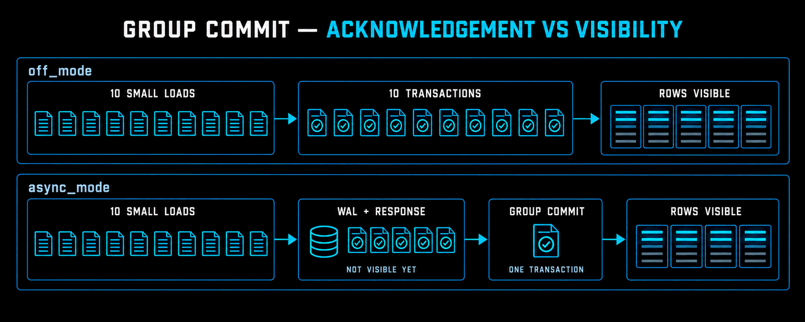
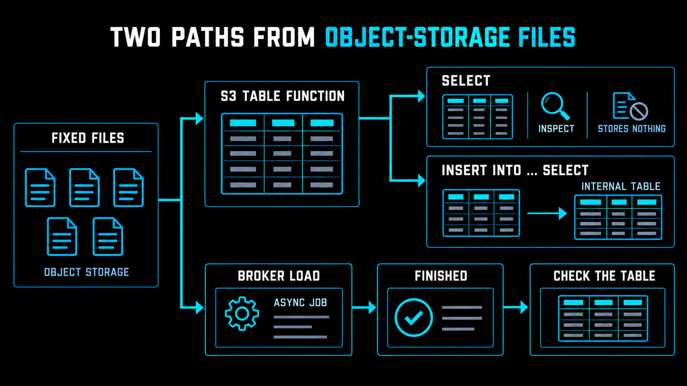
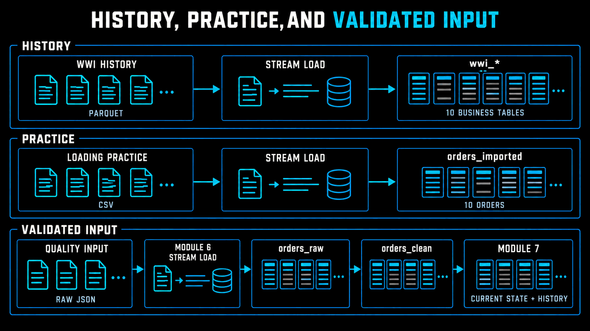

<a id="unit-u.f9e141df745042eba49ebc67164062ab"></a>

<a id="module-5-batch-and-continuous-data-ingestion"></a>

# 5-модуль: деректерді пакеттік және үздіксіз жүктеу

| Курс туралы ақпарат | Мәні |
| --- | --- |
| Курс | Apache Doris көмегімен деректер қоймасын құру · 1-деңгей |
| Doris | Apache Doris 4.1.3 |
| Орта | 1-модульдегі курстың сынақ ортасы |
| Болжалды уақыт | Шамамен 90 минут: оқу 35, зертханалық жұмыс 45, тест 10 |

[Курстың README файлы](../../README.md) · [5-зертханалық жұмысты ашу](lab05_stream_load.ipynb) · [5-тестті ашу](quiz05_load_methods_and_retry_safety.ipynb)
<a id="unit-u.a0c478ec657646d4af45fb3aa687fa00"></a>

<a id="module-goal"></a>

## Модуль мақсаты

Файлдарды Doris-ке пакетпен жүктеңіз, әр жүктеу хабарлағанын істегенін тексеріңіз және ештеңені екі рет жүктемей қайта әрекет жасаңыз.
<a id="unit-u.d3de49f854dd40008bb025def01859ce"></a>

<a id="learning-objectives"></a>

## Оқу мақсаттары

Осы модульді аяқтағаннан кейін сіз:

1. Жергілікті файл, объектілік сақтаудағы файлдар, хабарлар ағыны, дерекқор өзгерістері немесе көп шағын жазу үшін жүктеу әдісін таңдайсыз.
2. CSV орындарын, Parquet өрістерін және әдепкі мәндерді мақсатты кесте бағандарына сәйкестендіресіз.
3. Жүктеуді жауабына және мақсатты кестедегі жолдарға, байланыстар мен сомаларға қарап бағалайсыз.
4. Жүктеу пакетін өз label-імен қауіпсіз қайталап, пакетті қайта жіберуді бизнес қайталануларын жоюдан ажыратасыз.
5. Group Commit көп шағын жүктеуде нені өзгертетінін және олардың жолдары қашан көрінетінін түсіндіресіз.
6. WWI тарихи тапсырыстарының, шот түсімдерінің және модельденген жаңа тапсырыстардың түйіршіктілігі мен сома анықтамаларын ажыратасыз.
<a id="unit-u.e6239323858c4287983b7fe0d7e0817f"></a>

<a id="module-structure"></a>

## Модуль құрылымы

| Бөлім | Уақыт | Нәтиже |
| --- | ---: | --- |
| 5.1 Жүктеу әдісін таңдау | 5 мин | Деректердің келу тәсілін жүктеу әдісіне сәйкестендіру |
| 5.2 Түрлер, бағандар және әдепкі мәндер | 6 мин | Файл өрістерін кесте бағандарына сәйкестендіру |
| 5.3 Stream Load: сұрау, жауап және қайта әрекеттер | 15 мин | Жүктеу хабарламасын оқу және қауіпсіз қайта әрекет жасау |
| 5.4 Көп шағын жүктеу: Group Commit | 4 мин | Аз транзакция және олардың жолдары қашан көрінеді |
| 5.5 Объектілік сақтаудағы файлдар | 3 мин | S3 кестелік функциясынан INSERT INTO SELECT және Broker Load |
| 5.6 Екі түрлі дерек, екі түрлі түйіршіктілік | 2 мин | WWI тарихы, шот түсімдері және модельденген тапсырыстар |
| 5-зертханалық жұмыс | 45 мин | CSV жүктеу, қайталау, қате пакетті қабылдамау, шағын жүктеулерді біріктіру және он WWI кестесін жүктеу |
| 5-тест | 10 мин | Осы мақсаттарға арналған алты сұрақ |

Деректер келе беретін үздіксіз жүктеу бұл курста таңдау бойынша: Routine Load арқылы Kafka, Flink CDC арқылы дерекқор өзгерістері және Doris-тің өз Streaming Jobs мүмкіндігі [Үздіксіз жүктеу](optional05_continuous_ingestion.md) материалында берілген; оның жеке тесті және қосымша 5A, 5B зертханалық жұмыстары бар. 6 және 7-модульдердегі ештеңе оларға тәуелді емес.
<a id="unit-u.ce2af5c87bb2478e803c59e48e6d1ebe"></a>

<a id="51-choose-a-load-method"></a>

## 5.1 Жүктеу әдісін таңдау

Деректер қоймасы әдетте бұрыннан бар тарихтан басталып, кейін өзгеріп жатқан деректерді қабылдайды. Жүктеу тәсілін тек файл пішімі анықтамайды: өз машинаңыздағы Parquet файлы, объектілік сақтаудағы бекітілген Parquet файлдар жиыны және өсіп отыратын Parquet каталогы әртүрлі әдістерді қажет етеді.

| Деректер қайда және қалай келеді | Жүктеу әдісі | Нені тексеру керек |
| --- | --- | --- |
| Жергілікті CSV, JSON не Parquet файлы; бір шектеулі пакет | Stream Load: HTTP сұрауы файлды жеткізеді | Жауап, содан кейін мақсатты кесте |
| Алдымен SQL арқылы қаралатын объектілік сақтаудағы бекітілген файлдар жиыны | Жолдарды сақтау үшін `INSERT INTO ... SELECT` бар `S3` кестелік функциясы | Сұрау нәтижесі, содан кейін мақсатты кесте |
| Асинхронды тапсырма ретінде объектілік сақтаудағы ірі файл пакеттері | Broker Load | Тапсырманың соңғы күйі, содан кейін мақсатты кесте |
| Қолданбадан көп шағын жазу | Group Commit бар Stream Load не INSERT | Жолдар қашан көрінеді |
| Kafka сияқты хабарлар ағыны | Routine Load (қосымша оқу) | Тапсырма күйі мен барысы |
| Бизнес дерекқорының енгізулері, жаңартулары және жоюлары | Flink CDC сияқты CDC (қосымша оқу) | Snapshot, өзгерістер және жалғастыру орны |

Бұлар бір конвейердің қадамдары емес, таңдау нұсқалары. 4-модуль ештеңе жүктемейтін тәсілді де көрсетті: көл кестесін орнында сұрау.

5-зертханалық жұмыс екі дерек түрінде Stream Load жаттығуын орындайды: CSV файлындағы он модельденген жаңа тапсырыс және Parquet-тегі WWI тарихының он кестесі; Group Commit сол он тапсырысты бір-бірден жіберуде қарастырылады.
<a id="unit-u.adc0534185a8417aa5d9e5fe26a55992"></a>

<a id="52-types-columns-and-defaults"></a>

## 5.2 Түрлер, бағандар және әдепкі мәндер

Кестенің **схемасы** — оның бағандары, түрлері және NULL қабылдайтыны не қабылдамайтыны. Әр түрді бағанның қолданылуына қарай таңдаңыз: үтірден кейін екі таңбасы және жалпы 18 цифры бар сома үшін `DECIMAL(18, 2)`; ID үшін `BIGINT`; күнтізбелік күн үшін `DATE`; оқиға болған сәт үшін `DATETIME`. NULL бағанда нені білдіретінін, мысалы «төлем уақыты белгісіз» екенін анықтаңыз, сонда оны ешкім нөл деп түсінбейді. [Деректер түрлері](https://doris.apache.org/docs/4.x/table-design/data-type/) бөлімін қараңыз.

Түрленетін мән әлі жарамды бизнес мәні емес. `not-a-number` мәтіні сомаға айналмайды: бұл түр қатесі. `999999` тұтынушы ID-і бүтін санға түрленеді, бірақ ондай тұтынушы болмауы мүмкін: бұл 6-модуль құратын тұтынушы өлшемімен бизнес тексеруін қажет етеді.
<a id="unit-u.eadd86e34da64d67b7fb3c776b1a7f9f"></a>

<a id="tell-the-load-which-column-each-value-fills"></a>

### Әр мән қай бағанды толтыратынын жүктеуге көрсету

Модельденген жаңа тапсырыстар тақырып жолы жоқ CSV файлы түрінде келеді: әр жолда бір тапсырыс, үтірмен бөлінген он бір мән:

```text
order_id,customer_id,order_amount,status,event_version,event_id,
event_time,paid_amount,refund_amount,region,data_source
```

Жүктеудің `columns` параметрі әр мән толтыратын кесте бағанын файлдағы ретпен атайды. Файлда тұтынушы ID-і тапсырыс ID-інен бұрын болып, `columns` мұны айтпаса, барлық мән бәрібір түрленеді де, екі ID үнсіз ауысып кетеді; сондықтан жүктеуден кейін бірнеше тапсырысты іріктеп тексеріңіз.

| Кіріс | Пішім параметрлері | Өрістер бағандарға қалай жетеді |
| --- | --- | --- |
| Модельденген `orders.csv` | `format=csv`, `column_separator=,` | `columns` тізіміндегі орын бойынша |
| 6-модульдегі бастапқы тапсырыстар сияқты JSON массиві | `format=json`, `strip_outer_array=true` | Кілт атауы бойынша |
| WWI `orders.parquet` және басқа тарих файлдары | `format=parquet` | Өріс атауы бойынша; курс кесте анықтамалары файлдардағы өріс атауларын қолданады |

`columns` жазбасы мәнді есептей де алады, мысалы цент жіберетін дереккөз үшін `order_amount = amount_cents / 100.0`: 18000 мәні 180.00 болады. Бұл жүктеуге жатады, себебі ереже бір дереккөз пішімі туралы. Қалай жүктелсе де кестенің өзіне тиесілі ереже оның анықтамасындағы есептелетін баған бола алады; [файлдар және Group Commit кеңейтуі](../extensions/extension45_files_and_group_commit.ipynb) екеуін салыстырады.
<a id="unit-u.38aae8ab34e14e2287a4372d5e3f41c7"></a>

<a id="defaults-fill-only-what-a-load-leaves-out"></a>

### Әдепкі мәндер тек жүктеу бермегенін толтырады

Әдепкі мән — жазу бағанға мән бермегенде алынатын мән. Тек жаңа тапсырыстарды қабылдайтын кестеде `status` әдепкіде `CREATED` болуы мүмкін; әртүрлі күйдегі тапсырыстарды қабылдайтын кесте күйді дереккөзден алуы керек. Төлем сияқты фактілер ешқашан әдепкі мәннен емес, дереккөзден келуі керек.

**Оқуға арналған SQL мысалы: зертханалық жұмыста орындалмайды.** Байқау үшін оқшауланған зертханалық дерекқорда әлі жоқ orders_defaults_reading кестесін қолданып,
тек бір рет орындаңыз; бұл мысалды orders_imported кестесіне жазбаңыз.

<!-- reading-only-example -->
```sql
CREATE TABLE orders_defaults_reading (
    order_id BIGINT NOT NULL,
    status VARCHAR(20) NOT NULL DEFAULT "CREATED"
) DUPLICATE KEY(order_id)
DISTRIBUTED BY HASH(order_id) BUCKETS 1
PROPERTIES("replication_num"="1");
INSERT INTO orders_defaults_reading (order_id) VALUES (901001);
INSERT INTO orders_defaults_reading (order_id, status) VALUES (901002, 'PAID');
SELECT order_id, status FROM orders_defaults_reading ORDER BY order_id;
```

Бірінші жол `status` бермей, `(901001, CREATED)` алады; екіншісі оны беріп, `(901002, PAID)` сақтайды. Әдепкі мән жетіспейтін бағанды толтырады; қате мәнді түзетпейді.
<a id="unit-u.c80c64b8316343a29b7219551de608bf"></a>

<a id="53-stream-load-request-response-and-retries"></a>

## 5.3 Stream Load: сұрау, жауап және қайта әрекеттер

Stream Load файлды Doris-ке бір HTTP `PUT` сұрауымен жібереді. Doris оны талдап, әр жолды кесте мен сұрау параметрлеріне сай тексеріп, қабылданған жолдардың бәрін бір жүктеу транзакциясында бекітеді. [Stream Load нұсқаулығын](https://doris.apache.org/docs/4.x/data-operate/import/import-way/stream-load-manual/) қараңыз.
<a id="unit-u.a851da8038844e25a5accc60f3af7eca"></a>

<a id="the-request"></a>

### Сұрау

5-зертханалық жұмыстың алғашқы жүктеуі әр бөлікті көрсету үшін сұрауды Python-да толық жазады; кейінгі жүктеулер сол сұрауды жіберетін `lab.stream_load()` қолданады.

```text
PUT <BE HTTP address>/api/<database>/orders_imported/_stream_load
label: <a name for this batch, kept for retries>
format: csv
column_separator: ,
columns: <the column order of 5.2>
strict_mode: true
max_filter_ratio: 0
group_commit: off_mode
Request body: the bytes of orders.csv
```

`strict_mode` = true мәні баған түріне түрленбейтін жолға NULL жүктеудің орнына оны қабылдамайды; `max_filter_ratio` = 0 кез келген жол қабылданбаса, бүкіл пакетті сәтсіз етеді. `group_commit` = off_mode осы сұрауды жеке бекітеді (5.4).

Әдетте клиент Stream Load-ты FE-ге жібереді, ол BE-ге қайта бағыттаумен жауап береді, клиент оны `curl --location-trusted` сияқты орындайды. FE BE тіркеген мекенжайға бағыттайды. Курстың бір контейнерлі сынақ ортасында BE контейнер ішіндегі `127.0.0.1:8040` мекенжайын тіркеген, бұл өз машинаңыздан қарағанда BE емес: сынақ ортасы BE-нің 8040 портын 51040 ретінде жариялайды. Сондықтан жұмыс Stream Load-ты 51040 портындағы BE-ге тікелей жіберіп, қайта бағыттаудан бас тартады.
<a id="unit-u.ee32fe08a909401ab5f1b7096bd857d3"></a>

<a id="the-response-then-the-table"></a>

### Алдымен жауап, содан кейін кесте

Жүктеу JSON арқылы жауап береді. HTTP күйі 200 сұрау қабылданғанын ғана айтады; жолдармен не болғанын JSON көрсетеді:

```json
{
  "Status": "Success",
  "NumberLoadedRows": 10,
  "NumberFilteredRows": 0
}
```

Содан кейін кестені сұраңыз, себебі жүктеу сәтті болып, бәрібір қате болуы мүмкін, мысалы бағандар ауысса:

```sql
SELECT COUNT(*) AS orders, SUM(order_amount) AS amount
FROM orders_imported;
```

Он тапсырыс және 1400.00 күтіледі. WWI тарихы үшін кілттердің бірегейлігін, тапсырыс жолдары, тапсырыстар, тұтынушылар және өнімдер жол жоғалтпай не екі еселемей бірігетінін де тексеріңіз.

| `Status` | Мағынасы және не істеу керек |
| --- | --- |
| `Success` | `NumberLoadedRows` және `NumberFilteredRows` оқып, содан кейін кестені тексеріңіз |
| `Label Already Exists` | Осы label бар пакет бар: сол пакеттің нәтижесін қараңыз. Жаңа ештеңе жүктелмеді |
| `Fail` | Ештеңе жүктелмеді. Жауапты сақтап, қабылданбаған жолдарды табу үшін `ErrorURL` оқыңыз |
| `Publish Timeout` немесе мүлде жауап жоқ | Нәтиже белгісіз. Label-ді сақтап, қайта әрекет жасамас бұрын бастапқы транзакцияны тексеріңіз |
<a id="unit-u.4e00b02b7030498fbcb485039c7ecf54"></a>

<a id="a-label-makes-a-retry-safe-for-a-while"></a>

### Label қайта әрекетті біраз уақыт қауіпсіз етеді

**Label** өз дерекқорында жүктеу пакетін атайды. Сұрау сәтсіз аяқталса немесе жауабы жоғалса, сол label-мен қайта жіберіңіз: алғашқы әрекет бекітілген болса, Doris `Label Already Exists` деп жауап беріп, ештеңе жүктемейді; бекітілмесе, қайталау пакетті бір рет жүктейді. 5-зертханалық жұмыс бірінші файлды сол label-мен қайта жіберіп, кестеде әлі он тапсырыс барын тексереді.

Label шектеулі уақыт сақталады. Doris Stream Load не INSERT label-ін аяқталғаннан кейін 12 сағат есте сақтайды (FE параметрі `streaming_label_keep_max_second`), ал дерекқорда 2,000-нан көп аяқталған жүктеу болса (`label_num_threshold`), ең ескі label-дерді ертерек алып тастайды. Одан кейінгі не жаңа label-мен қайта әрекет пакетті қайта жүктейді, ал Duplicate Key кестесі екі көшірмені де сақтайды. Сондықтан жүктеуді қайталау — қайталануларды жою емес: бизнес оқиғаларының қайталануларын жою үшін 7-модуль құратын тұрақты бизнес кілттері мен нұсқалар қажет.
<a id="unit-u.39e260abac194dae903f2393334b2c59"></a>

<a id="a-bad-row-fails-the-whole-batch"></a>

### Бір қате жол бүкіл пакетті сәтсіз етеді

5-зертханалық жұмыс жаңа label-мен екі жол жібереді, біреуінің сомасы `not-a-number`. `strict_mode` және `max_filter_ratio` = 0 болса, жауап `Fail`, `NumberFilteredRows` мәні 1 болады, кестеде он тапсырыс және 1400.00 сақталады: сол пакеттің дұрыс жолы да жүктелмейді. `ErrorURL` қабылданбаған жол мен себебін біраз уақыт көрсетеді; ол кейін сұрауға болатын жазба емес, ақауды анықтау белгісі. 6-модуль қабылданбаған жолдарды кестеде сақтайды.
<a id="unit-u.d83bb94865564bb2a04bb971f4203261"></a>

<a id="54-many-small-loads-group-commit"></a>

## 5.4 Көп шағын жүктеу: Group Commit

Әр жүктеу транзакциясының тұрақты шығыны бар: бекіту және өзі жазатын әр tablet-те жаңа нұсқа, оны кейін compaction біріктіруі керек (2-модуль). Бір-бір тапсырыстан жіберетін қолданба бұл шығынды әр тапсырыс үшін төлейді. **Group Commit** Doris-ке бір-біріне жақын уақытта келген шағын жүктеулерді жинап, бір транзакция ретінде бекітуге мүмкіндік береді.

| `group_commit` | Клиент жауабын қашан алады | Жолдар қашан көрінеді |
| --- | --- | --- |
| `off_mode` | Өз бекітуінен кейін | Сол бекітумен |
| `sync_mode` | Оның жолдарын қамтитын топ бекітілгеннен кейін | Сол бекітумен |
| `async_mode` | Жолдары алдын ала жазу журналына (WAL) түскен бойда | Топ бекітілгенде, әдепкіде 10 секундқа дейін кейін |

Топ кестенің әдепкіде 10,000 ms болатын `group_commit_interval_ms` қасиетінің уақытын күткенде немесе әдепкіде 128 MB болатын `group_commit_data_bytes` көлемін жинағанда бекітіледі. 5-зертханалық жұмыс кестесінің аралығын 2 секундқа орнатып, он тапсырысты бір жолдан он жүктеу ретінде бір рет `off_mode`, бір рет `async_mode` арқылы жібереді. `off_mode` кезінде он жүктеу он транзакция жасап, tablet нұсқасы 11-ге жетеді. `async_mode` кезінде он жауаптың бәрінде бір транзакция ID-і болады, tablet 2-нұсқаға жетеді және соңғы жауаптан кейін бірден сұрау он жолдың ешқайсысын таппайды: олар топ бекітілгенде, шамамен 2 секундтан кейін пайда болады.



*Асинхронды растау топтың көрінетін бекітуінен бұрын келеді.*

Суреттегі жазулар: GROUP COMMIT – ACKNOWLEDGEMENT VS VISIBILITY — Group Commit: растау мен көріну; off_mode, async_mode — режим атаулары; 10 SMALL LOADS — 10 шағын жүктеу; 10 TRANSACTIONS — 10 транзакция; ROWS VISIBLE — жолдар көрінеді; WAL + RESPONSE — WAL + жауап; NOT VISIBLE YET — әлі көрінбейді; GROUP COMMIT — топтық бекіту; ONE TRANSACTION — бір транзакция.

Екі салдары бар. Біріншіден, `sync_mode` тек бір уақытта орындалып жатқан жүктеулерді біріктіреді: әр жауапты күтіп барып келесісін жіберетін бір клиент әр жүктеуге жеке бекіту алады, әрқайсысы аралық уақытына дейін созылады. Екіншіден, Group Commit сұрауында өз label-іңіз болмауы керек; Doris `label and group_commit can't be set at the same time` деп жауап береді. Сондықтан мұндай жүктеуді label арқылы қайталау мүмкін емес, ал жауаптағы `GroupCommit` өрісі мен жасалған label жүктеу қай жолмен өткенін көрсетеді. [Group Commit](https://doris.apache.org/docs/4.x/data-operate/import/load-best-practices/group-commit-manual/) бөлімін қараңыз.
<a id="unit-u.2362595af37e4f59b42c7d036ffe5dcc"></a>

<a id="55-files-in-object-storage"></a>

## 5.5 Объектілік сақтаудағы файлдар

Файлдар S3 не басқа S3-үйлесімді сақтауда болса, Doris оларды сол жерден екі тәсілмен оқи алады:



*Сұрау файлдарды бірден оқиды; Broker Load тапсырмасы аяқталуы керек.*

Суреттегі жазулар: TWO PATHS FROM OBJECT-STORAGE FILES — объектілік сақтау файлдарынан екі жол; FIXED FILES — бекітілген файлдар; OBJECT STORAGE — объектілік сақтау; S3 TABLE FUNCTION — S3 кестелік функциясы; SELECT — SELECT; INSPECT — қарап тексеру; STORES NOTHING — ештеңе сақтамайды; INSERT INTO ... SELECT — жолдарды енгізу операторы; INTERNAL TABLE — ішкі кесте; BROKER LOAD — Broker Load; ASYNC JOB — асинхронды тапсырма; FINISHED — аяқталды; CHECK THE TABLE — кестені тексеру.

`S3` кестелік функциясы атаған файлдарыңызды сұрау жолдары ретінде оқиды; жеке `SELECT` ештеңе сақтамайды, ал `INSERT INTO ... SELECT` сол операторда жолдарды кестеге жазады. 4-зертханалық жұмыс көл кестесінің деректер файлымен дәл осылай істейді. Broker Load асинхронды тапсырма жібереді: оператор бірден қайтады, жүктеу тек `SHOW LOAD` `FINISHED` көрсеткенде аяқталады.

**Сыртқы орта мысалы; зертханалық жұмыста орындалмайды.** Бұрышты жақшадағы мәндер өз сақтауыңызға арналған; [файлдар және Group Commit кеңейтуі](../extensions/extension45_files_and_group_commit.ipynb) сол тапсырманы курс Silo қызметінде орындайды.

<!-- external-service-example -->
```sql
LOAD LABEL <database>.orders_files_202601 (
    DATA INFILE("s3://<bucket>/orders/2026-01/*.parquet")
    INTO TABLE <target_table>
    FORMAT AS "parquet"
)
WITH S3 (
    "AWS_ENDPOINT" = "<endpoint>", "AWS_REGION" = "<region>",
    "AWS_ACCESS_KEY" = "<access_key>", "AWS_SECRET_KEY" = "<secret_key>"
)
PROPERTIES ("timeout" = "3600", "max_filter_ratio" = "0");
SHOW LOAD WHERE Label = 'orders_files_202601';
```

Сол файлдарды қайта жүктемес бұрын екінші жүктеу не істеуі керегін шешіңіз: қосу, кілт бойынша жаңарту не ауқымды ауыстыру. Бір ай файлдарын Duplicate Key кестесіне екі рет қосу сол айды екі рет санайды. [Broker Load](https://doris.apache.org/docs/4.x/data-operate/import/import-way/broker-load-manual/) және [S3 кестелік функциясы](https://doris.apache.org/docs/4.x/sql-manual/sql-functions/table-valued-functions/s3/) бөлімдерін қараңыз.
<a id="unit-u.adfc2a9e53564819ad4f16180d3ee5fb"></a>

<a id="56-two-kinds-of-data-two-grains"></a>

## 5.6 Екі түрлі дерек, екі түрлі түйіршіктілік



*Тарих, жүктеу жаттығуы және тексерілген жаңа тапсырыстар әртүрлі рөл атқарады.*

Суреттегі жазулар: HISTORY, PRACTICE, AND VALIDATED INPUT — тарих, жаттығу және тексерілген кіріс; HISTORY — тарих; WWI HISTORY — WWI тарихы; PARQUET — Parquet; STREAM LOAD — Stream Load; wwi_* — тарихи кестелер атауының үлгісі; 10 BUSINESS TABLES — 10 бизнес кестесі; PRACTICE — жаттығу; LOADING PRACTICE — жүктеу жаттығуы; CSV — CSV; orders_imported — жүктеу кестесі; 10 ORDERS — 10 тапсырыс; VALIDATED INPUT — тексерілген кіріс; QUALITY INPUT — сапаны тексеру кірісі; RAW JSON — бастапқы JSON; MODULE 6 — 6-модуль; orders_raw, orders_clean — бастапқы және тазартылған кестелер; MODULE 7 — 7-модуль; CURRENT STATE + HISTORY — ағымдағы күй + тарих.

`orders_imported` — 5-зертханалық жұмыста жүктеу, қайталау және қабылдамауға арналған жаттығу кестесі ғана. 6-модуль сол жаңа тапсырыстарды үш қате кіріспен өз бастапқы кестесіне қайта жүктеп, `orders_clean` жасайды. 7-модуль тазартылған тапсырыстардан `orders_current` және `order_events` жасайды; 2-деңгей сол ағымдағы күй мен тарихтан басталады. WWI кестелері — тарих: 6-модуль тұтынушы өлшемін `wwi_customers` ішінен, 7-модуль өнімдерін `wwi_products` ішінен оқиды.

Тарих пакетінде тапсырыстар, тапсырыс жолдары, тұтынушылар, өнімдер, шот-фактуралар, шот транзакциялары және анықтамалық кестелер сақталады: он кестеде 701,846 жол, бұл тапсырыстар саны емес. Әр WWI тапсырыс жолы — тапсырыстың бір өнімі, сондықтан жолдарды тапсырыстармен біріктіргеннен кейін `COUNT(*)` жолдарды санайды, ал күндік есеп тапсырыстарды `COUNT(DISTINCT o.OrderID)` арқылы санайды:

```sql
SELECT o.OrderDate,
       COUNT(DISTINCT o.OrderID) AS orders,
       SUM(l.Quantity * l.UnitPrice) AS order_amount
FROM wwi_orders o
JOIN wwi_order_lines l ON o.OrderID = l.OrderID
GROUP BY o.OrderDate
ORDER BY o.OrderDate
LIMIT 10;
```

WWI тұтынушы транзакциялары — тапсырысқа емес, тұтынушы шотына тиесілі төлемдер мен шот-фактуралар: оларды әр тапсырыстың төлеміне бөлуге болмайды. [Шот-фактуралар және шот түсімдері туралы қосымша оқу](optional05_invoice_and_receipts.md) үш сома түрін салыстырады; ол зертханалық жұмысқа кірмейді. 900001–900010 модельденген тапсырыстар WWI тұтынушылары мен өнімдерін, бірақ өз бағаларын, аймақтарын және уақыттарын қолданады, олар `COURSE_SIMULATION` деп белгіленген.
<a id="unit-u.c2a191b474a344a5ad628370fa533144"></a>

<a id="lab-5-batch-loading-failures-and-retries"></a>

## 5-зертханалық жұмыс: пакеттік жүктеу, сәтсіздіктер және қайта әрекеттер

[5-зертханалық жұмыс: пакеттік жүктеу, сәтсіздіктер және қайта әрекеттер](lab05_stream_load.ipynb) файлын ашыңыз. Сіз:

1. Python-да толық жазылған Stream Load сұрауымен он модельденген тапсырысты жүктеп, жауап пен кестені тексересіз: он тапсырыс, 1400.00.
2. Сол пакетті сол label-мен қайта жіберіп, сомасы қате пакетті жүктейсіз; кестеде он тапсырыс сақталады.
3. Сол он тапсырысты бір жолдан он жүктеу ретінде Group Commit-сіз және онымен жіберіп, транзакцияларды, нұсқаларды және көрінуді салыстырасыз.
4. Он WWI тарихи кестесін Parquet-тен жүктеп, кілттерін, байланыстарын және сомаларын тексересіз.
5. Жаттығу: алғашқы екі бағанының реті өзгеше CSV жүктейсіз.

1-модульдегі курстың сынақ ортасы қажет. Бұл жұмыс 4-модульдің деректер көлі ортасын қолданбайды.
<a id="unit-u.d15b4f4b1ec0490e922e7fc4afc2bdb9"></a>

<a id="summary"></a>

## Қорытынды

- Әдісті деректердің орны мен келу тәсіліне қарай таңдаңыз: шектеулі жергілікті файлға Stream Load, объектілік сақтаудағы файлдарға S3 кестелік функциясы не Broker Load, көп шағын жазуға Group Commit, ал келе беретін деректерге Routine Load не CDC.
- CSV `columns` арқылы орын бойынша, JSON кілт бойынша, Parquet өріс атауы бойынша сәйкестенеді; әдепкі мән тек жазу бермеген бағанды толтырады және бизнес фактінің орнына жүрмейді.
- Жүктеудің HTTP күйін емес, JSON жауабын оқып, кестенің жолдарын, кілттерін, байланыстарын және сомаларын тексеріңіз; `strict_mode` және `max_filter_ratio` = 0 болса, бір қате жол бүкіл пакетті сәтсіз етеді.
- Label сол пакетті қайта жүктегенде шамамен 12 сағат бойы ештеңені екі рет жүктетпейді; жаңа label қайта жүктейді, ал бизнес қайталануларға бизнес кілттері мен нұсқалар қажет.
- Group Commit шағын жүктеулерді азырақ транзакция мен нұсқаға біріктіреді; `async_mode` ішінде жауап жолдар көрінгенге дейін келеді және Group Commit жүктеуіне label беруге болмайды.
- WWI тапсырыс жолдары, шот транзакциялары және модельденген тапсырыстардың түйіршіктілігі мен дереккөздері әртүрлі: жолдарды емес, тапсырыстарды санаңыз, шот түсімдерін тапсырыстарға күштеп бөлмеңіз.
<a id="unit-u.f471d2f1d2af44c7b5c98e954656a3f0"></a>

<a id="quiz-5"></a>

## 5-тест

[5-тест: деректерді пакеттік және үздіксіз жүктеу](quiz05_load_methods_and_retry_safety.ipynb) файлын ашыңыз. Онда бір дұрыс жауабы бар алты сұрақ бар және іске қосылған орта қажет емес. Үздіксіз жүктеу материалының жеке [тесті](quiz05_continuous_ingestion.ipynb) бар.

Келесі модуль: [6-модуль: деректер сапасы және схеманы тексеру](../module06-data-quality/course.md).
<a id="unit-u.e4222fe93bc14834a3669e04bf83ca32"></a>

<a id="references"></a>

## Дереккөздер

- [Apache Doris: Жүктеу шолуы](https://doris.apache.org/docs/4.x/data-operate/import/load-manual/)
- [Apache Doris: Stream Load](https://doris.apache.org/docs/4.x/data-operate/import/import-way/stream-load-manual/)
- [Apache Doris: Group Commit](https://doris.apache.org/docs/4.x/data-operate/import/load-best-practices/group-commit-manual/)
- [Apache Doris: S3 кестелік функциясы](https://doris.apache.org/docs/4.x/sql-manual/sql-functions/table-valued-functions/s3/)
- [Apache Doris: INSERT INTO SELECT](https://doris.apache.org/docs/4.x/data-operate/import/import-way/insert-into-manual/)
- [Apache Doris: Broker Load](https://doris.apache.org/docs/4.x/data-operate/import/import-way/broker-load-manual/)
- [Apache Doris: Деректер түрлері](https://doris.apache.org/docs/4.x/table-design/data-type/)
