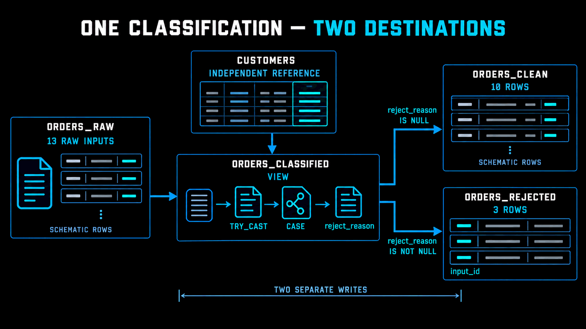
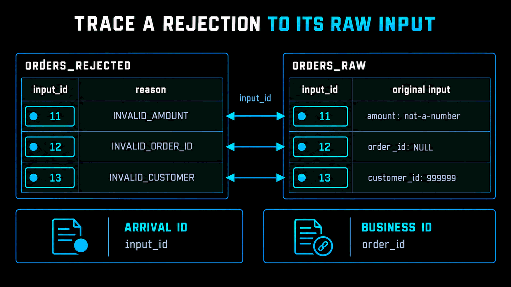
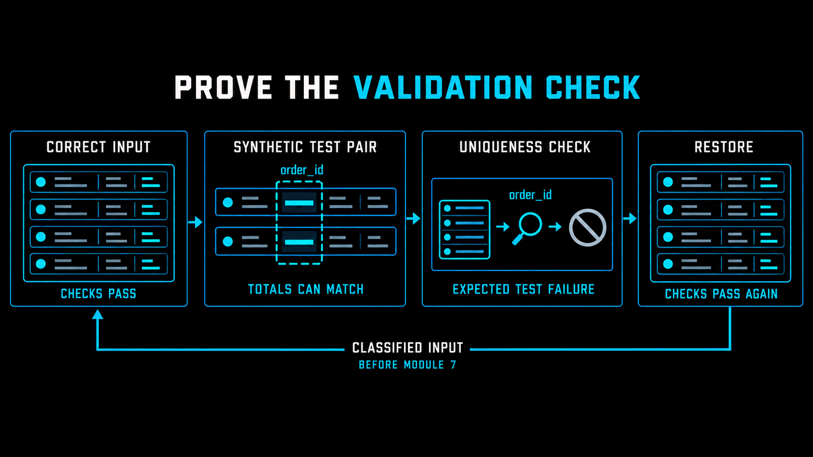

<a id="unit-u.e4393bf1ed3140789a7ff9e9e2a9ef2c"></a>

<a id="module-6-data-quality-and-schema-validation"></a>

# 6-модуль: деректер сапасы және схеманы тексеру

| Курс туралы ақпарат | Мәні |
| --- | --- |
| Курс | Apache Doris көмегімен деректер қоймасын құру · 1-деңгей |
| Doris | Apache Doris 4.1.3 |
| Орта | 1-модульдегі курс сынақ ортасы; 5-зертханалық жұмыстың `wwi_customers` кестесі немесе оны 6-зертханалық жұмыс жүктейді |
| Болжалды уақыт | Шамамен 70 минут: оқу 30, зертханалық жұмыс 30, тест 10 |

[Курстың README файлы](../../README.md) · [6-зертханалық жұмысты ашу](lab06_validate_orders.ipynb) · [6-тестті ашу](quiz06_data_quality_and_rejection.ipynb)
<a id="unit-u.f71e2d29058f4e2c82c3740831ef9d93"></a>

<a id="module-goal"></a>

## Модуль мақсаты

Тек сенуге болатын жаңа тапсырыстарды қабылдап, әр қабылданбағанын себебі мен бастапқы мәтінімен сақтаңыз және тексерулер өзі табады деген қателерді табатынын дәлелдеңіз.
<a id="unit-u.71a6a51188a04a1c9fa100f5d8fa190e"></a>

<a id="learning-objectives"></a>

## Оқу мақсаттары

Осы модульді аяқтағаннан кейін сіз:

1. Түр тексерулерін бизнес сапасы ережелерінен ажыратасыз.
2. Әр қабылданбаған жолды дереккөзіне дейін қадағалау үшін бастапқы кірісті мәтін ретінде аралық кестеге сақтайсыз.
3. Айқын ережелер мен тәуелсіз тұтынушы өлшемін қолданып, қабылданған және қабылданбаған жолдарды бағыттайсыз.
4. Кірісті қамтуды, бірегейлікті, сомаларды және әр жолдың нәтижесін бірге тексересіз.
5. Белгілі қатеде сәтсіз болуын көрсетіп, тексерудің жұмыс істейтінін дәлелдейсіз.
6. Схема өзгерісіне дейін және кейін оның әсерін тексересіз.
<a id="unit-u.51f8d589a7d94d1fab0ad144cdb81f36"></a>

<a id="module-structure"></a>

## Модуль құрылымы

| Бөлім | Уақыт | Нәтиже |
| --- | ---: | --- |
| 6.1 Түр тексерулері және бизнес ережелері | 5 мин | Түрленетін мән неге бәрібір қате болуы мүмкін |
| 6.2 Бастапқы кірісті аралық кестеге сақтау | 5 мин | Әр кірісті мәтін түрінде өз ID-імен сақтау |
| 6.3 Ережелермен бағыттау | 7 мин | Жіктеу көрінісі, екі жазу және кіріске дейін қадағалау |
| 6.4 Жалпы сомалардан көбірегін тексеру | 5 мин | Қамту, бірегейлік, сомалар және әр өріс |
| 6.5 Тексерулерді әдейі сәтсіз ету | 3 мин | Тексерулер табуы тиіс белгілі қателер |
| 6.6 Схема өзгергенде | 5 мин | Жаңа баған не түр неге әсер етеді |
| 6-зертханалық жұмыс | 30 мин | 13 кірісті сақтау, 10 және 3 етіп бағыттау, тексерулерді сынау |
| 6-тест | 10 мин | Осы мақсаттарға арналған алты сұрақ |
<a id="unit-u.508e2b6905bc45deb7c6a5cc8d21c4d8"></a>

<a id="61-type-checks-and-business-rules"></a>

## 6.1 Түр тексерулері және бизнес ережелері

5-модуль жүктеу сәтті болса да, қате болуы мүмкін екенін көрсетті. Тапсырыстар есептерге жетпес бұрын екі түрлі тексеру қолданылады:

| Кіріс | Түр тексеруі | Бизнес тексеруі |
| --- | --- | --- |
| `not-a-number` сомасы | DECIMAL бола алмайды | Қабылданған кестеге сома ретінде жетпеуі керек |
| Тапсырыс ID-і жоқ | Тапсырысты анықтайтын бүтін сан жоқ | Тапсырыс бола алмайды; қабылдамаңыз |
| `999999` тұтынушы ID-і | Бүтін санға түрленеді | Ондай тұтынушы жоқ: бәрібір қабылдамаңыз |
| Теріс сома | Жарамды ондық сан | Тек келісімшарт рұқсат етсе болады; бұл пакет рұқсат етпейді |

Баған түрі, жүктеудің қатаң режимі және курстың SQL ережелері әртүрлі деңгейде жұмыс істейді. «Тұтынушы бар» сияқты ереже — SQL-де жазылған тұтынушы өлшемімен біріктіру; оны ешбір баған түрі білдіре алмайды.
<a id="unit-u.9ddf9031eb914b21949b6a61f0fcea70"></a>

<a id="agree-on-a-contract-for-the-batch-first"></a>

### Алдымен пакет келісімшартын келісу

**Деректер келісімшарты** — жіберуші мен алушылардың әр өріс мағынасы және жол қашан жарамды екені туралы келісімі. Жаңа тапсырыстардың осы пакеті үшін: тапсырыс ID-і міндетті, сома теріс емес, тұтынушы белгілі және дереккөз `COURSE_SIMULATION` болуы керек. Белгілі тұтынушылар кірістердің өзінен емес, 5-модульдегі WWI тұтынушы кестесінен алынады, әйтпесе әр белгісіз тұтынушы белгілі деп саналар еді.
<a id="unit-u.6caa86366e69494dab8e73533ecdc89b"></a>

<a id="62-stage-the-raw-input"></a>

## 6.2 Бастапқы кірісті аралық кестеге сақтау

`orders_raw` бастапқы кестесі әр бизнес өрісін мәтін түрінде және тұрақты `input_id` мәнін сақтайды. 6-зертханалық жұмыс `raw_orders.json` файлынан он үш кірісті 5-модульдің Stream Load әдісімен жүктейді: `format=json` және `strip_outer_array=true` арқылы файл массивінің әр нысаны бір жолға айналады, кілттері `columns` ішінде аталған бағандарға сәйкестенеді. Әр бизнес бағаны мәтін болғандықтан, жүктеудің қатаң режимі ештеңені қабылдамай тастамайды: `not-a-number` және тапсырыс ID-і жоқ мәндер жіберілген күйінде жетеді. Түрлері қатаң берілген аралық кесте бұл жолдарды кіреберісте қабылдамай, мазмұны жоғалар еді.

Екі идентификатор әртүрлі жұмыс істейді: `input_id` осы пакеттегі бір келуді, `order_id` бизнес тапсырысын анықтайды. Тапсырыс ID-і жоқ кірісте де `input_id` бар, бір тапсырыстың екі келуі екі `input_id` сақтайды.

| input_id | Бастапқы order_id | Бастапқы order_amount | customer_id | Бағыт |
| ---: | --- | --- | --- | --- |
| 1–10 | 900001–900010 | Жарамды сомалар, барлығы 1400.00 | 1–10 | Қабылданған |
| 11 | 900012 | not-a-number | 1 | INVALID_AMOUNT |
| 12 | NULL | 100.00 | 1 | INVALID_ORDER_ID |
| 13 | 900013 | 100.00 | 999999 | INVALID_CUSTOMER |
<a id="unit-u.6cc7e9476a8248379fd80097a04412ea"></a>

<a id="63-route-with-rules"></a>

## 6.3 Ережелермен бағыттау

`TRY_CAST` түрлендіруге тырысып, сәтсіз болса NULL қайтарады: `TRY_CAST('not-a-number' AS DECIMAL(18, 2))` — NULL, сондықтан ереже мұны тексере алады, ал түзету мен қайта өңдеу үшін бастапқы мәтін `orders_raw` ішінде қалады. [CAST және TRY_CAST](https://doris.apache.org/docs/4.x/sql-manual/basic-element/sql-data-types/conversion/cast-expr/) бөлімін қараңыз.

Ережелер бекітілген ретпен — тапсырыс ID-і, сома, тұтынушы, дереккөз — орындалып, алғашқы сәйкес себепті тіркейді; бірнеше мәселесі бар жол алдымен біріншісін, ол түзетілгеннен кейін басқаларын көрсетеді. `CASE WHEN` шарттарды жоғарыдан төмен қарай тексереді, `THEN` алғашқы сәйкес шарт нәтижесін береді, `ELSE` ешқайсысы сәйкес келмесе қолданылады. Көрініс бастапқы өрістерді сақтап, `reject_reason` қосады:

**Оқуға арналған SQL мысалы: 6-зертханалық жұмыстың жіктеу қадамы. Жұмыстан кейін қайта орындамаңыз.**
Жұмыс алдымен `orders_raw` пен `customers` тұтынушы өлшемін дайындайды:

<!-- reading-only-example -->
```sql
CREATE VIEW orders_classified AS
SELECT *, CASE
    WHEN TRY_CAST(order_id AS BIGINT) IS NULL THEN 'INVALID_ORDER_ID'
    WHEN TRY_CAST(order_amount AS DECIMAL(12,2)) IS NULL
      OR TRY_CAST(order_amount AS DECIMAL(12,2)) < 0 THEN 'INVALID_AMOUNT'
    WHEN TRY_CAST(customer_id AS BIGINT) IS NULL THEN 'INVALID_CUSTOMER'
    WHEN TRY_CAST(customer_id AS BIGINT) NOT IN (SELECT customer_id FROM customers) THEN 'INVALID_CUSTOMER'
    WHEN data_source IS NULL OR data_source <> 'COURSE_SIMULATION' THEN 'INVALID_SOURCE'
    ELSE NULL END AS reject_reason
FROM orders_raw;
```

Мұнда `customers.customer_id` NULL бола алмайды; NULL болуы мүмкін тізімге `NOT IN` ешқашан қолданбаңыз: онда шарт ешбір жол үшін true болмайды. 11-кіріс тапсырыс ID-і ережесінен өтіп, сома ережесіне сәйкес келеді; 13-кірістің сомасы жарамды, бірақ тұтынушысы белгісіз. Он қалыпты кіріс NULL себеп алады.

`orders_classified` — кәдімгі көрініс: ол сұрауды сақтайды және оған әр сұрау ережелерді қайта орындайды. Оны жасау деректерді жылжытпайды. Екі жазу кірістерді бағыттайды:

**Оқуға арналған SQL мысалы: 6-зертханалық жұмыстың бағыттау қадамы. Жұмыстан кейін қайта орындамаңыз.**
Жұмыс алдымен бос `orders_clean` және `orders_rejected` жасайды; `orders_clean` — Duplicate Key кестесі, сондықтан бұл жазуларды екі рет орындау екі рет қосады.

<!-- reading-only-example -->
```sql
INSERT INTO orders_clean (
    order_id,customer_id,order_amount,status,event_version,event_id,
    event_time,paid_amount,refund_amount,region,data_source
)
SELECT order_id,customer_id,order_amount,status,event_version,event_id,
       event_time,paid_amount,refund_amount,region,data_source
FROM orders_classified WHERE reject_reason IS NULL;

INSERT INTO orders_rejected (input_id, reason)
SELECT input_id, reject_reason
FROM orders_classified WHERE reject_reason IS NOT NULL;
```

`IS NULL` және `IS NOT NULL` бір жіктеуді қиылыспайтын екі топқа бөледі: он қабылданған, үш қабылданбаған. Екі жазу екі кестеге ортақ бір транзакция емес: жұмыс олардың арасында тоқтаса, алғашқы жазудың сәттілігі пакеттің аяқталғанын білдірмейді. Жұмысты қайта орындау үшін нәтиже кестелерін қайта жасап, екі жазуды да қайта орындаңыз.



*Бір жіктеу барлық кірісті қабылданған не қабылданбаған жолдарға бағыттайды.*

Суреттегі жазулар: ONE CLASSIFICATION – TWO DESTINATIONS — бір жіктеу, екі бағыт; ORDERS_RAW — orders_raw; 13 RAW INPUTS — 13 бастапқы кіріс; SCHEMATIC ROWS — шартты көрсетілген жолдар; CUSTOMERS — customers; INDEPENDENT REFERENCE — тәуелсіз анықтамалық; ORDERS_CLASSIFIED — orders_classified; VIEW — көрініс; TRY_CAST — TRY_CAST; CASE — CASE; reject_reason — қабылдамау себебі; reject_reason IS NULL — себеп жоқ; ORDERS_CLEAN — orders_clean; 10 ROWS — 10 жол; reject_reason IS NOT NULL — себеп бар; ORDERS_REJECTED — orders_rejected; 3 ROWS — 3 жол; input_id — кіріс ID-і; TWO SEPARATE WRITES — екі бөлек жазу.
<a id="unit-u.7dda19e561cc46b7b971a15c50a3e740"></a>

<a id="trace-a-rejection-back-to-its-input"></a>

### Қабылдамауды бастапқы кіріске дейін қадағалау

Бағыттаудан кейін:

```sql
SELECT r.input_id, r.order_id, r.order_amount, r.customer_id, x.reason
FROM orders_rejected x
JOIN orders_raw r ON x.input_id = r.input_id
ORDER BY r.input_id;
```

Нәтиже — 6.2 бөлімінің кестесіндегі 11, 12 және 13-жолдар. Қабылданбағандар кестесі идентификаторлар мен себептерді, бастапқы кесте бастапқы мәтінді сақтайды, олар `input_id` арқылы бірігеді. Жүктеудің `ErrorURL` мерзімі өтеді; бұл кестелерді сақтағанша сұрауға болады. Ережені ештеңе бағыттамай тұрып `CASE` бар жай `SELECT` арқылы сынауға болады: 6-зертханалық жұмыстың жаттығуы осылай істейді.



*Тұрақты кіріс ID-лері әр қабылдамаудың бастапқы дәлелін сақтайды.*

Суреттегі жазулар: TRACE A REJECTION TO ITS RAW INPUT — қабылдамауды бастапқы кіріске дейін қадағалау; ORDERS_REJECTED — orders_rejected; input_id — кіріс ID-і; reason — себеп; INVALID_AMOUNT — жарамсыз сома; INVALID_ORDER_ID — жарамсыз тапсырыс ID-і; INVALID_CUSTOMER — жарамсыз тұтынушы; ORDERS_RAW — orders_raw; original input — бастапқы кіріс; amount: not-a-number — сома сан емес; order_id: NULL — тапсырыс ID-і жоқ; customer_id: 999999 — белгісіз 999999 тұтынушысы; ARRIVAL ID — келу ID-і; BUSINESS ID — бизнес ID-і; order_id — тапсырыс ID-і. 11, 12, 13 мәндері бастапқы кірістерді байланыстырады.
<a id="unit-u.01589d55f91f44ca9787834d55fb192d"></a>

<a id="64-check-more-than-totals"></a>

## 6.4 Жалпы сомалардан көбірегін тексеру

```sql
SELECT reject_reason, COUNT(*) AS input_rows
FROM orders_classified
GROUP BY reject_reason
ORDER BY reject_reason;
```

Себебі жоқ он жол және үш себептің әрқайсысына бір жол күтіледі: әр кірістің дәл бір баратын кестесі бар, ешбір кіріс екі кестеде қатар болмайды және ешқайсысы бағытсыз қалмайды.

```sql
SELECT COUNT(*) AS orders,
       COUNT(DISTINCT order_id) AS unique_orders,
       SUM(order_amount) AS amount
FROM orders_clean;
```

10, 10 және 1400.00 күтіледі. Содан кейін әр өрісті күтілетін тапсырыстармен салыстырыңыз: бірі артық, бірі кем екі қате сома жалпы соманы дұрыс қалдырар еді.

| Тексеру | 6-зертханалық жұмыс нені тексереді |
| --- | --- |
| Қамту | Барлық 13 кіріс бағытталған: 10 қабылданған, 3 қабылданбаған |
| Идентификаторлар мен сілтемелер | Қайталанған тапсырыс ID-і жоқ, әр тұтынушы бар, әр дереккөз дұрыс |
| Сомалар мен күйлер | Жалпы 1400.00, бәрі CREATED, төлем де, қайтарым да жоқ |
| Уақыт | Әр оқиға уақыты берілген және пакеттің бекітілген шегінен бұрын |
| Әр өріс | Әр тапсырыс күтілетін тапсырысқа тең |

`2026-01-02 12:00:00` шегі осы офлайн пакетті тексереді. Үздіксіз істейтін конвейерге кешіккен оқиғаны баяу тасымалдаудан не кезектен ажырату үшін бизнес оқиғасының уақыты, жүктелген уақыты және тексерілген уақыты да қажет.
<a id="unit-u.2cca1e1075394f0d82c48ea1a98d8cdf"></a>

<a id="65-make-the-checks-fail-on-purpose"></a>

## 6.5 Тексерулерді әдейі сәтсіз ету

Ешқашан сәтсіз болмаған тексеру ештеңені тексермеуі мүмкін. 6-зертханалық жұмыс қабылданған кестені әдейі екі рет бұзып, әр жолы бірегейлік тексеруін тікелей шақырады, сонда алдымен жалпы сомалар сәтсіз болып, сол ереженің жұмысын жасыра алмайды:

1. Бар тапсырыстың көшірмесін қосыңыз: бірегейлік тексеруі сәтсіз болуы керек.
2. Қалпына келтіріп, екінші тапсырыс ID-ін біріншісінің ID-іне өзгертіңіз: әлі он жол және 1400.00, бірақ бір тапсырыс екі рет, екіншісі жоқ. Бірегейлік тексеруі қайта сәтсіз болуы керек.



*Тексерудің дұрыстығы белгілі қатені табумен дәлелденеді.*

Суреттегі жазулар: PROVE THE VALIDATION CHECK — тексерудің жұмысын дәлелдеу; CORRECT INPUT — дұрыс кіріс; CHECKS PASS — тексерулер өтеді; SYNTHETIC TEST PAIR — жасанды сынақ жұбы; order_id — тапсырыс ID-і; TOTALS CAN MATCH — жалпы сомалар сәйкес келуі мүмкін; UNIQUENESS CHECK — бірегейлік тексеруі; EXPECTED TEST FAILURE — күтілетін сынақ сәтсіздігі; RESTORE — қалпына келтіру; CHECKS PASS AGAIN — тексерулер қайта өтеді; CLASSIFIED INPUT — жіктелген кіріс; BEFORE MODULE 7 — 7-модульге дейін.

Күтілетін мәндер бекітілген кіріс пен ережелерден алынады, қалпына келтіру бастапқы кірісті қайта жіктейді, сондықтан қабылданған кесте қате жазылғаннан кейін де тексерулерде тәуелсіз салыстыру негізі бар.
<a id="unit-u.4e0b2c5b32e24b7fb1300ebc28fc776a"></a>

<a id="66-when-the-schema-changes"></a>

## 6.6 Схема өзгергенде

Кірісті схемаға сай тексеру схеманың өзін өзгертуден бөлек. NULL қабылдайтын `order_channel` бағанын қосу ескі жолдарда оны NULL қалдырады, бірақ бағандарды орын бойынша сәйкестендіретін жүктеу не бағандар тізімі жоқ `INSERT INTO ... VALUES` енді кестеге сай келмейді, кейінгі өңдеудегі `SELECT *` тағы бір баған қайтарады. Баған мағынасын өзгерту, мысалы соманы салық қосылған ету, түрі өзгермесе де жаңа келісімді қажет етеді.

| Өзгеріс түрі | Doris не істейді | Нені тексеру керек |
| --- | --- | --- |
| Жеңіл Schema Change | Мән бағанын қосу сияқты кей операциялар тек метадеректерді өзгертеді | Әдепкі мәндер, баған сәйкестіктері және кейінгі сұраулар |
| Ауыр Schema Change | Кей түр өзгерістері сияқты басқа операциялар деректер файлдарын фондық режимде қайта жазады | Тапсырма күйі, ресурстар және түрленген деректер |

Өзгерістің жеңіл не ауыр болуы атауына емес, операцияға, кесте моделіне және нұсқаға байланысты. Оны `orders_clean` ішінде емес, бөлек көшірмеде сынаңыз:

```text
ALTER TABLE <separate_copy_table> ADD COLUMN order_channel VARCHAR(20) NULL;
DESC <separate_copy_table>;
SHOW ALTER TABLE COLUMN;
```

Өзгеріске дейін баған ретіне тәуелді жазулар мен сұрауларды табыңыз; кейін анықтаманы, ескі жолдардағы жаңа бағанды, жаңа жүктеуді және кейінгі нәтижелерді тексеріңіз. Фондық өзгеріс `ALTER` қайтқанда емес, `SHOW ALTER TABLE COLUMN` `FINISHED` көрсеткенде аяқталады. [Схема және жою кеңейтуі](../extensions/extension67_schema_and_delete.ipynb) тапсырыстар көшірмесінде баған қосып, түр өзгертеді; 3-деңгей өзгерістерді енгізуді қарастырады. [Schema Change](https://doris.apache.org/docs/4.x/table-design/schema-change/) бөлімін қараңыз.
<a id="unit-u.88ba4095982342d983a3f52bc2acc7e0"></a>

<a id="lab-6-preserve-input-route-rejections-and-automate-validation"></a>

## 6-зертханалық жұмыс: кірісті сақтау, қабылданбағандарды бағыттау және тексеруді автоматтандыру

[6-зертханалық жұмыс: кірісті сақтау, қабылданбағандарды бағыттау және тексеруді автоматтандыру](lab06_validate_orders.ipynb) файлын ашыңыз. Сіз:

1. Қате сома, тапсырыс ID-і жоқ жол және белгісіз тұтынушысы бар жолды қоса, он үш кірісті Stream Load арқылы аралық кестеге сақтайсыз.
2. Оларды он қабылданған және үш қабылданбаған жолға бағыттап, әр қабылдамауды `input_id` арқылы бастапқы мәтінге дейін қадағалайсыз.
3. Қабылданған тапсырыстарды тексеріп, бірегейлік тексеруінің сәтсіз болуын көру үшін әдейі екі рет бұзасыз және қалпына келтіресіз.
4. Жаттығу: соманы қолмен қараудың жаңа ережесін қолданбас бұрын `CASE` арқылы сынайсыз.

1-модульдегі курс сынақ ортасы және 5-зертханалық жұмыстың `wwi_customers` кестесі қажет; ол болмаса, жұмыс пакеттен сол бір кестені жүктейді. 7-модуль қабылданған тапсырыстарды оқиды. Курстың README файлындағы [Деректер жиыны](../../README.md#dataset) бөлімі кірістерді тізеді.
<a id="unit-u.0fdaa5def99c4255aa342dcdd84c2345"></a>

<a id="summary"></a>

## Қорытынды

- Түр тексеруі мәннің түрленетінін сұрайды; бизнес ережесі есептерге жарайтынын сұрайды: бүтін тұтынушы ID-і тұтынушының бар екенін білдірмейді.
- Ештеңе кіреберісте қабылданбай қалмауы және әр қабылдамаудың бастапқы мәтіні сақталуы үшін кірісті өз `input_id` мәнімен мәтін ретінде сақтаңыз; мерзімі өткен `ErrorURL` оның орнына жүрмейді.
- Тәуелсіз тұтынушы өлшеміне қарсы айқын ережелермен бағыттаңыз: 13 кіріс, 10 қабылданған және 3 қабылданбаған, әрқайсысында бір себеп.
- Қамту, бірегейлік, сомалар және әр өрісті салыстыру бірін-бірі толықтырады; жалпы соманың сәйкес келуі егжей-тегжейлі деректердің дұрыстығын дәлелдемейді.
- Белгілі қате тексеруді сәтсіз етіп, қалпына келген деректер қайта өткенде тексеру дәлелденеді; бекітілген шек орындалып жатқан конвейердің өзектілігін өлшемейді.
- Схема өзгерісінен бұрын бағандарға тәуелді жазулар мен сұрауларды табыңыз; кейін ескі жолдарды, жаңа жүктеулерді және өзгеріс тапсырмасын FINISHED болғанша тексеріңіз.
<a id="unit-u.745c382f87ec407c9bdc5ccc31ea6e7f"></a>

<a id="quiz-6"></a>

## 6-тест

[6-тест: деректер сапасы және схеманы тексеру](quiz06_data_quality_and_rejection.ipynb) файлын ашыңыз. Онда бір дұрыс жауабы бар алты сұрақ бар және іске қосылған орта қажет емес.

Келесі модуль: [7-модуль: деректерді жаңарту, жою және оқиғаларды қайта ойнату](../module07-state-changes/course.md).
<a id="unit-u.dedb71f7bb3a45d2aef09f66ce0da017"></a>

<a id="references"></a>

## Дереккөздер

- [Apache Doris: Stream Load, қатаң режим мен сүзуді қоса](https://doris.apache.org/docs/4.x/data-operate/import/import-way/stream-load-manual/)
- [Apache Doris: CAST және TRY_CAST](https://doris.apache.org/docs/4.x/sql-manual/basic-element/sql-data-types/conversion/cast-expr/)
- [Apache Doris: Schema Change](https://doris.apache.org/docs/4.x/table-design/schema-change/)
