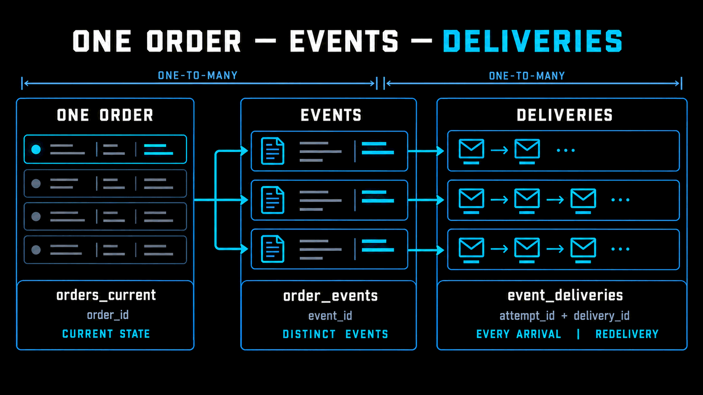
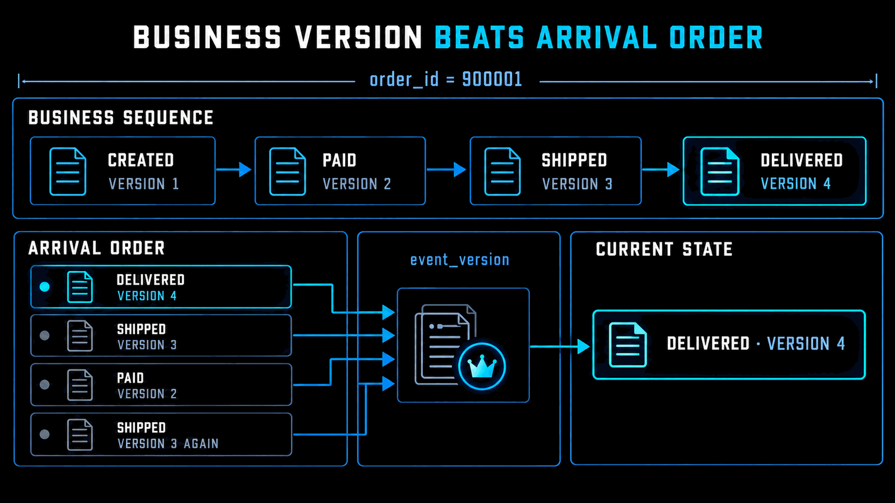
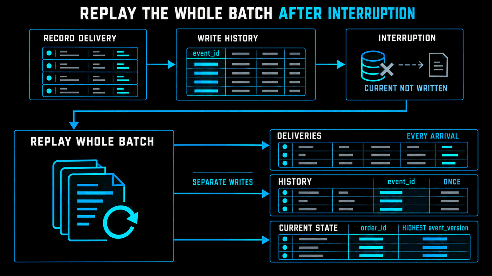

<a id="unit-u.6f19b174cd6a4f86a8967b8128068fed"></a>

<a id="module-7-data-updates-deletion-and-event-replay"></a>

# 7-модуль: деректерді жаңарту, жою және оқиғаларды қайта ойнату

| Курс туралы ақпарат | Мәні |
| --- | --- |
| Курс | Apache Doris көмегімен деректер қоймасын құру · 1-деңгей |
| Doris | Apache Doris 4.1.3 |
| Орта | 1-модульдегі курс сынақ ортасы; 6-зертханалық жұмыстың `orders_clean` және `customers` кестелері |
| Болжалды уақыт | Шамамен 90 минут: оқу 35, зертханалық жұмыс 45, тест 10 |

[Курстың README файлы](../../README.md) · [7-зертханалық жұмысты ашу](lab07_current_state_and_replay.ipynb) · [7-тестті ашу](quiz07_state_changes_and_replay.ipynb)
<a id="unit-u.5d4f1090f81245a68f7588bc47ed6c59"></a>

<a id="module-goal"></a>

## Модуль мақсаты

Оқиғалар екі рет, ретсіз және үзілістен кейін келгенде әр тапсырыстың ағымдағы күйін дұрыс сақтаңыз, тарихын сақтап, екеуін тәуелсіз тізіліммен салыстырып тексеріңіз.
<a id="unit-u.343cc521f3ce4064a9121a5809b9488e"></a>

<a id="learning-objectives"></a>

## Оқу мақсаттары

Осы модульді аяқтағаннан кейін сіз:

1. Ағымдағы күйдің, оқиға тарихының және бастапқы жеткізілімдердің кілттері мен мақсаттарын ажыратасыз.
2. Қайталанған және ретсіз оқиғаларды бизнес нұсқаларымен шешесіз.
3. Бағандарды ішінара жаңартуды өрістері берілмеген толық жол жазуынан ажыратасыз.
4. Жұмсақ жоюды, SQL DELETE, жүктеудің жою белгісін және физикалық орынды босатуды ажыратасыз.
5. Бүкіл пакетті қайта ойнатып, үзілген көп кестелі жазудан қалпына келесіз.
6. Ағымдағы күйді тәуелсіз төлем, қайтарым және жөнелту жазбаларымен салыстырасыз.
<a id="unit-u.916f08180cbc45c6862fc443ef42bc76"></a>

<a id="module-structure"></a>

## Модуль құрылымы

| Бөлім | Уақыт | Нәтиже |
| --- | ---: | --- |
| 7.1 Ағымдағы күй, тарих және жеткізілімдер | 5 мин | Үш кесте, үш кілт, үш сұрақ |
| 7.2 Келу ретіне қарсы нұсқалар | 8 мин | Кешіккен оқиға неге жаңарақ күйді кері өзгертпейді |
| 7.3 Бағандарды ішінара жаңарту | 6 мин | Бірнеше бағанды өзгертіп, басқаларын сақтау |
| 7.4 Жоюдың төрт түрі | 6 мин | Жұмсақ жою, DELETE, жүктеудің жою белгісі және орынды босату |
| 7.5 Үзілістен кейін қайта ойнату | 5 мин | Жартысында тоқтаған жазуды қалпына келтіру |
| 7.6 Тәуелсіз тізіліммен салыстыру | 5 мин | Басқа жерде сақталған жазбалармен сомаларды дәлелдеу |
| 7-зертханалық жұмыс | 45 мин | Оқиғаларды қайта ойнату, тарихты сақтау, салыстыру, бір бағанды жаңарту және көшірмелерде жою |
| 7-тест | 10 мин | Осы мақсаттарға арналған алты сұрақ |
<a id="unit-u.c3907bc8cbc24a77a88d5fb3982fd400"></a>

<a id="71-current-state-history-and-deliveries"></a>

## 7.1 Ағымдағы күй, тарих және жеткізілімдер

Бақылау тақтасына қазір не дұрыс екені, қайтарымды зерттеуге не болғаны қажет. Тек ағымдағы күйді сақтау оқиғалар тарихын жоғалтады; тек тарихты сақтау әр сұрауға дұрыс нұсқаны іздетеді. 7-зертханалық жұмыс екеуін де, бастапқы жеткізілімдерді де сақтайды:

| Кесте | Бір жол нені білдіреді | Кілт және мақсаты |
| --- | --- | --- |
| orders_current | Бір тапсырыстың ағымдағы күйі | UNIQUE KEY(order_id), `event_version` арқылы шешіледі |
| order_events | Бір бөлек бизнес оқиғасы | UNIQUE KEY(event_id): қайта жеткізілген оқиға тарих қоспайды |
| event_deliveries | Бір әрекеттегі бір жеткізілім | `attempt_id`, `delivery_id` және бастапқы мазмұн: әр қайта жеткізу сақталады |

Бір тапсырыстың бірнеше оқиғасы бар, бір оқиға бірнеше рет жеткізілуі мүмкін; `delivery_id` сәлемдемені емес, хабар жеткізілімін анықтайды. 6-модульдің `orders_clean` кестесі он қабылданған тапсырысты, алғашқы ағымдағы күй мен алғашқы тарихты береді; бәрі `COURSE_SIMULATION`, `wwi_*` кестелері өзгермейді.



*Тапсырыстарға, оқиғаларға және жеткізілімдерге әртүрлі идентификаторлар қажет.*

Суреттегі жазулар: ONE ORDER – EVENTS – DELIVERIES — бір тапсырыс, оқиғалар, жеткізілімдер; ONE-TO-MANY — біреуден көпке байланыс; ONE ORDER — бір тапсырыс; EVENTS — оқиғалар; DELIVERIES — хабар жеткізілімдері; orders_current — ағымдағы кесте; order_id — тапсырыс ID-і; CURRENT STATE — ағымдағы күй; order_events — оқиға тарихы; event_id — оқиға ID-і; DISTINCT EVENTS — бөлек оқиғалар; event_deliveries — жеткізілім журналы; attempt_id + delivery_id — әрекет ID-і + жеткізілім ID-і; EVERY ARRIVAL — әр келу; REDELIVERY — қайта жеткізу.
<a id="unit-u.6849e2ab556a440e92c5435fde480b3e"></a>

<a id="72-versions-against-arrival-order"></a>

## 7.2 Келу ретіне қарсы нұсқалар

900001 тапсырысының бизнес ағымы:



*Sequence келу ретіне қарамастан ең жоғары бизнес нұсқасын сақтайды.*

Суреттегі жазулар: BUSINESS VERSION BEATS ARRIVAL ORDER — бизнес нұсқасы келу ретінен басым; order_id = 900001 — тапсырыс ID-і 900001; BUSINESS SEQUENCE — бизнес реті; CREATED VERSION 1 — жасалған, 1-нұсқа; PAID VERSION 2 — төленген, 2-нұсқа; SHIPPED VERSION 3 — жөнелтілген, 3-нұсқа; DELIVERED VERSION 4 — жеткізілген, 4-нұсқа; ARRIVAL ORDER — келу реті; SHIPPED VERSION 3 AGAIN — жөнелтілген 3-нұсқа қайтадан; event_version — оқиға нұсқасы; CURRENT STATE — ағымдағы күй; DELIVERED · VERSION 4 — жеткізілген, 4-нұсқа. Күйдің техникалық мәндері CREATED, PAID, SHIPPED және DELIVERED кодта өзгермейді.

1-нұсқа — бастапқы күй; кейінгі оқиғалар әдейі ретсіз келеді, біреуі екі рет:

| Бірінші жеткізу айналымындағы орын | event_id | event_version | Оқиға күйі | Одан кейінгі ағымдағы күй |
| --- | --- | ---: | --- | --- |
| 1 | E08 | 4 | DELIVERED | DELIVERED, 4-нұсқа |
| 2 | E02 | 3 | SHIPPED | Әлі DELIVERED, 4-нұсқа |
| 3 | E01 | 2 | PAID | Әлі DELIVERED, 4-нұсқа |
| 9 | E02 | 3 | SHIPPED, қайта жеткізу | Әлі DELIVERED, 4-нұсқа |

Әр оқиға тек өзгерген өрістерді емес, одан кейінгі тапсырыстың толық күйін (after-image) қамтиды: 4-нұсқада DELIVERED қана емес, сол сәттің сомасы, тұтынушысы және төлемі бар, сондықтан 2 және 3-нұсқалар келмей тұрып-ақ ағымдағы жолды құра алады. Тек өзгерген өрістерді қамтитын оқиғаға ішінара жаңарту қажет (7.3).

Ағымдағы кесте `event_version` бағанын **Sequence бағаны** ретінде атайды: бірдей кілтті жолдар арасында Doris соңғы келгенін емес, sequence мәні ең жоғарысын сақтайды. 7-зертханалық жұмыс көрсеткен кесте анықтамасынан осы үш параметрді табыңыз:

```text
UNIQUE KEY(order_id)
"enable_unique_key_merge_on_write"="true"
"function_column.sequence_col"="event_version"
```

Біріншісі тапсырысты анықтайды, екіншісі Merge-on-Write қосады (3-модуль), үшіншісі нұсқа бағанын атайды. Жай ғана `event_version` деп аталған баған ештеңені шешпейді. Нұсқалар тек бір тапсырыс ішінде салыстырылатын болуы керек; бірдей нұсқалы екі бөлек оқиғаға жеке ереже қажет, бұл курс оны қамтымайды. [Sequence бағандары және қатар жаңартуды басқару](https://doris.apache.org/docs/4.x/data-operate/update/unique-update-concurrent-control/) бөлімін қараңыз.

7-зертханалық жұмыстан кейін:

```sql
SELECT order_id, status, event_version, paid_amount, refund_amount
FROM orders_current
WHERE order_id IN (900001, 900003)
ORDER BY order_id;
```

| order_id | status | event_version | paid_amount | refund_amount |
| ---: | --- | ---: | ---: | ---: |
| 900001 | DELIVERED | 4 | 100.00 | 0.00 |
| 900003 | REFUNDED | 4 | 150.00 | 150.00 |
<a id="unit-u.db5534eb22264ebd9ad6e976acc6ac6b"></a>

<a id="what-counts-as-a-safe-duplicate"></a>

### Қауіпсіз қайталану деген не?

Бір нәрсені **идемпотентті** өңдеу оны қайта өңдегенде дұрыс нәтиженің өзгеріссіз қалуын білдіреді. Курс қайта жеткізілген `event_id` бірдей мазмұн қамтуын талап етеді; сол ID-дің басқа мазмұны — ауыстырып жазылатын қайталану емес, қайшылық. `event_version` — Kafka offset-і не binlog орны емес, бизнестің әр тапсырысқа арналған өз санауышы: бұл орындар қай күй жаңарақ екенін емес, оқырман қай жерге жеткенін айтады.
<a id="unit-u.96e2c1fa9a56480cb24cceb5437146f7"></a>

<a id="73-partial-column-updates"></a>

## 7.3 Бағандарды ішінара жаңарту

900001 тапсырысынан бас тарту керек, ал хабарда тек кілті, жаңа күйі және нұсқасы бар делік. Басқа бағандардың мәнін сақтауы не әдепкі мәнге немесе NULL-ге айналуы `INSERT` ішінде бағандарды бермеуге емес, жолдың қалай жазылғанына байланысты. **Бағандарды ішінара жаңарту** берілген бағандарды бар жолға біріктіріп, басқаларын сақтайды; оған Merge-on-Write Unique Key кестесі және `enable_unique_key_partial_update` сеанс параметрі қажет.

7-зертханалық жұмыс мұны ағымдағы кестеде емес, жеке `orders_partial_update` көшірмесінде сынайды:

| Кезең | status | event_version | order_amount | region |
| --- | --- | ---: | ---: | --- |
| Бастапқы жол | CREATED | 1 | 100.00 | EAST |
| Күй мен нұсқаны ішінара жаңартқаннан кейін | CANCELLED | 2 | 100.00 | EAST |

**Оқуға арналған SQL мысалы: 7-зертханалық жұмыстың ішінара жаңарту қадамы. Жұмыстан кейін қайта орындамаңыз.**
Жұмыс алдымен бастапқы жолды өз көшірмесіне жазып, сол қосылымда мынаны орындайды:

<!-- reading-only-example -->
```sql
SET enable_unique_key_partial_update = true;
INSERT INTO orders_partial_update (order_id, status, event_version)
VALUES (900001, 'CANCELLED', 2);
```

`SET` осы сеанс үшін ішінара жаңартуды қосады; `INSERT` кілтті және өзгеретін екі бағанды береді. Жұмыс параметрдің бұрынғы мәнін сақтап, жазу сәтті не сәтсіз болса да, Python try/finally арқылы қалпына келтіреді; толық жол жазатын қосылымда оны қосулы қалдырмаңыз.

```sql
SELECT order_id, status, event_version, order_amount, region
FROM orders_partial_update
ORDER BY order_id;
```

Нәтиже — кестенің екінші жолы: тек CANCELLED жеткіліксіз; сома мен аймақ тазаланбауы керек. [Бағандарды ішінара жаңарту](https://doris.apache.org/docs/4.x/data-operate/update/partial-column-update/) бөлімін қараңыз.
<a id="unit-u.250b1346ed2c4914b0962270bb3253bd"></a>

<a id="74-four-kinds-of-deletion"></a>

## 7.4 Жоюдың төрт түрі

| Түрі | Кім қолданады | Не істейді |
| --- | --- | --- |
| `is_deleted` сияқты бизнес белгісі | Бизнес кестелері және олардың сұраулары | Жолды сақтайды; әр сұрау белгі бойынша сүзуі керек |
| SQL `DELETE` | Оператор | Барлық кейінгі сұраудан жолдарды алып тастайды |
| Жүктеудің `__DORIS_DELETE_SIGN__` жою белгісі | Unique Key кестесіне жүктеу: `merge_type` MERGE және `delete` шарты бар Stream Load не CDC коннекторы | Жүктелген жол атаған кілтті жояды, CDC конвейері бастапқы DELETE үшін осылай істейді |
| Физикалық орынды босату | Doris ішіндегі compaction | Сұраулар енді көрмейтін, мысалы Delete Bitmap белгілеген жолдардың орнын кейін босатады |

**Delete Bitmap** — Merge-on-Write сұраулар енді көрмейтін жолдарды белгілейтін тәсіл; ол тек жоюда емес, үстінен жазылған әр жол үшін қолданылады. Қай түрін қолдансаңыз да, сұраулар енді қайтармайтын жол оның орны бос екенін дәлелдемейді. Қайтарым да жою емес: 900003 тапсырысы төлемін де, қайтарымын да REFUNDED күйінде сақтайды; нөлдік таза түсімді көрсету үшін төлемді жою фактіні өшірер еді. [Жаңарту және жою](https://doris.apache.org/docs/4.x/data-operate/update/update-overview/) бөлімін қараңыз.

7-зертханалық жұмыстың `orders_delete_demo` көшірмесі 900001 және 900002 тапсырыстарынан басталады. Алдымен 900001 жұмсақ жойылады: кестеде әлі екі жол бар, оны тек `WHERE is_deleted=false` жасырады. Содан кейін `DELETE` 900002-ні жояды: кәдімгі сұраулар тек әлі белгіленген 900001-ді қайтарады.

**Оқуға арналған SQL мысалы: 7-зертханалық жұмыстың жою қадамы. Жұмыстан кейін қайта орындамаңыз.**
Жұмыс алдымен 900001 және 900002 бар көшірмені қайта жасайды:

<!-- reading-only-example -->
```sql
UPDATE orders_delete_demo SET is_deleted=true WHERE order_id=900001;
SELECT order_id FROM orders_delete_demo WHERE is_deleted=false ORDER BY order_id;
DELETE FROM orders_delete_demo WHERE order_id=900002;
```

`UPDATE` тек осы көшірме сияқты Unique Key кестесінде істейді: Duplicate не Aggregate Key кестесінде Doris `Only unique table could be updated` қатесімен бас тартады. Шартты `DELETE` Duplicate Key кестесінде де жұмыс істейді.

```sql
SELECT order_id, is_deleted, status
FROM orders_delete_demo
ORDER BY order_id;
```

Соңғы сұрау 900001, true, CREATED қайтарады. 7-зертханалық жұмыс жүктеудің жою белгісін сынамайды: оны [схема және жою кеңейтуі](../extensions/extension67_schema_and_delete.ipynb) екінші бөлімінде орындайды: 2-нұсқада жойғаннан кейін қайта ойнатылған 1-нұсқа тапсырысты қайтармайды, тек жаңа 3-нұсқа қайтарады.
<a id="unit-u.35736ad6e7d54125ae2be635f4f9696a"></a>

<a id="75-replay-after-an-interruption"></a>

## 7.5 Үзілістен кейін қайта ойнату

7-зертханалық жұмыс дерекқорды емес, өз қадамдарын үзеді:



*Үзілген ағымдағы күй жазуын аяқтау үшін барлық оқиғаны қайта ойнатыңыз.*

Суреттегі жазулар: REPLAY THE WHOLE BATCH AFTER INTERRUPTION — үзілістен кейін бүкіл пакетті қайта ойнату; RECORD DELIVERY — жеткізілімді тіркеу; WRITE HISTORY — тарихты жазу; event_id — оқиға ID-і; INTERRUPTION — үзіліс; CURRENT NOT WRITTEN — ағымдағы күй жазылмады; REPLAY WHOLE BATCH — бүкіл пакетті қайта ойнату; SEPARATE WRITES — бөлек жазулар; DELIVERIES — жеткізілімдер; EVERY ARRIVAL — әр келу; HISTORY — тарих; ONCE — бір рет; CURRENT STATE — ағымдағы күй; order_id — тапсырыс ID-і; HIGHEST event_version — ең жоғары event_version.

Үш кесте бір транзакцияда емес, бөлек қадамдарда жазылады. Сондықтан қалпына келтіру тарихта бар оқиғаларды өткізіп жібермеуі керек: бұл ешқашан орындалмаған ағымдағы кесте жазуын да өткізіп жіберер еді. Әр кестеге жазу идемпотентті болғандықтан, бүкіл пакетті қайта ойнату қауіпсіз. Екі қайта ойнатудан кейінгі үш сан:

| Кесте | Жолдар | Себебі |
| --- | ---: | --- |
| orders_current | 11 | Он бастапқы тапсырыс және бір жаңа тапсырыс |
| order_events | 18 | Он бастапқы оқиға және сегіз бөлек жаңа оқиға |
| event_deliveries | 19 | Үзіліске дейін бір жеткізілім және тоғыздан екі айналым |

```sql
SELECT 'current' AS record_type, COUNT(*) AS rows_count FROM orders_current
UNION ALL
SELECT 'history' AS record_type, COUNT(*) AS rows_count FROM order_events
UNION ALL
SELECT 'deliveries' AS record_type, COUNT(*) AS rows_count FROM event_deliveries
ORDER BY record_type;
```

Қайта жеткізулер оқиғаларды емес, жеткізілімдерді қосады және ағымдағы күйді бұрынғыдай қалдырады.

7-зертханалық жұмыс өз қадамдары үзілгеннен кейін файлдағы модельденген оқиғаларды қайта ойнатады, сондықтан нақты CDC баптауын қажет етпейді. CDC конвейеріне қажет өзгерістер әлі оқыла алуы үшін дереккөз журналының орны, snapshot-тан өзгерістерге ауысу және коннектордың өз қалпына келтіруі де қажет; [үздіксіз жүктеу туралы қосымша оқу](../module05-ingestion/optional05_continuous_ingestion.md) оларды түсіндіреді, ал қосымша [5B жұмысы](../module05-ingestion/optional05_flink_mysql_cdc.ipynb) нақты MySQL binlog-пен басқарылатын Savepoint тоқтатуы мен қалпына келтіруін орындайды. Екеуі де бастапқы дерекқордың істен шығуын немесе тазаланған binlog-ты қамтымайды.
<a id="unit-u.51e35133e44440c6a7f0da45406c3053"></a>

<a id="76-reconcile-with-an-independent-ledger"></a>

## 7.6 Тәуелсіз тізіліммен салыстыру

Қайта ойнату күтілетін сандарды қалдырса да, сомалар қате болуы мүмкін. `business_events.json` тауарларды, төлемдерді, қайтарымдарды және жөнелтулерді басқа жүйе сияқты бөлек сақтайды; 7-зертханалық жұмыс оларды жеке кестелерге жүктеп, ағымдағы күймен салыстырады: әр тапсырыстың сомасы тауарларына, төленген сомасы төлемдеріне, қайтарылған сомасы қайтарымдарына тең болуы керек. Әр қайтарым сол тапсырыстың төлеміне, әр жөнелту тапсырысқа, әр тұтынушы мен өнім WWI өлшемдеріне тиесілі болуы керек.

```sql
SELECT SUM(order_amount) AS orders_amount,
       SUM(paid_amount) AS paid,
       SUM(refund_amount) AS refunded,
       SUM(paid_amount - refund_amount) AS net_receipts
FROM orders_current;
```

1510.00, 250.00, 150.00 және 100.00 күтіледі. 900003 тапсырысы төленген 150.00 мен қайтарылған 150.00 сақтайды; тек таза түсімі нөл. Бұлар — WWI шот түсімдерінен бөлек модельденген бизнес жазбалары.
<a id="unit-u.80ab54b0451f4ba28cd8b875839c3b3a"></a>

<a id="lab-7-resolve-out-of-order-events-preserve-history-and-replay-recoverably"></a>

## 7-зертханалық жұмыс: ретсіз оқиғаларды шешу, тарихты сақтау және қалпына келетіндей қайта ойнату

[7-зертханалық жұмыс: ретсіз оқиғаларды шешу, тарихты сақтау және қалпына келетіндей қайта ойнату](lab07_current_state_and_replay.ipynb) файлын ашыңыз. Сіз:

1. Жеке шағын кестеде қалыпты жаңартуды, қайталануды және кешіккен оқиғаны бақылайсыз.
2. 6-модульдің қабылданған тапсырыстарынан ағымдағы, тарих және жеткізілім кестелерін жасайсыз.
3. Қадамдарды үзіп, бүкіл пакетті екі рет қайта ойнатып, 11 тапсырыс, 18 оқиға және 19 жеткізілімді тексересіз.
4. Ағымдағы күйді тауарлар, төлемдер, қайтарымдар және жөнелтулердің тәуелсіз тізілімімен салыстырасыз.
5. Бөлек көшірмелерде тапсырыстың бір бағанын жаңартып, тапсырыстарды жоясыз.
6. Жаттығу: қайтарылған 900003 тапсырысының тарихын оқып, кешіккен оқиғаны екі рет қайта ойнатасыз.

1-модульдегі курс сынақ ортасы және 6-зертханалық жұмыстың `orders_clean`, `customers` кестелері қажет; `wwi_products` жоқ болса, жұмыс оны пакеттен жүктейді. 2-деңгей [8-модуль: көріністер және материалданған көріністер](../../level2/module08-views-materialized-views/course.md) бөлімінен басталады.
<a id="unit-u.61ac444749ef453aa698a68021e238bb"></a>

<a id="summary"></a>

## Қорытынды

- Ағымдағы күйді `order_id`, тарихты `event_id` бойынша және әр жеткізуді әр әрекет бойынша сақтаңыз: үш сұраққа үш түйіршіктілік.
- Sequence бағаны оқиғалар қандай ретпен келсе де, әр тапсырыстың ең жоғары бизнес нұсқасын сақтайды; қайта жеткізілген оқиға бірдей мазмұнда болуы керек, оқырманның орны нұсқа емес.
- Бағандарды ішінара жаңартуға Merge-on-Write Unique Key кестесі және сеанс параметрі қажет; өзгерген және сақталған бағандарды тексеріп, параметрді қалпына келтіріңіз.
- Бизнес белгісі жолдарды тек сол белгімен сүзетін сұраулардан жасырады, `DELETE` барлық сұраудан алып тастайды, жүктеудің жою белгісі кілтті жояды, ал орынды босату кейін болады; қайтарым өз төлемін сақтайды.
- Жазулар арасындағы үзілістен кейін бүкіл пакетті қайта ойнатыңыз: идемпотентті кестелер 11 тапсырыс, 18 оқиға және 19 жеткізілім қалдырады.
- Басқа жерде сақталған жазбалармен салыстырыңыз: тапсырыс сомасы 1510.00, төленгені 250.00, қайтарылғаны 150.00, тазасы 100.00.
<a id="unit-u.210b84d63f724eaf9cccbda43a0e4de5"></a>

<a id="quiz-7"></a>

## 7-тест

[7-тест: деректерді жаңарту, жою және оқиғаларды қайта ойнату](quiz07_state_changes_and_replay.ipynb) файлын ашыңыз. Онда бір дұрыс жауабы бар алты сұрақ бар және іске қосылған орта қажет емес.

Келесі: бұл — 1-деңгейдің соңғы модулі. 2-деңгей [8-модуль: көріністер және материалданған көріністер](../../level2/module08-views-materialized-views/course.md) бөлімінен басталады.
<a id="unit-u.eddb332ed7c146c58b4830e413ae8adc"></a>

<a id="references"></a>

## Дереккөздер

- [Apache Doris: Unique Key моделі](https://doris.apache.org/docs/4.x/table-design/data-model/unique/)
- [Apache Doris: Sequence бағандары және қатар жаңартуды басқару](https://doris.apache.org/docs/4.x/data-operate/update/unique-update-concurrent-control/)
- [Apache Doris: Бағандарды ішінара жаңарту](https://doris.apache.org/docs/4.x/data-operate/update/partial-column-update/)
- [Apache Doris: Жаңарту және жою шолуы](https://doris.apache.org/docs/4.x/data-operate/update/update-overview/)
- [Apache Doris: DELETE](https://doris.apache.org/docs/4.x/sql-manual/sql-statements/data-modification/DML/DELETE/)
- [Apache Doris: Compaction қағидалары](https://doris.apache.org/docs/4.x/admin-manual/trouble-shooting/compaction-principles/)
