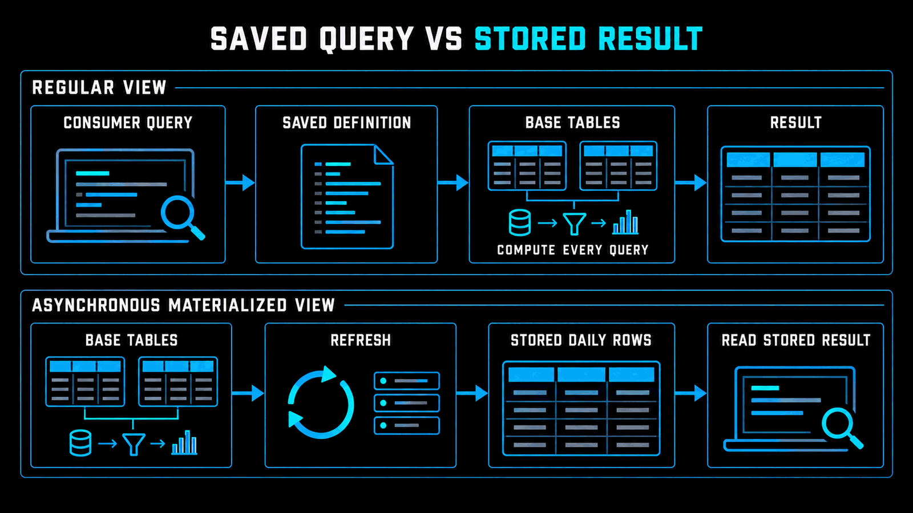
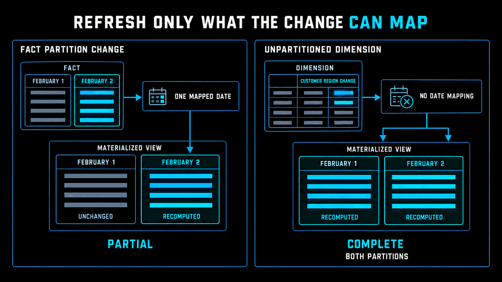
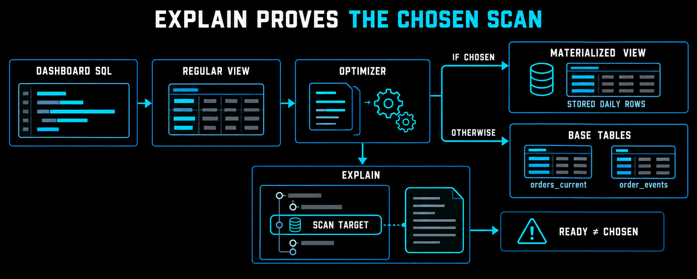

<a id="unit-u.9098cfbc14fa4ceca6ba7e9f543a62fd"></a>

<a id="module-8-views-and-materialized-views"></a>

# 8-модуль: көріністер және материалданған көріністер

| Курс туралы ақпарат | Мәні |
| --- | --- |
| Курс | Apache Doris көмегімен деректер қоймасын құру · 2-деңгей |
| Doris | Apache Doris 4.1.3 |
| Орта | 1-модульдегі курс сынақ ортасы; 7-зертханалық жұмыстың `orders_current` және `order_events` кестелері |
| Болжалды уақыт | Шамамен 117 минут: оқу 42, зертханалық жұмыс 65, тест 10 |

[Курстың README файлы](../../README.md) · [8-зертханалық жұмысты ашу](lab08_views_and_materialized_views.ipynb) · [8-тестті ашу](quiz08_views_and_materialized_views.ipynb)
<a id="unit-u.f4291a0693b74222881ea0890a7fdd96"></a>

<a id="module-goal"></a>

## Модуль мақсаты

Әр топқа күндік тапсырыстың бір анықтамасын беріңіз, қайталанатын сұраулар ақтаған жерде нәтижесін сақтаңыз және метадеректер, жолдар мен жоспарлар арқылы сақталған нәтиженің өзекті, дұрыс және қолданылғанын дәлелдеңіз.
<a id="unit-u.eaf28b3ab73f46b2b607c322b911ead9"></a>

<a id="learning-objectives"></a>

## Оқу мақсаттары

Осы модульді аяқтағаннан кейін сіз:

1. Кәдімгі көріністің сақталған сұрауын материалданған көріністің сақталған нәтижесінен ажыратасыз.
2. Тұтынушыларға қажет өзектілік пен жаңарту шығынына қарай жаңарту триггері мен аясын таңдайсыз.
3. Сәтті CREATE-ке сенудің орнына материалданған көріністің күйі мен жолдарын тексересіз.
4. EXPLAIN арқылы сұрау материалданған көріністі қолдану үшін қайта жазылды ма және неге жазылмағанын оқисыз.
5. Жарияланған көріністің іске асуы өзгергенде атаулары мен мағыналарын тұрақты сақтайсыз.
6. Қайталанатын сұраулар нәтижені сақтау мен жүргізуді ақтай ма, шешесіз.
<a id="unit-u.1045b2490e014040804e78a9e3c00a1e"></a>

<a id="module-structure"></a>

## Модуль құрылымы

| Бөлім | Уақыт | Нәтиже |
| --- | ---: | --- |
| 8.1 2-деңгей деректері | 5 мин | Қай дерек қай сұраққа жауап береді және сомалары |
| 8.2 Бір сұрақ, екі анықтама | 8 мин | «Күндік тапсырысқа» жылдамдықтан бұрын неге анықтама қажет |
| 8.3 Нәтижені сақтау | 9 мин | Кәдімгі, синхронды, асинхронды көріністер және қашан сақтау керек |
| 8.4 Жаңарту: қашан және қаншасын? | 8 мин | Қолмен, уақыт кестесімен және бөлім бойынша жаңарту |
| 8.5 Қайта жазуды дәлелдеу | 8 мин | EXPLAIN не көрсетеді және қайта жазылмаудың үш себебі |
| 8.6 Келісімшартты сақтау | 4 мин | Мағынасын емес, іске асуын өзгерту |
| 8-зертханалық жұмыс | 65 мин | Көріністі жариялау, күндік нәтижесін сақтау, жоспарларды оқу және жүргізудің үш түрін бақылау |
| 8-тест | 10 мин | Осы мақсаттарға арналған алты сұрақ |
<a id="unit-u.f1df84d82cf04514b8c11d9fba614ead"></a>

<a id="81-the-data-of-level-2"></a>

## 8.1 2-деңгей деректері

1-деңгей тарихы мен ағымдағы күйі бар дерекқор қалдырды. 2-деңгей соларға және өзінің шағын мысалына сүйенеді:

| Деректер | Қайдан келеді | Қайда қолданылады | Жолдар мен сомалар |
| --- | --- | --- | --- |
| 1-деңгей тапсырыстары | 6-зертханалық жұмыс қабылдаған тапсырыстардан 7-зертханалық жұмыстың `orders_current` және `order_events` кестелері | 8–12-модульдердің негізгі жолы | 11 тапсырыс, тапсырыс сомасы 1510.00; бас тартылған 900002-сіз 10 тапсырыс және 1310.00; төленгені 250.00, қайтарылғаны 150.00 |
| Деректер қоймасы мысалы | 9-зертханалық жұмыс жүктейтін `datasets/warehouse_case.json` | 9-жұмыс 5–7-бөлімдері, 10-жұмыс 5–6-бөлімдері, 11-жұмыстың қосымша бақылау тақтасы | 10 тапсырыс жеткізілімі, 8 тапсырыс және 850.00; бас тартылғансыз 7 тапсырыс және 800.00; есеп терезесінде 660.00 төленген |
| WWI тарихы | 5-зертханалық жұмыстың он `wwi_*` кестесі | 6-зертханалық жұмыстың `customers` арқылы 9-зертханалық жұмыстың тұтынушы өлшемі; 2-деңгейде басқа жерде қолданылмайды | 2013–2016 жылдардағы 701,846 жол; оның 663-і тұтынушы |

1-деңгей тапсырыстары екі күнде жасалып, екі рет төленді: күндік метрикаларды анықтау, сақтау, біріктіру және жариялауға жеткілікті, есеп терезесіндегі төлемдерді не қайта сатып алатын тұтынушыларды өлшеуге тым аз. Мысалда бұлар бар, 9-зертханалық жұмыс оның неге қажет екенін түсіндіреді. Сомалары өзіне тән; оларды 1-деңгейге қоспаңыз.

Сұрау жылдамдығын өлшеуге екеуіндегіден де көп жол қажет: 10-зертханалық жұмыс ол үшін 100,000 тапсырыс жасайды.
<a id="unit-u.276665ed65404af4884ef61de9921f75"></a>

<a id="82-one-question-two-definitions"></a>

## 8.2 Бір сұрақ, екі анықтама

Операция және қаржы топтары күндік тапсырыстарды сұрайды және екеуі де орынды SQL жазады. Операция тобы ағымдағы тапсырыстарды `event_time` күнімен топтайды:

```sql
SELECT DATE(event_time) AS order_date, COUNT(*) AS order_count, SUM(order_amount) AS gross_amount
FROM orders_current
GROUP BY DATE(event_time);
```

Қаржы тобы оларды әр тапсырысты жасаған оқиғаның күнімен топтап, бас тартылған тапсырыстарды тыс қалдырады:

```sql
SELECT DATE(e.event_time) AS order_date, COUNT(*) AS order_count, SUM(o.order_amount) AS gross_amount
FROM orders_current o
JOIN order_events e ON e.order_id = o.order_id AND e.event_version = 1
WHERE o.status <> 'CANCELLED'
GROUP BY DATE(e.event_time);
```

| order_date | Бірінші сұрау: тапсырыстар, сома | Екінші сұрау: тапсырыстар, сома |
| --- | ---: | ---: |
| 2026-01-01 | 7, 950.00 | 9, 1200.00 |
| 2026-01-02 | 4, 560.00 | 1, 110.00 |

Екі сұрауда да қате жоқ. `orders_current` әр тапсырыстың соңғы оқиға уақытын сақтайды: 900001 жеткізілді, 900002-ден бас тартылды, 900003 ақшасы 2 қаңтарда қайтарылды, сондықтан бірінші сұрау оларды сол күнде, бас тартылғанын қоса санайды. Екіншісі әр тапсырысты берілген күнінде бір рет санайды. Олар әртүрлі сұраққа жауап береді, ал біреуін екіншісінің атымен көрсететін бақылау тақтасы SQL қатесінсіз-ақ қате. Сұрауды жылдамдатпас бұрын мағынасын шешіңіз.

Курс екінші анықтаманы алады: тапсырыс күні — оның 1-нұсқа оқиғасының күні, бас тартылған тапсырыс саналмайды. **Кәдімгі көрініс** әр тұтынушы сол сұрауды орындауы үшін оны атаумен сақтайды:

**Оқуға арналған SQL мысалы: 8-зертханалық жұмыс жасайтын көрініс. Жұмыстан кейін қайта орындамаңыз.**

<!-- reading-only-example -->
```sql
CREATE VIEW orders_view_l2 AS
SELECT o.order_id,
       DATE(e.event_time) AS order_date,
       o.customer_id, o.status, o.order_amount, o.paid_amount, o.refund_amount, o.region
FROM orders_current o
JOIN order_events e ON e.order_id = o.order_id AND e.event_version = 1
WHERE o.status <> 'CANCELLED';
```

Көрініс күнді `order_date` деп атап, сүзгіні бір жерде ұстайды және тек есептер қолданатын бағандарды көрсетеді: 10 тапсырыс және 1310.00. Жолдар сақтамайды: әр сұрау сақталған сұрауды ағымдағы кестелерде орындайды, сондықтан солардай өзекті және солардай шығынды. Ол қатынау рұқсатын да бермейді: 12-модуль көрініске рұқсат береді.

`order_amount` — алынған ақша емес, тапсырыстың салыққа дейінгі құны: 900003 ақшасы қайтарылса да, көріністе 150.00 сақтайды. Төлемдер мен қайтарымдар — бөлек көрсеткіштер. Көрініс келісімшарты осыларды айтады: әр бағанның мағынасы, бірлігі, уақыт белдеуі, `NULL` мағынасы және оны кім өзгертетіні.
<a id="unit-u.d88ec0e7bec04ffd842ba25ec3e91a67"></a>

<a id="83-store-a-result"></a>

## 8.3 Нәтижені сақтау

Күндік қорытындыларды бірнеше минут сайын ашатын бақылау тақтасы бірдей біріктіру мен агрегаттауды қайта-қайта орындайды және тапсырыстар өзгергенше бірдей жауап алады. **Материалданған көрініс** сол жауапты сақтайды: көрініс сияқты сұрауы, кесте сияқты нәтижесі бар.



*Кәдімгі көрініс логиканы, материалданған көрініс есептелген жолдарды сақтайды.*

Суреттегі жазулар: SAVED QUERY VS STORED RESULT — сақталған сұрау мен сақталған нәтиже; REGULAR VIEW — кәдімгі көрініс; CONSUMER QUERY — тұтынушы сұрауы; SAVED DEFINITION — сақталған анықтама; BASE TABLES — негізгі кестелер; COMPUTE EVERY QUERY — әр сұрауда есептеу; RESULT — нәтиже; ASYNCHRONOUS MATERIALIZED VIEW — асинхронды материалданған көрініс; REFRESH — жаңарту; STORED DAILY ROWS — сақталған күндік жолдар; READ STORED RESULT — сақталған нәтижені оқу.

| Нысан | Не сақтайды | Қашан есептейді | Нені бақылау керек |
| --- | --- | --- | --- |
| Кәдімгі көрініс | Сұрауды | Әр сұрауда | Әр сұраудың шығынын |
| Синхронды материалданған көрініс | Бір кестенің агрегатын не басқа баған ретін, кестемен бірге | Кестеге әр жүктеуде | Жүктеудің қосымша жұмысын; тек бір кесте, Unique Key кестесінде агрегаттау жоқ |
| Асинхронды материалданған көрініс | Бір не бірнеше кесте сұрауының нәтижесін | Әр жаңартуда | Өзектілікті және әр жаңартудың шығынын |

**Оқуға арналған SQL мысалы: 8-зертханалық жұмыс жасайтын материалданған көрініс. Жұмыстан кейін қайта орындамаңыз.**
Ол көріністегідей кестелермен, біріктірумен және сүзгімен күндік қорытындыларды сақтайды:

<!-- reading-only-example -->
```sql
CREATE MATERIALIZED VIEW orders_daily_mv_l2
BUILD IMMEDIATE
REFRESH AUTO ON MANUAL
AS
SELECT DATE(e.event_time) AS order_date,
       COUNT(*) AS order_count,
       SUM(o.order_amount) AS gross_amount
FROM orders_current o
JOIN order_events e ON e.order_id = o.order_id AND e.event_version = 1
WHERE o.status <> 'CANCELLED'
GROUP BY DATE(e.event_time);
```

`BUILD IMMEDIATE` көрініс жасалғанда алғашқы құруды бастайды; `REFRESH AUTO` қаншасын қайта есептеуді Doris-ке шешкізеді; `ON MANUAL` жаңартуды тек `REFRESH MATERIALIZED VIEW` операторы бастайтынын білдіреді. Құру `CREATE` қайтқаннан кейін тапсырма ретінде орындалады. Сәтті `CREATE` тек анықтаманы қабылдады, сондықтан кейін әрқайсысының өз сұрағы бар төрт нәрсені тексеріңіз:

| Тексеру | Қайда | Сұрақ |
| --- | --- | --- |
| `State` | `mv_infos('database'='<db>')` | Материалданған көріністі мүлде қолдануға бола ма? NORMAL |
| `RefreshState` | Сол жерде | Соңғы жаңартуы сәтті ме? SUCCESS |
| `SyncWithBaseTables` | Сол жерде | Нәтижесі негізгі кестелерге әлі сәйкес пе? 1 |
| Жолдар | Материалданған көріністен `SELECT` | Анықтаманың жауабы ма? 9 / 1200.00 және 1 / 110.00 |

Жаңарту сәтсіз болса не тым ұзаққа созылса, `tasks('type'='mv')` көріністің жаңарту тапсырмаларын `Status` және `ErrorMsg` өрістерімен тізеді; жұмыс күту уақыты аяқталғанда оларды көрсетеді.

Бірдей қымбат сұрау жиі қойылып, жауабы бірнеше минут ескі бола алса және жаңартуды біреу бақыласа, нәтижені сақтау пайдалы. Бір реттік зерттеуде, сұрау пішіні үнемі өзгергенде немесе деректер жаңарту ілесе алмайтындай жылдам өзгергенде пайдасы жоқ. Он тапсырыста ештеңе сақтаудың қажеті жоқ; жұмыс сақталған нәтиженің мінез-құлқын көрсету үшін сақтайды, ал 10-зертханалық жұмыс сақтаудың үнемін 100,000 жолда өлшейді.
<a id="unit-u.0c1d38e5493d40018e31727263d34a6c"></a>

<a id="84-refresh-when-and-how-much"></a>

## 8.4 Жаңарту: қашан және қаншасын?

Жаңарту екі сұраққа жауап береді: қашан орындалады және қаншасын қайта есептейді.

**Қашан.** `ON MANUAL` оператор айтқанда жаңартады, мысалы пакет жүктейтін тапсырманың соңында; тұтынушыларға аяқталған пакет керек болса, бұл дұрыс триггер. `ON SCHEDULE EVERY 10 MINUTE` бірдеңе өзгерсе де, өзгермесе де уақыт бойынша жаңартады; бұл үздіксіз келетін деректерге және белгілі кідірісті қабылдайтын тұтынушыға жарайды. Уақыт бойынша жаңарту кешіккен пакет әлі келгенін білмейді.

**Қаншасын.** Мұнда «инкременттік» Doris алдыңғы қосындыға жаңа жол қоспай, тек әсер еткен бөлімдерді қайта есептейтінін білдіреді. Негізгі кестенің күн бағаны бойынша `PARTITION BY` жасалған материалданған көрініс әр бөлімін сол кестенің бөліміне сәйкестендіреді, сондықтан бір күн бөлімінің өзгерісі бір күнді жаңартады:

| Өзгеріс | Doris нені сәйкестендіре алады | 8-зертханалық жұмыста `REFRESH ... AUTO` нені қайта есептейді |
| --- | --- | --- |
| Факт кестесінің 2 ақпан бөліміне жаңа тапсырыс | 2 ақпан | Бір бөлім: `RefreshMode` PARTIAL |
| Бөлімделмеген тұтынушы кестесінде 1-тұтынушының аймағы | Ешбір күнге сәйкестенбейді | Екі бөлім: `RefreshMode` COMPLETE |

Екінші жаңарту 2 ақпанда ештеңе өзгермесе де оны қайта есептеді: бұрынғы және кейінгі бірдей мәндер қаншасы есептелгенін көрсетпейді. Оны тапсырманың `NeedRefreshPartitions` өрісі көрсетеді, қайта жарияланған бөлім жаңа `PartitionId` алады. Бір күн сомасы 200.00-ден 180.00-ге өзгерсе, жаңарту күнді ағымдағы жолдарынан қайта есептейді; 200.00-ге ешқашан 180.00 қоспайды.



*Бөлімдік жаңарту Doris өзгерісті күндерге сәйкестендіре алғанда ғана жұмыс істейді.*

Суреттегі жазулар: REFRESH ONLY WHAT THE CHANGE CAN MAP — өзгеріспен сәйкестенетінін ғана жаңарту; FACT PARTITION CHANGE — факт бөлімінің өзгерісі; FACT — факт; FEBRUARY 1, FEBRUARY 2 — 1 ақпан, 2 ақпан; ONE MAPPED DATE — сәйкес бір күн; MATERIALIZED VIEW — материалданған көрініс; UNCHANGED — өзгермеген; RECOMPUTED — қайта есептелген; PARTIAL — ішінара; UNPARTITIONED DIMENSION — бөлімделмеген өлшем; DIMENSION — өлшем; CUSTOMER REGION CHANGE — тұтынушы аймағының өзгерісі; NO DATE MAPPING — күнге сәйкестік жоқ; COMPLETE — толық; BOTH PARTITIONS — екі бөлім де.

8-зертханалық жұмыс басқа жағын да көрсетеді: жазудан кейінгі қолмен жаңартылатын нәтиже. Кәдімгі көрініс 2 тапсырыс пен 150.00 бірден көрсетеді; материалданған көрініс жаңартылғанша 1 тапсырыс пен 100.00 сақтайды. Синхронды материалданған көріністе мұндай аралық жоқ: жүктеу оны жаңартады, шығыны әр жүктеуге ауысады.
<a id="unit-u.02a28f5adec64902b2e76545df29d6fd"></a>

<a id="85-prove-a-rewrite"></a>

## 8.5 Қайта жазуды дәлелдеу

Бақылау тақталары материалданған көріністі емес, кәдімгі көріністі сұрайды. Сұрау материалданған көрініс сақтайтынды сұраса, Doris негізгі кестелердің орнына сақталған жолдарды оқитындай қайта жаза алады: **мөлдір қайта жазу**. Төрт нәрсе оңай шатасады: көрініс жасалды, жаңартуы аяқталды, оны тікелей сұрау дұрыс жолдар қайтарады және негізгі кестелердің не көріністің сұрауы оны қолданатындай қайта жазылды. Алғашқы үшеуі төртіншісін дәлелдемейді.



*Сұрау қай нысанды сканерлейтінін тек жоспар дәлелдейді.*

Суреттегі жазулар: EXPLAIN PROVES THE CHOSEN SCAN — EXPLAIN таңдалған сканерлеуді дәлелдейді; DASHBOARD SQL — бақылау тақтасының SQL-і; REGULAR VIEW — кәдімгі көрініс; OPTIMIZER — оңтайландырғыш; IF CHOSEN — таңдалса; MATERIALIZED VIEW — материалданған көрініс; STORED DAILY ROWS — сақталған күндік жолдар; OTHERWISE — әйтпесе; BASE TABLES — негізгі кестелер; orders_current, order_events — кесте атаулары; EXPLAIN — EXPLAIN; SCAN TARGET — сканерлеу нысаны; READY ≠ CHOSEN — дайын болу таңдалумен тең емес.

`EXPLAIN` сұрау жоспарын орындамай көрсетеді. Әр сканерлеу оқитын кесте не материалданған көріністі атайды, бір бөлім Doris сынаған материалданған көріністерді тізеді: таңдалған, қолдануға жарамды, бірақ таңдалмаған не себебімен жарамсыз. 8-зертханалық жұмыс `orders_view_l2` үш сұрауын түсіндіреді:

| Көрініс сұрауы | Жоспар не оқиды | `orders_daily_mv_l2` |
| --- | --- | --- |
| Күндік қорытындылар | `orders_daily_mv_l2` | Таңдалған |
| Күн және аймақ қорытындылары | `orders_current` және `order_events` | Жарамсыз: `View dimensions doesn't not cover the query dimensions` |
| Тек 1 қаңтар қорытындысы | `orders_current` және `order_events` | Жарамсыз: `Rewrite compensate predicate by view fail` |

Екіншісіне жауап беру мүмкін емес: сақталған жолдарда аймақ жоқ, қайта жазу материалданған көрініс сақтамаған бағанды қайтара алмайды. Үшіншісі таңғалдырады: сақталған жолдарда `order_date` бар, бірақ сол сүзгі қайта жазуды тоқтатты. Doris 4.1.3 материалданған көрініс іздемес бұрын `DATE(event_time) = '2026-01-01'` шартын `event_time` ауқымына — `event_time >= '2026-01-01 00:00:00' AND event_time <= '2026-01-01 23:59:59'` — айналдырады, ал сақталған жолдарда `event_time` жоқ. 9-модульдің тапсырыс фактісі сияқты нақты `DATE` бағаны бар кестеде сол сүзгіні сақталған жолдарға қолдануға болады: 4.1.3-те өлшенгендей, қайта жазу сонда сәтті болады, бірақ өте шағын кестелерде оңтайландырғыш әлі негізгі кестені таңдауы мүмкін.

Сұрау қайта жазылмаса, мына ретпен қараңыз: материалданған көрініс дайын ба (`State`, `RefreshState`); сұрауға қажет түйіршіктілікті, бағандар мен сүзгілерді сақтай ма; шығынға негізделген оңтайландырғыш өте шағын кестелерде жасай алатындай негізгі кестелерді жай таңдады ма, көріністі жарамды, бірақ таңдалмаған деп тізді ме? Қайта жазылған жоспардың өзі жауаптың дұрыстығын айтпайды: 8.3 бөліміндегідей сақталған жолдарды анықтамамен салыстырыңыз.
<a id="unit-u.0cec8623842d4cf18a7f02177c8268d4"></a>

<a id="86-keep-the-contract"></a>

## 8.6 Келісімшартты сақтау

Тұтынушылар көріністің қалай есептелетініне емес, атаулары мен мағыналарына тәуелді. Бұл астындағы іске асуын өзгертуге мүмкіндік береді: әр баған атауын, түрін және мағынасын сақтаса, өзгеріс бірдей деректердің ескі және жаңа жауабын салыстырып тексерілсе, көрініс сұрауы материалданған көріністі не басқа кестені оқи алады. `gross_amount` атауын `revenue` ету не бір жолы бір күн болатын көрініске `customer_id` қосу келісімшартты өзгертеді, тұтынушыларға алдын ала айту керек.

Жаңа түйіршіктіліктегі жаңа сұраққа жаңа интерфейс беріледі. Аймақтық бақылау тақтасы әр күн мен аймақ тапсырыстарын сұраса, `orders_daily_mv_l2` жауап бере алмайды; сол түйіршіктіліктегі екінші материалданған көрініс жауап береді, оны 8-зертханалық жұмыстың жаттығуы жасайды. Ол күндік көріністен көп жол сақтайды және жоспарлап, тексеретін тағы бір жаңарту қосады.
<a id="unit-u.7a9deb5058064899a6dc16aa6ff34f86"></a>

<a id="lab-8-share-one-definition-store-its-result-and-check-the-rewrite"></a>

## 8-зертханалық жұмыс: бір анықтаманы ортақ қолдану, нәтижесін сақтау және қайта жазуды тексеру

[8-зертханалық жұмыс: бір анықтаманы ортақ қолдану, нәтижесін сақтау және қайта жазуды тексеру](lab08_views_and_materialized_views.ipynb) файлын ашыңыз. Сіз:

1. «Күндік тапсырысқа» екі жауапты салыстырасыз: 1 қаңтарда 7 не 9 тапсырыс.
2. Курс анықтамасын `orders_view_l2` кәдімгі көрінісі ретінде жариялайсыз: 10 тапсырыс, 1310.00.
3. Күндік қорытындысын `orders_daily_mv_l2` ішінде сақтап, күйі мен жолдарын тексересіз.
4. Көріністің үш сұрауын түсіндіріп, қайсысына материалданған көрініс жауап беретінін көресіз.
5. Жеке шағын кестелерде: қолмен жаңартылатын нәтиженің ескіріп, қуып жетуін, жүктеу жаңартатын синхронды материалданған көріністі, бір күннің бөлімін жаңартуды екі күнді жаңартумен салыстырып бақылайсыз.
6. Жаттығу: күн мен аймақ қорытындысын сақтап, аймақ сұрауының қайта жазылғанын көресіз.

1-модульдегі курс сынақ ортасы және 7-зертханалық жұмыстың `orders_current`, `order_events` кестелері қажет; жұмыс екеуін де өзгертпейді, өз нысандары `_l2` жұрнағымен аяқталады.
<a id="unit-u.701a709613d94127b7f8635ef242bdc2"></a>

<a id="summary"></a>

## Қорытынды

- Кәдімгі көрініс сұрауды сақтап, деректер сақтамайды, сондықтан әрқашан кестелері сияқты өзекті және қымбат; материалданған көрініс жүктеу не жаңарту өзекті ұстайтын нәтижені сақтайды.
- Тұтынушылар күтетін оқиғада, мысалы пакет аяқталғанда не олар қабылдайтын уақыт кестесімен жаңартыңыз; бөлімделген материалданған көрініс Doris өзгеріспен байланыстыра алатын бөлімдерді, байланыстыра алмаса, бәрін қайта есептейді.
- `CREATE` кейін `State`, `RefreshState`, `SyncWithBaseTables` тексеріп, сақталған жолдарды анықтамамен салыстырыңыз; `tasks('type'='mv')` жаңартудың неге сәтсіз болғанын айтады.
- `EXPLAIN` Doris сынаған материалданған көріністерді және біреуінің қолданылмау себебін тізеді: жетіспейтін баған не түйіршіктілік, сақталған жолдарға қолдана алмайтын сүзгі немесе арзанырақ негізгі кесте.
- Көрініс іске асуын еркін, ал атаулары мен мағыналарын тек тұтынушыларымен келісіп өзгертіңіз; жаңа түйіршіктілік — жаңа интерфейс.
- Бірдей қымбат сұрау жиі қойылып, тұтынушылары бақыланатын кідірісті қабылдаса, нәтижені сақтаңыз; бір реттік сұрақ не өте шағын кесте үшін емес.
<a id="unit-u.f3f4ebdb7ac74196a1bf69c1c71ab2d3"></a>

<a id="quiz-8"></a>

## 8-тест

[8-тест: көріністер және материалданған көріністер](quiz08_views_and_materialized_views.ipynb) файлын ашыңыз. Онда бір дұрыс жауабы бар алты сұрақ бар және іске қосылған орта қажет емес.

Келесі модуль: [9-модуль: деректер қоймасын модельдеу және біріктірулер](../module09-modeling-and-joins/course.md).
<a id="unit-u.b316559326ac49db9b4fd600c46a81c2"></a>

<a id="references"></a>

## Дереккөздер

- [Apache Doris: CREATE VIEW](https://doris.apache.org/docs/4.x/sql-manual/sql-statements/table-and-view/view/CREATE-VIEW/)
- [Apache Doris: Синхронды материалданған көріністер](https://doris.apache.org/docs/4.x/query-acceleration/materialized-view/sync-materialized-view/)
- [Apache Doris: Асинхронды материалданған көріністер шолуы](https://doris.apache.org/docs/4.x/query-acceleration/materialized-view/async-materialized-view/overview/)
- [Apache Doris: Асинхронды материалданған көріністердің үздік тәсілдері](https://doris.apache.org/docs/4.x/query-acceleration/materialized-view/async-materialized-view/use-guide/)
- [Apache Doris: CREATE ASYNC MATERIALIZED VIEW](https://doris.apache.org/docs/4.x/sql-manual/sql-statements/table-and-view/async-materialized-view/CREATE-ASYNC-MATERIALIZED-VIEW/)
