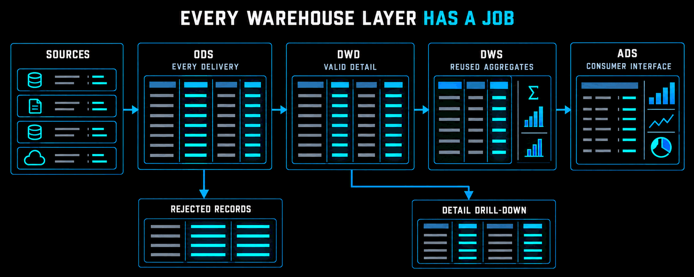
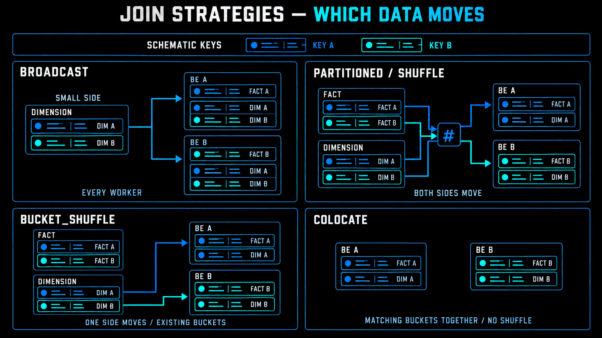
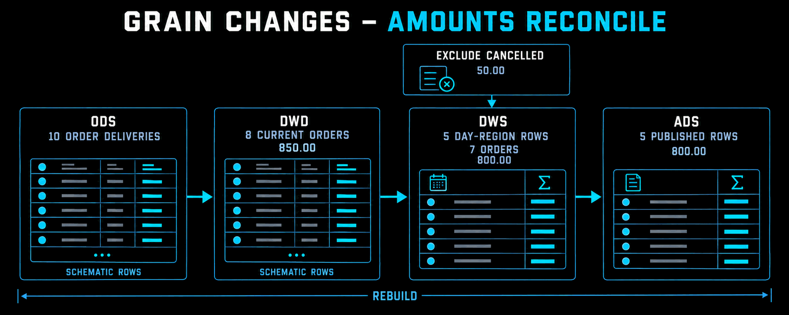

<a id="unit-u.8fc0195e323944e9b83b5f41a4cf08af"></a>

<a id="module-9-warehouse-modeling-and-joins"></a>

# 9-модуль: деректер қоймасын модельдеу және біріктірулер

| Курс туралы ақпарат | Мәні |
| --- | --- |
| Курс | Apache Doris көмегімен деректер қоймасын құру · 2-деңгей |
| Doris | Apache Doris 4.1.3 |
| Орта | 1-модульдегі курс сынақ ортасы; 6-зертханалық жұмыстың `customers`; 7-зертханалық жұмыстың `orders_current` және `order_events` кестелері |
| Болжалды уақыт | Шамамен 112 минут: оқу 42, зертханалық жұмыс 60, тест 10 |

[Курстың README файлы](../../README.md) · [9-зертханалық жұмысты ашу](lab09_modeling_and_joins.ipynb) · [9-тестті ашу](quiz09_modeling_and_joins.ipynb)
<a id="unit-u.7a7c20ac7ca040119bfc7fd4fcbb45d2"></a>

<a id="module-goal"></a>

## Модуль мақсаты

Тапсырыстарды факт, тұтынушыларды өлшем ретінде модельдеп, бірде-бір тапсырысты жоғалтпай не екі еселемей біріктіріңіз және әр жеткізілімді сақтайтын, қайта құруға болатын қойма қабаттарының тізбегін орындаңыз.
<a id="unit-u.7fe58bc6ca524eb7aa63e01366801e5e"></a>

<a id="learning-objectives"></a>

## Оқу мақсаттары

Осы модульді аяқтағаннан кейін сіз:

1. Біріктірмес бұрын факт және өлшем кестелерінің түйіршіктілігін айтасыз.
2. Дереккөз жазбаларды қосатынына не ағымдағы күйді ауыстыратынына қарай кесте моделі мен кілтін таңдайсыз.
3. Біріктіруде жоғалған және қайталанған жолдарды жолдар санымен, бөлек кілттермен және сомалармен тексересіз.
4. Өлшем жолы жетіспейтін фактілерді сол жақ не антибіріктірумен табасыз.
5. Жоспарды өлшеу деп қабылдамай, EXPLAIN арқылы біріктіру түрі мен таратылуын оқисыз.
6. Бастапқы жеткізілімдерді, тексерілген егжей-тегжейлі деректерді және агрегаттарды қайта құруға болатын бөлек қабаттарда сақтайсыз.
<a id="unit-u.893ab146c2e44aceb392bff55bd8a17e"></a>

<a id="module-structure"></a>

## Модуль құрылымы

| Бөлім | Уақыт | Нәтиже |
| --- | ---: | --- |
| 9.1 Әр қабатқа міндет беру | 8 мин | ODS, DWD, DWS, ADS және 1-деңгей не жасап қойғаны |
| 9.2 Түйіршіктілікті жариялау | 8 мин | Факт пен өлшемнің бір жолының мағынасы және оны сақтайтын модель |
| 9.3 Жолдарды жоғалтатын не екі еселейтін біріктірулер | 8 мин | Екі қате және оларды көрсететін не жасыратын біріктірулер |
| 9.4 Жоспар қалай біріктіреді | 6 мин | Broadcast, shuffle, bucket shuffle, colocate |
| 9.5 Біріктіруді қабылдау | 5 мин | Бір жалпы сома алмастыра алмайтын төрт тексеру |
| 9.6 Жеке мысалдағы тізбек | 7 мин | Қайта құру арқылы жеткізілімдерден жарияланған қорытындыға |
| 9-зертханалық жұмыс | 60 мин | Тапсырыс фактісі мен тұтынушы өлшемін жасау, біріктіруін тексеру, жоспарын оқу және тізбекті орындау |
| 9-тест | 10 мин | Осы мақсаттарға арналған алты сұрақ |
<a id="unit-u.daee7f744872459eadbe52dfe4ce0035"></a>

<a id="91-give-each-layer-a-job"></a>

## 9.1 Әр қабатқа міндет беру

Тапсырыс пакетімен қате сома келеді. Бақылау тақтасы әлі жарамды күндік қорытынды көрсетуі, деректер тобы қате жазбаны түзетіп, қайта жүктеу үшін сақтауы керек. Тек соңғы қорытындыны сақтайтын қойма дәлелді жоғалтады; тек бастапқы кірісті сақтайтыны әр есепке тазалауды қайталатады. Қабаттар әр міндетке өз кестесін береді:

| Қабат | Қай сұраққа жауап береді | Басқа атауы | Осы курста |
| --- | --- | --- | --- |
| ODS, Operational Data Store | Дереккөздер не жіберді? | Бастапқы не аралық қабат | 6-жұмыстың `orders_raw`, 7-жұмыстың `event_deliveries`, 9-жұмыстың `ods_*` кестелері |
| DWD, Data Warehouse Detail | Бизнес түйіршіктілігінде қай жазбалар өтті? | Тазартылған не негізгі қабат | `orders_clean`, `orders_current`, `order_events`; 9-жұмыстың `orders_fact_l2` және `dwd_*` кестелері |
| DWS, Data Warehouse Summary | Есептер қай агрегаттарды қайта қолданады? | Агрегат қабаты, деректер витринасының бөлігі | 10-жұмыстың `daily_order_metrics_l2`, 9-жұмыстың `dws_orders_region_day_l2` |
| ADS, Application Data Service | Тұтынушы не оқиды? | Ұсыну қабаты, витрина интерфейсі | 11-жұмыстың `bi_order_metrics_l2`, 9-жұмыстың `ads_orders_region_day_l2` |



*Қабаттар дәлелді сақтап, егжей-тегжейлі деректерді қайта қолданылатын қорытындылардан бөледі.*

Суреттегі жазулар: EVERY WAREHOUSE LAYER HAS A JOB — қойманың әр қабатында міндет бар; SOURCES — дереккөздер; ODS — бастапқы сақтау қабаты; EVERY DELIVERY — әр жеткізілім; DWD — егжей-тегжейлі деректер қабаты; VALID DETAIL — жарамды егжей-тегжейлі деректер; DWS — қорытынды қабаты; REUSED AGGREGATES — қайта қолданылатын агрегаттар; ADS — ұсыну қабаты; CONSUMER INTERFACE — тұтынушы интерфейсі; REJECTED RECORDS — қабылданбаған жазбалар; DETAIL DRILL-DOWN — егжей-тегжейлі деректерге өту.

Төрт атау — Doris кестелерінің түрлері емес, модельдеу дәстүрі: қабат кесте не көрініс бола алады, төрт кестеге префикс қою конвейер жасамайды. Конвейерді жасайтыны жазылып көрсетіледі: әр қабат алдыңғысынан қалай есептеледі, қашан жаңартылады, қабылданбаған жазбалар қайда кетеді және сәтсіз пакет қалай қайта орындалады. 1-деңгей алғашқы екі қабатты атамай-ақ жасады; 9–11-жұмыстар басқаларын қосады.
<a id="unit-u.be1bf91ea7cf4ef2b69e76f0cdc8b26a"></a>

<a id="92-declare-the-grain"></a>

## 9.2 Түйіршіктілікті жариялау

**Факт** бизнес оқиғасын не көрсеткішін тіркейді: тапсырыс, тапсырыс жолы, төлем. **Өлшем** оны сипаттайды: тұтынушы аты, өнім санаты, аймақ. Біріктірмес бұрын әрқайсысының бір жолы нені білдіретінін, яғни **түйіршіктілігін** айтыңыз:

| Кесте | Бір жолы | Нені білдірмейді |
| --- | --- | --- |
| `orders_fact_l2` | Қазіргі күйіндегі, жасалған оқиғасының күнімен берілген бір тапсырыс | Тапсырыстың әр оқиғасын емес |
| `order_events` | Тапсырыстың бір оқиғасы | Тапсырыстың ағымдағы күйін емес |
| `payments` | Бір төлем | Тапсырыстың төленген жалпы сомасын емес |
| `customers_dim_l2` | Бір тұтынушының ағымдағы атрибуттары | Тұтынушының әр бұрынғы нұсқасын емес |

9-зертханалық жұмыстың тапсырыс фактісі 7-зертханалық жұмыстың ағымдағы күйіндегі 11 тапсырыстың бәрін, бас тартылған 900002-ні де күйімен, сомаларымен және тапсырыс тіркелген сату аймағымен сақтайды; бас тартылған тапсырысты санауды есеп өз сүзгісімен шешеді. Өлшемі 6-зертханалық жұмыстың 663 WWI тұтынушысын бір-бір жолдан сақтайды.

Кесте моделі дереккөздің жазу тәсіліне байланысты:

| Дереккөз | Модель және кілт | Себебі |
| --- | --- | --- |
| Бастапқы жеткізілімдер, оқиғалар тарихы | Duplicate Key | Әр жол — қайталануларды қоса сақталатын жазба |
| Тұтынушы атрибуттары сияқты ағымдағы күй | Бизнес кілті бойынша Unique Key | Кілттің жаңа жолы ескісін ауыстырады |
| Тек өсетін қосылатын көрсеткіштер | `SUM` бар Aggregate Key | Бірдей кілтті жолдар қосылады |

Duplicate Key кестесі жолдарды кілтімен ұйымдастырады; бір тапсырыстың екінші жолын бөгемейді. Тапсырыс фактісі әр орындауда ағымдағы күйден қайта құрылады, түйіршіктілігі `COUNT(*)` пен `COUNT(DISTINCT order_id)` салыстыруымен тексеріледі. Unique Key өлшемінде бір тұтынушының екі ағымдағы жолы бола алмайды; Duplicate Key өлшемінде жүктеу өзгерген тұтынушыны ауыстырудың орнына қосқан бойда бола алады.

Есептерге тұтынушының бүгінгі емес, әр тапсырыс кезіндегі атрибуттары қажет болса, бір тұтынушы үшін қиылыспайтын `valid_from` және `valid_to` жарамдылық шектері бар нұсқаларды сақтап, әр тапсырысты оқиға уақытында жарамды нұсқамен біріктіріңіз. `valid_to IS NULL` жолдарын алу басқа сұраққа жауап береді: тұтынушының ағымдағы атрибуттары. Курс өлшемі тек ағымдағыларын сақтайды.
<a id="unit-u.c982eb8048b7427299415d49c770013b"></a>

<a id="93-joins-that-lose-or-double-rows"></a>

## 9.3 Жолдарды жоғалтатын не екі еселейтін біріктірулер

Екі бөлек ақау біріктіруді бұзады. Екі рет сәйкес келетін өлшем жолы факт көрсеткіштерін екі еселейді; жоқ өлшем жолы фактіні алып тастайды не атрибутсыз қалдырады. Дербес мысал: өлшемде 1-тұтынушының екі, 2-тұтынушының бір жолы бар.

```sql
WITH facts AS (
    SELECT 1 AS order_id, 1 AS customer_id, 100 AS amount
    UNION ALL SELECT 2, 2, 200
), dim AS (
    SELECT 1 AS customer_id, 'Tailspin Toys (Head Office)' AS customer_name
    UNION ALL SELECT 1, 'Tailspin Toys, head office'
    UNION ALL SELECT 2, 'Tailspin Toys (Sylvanite, MT)'
)
SELECT COUNT(*) AS joined_rows, COUNT(DISTINCT f.order_id) AS orders, SUM(f.amount) AS joined_amount
FROM facts f
JOIN dim d ON f.customer_id = d.customer_id;
```

Нәтиже — құны 300 болатын тапсырыстар үшін 3 жол, 2 тапсырыс және 400: 1-тапсырыс екі рет саналады. `COUNT(DISTINCT order_id)` әлі 2 дейді, сондықтан жалғыз өзі артық соманы байқамайды, `SUM(DISTINCT amount)` та түзетпейді: сомасы бірдей екі тапсырыс бір рет саналар еді. Біріктіруге дейінгі және кейінгі жолдарды, бөлек тапсырыстарды және соманы салыстырып, өлшем кілтін бөлек тексеріңіз.

Біріктіру түрі сәйкес келмеген фактімен не болатынын шешеді:

| Біріктіру | Қай фактілерді сақтайды | Не үшін қолданылады |
| --- | --- | --- |
| `INNER JOIN` | Тек сәйкес келгендерін | Өлшемі белгілі фактілерді талдау; тұтынушысы жоқ тапсырыстар жоғалады |
| `LEFT JOIN` | Бәрін; сәйкестік болмаса, өлшем бағандары `NULL` | Әр тапсырысты сақтау және тұтынушысы жоқтарын көру |
| `FULL OUTER JOIN` | Екі жақтың да сәйкес келмеген жолдарын да | Екі жиынды салыстыру (10-модуль) |
| `LEFT SEMI JOIN` | Сәйкестік болса, әр фактіні бір рет | Фактілерді өлшем жолдарының жиынымен сүзу |
| `LEFT ANTI JOIN` | Тек сәйкес келмеген фактілерді | Жетіспейтін өлшем жолдарын табу |

9-зертханалық жұмыстан кейін сол жақ біріктіру түрінде жазылған бұл антибіріктіру тұтынушысы жоқ тапсырыстарды табады:

```sql
SELECT f.customer_id, COUNT(*) AS orders_without_customer
FROM orders_fact_l2 f
LEFT JOIN customers_dim_l2 d ON d.customer_id = f.customer_id
WHERE d.customer_id IS NULL
GROUP BY f.customer_id;
```

Бос нәтиже әр тапсырыстың тұтынушысы барын білдіреді. Ішкі біріктіру мұны тексере алмайды: іздеп отырған жолдарыңызды дәл өзі алып тастайды. Екі ақау қатар болып, жалпы сомада бірін-бірі жасыра алады, мұны 9-зертханалық жұмыс көрсетеді.
<a id="unit-u.5851fc8c2b194f928efebaebd46db33f"></a>

<a id="94-how-the-plan-joins"></a>

## 9.4 Жоспар қалай біріктіреді?

Логикалық біріктіру қай жолдар шығатынын, физикалық біріктіру Doris сәйкес жолдарды қалай біріктіретінін айтады:



*Біріктіру таратылулары сәйкес орындаушыларға қай жолдар жылжитынымен ерекшеленеді.*

Суреттегі жазулар: JOIN STRATEGIES – WHICH DATA MOVES — біріктіру стратегиялары: қай деректер жылжиды; SCHEMATIC KEYS — шартты кілттер; KEY A, KEY B — A және B кілттері; BROADCAST — барлық орындаушыға тарату; SMALL SIDE — шағын жақ; DIMENSION — өлшем; DIM A, DIM B — A және B өлшем жолдары; BE A, BE B — A және B BE түйіндері; FACT, FACT A, FACT B — факт және A, B факт жолдары; EVERY WORKER — әр орындаушы; PARTITIONED / SHUFFLE — екі жақты қайта тарату; BOTH SIDES MOVE — екі жақ та жылжиды; BUCKET_SHUFFLE — бакет бойынша қайта тарату; ONE SIDE MOVES / EXISTING BUCKETS — бір жақ жылжиды, бар бакеттерге; COLOCATE — бірге орналастыру; MATCHING BUCKETS TOGETHER / NO SHUFFLE — сәйкес бакеттер бірге, қайта тарату жоқ.

| Таратылу | Не жылжиды | Қашан жарайды |
| --- | --- | --- |
| `BROADCAST` | Бір жақ, әдетте кішісі, екіншісін сканерлейтін әр данаға жіберіледі | Шағын өлшем және үлкен факт |
| `PARTITIONED`, shuffle | Екі жақ біріктіру кілті бойынша қайта таратылады | Екі үлкен жақ |
| `BUCKET_SHUFFLE` | Тек бір жақ екіншісінің бакеттеріне жылжиды | Біріктіру кілті екінші жақтың бакеттерге бөлу кілті болса |
| `COLOCATE` | Ештеңе: сәйкес бакеттер қазірдің өзінде бірге | Бір colocation тобын және оның бакеттерге бөлінуін бөлісетін кестелер |

`EXPLAIN` біріктіру түйініндегі таңдауды көрсетеді: 9-зертханалық жұмыста `customer_id` шарты бар `join op: INNER JOIN(BROADCAST)[]` және тұтынушыларды тапсырыстар сканерлеуіне жіберетін exchange. Екі кесте анықтамасындағы `HASH(customer_id)` оларды бірге орналастырмайды: оған colocation тобы қажет. Жоспар — Doris-тің осы деректер мен статистика үшін таңдауы; Query Profile орындалудың іс жүзінде не істегенін тіркейді. Бір BE және бір бакеті бар сынақ ортасы стратегияларды кластерде салыстыруды емес, жоспар оқуды үйретеді.

**Runtime Filter** — біріктіру жоспарының тағы бір бөлігі: орындау кезінде Doris бір жақтың біріктіру кілттерінен сүзгі құрып, екінші жақтың сканерлеуіне қолданады, сәйкес келе алмайтын жолдар ерте өткізіліп жіберіледі. Ол біріктіру қайтаратын жолдарды емес, оқылатын көлемді өзгертеді және қайталанған өлшем кілтін түзетпейді.
<a id="unit-u.bdb1ac3703af44e9bb355215883c1ce5"></a>

<a id="95-accept-a-join"></a>

## 9.5 Біріктіруді қабылдау

9-зертханалық жұмыс тапсырыс фактісін тұтынушылармен сол жақ біріктіруге дейін және кейін салыстырады:

| Кезең | Жолдар | Бөлек тапсырыстар | Сома |
| --- | ---: | ---: | ---: |
| Біріктіруге дейін | 11 | 11 | 1510.00 |
| Сол жақ біріктіруден кейін | 11 | 11 | 1510.00 |

Өлшем кілті бірегей (663 жол, 663 тұтынушы), антибіріктіру бос. Содан кейін 2-тұтынушысы жоқ, 1-тұтынушысы екі рет болатын қате өлшем көшірмесі әр тексерудің не табатынын көрсетеді:

| Қате өлшеммен біріктіру | Жолдар | Бөлек тапсырыстар | Сома | Сәйкес келмеген тапсырыстар |
| --- | ---: | ---: | ---: | ---: |
| `LEFT JOIN` | 12 | 11 | 1610.00 | 1 |
| `INNER JOIN` | 11 | 10 | 1410.00 | 0 |

Ішкі біріктіру фактінің өз санындай 11 жол қайтарады, бұл дұрыс көрінеді; тек бөлек тапсырыстар мен сома бір тапсырыс жоғалғанын, екіншісі екі рет саналғанын көрсетеді. Өлшем кілті бірегей, әр фактінің өлшем жолы бар болса және дейінгі-кейінгі жолдар, бөлек кілттер мен сомалар сәйкес болса, біріктіруді қабылдаңыз.
<a id="unit-u.726a48e1aacc4c7faa8f13d1d3e74c2c"></a>

<a id="96-a-chain-on-a-case-of-its-own"></a>

## 9.6 Жеке мысалдағы тізбек

1-деңгей тапсырыстары екі күнде жасалып, екі рет төленді, бұл 10-модуль төлем метрикаларына тым аз. `datasets/warehouse_case.json` мысалында үш күндегі 5 тұтынушының 8 тапсырысы бар: қайталанған жеткізілім, кешіккен ескі нұсқа, қате пішімдегі сома, есеп шегінен кейінгі төлем және ішінара қайтарым. 9-зертханалық жұмыс оны төрт қабаттан өткізеді:

| Қабат | Кестелер | Жолдар | Не болады |
| --- | --- | ---: | --- |
| ODS | `ods_order_deliveries_l2`, `ods_payment_deliveries_l2` | 10 және 7 | Әр жеткізілім келген күйінде, қате сома мәтін ретінде сақталады |
| DWD | `dwd_orders_l2`, `dwd_payments_l2` | 8 және 6 | Әр тапсырыс ID-іне нұсқа бойынша бір ағымдағы тапсырыс; әр төлем ID-іне бір төлем |
| DWS | `dws_orders_region_day_l2` | 5 | Бас тартылғансыз күн мен аймақ бойынша тапсырыстар мен сомасы: 7 тапсырыс, 800.00 |
| ADS | `ads_orders_region_day_l2` | 5 | Бақылау тақтасы оқитын атаулармен берілген қорытынды |

DWD қадамы әр тапсырыстың соңғы нұсқасын `ROW_NUMBER() OVER (PARTITION BY order_id ORDER BY event_version DESC, input_id DESC)` терезе функциясымен сақтайды: әр тапсырыстың жеткізілімдерін ең жоғары нұсқадан төмен қарай нөмірлеп, сұрау 1-нөмірді қалдырады. 10-модуль терезе функцияларын түсіндіреді. Сондықтан 2102 тапсырысының кешіккен 1-нұсқасы оны `PARTIALLY_REFUNDED` күйінен `CREATED` күйіне қайтармайды. Екі рет келген төлем ID-і — бір төлем, себебі мысалда қайталанған ID бірдей мазмұн қамтитыны жарияланған; сол ID-дің басқа сомасы алып тастайтын қайталану емес, шешілетін қайшылық болар еді.

Әр қабаттың өз түйіршіктілігі болғандықтан, сандары әртүрлі — 10, 8 және 5; оларды сома байланыстырады: қорытындыдағы 800.00 — DWD тапсырыстарының 850.00 сомасынан бас тартылған тапсырыстың 50.00 сомасын алып тастағандағы мән. Тізбек әр орындауда ODS-тен қайта құрылады, сол жолдарды қайта береді. Қорытындыны екінші рет енгізу әр тапсырысты екі рет санар еді: агрегат қосыла бергенде емес, егжей-тегжейлі деректерінен қайта құрылғанда қайталанып алынады. Жұмыста тізбек пакет ретінде орындалады; ол жоспарлағышты, өзгерістерді тіркеуді не қабаттар арасындағы транзакцияны білдірмейді.



*Сандар түйіршіктілік бойынша өзгереді, ал жарияланған сомалар сәйкес келеді.*

Суреттегі жазулар: GRAIN CHANGES – AMOUNTS RECONCILE — түйіршіктілік өзгереді, сомалар салыстырып тексеріледі; ODS 10 ORDER DELIVERIES — ODS, 10 тапсырыс жеткізілімі; DWD 8 CURRENT ORDERS 850.00 — DWD, 8 ағымдағы тапсырыс, 850.00; SCHEMATIC ROWS — шартты жолдар; EXCLUDE CANCELLED 50.00 — бас тартылған 50.00 алып тастау; DWS 5 DAY-REGION ROWS, 7 ORDERS, 800.00 — DWS, күн-аймақ бойынша 5 жол, 7 тапсырыс, 800.00; ADS 5 PUBLISHED ROWS 800.00 — ADS, жарияланған 5 жол, 800.00; REBUILD — қайта құру.
<a id="unit-u.a9ebc2a69d61457085ea6dcb9f3f8c1d"></a>

<a id="lab-9-order-facts-customer-dimensions-and-a-warehouse-chain"></a>

## 9-зертханалық жұмыс: тапсырыс фактілері, тұтынушы өлшемдері және қойма тізбегі

[9-зертханалық жұмыс: тапсырыс фактілері, тұтынушы өлшемдері және қойма тізбегі](lab09_modeling_and_joins.ipynb) файлын ашыңыз. Сіз:

1. 11 тапсырыс және 1510.00 бар `orders_fact_l2`, 663 тұтынушысы бар `customers_dim_l2` жасап, түйіршіктілігін тексересіз.
2. Оларды біріктіріп, жетіспейтін тұтынушыларды іздейсіз және дейінгі-кейінгі жолдарды, тапсырыстар мен соманы салыстырасыз.
3. Тапсырыстарды аймақ бойынша қосып, жоспардан біріктіру түрі мен таратылуын оқисыз.
4. Тапсырыстарды қате өлшеммен біріктіріп, әр тексеру не көрсететінін оқисыз.
5. Мысалды ODS, DWD, DWS, ADS арқылы өткізіп, жарияланған жолдарын салыстырасыз.
6. Жаттығу: қате өлшемді жөндейсіз.

Курс сынақ ортасы және 6, 7-зертханалық жұмыстар кестелері қажет. 10-модуль тапсырыс фактісі мен мысалдың DWD кестелерін оқиды.
<a id="unit-u.e49282055d5b4bce992d987578e4327e"></a>

<a id="summary"></a>

## Қорытынды

- Біріктірмес бұрын әр кестенің бір жолы нені білдіретінін айтыңыз: тапсырыстың қазіргі күйі, тұтынушының ағымдағы атрибуттары, жеткізілім, күн мен аймақ қорытындысы.
- Duplicate Key әр жазбаны сақтайды, Unique Key кілт жолын ауыстырады, Aggregate Key көрсеткіштерді қосады; Duplicate Key фактісі түйіршіктілігін сақтағанын тек `COUNT(*)` пен бөлек кілттерді салыстыру көрсетеді.
- Қайталанған өлшем кілті көрсеткіштерді екі еселейді, жетіспейтіні фактіні алып тастайды не бос қалдырады; біріктіруге дейінгі және кейінгі жолдарды, бөлек кілттерді, сомаларды салыстырыңыз.
- Өлшем жолы жоқ фактілерді сол жақ біріктіру және `IS NULL`, яғни антибіріктіру арқылы табыңыз; ішкі біріктіру оларды жасырады.
- `EXPLAIN` `INNER JOIN(BROADCAST)` сияқты біріктіру түрі мен таратылуын көрсетеді; бұл — орындалуды өлшеу емес, Doris жоспары.
- ODS, DWD, DWS және ADS бөлек болсын, әрқайсысын алдыңғы қабаттан қайта құрыңыз; сандар түйіршіктілікпен өзгереді, сомалар сәйкес келеді.
<a id="unit-u.68cf37edd8af43ec93a5a949786feaea"></a>

<a id="quiz-9"></a>

## 9-тест

[9-тест: деректер қоймасын модельдеу және біріктірулер](quiz09_modeling_and_joins.ipynb) файлын ашыңыз. Онда бір дұрыс жауабы бар алты сұрақ бар және іске қосылған орта қажет емес.

Келесі модуль: [10-модуль: метрикаларды өңдеу және ұсыну](../module10-metric-processing/course.md).
<a id="unit-u.223ee53c662846e29bf788d5526e3671"></a>

<a id="references"></a>

## Дереккөздер

- [Apache Doris: Біріктіру](https://doris.apache.org/docs/4.x/query-data/join/)
- [Apache Doris: Кесте модельдеріне шолу](https://doris.apache.org/docs/4.x/table-design/data-model/intro/)
- [Apache Doris: Colocation Join](https://doris.apache.org/docs/4.x/query-acceleration/colocation-join/)
- [Apache Doris: Runtime Filter](https://doris.apache.org/docs/4.x/query-acceleration/optimization-technology-principle/runtime-filter/)
- [Apache Doris: Query Profile](https://doris.apache.org/docs/4.x/query-acceleration/query-profile/)
