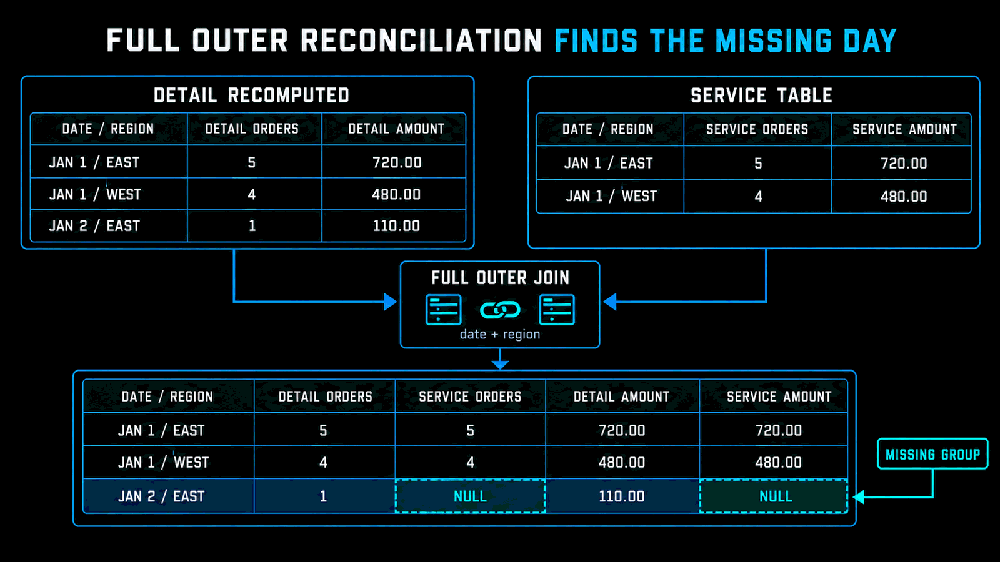
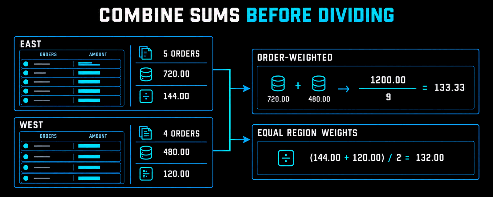
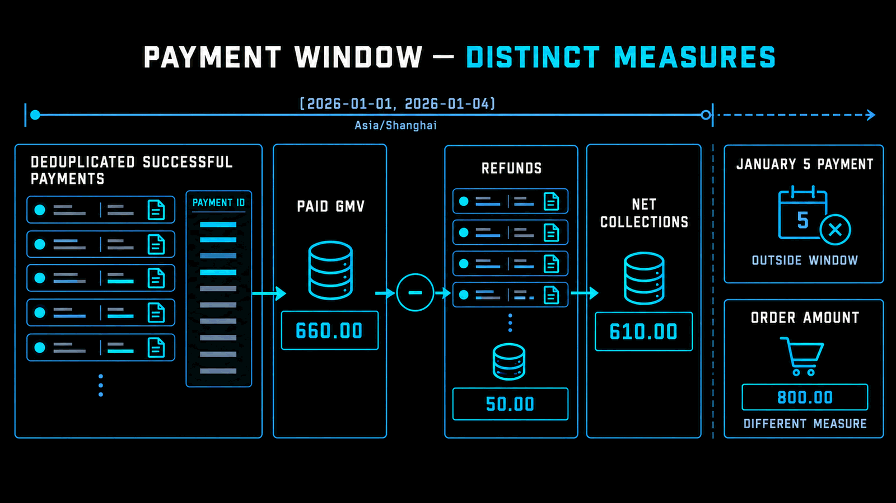

<a id="unit-u.056dced5bfa74e8089a16dac2ed83f8a"></a>

<a id="module-10-metric-processing-and-delivery"></a>

# 10-модуль: метрикаларды өңдеу және ұсыну

| Курс туралы ақпарат | Мәні |
| --- | --- |
| Курс | Apache Doris көмегімен деректер қоймасын құру · 2-деңгей |
| Doris | Apache Doris 4.1.3 |
| Орта | 1-модульдегі курс сынақ ортасы; 9-зертханалық жұмыстың тапсырыс фактісі және мысалдың DWD кестелері |
| Болжалды уақыт | Шамамен 146 минут: оқу 46, зертханалық жұмыс 90, тест 10 |

[Курстың README файлы](../../README.md) · [10-зертханалық жұмысты ашу](lab10_metric_processing.ipynb) · [10-тестті ашу](quiz10_metric_processing.ipynb)
<a id="unit-u.07bf71ca93c241cd94043dc553b7abd4"></a>

<a id="module-goal"></a>

## Модуль мақсаты

«Күндік тапсырыс» пен «төленген GMV»-ді жазылған келісімшарттарға айналдырыңыз, көрсеткіштерін жарияланған түйіршіктілікте сақтаңыз және жылдамдатпас бұрын сақталған сандардың дұрыстығын егжей-тегжейлі деректермен дәлелдеңіз.
<a id="unit-u.d7cf3440cdbf4de78a7c6916a0036d32"></a>

<a id="learning-objectives"></a>

## Оқу мақсаттары

Осы модульді аяқтағаннан кейін сіз:

1. SQL жазбас бұрын метриканың жиынын, түйіршіктілігін, көрсеткіштерін, уақыт және қатынас ережесін анықтайсыз.
2. Жарияланған түйіршіктілікте ұсыну кестесін жасап, бір пакетті екі рет жүктеудің орнына қайта құрасыз.
3. Толық сыртқы біріктіру арқылы ұсыну кестесін егжей-тегжейлі деректермен салыстырасыз.
4. Нәтиже түйіршіктілігін өзгертпей, терезе функциялары мен шартты агрегаттауды қолданасыз.
5. Төленген GMV, тапсырыс сомасы мен таза түсімді ажыратып, әр қатынастың алымы мен бөлімін сақтайсыз.
6. Нақты не жуық бөлек мәндер санын таңдап, оңтайландыруды тең нәтижелер және өлшенген жұмыспен тексересіз.
<a id="unit-u.0f9a025cff0c44549de4ffdbb333834d"></a>

<a id="module-structure"></a>

## Модуль құрылымы

| Бөлім | Уақыт | Нәтиже |
| --- | ---: | --- |
| 10.1 Метрика келісімшартын жазу | 9 мин | Жиын, түйіршіктілік, көрсеткіштер, уақыт және қатынастар кестесі |
| 10.2 Келісімшарт түйіршіктілігіндегі ұсыну кестесі | 8 мин | Егжей-тегжейлі деректерден қайта құрылған бір түйіршіктіліктегі қосындылар мен сандар |
| 10.3 Егжей-тегжейлі деректермен салыстыру | 7 мин | Жоғалған күнді байқайтын толық сыртқы біріктіру |
| 10.4 Терезелер, шарттар және қатынастар | 8 мин | Түйіршіктілікті сақтау, орташаларды емес, қосындыларды бөлу |
| 10.5 Тапсырыс сомасы төленген GMV емес | 8 мин | Терезедегі төлемдер, жасалған тапсырыс когорты, қайта сатып алушылар |
| 10.6 Нақты сандар, ықшам көріністер және өлшенген жұмыс | 6 мин | Bitmap және HLL, жылдамдаудан бұрын Profile |
| 10-зертханалық жұмыс | 90 мин | Ұсыну кестесін жасау және салыстыру, мысал төлемдерін өлшеу, бөлек мәндер санын салыстыру және шағын кестені өлшеу |
| 10-тест | 10 мин | Осы мақсаттарға арналған алты сұрақ |
<a id="unit-u.b84c7a3d38e74c6b97c79e82205dc25d"></a>

<a id="101-write-the-metric-contract"></a>

## 10.1 Метрика келісімшартын жазу

Үш топ «тапсырыстың орташа құнын» есептейді: бірі кезең сомасын тапсырыс санына бөледі, екіншісі күндік орташалардың орташасын алады, үшіншісі бас тартылғандарды қоса санайды. Үшеуі де орындалады. SQL-ден бұрын метриканың не екенін жазыңыз:

| Тармақ | Осы курстағы күндік тапсырыстар мен тапсырыс сомасы |
| --- | --- |
| Жиын | `orders_fact_l2` ішіндегі CANCELLED емес тапсырыстар |
| Түйіршіктілік | Әр тапсырыс күні мен аймағына бір жол |
| Көрсеткіштер | `order_count` — тапсырыс саны; `gross_amount` — алынған ақша емес, тапсырыстың салыққа дейінгі құны `order_amount` қосындысы |
| Уақыт | `order_date` — тапсырыстың 1-нұсқа оқиғасының күні, сеанстың +08:00 уақыт белдеуінде |
| Қатынас | Орташа тапсырыс сомасы = `gross_amount` / `order_count`, сұралған түйіршіктіліктің қосындыларынан есептеледі |
| Нөл және жоқ мән | Тапсырыссыз қатынас 0 емес, `NULL`; жолы жоқ күн — нөл емес, жетіспейтін күн |

Көрсеткіштер әртүрлі қосылады. Сома не сан **аддитивті**: біріктіру қайталамаған болса, күндер, аймақтар және тұтынушылар бойынша қосылады. Қалдық **жартылай аддитивті**: тұтынушылар бойынша қосылады, күндер бойынша емес, әйтпесе сол ақша әр күнге бір рет саналар еді. Қатынас **аддитивті емес**: орташалардың орташасы әр топқа өлшеміне қарамастан бірдей салмақ береді. Қатынастың алымы мен бөлімін сақтап, есеп беретін түйіршіктілікте бөліңіз.
<a id="unit-u.a358faf822f04bcfa1ebdf0a40d294c0"></a>

<a id="102-a-service-table-at-the-contracts-grain"></a>

## 10.2 Келісімшарт түйіршіктілігіндегі ұсыну кестесі

Егжей-тегжейлі деректер әр сұраққа жауап беріп, әр жолы сканерлеу шығынын талап етеді; **ұсыну кестесі** есеп сұрайтын көрсеткіштерді өз түйіршіктілігінде азырақ жолда сақтайды. 10-зертханалық жұмыс кестесі — Aggregate Key:

**Оқуға арналған SQL мысалы: 10-зертханалық жұмыстың ұсыну кестесі. Жұмыстан кейін қайта орындамаңыз.**

<!-- reading-only-example -->
```sql
CREATE TABLE daily_order_metrics_l2 (
    order_date DATE NOT NULL,
    region VARCHAR(16) NOT NULL,
    order_count BIGINT SUM NOT NULL DEFAULT "0",
    gross_amount DECIMAL(18,2) SUM NOT NULL DEFAULT "0.00"
)
AGGREGATE KEY(order_date, region)
DISTRIBUTED BY HASH(order_date) BUCKETS 1
PROPERTIES ("replication_num"="1");
```

| order_date | region | order_count | gross_amount |
| --- | --- | ---: | ---: |
| 2026-01-01 | EAST | 5 | 720.00 |
| 2026-01-01 | WEST | 4 | 480.00 |
| 2026-01-02 | EAST | 1 | 110.00 |

Бірге 10 тапсырыс және 1310.00, 8-модуль көрінісіндегідей. `SUM` бағандары бірдей кілтті жолдарды қосады, бұл жаңа тапсырыс үшін дұрыс, бір пакетті екі рет жүктеуге қате: 1 қаңтар EAST 10 тапсырыс және 1440.00 көрсетер еді. Кесте жаңа пакетті қайталанғанынан ажырата алмайды, оны толтыратын тапсырма ажыратуы керек: 10-жұмыс әр орындауда кестені жойып, егжей-тегжейлі деректерден қайта құрады; өндірістік тапсырма әсер еткен бөлімдерді ауыстырады не әр пакетті бір рет жүктеп, не жүктегенін тіркейді.

| Нұсқа | Қашан | Нені басқару керек |
| --- | --- | --- |
| Тапсырма құратын ұсыну кестесі | Тазалау, сапа тексерістері және жариялау конвейер қадамдары болса | Қайта орындаулар, әр қайта құру аясы, салыстыру |
| Асинхронды материалданған көрініс (8-модуль) | Жаңартуын Doris басқара алатын тұрақты сұрау | Жаңарту күйі, өзектілік, қай сұрауларға жауап береді |
| Кәдімгі көрініс | Анықтама ортақ болуы керек, шығыны қабылданады | Әр сұрау шығыны |

Ұсыну кестесі бар болса да, егжей-тегжейлі деректерді сақтаңыз: оның қателерін солар табады.
<a id="unit-u.a701a5012cbe4f48987ff83368a68b7e"></a>

<a id="103-reconcile-with-the-detail"></a>

## 10.3 Егжей-тегжейлі деректермен салыстыру

Ұсыну кестесі тәуелсіз сұраумен қайта есептелген егжей-тегжейлі деректер сол сандарды бергенде дұрыс. Ұсыну кестесін тек бір жақта оқыңыз:

```sql
WITH detail AS (
    SELECT order_date, region, COUNT(*) AS order_count, SUM(order_amount) AS gross_amount
    FROM orders_fact_l2
    WHERE status <> 'CANCELLED'
    GROUP BY order_date, region
), serving AS (
    SELECT order_date, region, SUM(order_count) AS order_count, SUM(gross_amount) AS gross_amount
    FROM daily_order_metrics_l2
    GROUP BY order_date, region
)
SELECT COALESCE(d.order_date, s.order_date) AS order_date,
       COALESCE(d.region, s.region) AS region,
       d.order_count AS detail_orders, s.order_count AS serving_orders,
       d.gross_amount AS detail_amount, s.gross_amount AS serving_amount
FROM detail d
FULL OUTER JOIN serving s ON s.order_date = d.order_date AND s.region = d.region
ORDER BY order_date, region;
```

Ұсыну кестесінің түйіршіктілігі — күн мен аймақ — бойынша біріктіріңіз. `FULL OUTER JOIN` тек бір жақта бар жолды сақтайды. 10-зертханалық жұмыс 2 қаңтарды жоғалтқан, сол күннің жүктеуі сәтсіз болғандай ұсыну кестесін салыстырады: ішкі біріктіру 1 қаңтардың екі EAST, WEST жолын, екеуі де тең, көрсетіп, салыстыру өтеді; толық сыртқы біріктіру егжей-тегжейлі деректерде 1 тапсырыс және 110.00 бар, ұсыну кестесінде `NULL` болатын 2026-01-02 EAST көрсетеді. Себебін білмейінше `NULL` сақтаңыз: жоқ жол — тапсырыссыз күн емес. Баптамас бұрын жолдарды, сомаларды, күндер мен маңызды өлшемдерді тексеріңіз: қате жауап беретін жылдамырақ сұрау оны тек ертерек қайтарады.



*Толық сыртқы салыстыру екі жақтың бірінде жоқ топтарды анықтайды.*

Суреттегі жазулар: FULL OUTER RECONCILIATION FINDS THE MISSING DAY — толық сыртқы салыстыру жоғалған күнді табады; DETAIL RECOMPUTED — егжей-тегжейлі деректер қайта есептелген; SERVICE TABLE — ұсыну кестесі; DATE / REGION — күн / аймақ; DETAIL ORDERS, DETAIL AMOUNT — егжей-тегжейлі тапсырыстар саны мен сомасы; SERVICE ORDERS, SERVICE AMOUNT — ұсыну кестесіндегі тапсырыстар саны мен сомасы; JAN 1 / EAST, JAN 1 / WEST, JAN 2 / EAST — 1 қаңтар / EAST, 1 қаңтар / WEST, 2 қаңтар / EAST; FULL OUTER JOIN date + region — күн + аймақ бойынша толық сыртқы біріктіру; MISSING GROUP — жетіспейтін топ; NULL — сәйкестік жоқ. 5/720.00 және 4/480.00 екі жақта да бар; 1/110.00 тобы ұсыну кестесінде жоқ.
<a id="unit-u.7d1122ffcb70463686d4f35b7880aeed"></a>

<a id="104-windows-conditions-and-ratios"></a>

## 10.4 Терезелер, шарттар және қатынастар

`GROUP BY` жолдарды топтарға жинайды. **Терезе функциясы** байланысты жолдармен есептеп, әр жолды сақтайды: `SUM(...) OVER (ORDER BY order_date ROWS BETWEEN UNBOUNDED PRECEDING AND CURRENT ROW)` бірінші жолдан ағымдағысына дейін қосады, `LAG(...) OVER (ORDER BY order_date)` алдыңғы жол мәнін алады. Алдымен терезеге қажет түйіршіктілікті беріңіз:

```sql
WITH daily AS (
    SELECT order_date, SUM(order_count) AS order_count, SUM(gross_amount) AS gross_amount
    FROM daily_order_metrics_l2
    GROUP BY order_date
)
SELECT order_date, order_count, gross_amount,
       SUM(gross_amount) OVER (ORDER BY order_date ROWS BETWEEN UNBOUNDED PRECEDING AND CURRENT ROW) AS cumulative_amount,
       LAG(gross_amount) OVER (ORDER BY order_date) AS previous_day_amount
FROM daily
ORDER BY order_date;
```

CTE әр күнге бір жол жасайды, сондықтан нәтиже әр күнге бір жол: сол күнге дейін 1200.00, содан кейін 1310.00, 2 қаңтардың алдыңғы күнінде 1200.00. Оның орнына ұсыну жолдарындағы терезе аймақ бойынша орындалар еді; әр тапсырыста қайталанған күндік терезені қосу күнді әр тапсырысқа бір рет санар еді. `LAG` алдыңғы жолды алады: мұнда барлық күн бар болғандықтан алдыңғы күн; бос күн болса, ескірек күн болар еді, кешегімен салыстыруға барлық күндердің күнтізбесі қажет. Рейтингке тең мәндер ережесі, жылжымалы терезеге айқын шектер керек.

**Шартты агрегаттау** топ бөліктерін қатар қояды: `SUM(CASE WHEN region = 'EAST' THEN order_count ELSE 0 END)` әр күннің EAST тапсырыстарын барлық тапсырыспен қатар санайды, 1 қаңтарда 9-дың 5-еуі. `WHERE` топтаудан бұрын жолдарды, `HAVING` кейін топтарды сүзеді.

Қатынас ережесі нақты деректерде маңызды. 1 қаңтарда EAST — 5 тапсырыс, 720.00, орташа 144.00, WEST — 4 тапсырыс, 480.00, орташа 120.00. Екі орташаның орташасы — 132.00; күннің орташа тапсырыс сомасы — 1200.00 / 9 = 133.33. Біріншісі WEST-тің 4 тапсырысына EAST-тің 5 тапсырысындай салмақ береді. 100 сомалы бір тапсырыс пен жалпы 1000 болатын 100 тапсырыс сияқты үлкен айырмада қате өседі: 55.00 және 10.89.



*Бөлмес бұрын қатынас қосындыларын есеп түйіршіктілігінде біріктіріңіз.*

Суреттегі жазулар: COMBINE SUMS BEFORE DIVIDING — бөлмес бұрын қосындыларды біріктіру; EAST, WEST — аймақ мәндері; ORDERS — тапсырыстар; AMOUNT — сома; 5 ORDERS — 5 тапсырыс; 4 ORDERS — 4 тапсырыс; ORDER-WEIGHTED — тапсырыс саны бойынша салмақталған; EQUAL REGION WEIGHTS — аймақтарға бірдей салмақ. EAST: 720.00 / 5 = 144.00; WEST: 480.00 / 4 = 120.00; (720.00 + 480.00) / 9 = 133.33; (144.00 + 120.00) / 2 = 132.00.
<a id="unit-u.fb5056a7ce144798b03afd3108ec1a3d"></a>

<a id="105-order-amount-is-not-paid-gmv"></a>

## 10.5 Тапсырыс сомасы төленген GMV емес

Тапсырыс сомасы неге тапсырыс берілгенін айтады. Мұнда **тауарлардың жалпы құны (GMV)** тапсырыс күйінен емес, төлемдердің өзінен алынатын төленген тапсырыстар құнын білдіреді: ақшасы қайтарылған тапсырыс та бір рет төленген. 9-модуль қойма мысалында төлемдер бар, 10-зертханалық жұмыс олардың келісімшартын жазады:

| Метрика | Келісімшарт |
| --- | --- |
| Төленген GMV | Asia/Shanghai бойынша уақыты `[2026-01-01, 2026-01-04)` ішіндегі қайталанулары жойылған сәтті төлемдер; қайтарымдар бөлек |
| Төленген тапсырыстар мен тұтынушылар | Сол төлемдердің бөлек тапсырыстары мен тұтынушылары |
| Жасалған тапсырыстар когортының конверсиясы | Терезеде жасалып, шекке дейін төленген тапсырыстарды терезеде жасалған барлық тапсырысқа бөлу |
| Қайта сатып алушы үлесі | Терезеде кемінде екі төленген тапсырысы бар тұтынушыларды төлем жасаған тұтынушыларға бөлу |
| Таза түсім | Төленген GMV минус терезедегі қайтарымдар; пайда емес |

| Көрсеткіш | Мәні |
| --- | ---: |
| Мысал тапсырыстарының бас тартылғансыз сомасы | 800.00 |
| Терезедегі төленген GMV | 5 төленген тапсырыс пен 3 тұтынушыдан 660.00 |
| Терезедегі қайтарымдар | 50.00 |
| Таза түсім | 610.00 |
| Когорт конверсиясы | 8 жасалған тапсырыстың 5-еуі: 0.62500 |
| Қайта сатып алушы үлесі | 3 тұтынушының 2-еуі: 0.66666 |

Екі рет келген төлем ID-і бір рет саналады, 5 қаңтар төлемі терезеден тыс. Когорт бас тартылған тапсырысты жасалған, бірақ конверсияланбаған деп санайды, келісімшарт оны сол себептен айтады: тапсырыс метрикалары бас тартылғандарды тыс қалдырады, когорт қалдырмайды. Бөлек мәндер сандары да қосылмайды: күндердің төлем жасаған тұтынушыларын қоссақ 4, терезеде 3, себебі бір тұтынушы екі күнде төледі. Әр қатынас жарияланған жолда алымы мен бөлімін сақтайды, оқырман тексере алады.



*Төлем уақыты мен қайталануларды жою төленген GMV-ді, қайтарымдар таза түсімді анықтайды.*

Суреттегі жазулар: PAYMENT WINDOW – DISTINCT MEASURES — төлем терезесі, бөлек көрсеткіштер; [2026-01-01, 2026-01-04) Asia/Shanghai — басталуы кіреді, аяқталуы кірмейтін есеп терезесі; DEDUPLICATED SUCCESSFUL PAYMENTS — қайталанулары жойылған сәтті төлемдер; PAYMENT ID — төлем ID-і; PAID GMV 660.00 — төленген GMV 660.00; REFUNDS 50.00 — қайтарымдар 50.00; NET COLLECTIONS 610.00 — таза түсім 610.00; JANUARY 5 PAYMENT — 5 қаңтар төлемі; OUTSIDE WINDOW — терезеден тыс; ORDER AMOUNT 800.00 — тапсырыс сомасы 800.00; DIFFERENT MEASURE — басқа көрсеткіш.
<a id="unit-u.c84b75e7492c49caa18256b3129c4725"></a>

<a id="106-exact-counts-sketches-and-measured-work"></a>

## 10.6 Нақты сандар, ықшам көріністер және өлшенген жұмыс

Бөлек тұтынушылар санын есептеуде функциядан бұрын дәлдік туралы уәде қажет:

| Әдіс | Нәтиже | Қайда жарайды | Шығыны |
| --- | --- | --- | --- |
| `COUNT(DISTINCT id)` | Нақты | Салыстырып тексеру, орташа көлем | Санағанда әр бөлек ID-ді сақтайды |
| Bitmap (`BITMAP_UNION_COUNT(TO_BITMAP(id))`) | Нақты | Теріс емес бүтін ID-лер, үлкен көлемде қайта қолданылатын бөлек сандар | Тек бүтін ID-лер, bitmap функциялары |
| HLL (`HLL_UNION_AGG(HLL_HASH(id))`) | Жуық | Соңғы бірліктен гөрі масштаб маңызды болса | Тұтынушылар білуі тиіс қате |

20,000 бөлек мәні бар 100,000 ID үшін 10-жұмыстың нақты әдістері 20,000, HLL 19,834 береді, осы орындауда қате 0.0083: бұл — шек емес, бір бақылау. Шағын мысалға сәйкес келді деп HLL-ді нақты атамаңыз.

Ұсыну кестесінің көмегін көрсету үшін алдымен егжей-тегжейлі деректердей жауап беретінін дәлелдеңіз: 10-жұмыс 32 күндік жолдың әрқайсысын салыстырады. Содан кейін әр орындалудың не істегенін оқыңыз: `EXPLAIN` жоспарды, **Query Profile** бір орындалудың өлшенген жұмысын көрсетеді, мұнда егжей-тегжейлі деректер үшін 100,000, ұсыну кестесі үшін 32 жол сканерленген. Соңында жарияланған жағдайдағы уақыттар: қыздырудан кейін, нәтиже кэші өшірулі, әр сұрау бір-бірден 20 рет орындалды; екеуінің де эмпирикалық 95-процентилі (P95) бірнеше миллисекунд болды. Аз жол оқу әрқашан жылдамырақ сұрау емес, бір компьютердегі уақыт бақылау тақтасының қызмет деңгейі емес.
<a id="unit-u.f39e502d189d47dbb6d1515df93ee1dd"></a>

<a id="lab-10-build-and-reconcile-a-service-table-and-measure-payments"></a>

## 10-зертханалық жұмыс: ұсыну кестесін жасау және салыстырып тексеру, төлемдерді өлшеу

[10-зертханалық жұмыс: ұсыну кестесін жасау және салыстырып тексеру, төлемдерді өлшеу](lab10_metric_processing.ipynb) файлын ашыңыз. Сіз:

1. Күндік тапсырыс келісімшартын жазып, 9-зертханалық жұмыстың тапсырыс фактісінен `daily_order_metrics_l2` жасайсыз.
2. Орташаларды қосындылардан есептеп, бақылау тақтасы үшін ірілендіресіз.
3. Оны егжей-тегжейлі деректермен салыстырып, ішкі біріктіру өткізіп жіберген жоғалған күнді толық сыртқы біріктіру көрсететінін көресіз.
4. Нақты күндер мен аймақтарда жинақтаушы терезе мен 1 қаңтардың екі орташасын есептейсіз.
5. Мысал төлемдерін өлшейсіз: төленген GMV, когорт конверсиясы, қайта сатып алушылар, таза түсім.
6. Нақты және жуық бөлек мәндер санын салыстырып, 32 жолдық кестені 100,000 егжей-тегжейлі жолмен өлшейсіз.
7. Жаттығу: тұтынушы мен күн бойынша тапсырыстарды егжей-тегжейлі деректерден есептейсіз.

Курс сынақ ортасы, 9-зертханалық жұмыстың `orders_fact_l2` және мысалдың DWD кестелері қажет. 11-модуль `daily_order_metrics_l2` жариялайды.
<a id="unit-u.30176655f0c349cb91847010d281b116"></a>

<a id="summary"></a>

## Қорытынды

- Метрика — оның келісімшарты: жиын, түйіршіктілік, көрсеткіштер, уақыт, қатынас, нөл және жоқ жолдар ережелері; сомалар мен сандар қосылады, қалдықтар тек кей кілттер бойынша, қатынастар мүлде қосылмайды.
- Ұсыну кестесі бір түйіршіктілікте қосындылар мен сандарды сақтайды; егжей-тегжейлі деректерден қайта құрыңыз, себебі `SUM` бағандары қайталанған пакетті жаңасынан ажырата алмайды.
- Ұсыну түйіршіктілігінде толық сыртқы біріктірумен салыстырыңыз, ол бір жақта жоқ жолдарды сақтайды; ішкі біріктіру оларды салыстырудан алып тастайды.
- Алдымен түйіршіктілікті құрып, содан кейін терезені қолданыңыз; қатынасты орташалардың орташасы емес, есеп түйіршіктілігінің қосындыларынан есептеңіз.
- Төленген GMV терезедегі қайталанулары жойылған төлемдерден, тапсырыс сомасы тапсырыстардан, таза түсім төлемнен қайтарымды шегеруден алынады; күндік бөлек сандар терезе санына қосылмайды.
- Салыстырып тексеруге нақты сандарды, қатесі қабылданатын жерде HLL қолданыңыз; нәтижелер теңдігін дәлелдеп, Profile өлшеген жұмысты оқыңыз, содан кейін уақыт өлшеңіз.
<a id="unit-u.ac35e3f988ac4d0baa8619063180fe90"></a>

<a id="quiz-10"></a>

## 10-тест

[10-тест: метрикаларды өңдеу және ұсыну](quiz10_metric_processing.ipynb) файлын ашыңыз. Онда бір дұрыс жауабы бар алты сұрақ бар және іске қосылған орта қажет емес.

Келесі модуль: [11-модуль: BI және AI тұтынушыларына арналған интерфейстер мен шекаралар](../module11-bi-and-ai/course.md).
<a id="unit-u.c223ec832c2844d6ab41836933d05093"></a>

<a id="references"></a>

## Дереккөздер

- [Apache Doris: Терезе функциялары](https://doris.apache.org/docs/4.x/query-data/window-function/)
- [Apache Doris: Aggregate Key моделі](https://doris.apache.org/docs/4.x/table-design/data-model/aggregate/)
- [Apache Doris: Bitmap арқылы нақты қайталануларды жою](https://doris.apache.org/docs/4.x/query-acceleration/distinct-counts/bitmap-precise-deduplication/)
- [Apache Doris: HLL арқылы жуық қайталануларды жою](https://doris.apache.org/docs/4.x/query-acceleration/distinct-counts/hll-approximate-deduplication/)
- [Apache Doris: Query Profile](https://doris.apache.org/docs/4.x/query-acceleration/query-profile/)
