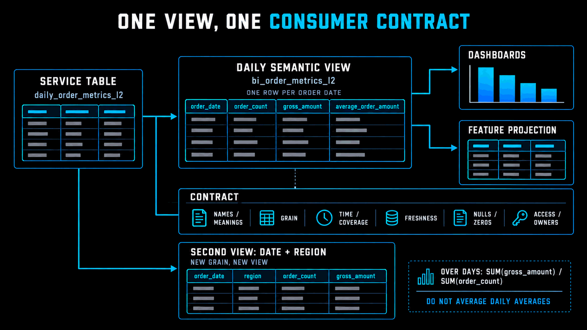
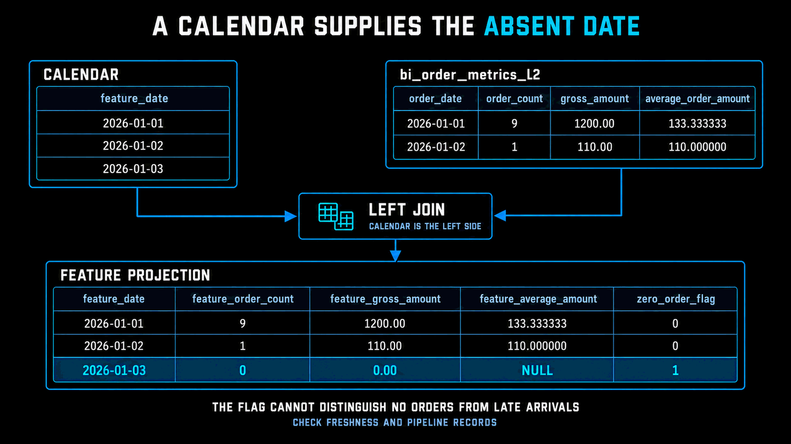
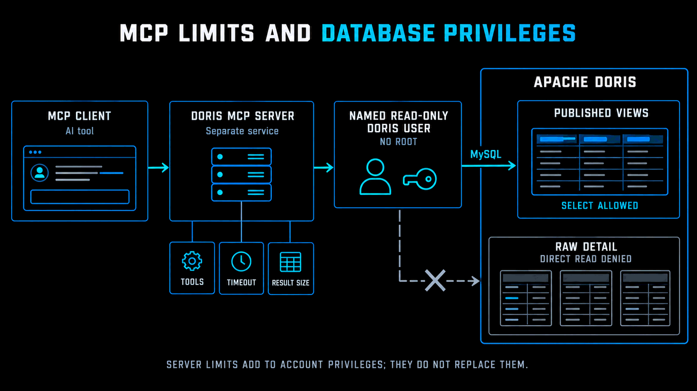

<a id="unit-u.97da767896de4d22b542586be33bd097"></a>

<a id="module-11-interfaces-and-boundaries-for-bi-and-ai-consumers"></a>

# 11-модуль: BI және AI тұтынушыларына арналған интерфейстер мен шекаралар

| Курс туралы ақпарат | Мәні |
| --- | --- |
| Курс | Apache Doris көмегімен деректер қоймасын құру · 2-деңгей |
| Doris | Apache Doris 4.1.3 |
| Орта | 1-модульдегі курс сынақ ортасы; 10-зертханалық жұмыстың `daily_order_metrics_l2`; қосымша бақылау тақтасына Docker-дің тағы шамамен 2 GiB жады және бір реттік интернет қатынауы |
| Болжалды уақыт | Шамамен 120 минут: оқу 40, зертханалық жұмыс 70, тест 10 |

[Курстың README файлы](../../README.md) · [11-зертханалық жұмысты ашу](lab11_bi_and_ai_delivery.ipynb) · [11-тестті ашу](quiz11_bi_and_ai.ipynb)
<a id="unit-u.514e177724fb40ca9a76dff5697a38c7"></a>

<a id="module-goal"></a>

## Модуль мақсаты

Күндік метрикаларды бақылау тақталары мен модельдер үшін жолдары және мағынасы тұрақты интерфейс ретінде жариялаңыз, оны біреу оқымас бұрын тексеріңіз және Doris кепілдік беретін нәрсе мен BI, AI құралдары өздері тексеруі тиіс нәрсенің шекарасын анықтаңыз.
<a id="unit-u.793dc605d06a4ca0a51f16cf1881ceeb"></a>

<a id="learning-objectives"></a>

## Оқу мақсаттары

Осы модульді аяқтағаннан кейін сіз:

1. Тұрақты атаулары, бір жарияланған түйіршіктілігі және мағынасы жазылған көрсеткіштері бар семантикалық көрініс жобалайсыз.
2. Бақылау тақтасында өлшемдерді, аддитивті көрсеткіштерді және қатынастарды ажыратасыз.
3. Интерфейс жолдарын, null мәндерін, күндер мен сомаларын тексеріп, келісімшарт және өзектілік тексерулерін әдейі сәтсіз етесіз.
4. Модель дәлдігі туралы ештеңе мәлімдемей, күнтізбе бойынша белгі кірістерін дайындайсыз.
5. Doris неге кепілдік беретінін және BI құралы не AI қолданбасы нені өзі тексеруі керегін айтасыз.
6. Бөлек MCP сервері және жарияланған көріністермен шектелген тек оқитын тіркелгі арқылы AI құралының Doris қатынауын шектейсіз.
<a id="unit-u.1e9d7bf3e72e478ea873761ae39e607e"></a>

<a id="module-structure"></a>

## Модуль құрылымы

| Бөлім | Уақыт | Нәтиже |
| --- | ---: | --- |
| 11.1 Тұтынушы келісімшарты | 8 мин | Семантикалық көрініс, түйіршіктілігі, әр баған мағынасы |
| 11.2 Жарияламас бұрын интерфейсті тексеру | 7 мин | Жолдар, null, күндер, сомалар және сәтсіз болуы тиіс екі тексеру |
| 11.3 Doris пен BI құралының жауапкершілігі | 7 мин | Жылдамдық, өзектілік, дұрыстық және әрқайсысын кім тексереді |
| 11.4 AI белгілері: қорытынды емес, кірістер | 7 мин | Күнтізбе, тапсырыссыз күн және белгілер нені дәлелдей алмайды |
| 11.5 AI құралы не оқи алатынын шектеу | 7 мин | Бөлек MCP сервері және тек оқитын тіркелгі |
| 11.6 Қосымша: нақты бақылау тақтасы | 4 мин | Төлем келісімшартындағы жергілікті Superset және оны жою |
| 11-зертханалық жұмыс | 70 мин | Семантикалық көріністі жариялау, белгілер проекциясы, келісімшартты тексеріп бұзу; қалауыңызша бақылау тақтасын жасау |
| 11-тест | 10 мин | Осы мақсаттарға арналған алты сұрақ |
<a id="unit-u.5e745e316d4b492c83f16c8443f5e307"></a>

<a id="111-a-consumer-contract"></a>

## 11.1 Тұтынушы келісімшарты

BI тобы кестені сұрай алса да, қате бақылау тақтасын жасай алады, мысалы салыққа дейінгі тапсырыс сомасын алынған ақша деп атаса. Сұрау қатынауы деректер өнімі емес. **Семантикалық көрініс** — тұтынушылар интерфейсі: тұрақты атаулар, бір жарияланған түйіршіктілік, мағынасы жазылған көрсеткіштер. 11-жұмыс 10-жұмыстың ұсыну кестесінің үстінде біреуін жариялайды:

**Оқуға арналған SQL мысалы: 11-зертханалық жұмыстың семантикалық көрінісі. Жұмыстан кейін қайта орындамаңыз.**

<!-- reading-only-example -->
```sql
CREATE VIEW bi_order_metrics_l2 AS
SELECT order_date,
       SUM(order_count) AS order_count,
       SUM(gross_amount) AS gross_amount,
       CASE WHEN SUM(order_count) = 0 THEN NULL
            ELSE SUM(gross_amount) / SUM(order_count) END AS average_order_amount
FROM daily_order_metrics_l2
GROUP BY order_date;
```

| order_date | order_count | gross_amount | average_order_amount |
| --- | ---: | ---: | ---: |
| 2026-01-01 | 9 | 1200.00 | 133.333333 |
| 2026-01-02 | 1 | 110.00 | 110.000000 |

Бақылау тақтасы өрістердің үш түрін қолданады:

| Түрі | Осы көріністе | Бақылау тақтасы не істей алады |
| --- | --- | --- |
| Өлшем | `order_date` | Топтау, сүзу және сұрыптау |
| Аддитивті көрсеткіш | `order_count`, `gross_amount` | Күндер бойынша қосу |
| Қатынас | `average_order_amount` | Әр жолда көрсету; бірнеше күнде сандар мен сомаларды қосып, қайта бөлу, ешқашан орташаламау |

Көрініс келісімшарты тұтынушылар сүйенетінді жазады:

1. **Атаулар, түрлер және мағыналар:** `order_date` — тапсырыстың 1-нұсқа оқиғасының күні; `order_count` бас тартылмаған тапсырыстарды санайды; `gross_amount` — алынған ақша емес, салыққа дейінгі тапсырыс құны; `average_order_amount` — соманы санға бөлу.
2. **Түйіршіктілік:** тапсырысы бар әр күнге бір жол. Тапсырыссыз күнде жол жоқ; жоқ жол мен нөл тапсырысты күн — әртүрлі нәрсе.
3. **Уақыт пен қамту:** +08:00 уақыт белдеуі, алғашқы күн және кешіккен оқиғаларда не болады.
4. **Өзектілік:** жаңартуды не бастайды, рұқсат етілген кідіріс және кешіккен оқиғадан кейін қай күндер қайта құрылады.
5. **Null және нөлдер:** тапсырыссыз қатынас ойдан шығарылған 0 емес, `NULL`.
6. **Қатынау және жауаптылар:** қай тіркелгі көріністі оқи алады (12-модуль), анықтама өзгерісін кім мақұлдайды.

Бағандар атауы мен мағынасын сақтаса, көрініс іске асуы өзгеріп, 10-жұмыс кестесіне бағандар қосыла алады. Аймақпен сүзу сияқты жаңа түйіршіктіліктегі жаңа сұраққа 11-жұмыс жаттығуы жариялайтындай екінші көрініс беріледі, бірінші тұтынушыларын сақтайды.



*Тұтынушылар бір жарияланған түйіршіктілікте тұрақты мағыналарды ортақ қолданады.*

Суреттегі жазулар: ONE VIEW, ONE CONSUMER CONTRACT — бір көрініс, бір тұтынушы келісімшарты; SERVICE TABLE — ұсыну кестесі; daily_order_metrics_l2 — ұсыну кестесінің атауы; DAILY SEMANTIC VIEW — күндік семантикалық көрініс; bi_order_metrics_l2 — көрініс атауы; ONE ROW PER ORDER DATE — әр тапсырыс күніне бір жол; order_date, order_count, gross_amount, average_order_amount — тапсырыс күні, саны, салыққа дейінгі сомасы, орташа сомасы; DASHBOARDS — бақылау тақталары; FEATURE PROJECTION — белгі проекциясы; CONTRACT — келісімшарт; NAMES / MEANINGS — атаулар / мағыналар; GRAIN — түйіршіктілік; TIME / COVERAGE — уақыт / қамту; FRESHNESS — өзектілік; NULLS / ZEROS — null / нөлдер; ACCESS / OWNERS — қатынау / жауаптылар; SECOND VIEW: DATE + REGION — екінші көрініс: күн + аймақ; NEW GRAIN, NEW VIEW — жаңа түйіршіктілік, жаңа көрініс; region — аймақ; OVER DAYS: SUM(gross_amount) / SUM(order_count) — күндер бойынша сомалар қосындысын тапсырыс сандары қосындысына бөлу; DO NOT AVERAGE DAILY AVERAGES — күндік орташаларды орташаламаңыз.
<a id="unit-u.f14f2adee0b14c048b5319f05a07a680"></a>

<a id="112-check-the-interface-before-publication"></a>

## 11.2 Жарияламас бұрын интерфейсті тексеру

Бақылау тақтасы не модель көріністі оқымас бұрын сүйенетін нәрселерін тексеріңіз:

```sql
SELECT COUNT(*) AS serving_days,
       SUM(CASE WHEN order_count IS NULL OR gross_amount IS NULL THEN 1 ELSE 0 END) AS days_with_nulls,
       MIN(order_date) AS first_date,
       MAX(order_date) AS last_date,
       SUM(order_count) AS served_orders,
       SUM(gross_amount) AS served_amount
FROM bi_order_metrics_l2;
```

| Тексеру | 11-зертханалық жұмыстың нәтижесі |
| --- | --- |
| Ұсынылған күндер және null бар күндер | 2 және 0 |
| Алғашқы және соңғы күн | 2026-01-01 және 2026-01-02 |
| Тапсырыстар мен сома | Ұсыну кестесіндегідей 10 және 1310.00 |

Орындалатын сұрау келісімшарт сынағы емес. 11-жұмыс курсор арқылы көрініс бағандарының атауларын оқып, келісімшарт жариялайтын төртеумен салыстырады, содан кейін `average_order_amount` жоқ бұзылған көшірме жасайды: сол тексеру оны қабылдамауы керек. Тапсырыстар 2026 қаңтарынан болғандықтан, өзектілікті бекітілген оқу күндерімен өлшейді: соңғы күн 2 қаңтар, 3 қаңтарда бір күн ескі, біркүндік ереже рұқсат етеді, 9 қаңтарда жеті күн ескі, рұқсат етпейді. Нақты тексеру бизнес уақытын және жарияланған ережесін қолданады. Ешқашан сәтсіз болмаған тексеру ештеңені тексермеуі мүмкін, сондықтан әрқайсысын әдейі бір рет сәтсіз етіңіз.
<a id="unit-u.2a19eb2230c34e34885a89463258f411"></a>

<a id="113-what-doris-owns-and-what-a-bi-tool-owns"></a>

## 11.3 Doris пен BI құралының жауапкершілігі

Apache Superset сияқты BI құралы Doris-ті SQL интерфейсі арқылы оқиды; құрал диаграммаларына, сүзгілеріне, кэшіне, өз пайдаланушылары мен рөлдеріне жауап береді. Қосылым URI-і мына түрде:

```text
doris://<username>:<password>@<host>:<port>/internal.<database>
```

> **Нақты құпиясөзді ноутбукке, сабаққа не commit жасайтын файлға жазбаңыз.** 11-жұмыстың қосымша бақылау тақтасы Doris тіркелгісінің құпиясөзін жасап, көрсетпей Superset-ке береді.

BI құралы жете алатын портты қолданыңыз: курс контейнерлері ішінде Doris MySQL порты — 9030; өз компьютеріңізден — жарияланған 52030 не `DW_FE_QUERY_PORT`. Көріністе деректер жиынын жасамас бұрын тіркелгі тек тиістісін оқитынын (12-модуль), Catalog пен дерекқор дұрыстығын, сандар 10-модуль салыстыруына сәйкес екенін, уақыт белдеуі мен өзектілік жазылғанын тексеріңіз.

| Уәде | Doris не көрсете алады | Басқа жауапты не тексереді |
| --- | --- | --- |
| Жылдамдық | Query Profile ішіндегі сұрау кідірісі, сканерленген жолдар, оператор уақыты | BI құралының сұраулары, параллельдігі және кэші |
| Өзектілік | Соңғы жаңарту, соңғы оқиға уақыты | Жоспарлағыш, кешіккен деректер, BI кэші |
| Дұрыстық | Бекітілген күтулер, егжей-тегжейлі деректермен салыстыру, null және сан тексерулері | Метрикаға жауапты және диаграмма сүзгілері |

200 ms жауап деректердің өзектілігін айтпайды, диаграммадағы сан артындағы анықтаманың дұрыстығын айтпайды.
<a id="unit-u.c7fcc598031f42b08482599e32a2cec3"></a>

<a id="114-features-for-ai-inputs-not-conclusions"></a>

## 11.4 AI белгілері: қорытынды емес, кірістер

Күндік белгілерді оқитын модельге тапсырыссыз күнді қоса әр күнге жол қажет: жоқ жол — кіріс жоқ, ал нөл — кіріс. Семантикалық көріністе тек тапсырыс болған күндер бар, сондықтан 11-жұмыс проекцияны есеп терезесінің күнтізбесінен бастап, көріністі соған біріктіреді:

```sql
WITH calendar AS (
    SELECT DATE_ADD(DATE '2026-01-01', number) AS feature_date FROM numbers("number"="3")
)
SELECT c.feature_date,
       COALESCE(m.order_count, 0) AS feature_order_count,
       COALESCE(m.gross_amount, 0.00) AS feature_gross_amount,
       m.average_order_amount AS feature_average_amount,
       CASE WHEN COALESCE(m.order_count, 0) = 0 THEN 1 ELSE 0 END AS zero_order_flag
FROM calendar c
LEFT JOIN bi_order_metrics_l2 m ON m.order_date = c.feature_date
ORDER BY c.feature_date;
```

3 қаңтар 0 тапсырыс, орташа мәнсіз және `zero_order_flag` 1 болып көрінеді. Белгі күнде тапсырыс болмағанын не әлі келмегенін айта алмайды: өзектілік тексеруі мен конвейер жазбалары айта алады. Белгі проекциясы бірізді, тексерілген кірістер дайындайды; модель дәлдігін дәлелдемейді, мақсатты айнымалы туралы ақпараттың белгілерге өтіп кетуінен қорғамайды және оқыту мен қызмет көрсету деректерін өздігінен сәйкестендірмейді: бұларға өз бағалауымен AI қолданбасы жауап береді. Doris ұқсастық іздеуге вектор бағандары мен индекстерін де ұсынады; олар да көрсеткішті жақсы белгіге айналдырмайды.



*Күнтізбе орташа мәнді ойдан шығармай, жетіспейтін күндерді береді.*

Суреттегі жазулар: A CALENDAR SUPPLIES THE ABSENT DATE — күнтізбе жетіспейтін күнді береді; CALENDAR — күнтізбе; feature_date — белгі күні; bi_order_metrics_l2 — семантикалық көрініс; order_date — тапсырыс күні; order_count — тапсырыс саны; gross_amount — салыққа дейінгі тапсырыс сомасы; average_order_amount — орташа тапсырыс сомасы; LEFT JOIN — сол жақ біріктіру; CALENDAR IS THE LEFT SIDE — сол жақта күнтізбе; FEATURE PROJECTION — белгі проекциясы; feature_order_count, feature_gross_amount, feature_average_amount — белгі ретіндегі тапсырыс саны, сомасы, орташасы; zero_order_flag — тапсырыссыз күн белгісі; THE FLAG CANNOT DISTINGUISH NO ORDERS FROM LATE ARRIVALS — белгі тапсырыссыз күнді кешіккен келуден ажыратпайды; CHECK FRESHNESS AND PIPELINE RECORDS — өзектілік пен конвейер жазбаларын тексеру. 2026-01-03 жолы: 0, 0.00, NULL, 1; алғашқы екі күннің 9/1200.00/133.333333 және 1/110.00/110.000000 мәндері, 0 белгілері сақталады.
<a id="unit-u.6bec23b8cf914542b04ddb434608776c"></a>

<a id="115-bound-what-an-ai-tool-can-read"></a>

## 11.5 AI құралы не оқи алатынын шектеу

[Apache Doris MCP Server](https://doris.apache.org/docs/4.x/key-features/mcp-server/) Model Context Protocol (MCP) қолданатын AI құралдарына Doris схемаларын зерттеп, оқу сұрауларын орындауға мүмкіндік береді. Ол FE операторы емес, бөлек қызмет; атаулы Doris пайдаланушысы ретінде MySQL хаттамасымен қосылады:



*MCP серверінің шектері дерекқор пайдаланушысының көрініс рұқсаттарына қосылады.*

Суреттегі жазулар: MCP LIMITS AND DATABASE PRIVILEGES — MCP шектері және дерекқор рұқсаттары; MCP CLIENT — MCP клиенті; AI tool — AI құралы; DORIS MCP SERVER — Doris MCP сервері; Separate service — бөлек қызмет; TOOLS — құралдар; TIMEOUT — күту уақытының шегі; RESULT SIZE — нәтиже көлемі; NAMED READ-ONLY DORIS USER — атаулы, тек оқитын Doris пайдаланушысы; NO ROOT — root қолданылмайды; MySQL — MySQL хаттамасы; APACHE DORIS — Apache Doris; PUBLISHED VIEWS — жарияланған көріністер; SELECT ALLOWED — SELECT рұқсат етілген; RAW DETAIL — бастапқы егжей-тегжейлі деректер; DIRECT READ DENIED — тікелей оқуға тыйым салынған; SERVER LIMITS ADD TO ACCOUNT PRIVILEGES; THEY DO NOT REPLACE THEM — сервер шектері тіркелгі рұқсаттарына қосылады, оларды алмастырмайды.

Сервердің рұқсат етілген құралдар, күту уақыттары, нәтиже көлемдері және журналы сияқты өз шектері Doris тіркелгісінің рұқсаттарына қосылады; оларды алмастырмайды. Қауіпсіз баптау серверге тек жарияланған көріністерді оқитын тіркелгі береді (12-модуль), құпиясөзін ноутбуктер мен prompt-тарға қоспайды, құрал жасаған SQL-ді, әсіресе сезімтал бағандар мен кең сканерлеулерді қарайды, жолдар мен уақыт ауқымдарын шектейді, кестелерден қайтқан мәтінді сенімсіз кіріс деп қабылдайды және аудит жазбаларын сақтайды (12-модуль). Ешқашан root ретінде қоспаңыз, модель сенімділігін метриканы тексеру деп қабылдамаңыз.

11-зертханалық жұмыс MCP серверін орнатпайды. Қосымша оқу үшін Apache Doris-пен AI интеграциялары курсының [1-модулі: MCP арқылы AI агенттерін Apache Doris-ке қосу](../../../../04-ai-integrations/level1/module01-doris-mcp/course.md) AI құралын тек оқитын тіркелгімен MCP сервері арқылы қосады.
<a id="unit-u.44e229d0bdf34a699412c936b3cea0fc"></a>

<a id="116-optional-a-real-dashboard"></a>

## 11.6 Қосымша: нақты бақылау тақтасы

11-жұмыстың қосымша 5 және 6-бөлімдері атауы өзгертілген тапсырыс сомасын емес, 10-модуль төлем келісімшартын нақты BI құралына апарады: жергілікті Apache Superset 4.1.2 жинап, іске қосады, Doris SQLAlchemy драйверін тіркейді, мәндерін көмекші Superset арқылы қайта оқитын үш диаграмма — төленген GMV, төленген тапсырыстар және когорт конверсиясын — жасайды. Тек `BUILD_DASHBOARD = True` орнатқанда орындалады.

**Қоспас бұрын:** алғаш орындау Superset жүктеп, интернет қатынауы мен бірнеше минутты қажет ететін `doris-course-superset:4.1.2-pydoris1.1.0` бейнесін жинайды. Қызметке Docker-дің тағы шамамен 2 GiB жады (контейнер шегі 2 GiB және 2 CPU) және 127.0.0.1 мекенжайында 51888 порты қажет (басқасына `DW_BI_PORT`). Ол метадеректер томы бар `doris-warehousing-bi` Compose жобасын, Superset `course_admin` / `course_local_only` пайдаланушысын және тек `bi_paid_kpis_l2` оқитын `course_bi_<suffix>` Doris тіркелгісін жасайды; 12-модуль оның рұқсатын рөлге ауыстырады. Бақылау тақтасы жұмыс істей беруі үшін бұлар жұмыстан кейін қалады. Қосымша бөлімдерді өткізу 11-тестке не 3-деңгейге ештеңе өзгертпейді.

Superset пайдаланушысы бақылау тақталарын баптайды; диаграммалар Doris тіркелгісімен оқиды. Жүктелетін диаграмма және `dwd_payments_l2` оқуының қабылданбауы сол тіркелгінің дерекқор шекарасын көрсетеді; Superset-тің өз пайдаланушы оқшаулауын көрсетпейді. Құпия кілт, жай HTTP және ашық пайдаланушы тек жергілікті курсқа арналған.

Бақылау тақтасын жою үшін алдымен курстың Doris контейнерін желіден ажыратып, содан кейін курс каталогынан жоба мен бейнені жойыңыз:

```bash
docker network disconnect doris-warehousing-bi_default doris-warehousing-course-doris-1
docker compose --project-name doris-warehousing-bi --file environments/bi/compose.yml down --volumes
docker image rm doris-course-superset:4.1.2-pydoris1.1.0
```

Содан кейін 11-жұмыс `doris_reader` ретінде көрсеткен Doris тіркелгісін және 12-модуль оны ауыстырған рөлді жойыңыз: `DROP USER 'course_bi_<suffix>'@'%'` және `DROP ROLE IF EXISTS course_bi_dashboard_l3`.
<a id="unit-u.f975a887c9c44dc1815b3677c3aab7c1"></a>

<a id="lab-11-publish-a-semantic-view-and-its-features"></a>

## 11-зертханалық жұмыс: семантикалық көрініс пен белгілерін жариялау

[11-зертханалық жұмыс: семантикалық көрініс пен белгілерін жариялау](lab11_bi_and_ai_delivery.ipynb) файлын ашыңыз. Сіз:

1. `bi_order_metrics_l2` жариялайсыз: екі күн, 10 тапсырыс, 1310.00.
2. 3 қаңтарды белгілеп, есеп терезесінің күнтізбесіне белгілерді проекциялайсыз.
3. Интерфейс күндерін, null мәндерін, күн ауқымын және сомаларын ұсыну кестесімен салыстырасыз.
4. Келісімшарт пен өзектілік тексеруін әдейі сәтсіз етесіз.
5. Қалауыңызша төлем келісімшартында үш диаграммалы Superset бақылау тақтасын жасайсыз.
6. Жаттығу: біріншісін өзгертпей, әр күн мен аймаққа екінші көріністі жариялайсыз.

Курс сынақ ортасы және 10-зертханалық жұмыстың `daily_order_metrics_l2` кестесі қажет; қосымша бақылау тақтасына оның `bi_paid_kpis_l2` көрінісі де қажет. 12-модуль `bi_order_metrics_l2` көрінісін рөлге жариялайды.
<a id="unit-u.4c2cc4f6b4fd4698ae1d14ac06a2759c"></a>

<a id="summary"></a>

## Қорытынды

- Семантикалық көрініс — келісімшарт: тұрақты атаулар, бір түйіршіктілік, жазылған мағыналар, уақыт белдеуі, өзектілік және null ережелері, жауаптылар; жаңа түйіршіктілікке жаңа көрініс қажет.
- Бақылау тақтасында өлшемдер бойынша топтап, аддитивті көрсеткіштерді қосыңыз, қатынастарды орташаламай, қосындыларынан қайта есептеңіз.
- Жарияламас бұрын күндерді, null мәндерін, күн ауқымын және қорытындыларды тексеріп, жұмысын дәлелдеу үшін келісімшарт пен өзектілік тексеруін бір рет сәтсіз етіңіз.
- Тапсырыссыз күнге де жол болуы үшін белгілерді күнтізбе бойынша проекциялаңыз; белгілер — модель дәлдігінің дәлелі емес, тексерілген кірістер.
- Doris SQL интерфейсінің жылдамдығын, өзектілігін, дұрыстығын көрсетеді; BI құралы диаграммаларына, сүзгілері мен кэшіне, AI қолданбасы моделіне және бағалауына жауап береді.
- AI құралына жарияланған көріністермен шектелген тек оқитын тіркелгісі бар бөлек MCP сервері арқылы қатынау беріңіз; сервердің өз шектері рұқсаттарға қосылады, оларды алмастырмайды.
<a id="unit-u.bcd9809aca0549179282b4abe37d1ac1"></a>

<a id="quiz-11"></a>

## 11-тест

[11-тест: BI және AI тұтынушыларына арналған интерфейстер мен шекаралар](quiz11_bi_and_ai.ipynb) файлын ашыңыз. Онда бір дұрыс жауабы бар алты сұрақ бар және іске қосылған орта қажет емес.

Келесі: бұл — 2-деңгейдің соңғы модулі. 3-деңгей [12-модуль: жариялау, рұқсаттар және аудит](../../level3/module12-publishing-permissions-audit/course.md) бөлімінен басталады.
<a id="unit-u.a51eec9ed9fd4f3eb5744682edb7c646"></a>

<a id="references"></a>

## Дереккөздер

- [Apache Doris: CREATE VIEW](https://doris.apache.org/docs/4.x/sql-manual/sql-statements/table-and-view/view/CREATE-VIEW/)
- [Apache Doris: Superset](https://doris.apache.org/docs/4.x/connection-integration/data-integration/superset/)
- [Apache Doris: MCP Server](https://doris.apache.org/docs/4.x/key-features/mcp-server/)
- [Apache Doris: Векторлық іздеу](https://doris.apache.org/docs/4.x/table-design/index/vector-index/overview/)
