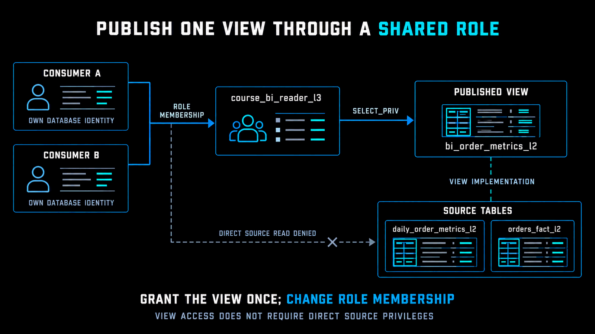
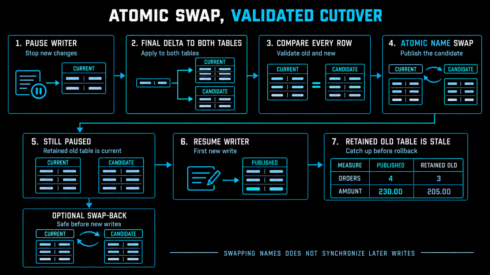
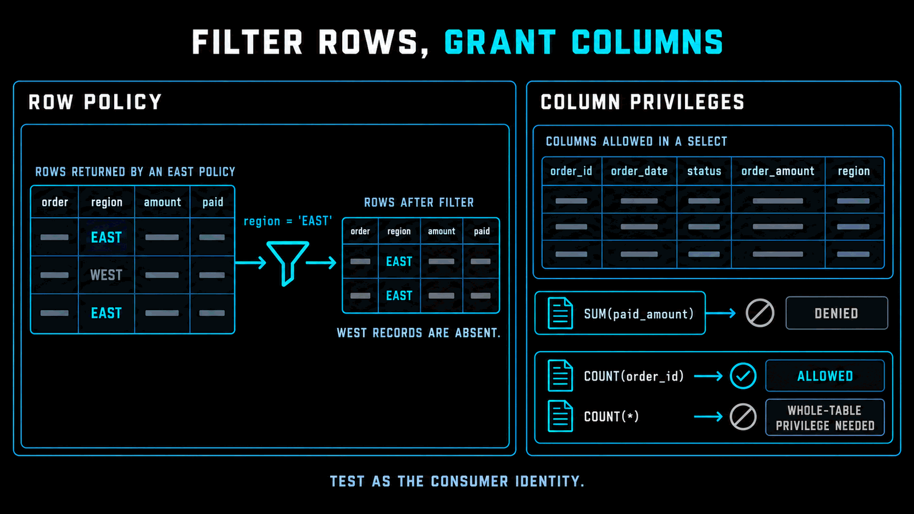

<a id="unit-u.a4c7cb27bf5645b09c72ad56c22173fb"></a>

<a id="module-12-publishing-permissions-and-audit"></a>

# 12-модуль: Жариялау, рұқсаттар және аудит

| Курс туралы ақпарат | Мәні |
| --- | --- |
| Курс | Apache Doris көмегімен деректер қоймасын құру · 3-деңгей |
| Doris | Apache Doris 4.1.3 |
| Орта | 1-модульдің сынақ ортасы; 9-зертханалық жұмыстың `orders_fact_l2`, 11-жұмыстың `bi_order_metrics_l2` нысандары |
| Болжалды уақыт | Шамамен 123 минут: оқу 38, зертханалық жұмыс 75, тест 10 |

[Курстың README файлы](../../README.md) · [12-зертханалық жұмысты ашу](lab12_publishing_permissions_audit.ipynb) · [12-тестті ашу](quiz12_publishing_permissions_audit.ipynb)

<a id="unit-u.d0cee480290a404ab736749dbe4ba60b"></a>

<a id="module-goal"></a>

## Модуль мақсаты

Тұтынушыға келісімшарты қажет ететін қатынауды ғана рөлмен беру, соның сәйкестігімен дәлелдеу, басқа адам тексере алатын жазба сақтау, кейін басқаларға зиян келтірмей сол қолжетімділікті тоқтату.

<a id="unit-u.1d63ed27ddf2412590d49440fd5c2e9d"></a>

<a id="learning-objectives"></a>

## Оқу мақсаттары

Модульді аяқтаған соң сіз:

1. Рұқсат бермес бұрын тұтынушы келісімшартын жазып, жарияланатын нысанды таңдай аласыз.
2. Қажет нысан рұқсатын ғана рөлмен беріп, оқу мен әкімшілікті ажырата аласыз.
3. SHOW GRANTS, SHOW ROLES, тұтынушы сұраулары, өзгеріс жазбасы, аудит әрқайсысы нені дәлелдейтінін айта аласыз.
4. Мүшелік не рөл рұқсатын қайтарып қолжетімділікті тоқтатып, әсерін тұтынушы ретінде тексере аласыз.
5. Кестені тексерілген ауысумен жариялап, кері қайтару қашан қауіпсіз болмайтынын айта аласыз.
6. Шектеуге кесте/баған рұқсатын, Row Policy не бүркемелеуді таңдай аласыз.

<a id="unit-u.84d631f8eb1648ff80acc1f9101eeb04"></a>

<a id="module-structure"></a>

## Модуль құрылымы

| Бөлім | Уақыт | Нәтиже |
| --- | ---: | --- |
| 12.1 Рұқсаттан бұрын келісімшарт | 6 мин | BI тобына не қажет, қай нысанды жариялау керек |
| 12.2 Рұқсаттар, рөлдер және ауқым | 8 мин | Оқу мен әкімшілік рұқсаттары, рөл арқылы беру |
| 12.3 Дәлелдер | 7 мин | Конфигурация, тұтынушы сұраулары, жазбалар және аудит кестесі |
| 12.4 Қолжетімділікті тоқтату | 5 мин | Мүшелік пе, рұқсат па және қандай ретпен |
| 12.5 Кестені жариялап, кері қайтару | 5 мин | Атауларды алмастыру, тексерілген ауысу, қауіпсіз кері қайтару шегі |
| 12.6 Жолдар мен бағандар | 7 мин | Row Policy, баған рұқсаттары және бүркемелеу |
| 12-зертханалық жұмыс | 75 мин | Көріністі рөлге жариялау, тұтынушы ретінде тексеру, тоқтату, тікелей рұқсатты көшіру, кесте жариялау, жол/бағанды шектеу |
| 12-тест | 10 мин | Осы мақсаттарға арналған алты сұрақ |

<a id="unit-u.ef086e84e98d4bf5a9d2d9368f88e7e8"></a>

<a id="121-a-contract-before-a-grant"></a>

## 12.1 Рұқсаттан бұрын келісімшарт

11-модуль `bi_order_metrics_l2` жариялады, BI тобы тақта іске қосылмай тұрып тіркелгі сұрайды. Екі жылдам жауап кейін мәселе туғызады. Root-ты бөлісу пайдаланушыларға кесте жою мен рұқсат беруге мүмкіндік береді, аудитте бәрі root болады. `SELECT_PRIV ON *.*.*` тіркелгісі барлық кестені, егжей-тегжейді және кейін құрылғандарын да оқиды. Тақта тоқтатылғанда не берілгені ешкімнің есінде қалмайды.

Алдымен тұтынушы не оқитынын шешіңіз:

| Үміткер | Бір жол нені білдіреді | Сол тақта не істеуі керек |
| --- | --- | --- |
| `orders_fact_l2` | Клиенті, күйі, төлемі, аймағы бар бір тапсырыс | Әр диаграммада келісімшарт сүзгісі мен агрегаттауын қайталау |
| `bi_order_metrics_l2` | Бір күн: тапсырыс, сома, орташа тапсырыс сомасы | Жарияланған өлшемдерді оқу |

Жеткізілетін нысан — семантикалық көрініс: 11-модуль келісімшарты әр баған мағынасын айтады, іске асуы тақтадан тәуелсіз өзгереді. Рұқсат бермес бұрын жазыңыз: нысан; түйіршіктілігі; `gross_amount` түскен ақша емес, тапсырыс құны екені сияқты өріс мағынасы; өзектілігі; тұтынушы және тек осы көріністі оқитын ауқымы; дерек, тақта, мақұлдау иелері; жариялауды тексеру жолы. Рұқсат содан кейін нысан мен ауқымнан шығады.

<a id="unit-u.793c9def3b1946b7be9ecd23d3b7aa3b"></a>

<a id="122-privileges-roles-and-scope"></a>

## 12.2 Рұқсаттар, рөлдер және ауқым

Doris нысан **рұқсаттарын** **рөлдерге**, рөлдерді **пайдаланушыларға** береді. BI тобының бесеуі бір рөлді бөліседі; біреуі кетсе мүшелік қана өзгереді, тексеруші бес пайдаланушы орнына бір рөлді оқиды.

| Рұқсат | Мүмкіндік | Тақтаға керек пе? |
| --- | --- | --- |
| `SELECT_PRIV` | Ауқым нысандарын оқу | Иә |
| `LOAD_PRIV`, `ALTER_PRIV`, `DROP_PRIV` | Жүктеу, өзгерту, жою | Жоқ |
| `GRANT_PRIV` | Рұқсат беру, пайдаланушы/рөлдерді басқару | Жоқ |
| `ADMIN_PRIV` | Оқу мен рұқсат беруді қоса әкімшілік, түйін басқаруынсыз | Жоқ |
| `NODE_PRIV` | FE/BE түйіндерін қосу/жою | Жоқ |

Бұлар бөлек: `GRANT_PRIV` оқытпайды, `SELECT_PRIV` рұқсат бергізбейді. Бір көріністі оқуға `ADMIN_PRIV` беру қажеттіктен әлдеқайда көп. `ON` кейінгі ауқым `SELECT_PRIV` нені қамтитынын шешеді:

| Ауқым | Қамтиды | Кейін құрылған нысандар |
| --- | --- | --- |
| `*.*.*` | Әр Catalog-тың әр кестесі | Олар да оқылады |
| `internal.<db>.*` | Бір базаның әр кестесі/көрінісі | Олар да оқылады |
| `internal.<db>.<table>` | Бір кесте не көрініс | Әсер етпейді |
| `SELECT_PRIV(col1, col2) ON internal.<db>.<table>` | Бір кестенің аталған бағандары | Жаңа бағандар кірмейді |

**SQL оқу мысалы: 12-жұмыс рұқсаты. Кейін қайта орындамаңыз.**
Келісімшарт рұқсат ететін ең тар ауқым:

<!-- reading-only-example -->
```sql
CREATE ROLE course_bi_reader_l3;
GRANT SELECT_PRIV ON internal.dw_course_l1_demo.bi_order_metrics_l2 TO ROLE 'course_bi_reader_l3';
```

Жұмыс өз базаңыздың атын жазады. Мүше `daily_order_metrics_l2`, `orders_fact_l2` дереккөздеріне рұқсатсыз көріністі оқиды: Doris сұрау атаған нысанды тексереді. Өзгерісті курста сынақ ортасының әкімшісі root, өндірісте мақұлданған әкімші орындайды; тұтынушылар өз хост ауқымы мен басқарылатын тіркелгі деректері бар жеке тіркелгі алады.



*Рөл дереккөздерді ашпай, жарияланған көрініске рұқсат береді.*

Сурет белгілері: PUBLISH ONE VIEW THROUGH A SHARED ROLE — бір көріністі ортақ рөлмен жариялау; CONSUMER A/B — A/B тұтынушысы; OWN DATABASE IDENTITY — жеке база сәйкестігі; ROLE MEMBERSHIP — рөл мүшелігі; PUBLISHED VIEW — жарияланған көрініс; VIEW IMPLEMENTATION — көрініс іске асуы; SOURCE TABLES — бастапқы кестелер; DIRECT SOURCE READ DENIED — дереккөзді тікелей оқуға тыйым; GRANT THE VIEW ONCE; CHANGE ROLE MEMBERSHIP — көрініс рұқсатын бір рет беріп, мүшелікті өзгерту; VIEW ACCESS DOES NOT REQUIRE DIRECT SOURCE PRIVILEGES — көрініске қатынауға бастапқы кесте рұқсаттары керек емес. course_bi_reader_l3, SELECT_PRIV, bi_order_metrics_l2, daily_order_metrics_l2 және orders_fact_l2 — нақты рөл/рұқсат/нысан атаулары.

11-модульдің қосымша тақтасындай пайдаланушыға тікелей берілген рұқсат та жұмыс істейді, бірақ рөл тексеруі оны таппайды; сол мақсаттағы келесі тіркелгіге қайта беру керек. Doris пайдаланушының өз рұқсаттарын `default_role_rbac_<user>@<host>` жасырын рөлінде сақтайды. Жұмыс тікелей рұқсатты қатынауды үзбей көшіреді: рөлге рұқсат, пайдаланушыға рөл беру, кейін өз рұқсатын қайтару.

<a id="unit-u.9a1dda1a36aa4a3fa0da6ae916125261"></a>

<a id="123-evidence"></a>

## 12.3 Дәлелдер

Жариялағаннан үш ай кейін тексеруші кім нені, неге өзгерткенін және әсерін сұрайды. «SQL сәтті болды» бұған жауап бермейді. Әр дәлел бір бөлігін көрсетеді:

| Дәлел | Нені көрсетеді | Нені көрсетпейді |
| --- | --- | --- |
| `SHOW ROLES` | Әр рөлдің ауқым бойынша рұқсаттары мен мүшелері | Мүше олармен іс жүзінде не істей алады |
| `SHOW GRANTS` / `SHOW ALL GRANTS` | Тіркелгінің өз және рөлдерінен келген рұқсаттарының біріккен тізімі | Қайсысы өзінікі, қайсысы рөлден |
| Тұтынушы ретінде сұрау | Сол сәйкестік нені оқи алады/алмайды | Өзге сәйкестіктер, өзге хосттар |
| Өзгеріс жазбасы | ID, рөл, нысан, рұқсат, себеп және мақұлдау | Өзгеріс орындалды ма, не істеді |
| `__internal_schema.audit_log` аудит кестесі | Кім қай дерекқорда қандай команданы қандай нәтижемен орындады | Рұқсаттар дұрыс па, тіркелгінің артында кім тұрды |

12-жұмыстың тексерулері осыларды біріктіреді. `SHOW ROLES` `course_bi_reader_l3` рөлін `TablePrivs` ішінде `internal.<db>.bi_order_metrics_l2: Select_priv` мәнімен, ал кеңірек рұқсат берер `GlobalPrivs`, `DatabasePrivs` ішінде ештеңесіз көрсетеді. Кейін рөлмен құрылып, соңында жойылатын уақытша қарапайым пайдаланушы көріністің екі күнін оқиды, екі дереккөзіне де тыйым алады: `Access denied; you need (at least one of) the (Admin_priv,Select_priv) privilege(s) on table orders_fact_l2 for this operation`. Root сұраулары тұтынушы туралы ештеңе дәлелдемейді: root бәрін оқиды.

Doris аудит плагині әр команданы пайдаланушы, дерекқор, күйі, қате кодымен `__internal_schema.audit_log` кестесіне және FE `fe.audit.log` файлына жазады. Пакетпен жазатындықтан, SQL жазбаны командадан шамамен бір минутқа дейін кешігіп оқиды:

```sql
SELECT `user`, db, state, error_code, return_rows, stmt
FROM __internal_schema.audit_log
WHERE `user` = 'course_orders_l3_<random>'
ORDER BY `time`;
```

Жол қайтарған сұрау күйі — `EOF`, қате коды 0; қабылданбағаны — `ERR`, осы жұмыста 1105. Бұл — орындалу дәлелі, рұқсаттарды тексеру емес: кластерде әр FE өз жазбасын жазады; сақтау, қорғау, соларға ескерту жасау — аудит платформасының міндеті.

<a id="unit-u.99d6b1aa65aa450a86f596ff1e55ed0c"></a>

<a id="124-retire-access"></a>

## 12.4 Қолжетімділікті тоқтату

Тақта тоқтатылса да, тіркелгі рөл арқылы оқи алады. Алдымен рөлдің `Users` тізімін қарап, нені қайтаруды шешіңіз:

| Жағдай | Нені қайтару | Кімге әсер етеді |
| --- | --- | --- |
| A тоқтайды, B сол рөлді қолданады | A мүшелігі: `REVOKE 'course_bi_reader_l3' FROM 'dashboard_a'@'%'` | Тек A |
| Рөл қажет емес | Рұқсаты, кейін рөл: `REVOKE SELECT_PRIV ON ... FROM ROLE ...`, `DROP ROLE ...` | Әр мүше |

B әлі қолданғанда рөл рұқсатын қайтару B-ні де ажыратады. A тоқтады демес бұрын басқа жолдарын тексеріңіз: тікелей рұқсат не өзге рөл оқыта беруі мүмкін. Кейін тұтынушы ретінде растаңыз: 12-жұмыс пайдаланушының рөл мүшелігін тоқтатқаннан кейін, тіркелгінің база рұқсаты қалмағандықтан Doris қосылудың өзінен бас тартады — `Access denied for user '...' to database '...'`.

Кей нысандар тиесілі нысанынан ұзақ сақталады. Рөлді жою Row Policy-лерін, Workload Group жою пайдалану рұқсаттарын қалдырады (14-модуль); кейін сол атпен құрылған рөл/топ қайта алады. Алдымен саясаттар мен рұқсаттар, кейін рөл/топты жойып, `SHOW ROW POLICY`, `SHOW ROLES` тексеріңіз. `DROP ROLE` нысанды жояды; мақұлдау мен себебінің жазбасын сақтаңыз.

<a id="unit-u.cc3939edbc124671820f7a9900e779d8"></a>

<a id="125-release-a-table-and-roll-it-back"></a>

## 12.5 Кестені жариялап, кері қайтару

Кестенің жаңа нұсқасы жарияланғанының жанында құрылып, атымен жариялана алады.

**SQL оқу мысалы: 12-жұмыстың жариялауы. Жұмыстан кейін қайта орындамаңыз.**

<!-- reading-only-example -->
```sql
ALTER TABLE published_orders_l3 REPLACE WITH TABLE candidate_orders_l3 PROPERTIES ("swap" = "true");
```

Алмастыру атомарлы: сұрау ескі не жаңа кестені көреді, екеуінің жартысын емес. `swap = true` ескіні үміткер атымен сақтап, кері қайтаруға дайындайды. Doris толтыруды, салыстыруды, жазуларды қуып жетуді сіз үшін істемейді: бұлар айналасындағы рәсім. Жұмыс имитациялық жазушыны кідіртіп, соңғы өзгерісті екеуіне қолданып, әр жолды салыстырады, алмастырады, жазушы әлі тоқтағанда кері қайтаруды жаттығады, қайта алмастырып жазуды жалғастырады. Тағы бір жазудан соң ескіде ол жоқ: жарияланған 4 тапсырыс/230.00 орнына 3/205.00. Кері қайтару жарияланғанға алғашқы жазу келгенше ғана қауіпсіз; кейін ескі қайтпас бұрын қуып жетуі керек.



*Атауларды атомарлы алмастыру ескі кестеге кейінгі жазуларды синхрондамайды.*

Сурет белгілері: ATOMIC SWAP, VALIDATED CUTOVER — атомарлы алмастыру, тексерілген ауысу; 1. PAUSE WRITER / Stop new changes — жазушыны кідірту, жаңа өзгерістерді тоқтату; 2. FINAL DELTA TO BOTH TABLES / Apply to both tables — соңғы өзгерісті екі кестеге қолдану; 3. COMPARE EVERY ROW / Validate old and new — әр жолды салыстыру, ескі/жаңаны тексеру; 4. ATOMIC NAME SWAP / Publish the candidate — атауларды атомарлы алмастыру, үміткерді жариялау; 5. STILL PAUSED / Retained old table is current — әлі кідіртілген, ескі өзекті; OPTIONAL SWAP-BACK / Safe before new writes — қосымша кері алмастыру, жаңа жазуға дейін қауіпсіз; 6. RESUME WRITER / First new write — жазуды жалғастыру, алғашқы жаңа жазу; 7. RETAINED OLD TABLE IS STALE / Catch up before rollback — ескі ескірді, қайтармас бұрын қуып жету; CURRENT/CANDIDATE/PUBLISHED/RETAINED OLD — ағымдағы/үміткер/жарияланған/сақталған ескі; MEASURE/ORDERS/AMOUNT — өлшем/тапсырыс/сома; SWAPPING NAMES DOES NOT SYNCHRONIZE LATER WRITES — атаулар алмастыруы кейінгі жазуларды синхрондамайды. Мәндер: жарияланған 4 және 230.00, ескі 3 және 205.00.

<a id="unit-u.d3cb769026c54c818a42f3853008e96e"></a>

<a id="126-rows-and-columns"></a>

## 12.6 Жолдар мен бағандар

Екі жаңа талап бар: EAST тобы тек EAST тапсырыстарын оқиды, төленген/қайтарылған соманы тек Қаржы көреді. Кесте рұқсаты барлық жол/бағанды қамтиды, екеуіне де сай емес:



*Жол саясаты жазбаларды, баған рұқсаттары өрістерді таңдайды.*

Сурет белгілері: FILTER ROWS, GRANT COLUMNS — жолдарды сүзу, бағандарға рұқсат беру; ROW POLICY — жол саясаты; ROWS RETURNED BY AN EAST POLICY — EAST саясаты қайтаратын жолдар; ROWS AFTER FILTER — сүзгіден кейінгі жолдар; WEST RECORDS ARE ABSENT — WEST жазбалары жоқ; COLUMN PRIVILEGES — баған рұқсаттары; COLUMNS ALLOWED IN A SELECT — SELECT-те рұқсат етілген бағандар; DENIED — тыйым салынған; ALLOWED — рұқсат етілген; WHOLE-TABLE PRIVILEGE NEEDED — бүкіл кестеге рұқсат керек; TEST AS THE CONSUMER IDENTITY — тұтынушы сәйкестігімен тексеру. order/region/amount/paid — тапсырыс/аймақ/сома/төленген; EAST/WEST, region = 'EAST', order_id, order_date, status, order_amount, SUM(paid_amount), COUNT(order_id), COUNT(*) — өзгермейтін дерек/SQL белгілері.

| Талап | Тетік | Тексеру |
| --- | --- | --- |
| Кей рөлдерге кей бағандар | Баған рұқсаттары: `SELECT_PRIV(order_id, order_date, status, order_amount, region)` | Өзге баған сұрауы қабылданбайды; кейін қосылған баған қамтылмайды |
| Кей рөлдерге кей жолдар | Кестеде рөлге арналған Row Policy | Өзгесін сұраса да, тек өз жолдарын көреді |
| Карта нөмірі сияқты мән бөлігін жасыру | Apache Ranger арқылы бүркемелеу | Бұл курста жоқ: 12-жұмыс Ranger орнатпайды |

**Row Policy** аталған рөлдер/пайдаланушылардың кестеге әр сұрауына Doris қолданатын шарт қосады; `RESTRICTIVE` тек сәйкес жолдарды қалдырады.

**SQL оқу мысалы: 12-жұмыстың EAST саясаты. Жұмыстан кейін қайта орындамаңыз.**

<!-- reading-only-example -->
```sql
CREATE ROW POLICY region_east_l3 ON dw_course_l1_demo.orders_fact_l2
AS RESTRICTIVE TO ROLE course_region_east_l3 USING (region = 'EAST');
```

Рұқсат сияқты саясат рөл мүшелеріне ілеседі. EAST пайдаланушысы 6 тапсырыс пен 830.00 көреді, `WHERE region = 'WEST'` ештеңе қайтармайды: тақта сүзгісінен өзгеше, сұрау ауқымды кеңейте алмайды. Root-қа саясат қолданылмайды, тұтынушы ретінде тексеріңіз.

`orders_fact_l2` бес бағанына рұқсаты бар рөл оларды оқиды; Doris `SUM(paid_amount)`, рөлде жоқ алғашқы бағанға тыйым салатын `SELECT *` және `COUNT(*)` сұрауларын қабылдамайды. Жол санауға бүкіл кесте рұқсаты керек, сондықтан рұқсатты бағанды `COUNT(order_id)` арқылы санаңыз. Тетікті таңдамас бұрын шектеуді, қамтитын нысандарын, тексеруін шешіңіз.

<a id="unit-u.f9139e6ad34143fda527a186ab8f4e80"></a>

<a id="lab-12-publish-a-view-to-a-role-and-audit-who-read-what"></a>

## 12-зертханалық жұмыс: Көріністі рөлге жариялап, кім не оқығанын аудиттеу

[12-зертханалық жұмыс: Көріністі рөлге жариялап, кім не оқығанын аудиттеу](lab12_publishing_permissions_audit.ipynb) файлын ашыңыз. Сіз:

1. Сәйкестік, нысан және рөлдің бастапқы күйін жазасыз.
2. Рөлге тек `bi_order_metrics_l2` үстінде `SELECT_PRIV` беріп, `SHOW ROLES` арқылы тексересіз.
3. Уақытша қарапайым пайдаланушы ретінде көріністі оқып, дереккөздеріне, `REVOKE` соң көрініске де тыйым аласыз.
4. Рөлді тоқтатасыз.
5. 11-модуль тақтасын құрсаңыз, тікелей рұқсатын рөлге көшіресіз.
6. Кестені тексерілген ауысумен жариялап, кері қайтару қашан қауіпсіз болмайтынын көресіз.
7. Екі аймақ рөлін Row Policy арқылы, үшіншісін бес бағанмен шектейсіз.
8. Пайдаланушы сұрауларын, тыйымды да аудит кестесінен табасыз.
9. Жаттығу: ортақ рөлді екі тақтаның бірін тоқтатасыз.

Сынақ ортасы, 9-жұмыстың `orders_fact_l2`, 11-жұмыстың `bi_order_metrics_l2` нысандары керек. Рөлдер, пайдаланушылар мен саясаттар бүкіл кластерге тиесілі; жұмыс сақтамайтындарын жояды.

<a id="unit-u.79f20485a9004f1abd82f7afa40e67b1"></a>

<a id="summary"></a>

## Қорытынды

- Алдымен тұтынушы келісімшартын жазып, егжей-тегжей орнына семантикалық көріністі жариялаңыз: рұқсат нысаны мен ауқымы содан шығады.
- Бір нысанға `SELECT_PRIV` рөл арқылы беріледі; әкімшілік пен рұқсат беру бөлек, тікелей берілгені тіркелгіні үзбей рөлге көшеді.
- `SHOW ROLES` конфигурацияны көрсетеді, `SHOW GRANTS` тіркелгінің өз және рөлдік рұқсаттарын біріктіреді, тұтынушы сұрауы не істей алатынын, өзгеріс жазбасы өзгерісті құжаттайды, `__internal_schema.audit_log` не орындалғанын көрсетеді.
- Бір тұтынушыны тоқтатуға мүшелікті, бәрін тоқтатуға рөл рұқсатын қайтарыңыз; басқа жолдарды тексеріп, тұтынушы ретінде растаңыз, рөл/топтан бұрын саясаттар мен рұқсаттарды жойыңыз.
- Атаулар алмастыруы атомарлы; айналасындағы ауысу — өз рәсіміңіз, кері қайтару келесі жазуға дейін ғана қауіпсіз.
- Баған рұқсаттары бағандарды, Row Policy рөлдерінің жолдарын шектейді, бүркемелеу мән бөлігін жасырады; `COUNT(*)` бүкіл кесте рұқсатын талап етеді.

<a id="unit-u.c517ca8650634c7d902d19c93bcc39fa"></a>

<a id="quiz-12"></a>

## 12-тест

[12-тест: Жариялау, рұқсаттар және аудит](quiz12_publishing_permissions_audit.ipynb) файлын ашыңыз. Бір жауап таңдалатын алты сұрақ бар; іске қосылған орта қажет емес.

Келесі модуль: [13-модуль: Сақтау мен өмірлік циклді басқару](../module13-storage-lifecycle/course.md).

<a id="unit-u.d5fca168713b4b48b46be8c5f3a47280"></a>

<a id="references"></a>

## Дереккөздер

- [Apache Doris: кірістірілген авторизация](https://doris.apache.org/docs/4.x/admin-manual/auth/authorization/internal/)
- [Apache Doris: дерекке қатынауды басқару](https://doris.apache.org/docs/4.x/admin-manual/auth/authorization/data/)
- [Apache Doris: GRANT TO](https://doris.apache.org/docs/4.x/sql-manual/sql-statements/account-management/GRANT-TO)
- [Apache Doris: REVOKE FROM](https://doris.apache.org/docs/4.x/sql-manual/sql-statements/account-management/REVOKE-FROM)
- [Apache Doris: SHOW GRANTS](https://doris.apache.org/docs/4.x/sql-manual/sql-statements/account-management/SHOW-GRANTS/)
- [Apache Doris: CREATE ROW POLICY](https://doris.apache.org/docs/4.x/sql-manual/sql-statements/data-governance/CREATE-ROW-POLICY/)
- [Apache Doris: ALTER TABLE REPLACE](https://doris.apache.org/docs/4.x/sql-manual/sql-statements/table-and-view/table/ALTER-TABLE-REPLACE/)
- [Apache Doris: аудит журналы](https://doris.apache.org/docs/4.x/admin-manual/audit-plugin/)
