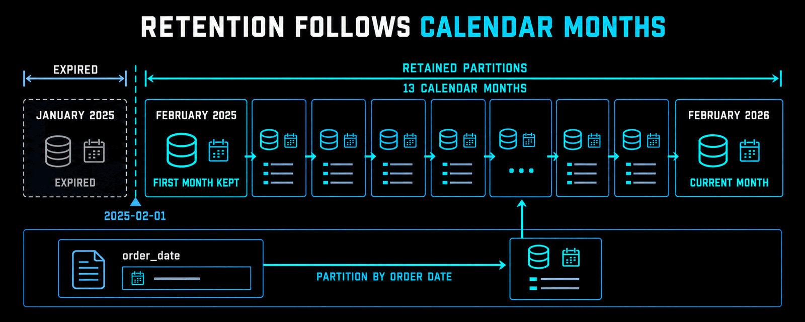
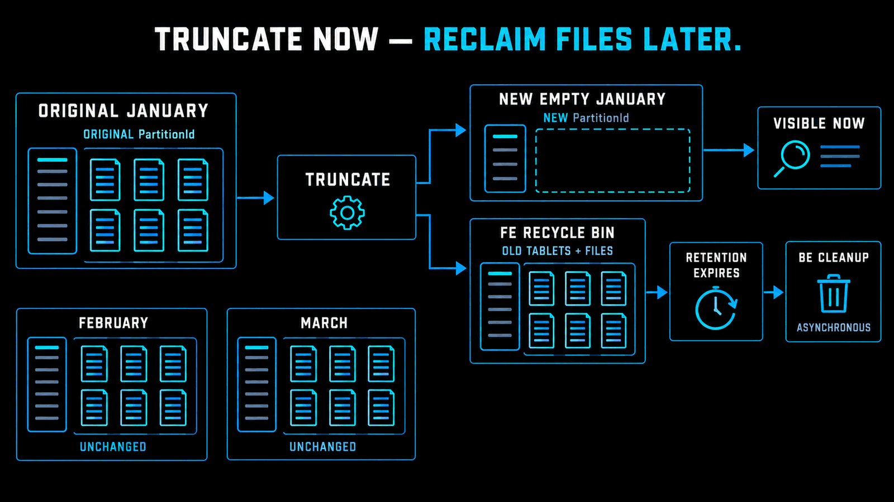
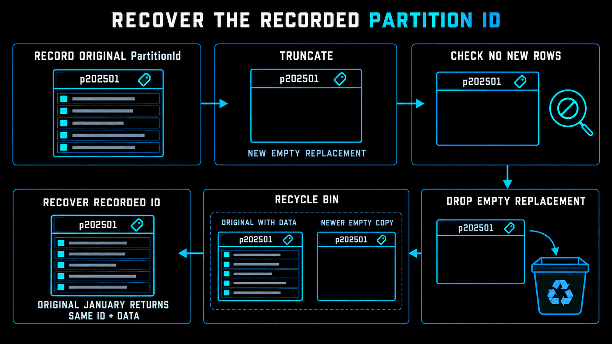

<a id="unit-u.755884d52b8147f3a8ac607cfb17ceae"></a>

<a id="module-13-storage-and-lifecycle-management"></a>

# 13-модуль: Сақтау мен өмірлік циклді басқару

| Курс туралы ақпарат | Мәні |
| --- | --- |
| Курс | Apache Doris көмегімен деректер қоймасын құру · 3-деңгей |
| Doris | Apache Doris 4.1.3 |
| Орта | 1-модуль сынақ ортасы; қосымша көшірме жаттығуына жұмыс бастайтын жергілікті объектілік сақтау |
| Болжалды уақыт | Шамамен 108 минут: оқу 38, зертханалық жұмыс 60, тест 10 |

[Курстың README файлы](../../README.md) · [13-зертханалық жұмысты ашу](lab13_storage_and_lifecycle.ipynb) · [13-тестті ашу](quiz13_storage_lifecycle.ipynb)

<a id="unit-u.b0e32db3847046bfb06703c8cce15ef1"></a>

<a id="module-goal"></a>

## Модуль мақсаты

Мерзімі өткен айларды бөліммен жою, әр қызмет көрсету қадамы нені өзгерткенін жазу, қате жойылған айды қайтаруды алдын ала білу.

<a id="unit-u.dbe657c7ddff4cbd920437b152c49e67"></a>

<a id="learning-objectives"></a>

## Оқу мақсаттары

Модульді аяқтаған соң сіз:

1. Сақтау ережесі мен сұрау уақытына сай бөлім шекарасын таңдай аласыз.
2. Жол бөлімге, tablet-ке, репликаға, rowset-ке, сегментке қалай тиесілі екенін түсіндіре аласыз.
3. SHOW PARTITIONS, SHOW TABLETS, SHOW CREATE TABLE арқылы өзгеріске дейінгі/кейінгі дәлелді жаза аласыз.
4. Сұрауда көріну, метадерек өзгерісі, босатылған орынды ажыратып, compaction орнын айта аласыз.
5. Жойылған/тазаланған бөлімді себеттен қалпына келтіріп, тек көшірме/мұрағат қашан көмектесетінін айта аласыз.
6. Ауқымы, тексеруі, дәлелі, алдын ала сыналған қайтаруы бар қызмет көрсету нұсқаулығын жаза аласыз.

<a id="unit-u.b522793780bc4efca78bccea5d9071ae"></a>

<a id="module-structure"></a>

## Модуль құрылымы

| Бөлім | Уақыт | Нәтиже |
| --- | ---: | --- |
| 13.1 Сақтау ережесіне сай бөлімдеу | 8 мин | Тапсырыс күніндегі айлар, TRUNCATE пен DROP |
| 13.2 Жол қайда тұрады | 6 мин | Кестеден сегментке, tablet саны |
| 13.3 Қызмет көрсетуге дейінгі/кейінгі дәлел | 6 мин | SHOW не көрсетеді, қай сандар кешігеді |
| 13.4 TRUNCATE нені өзгертеді | 6 мин | Көріну қазір, файл кейін, арасында себет |
| 13.5 Қайтару жолдары | 8 мин | Себеттен атау/ID-мен, сақтық көшірме, мұрағат |
| 13.6 Қызмет көрсету нұсқаулығы | 4 мин | Ауқым, тексеру, өзгеріс, дәлел, қалпына келу |
| 13-зертханалық жұмыс | 60 мин | Айды тазалау, ID-мен қайтару, өзгені жойып қайтару, сақтау жоспары; қосымша сақтық көшірме/қалпына келтіру |
| 13-тест | 10 мин | Осы мақсаттарға арналған алты сұрақ |

<a id="unit-u.62aed84fc84241a3a3dd5c7b6f107657"></a>

<a id="131-partition-by-the-retention-rule"></a>

## 13.1 Сақтау ережесіне сай бөлімдеу

Тапсырыс кестесінде екі жылдық дерек бар, ереже **ағымдағы күнтізбелік ай мен алдындағы 12 айды** сақтайды. 2026 ақпанда 2025 ақпан–2026 ақпан қалады, бұрынғылары жойылады. Әріптес `DELETE FROM orders WHERE order_date < '2025-02-01'` орындайды: тез қайтады, ескі тапсырыс сұраудан жоғалады, диск дерлік өзгермейді — жолдар compaction-ға дейін файлда қалады; шарт қате болса, қайтару жолы жоқ. SQL-ден бұрын төрт сұраққа жауап беріңіз:



*Күнтізбелік сақтау бөлім шекарасын бизнес тапсырыс күніне сәйкестендіреді.*

Сурет белгілері: RETENTION FOLLOWS CALENDAR MONTHS — сақтау күнтізбелік айларға ілеседі; EXPIRED — мерзімі өткен; RETAINED PARTITIONS — сақталған бөлімдер; 13 CALENDAR MONTHS — 13 күнтізбелік ай; JANUARY 2025 — 2025 қаңтар; FEBRUARY 2025 — 2025 ақпан; FEBRUARY 2026 — 2026 ақпан; FIRST MONTH KEPT — сақталатын алғашқы ай; CURRENT MONTH — ағымдағы ай; PARTITION BY ORDER DATE — тапсырыс күнімен бөлімдеу. order_date — нақты баған, 2025-02-01 — сақтау шекарасы.

| Сұрақ | Тапсырыс кестесіне жауап |
| --- | --- |
| Бір жол не? | Бір тапсырыс |
| Қанша сақталады? | Осы ай және алдыңғы 12: мұнда 2025 ақпан–2026 ақпан |
| Қай уақыт жарамдылықты шешеді? | Жүктелгені емес, `order_date` |
| Жойылған ай қалай қайтады? | Қайта оқылған сақтық көшірме/мұрағаттан; бір күн ішінде себеттен |

Үшінші жауап — бөлім кілті. Жүктеу уақытымен бөлсе, ақпанда келген қаңтар тапсырысы ақпанға түсіп, қаңтар тазалауына кірмейді, `order_date` сүзгісі бөлім қысқартпайды. Күнтізбелік ай ережесі жылжымалы 365 күннен де бөлек: тұтас ай бөліммен жойылады, белгілі күнде бітетін терезе олай жойылмайды.

| Бөлімдер | 2025 қаңтарды жою | Қамтитыны |
| --- | --- | --- |
| Айлық | `ALTER TABLE ... DROP PARTITION p202501` | Тек қаңтар |
| Жылдық | 2025 бөліміндегі `DELETE ... WHERE order_date < '2025-02-01'` | Compaction-ға дейін әр 2025 сұрауы жою шартын қолданады |
| Жоқ | Кестедегі `DELETE` | Әр кесте сұрауы шартты қолданады |

Duplicate Key ішінде шартты `DELETE` файлды қайта жазбай, жою предикаты бар нұсқа жазады; `SHOW DELETE` тізеді, compaction rowset-терді біріктіргенше сұраулар сүзеді. Көп предикат сұрауды баяулатады.

Айлық бөлімге екі команда бар:

| Команда | Кейінгі бөлім | Не үшін |
| --- | --- | --- |
| `TRUNCATE TABLE ... PARTITION (p202501)` | Орнында, бос, жаңа ID-мен | Айды тазалап қайта жүктеу |
| `ALTER TABLE ... DROP PARTITION p202501` | Анықтамасымен бірге жоқ | Мұрағаты тексерілген мерзімі өткен айды жою |

Динамикалық бөлімдеу болашақты құрып, тарихты жоспармен жоя алады; қанша сақтау керегін `dynamic_partition.start` айтса ғана ескіні жояды. Қолмен не жоспармен болсын, жоймас бұрын ай мұрағатын тексеріңіз.

<a id="unit-u.a5d8c635cf964ed99d080f86cd92bd78"></a>

<a id="132-where-a-row-lives"></a>

## 13.2 Жол қайда тұрады

Бизнес қаңтар тапсырыстарын айтады, Doris tablet/rowset сақтайды. 2025-01-15 күнгі 130001 тапсырысын қадағалаңыз:

| Қабат | 130001 қайда | Қызмет көрсету не қарайды |
| --- | --- | --- |
| Кесте | `ops_orders_l3` | Модель, иесі, рұқсаттар |
| Бөлім | 2025-02-01-ден төмен, сондықтан `p202501` | Сақтау, қысқарту, тазалау ауқымы |
| Bucket/tablet | `HASH(order_id)`, `BUCKETS 1`: жалғыз tablet | Параллельдік, қисық таралу, өлшем |
| Реплика | `replication_num` 1: жалғыз BE-де бір көшірме | Саны, орны, денсаулығы |
| Rowset | `INSERT` қосқан нұсқа | Нұсқалар, compaction қысымы |
| Сегмент | Rowset ішіндегі баған файлдары | Сканерлеу/индекс, қызмет көрсету сирек тиеді |

`p202501` тазалау қаңтар tablet-терін қамтып, ақпан/наурызға тимейді. Құрылым tablet санын шешеді:

| Кесте | Бөлім | Бөлімге bucket | Реплика | Tablet | SHOW TABLETS жолдары |
| --- | ---: | ---: | ---: | ---: | ---: |
| Жұмыстың `ops_orders_l3` | 3 | 1 | 1 | 3 | 3 |
| 13 айлық өндірістік кесте | 13 | 8 | 3 | 104 | 312 |

`SHOW TABLETS` әр жолы — бір реплика, сондықтан нақты кестеде бөлім сөйлемі пайдалы. Аз bucket ірі tablet, аз параллельдік; тым көбі ұсақ tablet, жоспарланатын көп метадерек жасайды. Бір BE/реплика қатынасты көрсетеді, өндірістік өлшем емес.

<a id="unit-u.0cc5b7c19bfd4a32baa4a311147bd7cb"></a>

<a id="133-evidence-before-and-after-maintenance"></a>

## 13.3 Қызмет көрсетуге дейінгі және кейінгі дәлел

Қате рұқсатты қайтаруға болады, қате тазалаудың әрдайым істейтін кері командасы жоқ. Күйді алдын ала жазып, кейін сол тексерулерді қайталаңыз:

| Дәлел | Көрсетеді | Көрсетпейді |
| --- | --- | --- |
| `SHOW PARTITIONS FROM t` | Әр бөлім атауы, аралығы, `PartitionId`, `VisibleVersion`, `State` | Қазіргі дәл санақты: `RowCount`, `DataSize` BE есебін күтеді |
| `SHOW TABLETS FROM t PARTITION (p)` | Әр репликаның tablet, backend, нұсқасы мен күйі | Жойылған tablet файлдары дисктен кеткенін |
| `SHOW CREATE TABLE t` | Модель, бөлімдер, bucket-тер, репликалар | Ай мұрағатталды ма, compaction аяқталды ма |
| `SELECT COUNT(*) FROM t PARTITION (p)` | Сұраулар қазір көретін жолдар | Орын босатылғанын |

Жүктеу бекітілген бойда `VisibleVersion` өзгереді; BE-нің шамамен минуттан кейінгі есебіне дейін `RowCount` -1 не 0. `SHOW TABLETS` ішінде бөлім бағаны жоқ, бөлімді атаңыз. Сақтау мен есептеуі біріктірілген және ажыратылған архитектураларда өлшемдер әртүрлі мағына береді; бұл орта біріктірілген.

<a id="unit-u.9eec5073a4be479f97ccf0f8d992add4"></a>

<a id="134-what-truncate-changes"></a>

## 13.4 TRUNCATE нені өзгертеді

**SQL оқу мысалы: қаңтарды тазалайтын қадам. Жұмыстан кейін қайта орындамаңыз.**

<!-- reading-only-example -->
```sql
TRUNCATE TABLE ops_orders_l3 PARTITION (p202501);
```

| Қабат | Не өзгереді | Қашан |
| --- | --- | --- |
| Сұраулар | Ақпан/наурыз: 2 тапсырыс, 500.00 қалады | Бірден |
| Метадерек | `p202501` жаңа `PartitionId`, `VisibleVersion` 1 алады; өзгелері сақталады | Бірден |
| Сақтау | Ескі бөлім/tablet-тері FE себетінде, файлдары қалады | Себет мерзімінен кейін, кейін BE-де асинхронды жойылады |

`TRUNCATE` бөлімді аты/аралығы бірдей жаңа босымен алмастырады; жолдап жоймайды, жою предикатын жазбайды, compaction күтпейді. Себет ескіні `catalog_trash_expire_second`, әдепкі 86400 секунд — бір күн, сақтайды. `TRUNCATE ... FORCE` себетті өткізеді.



*TRUNCATE сұрауда көрінуді бірден өзгертеді, ескі файлды кейін босатады.*

Сурет белгілері: TRUNCATE NOW — RECLAIM FILES LATER — қазір тазалау, файлды кейін босату; ORIGINAL JANUARY — бастапқы қаңтар; ORIGINAL PartitionId — бастапқы ID; NEW EMPTY JANUARY — жаңа бос қаңтар; NEW PartitionId — жаңа ID; VISIBLE NOW — қазір көрінеді; FE RECYCLE BIN — FE себеті; OLD TABLETS + FILES — ескі tablet/файлдар; RETENTION EXPIRES — сақтау мерзімі бітеді; BE CLEANUP ASYNCHRONOUS — BE асинхронды тазалауы; FEBRUARY/MARCH UNCHANGED — ақпан/наурыз өзгермеді. TRUNCATE және PartitionId — нақты SQL/метадерек атаулары.

**Compaction** tablet rowset-терін фонда аздау іріге біріктіріп, жою предикаттарының жолдарын алып тастайды; сондықтан әріптестің `DELETE` сұрауды дисктен бұрын өзгертті. TRUNCATE сәттілігіне қатысы жоқ. Қысымын бір шағын үлгімен емес, `VersionCount`, жүктеу/сұрау жиіліктерімен бақылаңыз.

<a id="unit-u.a084f6ce29d14d8aab48a87b81cc9198"></a>

<a id="135-ways-back"></a>

## 13.5 Қайтару жолдары

Себет TRUNCATE тазалаған және жойылған бөлімдерді сақтайды; әлі барда `RECOVER PARTITION` қайтарады. Жұмыс қаңтарды қайтарады:

1. `SHOW CATALOG RECYCLE BIN WHERE NAME = 'p202501'` әр кесте/орындаудан жойылған барлық `p202501` бөлімін тізеді; тазалауға дейін жазған `PartitionId` жазбасын таңдаңыз.
2. Бос алмастырушы әлі кестеде болса, `RECOVER PARTITION p202501 FROM ops_orders_l3` қабылданбайды: `partition[p202501] already exist in table[ops_orders_l3]`. Алмастырушы әлі бос екенін тексеріңіз: кейін жазылған жолдар жоғалар еді.
3. Алмастырушыны жойыңыз, ол да себетке түседі; ID-мен қайтарыңыз.

**SQL оқу мысалы: 13-жұмыстың қалпына келтіруі. Кейін қайта орындамаңыз.**

<!-- reading-only-example -->
```sql
ALTER TABLE ops_orders_l3 DROP PARTITION p202501;
RECOVER PARTITION p202501 <the recorded PartitionId> FROM ops_orders_l3;
```

Қаңтар бастапқы ID-імен, тапсырысымен қайтады; кестеде барлығы 3 тапсырыс, 600.00. Doris 4.1.3 өлшемінде ID-сіз `RECOVER PARTITION p202501 FROM ops_orders_l3` себеттегі ең жаңа `p202501` — бос алмастырушыны қайтарады, қаңтар бос қалады. `FORCE` жоқ `DROP PARTITION` екінші кестедегідей атаумен `RECOVER` арқылы қайтады, өйткені сол кестенің бір ғана `p202501` бөлімі бар.



*Қажет қаңтар нұсқасын қайтаруға жазылған бөлім ID-ін қолданыңыз.*

Сурет белгілері: RECOVER THE RECORDED PARTITION ID — жазылған бөлім ID-ін қайтару; RECORD ORIGINAL PartitionId — бастапқы PartitionId жазу; TRUNCATE — бөлімді тазалау; NEW EMPTY REPLACEMENT — жаңа бос алмастырушы; CHECK NO NEW ROWS — жаңа жол жоқтығын тексеру; DROP EMPTY REPLACEMENT — бос алмастырушыны жою; RECYCLE BIN — себет; ORIGINAL WITH DATA — дерегі бар бастапқы; NEWER EMPTY COPY — жаңарақ бос көшірме; RECOVER RECORDED ID — жазылған ID-мен қайтару; ORIGINAL JANUARY RETURNS SAME ID + DATA — бастапқы қаңтар сол ID/дерегімен қайтады. p202501 және PartitionId — нақты атаулар.

Себет — қысқа қайтару жолы. Ұзақ мерзімділері алдын ала дайындалады:

| Жол | Не сақтайды | Шегі |
| --- | --- | --- |
| Себет | Тазаланған/жойылған бөлімдер мен кестелер | Әдепкі бір күн; `FORCE` соң ештеңе жоқ |
| Репозиторий көшірмесі, `BACKUP SNAPSHOT` / `RESTORE SNAPSHOT` | S3-үйлесімді сақтау сияқты қашық репозиторийдегі кестелердің бір сәттік көшірмесі | Сол snapshot уақыты, кейінгі жазулар кірмейді |
| Мұрағат | Экспортталып қайта оқылған ай көшірмесі, мысалы объектілік сақтаудағы Parquet | Экспорт сақтағаны ғана; қайта жүктеледі, RESTORE емес |
| Дереккөз | Қайта ойналатын пакет не жоғарыдағы өзгеріс ағыны | Өз сақтау мерзімі |

Қосымша бөлімдер репозиторий көшірмесін жасайды: 4-модульдің жергілікті Silo сақтауын қосады, репозиторий тіркейді, кесте көшірмесін алып, `FORCE` арқылы жояды, snapshot-ты басқа базада өзге атаумен қалпына келтіріп, әр жолды салыстырады. Doris пен сақтау бір компьютерде: компьютер жоғалса екеуі де кетеді. Апаттық қалпына келуге бөлек ақау домені, сыналған қалпына келу нүктесі/уақыты, басқарылатын кілттер/сақтау мерзімі қажет. Жаттығу біріктірілген архитектураның кәдімгі кестесін қамтиды, ажыратылған архитектураны, кластер конфигурациясын, сыртқы lake кестелерін емес.

<a id="unit-u.3a942fc000be4981a926cbe880c79dd0"></a>

<a id="136-a-maintenance-runbook"></a>

## 13.6 Қызмет көрсету нұсқаулығы

Келесі операторға «қаңтарды тазала» жеткіліксіз. Алдын ала жазыңыз:

| Бөлік | Мысал |
| --- | --- |
| Ауқым | Тек `ops_orders_l3.p202501` |
| Алдын ала тексеру | Бөлім бар, 1 тапсырыс/100.00; кестеде 3; әр `PartitionId`, `VisibleVersion`; өндірісте қайта оқылған мұрағат пен мақұлдау |
| Өзгеріс | `TRUNCATE TABLE ops_orders_l3 PARTITION (p202501)` |
| Кейінгі дәлел | 2 тапсырыс/500.00 қалды, жаңа ID тек қаңтарда |
| Қайтару | Бір күнде алмастырушыға жол келмегенін тексеріп, жойып, `RECOVER PARTITION p202501 <recorded id> FROM ops_orders_l3` орындау; кейін мұрағаттан жүктеу |

Қайтаруды алдын ала сынаңыз: мұрағатты қайта оқып, жолдарын бөліммен салыстырыңыз, оқылмайтынын қатеден кейін ғана анықтап жүрмеңіз. Жаттығу жоймас бұрын SQL-мен жоспарды тексереді: 2026-02-15 күнінен алғашқы сақталатын 2025-02-01 айын есептеп, соған дейін не сол кезде бітетін бөлімдерді тізеді, `FORCE` қоспай жойып, 13 ай қалғанын тексереді.

<a id="unit-u.84a7b58154e1400e999b772a604aa1cc"></a>

<a id="lab-13-partition-maintenance-and-recovery"></a>

## 13-зертханалық жұмыс: Бөлімдерге қызмет көрсету және қалпына келтіру

[13-зертханалық жұмыс: Бөлімдерге қызмет көрсету және қалпына келтіру](lab13_storage_and_lifecycle.ipynb) файлын ашыңыз. Сіз:

1. Айына бір тапсырысты үш бөлімді `ops_orders_l3` құрасыз.
2. Бөлім/tablet/анықтамасын жазасыз.
3. Қаңтарды `TRUNCATE` тазалап, ID-лерін салыстырасыз.
4. Қаңтарды бөлім ID-імен қайтарасыз.
5. Екінші кестеде қаңтарды жойып қайтарасыз.
6. Қосымша: кестені репозиторийге көшіріп, `FORCE` арқылы жойып, басқа базада қалпына келтіресіз.
7. Жаттығу: 13 айлық сақтау жоспарын тексеріп, қолданасыз.

Тек сынақ ортасы керек. Қосымша жаттығу объектілік сақтауды бастап, snapshot қалдырады; жоюын жұмыс түсіндіреді.

<a id="unit-u.b61c9d044ee442abba6735ab28e710c1"></a>

<a id="summary"></a>

## Қорытынды

- Мерзімді шешетін тапсырыс күнімен, ереже бірлігі — күнтізбелік аймен бөліңіз; өткен айды жойыңыз, қайта жүктелетінін тазалаңыз.
- Жол бөлімде, оның tablet-інде, репликада, rowset пен сегменттерінде тұрады; бөлім тазалауы тек өз tablet-терін қамтиды.
- Өзгеріске дейін ID/нұсқа, tablet-тер, анықтаманы жазып, жолды бөліммен санаңыз: `RowCount` кешігеді.
- Сұраулар бірден өзгереді, метадерек жаңа ID алады, орын себет мерзімінен кейін босайды; compaction rowset біріктіріп, жойылған жолдарды алады, TRUNCATE-тан бөлек.
- Бос алмастырушыны алып тастап, тазаланған бөлімді жазылған ID-мен қайтарыңыз; `FORCE` не мерзім соң тек көшірме, мұрағат, дереккөз көмектеседі.
- Нұсқаулық ауқым, тексеру, өзгеріс, дәлел және алдын ала сыналған қалпына келуді атайды.

<a id="unit-u.475d5f4be68047ef86dd7e67fb5f3234"></a>

<a id="quiz-13"></a>

## 13-тест

[13-тест: Сақтау мен өмірлік циклді басқару](quiz13_storage_lifecycle.ipynb) файлын ашыңыз. Бір жауап таңдалатын алты сұрақ бар; іске қосылған орта қажет емес.

Келесі модуль: [14-модуль: Ресурстарды оқшаулау және сұрауларды қорғау](../module14-resource-isolation/course.md).

<a id="unit-u.fd410ee74fcc4edab6480c8be6362fbd"></a>

<a id="references"></a>

## Дереккөздер

- [Apache Doris: бөлімдеу және bucket-терге бөлу](https://doris.apache.org/docs/4.x/key-features/partitioning-and-bucketing/)
- [Apache Doris: динамикалық бөлімдеу](https://doris.apache.org/docs/4.x/table-design/data-partitioning/dynamic-partitioning)
- [Apache Doris: Delete](https://doris.apache.org/docs/4.x/data-operate/delete/delete-manual/)
- [Apache Doris: Truncate](https://doris.apache.org/docs/4.x/data-operate/delete/truncate-manual/)
- [Apache Doris: себет](https://doris.apache.org/docs/4.x/admin-manual/data-admin/recyclebin/)
- [Apache Doris: сақтық көшірме](https://doris.apache.org/docs/4.x/admin-manual/data-admin/backup-restore/backup/)
- [Apache Doris: қалпына келтіру](https://doris.apache.org/docs/4.x/admin-manual/data-admin/backup-restore/restore/)
- [Apache Doris: деректер compaction-ы](https://doris.apache.org/docs/4.x/key-features/data-compaction/)
