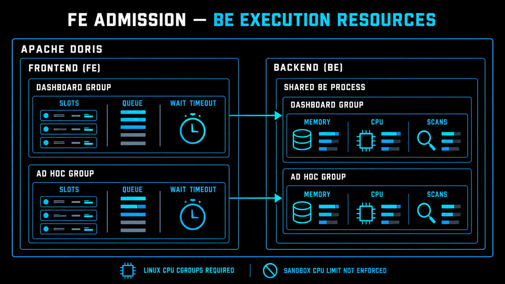
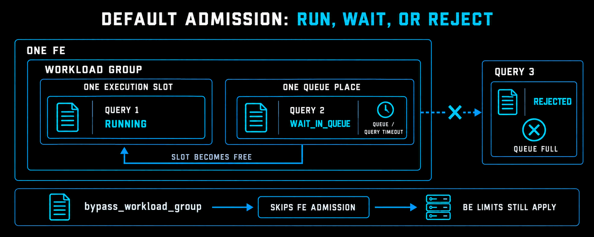
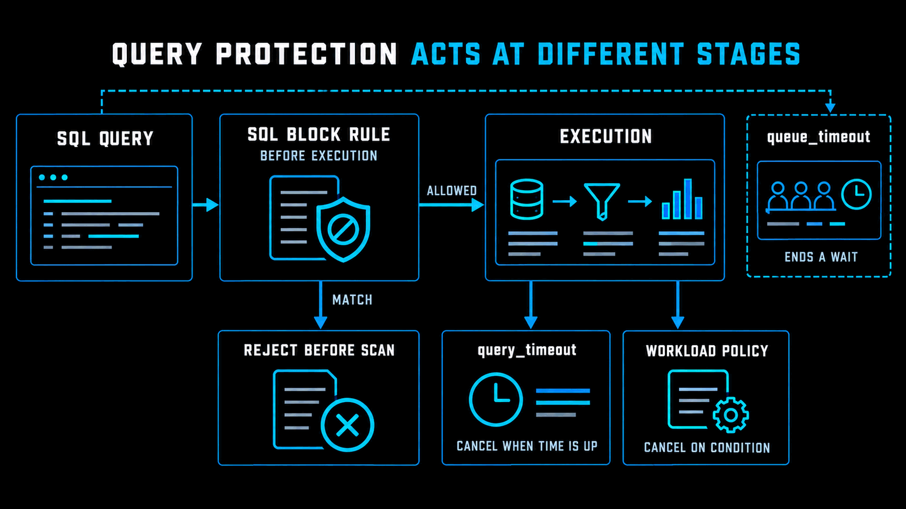

<a id="unit-u.750614a7fbb44ad5850d73ab5b85608f"></a>

<a id="module-14-resource-isolation-and-query-protection"></a>

# 14-модуль: Ресурстарды оқшаулау және сұрауларды қорғау

| Курс туралы ақпарат | Мәні |
| --- | --- |
| Курс | Apache Doris көмегімен деректер қоймасын құру · 3-деңгей |
| Doris | Apache Doris 4.1.3 |
| Орта | 1-модуль сынақ ортасы |
| Болжалды уақыт | Шамамен 100 минут: оқу 45, зертханалық жұмыс 45, тест 10 |

[Курстың README файлы](../../README.md) · [14-зертханалық жұмысты ашу](lab14_resource_isolation.ipynb) · [14-тестті ашу](quiz14_resource_isolation.ipynb)

<a id="unit-u.6fcaeb390a4e4a5ea97aaba16e5fac7b"></a>

<a id="module-goal"></a>

## Модуль мақсаты

Ad hoc талдаудың тақтаны баяулатуын азайту: әр жүктемеге топ беру, тіркелгіні бағыттау, артық сұрауды орындалуға дейін/кезінде тоқтату, кейін тәуелділік ретімен бәрін жою.

<a id="unit-u.04cb83564c8345feb1517c47fb2659c8"></a>

<a id="learning-objectives"></a>

## Оқу мақсаттары

Модульді аяқтаған соң сіз:

1. Doris Workload Group таңдау ретін түсіндіре аласыз.
2. max_concurrency, max_queue_size, queue_timeout бойынша орындала ма, күте ме, қабылданбай ма болжай аласыз.
3. Жады/CPU шектері қайда қатысты, CPU-ға не қажет екенін түсіндіре аласыз.
4. USAGE_PRIV және default_workload_group арқылы бағыттап, bypass_workload_group неге оқшаулау шекарасы еместігін түсіндіре аласыз.
5. query_timeout, Workload Policy, SQL Block Rule-ды уақыты/орны бойынша ажырата аласыз.
6. Топ, бағыттау, қорғаныс, бақылау, тәуелділік ретімен қайтаруы бар ресурс нұсқаулығын жаза аласыз.

<a id="unit-u.fe84cbab6b0045f4a9a3cd6f5bc93be9"></a>

<a id="module-structure"></a>

## Модуль құрылымы

| Бөлім | Уақыт | Нәтиже |
| --- | ---: | --- |
| 14.1 Тақтамен кім бәсекелеседі | 6 мин | Екі жүктеме, бір топ, бағыттау реті |
| 14.2 Орындалу, күту не қабылданбау | 9 мин | Қатар орындалу, кезек, күту, айналып өту |
| 14.3 Әр BE жады/CPU-ы | 6 мин | BE шектері, CPU cgroup талабы |
| 14.4 Тіркелгіні тобына бағыттау | 8 мин | Қарапайым пайдаланушы көретін рұқсат/әдепкі |
| 14.5 Артық сұрауды тоқтату | 10 мин | Timeout, Workload Policy, SQL Block Rule |
| 14.6 Ресурс нұсқаулығы және қайтаруы | 6 мин | Баптау, бақылау, жою реті |
| 14-зертханалық жұмыс | 45 мин | Екі топ, кезек/тыйым, қарапайым пайдаланушы, толық сканерлеуді бұғаттау, жоспар |
| 14-тест | 10 мин | Осы мақсаттарға арналған алты сұрақ |

<a id="unit-u.d5f33e2a2d2e47f49b9b453b43692580"></a>

<a id="141-who-competes-with-the-dashboard"></a>

## 14.1 Тақтамен кім бәсекелеседі

11-модуль тақтасы бір секундқа жетпей жаңарады. Дүйсенбілік айлық тексеруде аналитиктер күн сүзгісіз егжей-тегжей, бірнеше ірі агрегаттау жібереді; жаңару 20 секунд болып, кей сұрау уақыттан асады. Екеуі әдепкі `normal` тобында: іс жүзінде қатар орындалу шегі де, кезек те жоқ, толық сканерлеуді ештеңе тоқтатпайды.

| | Тақта сұраулары | Ad hoc талдау |
| --- | --- | --- |
| Жиілік | Жоғары: әр жаңаруда бірнешеу | Төменірек, бірақ бірі ұзақ |
| Сканерлеу | Шағын, соңғы күндер | Болжамсыз, күн сүзгісі ұмытылуы мүмкін |
| Кідіріс мақсаты | Шамамен секунд | Ондаған секунд жарауы мүмкін |

**Workload Group** (жұмыс жүктемесі тобы) сұрауларына екі деңгейде шек қояды:

| Қайда | Не басқарады | Қасиеттер |
| --- | --- | --- |
| Әр FE | Нешеуі орындалады/күтеді, қанша күтеді | `max_concurrency`, `max_queue_size`, `queue_timeout` |
| Әр BE | Топ жады, CPU, сканерлеу ресурсы | `max_memory_percent`, `max_cpu_percent`, `scan_thread_num`, `read_bytes_per_second` |

Бөлек топ ad hoc-ты тақта орындарынан шығарып, BE-де әрқайсысын шектейді. Бір BE процесін, кэш/ағындарын бөліседі: толық оқшауламай, әсерін азайтады; мүлде әсер етпеуі тиісіне бөлек түйін керек.



*FE қабылдауды, әр BE топтарының орындау ресурстарын басқарады.*

Сурет белгілері: FE ADMISSION — BE EXECUTION RESOURCES — FE қабылдауы және BE орындау ресурстары; FRONTEND (FE)/BACKEND (BE) — алдыңғы/артқы түйін; DASHBOARD GROUP — тақта тобы; AD HOC GROUP — ad hoc тобы; SLOTS — орындар; QUEUE — кезек; WAIT TIMEOUT — күту шегі; SHARED BE PROCESS — ортақ BE процесі; MEMORY — жады; SCANS — сканерлеулер; LINUX CPU CGROUPS REQUIRED — Linux CPU cgroup қажет; SANDBOX CPU LIMIT NOT ENFORCED — сынақ ортасында CPU шегі орындалмайды. Apache Doris және CPU — техникалық атаулар.

Doris топты осы ретпен таңдайды:

1. Сұрау hint-і: `SET_VAR(workload_group = ...)`.
2. Бос болмаса, сеанстың `workload_group` мәні.
3. Тіркелгі `default_workload_group` қасиеті.
4. Әр тіркелгі қолданатын, жойылмайтын `normal`.

<a id="unit-u.5dd4e997816b4f9eb832882e896ded80"></a>

<a id="142-run-wait-or-be-rejected"></a>

## 14.2 Орындалу, күту не қабылданбау

Топ сұрауына FE шешеді:

1. Орындалып жатқаны `max_concurrency` мәнінен аз: басталады.
2. Орын толы, күткені `max_queue_size` мәнінен аз: күтеді.
3. Кезек те толы: `query waiting queue is full` деп қабылданбайды.
4. Рұқсат уақытынан ұзақ күтті: `query queue timeout`.

Ad hoc тобында бір орын/бір кезек орны бар. Үш баяудың біріншісі орындалады, екіншісі күтеді, үшіншісі бірден `query waiting queue is full, queue capacity=1, waiting num=1` алады. Әдепкілер маңызды:



*Әр FE орынға қабылдап, артығын кезекке қояды, толса қабылдамайды.*

Сурет белгілері: DEFAULT ADMISSION: RUN, WAIT, OR REJECT — әдепкі қабылдау: орындау, күту, қабылдамау; ONE FE — бір FE; WORKLOAD GROUP — жұмыс жүктемесі тобы; ONE EXECUTION SLOT — бір орындау орны; ONE QUEUE PLACE — бір кезек орны; QUERY 1/2/3 — 1/2/3-сұраулар; RUNNING — орындалады; WAIT_IN_QUEUE — кезекте күтеді; QUEUE / QUERY TIMEOUT — кезек/сұрау уақыт шегі; REJECTED — қабылданбады; QUEUE FULL — кезек толы; SLOT BECOMES FREE — орын босайды; SKIPS FE ADMISSION — FE қабылдауын өткізеді; BE LIMITS STILL APPLY — BE шектері әлі бар. bypass_workload_group — нақты айнымалы.

| Қасиет | Әдепкі | Мағынасы |
| --- | --- | --- |
| `max_concurrency` | 2147483647 | Іс жүзінде шексіз |
| `max_queue_size` | 0 | Кезек жоқ: орыннан артығы қабылданбайды |
| `queue_timeout` | 0 | Миллисекунд; 0 жеке күту шегін қоймайды, сұраудың өз шегі шектейді |

Тек `max_concurrency` кезек құрмайды; артық сұрау күтуі үшін `max_queue_size` да қойыңыз. Оң `queue_timeout` миллисекундпен, `query_timeout` секундпен бірге күтуді шектейді: бұрын біткені жеңеді.

Кей сұрау кезекке тұрмайды. FE дерек сканерлейтіндерді қояды; `SELECT 1`, тек `information_schema` сұраулары тұрмайды. SQL кэші де бірден қайтарады; ортада кэш қосулы, кесте 30 секундтай өзгермесе қайталау кэштелуі мүмкін, сондықтан сеанстар өшіреді. Әр FE өз орын/кезегін ұстайды: үш FE × 8 орын = 24, қосылымдар таратылса. `SHOW WORKLOAD GROUPS` `running_query_num`, `waiting_query_num` көрсетеді; `information_schema.active_queries` ішінде күткені `WAIT_IN_QUEUE`, орындалғаны `RUNNING`.

<a id="unit-u.d90bf4f301fc4316a841f1baee7bd050"></a>

<a id="143-memory-and-cpu-on-each-be"></a>

## 14.3 Әр BE-дегі жады мен CPU

Қасиеттер бүкіл кластерге емес, әр BE-ге қатысты:

| Қасиет | Мағынасы | Әдепкі |
| --- | --- | --- |
| `max_memory_percent` | BE процесінің `mem_limit` үлесі ретінде топтың ең көп жады | 100% |
| `min_memory_percent` | Жады азда топқа сақталатын үлес | 0% |
| `memory_high_watermark` | Топ жаңа жады сұрауы сәтсіз бола бастайтын максимум үлесі | 85% |
| `memory_low_watermark` | Кідірген сұраулар әдетте жалғасатын төменгі үлес | 75% |
| `max_cpu_percent` | CPU бос болса да, қатаң шек | 100% |
| `min_cpu_percent` | CPU бос емес кезде сақталатын үлес | 0% |

Барлық минимум қосындысы ең көбі 100%, максимум одан аса алады. Шекке жақындағанда сұраулар жады ала алмай, кідіреді; Doris аралық деректі дискіге шығарады не жады босағанда жалғастырады, әйтпесе `memory limit is exceeded while handling workload group memory pressure` деп тоқтатады. Нәтиже сол сәттегі BE жүктемесіне тәуелді, сондықтан жұмыс жады шегін орнатып, артық жүктемені қайталаймын демейді.

Жады Doris есебімен шектеледі. CPU үшін Linux CPU cgroup керек: BE `doris_cgroup_cpu_path` бос болса, Doris топтарға cgroup құрмайды, `max_cpu_percent` ештеңе орындатпайтын баптау болып қалады. Курс ортасында сол жол жоқ.

<a id="unit-u.e6735922694341e3942869bc537c52e6"></a>

<a id="144-route-an-account-to-its-group"></a>

## 14.4 Тіркелгіні тобына бағыттау

Екі нәрсе бағыттайды, әрқайсысы жалғыз жеткіліксіз.

**SQL оқу мысалы: жұмыс уақытша пайдаланушыға орындайды. Сыртында орындамаңыз.**

<!-- reading-only-example -->
```sql
GRANT USAGE_PRIV ON WORKLOAD GROUP 'course_dashboard_l3' TO ROLE 'course_dashboard_reader_l3';
SET PROPERTY FOR 'bi_dashboard_user' 'default_workload_group' = 'course_dashboard_l3';
```

| Баптау | Нәтиже |
| --- | --- |
| Әдепкі/өзге таңдаусыз `USAGE_PRIV` | Әлі `normal` |
| `USAGE_PRIV` жоқ әдепкі | Әр сұрау өтпейді: `Access denied; you need (at least one of) the USAGE/ADMIN privilege(s) to use workload group '...'` |
| Екеуі | Сұраулар топта |

Жұмыс рөлі/әдепкісі бар уақытша қарапайым пайдаланушымен тексереді. Топ атамаса да, баяу сұрауы `information_schema.active_queries` көрсеткен `course_dashboard_l3` ішінде. Кейін сеансты рөл қолдана алмайтын `course_adhoc_l3` етеді: `SET` өтеді, келесі сұрау қабылданбайды, себебі рұқсат орындалуда тексеріледі. Пайдаланушы өз `default_workload_group` мәнін өзгерте алады, бірақ тек рұқсатты топтарда орындайды; `query_timeout`, `sql_block_rules` сияқты өзге қасиеттерді тек әкімші `SET PROPERTY FOR` арқылы орнатады. Біреудің әдепкі тобы сол мән өзгермей жойылмайды.

Әр пайдаланушы сеансына `bypass_workload_group = true` қоя алады: FE кезегін, `max_concurrency`, `max_queue_size`, `queue_timeout` өткізеді; топты өзгертпейді, рұқсат тексеруі мен BE жады шегін алып тастамайды. Жұмыста ad hoc орны/кезегі толы болса да осындай сұрау өтеді. Демек кезек — қарапайым пайдаланушы өте алмайтын шекара емес; BE шектері, әкімші уақыты, SQL Block Rule — шекара.

<a id="unit-u.b16577115ef247378c0e6a5876f1f686"></a>

<a id="145-stop-an-excessive-query"></a>

## 14.5 Шамадан тыс сұрауды тоқтату

Топ барлық сұрауының жиынтық ресурсын шектейді; жеке сұрауға да шек керек. Doris үшеуін әр уақытта қолданады:



*Бұғаттау ережесі сканерлеуге дейін қабылдамайды; уақыт шегі/саясат орындалып жатқанды тоқтатады.*

Сурет белгілері: QUERY PROTECTION ACTS AT DIFFERENT STAGES — сұрау қорғанысы әр кезеңде іске асады; SQL QUERY — SQL сұрауы; SQL BLOCK RULE — SQL бұғаттау ережесі; BEFORE EXECUTION — орындалуға дейін; ALLOWED — рұқсат етілген; EXECUTION — орындалу; MATCH — сәйкес; REJECT BEFORE SCAN — сканерлеуге дейін қабылдамау; ENDS A WAIT — күтуді аяқтайды; CANCEL WHEN TIME IS UP — уақыт біткенде тоқтату; WORKLOAD POLICY — жұмыс жүктемесі саясаты; CANCEL ON CONDITION — шартпен тоқтату. queue_timeout және query_timeout — нақты баптау атаулары.

| Тетік | Қашан | Қай сұрауларға | Нәтиже |
| --- | --- | --- | --- |
| `query_timeout` | Орындалуда уақыт біткенде | Әр сұрауға | Тоқтайды: `query timeout` |
| Workload Policy | Орындалуда шарт сәйкескенде | Топ сұраулары не барлығы | `cancel_query` сияқты әрекет |
| SQL Block Rule | Орындалуға дейін | Global болса барлық, әйтпесе байланған тіркелгілер | Сканерлемей қабылданбайды |

**Орындалу уақытының шегі.** Секундпен берілетін `query_timeout` әдепкіде 900. Пайдаланушы сеанста көтере алады; әкімші орнатқан сол аттағы тіркелгі қасиеті басым, пайдаланушы өзгерте алмайды.

**SQL оқу мысалы: жұмыста орындалмайды.**

<!-- reading-only-example -->
```sql
SET PROPERTY FOR 'adhoc_analyst' 'query_timeout' = '600';
```

Жұмыс қатені көру үшін сеанста екі секунд орнатады. Шек шығынды тоқтатады, бірақ оған дейін ресурс қолданылды; кезек уақытының бітуі, керісінше, сұрау мүлде орындалмағанын білдіреді.

**Workload Policy.** Саясат орындалып жатқан сұрауларды тексеріп, шарт сәйкессе әрекет етеді; мынасы минуттан ұзақ ad hoc сұрауларды тоқтатады.

**SQL оқу мысалы: жұмыста орындалмайды.**

<!-- reading-only-example -->
```sql
CREATE WORKLOAD POLICY course_adhoc_guard_l3
CONDITIONS (query_time > 60000)
ACTIONS (cancel_query)
PROPERTIES ("workload_group" = "course_adhoc_l3");
```

`query_time` миллисекундпен; басқа шарттар: `be_scan_rows`, `be_scan_bytes`, `query_be_memory_bytes`. FE саясаттарды BE-ге мерзіммен жібереді, BE шамамен жарты секунд сайын тексереді; сондықтан тоқтату кешігеді, хабарда `cancelled by workload policy` және атауы бар. Топсыз саясат барлық сұрауға әсер етіп, қате шарт қымбатқа түседі. Саясат сілтейтін топ алдымен жойылмайды; `information_schema.workload_policy` саясаттарды тізеді. Жұмыс оны орындамайды: уақытқа тәуелділігі сенімді тексеру бермейді.

**SQL Block Rule.** Мәтін не жоспардың сканерлеуі бойынша сәйкес сұрауды орындамай қабылдамайды:

| Түр | Қасиеттер | Не оқиды |
| --- | --- | --- |
| Мәтін | Тұрақты өрнек `sql` не `sqlHash` | Сұраудың мәтіні |
| Сканерлеу | `partition_num`, `tablet_num`, `cardinality` | Жоспардағы бөлім/tablet/бағаланған жолдар |

**SQL оқу мысалы: жұмыс соңында жоятын ереже. Сыртында орындамаңыз: жаһандық.**
Ең көбі екі бөлімге рұқсат береді:

<!-- reading-only-example -->
```sql
CREATE SQL_BLOCK_RULE course_scan_guard_l3
PROPERTIES ("partition_num" = "2", "global" = "true", "enable" = "true");
```

`orders_monthly_l3` үш айлық бөлімді. Сүзгісіз `SUM(amount)` үшеуін оқыр еді, Doris `sql hits sql block rule: course_scan_guard_l3, reach partition_num : 2` деп қабылдамайды; 2 — оқылған саны емес, шек. Наурыз сұрауы бір бөлімге қысқарып өтеді. Төрт жайт:

- `global` әдепкі false: әкімші ережені тіркелгінің өзі алып тастай алмайтын `sql_block_rules` қасиетімен байлайды. Global root пен тақталарды қоса бәріне қатысты.
- Мәтін ережесі бастапқы мәтінді әдепкі регистрге сезімтал салыстырады: `select * from orders_monthly_l3` ережесі `SELECT * FROM db.orders_monthly_l3` таппайды. Талап ауқым туралы болса, scan ережесін қолданыңыз.
- Scan ережесіне сканерлейтін жоспар керек. Duplicate Key сүзгісіз `COUNT(*)` FE статистикасынан оқымай жауап ала алады; сондықтан жұмыс `SUM(amount)` қолданады.
- SQL кэшіндегі сұрау жаңа ережеде де бұрынғы нәтижесін қайтара береді: кэшті өшіріп тексеріңіз.

Тетіктер бірге істейді: scan ережесі шексіз сканерлеуді кіреберісте, саясат ұзақ ad hoc сұрауды орындалуда тоқтатады, әкімші уақыты әр сұрауды шектейді.

<a id="unit-u.8f564281d074466bbf76d3c61bfda774"></a>

<a id="146-a-resource-runbook-and-its-rollback"></a>

## 14.6 Ресурс нұсқаулығы және кері қайтаруы

Өзгеріске иесі, бақылау, қайтару жолы керек:

| Бөлік | Мысал |
| --- | --- |
| Топтар | Тақта: 8 орын, кезекте 20, 10 s күту, 50% жады. Ad hoc: 1, 1, 30 s, 30% жады және орта орындатпайтын 30% CPU |
| Бағыттау | `course_dashboard_reader_l3` тақта тобының `USAGE_PRIV` рұқсатын ұстайды; тіркелгілерге әдепкі беріледі |
| Қорғаныс | `course_scan_guard_l3` екі бөлімге шектейді; әкімші уақыт шегін орнатады |
| Бақылау | Орындалған/күткен сандар, `WAIT_IN_QUEUE`, нақты қателер |
| Кері қайтару | Саясат сілтемесін жою, тіркелгі әдепкісін басқаға ауыстыру, рұқсатты қайтару, қажетсіз рөл/топтарды, ережелерді жою; әрқайсысын `SHOW` арқылы тексеру |

Рет тәуелділікке сай: саясат сілтесе не тіркелгі әдепкісі болса, Doris топты жоймайды. Жою пайдалану рұқсатын жоймайды: сол атпен жаңа топ `SHOW ROLES` ішінде бұрынғы `USAGE_PRIV` қайта көрсетеді. Алдымен рұқсатты қайтарыңыз не қажетсіз рөлді жойыңыз. Жаттығу жоспарды қолданбай тұрып тексереді: үш FE-де 8 орын 20 шың сұрауды тек қосылымдар таралса ұстайды.

<a id="unit-u.853da0f1e04c435f8488b31514531284"></a>

<a id="lab-14-separate-dashboard-and-ad-hoc-resources"></a>

## 14-зертханалық жұмыс: Тақта мен ad hoc ресурстарын бөлу

[14-зертханалық жұмыс: Тақта мен ad hoc ресурстарын бөлу](lab14_resource_isolation.ipynb) файлын ашыңыз. Сіз:

1. Root топ таңдауын көресіз.
2. Кестені дайындап, бұрынғы қалдықты жоясыз.
3. Екі топ құрып, тақта тобын рөлге бересіз.
4. Бес сұраудың орындалу, күту, қабылданбау, кезекті айналып өтуін көресіз.
5. Кезек/орындалу уақыт шегін ажыратасыз.
6. Уақытша пайдаланушыны әдепкімен бағыттап, ad hoc тобына тыйым көресіз.
7. SQL Block Rule арқылы толық сканерлеуді қабылдамайсыз.
8. Саясат/әдепкі топты ұстамайтынын тексеріп, рұқсатты қайтарып, рөл/топтарды жоясыз.
9. Жаттығу: ресурс жоспарын тексеріп, сынақ атауларымен қолданасыз.

Тек сынақ ортасы қажет. Нысандар бүкіл кластерге тиесілі; жұмыс өзінікін жойып, `normal` мен root тіркелгісін өзгертпейді.

<a id="unit-u.e05bcc66fc5e4c748bcad900213b9eb5"></a>

<a id="summary"></a>

## Қорытынды

- Топ реті: hint, сеанс, тіркелгі әдепкісі, `normal`.
- Орын бос болса орындалады, кезек бос болса күтеді, әйтпесе қабылданбайды; оң `queue_timeout` күтуді бітіртеді; әр FE өз орын/кезегін ұстайды.
- Шектер әр BE-ге қатысты; CPU үшін ортада жоқ cgroup қажет.
- `USAGE_PRIV` пен `default_workload_group` екеуі бағыттайды; рұқсат орындалуда тексеріледі, `bypass_workload_group` тек FE кезегін өткізеді.
- `query_timeout` орындалғанды, Workload Policy шартқа сәйкес орындалғанды тоқтатады, SQL Block Rule орындалуға дейін қабылдамайды.
- Нұсқаулық топ, бағыттау, қорғаныс, бақылауды атап, саясат/әдепкі/рұқсат/рөл/топ/ережені тәуелділікпен жояды.

<a id="unit-u.62aebbd88bec423784577bb5e96682fd"></a>

<a id="quiz-14"></a>

## 14-тест

[14-тест: Ресурстарды оқшаулау және сұрауларды қорғау](quiz14_resource_isolation.ipynb) файлын ашыңыз. Бір жауап таңдалатын алты сұрақ бар; іске қосылған орта қажет емес.

Әрі қарай: бұл — соңғы модуль. Он төрт модульде тапсырыс/тарихты жүктеп, тек тексерілген кірісті сақтадыңыз, өзгерісті қадағалап, факт/өлшеммен модельдедіңіз, жазылған келісімшарттары бар метрикаларға айналдырып, тақта/модельге жарияладыңыз; рөлмен рұқсат беріп аудиттедіңіз; бөлімдерде сыналған қайтаруы бар өмірлік цикл, әр жүктемеге жеке ресурс жасадыңыз. [Курстың README файлы](../../README.md) нысандарды жоюды айтады; [Apache Doris көмегімен нақты уақыттағы аналитика](../../../01-real-time-analytics/README.md) сияқты серияның өзге курстары — қосымша оқу.

<a id="unit-u.be39efcf00f54faf8da4e6da7b8694e0"></a>

<a id="references"></a>

## Дереккөздер

- [Apache Doris: Workload Group](https://doris.apache.org/docs/4.x/admin-manual/workload-management/workload-group/)
- [Apache Doris: қатар орындалу мен кезекті басқару](https://doris.apache.org/docs/4.x/admin-manual/workload-management/concurrency-control-and-queuing/)
- [Apache Doris: SQL бұғаттау және Workload Policy](https://doris.apache.org/docs/4.x/admin-manual/workload-management/sql-blocking/)
- [Apache Doris: CREATE SQL_BLOCK_RULE](https://doris.apache.org/docs/4.x/sql-manual/sql-statements/data-governance/CREATE-SQL_BLOCK_RULE/)
- [Apache Doris: CREATE WORKLOAD POLICY](https://doris.apache.org/docs/4.x/sql-manual/sql-statements/cluster-management/compute-management/CREATE-WORKLOAD-POLICY/)
- [Apache Doris: SET PROPERTY](https://doris.apache.org/docs/4.x/sql-manual/sql-statements/account-management/SET-PROPERTY/)
- [Apache Doris: active_queries](https://doris.apache.org/docs/4.x/admin-manual/system-tables/information_schema/active_queries/)
- [Apache Doris: SQL Cache](https://doris.apache.org/docs/4.x/query-acceleration/sql-cache-manual/)
