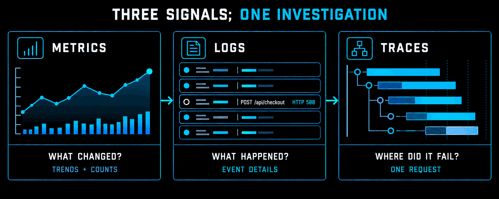
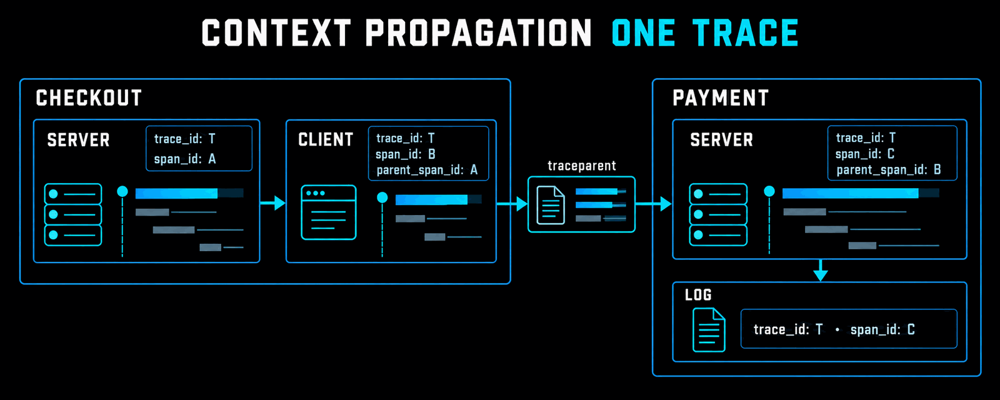
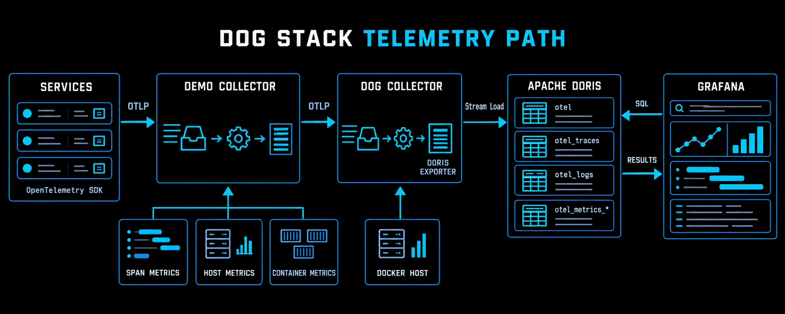

# 1-модуль: DOG стегіндегі жүйені бақылау негіздері

| Курс ақпараты | Мәні |
| --- | --- |
| Курс | Apache Doris көмегімен жүйені бақылау · 1-деңгей |
| Doris | Apache Doris 4.1.3 |
| Орта | DOG стегі (Doris, OpenTelemetry Collector 0.144.0 және Grafana 11.4.0) және OpenTelemetry демосы 2.0.2 |
| Болжалды уақыт | Шамамен 70 минут: оқу 25, зертханалық жұмыс 35 (алғашқы шамамен 4.8 GB бейнелерді жүктеу қосылады), тест 10 |

[Курс README файлы](../../README.md) · [1-зертханалық жұмысты ашу](lab01_observability_introduction.ipynb) · [1-тестті ашу](quiz01_observability_foundations.ipynb)

## Модуль мақсаты

Жүйені бақылау стегін және ол бақылайтын онлайн дүкенді іске қосу, дүкен журналдары, метрикалары мен трассаларының Doris-ке жеткенін тексеру және курстың қалған бөлігі тексеретін инцидентті бастау.

## Оқу мақсаттары

Модульді аяқтаған соң сіз:

1. Пайдалану кезіндегі сұраққа журналдарды, метрикаларды не трассаларды таңдай аласыз.
2. Трасса ID-і мен ата-аналық span ID-і бір сұраудың span-дарын қалай біріктіретінін түсіндіре аласыз.
3. Жинау, сақтау және визуализацияны DOG стегінің бөліктеріне сәйкестендіре аласыз.
4. Демо телеметриясының сервистен Doris кестесіне дейінгі жолын қадағалай аласыз.
5. Телеметрияның Doris-ке жеткенін қандай дәлел көрсететінін бағалай аласыз.
6. Мүмкіндік жалаушасымен ақау тудырып, оны телеметриядан растай аласыз.

## Модуль құрылымы

| Бөлім | Уақыт | Нәтиже |
| --- | ---: | --- |
| 1.1 Жүйені бақылау не үшін қажет | 3 мин | Телеметрия жауап беретін сұрақтар |
| 1.2 Телеметрияның үш түрі | 6 мин | Журналдар, метрикалар, трассалар және әрқайсысын қашан қолдану |
| 1.3 Трассаның ішінде | 5 мин | Span өрістері және span-дардың сұрауды құрауы |
| 1.4 DOG стегі және демо | 5 мин | Телеметрияны кім жинайды, сақтайды, көрсетеді және ол қандай жолдан өтеді |
| 1.5 Телеметрияның жеткенін дәлелдеу | 3 мин | Іске қосылған контейнер нені және Doris жолы нені дәлелдейді |
| 1.6 Осы курстағы инцидент | 3 мин | Төлемдерді сәтсіз ететін мүмкіндік жалаушасы |
| 1-зертханалық жұмыс | 35 мин | Жұмыс істейтін стек пен дүкен, Doris-тегі алғашқы сәтсіз тапсырыстар |
| 1-тест | 10 мин | Осы мақсаттар бойынша алты сұрақ |

## 1.1 Жүйені бақылау не үшін қажет

Онлайн дүкенде көптеген сервис бар: бірі тауар көрсетеді, бірі себетті сақтайды, бірі төлем қабылдайды. Тұтынушылар «тапсырысты рәсімдеу бұзылды» десе, кезекші инженер мынадай сұрақтарға жауап беруі керек: барлығында ма, әлде кей тұтынушыларда ғана ма? Қашаннан бері? Қай сервис істен шықты және неге? Не өзгерді?

Инженер өндірістік ортаға жөндегіш қоса алмайды және әр сервистен өзін түсіндіруді сұрай алмайды. Ол тек сервистер жұмыс кезінде жазған **телеметрияны** оқи алады. Жүйе телеметриясы осындай сұрақтарға, оның ішінде сервистер жазылғанда ешкім ойламаған жаңа сұрақтарға жауап берсе, жүйені *бақылауға болады*. Бұл курс осы қабілетті үш ашық құралмен — OpenTelemetry Collector, Apache Doris және Grafana-мен — құрады және оларды компьютеріңізде іске қосылатын нақты дүкенге қолданады.

## 1.2 Телеметрияның үш түрі

Сервистер **сигналдар** деп аталатын телеметрияның үш түрін тіркейді. Әрқайсысы әртүрлі сұраққа жауап береді.

| Сигнал | Бір жазба нені білдіреді | Қандай сұраққа жауап береді | Дүкеннен мысал |
| --- | --- | --- | --- |
| **Журналдар** | Маңыздылық деңгейі мен атрибуттары бар, уақыт белгісі қойылған мәтіндік оқиға | Дәл осы жерде, осы сәтте не болды? | Дүкен проксиінің `"POST /api/checkout HTTP/1.1" 500` жолы |
| **Метрикалар** | Атауы бар өлшем мен атрибуттар жиыны үшін белгілі бір уақытта өлшенген сан | Қанша, қаншалықты жиі және уақыт өте қалай өзгереді? | Хосттың бір CPU ядросының бос тұрған уақыт үлесі |
| **Трассалар** | Span ағашы түріндегі бір сұраудың сервистер арқылы өткен жолы | Сұрау қайда барды, әр қадам қанша уақыт алды және қай қадамда ақау болды? | Проксиден frontend, checkout және payment сервистеріне өткен тапсырыс |

Сигналдар бірін-бірі толықтырады:

- **Метрикаларды** ұзақ уақыт сақтау және сұрау ең арзан: сұраулар саны қанша болса да, бір өлшем әр аралықта бірнеше сан береді. Олар үрдістер мен процентильдерді көрсетіп, ескертулерге негіз болады. Қай сұраудың сәтсіз болғанын көрсетпейді.
- **Журналдар** жеке оқиғалардың егжей-тегжейін әзірлеуші таңдаған сөздермен сақтайды. Сервис жазса ғана оларда қате хабарлары мен стек трассалары болады; пішімі сервиске қарай өзгереді.
- **Трассалар** бір сұрауды сервистер арасында қадағалайды. Уақыт қайда жұмсалғанын және қате қайдан басталғанын көрсетеді; бір журнал жолы да, метрика да мұны жеке өзі көрсете алмайды.

Тексеру әдетте олардың арасында ауысады: метрика өзгерісті көрсетеді, журнал не трасса сол өзгеріс болған сұрауды көрсетеді, ал трасса оны қай сервис тудырғанын анықтайды. 3-модульде бұл ауысу Grafana-да орындалады.

*Әр сигнал өз сұрағына жауап береді, сондықтан тексеру олардың арасында ауысады.*

Суреттегі ағылшынша белгілер: THREE SIGNALS; ONE INVESTIGATION — үш сигнал, бір тексеру; METRICS — метрикалар; LOGS — журналдар; TRACES — трассалар; WHAT CHANGED? — не өзгерді?; TRENDS + COUNTS — үрдістер мен санақтар; WHAT HAPPENED? — не болды?; EVENT DETAILS — оқиға егжей-тегжейі; WHERE DID IT FAIL? — ақау қай жерде болды?; ONE REQUEST — бір сұрау. POST /api/checkout және HTTP 500 — өзгеріссіз техникалық мәндер.

### Маңыздылық деңгейі және OpenTelemetry шкаласы

Әр журнал жазбасында маңыздылықтың екі өрісі бар. `severity_text` — дереккөз жазған `ERROR`, `Error` не `WARN` сияқты белгі; ол бағдарламалау тілдері мен кітапханаларда әртүрлі. `severity_number` барлық дереккөзді ортақ OpenTelemetry шкаласына келтіреді: 1–4 — TRACE, 5–8 — DEBUG, 9–12 — INFO, 13–16 — WARN, 17–20 — ERROR, 21–24 — FATAL. Қатынас журналының жолы сияқты маңыздылық деңгейі жоқ жазбаның `severity_number` мәні 0 болады.

### Метрика түрлері

Метриканың сандарын қалай түсіндіру керегін оның түрі анықтайды. **Gauge** — CPU үлесі не кезек ұзындығы сияқты бір сәттегі мән. **Sum**, яғни санауыш, өңделген сұраулар сияқты оқиғаларды қосады; әдетте бастапқы уақыттан бері тек өседі. **Histogram** сұрау ұзақтығы сияқты өлшемдердің бірнеше интервалдың әрқайсысына қаншасы түскенін санайды. Бағандары әртүрлі болғандықтан, Doris әр түрді жеке кестеде сақтайды.

## 1.3 Трассаның ішінде

Трасса **span-дардан** тұрады. Span — жұмыстың бірлігі: сервис қабылдаған сұрау, оның басқа сервиске жасаған шақыруы немесе ішкі қадамы. Әр span мынаны тіркейді:

| Өріс | Мағынасы |
| --- | --- |
| `trace_id` | Сұрау ID-і. Сұраудың барлық span-ында трасса ID-і бірдей. |
| `span_id` | Осы span ID-і. |
| `parent_span_id` | Осы span-ды бастаған span ID-і. Сұраудың алғашқы **түбір span-ында** ол жоқ. |
| `span_name` | `oteldemo.CheckoutService/PlaceOrder` сияқты операция |
| `span_kind` | Сервис қабылдаған сұрау үшін `SERVER`, жасаған шақыруы үшін `CLIENT`, ішкі қадам үшін `INTERNAL`, хабарлар үшін `PRODUCER` және `CONSUMER` |
| `timestamp`, `end_time`, `duration` | Қашан басталып аяқталды және қанша уақыт алды |
| `status_code` | Операция сәтсіз болса `STATUS_CODE_ERROR`; әйтпесе `STATUS_CODE_OK` не көбіне `STATUS_CODE_UNSET` |
| `span_attributes`, `events` | HTTP күй коды сияқты егжей-тегжей және span ішіндегі exception сияқты уақыт белгісі бар оқиғалар |
| `resource_attributes` | Span-ды не өндірді: сервис атауы (`service.name`, сондай-ақ `service_name` ретінде сақталады), нұсқасы, хосты |

Трасса ID-і мен ата-аналық span ID-і span-дарды ағашқа біріктіреді. Checkout payment-ті шақырғанда, checkout SDK-сы шақыруға `CLIENT` span-ын тіркеп, трасса ID-і мен span ID-ін сұраумен бірге HTTP не gRPC тақырыбында (W3C `traceparent` тақырыбы) береді. Payment SDK-сы сол трасса ID-імен өз `SERVER` span-ын тіркейді, ал оның ата-анасы checkout клиенттік span-ы болады. ID-лердің сервистен сервиске берілуі **контексті тарату** деп аталады. Соның арқасында он сервис бөлек жазған span-дарды қайтадан бір сұрауға жинауға болады.

Журналдар да қосыла алады. OpenTelemetry SDK әр журнал жазбасына сервис өңдеп жатқан сұраудың трасса ID-і мен span ID-ін қояды. Сонда журнал жолы мен оның сұрауының span-дары ортақ трасса ID-іне ие болып, бірінен екіншісіне өтуге мүмкіндік береді.

*Контексті тарату сервис шекарасынан өткенде трасса ID-ін және ата-ана байланысын сақтайды.*

Сурет белгілері: CONTEXT PROPAGATION — контексті тарату; ONE TRACE — бір трасса; CHECKOUT — тапсырысты рәсімдеу сервисі; PAYMENT — төлем сервисі; SERVER — сервер; CLIENT — клиент; LOG — журнал. trace_id: T барлық жерде ортақ; checkout серверінің span_id: A мәні клиенттің parent_span_id: A мәніне, ал клиенттің span_id: B мәні payment серверінің parent_span_id: B мәніне сәйкес. Payment журналы trace_id: T және span_id: C мәндерін сақтайды. traceparent — осы контексті беретін тақырып.

## 1.4 DOG стегі және демо

Бұл курс ашық [ai-observe-stack](https://github.com/ai-observe/ai-observe-stack) жобасының **DOG стегін** пайдаланады: **D**oris, OpenTelemetry Collector және **G**rafana. Әр бөліктің бір міндеті бар:

| Бөлік | Міндеті | Не істемейді |
| --- | --- | --- |
| **OpenTelemetry Collector** | Телеметрияны қабылдайды, өңдейді (атрибуттар қосады, пакеттерге біріктіреді) және мұнда Doris-ке экспорттайды | Телеметрияны сақтамайды, диаграмма салмайды |
| **Apache Doris** | Телеметрияны кестелерде сақтап, оның ішінде сигналдарды біріктіріп SQL сұрауларына жауап береді | Сервистерден телеметрия жинамайды |
| **Grafana** | Телеметрияны іздеу, трассалар, бақылау тақталары және ескертулер арқылы көрсетеді. Doris-ті SQL-мен оқиды | Телеметрияны сақтамайды |

Doris — талдамалық дерекқор: деректерді баған бойынша сақтайды, сығады және сұрауларды көптеген ядроларда параллель орындайды. DOG стегі оны үш сигналдың ортақ сақтау орны ретінде пайдаланады: бір SQL сұрауы журналдар мен трассаларды трасса ID-і арқылы біріктіре алады, ал толық мәтіндік индекстер журнал іздеуін жылдамдатады. Курстың 2-деңгейі Doris мұны қалай орындайтынын қарастырады.

**OpenTelemetry** — телеметрияның негізіндегі ашық стандарт: сервистер журнал, метрика және span тіркеуге пайдаланатын API мен SDK; оларды жіберетін **OTLP** протоколы; және **Collector**. Collector **конвейерлерден** тұрады: әр сигналға бір конвейер, онда деректі қабылдайтын қабылдағыштар, өзгертетін өңдегіштер және әрі қарай жіберетін экспорттаушылар болады. 2-модульде өз Collector-ларыңызды құрасыз.

Бақыланатын жүйе — [OpenTelemetry демосы](https://opentelemetry.io/docs/demo/), Astronomy Shop: Go, Java, .NET, Node.js, Python, PHP, Ruby, Rust және C++ тілдерінде жазылған оннан астам сервистен тұратын телескоптардың онлайн дүкені. Әр сервис өз тілінің OpenTelemetry SDK-сын пайдаланады. **Жүктеме генераторы** дүкенді үздіксіз қарап, тапсырыс береді, сондықтан сіз жұмыс істегенде сервистер телеметрия өндіре береді.

*Collector-лар телеметрияны тасымалдайды, Doris сақтайды, ал Grafana оқиды.*

Сурет белгілері: DOG STACK TELEMETRY PATH — DOG стегіндегі телеметрия жолы; SERVICES — сервистер; DEMO COLLECTOR — демо Collector-ы; DOG COLLECTOR — DOG Collector-ы; DORIS EXPORTER — Doris экспорттаушысы; RESULTS — нәтижелер; SPAN METRICS — span метрикалары; HOST METRICS — хост метрикалары; CONTAINER METRICS — контейнер метрикалары; DOCKER HOST — Docker хосты. Apache Doris, Grafana, OpenTelemetry SDK, OTLP, Stream Load, SQL және кесте атаулары өзгермейді.

Дүкен телеметриясының жолы:

1. Сервис SDK-сы span, журнал және метрикаларды OTLP арқылы **демо Collector-ына** жібереді.
2. Демо Collector-ы өз метрикаларын қосады: әр сервис пен операция span-дарын санайтын **span метрикалары**, сондай-ақ хост пен контейнер метрикалары. Барлығын OTLP арқылы **DOG Collector-ына** бағыттайды.
3. DOG Collector өзі жұмыс істейтін Docker хостының метрикаларын қосады. Оның **Doris экспорттаушысы** келгеннен бірнеше секунд кейін жолдарды HTTP арқылы **Stream Load** көмегімен Doris-ке жүктейді.
4. Doris оларды `otel` дерекқорында сақтайды: span-дар — `otel_traces`, журналдар — `otel_logs`, метрикалар — `otel_metrics_gauge` және `otel_metrics_sum` сияқты әр түрге жеке кестеде. Экспорттаушы бұл кестелерді іске қосылғанда құрған.
5. Grafana кестелерді SQL-мен оқиды. Оның **Doris App** плагинінде жолдарды іздеуге арналған **Discover** беті және трассаларға арналған **Traces** беті бар; Grafana-ның бақылау тақталары мен ескертулері де сол дереккөз арқылы Doris-ті оқиды.

Стекте 8-модульдегі Grafana ескерту хаттарын қабылдайтын жергілікті Mailpit пошта сервері де жұмыс істейді. Барлық бөлік компьютеріңіздегі Docker-де, 127.0.0.1 адресіне байланған 23000–29030 порттарында орындалады; тізімі [курс README файлында](../../README.md) берілген.

## 1.5 Телеметрияның жеткенін дәлелдеу

Жолдың әр қадамында жеке ақау болуы мүмкін: сервис демо Collector-ымен байланысын жоғалтуы, демо Collector-ы DOG Collector-ына жете алмауы немесе экспорттаушы пакетті Doris-ке жүктей алмауы мүмкін. Әр сигналдың өз конвейері бар, сондықтан трассалар келіп, журналдар келмеуі мүмкін. Жұмыс істеп тұрған контейнерлер тек процестердің іске қосылғанын дәлелдейді, олардан телеметрия өткенін дәлелдемейді.

Телеметрияның жеткенінің дәлелі — **Doris-тегі жолдар**: әр сигнал кестесінде уақыт белгісі қазіргі уақытқа жақын жаңа жолдардың болуы. 1-зертханалық жұмыс дәл осыны тексереді: әр сигнал үшін соңғы бес минуттағы жолдарды және оларды жіберген сервистерді санайды. Жолдарды көрсететін Grafana беті — қосымша бір қадам арқылы көрінетін сол дәлел.

Телеметрия уақыт белгілері UTC бойынша беріледі. Экспорттаушы UTC жазады, ал кестелер деректерді әр UTC күніне бір бөлімге бөледі. Сондықтан зертханалық жұмыс уақыт белгілерін компьютеріңіздің жергілікті уақытымен емес, `UTC_TIMESTAMP()` мәнімен салыстырады.

## 1.6 Осы курстағы инцидент

Демо ақау сценарийлерін **мүмкіндік жалаушаларымен** қосып-өшіре алады. Мүмкіндік жалаушасы — сервис жұмыс кезінде оқитын баптау; мұнда ол демоның **flagd** жалауша сервисінен алынады. Жалауша өзгергенде сервис қайта іске қосылмай-ақ әрекетін өзгертеді. Дүкен портындағы `/feature` беті әр жалаушаны және оның ықтимал мәндерін көрсетеді.

Бұл курс бір сценарийді қарастырады: `paymentFailure` жалаушасы. `50%` мәнінде payment сервисі алған төлем сұрауларының шамамен жартысын қабылдамайды, сондықтан дүкен тапсырыстарының шамамен жартысы сәтсіз болады. Төлемі өтпеген тұтынушы хабарсыз себет бетінде қалады. 1-зертханалық жұмыстың соңында жалаушаны қосып, Doris-тен алғашқы сәтсіз тапсырыстарды көресіз: checkout сервисінің әр тапсырысқа арналған `oteldemo.CheckoutService/PlaceOrder` span-ының күйі `STATUS_CODE_ERROR` болады.

Осыдан кейін курс ақаудың себебі белгісіздей тексереді:

| Модуль | Тексерудегі рөлі |
| --- | --- |
| 1 | Ақау басталып, трассаларда сәтсіз тапсырыстар пайда болады. |
| 2 | Сәтсіз тапсырыстың дәлелі қай кестелерде екенін және әр бөлікті қай конвейер жеткізгенін табу. |
| 3 | Grafana арқылы ақаудың қайдан және неге басталғанын табу, хост CPU-ын ықтимал себептен алып тастау. |
| 4–8 | Ықшам қорытындылар сақтау, Doris кесте құрылымы мен индекстері арқылы іздеуді жеделдету, ақауды SQL-мен өлшеу және ол туралы ескерту. |

Жалаушаны оның бетінде өшіргенше немесе `lab.teardown()` курс ортасын жойғанша, ол қосулы қалады.

## 1-зертханалық жұмыс: DOG стегін іске қосу

[1-зертханалық жұмыс: DOG стегін іске қосу](lab01_observability_introduction.ipynb) файлын ашып, ұяшықтарын ретімен орындаңыз. Сіз:

1. DOG стегін: Doris, DOG Collector, Grafana және Mailpit-ті іске қосасыз.
2. OpenTelemetry демосын іске қосып, соңғы бес минуттағы трассалар, журналдар мен метрикалардың Doris-те барын тексересіз.
3. Дүкенді және Grafana-ны ашасыз.
4. Жалауша бетінде `paymentFailure` мәнін 50% етіп қосып, жалаушаны растайсыз және Doris-тегі алғашқы сәтсіз тапсырысты күтесіз.
5. Жаттығу: соңғы он минуттағы қате span-дарын сервис бойынша санайсыз.

Кемінде 10 GB жады бөлінген Docker және курстың Python ортасы қажет; екеуі де [курс README файлында](../../README.md) сипатталған. Алғашқы іске қосуда шамамен 4.8 GB бейне жүктеледі, оған тағы бірнеше минут кетеді.

## Қорытынды

- Журналдар жеке оқиғаларды тіркейді, метрикалар шамалардың уақыт бойынша өзгерісін өлшейді, ал трассалар сұрауды сервистер арқылы қадағалайды; тексеру олардың арасында ауысады.
- Span жұмыстың бірлігін тіркейді. Сұраудың барлық span-ына ортақ трасса ID-і мен ата-аналық span ID-і контексті тарату арқылы сервис шекараларынан өтіп, span-дарды ағашқа біріктіреді.
- DOG стегінде OpenTelemetry Collector жинайды, Doris сақтап сұрайды, ал Grafana телеметрияны көрсетеді.
- Демо сервистері телеметрияны демо Collector-ына жібереді; ол DOG Collector-ына бағыттайды, ал оның Doris экспорттаушысы оны `otel` дерекқорындағы әр сигналдың жеке кестесіне жүктейді.
- Іске қосылған контейнерлер телеметрияның жеткенін дәлелдемейді; Doris-тегі жаңа жолдар дәлелдейді.
- `paymentFailure` мүмкіндік жалаушасы төлемдердің жартысын сәтсіз етеді; сәтсіз тапсырыстар қате күйі бар checkout span-дары ретінде көрінеді.

## 1-тест

[1-тест: DOG стегіндегі жүйені бақылау негіздері](quiz01_observability_foundations.ipynb) файлын ашыңыз. Онда бір жауап таңдалатын алты сұрақ бар; іске қосылған орта қажет емес.

Келесі модуль: [2-модуль: Жүйені бақылау деректерін жүктеу](../module02-data-ingest/course.md).

## Дереккөздер

- [OpenTelemetry: жүйені бақылауға кіріспе](https://opentelemetry.io/docs/concepts/observability-primer/)
- [OpenTelemetry: сигналдар](https://opentelemetry.io/docs/concepts/signals/), соның ішінде [трассалар](https://opentelemetry.io/docs/concepts/signals/traces/), [метрикалар](https://opentelemetry.io/docs/concepts/signals/metrics/) және [журналдар](https://opentelemetry.io/docs/concepts/signals/logs/)
- [OpenTelemetry: контексті тарату](https://opentelemetry.io/docs/concepts/context-propagation/)
- [OpenTelemetry журнал деректерінің моделі: маңыздылық өрістері](https://opentelemetry.io/docs/specs/otel/logs/data-model/#field-severitynumber)
- [OpenTelemetry демосының құжаттамасы](https://opentelemetry.io/docs/demo/) және оның [мүмкіндік жалаушалары](https://opentelemetry.io/docs/demo/feature-flags/)
- [Apache Doris: жүйені бақылауға шолу](https://doris.apache.org/docs/4.x/observability/overview/)
- [ai-observe-stack (DOG стегі)](https://github.com/ai-observe/ai-observe-stack)
