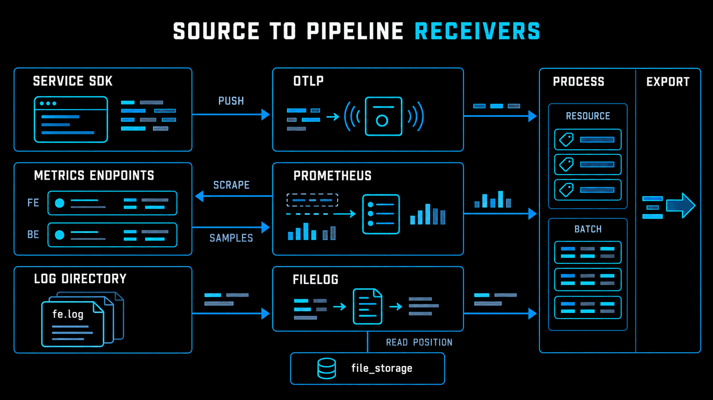
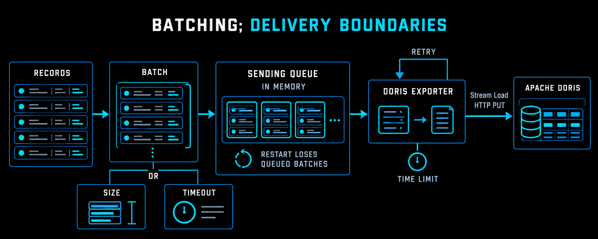
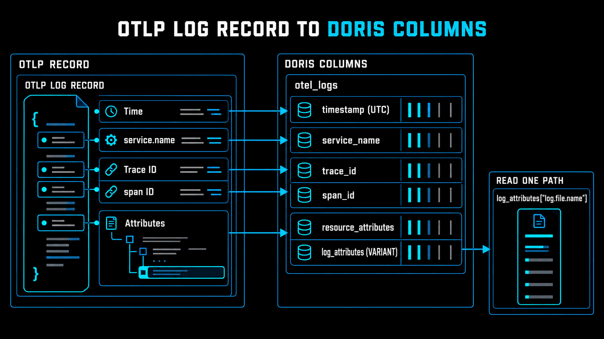

<a id="unit-u.bc4afc855c964e7398984d8c4b69369f"></a>

<a id="module-2-ingesting-observability-data"></a>

# 2-модуль: Жүйені бақылау деректерін жүктеу

| Курс ақпараты | Мәні |
| --- | --- |
| Курс | Apache Doris көмегімен жүйені бақылау · 1-деңгей |
| Doris | Apache Doris 4.1.3 |
| Collector | Doris экспорттаушысы бар OpenTelemetry Collector Contrib 0.144.0 |
| Болжалды уақыт | Шамамен 70 минут: оқу 30, зертханалық жұмыс 30, тест 10 |

[Курс README файлы](../../README.md) · [2-зертханалық жұмысты ашу](lab02_ingest_observability_data.ipynb) · [2-тестті ашу](quiz02_ingesting_observability_data.ipynb)

<a id="unit-u.153f8f63b31847f0bb1c0dd26d7efe15"></a>

<a id="module-goal"></a>

## Модуль мақсаты

Журналдар, метрикалар мен трассаларды Doris-ке жүктейтін OpenTelemetry Collector конвейерлерін құру, әр бөліктің неге кепілдік беретінін және бермейтінін білу, әр сигналдан бір сәтсіз тапсырыстың дәлелін табу.

<a id="unit-u.f044ba2295c74e7fa80c6ee0b35b51b1"></a>

<a id="learning-objectives"></a>

## Оқу мақсаттары

Модульді аяқтаған соң сіз:

1. Collector конвейерінің қабылдағыштары, өңдегіштері, экспорттаушылары мен кеңейтімдері не істейтінін сипаттай аласыз.
2. Телеметриясын өзі жіберетін және дерегі тартылуы қажет дереккөздерге қабылдағыш таңдай аласыз.
3. Пакет өңдегіші деректі қашан жіберетінін және жіберу кезегі мен қайталаулар неге кепілдік беретінін болжай аласыз.
4. Doris экспорттаушысының қай баптаулары кестені құрғанда ғана қолданылатынын түсіндіре аласыз.
5. Сәтті экспорт шақыруы нені, ал тек Doris сұрауы нені көрсететінін бағалай аласыз.
6. Әр сигналдан бір сұраудың дәлелін тауып, қай сервис қай сигналды жіберетінін ажырата аласыз.

<a id="unit-u.41de9aad45f24c6799c761b4af7ec9ff"></a>

<a id="module-structure"></a>

## Модуль құрылымы

| Бөлім | Уақыт | Нәтиже |
| --- | ---: | --- |
| 2.1 Collector — конвейерлер жиыны | 5 мин | Collector конфигурациясын оқу |
| 2.2 Телеметрияны қабылдау | 6 мин | Жіберу, тарту және файл қабылдағыштары |
| 2.3 Жолдағы өңдеу | 4 мин | Дереккөзді атау, жазбаларды пакеттеу |
| 2.4 Doris-ке жүктеу | 7 мин | Экспорттаушы пакетпен және кестелермен не істейді |
| 2.5 OTLP өрістерінен бағандарға | 4 мин | Жазбаның әр бөлігі қайда түседі |
| 2.6 Жазбаның жеткенін не дәлелдейді | 2 мин | Экспорт шақырулары мен Doris-тегі жолдар |
| 2.7 Бір сәтсіз тапсырыс, үш сигнал | 2 мин | Қай сервис қай сигналды жібереді |
| 2-зертханалық жұмыс | 30 мин | Өзіңіздің үш конвейеріңіз және Doris-ке дейін қадағаланған бір сәтсіз тапсырыс |
| 2-тест | 10 мин | Осы мақсаттар бойынша алты сұрақ |

<a id="unit-u.c5a090cc0e7d43b2ae5521f7309bf7dd"></a>

<a id="21-a-collector-is-a-set-of-pipelines"></a>

## 2.1 Collector — конвейерлер жиыны

1-модульде демо телеметриясы Doris-ке жетпес бұрын екі Collector-дан өтті. Бұл модульде Collector-ларды өзіңіз баптайсыз. Collector конфигурациясы — бес бөліктен тұратын YAML файлы:

| Бөлік | Нені жариялайды |
| --- | --- |
| `receivers` | Дерек қалай келеді: OTLP тыңдау, URL-ден метрика жинау не файл оқу |
| `processors` | Жолда дерекпен не болады: атрибут қосу, сүзу, пакеттеу |
| `exporters` | Дерек қайда барады: мұнда Doris экспорттаушысы |
| `extensions` | Дерек жолында тұрмайтын көмекшілер: денсаулық тексеруі не күйді сақтау |
| `service` | Жарияланған бөліктердің қайсысы жұмыс істейді және **конвейерлерге** қалай бірігеді |

Жарияланғанымен, конвейерде қолданылмайтын компонент ештеңе істемейді. Конвейер бір сигналға — `logs`, `metrics` не `traces` — жатады; дерек қабылдағыштардан тізімдегі ретпен өңдегіштер арқылы экспорттаушыларға өтеді. 2-зертханалық жұмыстың қысқартылған журнал collector-ы:

```yaml
extensions:
  file_storage:
    directory: /var/lib/otelcol/file_storage

receivers:
  filelog:
    include: [ /var/log/doris-fe/fe.log ]
    start_at: beginning
    storage: file_storage

processors:
  resource:
    attributes:
      - key: service.name
        value: doris-fe
        action: upsert
  batch:
    send_batch_size: 10000
    timeout: 2s

exporters:
  doris:
    endpoint: http://doris-obs:8040
    database: otel
    table:
      logs: otel_logs
    create_schema: false

service:
  extensions: [file_storage]
  pipelines:
    logs:
      receivers: [filelog]
      processors: [resource, batch]
      exporters: [doris]
```

DOG стегінің Collector-ы да солай жұмыс істейді: OTLP қабылдап, Doris-ке экспорттайтын үш конвейері бар. Әр конвейер бөлек: журнал конвейерінің ақауы трассаларды тоқтатпайды, ал жұмыс істейтін трасса конвейері журналдар туралы ештеңе айтпайды.

<a id="unit-u.9c2ecab57fd64329885f59626e3d23ba"></a>

<a id="22-getting-telemetry-in"></a>

## 2.2 Телеметрияны қабылдау

Қабылдағыш деректі күтеді немесе өзі алады.

**Жіберу: `otlp` қабылдағышы.** OpenTelemetry SDK қолданатын сервистер телеметриясын Collector-ға OTLP арқылы 4317 (gRPC) не 4318 (HTTP) портына жібереді. Қабылдағыш тыңдап, келгеннің бәрін қабылдайды, сондықтан жіберу уақытын SDK шешеді. Қабылдағыш жіберушілер оған жете алса ғана пайдалы: 2-зертханалық жұмыстың трасса collector-ы ноутбуктағы Python коды оған жібере алуы үшін өзінің 4318 портын компьютерде 127.0.0.1:24328 ретінде ашады. Ешкім жете алмайтын порттағы қабылдағыш ештеңе алмайды; сондықтан 2-зертханалық жұмыстың метрика collector-ында OTLP қабылдағышы жоқ.

**Тарту: `prometheus` қабылдағышы.** Көп бағдарлама метрикасын HTTP жолында, әдетте `/metrics`, Prometheus мәтіні ретінде жариялап, сұрауды күтеді. Doris FE (8030 порты) мен BE (8040 порты) де солай істейді. Қабылдағыш әр нысанадан тұрақты аралықпен, 2-зертханалық жұмыста 15 секунд сайын, **метрикаларды жинап**, әр үлгіні OpenTelemetry дерек нүктесіне айналдырады. Қатарды жинау тапсырмасының `doris_cluster` атауымен белгілейді; ол `service_name` болады, ал нысана `service_instance_id` болады. Нысана істемесе, жинау сәтсіз болып, одан нүктелер келмейді; өлшенетін бағдарлама мұны байқамайды.

**Файлдар: `filelog` қабылдағышы.** Doris FE-нің `fe.log` файлы сияқты тек журнал файлын жазатын бағдарламаларға файл оқитын қабылдағыш керек. Filelog қабылдағышы `include` үлгісіне сәйкес файлдарды қадағалап, көпжолды жазбаның (мысалы Java стек трассасының) жолдарын жазбаның бірінші жолының үлгісімен біріктіреді және уақыт пен маңыздылықты шығаратын тұрақты өрнек сияқты операторлармен талдайды. Іс жүзінде екі жайт маңызды:

- **Ротация.** FE үлкейген `fe.log` файлының атын өзгертіп, жаңа `fe.log` бастайды. 2-зертханалық жұмыс collector контейнеріне журнал *каталогын* байланыстырады, сондықтан қабылдағыш жаңа файлды көреді. Бір файл ғана байланыстырылса, ол аты өзгерген ескі файлға сілтей берер еді.
- **Оқу орны.** `start_at: beginning` жаңа файлды бірінші жолдан оқиды. Сақтау орны болмаса, қайта іске қосылған қабылдағыш бұрын не оқығанын білмей, бүкіл файлды қайта жүктейді; Doris-тегі әр жол қайталанады. `file_storage` кеңейтімі әр файлдың орнын сақтайды, сондықтан қайта іске қосу соңғы тоқтаған жерден жалғасады.



*Қабылдағышты дереккөздің телеметрияны қалай ұсынатынына қарай таңдаңыз.*

Сурет белгілері: SOURCE TO PIPELINE RECEIVERS — дереккөзден конвейер қабылдағыштарына; SERVICE SDK — сервис SDK-сы; PUSH — жіберу; METRICS ENDPOINTS — метрика соңғы нүктелері; SCRAPE — метрикаларды сұрап жинау; SAMPLES — үлгілер; LOG DIRECTORY — журнал каталогы; READ POSITION — оқу орны; PROCESS — өңдеу; EXPORT — экспорттау; RESOURCE — ресурс; BATCH — пакет. OTLP, Prometheus, filelog, file_storage, FE, BE және fe.log — техникалық атаулар.

<a id="unit-u.93cf602abf75496e8f7511f012dbb6a9"></a>

<a id="23-processing-on-the-way"></a>

## 2.3 Жолдағы өңдеу

Өңдегіштер конвейер тізіміндегі ретпен орындалады.

- **`resource`** өңдегіші дереккөзді сипаттайтын ресурс атрибуттарын орнатады. Журнал файлы оны қай сервис жазғанын айтпайды, сондықтан журнал collector-ы `service.name` мәнін `doris-fe` етеді; трасса collector-ы `deployment.environment.name` қосады, оны 2-зертханалық жұмыс Doris-тегі span-ынан табады.
- **`batch`** өңдегіші экспорт алдында жазбаларды топтайды: 10,000 жолды бір рет жүктеу бір жолды 10,000 рет жүктеуден әлдеқайда арзан. Пакетті `send_batch_size` жазбаға жеткенде немесе пакет басталғаннан `timeout` өткенде, қайсысы бұрын болса, жібереді. `timeout: 10s` болса, жалғыз span collector оны экспорттағанша 10 секундқа дейін күтеді; жоғары жүктемеде пакеттер толып, дереу шығады.
- DOG Collector сондай-ақ жады азайғанда деректі қабылдамайтын **`memory_limiter`** және уақыт белгісі жоқ журнал жазбаларына Collector байқаған уақытты беретін **`transform`** өңдегішін қолданады.

<a id="unit-u.075a6eba01a64e8abe9dd99cbba1568c"></a>

<a id="24-loading-into-doris"></a>

## 2.4 Doris-ке жүктеу

Doris экспорттаушысы әр пакетті JSON жолдарына айналдырып, **Stream Load** арқылы бір кестеге жүктейді: `<endpoint>/api/<database>/<table>/_stream_load` адресіне HTTP `PUT`. Doris жолдарды талдап, бір транзакцияда жазады; жауабы қанша жол жүктегенін және жарамсыз деп қаншасын сүзіп тастағанын көрсетеді. `endpoint` — BE HTTP порты, 8040: курс контейнерлері FE қайта бағыттаған, осы бір контейнерлі Doris өз BE-сін тіркеген адреске өте алмайды. Экспорттаушы уақыт белгілерін `timezone` уақыт белдеуімен жазады; бұл курстың барлық Collector-ында ол UTC.

Doris не желі істен шыққанда, дерекке не болатынын екі баптау анықтайды:

- **`sending_queue`** экспорт күткен пакеттерді Collector жадында `queue_size` пакетке дейін сақтайды; `num_consumers` экспорт параллель орындалады. Кезек толса, экспорттаушы жаңа деректі қабылдамайды; жіберушісі қайталамаса, дерек жоғалады.
- **`retry_on_failure`** сәтсіз экспортты `initial_interval` өткен соң, кейін аралығы `max_interval` мәніне дейін ұлғая отырып қайталайды; `max_elapsed_time` өткенде тоқтайды.

Екеуі бірге қысқа үзілісті еңсереді. Конвейерге тұрақты сақтау кепілдігін бермейді: кезек жадыда тұрады, сондықтан Collector құласа не қайта іске қосылса, ішіндегісі жоғалады; ұзақ үзілісте қайталаулар тоқтағанда не кезек толғанда дерек тасталады.



*Пакеттеу мен қайталау қысқа үзілістерге төзеді, бірақ кезектегі пакеттер Collector қайта іске қосылғанда жоғалуы мүмкін.*

Сурет белгілері: BATCHING; DELIVERY BOUNDARIES — пакеттеу және жеткізу шектері; RECORDS — жазбалар; BATCH — пакет; OR — немесе; SIZE — өлшем; TIMEOUT — күту мерзімі; SENDING QUEUE — жіберу кезегі; IN MEMORY — жадыда; RESTART LOSES QUEUED BATCHES — қайта іске қосу кезектегі пакеттерді жоғалтады; DORIS EXPORTER — Doris экспорттаушысы; RETRY — қайталау; TIME LIMIT — уақыт шегі. Stream Load, HTTP PUT және Apache Doris өзгермейді.

<a id="unit-u.ba67e760403a405a815c6a6201f9801a"></a>

<a id="creating-the-tables"></a>

### Кестелерді құру

`create_schema: true` болса, экспорттаушы іске қосылғанда FE MySQL портына (`mysql_endpoint`) қосылып, дерекқорды құрады және өз конвейерлерінің кестелері үшін `CREATE TABLE IF NOT EXISTS` орындайды. Мына баптаулар құрылатын кестелерді анықтайды:

| Экспорттаушы баптауы | Орнататын кесте қасиеті |
| --- | --- |
| `history_days: 7` | `dynamic_partition.start = -7`: 7 күннен ескі күндік бөлімдер жойылады |
| `create_history_days: 3` | `dynamic_partition.history_partition_num = 3`: кестемен бірге өткен 3 күннің бөлімдері құрылады |
| `replication_num: 1` | Әр tablet-тің бір репликасы, жалғыз BE үшін қажет |

Олар **экспорттаушы кестені құрғанда ғана** қолданылады. `IF NOT EXISTS` бұрынғы кестені қазіргі баптауға қарамастан өзгеріссіз қалдырады. Бұл курста DOG Collector-ы 1-модульде іске қосылғанда барлық кестені жоғарыдағы баптаулармен құрады. Сондықтан 2-зертханалық жұмыс collector-лары `create_schema: false` қояды: кестелері бар, тек жол жүктейді. 2-зертханалық жұмыс `SHOW DYNAMIC PARTITION TABLES FROM otel` арқылы кестелердің бөлімделуін көрсетеді.

Экспорттаушы сигнал кестелерімен шектелмейді. Трассалар үшін сервистер арасындағы минуттық шақыруларды сақтайтын `otel_traces_graph` және оны алдыңғы 10 минут span-дарынан әр 10 минут сайын толтыратын `otel_traces_graph_job` Doris тапсырмасын құрады. Span-дар аяқталғаннан кейін бірнеше секундта Doris-ке жетеді, сондықтан орындалу алдыңғы минуттың соңғы span-дарын өткізіп алуы мүмкін; келесі орындалу сол минутты қайта санамайды және саны кем қалады. `create_schema: true` және трасса конвейерімен іске қосылған әр Collector тапсырманы жойып қайта құрады, соның салдарынан келесі орындалу 10 минутқа шегеріледі. Экспорттаушы әр кестеде `<table>_services` материалданған көрінісін де құруға тырысады. Doris 4.1.3 оның командасын `Duplicate column name 'service_name'` қатесімен қабылдамайды; экспорттаушы `failed to create materialized view` ескертуін жазып, жалғастырады. Жүктеулерге әсер етпейді.

<a id="unit-u.ce88fc7fc15f42a6b4cf6e845a29698d"></a>

<a id="25-from-otlp-fields-to-columns"></a>

## 2.5 OTLP өрістерінен бағандарға

Экспорттаушы әр OTLP жазбасының бөліктерін бағандарға сәйкестендіреді. Журнал жазбасы үшін:

| OTLP | `otel_logs` бағаны |
| --- | --- |
| Жазба уақыты | `timestamp`, UTC бойынша `DATETIME(6)` |
| `service.name` ресурс атрибуты | `service_name` |
| `service.instance.id` ресурс атрибуты | `service_instance_id` |
| Трасса ID-і мен span ID-і | Он алтылық мәтін ретінде `trace_id`, `span_id` |
| Маңыздылық саны мен мәтіні | `severity_number`, `severity_text` |
| Негізгі мәтін | `body` |
| Барлық ресурс атрибуттары, жазбаның барлық атрибуттары | `resource_attributes`, `log_attributes` |
| Құралдандыру ауқымының атауы мен нұсқасы | `scope_name`, `scope_version` |

Span-дар да солай `otel_traces` кестесіне `span_name`, `span_kind`, `parent_span_id`, `end_time`, `duration` (микросекундпен), `status_code`, `status_message`, `span_attributes` және `events` өрістерімен түседі. Метрикалар түріне қарай жеке кестеге барады: `otel_metrics_gauge`, `otel_metrics_sum`, `otel_metrics_histogram`, `otel_metrics_exponential_histogram` және `otel_metrics_summary`; әрқайсысында `metric_name`, `attributes` және өз түрінің мән бағандары бар.

Атрибут бағандарының түрі — `VARIANT`: Doris ондағы әр кілтті мәніне сәйкес түрленген жеке баған ретінде сақтайды, сондықтан бір кілт сұрауы тек сол кілтті оқиды. `log.file.name` сияқты нүктелі кілт ішкі жол ретінде сақталады, оны `log_attributes['log.file.name']` оқиды; 2-зертханалық жұмыс FE журнал жолдарын осылай табады.



*Схема ортақ өрістерді SQL жеке оқи алатын ішкі атрибуттардан бөледі.*

Сурет белгілері: OTLP LOG RECORD TO DORIS COLUMNS — OTLP журнал жазбасын Doris бағандарына сәйкестендіру; OTLP RECORD — OTLP жазбасы; OTLP LOG RECORD — OTLP журнал жазбасы; DORIS COLUMNS — Doris бағандары; Time — уақыт; Trace ID — трасса ID-і; span ID — span ID-і; Attributes — атрибуттар; READ ONE PATH — бір жолды оқу. service.name → service_name, уақыт → timestamp (UTC), Trace ID → trace_id, span ID → span_id; атрибуттар resource_attributes пен log_attributes (VARIANT) ішінде. otel_logs және log_attributes["log.file.name"] — өзгермейтін техникалық белгілер.

<a id="unit-u.595f6247e4bd4469936329f33e2431d9"></a>

<a id="26-what-proves-that-a-record-arrived"></a>

## 2.6 Жазбаның жеткенін не дәлелдейді

SDK span-дарды фонда экспорттайды. 2-зертханалық жұмыстың Python коды span-ын аяқтағанда, ол SDK-ның `BatchSpanProcessor` ішінде күтеді; `provider.force_flush()` SDK-ны оны қазір жіберуге мәжбүрлеп, әрекетті күтеді. Бірақ басылған хабар да, `force_flush()` та экспорт сәтті болғанын хабарламайды: collector қолжетімсіз болса, SDK тек ескерту жазады. Span-ды қабылдаған collector да оны Doris-ке әлі жүктеген жоқ; пакеттеу мен экспорттау содан кейін жүреді.

Span-ның жеткенін тек Doris сұрауы көрсетеді. 2-зертханалық жұмыс оны трасса ID-і бойынша іздеп, жол пайда болғанша сұрауды қайталайды, әдетте 20 секунд ішінде: collector пакетінің күту мерзімі — 10 секунд, ал Doris жүктеуді бекіткеннен бірнеше секунд кейін көрінетін етеді.

<a id="unit-u.9ef0b18b53834a04a001ac828bd99d65"></a>

<a id="27-one-failed-order-three-signals"></a>

## 2.7 Бір сәтсіз тапсырыс, үш сигнал

Инциденттегі сәтсіз тапсырыс үш сигналда да дәлел қалдырады, бірақ әр сервисте емес:

| Сигнал | Бір сәтсіз тапсырыстың дәлелі | Қайдан келеді |
| --- | --- | --- |
| Трассалар, `otel_traces` | Шамамен он сервисте 25–40 span; `payment` пен оны шақырған сервистерде қате span-дары бар | Әр сервис SDK-сы |
| Журналдар, `otel_logs` | Дүкен проксиінің маңыздылық деңгейі жоқ `"POST /api/checkout HTTP/1.1" 500` қатынас журналы жолы; `cart` пен `currency` сияқты сервистердің `INFO` жолдары | Журнал жіберетін сервистер |
| Метрикалар, `otel_metrics_sum` | Жеке тапсырысты емес, сәтсіз және сәтті төлемдерді санайтын `traces.span.metrics.calls` span метрикасы | Демо Collector-ының span метрикалары |

Әр сервис барлық сигналды жібермейді. Демода `checkout`, `payment`, `frontend`, `product-catalog`, `shipping` және `email` трасса жібереді, бірақ журнал жібермейді: журналдарын тек контейнер шығысына жазады; онда `docker logs doris-obs-demo-payment` төлем қатесін көрсетеді. Сондықтан ақау Doris-те қате журналын қалдырмайды, маңыздылық бойынша қате іздеу оны өткізіп алады, ал трассада ол бар. Қай дереккөз қай сигналды жіберетінін білу — телеметрияны түсінудің бір бөлігі: жоқ жол ештеңе болмағанын да, ештеңе жіберілмегенін де білдіруі мүмкін.

<a id="unit-u.e3b823b7a9a8449fbfd943ad3748d1de"></a>

<a id="lab-2-ingest-observability-data-into-dog"></a>

## 2-зертханалық жұмыс: Жүйені бақылау деректерін DOG-қа жүктеу

[2-зертханалық жұмыс: Жүйені бақылау деректерін OpenTelemetry арқылы DOG-қа жүктеу](lab02_ingest_observability_data.ipynb) файлын ашыңыз. Сіз:

1. FE журналын оқитын collector-ды іске қосып, Doris-тегі жолдарын тексересіз және кесте баптауларының қайдан келетінін көресіз.
2. FE мен BE-ден метрика жинайтын collector-ды іске қосып, дерек нүктелерін тексересіз.
3. Трасса collector-ын іске қосып, Python-нан span жіберіп, Doris-тен табасыз; кейін collector конфигурациясын өзгертіп, жаңа span-дағы өзгерісті көресіз.
4. Бір сәтсіз тапсырысты `otel_traces`, `otel_logs` және `otel_metrics_sum` кестелеріне дейін қадағалайсыз.
5. Жаттығу: қатынас журналындағы checkout сұрауларын HTTP күйі бойынша санайсыз.

Төлем ақауы қосылған 1-модульдің DOG стегі мен демосы қажет.

<a id="unit-u.c03d24ffb15145fdb4aa192e07e49032"></a>

<a id="summary"></a>

## Қорытынды

- Collector конвейерлері қабылдағыштарды, өңдегіштерді және экспорттаушыларды біріктіреді; әр сигналға бір конвейер беріледі. Оқу орнын сақтауға арналған кеңейтімдер олармен қатар жұмыс істейді.
- OTLP қабылдағышы жіберілген деректі күтеді және оған жету мүмкін болуы керек; Prometheus қабылдағышы метрикаларды аралықпен тартады; filelog қабылдағышы файлдарды оқып, каталог көрінсе ротацияны қадағалайды және орнын есте сақтау үшін сақтау орнын қажет етеді.
- Пакет өңдегіші пакет толғанда не күту мерзімі біткенде жібереді. Жіберу кезегі мен қайталаулар қысқа үзілістерді еңсереді, бірақ деректер жадыда болғандықтан, тұрақты сақтауға кепілдік бермейді.
- Doris экспорттаушысы әр пакетті Stream Load арқылы жүктейді. Оның `history_days` сияқты кесте баптаулары кестені құрғанда ғана қолданылады; бұрынғы кестелер өз баптауларын сақтайды.
- Басып шығару не flush span-ның Doris-ке жеткенін дәлелдемейді; оны тапқан сұрау дәлелдейді.
- Сәтсіз тапсырыс өз жолындағы әр сервисте span-дар, қатынас журналында маңыздылық деңгейі жоқ жол және span метрикасында санақ қалдырады. Журнал жібермейтін сервистер қате журналын қалдырмайды.

<a id="unit-u.95e69c8e34654b2e8ce226cb3d09e2ee"></a>

<a id="quiz-2"></a>

## 2-тест

[2-тест: Жүйені бақылау деректерін жүктеу](quiz02_ingesting_observability_data.ipynb) файлын ашыңыз. Бір жауап таңдалатын алты сұрақ бар; іске қосылған орта қажет емес.

Келесі модуль: [3-модуль: Жүйені бақылау деректерін визуализациялау](../module03-data-visualization/course.md).

<a id="unit-u.8be479a3635f4aa9b54135ca83cb7ace"></a>

<a id="references"></a>

## Дереккөздер

- [OpenTelemetry Collector: конфигурация](https://opentelemetry.io/docs/collector/configuration/)
- [OpenTelemetry протоколы (OTLP)](https://opentelemetry.io/docs/specs/otlp/)
- [Filelog қабылдағышы](https://github.com/open-telemetry/opentelemetry-collector-contrib/tree/v0.144.0/receiver/filelogreceiver), [Prometheus қабылдағышы](https://github.com/open-telemetry/opentelemetry-collector-contrib/tree/v0.144.0/receiver/prometheusreceiver), [файлдық сақтау кеңейтімі](https://github.com/open-telemetry/opentelemetry-collector-contrib/tree/v0.144.0/extension/storage/filestorage)
- [Пакет өңдегіші](https://github.com/open-telemetry/opentelemetry-collector/tree/main/processor/batchprocessor) және [экспорттаушы кезегі мен қайталау баптаулары](https://github.com/open-telemetry/opentelemetry-collector/blob/main/exporter/exporterhelper/README.md)
- [Doris экспорттаушысы](https://github.com/open-telemetry/opentelemetry-collector-contrib/tree/v0.144.0/exporter/dorisexporter)
- [Apache Doris: Stream Load](https://doris.apache.org/docs/4.x/data-operate/import/import-way/stream-load-manual/), [VARIANT](https://doris.apache.org/docs/4.x/sql-manual/basic-element/sql-data-types/semi-structured/VARIANT/) және [динамикалық бөлімдеу](https://doris.apache.org/docs/4.x/table-design/data-partitioning/dynamic-partitioning/)
