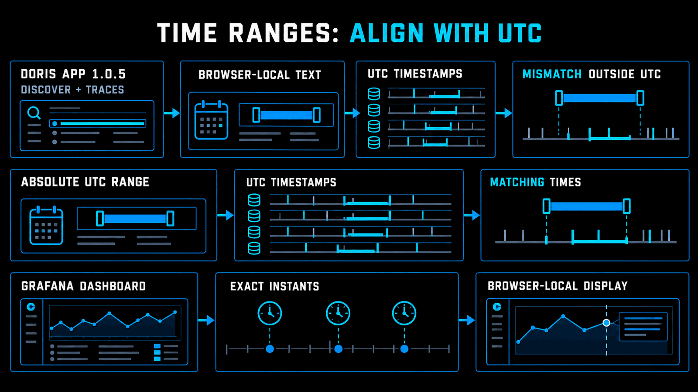
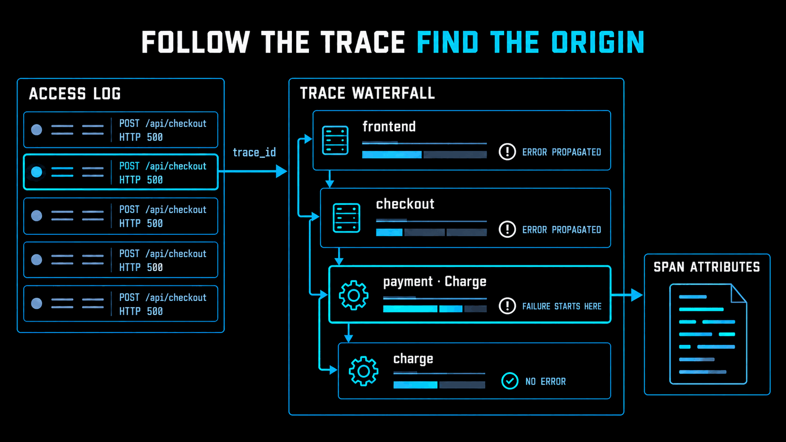
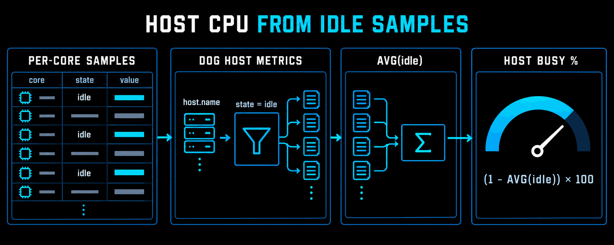

<a id="unit-u.ac3c1cec796447a5875fb7625c7993b9"></a>

<a id="module-3-visualizing-observability-data"></a>

# 3-модуль: Жүйені бақылау деректерін визуализациялау

| Курс ақпараты | Мәні |
| --- | --- |
| Курс | Apache Doris көмегімен жүйені бақылау · 1-деңгей |
| Doris | Apache Doris 4.1.3 |
| Grafana | Doris App 1.0.5 плагині бар Grafana 11.4.0 |
| Болжалды уақыт | Шамамен 85 минут: оқу 30, зертханалық жұмыс 45, тест 10 |

[Курс README файлы](../../README.md) · [3-зертханалық жұмысты ашу](lab03_data_visualization.ipynb) · [3-тестті ашу](quiz03_observability_visualization.ipynb)

<a id="unit-u.1d4c5b6d23254575857574dd7961e29b"></a>

<a id="module-goal"></a>

## Модуль мақсаты

Grafana-да төлем ақауларын тексеру: журналдардан іздеу, сәтсіз тапсырыс трассасын ақау басталған span-ға дейін қадағалау, хост CPU-ын себептен алып тастау және дәлелді бақылау тақтасында сақтау.

<a id="unit-u.98f3a83f0dd945be8bcce2b13c34c8a6"></a>

<a id="learning-objectives"></a>

## Оқу мақсаттары

Модульді аяқтаған соң сіз:

1. Doris App-тың Discover бетінде Lucene және SQL шарттарымен журнал іздей аласыз.
2. Маңыздылық бойынша іздеу сервис қате ретінде жазбайтын ақауларды неге өткізіп алатынын түсіндіре аласыз.
3. Doris уақытты сақтауына сәйкес уақыт аралығын орната аласыз.
4. Журнал жолынан трасса арқылы қате басталған span-ға өте аласыз.
5. Әр ядро мен әр күйдің үлгілерінен хост CPU-ын өлшей аласыз.
6. Grafana уақыт макростары бар SQL-ден бақылау тақтасының панельдерін құра аласыз.

<a id="unit-u.dfea70e7dfdf4c42a652554bb0771ab8"></a>

<a id="module-structure"></a>

## Модуль құрылымы

| Бөлім | Уақыт | Нәтиже |
| --- | ---: | --- |
| 3.1 Grafana және Doris App | 3 мин | Жұмыс істейтін беттеріңіз |
| 3.2 Уақыт аралықтары мен уақыт белдеулері | 4 мин | Ең жаңа жолдарды табатын аралық |
| 3.3 Журналдардан іздеу | 7 мин | Lucene және SQL іздеулері, олардың индексі |
| 3.4 Ақаулар қате журналында болмағанда | 3 мин | Маңыздылық іздеуі нені табады және таба алмайды |
| 3.5 Трассаны оқу | 6 мин | Журнал жолынан ақаулы span-ға дейін |
| 3.6 Хост CPU-ын өлшеу | 4 мин | Әр ядро үлгілерінен жұмысбасты үлесті есептеу |
| 3.7 Бақылау тақталары | 3 мин | Уақыт аралығына сәйкес SQL панельдері |
| 3-зертханалық жұмыс | 45 мин | Тексерілген инцидент және оның бақылау тақтасы |
| 3-тест | 10 мин | Осы мақсаттар бойынша алты сұрақ |

<a id="unit-u.4d954fcd8e7a430ea7f2c139d9070a51"></a>

<a id="31-grafana-and-the-doris-app"></a>

## 3.1 Grafana және Doris App

Grafana әртүрлі дереккөздерден дерек көрсетеді. DOG стегі оған **Doris** атты бір дереккөз береді; ол MySQL протоколымен `otel` дерекқорына қосылады. Осы модульдің әр беті мен панелі Doris-ті сол арқылы SQL-мен оқиды.

**Doris App** — Doris телеметриясына арналған Grafana плагині. Беттері Grafana мәзірінің **Doris App** бөлімінде:

| Бет | Нені іздейді | Не үшін қолданылады |
| --- | --- | --- |
| **Discover** | `otel_logs` сияқты бір кестенің жолдары | Журнал жазбаларын табу, сүзу және уақыт бойынша қаншасы келгенін көру |
| **Traces** | `otel_traces` ішіндегі толық трассалар | Сұрауларды span атрибуттары мен ұзақтығы бойынша тауып, сарқырама көрінісін ашу |
| **Dashboard** | Grafana бақылау тақталары | Минуттық санақ сияқты SQL сұрау панельдерін сақтау |

DOG стегіндегі Grafana кірушілерге жүйеге кірмей беттерді көруге мүмкіндік береді; бұл Discover мен Traces үшін жеткілікті. Тақта құруға тіркелгі қажет: стек әкімшісі — `admin`, құпиясөзі — `admin`. Grafana бірінші рет жаңа құпиясөз сұрайды; бұл жергілікті стекте оны өткізіп жіберуге болады.

<a id="unit-u.ec0f1e0b20fe4194bcca13bdd493bacb"></a>

<a id="32-time-ranges-and-time-zones"></a>

## 3.2 Уақыт аралықтары мен уақыт белдеулері

Grafana-дағы әр іздеудің уақыт аралығы бар, ал жүйені бақылау деректері уақытқа байланысты: инцидентте ең жаңа минуттар маңызды. Екі сағат қатысады. Doris телеметрия уақытын экспорттаушы жазғандай UTC бойынша сақтайды, Discover сақталған уақытты көрсетеді. Браузеріңіз компьютердің уақыт белдеуінде жұмыс істейді.

Grafana-ның өз панельдері дұрыс түрлендіреді: аралықты дереккөзге нақты уақыт сәттерімен жіберіп, нәтижені браузердің уақыт белдеуінде көрсетеді. Бірақ Doris App 1.0.5 аралықты браузер уақыт белдеуінің мәтініне айналдырып, Doris-тегі UTC уақытымен салыстырады. UTC+8 компьютерінде **Last 15 minutes** осылайша болашақтағы 8 сағат кейінгі жолдарды сұрап, ештеңе таппайды; UTC-ден батысқа қарай өткен уақыттан іздеп, жаңа жолдарды өткізіп алады. UTC қолданатын компьютерде ғана салыстырмалы аралық күткендей жұмыс істейді.

Екі салдар:

- Discover мен Traces ішінде UTC бойынша **абсолют** аралық орнатыңыз: уақыт таңдағышының **Absolute time range** бөлімінде басталу және аяқталу уақытын теріңіз. 3-зертханалық жұмыс оларды шығарып береді.
- Бет жол көрсетпесе, дерек жоқ деп қорытпас бұрын аралықты тексеріңіз. Дұрыс кезең сұрауы соны растамайынша, бос панель деректер туралы емес, сұрау туралы дәлел береді.

Traces бетінің сарқырама көрінісі уақытты браузер белдеуімен көрсетеді: UTC+1 компьютерінде бір span Discover-де 19:37, сарқырамада 20:37 болуы мүмкін.



*Doris App ішінде абсолют UTC аралықтарын қолданыңыз; Grafana бақылау тақталары уақыт белдеуін өздері түрлендіреді.*

Сурет белгілері: TIME RANGES: ALIGN WITH UTC — уақыт аралықтарын UTC-мен сәйкестендіру; BROWSER-LOCAL TEXT — браузердің жергілікті уақыт мәтіні; UTC TIMESTAMPS — UTC уақыт белгілері; MISMATCH OUTSIDE UTC — UTC-ден өзге белдеудегі сәйкессіздік; ABSOLUTE UTC RANGE — абсолют UTC аралығы; MATCHING TIMES — сәйкес уақыттар; GRAFANA DASHBOARD — Grafana бақылау тақтасы; EXACT INSTANTS — нақты уақыт сәттері; BROWSER-LOCAL DISPLAY — браузердің жергілікті уақытпен көрсетуі. DORIS APP 1.0.5 және DISCOVER + TRACES — өнім мен беттердің атаулары.

<a id="unit-u.f0c48504908b4dbfb59ff3d2fb873b9e"></a>

<a id="33-searching-logs"></a>

## 3.3 Журналдардан іздеу

Discover іздеуді жазудың **Mode** арқылы таңдалатын екі тәсілін ұсынады.

**Lucene** — өрістерден іздеудің қысқа синтаксисі. Doris App оны SQL-ге айналдырады:

| Lucene | Мағынасы | Doris орындайтын SQL |
| --- | --- | --- |
| `service_name:cart` | Өрісте осы сөз бар | `service_name MATCH_ANY 'cart'` |
| `body:"POST /api/checkout"` | Өрісте осы сөздер қатар және осы ретпен бар | `body MATCH_PHRASE 'POST /api/checkout'` |
| `severity_number:>=17` | Сандық салыстыру | `severity_number >= 17` |
| `a AND b`, `a OR b`, `NOT a` | Біріктірулер | SQL-де де солай |

**SQL** режимі тікелей `WHERE` шартын, мысалы `severity_number >= 17 AND service_name = 'cart'`, қабылдайды. Оны Lucene өрнектей алмайтын функциялар не `VARIANT` бағандары сияқты жағдайларға қолданыңыз.

Мәтіндік іздеу жылдам, өйткені Doris экспорттаушысы `otel_logs` кестесін `body` бағанының **кері индексімен** құрған. Жол жүктелгенде индекс мәтінді токен деп аталатын сөздерге бөліп, әр сөз қай жолдарда барын тіркейді. `body` индексі `unicode` парсерін қолданып, сөздерді кіші әріпке айналдырады: `"POST /api/checkout?currencyCode=USD HTTP/1.1" 500` қатынас журналы жолы `post`, `api`, `checkout`, `currencycode`, `usd`, `http`, `1.1` және `500` болады; тыныс белгілері алынып тасталады. `MATCH_ANY` іздеу сөздерінің кез келгені бар жолдарды, `MATCH_ALL` барлығы бар жолдарды, `MATCH_PHRASE` сөздері қатар әрі ретімен тұрған жолдарды табады. Doris бұған әр мәтінді оқымай, индекстен жауап береді.

Фраза таңбаларды емес, сөздерді салыстырады; оның екі әсері бар:

- Фраза тыныс белгісі мен регистрді елемейді: `POST /api/checkout` және `post api checkout` бір жолдарды табады.
- Қосымша сөздер фразаны бұзады. Дүкен беті checkout сұрауын `/api/checkout?currencyCode=USD` адресіне жібереді, сондықтан `"POST /api/checkout HTTP/1.1 500"` фразасы оларды өткізіп алады: `currencycode` пен `usd` сөздері `checkout` пен `http` арасында тұр. `AND` арқылы қосылған `body:"POST /api/checkout" AND body:"HTTP/1.1 500"` екі фразасы жүктеме генераторының да, беттің де сәтсіз checkout сұрауларын табады.

<a id="unit-u.38d3a9340a6641abb74cdd3a1970a622"></a>

<a id="34-when-failures-are-not-error-logs"></a>

## 3.4 Ақаулар қате журналында болмағанда

Инцидентте алғашқы қадам — қателерді іздеу: `severity_number:>=17` дереккөз қандай белгі қолданса да, ERROR не FATAL деңгейіндегі әр журнал жазбасын табады. Бұл инцидентте ол ештеңеге жуық нәтиже береді: Doris FE-нің бірнеше қатесі және демо іске қосылғанда оның бір сервисінің ықтимал қатесі; төлем туралы ештеңе жоқ.

Себебі 2-модуль көрсеткендей дереккөздерде. Payment пен checkout Collector-ға журнал жібермейді, ал әр сәтсіз checkout-ты жазатын дүкен проксиінің қатынас журналында маңыздылық деңгейі жоқ. Іздеу тек жүйе тіркегенді, тіркелген түрімен табады. Мұнда дәлел — күйі `500` қатынас журналының жолы; іздеу соны сұрауы керек.

Демек нәтиже бермеген іздеу ақауды көрсететін дерек жиналса ғана оның жоқтығына дәлел болады. Тыныш қате іздеуіне сүйенбес бұрын қай сервис журнал жіберетінін және ақаулары қалай көрінетінін тексеріңіз.

<a id="unit-u.68f5680643f0419a9a132db7ecd0831a"></a>

<a id="35-reading-a-trace"></a>

## 3.5 Трассаны оқу

Әр қатынас журналы жолында сұрауының трасса ID-і бар, сондықтан сәтсіз checkout жолы оның трассасына апарады. Discover ішіндегі `trace_id` басылса, трассаны сарқырама түрінде көрсететін **Trace Panel** ашылады:

- Әр жол — span: қалың қаріппен сервис, операция және ұзақтық. Балалары ата-анасының астына шегініспен жазылады, ал оң жақ жолақ сұрау ішіндегі әр span-ның қашан басталып, қанша уақыт алғанын көрсетеді.
- Қызыл белгі қате күйі бар span-ды көрсетеді. Қателер жоғары таралады: payment сәтсіз болса, checkout-тың payment шақыруы, кейін checkout-тың өз span-ы, frontend, прокси және жүктеме генераторы сәтсіз болады. Қызыл жолдардың көбі тек төменнен келген қатені хабарлайды.
- Ақаудың **бастауы** — ең терең қате span-ы: оның балалары бар болса, оларда қате жоқ. Бұл инцидентте ол payment сервисінің `grpc.oteldemo.PaymentService/Charge` span-ы. `charge` span-ы сияқты балалары қатесіз.
- Жолды басу span егжей-тегжейін: түрін, күйін, атрибуттарын ашады. Payment span атрибутында `grpc.error_message`: `Payment request failed. Invalid token. app.loyalty.level=gold` бар.

**Traces** беті толық трассаларды іздейді. **Service** және **Operation** сүзгілері алғашқы, түбір span бойынша таңдайды; жүктеме генераторының тапсырыстарында ол checkout span-ы емес, өзінің `POST` span-ы. **Tags** кез келген span атрибуты бойынша таңдайды: `http.status_code=500` кей span-ы HTTP 500 тіркеген трассаларды табады. Бұған сәтсіз checkout та, демо іске қосылғандағы GET сияқты қатыссыз сұраулар да кіреді. Трассаны төлем инцидентіне жатқызбас бұрын түбір операциясы мен сервистерін қараңыз. Браузерде берілген тапсырыстың түбірі `load-generator:POST` орнына `frontend-web` болуы мүмкін. Бет әр трассаны басталу уақыты мен ұзақтығына қарай нүкте ретінде көрсетіп, span-дары және сервистерімен тізеді.



*Бастапқы payment қатесін оны шақырғандар хабарлаған қателерден ажырату үшін трасса ID-імен жүріңіз.*

Сурет белгілері: FOLLOW THE TRACE FIND THE ORIGIN — трассаны қадағалап, бастауды табу; ACCESS LOG — қатынас журналы; TRACE WATERFALL — трассаның сарқырама көрінісі; ERROR PROPAGATED — жоғарыға таралған қате; FAILURE STARTS HERE — ақау осы жерден басталады; NO ERROR — қате жоқ; SPAN ATTRIBUTES — span атрибуттары. frontend, checkout, payment: Charge және charge — сервис/операция атаулары; trace_id — байланыстыратын өріс; POST /api/checkout және HTTP 500 — техникалық мәндер.

<a id="unit-u.34608f2623404154a245810e8f9f0d21"></a>

<a id="36-measuring-a-hosts-cpu"></a>

## 3.6 Хост CPU-ын өлшеу

Қолданбаны кінәламас бұрын машинаны тексеріңіз: шамадан тыс жүктелген хост көптеген сервисті бірден істен шығарады. DOG Collector Docker хостының CPU-ын әр 15 секунд сайын `otel_metrics_gauge` кестесіндегі `system.cpu.utilization` метрикасы ретінде өлшейді. macOS пен Windows-та Docker хосты — Docker Desktop Linux виртуалды машинасы, Linux-та — компьютеріңіздің өзі.

Жолдар ұсақ түйіршікті. Әрқайсысы алдыңғы өлшемнен бері **бір CPU ядросының** `user`, `system` не `idle` сияқты **бір күйде** болған уақыт үлесін, 0–1 арасында, сақтайды; `attributes` ядро мен күйді атайды. 8 ядролы хостта әр өлшем 8 ядро × 8 күй, яғни 64 жол жазады. Бір жол аз мәлімет береді: уақытының 97% бос тұрған ядро `idle` жолына `0.97` жазады, ал `value > 0.9` сүзгісі көбіне бос ядроларды табады.

Сондықтан хосттың жұмысбасты уақыт үлесі — 1-ден барлық ядроның орташа `idle` үлесін шегеру:

```sql
SELECT (1 - AVG(value)) * 100 AS busy_percent
FROM otel_metrics_gauge
WHERE metric_name = 'system.cpu.utilization'
  AND attributes['state'] = 'idle'
  AND scope_name LIKE '%hostmetricsreceiver%'
  AND resource_attributes['host.name'] IS NOT NULL
  AND timestamp >= UTC_TIMESTAMP() - INTERVAL 1 MINUTE
```

Бірнеше бағдарлама, оның ішінде демо Collector-ы мен екі Python сервисі осы атаулы метриканы береді; соңғы екі шарт хост атауы бар DOG Collector өлшемдерін қалдырады. Бұл инцидентте ақаулар басталғанға дейін де, кейін де хост 5–15 пайыз жұмысбасты болады, сондықтан себеп хостта емес. 8-модуль осы сұрауға 90 пайыз шегінде ескерту құрады.



*Үлкен idle мәні ядроның бос екенін білдіреді; хосттың жұмысбасты CPU-ын есептемес бұрын idle үлгілерін орташалаңыз.*

Сурет белгілері: HOST CPU FROM IDLE SAMPLES — бос тұру үлгілерінен хост CPU-ын есептеу; PER-CORE SAMPLES — әр ядроның үлгілері; core — ядро; state — күй; value — мән; DOG HOST METRICS — DOG хост метрикалары; AVG(idle) — орташа бос үлес; HOST BUSY % — хосттың жұмысбасты пайызы. host.name және state = idle — сүзгі өрістері; формула (1 - AVG(idle)) × 100.

<a id="unit-u.a8fafb6868ce47d0bdea30cdc8654cfd"></a>

<a id="37-dashboards"></a>

## 3.7 Бақылау тақталары

Бақылау тақтасы тексеру сұрауларын өздігінен жаңаратын панельдер ретінде сақтайды. Панельде дереккөз, сұрау және визуализация бар. Doris дереккөзінде сұрау — редактордың **Code** режимінде жазылатын SQL.

Уақыт қатары үшін сұрау `time` атты уақыт бағанын және әр қатарға бір сандық баған қайтарады, ал **Format** мәні — **Time series**. Grafana SQL-ді тақтаға бейімдейтін макростар ұсынады:

| Макрос | Grafana немен алмастырады |
| --- | --- |
| `$__timeFilter(timestamp)` | Тақтаның уақыт аралығындағы жолдарды қалдыратын шарт |
| `$__timeGroupAlias(timestamp, 1m)` | Әр жол минуты басталатын уақыт, атауы `time` |

Макростар аралықты нақты уақыт сәттерімен бергендіктен, **Last 30 minutes** сияқты салыстырмалы аралық Doris App беттерінен өзгеше, кез келген уақыт белдеуінде жұмыс істейді. 3-зертханалық жұмыстың `Payment incident` тақтасында екі панель бар: сәтті және сәтсіз тапсырыстары жинақталған бағандармен бөлінген минуттық тапсырыстар және хост CPU-ы. Grafana тақталарды өз дерекқорында сақтайды; кез келген көруші оларды Grafana API-ы арқылы қайта оқи алады, 3-зертханалық жұмыс сіздікін осылай тексереді.

<a id="unit-u.2d6da7e9eb324ab2a63e3ceaf110b69b"></a>

<a id="lab-3-investigate-the-payment-failures-in-grafana"></a>

## 3-зертханалық жұмыс: Grafana-да төлем ақауларын тексеру

[3-зертханалық жұмыс: Grafana-да төлем ақауларын тексеру](lab03_data_visualization.ipynb) файлын ашыңыз. Сіз:

1. Тапсырыстардың сәтсіз болатынын тексеріп, Discover ішінде абсолют UTC аралығын орнатасыз.
2. Қате журналдарын іздеп, инцидентті неге өткізіп алатынын көресіз.
3. Қатынас журналынан Lucene және SQL арқылы сәтсіз checkout сұрауларын табасыз.
4. Сәтсіз checkout трассасын ашып, payment сервисінің қатесін табасыз; Traces бетінен іздейсіз.
5. Хост CPU-ын себептен алып тастайсыз.
6. `Payment incident` бақылау тақтасын құрып сақтайсыз.
7. Жаттығу: сәтсіз төлемдердің үлесін есептейсіз.

Төлем ақауы қосылған 1-модульдің DOG стегі мен демосы қажет.

<a id="unit-u.dcc22d4fcc0a462cb9785ecd5f665ec6"></a>

<a id="summary"></a>

## Қорытынды

- Discover Lucene не SQL шартымен бір кестенің жолдарын іздейді; Traces беті толық трассаларды іздейді; бақылау тақталары SQL панельдерін сақтайды.
- Doris UTC сақтайды. Doris App аралықты браузердің уақыт белдеуімен салыстырады, сондықтан онда абсолют UTC аралықтарын орнатыңыз; бақылау тақталарының панельдері дұрыс түрлендіреді.
- `MATCH_PHRASE` пен `MATCH_ANY` мәтінді кіші әріпті сөздерге бөлетін `body` кері индексін қолданады. Фразада сөздер ретімен сәйкесуі керек, сондықтан сұрау параметрлері сияқты қосымша сөздер сәйкестікті бұзады.
- Маңыздылық бойынша іздеу дереккөз қате ретінде жазғанын ғана табады. Бұл инцидент қате журналын қалдырмайды, тек күйі 500 қатынас журналы жолдарын қалдырады.
- Трассада қате ең терең қате span-ынан басталады; жоғарыдағы span-дар оны тек хабарлайды. Мұнда ол — payment сервисінің төлем шақыруы.
- Хосттың жұмысбасты үлесі — 1-ден барлық ядроның орташа бос тұру үлесін шегеру. Хост CPU-ы төмен қалады, демек себеп қолданбада.
- `$__timeFilter` және `$__timeGroupAlias` SQL панелін тақтаның уақыт аралығына сәйкестендіреді.

<a id="unit-u.aac133e7ba154348a075a4092a754dbd"></a>

<a id="quiz-3"></a>

## 3-тест

[3-тест: Жүйені бақылау деректерін визуализациялау](quiz03_observability_visualization.ipynb) файлын ашыңыз. Бір жауап таңдалатын алты сұрақ бар; іске қосылған орта қажет емес.

Әрі қарай: бұл — 1-деңгейдің соңғы модулі. 2-деңгей [4-модуль: Жүйені бақылау деректерінің кесте модельдері](../../level2/module04-table-model/course.md) бөлімінен басталады.

<a id="unit-u.d2d515db5f414a39958c2e1fce03dd23"></a>

<a id="references"></a>

## Дереккөздер

- [Grafana: бақылау тақталары](https://grafana.com/docs/grafana/v11.4/dashboards/) және [тақталарды қолдану (уақыт аралығы)](https://grafana.com/docs/grafana/v11.4/dashboards/use-dashboards/)
- [Grafana: MySQL дереккөзі, сұрау редакторы және макростар](https://grafana.com/docs/grafana/v11.4/datasources/mysql/query-editor/)
- [Apache Doris: кері индекс](https://doris.apache.org/docs/4.x/table-design/index/inverted-index/overview/) және `MATCH_ANY`, `MATCH_PHRASE` сияқты [іздеу операторлары](https://doris.apache.org/docs/4.x/table-design/index/inverted-index/search-operators/)
- [Apache Doris: TOKENIZE](https://doris.apache.org/docs/4.x/sql-manual/sql-functions/scalar-functions/string-functions/tokenize/)
- [Хост метрикалары қабылдағышы: CPU метрикалары](https://github.com/open-telemetry/opentelemetry-collector-contrib/blob/v0.144.0/receiver/hostmetricsreceiver/internal/scraper/cpuscraper/documentation.md)
