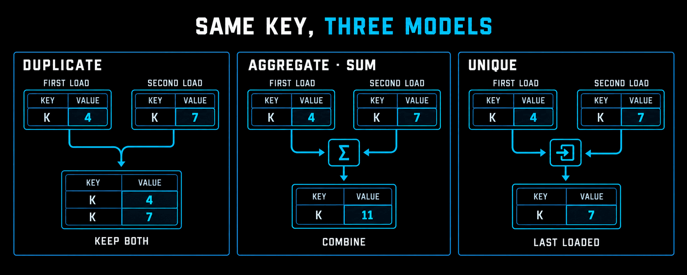
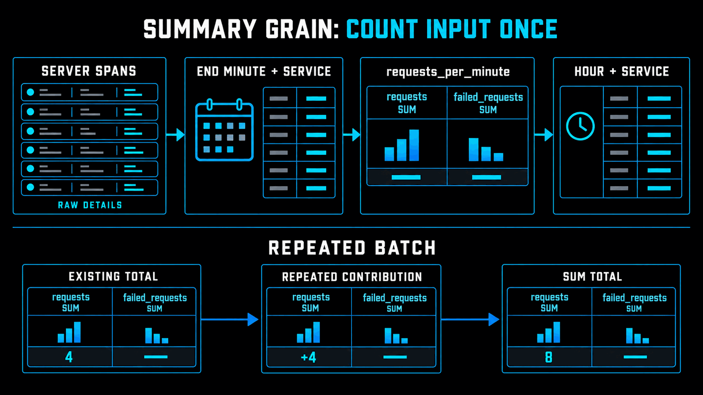
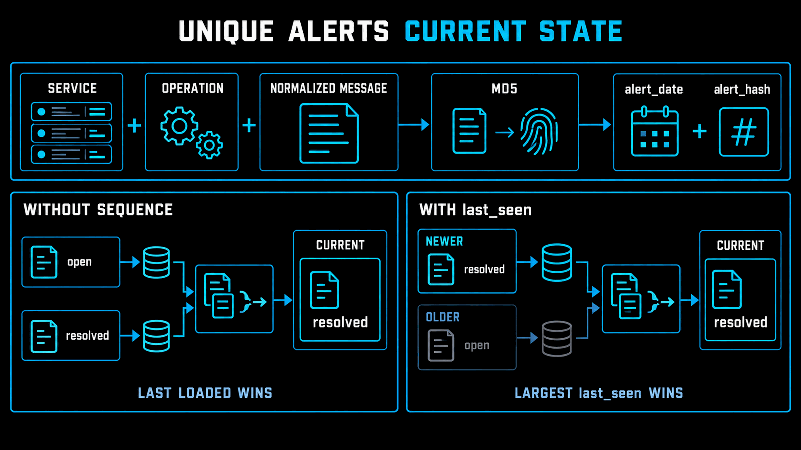

<a id="unit-u.fe141f71619348b38d62f9f6e0a20790"></a>

<a id="module-4-table-models-for-observability-data"></a>

# 4-модуль: Жүйені бақылау деректерінің кесте модельдері

| Курс ақпараты | Мәні |
| --- | --- |
| Курс | Apache Doris көмегімен жүйені бақылау · 2-деңгей |
| Doris | Apache Doris 4.1.3 |
| Орта | Төлем ақауы қосылған 1-модульдің DOG стегі мен OpenTelemetry демосы |
| Болжалды уақыт | Шамамен 70 минут: оқу 25, зертханалық жұмыс 35, тест 10 |

[Курс README файлы](../../README.md) · [4-зертханалық жұмысты ашу](lab04_table_models.ipynb) · [4-тестті ашу](quiz04_observability_table_models.ipynb)

<a id="unit-u.5e0b48ce90a74c97ac4fdeb0d1f81a65"></a>

<a id="module-goal"></a>

## Модуль мақсаты

Төлем инцидентінің дәлелін ықшам кестелерде сақтап, әр кестеге Doris кілті ортақ жолдармен не істейтінін анықтайтын модель таңдау.

<a id="unit-u.dc5ebf3821744079bb2f9e5d877a275e"></a>

<a id="learning-objectives"></a>

## Оқу мақсаттары

Модульді аяқтаған соң сіз:

1. Кілті ортақ жолдарға не болуы керегіне қарай DUPLICATE, AGGREGATE не UNIQUE таңдай аласыз.
2. Бастапқы журналдар, span-дар мен метрика нүктелері неге DUPLICATE кестесіне жататынын түсіндіре аласыз.
3. AGGREGATE кестесінің кілтін жауап беретін сұрақтарының түйіршіктілігіне сай таңдай аласыз.
4. Қабаттасқан не қайталанған жүктеулерден кейінгі AGGREGATE жолдарын болжай аласыз.
5. Қатенің әр қайталануында өзгермейтін ескерту сәйкестендіргішін құра аласыз.
6. UNIQUE қай жолды сақтайтынын және бір жол қайталанулар туралы нені айтатынын болжай аласыз.

<a id="unit-u.3936ff2cbf5942abb30ed7b30f8f4079"></a>

<a id="module-structure"></a>

## Модуль құрылымы

| Бөлім | Уақыт | Нәтиже |
| --- | ---: | --- |
| 4.1 Кілттер мен модельдер | 4 мин | Кестенің кілт сөйлемі нені шешеді |
| 4.2 DUPLICATE: әр оқиғаны сақтау | 4 мин | Бастапқы телеметрия неге әр жолды сақтайды |
| 4.3 AGGREGATE: санақтарды сақтау | 6 мин | Сұрақтар түйіршіктілігіндегі қорытынды |
| 4.4 UNIQUE: ағымдағы күйді сақтау | 6 мин | Әр ескертуге бір жол және оның мағынасы |
| 4.5 Экспорттаушының UNIQUE кестесі | 2 мин | Бір минутты екі рет санауы мүмкін тапсырма |
| 4.6 Модель таңдау | 3 мин | Модельді сұраққа сәйкестендіру |
| 4-зертханалық жұмыс | 35 мин | Инциденттің минуттық қорытындысы және әр қате түріне бір ескерту |
| 4-тест | 10 мин | Осы мақсаттар бойынша алты сұрақ |

<a id="unit-u.af835d2dbb9f438f8af0220ecd3f12f0"></a>

<a id="41-keys-and-models"></a>

## 4.1 Кілттер мен модельдер

1-модульден бері дүкен тапсырыстарының шамамен жартысы сәтсіз болады. Инцидент кезінде де, одан көп уақыт кейін де бір сұрақтар қойылады: әр сервис минутына қанша сұрау өңдеді, қаншасы сәтсіз болды; қандай қателер болды, қайсысы әлі ашық. Бастапқы span-дардан жауап беру үшін тақтаның әр жаңаруында кезеңнің әр span-ын оқу керек. Егер Doris бір нәрсені сипаттайтын жолдармен не істеуді білсе, жауаптарды сақтайтын кесте кішірек әрі жылдамырақ болады.

Кестенің **дерек моделі** соны анықтайды. Әр Doris кестесінің `CREATE TABLE` кілт сөйлемімен орнатылған, кесте басындағы бір не бірнеше бағаннан тұратын кілті бар. Модель барлық кілт бағандарының мәні бірдей жолдарға не болатынын шешеді:

| Модель | Кілті бірдей жолдар | Әдеттегі қолданылуы |
| --- | --- | --- |
| `DUPLICATE KEY` | Барлығы сақталады. Кілт тек сақтау ретін анықтайды. | Бастапқы журналдар, span-дар, метрика нүктелері |
| `AGGREGATE KEY` | Бір жолға бірігеді. Әр мән бағаны `SUM` сияқты біріктіру функциясын атайды. | Алдын ала сақталған кезеңдік санақтар мен жиынтықтар |
| `UNIQUE KEY` | Бір ғана, соңғы жүктелген жол сақталады. | Ескерту сияқты нысанның ағымдағы күйі |

Модель кесте құрылғанда бекітіледі. Doris әр tablet жолдарын кілт бойынша сұрыптап сақтайды; бұл алғашқы кілт бағандары бойынша сүзетін сұрауларға да көмектеседі.



*Кесте моделі бірдей кілттер оқиғаларды сақтай ма, жиынтықтарды біріктіре ме, әлде күйді алмастыра ма — соны анықтайды.*

Сурет белгілері: SAME KEY, THREE MODELS — бір кілт, үш модель; FIRST LOAD — бірінші жүктеу; SECOND LOAD — екінші жүктеу; KEY — кілт; VALUE — мән; KEEP BOTH — екеуін де сақтау; COMBINE — біріктіру; LAST LOADED — соңғы жүктелген. DUPLICATE, AGGREGATE · SUM, UNIQUE — модель атаулары; K — кілт, 4 пен 7 мәндері тиісінше екі жол, 11 және 7 береді.

<a id="unit-u.e5e3fc5881b44470a3540d51062d4d8f"></a>

<a id="42-duplicate-keep-every-event"></a>

## 4.2 DUPLICATE: әр оқиғаны сақтау

Журнал жолы, span және метрика нүктесі — әрқайсысы жеке оқиға. Бір сервистің екі span-ы бір миллисекундта басталуы мүмкін: SDK-сы миллисекунд тіркейтін frontend бір сұраудың бірнеше span-ын бірден бастайды; 4-зертханалық жұмыс он не одан көп span-ға ортақ кілттерді табады. Олар span ID-лері әртүрлі бөлек оқиғалар; әр кілтке бір жол қалдыратын кесте біреуінен басқасын жоғалтар еді.

Сондықтан Doris экспорттаушысы бастапқы телеметрия кестелерін — `otel_logs`, `otel_traces` және бес `otel_metrics_*` кестесін — уақыт пен сервиске `DUPLICATE KEY` қойып құрады. Doris әр жүктелген жолды сақтайды, кілт тек ретін анықтайды, сондықтан уақыт аралығындағы бір сервис сұрауы оларды жақын жерден оқиды. Кілт сөйлемі жоқ кесте де DUPLICATE болады.

DUPLICATE дәл көшірмелерді де сақтайды. Бір дерек екі рет жүктелсе, әр жол екі рет болып, әр санақ екі еселенеді. Кесте қайталанған жүктеуден қорғамайды; оны жүктеуші болдырмауы керек. Сондықтан 2-модульдегі журнал collector-ы оқу орнын сақтайды: онсыз қайта іске қосу бүкіл FE журналын қайта жүктер еді.

<a id="unit-u.049620c4789048c1a447a44ed4cf79e4"></a>

<a id="43-aggregate-keep-the-counts"></a>

## 4.3 AGGREGATE: санақтарды сақтау

Инцидент қорытындысына әр сервис пен минутқа сұраулар және сәтсіздер саны бар бір жол керек. AGGREGATE кестесінде кілт қорытындының **түйіршіктілігін** береді, ал әр басқа баған Doris кілті бірдей жолдардың мәнін қалай біріктіретінін жариялайды:

```sql
CREATE TABLE IF NOT EXISTS requests_per_minute (
    request_minute  DATETIME,
    service_name    VARCHAR(200),
    requests        BIGINT SUM,
    failed_requests BIGINT SUM
)
AGGREGATE KEY(request_minute, service_name)
DISTRIBUTED BY HASH(service_name) BUCKETS 1
```

Жүктеу тапсырмасы әр сервер span-ына `requests = 1` және `failed_requests = 1` не `0` мәнді бір жол қосады. Кілті бұрыннан бар жол келгенде `SUM` оның мәндерін бұрынғы жолға қосады. Doris жүктеу кезінде жолдарды біріктіреді, қалғанын фонда біріктіреді (compaction), ал сұрау оқығанда әлі қалғанын біріктіреді; сондықтан сұрау әр кілтке әрдайым бір жол көреді. `SUM`-нан басқа мән бағаны `MAX`, `MIN`, `REPLACE` (соңғы жүктелген мән), `REPLACE_IF_NOT_NULL` және жуық бөлек санаққа арналған `HLL_UNION`, `BITMAP_UNION` сияқты функцияларды жариялай алады.

**Кілт — түйіршіктілік.** Кілт әр span уақытын емес, минутты, `DATE_TRUNC(end_time, 'minute')`, сақтайды. Span уақыты кілтте болса, тек бір микросекундтағы span-дар бірігіп, кесте `otel_traces` сияқты үлкен болар еді. Керісінше, кесте тек өз не ірірек түйіршіктіліктегі сұрақтарға жауап береді: минуттарды сағаттарға қоса алады, бірақ қай сұраулар сәтсіз болғанын не қанша уақыт алғанын айта алмайды. Түйіршіктілікті сұрақтарға қарай таңдап, қалғанына бастапқы кестені сақтаңыз.

**Әр оқиғаны бір рет, дұрыс уақыт тобына санаңыз.** Span `timestamp` мәні — басталу уақыты, бірақ ол аяқталғаннан кейін ғана Doris-ке жетеді. 10 минутқа дейін ашық тұратын `flagd` жалауша ағыны сияқты ұзақ сұрау басталған минут қорытындыланғаннан көп кейін келер еді. Сондықтан қорытынды әр сұрауды аяқталған минутта санайды. Бұл жоспар бойынша жүктелетін кез келген қорытындыға қатысты: әр кезеңді дерегі келгеннен кейін ғана жүктеңіз.

**Әр бастапқы жолды дәл бір рет жүктеңіз.** AGGREGATE кестесі жаңа жолды қайталанғанынан ажырата алмайды. Екі жүктеу қабаттасса не бірі екі рет орындалса, қайталанған жолдар саны екі рет қосылып, кесте еш қатесіз қате нәтиже береді. 4-зертханалық жұмыс қорытындысын минут ішіндегі бір сәтте түйісетін екі пакетпен жүктейді: екіншісі сол минут жолдарына қосады; бір кілтке 4, кейін 7 жүктеу 11 береді. `otel_traces` кестесімен біріктіру әр санақтың сәйкестігін тексереді.



*Қорытынды кілтін сұраққа қарай таңдап, әр бастапқы оқиғаны бір рет жүктеңіз.*

Сурет белгілері: SUMMARY GRAIN: COUNT INPUT ONCE — қорытынды түйіршіктілігі: кірісті бір рет санау; SERVER SPANS — сервер span-дары; RAW DETAILS — бастапқы егжей-тегжей; END MINUTE + SERVICE — аяқталу минуты мен сервис; HOUR + SERVICE — сағат пен сервис; REPEATED BATCH — қайталанған пакет; EXISTING TOTAL — бұрынғы жиынтық; REPEATED CONTRIBUTION — қайталанған үлес; SUM TOTAL — SUM жиынтығы. requests_per_minute — кесте, requests SUM мен failed_requests SUM — қосылатын бағандар; суреттегі 4 + 4 = 8 бір пакетті қайта қосудың салдарын көрсетеді.

<a id="unit-u.81ec2b1f0fa9439d942214ca08e61623"></a>

<a id="44-unique-keep-the-current-state"></a>

## 4.4 UNIQUE: ағымдағы күйді сақтау

Әр сәтсіз тапсырыс payment, checkout, frontend, прокси және жүктеме генераторы сияқты бірнеше сервисте қате span-дарын қалдырады. Әр қате span-ына ескерту жасайтын тапсырма бір мәселе туралы минутына бірнеше ескерту жіберер еді. Кезекші инженерге керегі — әр қате түріне ағымдағы күйі бар бір ескерту.

UNIQUE кестесі әр кілтке бір жол сақтайды. Кілт күн мен **ескерту сәйкестендіргішінен** тұрса, қаншалықты жиі қайталанса да, әр қате түріне күніне бір жол беріледі:

```sql
CREATE TABLE IF NOT EXISTS error_alerts (
    alert_date   DATE,
    alert_hash   VARCHAR(32),
    service_name VARCHAR(200),
    span_name    STRING,
    status       VARCHAR(16),
    message      STRING
)
UNIQUE KEY(alert_date, alert_hash)
DISTRIBUTED BY HASH(alert_hash) BUCKETS 1
```

Кілті бірдей барлық жол бір tablet-ке жетуі үшін UNIQUE кестесі кілт бағандарының хешімен бөлінуі керек. Doris 4.x ішінде UNIQUE кестелері әдепкіде **Merge-on-Write** (MoW): кілті бұрыннан бар жол келгенде Doris жаңа жолды жазып жатып, ескісін жойылған деп белгілейді. Сондықтан сұраулар оқу кезінде біріктірмей, тек ағымдағы жолды оқиды.

**Тұрақты сәйкестендіргіш.** Ол бір қате түрінің әр қайталануында бірдей, ал түрлер арасында әртүрлі болуы керек. 4-зертханалық жұмыс оны сервис, операция (`span_name`) және қате span-ының күй хабарынан `MD5` хешімен құрады. Хабарларда уақыт, адрес, порт, ID сияқты әр қайталанғанда өзгеретін бөліктер жиі бар. Хештеу алдында әр санды `0` ету `connect ECONNREFUSED 169.254.169.254:80` хабарын басқа адрестегі сондай хабармен бір қате түріне біріктіреді. Мысалы recommendation сервисінің жалауша ағыны әр 10 минут сайын уақыты бар хабармен `DEADLINE_EXCEEDED` болып аяқталады; алмастыру болмаса, әр қайталану жаңа ескерту болар еді.

**Соңғы жүктелген жол жеңеді.** Бір қате span-дарын қайта жүктеу кестені өзгертпейді, сондықтан тапсырма әр минутта қайталанусыз орындала алады. Ескертуді шешу үшін жолды `status = 'resolved'` мәнімен қайта жазады; кейін сол кілт жүктелсе, қайта алмастырады. Ретсіз келетін жүктеулерге **sequence бағаны** керек: `"function_column.sequence_col" = "last_seen"` кезінде Doris жүктеу ретіне қарамастан ең үлкен `last_seen` жолын сақтайды. Сондықтан кеш келген ескі ашық жол жаңарақ шешілген жолды алмастыра алмайды.

**Бір жол — бір қайталану емес.** Payment төлемінің ескертуі `error_alerts` ішінде бір жол, ал `otel_traces` ішінде әр сәтсіз тапсырысқа бір қате span-ын береді. UNIQUE кестесі санақты емес, ағымдағы күйді сақтайды. Қате қаншалықты жиі болғанын білу үшін span-дарын санаңыз не санақты AGGREGATE кестесінде сақтаңыз.



*Тұрақты кілттер қайталануларды бір ескертуге біріктіреді; sequence бағаны кеш келген ескі жолдың оны қайта ашуына жол бермейді.*

Сурет белгілері: UNIQUE ALERTS CURRENT STATE — UNIQUE ескертулердің ағымдағы күйі; SERVICE — сервис; OPERATION — операция; NORMALIZED MESSAGE — қалыпқа келтірілген хабар; WITHOUT SEQUENCE — sequence бағанынсыз; WITH last_seen — last_seen бағанымен; CURRENT — ағымдағы; open — ашық; resolved — шешілген; NEWER — жаңарақ; OLDER — ескірек; LAST LOADED WINS — соңғы жүктелген жеңеді; LARGEST last_seen WINS — ең үлкен last_seen жеңеді. MD5, alert_date және alert_hash — хеш алгоритмі мен кілт бағандары.

<a id="unit-u.44048271e2ed458ab7dbcbd095fdbc3a"></a>

<a id="45-the-exporters-unique-table"></a>

## 4.5 Экспорттаушының UNIQUE кестесі

Экспорттаушы бастапқы телеметрия емес бір кесте құрады: `otel_traces_graph`, сервистен сервиске минуттық шақырулар, `count` және `error_count` мәндерімен. Экспорттаушы құрған `otel_traces_graph_job` оны соңғы 10 минут span-дарынан әр 10 минут сайын толтырады. Әр орындалу алдыңғы орындалу басталған, сол кезде тек ішінара көрінген минутты қайта санап, кілті бірдей жолдарды жазады. Кесте UNIQUE болғандықтан, жаңа толық санақ ескі ішінара санақты алмастырады. `SUM` болса екі санақ қосылар еді; DUPLICATE болса минут екі рет көрінер еді. UNIQUE қайта есептеуді қауіпсіз қайталауға мүмкіндік береді, сондықтан соңғы терезені қайта есептейтін тапсырмалар оны қолданады.

Бұл кестеде де инцидент көрінеді: жалаушаны қосқалы `checkout`-тан `payment`-ке шақырулардың `error_count` мәні `count` мәнінің шамамен жартысына тең.

<a id="unit-u.67300156e3714a9a9d48ccb10e209a1f"></a>

<a id="46-choosing-a-model"></a>

## 4.6 Модель таңдау

Кілті бірдей екі жолға не болуы керегін сұраңыз:

| Кілті бірдей екі жол... | Модель | Бұл курста |
| --- | --- | --- |
| екеуі де маңызды екі бөлек оқиға болса | DUPLICATE | `otel_logs`, `otel_traces`, метрика кестелері |
| біріктірілетін бір жиынтықтың бөліктері болса | `SUM`, `MAX`, `MIN`, ... бар AGGREGATE | `requests_per_minute`, `daily_log_counts` |
| бір нысанның нұсқалары болып, жаңасы жеңсе | UNIQUE; жүктеулер ретсіз келуі мүмкін болса sequence бағанымен | `error_alerts`, `otel_traces_graph` |

Әр таңдаудың құны бар. DUPLICATE кестесі ең үлкен және барлық егжей-тегжейді сақтайды. AGGREGATE кішкентай әрі жылдам, бірақ тек өз түйіршіктілігіндегі сұрақтарға жауап береді, жүктеулері қабаттаспауы керек. UNIQUE әр жүктеуде кілтті іздеуді қажет етеді және әр жолдың тек соңғы нұсқасын сақтайды.

<a id="unit-u.fdad4d233d8e40c094347e713086ba9a"></a>

<a id="lab-4-table-models-for-observability-data"></a>

## 4-зертханалық жұмыс: Жүйені бақылау деректерінің кесте модельдері

[4-зертханалық жұмыс: Жүйені бақылау деректерінің кесте модельдері](lab04_table_models.ipynb) файлын ашыңыз. Сіз:

1. Тапсырыстардың сәтсіз болатынын тексересіз.
2. Экспорттаушы кестелерінің модельдерін тізіп, кілті ортақ span-дарды табасыз.
3. `requests_per_minute` құрып, екі пакетпен жүктейсіз, `otel_traces` кестесімен салыстырып, инцидент тапсырыстары мен төлемдерін оқисыз.
4. Қате span-дарынан `error_alerts` құрып, екі рет жүктейсіз және бір ескертуді шешесіз.
5. Экспорттаушының `otel_traces_graph` кестесін және оны толтыратын тапсырманы қарайсыз.
6. Жаттығу: журналдардың күндік қорытындысын құрып, инцидент оған неге қате журналын қоспайтынын көресіз.

Төлем ақауы қосылған 1-модульдің DOG стегі мен демосы қажет.

<a id="unit-u.1931e6304620462aa2875f8cdc5fc816"></a>

<a id="summary"></a>

## Қорытынды

- Кесте кілті мен моделі Doris кілті ортақ жолдарға не істейтінін шешеді: бәрін сақтайды (DUPLICATE), біріктіреді (AGGREGATE) не соңғысын сақтайды (UNIQUE).
- Бастапқы телеметрия DUPLICATE қолданады: кілті ортақ болса да, әр журнал жолы, span және метрика нүктесі — жеке оқиға. Қайталанған жүктеулер де сақталады, сондықтан жүктеуші оларды болдырмауы керек.
- AGGREGATE кестесінің кілті — минут пен сервис сияқты түйіршіктілігі; ол сол не ірірек түйіршіктіліктегі сұрақтарға жауап береді. Әр оқиғаны соңғы күйіне жеткен кезеңде, мысалы сұрау аяқталған минутта санаңыз.
- Кілті бірдей жолдар функцияларымен бірігеді: `SUM` астында 4 және 7 жүктеулері 11 береді. Қайталанған не қабаттасқан жүктеу еш қатесіз қайта қосылады.
- Ескерту сәйкестендіргіші қайталанулар арасындағы өзгерістерді елемеуі керек: 4-зертханалық жұмыс сервис, операция және барлық саны алмастырылған хабарды хештейді.
- UNIQUE соңғы жүктелген жолды, sequence бағаны болса ең үлкен sequence мәні бар жолды сақтайды. Бір ескертуге бір жол қатенің жиілігі туралы ештеңе айтпайды.

<a id="unit-u.8cbe1955dcb444a5b1494dfeddf396f8"></a>

<a id="quiz-4"></a>

## 4-тест

[4-тест: Жүйені бақылау деректерінің кесте модельдері](quiz04_observability_table_models.ipynb) файлын ашыңыз. Бір жауап таңдалатын алты сұрақ бар; іске қосылған орта қажет емес.

Келесі модуль: [5-модуль: Жүйені бақылау деректерін бөлімдеу және bucket-терге бөлу](../module05-partition-bucket/course.md).

<a id="unit-u.4afbebacf819457c9253ecdf9a50ad8e"></a>

<a id="references"></a>

## Дереккөздер

- [Apache Doris: кесте модельдеріне шолу](https://doris.apache.org/docs/4.x/table-design/data-model/intro/) және [Duplicate Key](https://doris.apache.org/docs/4.x/table-design/data-model/duplicate/), [Aggregate](https://doris.apache.org/docs/4.x/table-design/data-model/aggregate/), [Unique Key](https://doris.apache.org/docs/4.x/table-design/data-model/unique/) модельдері
- [Apache Doris: Merge-on-Write](https://doris.apache.org/docs/4.x/table-design/data-model/merge-on-write/)
- [Apache Doris: sequence бағанымен Unique Key моделінің қатар жаңартуларын басқару](https://doris.apache.org/docs/4.x/data-operate/update/unique-update-concurrent-control/)
- [Apache Doris: DATE_TRUNC](https://doris.apache.org/docs/4.x/sql-manual/sql-functions/scalar-functions/date-time-functions/date-trunc/)
- [OpenTelemetry Collector-ының Doris экспорттаушысы](https://github.com/open-telemetry/opentelemetry-collector-contrib/tree/v0.144.0/exporter/dorisexporter)
