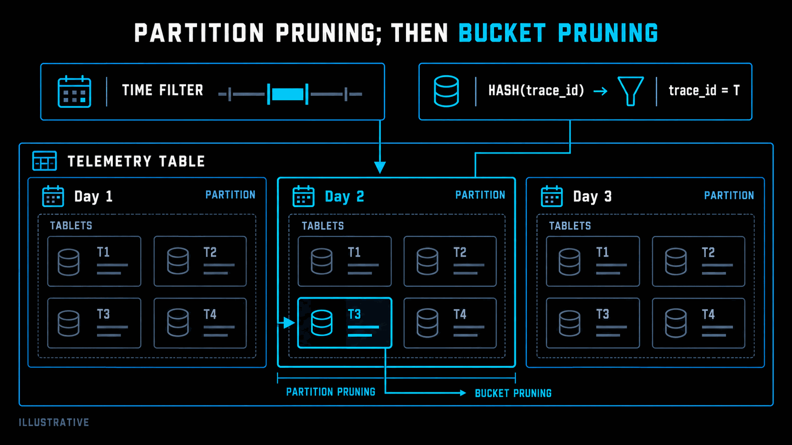
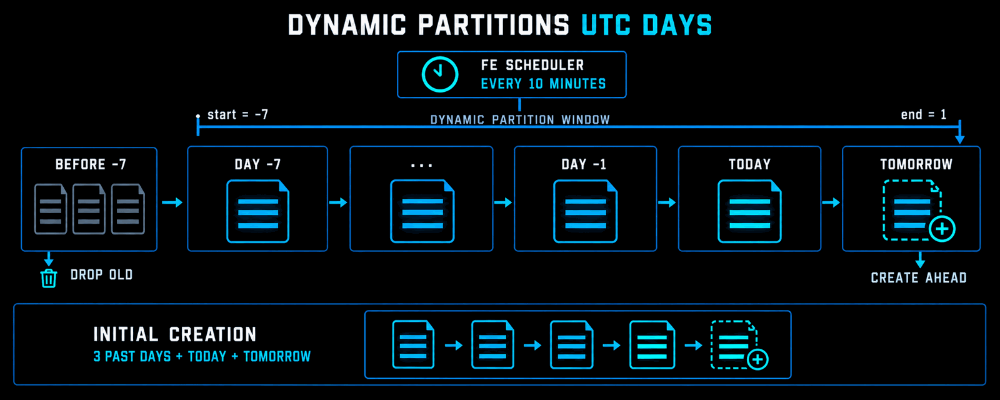
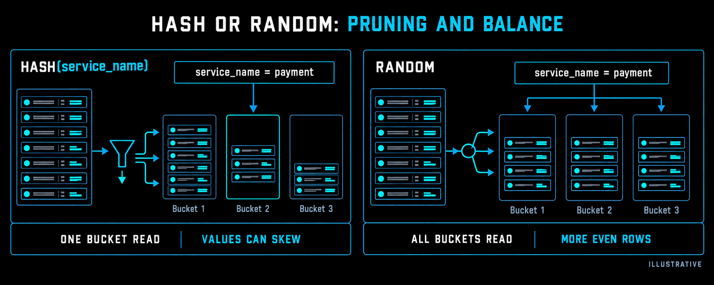

<a id="unit-u.a536ffc925484949ab1abb9929302154"></a>

<a id="module-5-partitioning-and-bucketing-for-observability-data"></a>

# 5-модуль: Жүйені бақылау деректерін бөлімдеу және bucket-терге бөлу

| Курс ақпараты | Мәні |
| --- | --- |
| Курс | Apache Doris көмегімен жүйені бақылау · 2-деңгей |
| Doris | Apache Doris 4.1.3 |
| Орта | Төлем ақауы қосылған 1-модульдің DOG стегі мен OpenTelemetry демосы |
| Болжалды уақыт | Шамамен 75 минут: оқу 30, зертханалық жұмыс 35, тест 10 |

[Курс README файлы](../../README.md) · [5-зертханалық жұмысты ашу](lab05_partition_and_bucket.ipynb) · [5-тестті ашу](quiz05_partition_and_bucket_choices.ipynb)

<a id="unit-u.969f16d2c8364ec9838def067bd0fa65"></a>

<a id="module-goal"></a>

## Модуль мақсаты

Инцидент терезесінің сұрауларына тек оның жолдары болуы мүмкін бөлімдер мен tablet-терді оқыту және телеметрия кестесін қалай бөлімдеу, bucket-терге бөлу және сақтау керегін таңдау.

<a id="unit-u.95d2ee8344de4a9083740d2df9538e03"></a>

<a id="learning-objectives"></a>

## Оқу мақсаттары

Модульді аяқтаған соң сіз:

1. Doris кестені бөлімдерге, bucket-терге және tablet-терге қалай бөлетінін түсіндіре аласыз.
2. Бөлім бағанының сүзгісінен сұрау қай бөлімдерді оқитынын болжай аласыз.
3. Динамикалық бөлімдеу қандай бөлімдерді құрып, жоятынын болжай аласыз.
4. Сақтау мерзімі мен сұрау үлгісіне сай бөлім түйіршіктілігін және тәсілін таңдай аласыз.
5. Кесте сүзгілері мен дерек таралуына қарай HASH не RANDOM таңдай аласыз.
6. Doris әр бөлімнің bucket санын қалай орнататынын түсіндіре аласыз.

<a id="unit-u.b5a679abbf6442efb4698a641b123b50"></a>

<a id="module-structure"></a>

## Модуль құрылымы

| Бөлім | Уақыт | Нәтиже |
| --- | ---: | --- |
| 5.1 Бөлімдер, bucket-тер және tablet-тер | 4 мин | Doris кестені қалай және неге бөледі |
| 5.2 Телеметрияның уақыт бөлімдері | 5 мин | Экспорттаушының күндік бөлімдері және сақтау мерзімі |
| 5.3 Бөлімдерді қысқарту | 5 мин | Сұрау қай бөлімдерді оқиды |
| 5.4 Бөлім түйіршіктілігін таңдау | 4 мин | Сағат, күн не ай |
| 5.5 AUTO PARTITION | 3 мин | Дерек құратын бөлімдер |
| 5.6 HASH не RANDOM bucket-тері | 6 мин | Қысқарту мен теңгерім |
| 5.7 Қанша bucket керек | 3 мин | Tablet өлшемі және `BUCKETS AUTO` |
| 5-зертханалық жұмыс | 35 мин | Инцидент сұрауларының жоспарлары және span бөлудің үш тәсілі |
| 5-тест | 10 мин | Осы мақсаттар бойынша алты сұрақ |

<a id="unit-u.be91774d274f4d57a3bfe8c9bb54e1a6"></a>

<a id="51-partitions-buckets-and-tablets"></a>

## 5.1 Бөлімдер, bucket-тер және tablet-тер

Төлем ақаулары басталғанда сұрақтар уақыт терезесі мен бірнеше сервиске тарылды: ақау басталғалы тапсырыстар, payment төлемдері. Тек жауап бере алатын деректі оқитын сұрау ертерек бітеді де, машинаны басқа сұрауларға босатады. Doris әр кестені екі рет бөліп, осыны мүмкін етеді:

- **Бөлімдер** жолдарды бөлім бағандарының мәндерімен, телеметрияда уақытпен бөледі: мысалы күніне бір бөлім. Бөлім бағанын сүзетін сұрау сәйкес келмейтін бөлімдерді өткізіп жібереді. Бөлім — кесте өмірлік циклінің де бірлігі: оны жою деректі қайта жазбай, барлық жолын бірден жояды.
- **Bucket-тер** әр бөлімді бағандар хеші не кездейсоқ тәсілмен қайта бөледі. Doris әр бөлімнің әр bucket-ін **tablet** ретінде сақтайды: BE сақтайтын, репликаларға көшіретін, compaction жасайтын және сканерлейтін бірлік. Әрқайсысы 10 bucket-тен тұратын 5 бөлімде 50 tablet бар; сканерлеу бөлім tablet-терін параллель оқи алады.

Tablet ішінде Doris жолдарды кілтпен сұрыпталған сегменттерде, 6-модуль өлшейтін zone map және индекстермен сақтайды. Бөлімдер мен bucket-тер сұрау қай tablet-терді мүлде ашатынын шешеді.



*Уақыт бөлімдерді таңдайды; қолайлы хеш кілті сканерлеуді әр таңдалған бөлімде бір tablet-ке дейін тарылта алады.*

Сурет белгілері: PARTITION PRUNING; THEN BUCKET PRUNING — алдымен бөлімдерді, кейін bucket-терді қысқарту; TIME FILTER — уақыт сүзгісі; TELEMETRY TABLE — телеметрия кестесі; Day 1/2/3 — 1/2/3-күн; PARTITION — бөлім; TABLETS — tablet-тер; PARTITION PRUNING — бөлімдерді қысқарту; BUCKET PRUNING — bucket-терді қысқарту; ILLUSTRATIVE — көрнекі мысал. HASH(trace_id) және trace_id = T 2-күн бөлімінің T3 tablet-ін таңдайды; T1–T4 — tablet белгілері.

<a id="unit-u.1a4b0f50205c4cbbad00a1b010a4cbae"></a>

<a id="52-time-partitions-for-telemetry"></a>

## 5.2 Телеметрияның уақыт бөлімдері

Экспорттаушы әр телеметрия кестесін `PARTITION BY RANGE(timestamp)` және күндік **динамикалық бөлімдеумен** құрады. 2-модульдегі баптаулары кесте қасиеттеріне айналады:

| Қасиет | Мән | Мағынасы |
| --- | --- | --- |
| `dynamic_partition.time_unit` | `DAY` | Күніне бір бөлім; атауы күнге сай, мысалы `p20261020` |
| `dynamic_partition.time_zone` | `UTC` | Экспорттаушы жазатын уақыт сияқты күн UTC түн ортасында басталады |
| `dynamic_partition.end` | `1` | Ертеңге дейінгі бөлімдерді алдын ала құрып ұстау |
| `dynamic_partition.start` | `-7` | Бүгіннен 7 күннен астам бұрынғы күн бөлімдерін жою (`history_days: 7` мәнінен) |
| `dynamic_partition.history_partition_num` | `3` | Кестемен бірге өткен 3 күннің бөлімін құру (`create_history_days: 3` мәнінен) |
| `dynamic_partition.buckets` | `10` | Кестемен бірге құрылған бөлімдер bucket-терінің саны |

FE жоспарлағышы бұл баптауларды әр 10 минут сайын қолданады (FE баптауы `dynamic_partition_check_interval_seconds`, әдепкіде 600): `end` шегіне дейін жетіспейтін бөлімдерді құрып, `start` алдындағыларды жояды. Сондықтан сақтау мерзімі тұтас күнмен жұмыс істейді және қосымша өңдеу талап етпейді: Doris бүкіл бөлім файлдарын жояды. `start` жүктеуді де шектейді: ең ескі бөлімнен бұрынғы жолдың баратын бөлімі жоқ, Doris оны қабылдамайды.

`history_partition_num` `start` шегінен аса алмайды: `start = -7`, `history_partition_num = 10` болса да, өткен 7 күннің бөлімдері ғана құрылады. Сондықтан экспорттаушы `otel_traces` құрған сәтте бес бөлім болған: өткен 3 күн, бүгін және ертең. 5-зертханалық жұмыс оларды `SHOW PARTITIONS` және `SHOW DYNAMIC PARTITION TABLES` арқылы тізеді.



*Сақтау мерзімі тұтас UTC күндерімен жылжиды; бастапқы тарихты құру мен рұқсат етілген сақтау терезесі — бөлек баптаулар.*

Сурет белгілері: DYNAMIC PARTITIONS UTC DAYS — динамикалық бөлімдер, UTC күндері; FE SCHEDULER EVERY 10 MINUTES — FE жоспарлағышы әр 10 минутта; DYNAMIC PARTITION WINDOW — динамикалық бөлім терезесі; BEFORE -7 — -7 күннен бұрын; DAY -7 — 7 күн бұрын; DAY -1 — кеше; TODAY — бүгін; TOMORROW — ертең; DROP OLD — ескіні жою; CREATE AHEAD — алдын ала құру; INITIAL CREATION — бастапқы құру; 3 PAST DAYS + TODAY + TOMORROW — өткен 3 күн, бүгін және ертең. start = -7 және end = 1 — терезе шектері.

<a id="unit-u.039463d266264ee4bbe9a7c7f4072f6e"></a>

<a id="53-partition-pruning"></a>

## 5.3 Бөлімдерді қысқарту

Бөлім бағаны бойынша сүзетін сұрау тек сәйкес жолдарды сақтауы мүмкін аралықтағы бөлімдерді оқиды: **бөлімдерді қысқарту**. `EXPLAIN` сұрауды орындамай жоспарын көрсетеді; жоспардағы әр кесте сканерлеуі қанша бөлім мен tablet оқитынын айтады:

```text
0:VOlapScanNode
   TABLE: otel.otel_traces(otel_traces)
   PREDICATES: ((service_name = 'payment') AND (timestamp >= '2026-10-20 23:24:01.850805'))
   partitions=1/5 (p20261020)
   tablets=10/10
```

Инцидент терезесінің сұрауы бестен бір бөлімді, бүгінгіні және оның он tablet-ін түгел оқиды. Жоспарды оқуға үш жайт көмектеседі:

- **Бос бөлімдер де өткізіледі.** Жаңа ортада уақыт сүзгісі жоқ сұрау да `1/5` оқиды, өйткені тек бүгінгі бөлімде жолдар бар. Бір апталық телеметрияда ол барлық бөлімді, инцидент терезесінің сұрауы әлі бір не екі бөлімді оқыр еді.
- **Doris мәндерді жоспарлаған кезде білуі керек.** Тұрақтымен не Doris жоспарлауда есептейтін `UTC_TIMESTAMP() - INTERVAL 1 HOUR` мәнімен салыстыру қысқартады. Doris 4.1.3 ішінде `UTC_DATE()` салыстыруы қысқартпайды: Doris оны жоспарлауда есептемейді, сканерлеу дерегі бар барлық бөлімді оқиды. 5-зертханалық жұмыс кешегі аралықты Python-да есептеп, сұрауға мәтінмен жазады.
- **Тек бос бөлімдерді таңдайтын сүзгі ештеңе оқымайды.** Кешегі аралық үшін жоспарда сканерлеу мүлде жоқ.

Бөлім бағанын сүзу — телеметрия сұрауын кішірейтетін алғашқы қадам: осы курстың әр Discover іздеуі, тақта панелі және ескерту ережесінде уақыт аралығы бар.

<a id="unit-u.5c5ce437d2784d23b5ec63e04a0c057e"></a>

<a id="54-choosing-the-partition-grain"></a>

## 5.4 Бөлім түйіршіктілігін таңдау

Түйіршіктілік сұрау қаншалықты дәл қысқарта, сақтау мерзімі қаншалықты дәл жоя алатынын және tablet санын шешеді:

| Түйіршіктілік | 7 күнге бөлім | 10 bucket болғандағы tablet | Сәйкес қолданылуы |
| --- | ---: | ---: | --- |
| Сағат | 168 | 1,680 | Бірнеше күн сақталып, сағат терезелерімен оқылатын өте үлкен көлем |
| Күн | 7 | 70 | Көп телеметрия: минуттан күнге дейінгі сұрау, күнмен сақтау |
| Ай | 1 | 10 | Жылдар бойы сақталатын шағын көлем |

Әр бөлім мен tablet — FE жадында сақтайтын метадерек; әр tablet — BE ашатын, compaction жасайтын және есеп беретін файлдар. Сағаттық бөлімдер санды 24 есе өсіреді; бұл күндік деректі сканерлеу тым үлкен және сұрауларға сағаттар керек болғанда ғана тиімді. Айлық бөлімдер бір күнді сұрауға кедергі емес: уақыт сүзгісі әлі жолдарды таңдайды. Бірақ сұрау оларды табуға бүкіл ай бөлімін оқиды, сақтау мерзімі тек тұтас айды жоя алады. Телеметрияға экспорттаушы сияқты күндік бөлімдер әдетте қолайлы.

Түйіршіктілік қандай болса да, сақтау мерзімін орнатыңыз. Бөлім құрып, ешқашан жоймайтын кесте диск толғанша өседі.

<a id="unit-u.560e31392d744a178b131b4347c714d0"></a>

<a id="55-auto-partition"></a>

## 5.5 AUTO PARTITION

**AUTO PARTITION** кезінде кесте бөлімсіз басталады, жүктеу бөлімі жоқ әр жолға бөлім құрады:

```sql
CREATE TABLE spans_by_service (...)
DUPLICATE KEY(timestamp, service_name)
AUTO PARTITION BY RANGE (date_trunc(timestamp, 'day')) ()
DISTRIBUTED BY HASH(service_name) BUCKETS 10
PROPERTIES ("partition.retention_count" = "7")
```

Бос бөлімдер жоқ: дерексіз өткен күндер де, ертеңгі жол келмейінше ертеңгі бөлім де жоқ. Бұл ретсіз не кеш келетін дерекке қолайлы: баяғы күннің жолы қабылданбай қалмай, өз бөлімін алады. Бөлім бағаны `NOT NULL` болуы керек.

AUTO PARTITION ескі бөлімдерді өзі жоймайды. `partition.retention_count = 7` өткен күндердің ең жаңа 7 бөлімін сақтап, ескісін жояды; бүгінгі және болашақ бөлімдер әрдайым сақталады. Оны динамикалық бөлімдеудегідей жоспарлағыш әр 10 минутта қолданады. AUTO PARTITION кестесінде динамикалық бөлімдеу де болуы мүмкін: ол 7-модульдегі Litefuse кестелеріндей бөлімдерді алдын ала құрып, `start` бойынша жояды. `partition.retention_count` динамикалық бөлімдеумен бірге қолданылмайды.

<a id="unit-u.5cfc141cac6a4fcf994e26e1b70b0894"></a>

<a id="56-hash-or-random-buckets"></a>

## 5.6 HASH не RANDOM bucket-тері

Тарату әр жол бөлімнің қай bucket-іне баратынын анықтайды:

| | `DISTRIBUTED BY HASH(column)` | `DISTRIBUTED BY RANDOM` |
| --- | --- | --- |
| Жол қайда барады | Мәнінің хешіне сәйкес bucket-ке | Кез келген bucket-ке |
| `column = value` сүзгісі | Бір bucket оқиды: **bucket-терді қысқарту** | Әр bucket-ті оқиды |
| Теңгерім | Мәндердей ғана біркелкі: жолы көп мән үлкен bucket жасайды | Біркелкі |
| Қай модельге болады | Барлық модельге | DUPLICATE және `REPLACE` бағандары жоқ AGGREGATE кестелеріне |

5-зертханалық жұмыс `otel_traces` span-дарын `HASH(service_name)` бойынша 10 bucket-ке бөлінген кестеге көшіреді. Payment сұрауы содан кейін `1/10` tablet оқиды. Бірақ сервистер өте біркелкі емес: бір өлшеуде бір tablet жолдардың 38%-ын (`flagd`, `frontend-proxy`, `accounting` бірге), басқасы 28%-ын сақтаған, біреуінде мүлде жоқ, ал `payment` tablet-інде бірнеше ондаған жол ғана болған. Бөлім ең үлкен tablet-індей ғана жылдам: жүктеуі, compaction-ы және толық сканерлеуі соны күтеді. Экспорттаушының `otel_traces` кестесі RANDOM қолданады, он tablet-тің әрқайсысында жолдардың шамамен оннан бірі бар.

Сондықтан bucket бағанын көп сұрау оны `=` не `IN` арқылы сүзсе және жолдарды біркелкі таратса ғана таңдаңыз: бөлек мән көп, басым мән жоқ. Трассалап оқылатын кестеге трасса ID-і сондай баған: бір трасса іздеуі бір tablet оқиды, tablet-тер біркелкі қалады. Сондықтан Litefuse кестелерін трасса ID-імен бөледі. Бастапқы телеметрия әртүрлі, көбіне уақыт бойынша оқылады және сервистері біркелкі емес, сол себепті RANDOM — қауіпсіз әдепкі таңдау; `service_name` кері индексі tablet ішінде бір сервис жолдарын табады (6-модуль).

RANDOM кезінде жүктеу әр жол пакетін бір tablet-ке, келесісін келесі tablet-ке жібереді. Жолдар бөлім tablet-теріне таралып, пакет көбейген сайын біркелкіленеді. `load_to_single_tablet: true` тақырыбы бар Stream Load барлық жолын бір tablet-ке, келесі жүктеуді келесісіне жазады; сондықтан әр жүктеу аздау әрі ірірек файл құрып, көп жүктеу алатын кестеге көмектеседі. Экспорттаушы оны орнатпайды.



*Хеш кілті мәндері жолдарды біркелкі таратқанда ғана қысқартуды тиімді етеді.*

Сурет белгілері: HASH OR RANDOM: PRUNING AND BALANCE — HASH не RANDOM: қысқарту және теңгерім; Bucket 1/2/3 — 1/2/3-bucket; ONE BUCKET READ — бір bucket оқылады; VALUES CAN SKEW — мәндер біркелкі таралмауы мүмкін; ALL BUCKETS READ — барлық bucket оқылады; MORE EVEN ROWS — жолдар біркелкілеу; ILLUSTRATIVE — көрнекі мысал. HASH(service_name), RANDOM және service_name = payment — нақты тарату мен сүзгі өрнектері.

<a id="unit-u.9a39e39ae5df460bb96e78e8295d1394"></a>

<a id="57-how-many-buckets"></a>

## 5.7 Қанша bucket керек

Doris әр tablet-те шамамен 1–20 GB сығылған дерек, UNIQUE үшін ең көбі 10 GB ұстауды және tablet санын кластер дискілерінің санына жуық етуді ұсынады. Тым кішісі метадерек шығыны мен көп ұсақ файл жасайды; тым үлкені баяу көшіріледі, теңгеріледі және қалпына келеді.

`BUCKETS AUTO` Doris-ке дерегі бар бұрынғы бөлім өлшемдерінен әр жаңа бөлім санын таңдауға мүмкіндік береді: бөлімге 100 MB сығылған дерекке дейін шамамен бір bucket, 1 GB-қа дейін екі, кейін әр 5 GB-қа бір, шегі — кластер дискілері және 128. Экспорттаушының барлық бөлімінде неге 10 bucket екенін екі ереже түсіндіреді:

- Кестемен бірге құрылған бөлімдер `dynamic_partition.buckets` мәнін, 10, алады.
- Жаңа бөлім бағасы алдыңғы бөлім санының жартысынан аз болса, Doris оны қате деп санап, бұрынғы санды сақтайды. Курс бөлімдері мегабайттар ғана, баға 1 — 10-ның жартысынан аз, сондықтан Doris 10 сақтайды.

Өндірісте күндік телеметрия гигабайттар болғанда баға өскен дерекке ілеседі.

<a id="unit-u.ca2785a0a9574c409ea0719c7f339006"></a>

<a id="lab-5-partitions-and-buckets-for-the-incident-window"></a>

## 5-зертханалық жұмыс: Инцидент терезесінің бөлімдері мен bucket-тері

[5-зертханалық жұмыс: Инцидент терезесінің бөлімдері мен bucket-тері](lab05_partition_and_bucket.ipynb) файлын ашыңыз. Сіз:

1. Инцидент терезесін — алғашқы сәтсіз тапсырыстан бергі уақытты табасыз.
2. `otel_traces` бөлімдері мен динамикалық бөлімдеуін тізесіз.
3. Инцидент терезесі, кеше және уақыт сүзгісі жоқ сұраулардың жоспарларын оқисыз.
4. `otel_traces` әр tablet жолдарын санап, span-дарын сервиспен бөлінген кестеге көшіресіз және tablet-тер мен жоспарларды салыстырасыз.
5. AUTO PARTITION құрған бөлімдерді көресіз.
6. Жаттығу: span-дарды трасса ID-імен бөліп, сәтсіз тапсырыс трассасын іздейсіз.

Төлем ақауы қосылған 1-модульдің DOG стегі мен демосы қажет.

<a id="unit-u.68ba0b9d85dd4e73bd305aa4f2668094"></a>

<a id="summary"></a>

## Қорытынды

- Бөлімдер кестені бөлім бағанымен, bucket-тер әр бөлімді бөледі; әр бөлімнің әр bucket-і — Doris сақтап сканерлейтін tablet.
- Жоспарлау кезінде белгілі мәндері бар бөлім бағанының сүзгісі тек сәйкесуі мүмкін бөлімдерді оқытады; Doris бос бөлімдерді де өткізеді. `EXPLAIN` екеуін `partitions=read/total` деп көрсетеді.
- Динамикалық бөлімдеу әр 10 минутта `end` шегіне дейін құрып, `start` алдындағы бөлімдерді жояды; `history_partition_num` кестемен бірге өткен бөлімдерді құрады, `start` шегінен аспайды.
- Күндік бөлімдер көп телеметрияға сай: сағаттықтары tablet санын көбейтеді, айлықтары аз қысқартып, деректі тұтас аймен сақтайды. AUTO PARTITION тек жолдарға керек бөлімдерді құрады, `partition.retention_count` ескілерін жояды.
- HASH өз бағанының `=` сүзгілеріне bucket-терді қысқартады, бірақ мәндердей ғана біркелкі; RANDOM tablet-терді тең ұстап, ештеңе қысқартпайды. Көп сұрау сүзетін және трасса ID-і сияқты біркелкі қолданылатын көп мәні бар бағанмен бөліңіз.
- `BUCKETS AUTO` bucket санын бұрынғы бөлім өлшемдерінен бағалайды; кестемен бірге құрылғандар `dynamic_partition.buckets` алады; алдыңғы бөлім санының жартысынан аз баға еленбейді.

<a id="unit-u.56600564cd524054a2fa854d07dd9d72"></a>

<a id="quiz-5"></a>

## 5-тест

[5-тест: Жүйені бақылау деректерін бөлімдеу және bucket-терге бөлу](quiz05_partition_and_bucket_choices.ipynb) файлын ашыңыз. Бір жауап таңдалатын алты сұрақ бар; іске қосылған орта қажет емес.

Келесі модуль: [6-модуль: Кесте қасиеттері, материалданған көріністер және индекстер](../module06-property-mv-index/course.md).

<a id="unit-u.e94e3037ada64b39b31959292baf04ff"></a>

<a id="references"></a>

## Дереккөздер

- [Apache Doris: деректерді бөлімдеуге шолу](https://doris.apache.org/docs/4.x/table-design/data-partitioning/overview/) және [негізгі ұғымдар](https://doris.apache.org/docs/4.x/table-design/data-partitioning/basic-concepts/)
- [Apache Doris: динамикалық бөлімдеу](https://doris.apache.org/docs/4.x/table-design/data-partitioning/dynamic-partitioning/) және [автоматты бөлімдеу](https://doris.apache.org/docs/4.x/table-design/data-partitioning/auto-partitioning/)
- [Apache Doris: деректерді bucket-терге бөлу](https://doris.apache.org/docs/4.x/table-design/data-partitioning/data-bucketing/)
- [Apache Doris: Stream Load параметрлері, соның ішінде load_to_single_tablet](https://doris.apache.org/docs/4.x/data-operate/import/import-way/stream-load-manual/)
- [Apache Doris: EXPLAIN](https://doris.apache.org/docs/4.x/sql-manual/sql-statements/data-query/EXPLAIN/)
