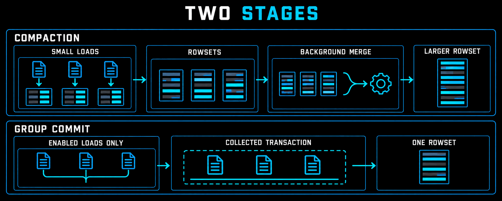
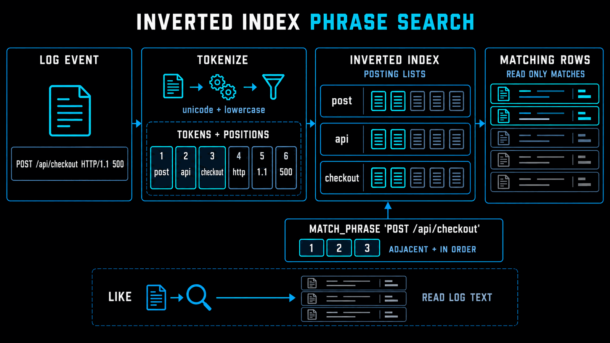
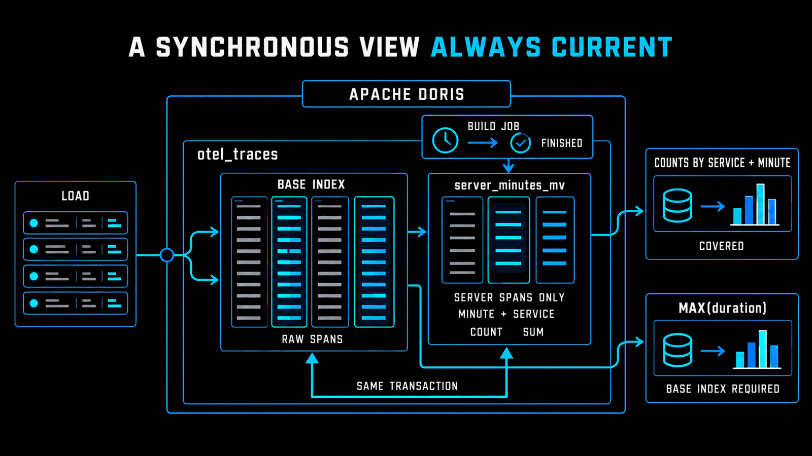

<a id="unit-u.d9fd786930ba4715b610c2961469fa5b"></a>

<a id="module-6-table-properties-materialized-views-and-indexes"></a>

# 6-модуль: Кесте қасиеттері, материалданған көріністер және индекстер

| Курс ақпараты | Мәні |
| --- | --- |
| Курс | Apache Doris көмегімен жүйені бақылау · 2-деңгей |
| Doris | Apache Doris 4.1.3 |
| Орта | Төлем ақауы қосылған 1-модульдің DOG стегі мен OpenTelemetry демосы |
| Болжалды уақыт | Шамамен 85 минут: оқу 35, зертханалық жұмыс 40, тест 10 |

[Курс README файлы](../../README.md) · [6-зертханалық жұмысты ашу](lab06_properties_mv_index.ipynb) · [6-тестті ашу](quiz06_properties_mv_and_indexes.ipynb)

<a id="unit-u.0d1aece4202542ec8784d51824eef161"></a>

<a id="module-goal"></a>

## Модуль мақсаты

Инцидент іздеулері мен қорытындыларын жылдам, телеметрия сақтауын үнемді ететінді өлшеу: журнал мәтіндерінің кері индексі, инцидент санақтарының материалданған көрінісі және compaction мен сығуға арналған кесте қасиеттері.

<a id="unit-u.aa857288160d416491e95355055b5194"></a>

<a id="learning-objectives"></a>

## Оқу мақсаттары

Модульді аяқтаған соң сіз:

1. `SHOW CREATE TABLE` арқылы кесте сақтау қасиеттерін, соның ішінде онда көрсетілмейтіндерін түсіне аласыз.
2. Тек алгоритмді өзгертетін сығу алгоритмдерінің салыстыруын жобалай аласыз.
3. Мәтін бағанының кері индексі `MATCH_ANY`, `MATCH_ALL`, `MATCH_PHRASE` сұрауларына қалай жауап беретінін түсіндіре аласыз.
4. Query Profile жол санауыштарын олар көрсеткеннен артық қорытынды жасамай түсіндіре аласыз.
5. Синхронды материалданған көріністің құрылуын, өзекті ұсталуын және сақталуын түсіндіре аласыз.
6. Doris сұрауға материалданған көріністен жауап бере алатынын болжай аласыз.

<a id="unit-u.2017f0a0ee50430f8fd100c864af09d3"></a>

<a id="module-structure"></a>

## Модуль құрылымы

| Бөлім | Уақыт | Нәтиже |
| --- | ---: | --- |
| 6.1 Кесте анықтамасы не айтады | 4 мин | `SHOW CREATE TABLE` және оның көрсетпейтінін оқу |
| 6.2 Жүктеулер, rowset-тер және compaction | 5 мин | Уақыт қатары саясаты және Group Commit |
| 6.3 Сығу | 5 мин | ZSTD не LZ4 және әділ салыстыру |
| 6.4 Журнал іздеуіне арналған кері индекстер | 6 мин | `MATCH_PHRASE` сәтсіз checkout-ты қалай табады |
| 6.5 Іздеуді Query Profile арқылы өлшеу | 5 мин | Санауыштар нені көрсетеді және көрсетпейді |
| 6.6 Синхронды материалданған көріністер | 5 мин | Doris өзекті ұстайтын қорытынды |
| 6.7 Doris көріністі қашан қолданады | 5 мин | Көрініс қай сұрауларға жауап береді |
| 6-зертханалық жұмыс | 40 мин | Индекс, инцидент санақтарының көрінісі және екі сығу тәсілін өлшеу |
| 6-тест | 10 мин | Осы мақсаттар бойынша алты сұрақ |

<a id="unit-u.24d94dd8164d4c4e96c6c24eb6a8c6d6"></a>

<a id="61-what-a-tables-definition-says"></a>

## 6.1 Кесте анықтамасы не айтады

3-модульде қатынас журналынан сәтсіз checkout таптыңыз, 4-модульде инцидент санақтарын өз кестеңізде сақтадыңыз. Мұның жылдамдығы мен құны кесте анықтамасына байланысты. `SHOW CREATE TABLE otel_logs` кестені қазіргі күйінде құратын, шамамен 60 жолдық команданы қайтарады. Жоғарыдан оқыңыз:

- **Бағандар.** `body` — мәтін. `resource_attributes` пен `log_attributes` — `VARIANT`: Doris атрибуттың әр кілтін жеке баған ретінде, `variant_max_subcolumns_count` шегіне, 2048 кілтке дейін сақтайды. Сондықтан `log_attributes['log.file.name']` сияқты бір кілт сұрауы тек сол кілтті оқиды.
- **Индекстер.** Әр бағанға бір кері индекс. Тек `idx_body` қасиеттері бар: `"parser" = "unicode"`, `"lower_case" = "true"`, `"support_phrase" = "true"` (6.4-бөлім).
- **Кілт, бөлімдер, bucket-тер.** `DUPLICATE KEY(timestamp, service_name)`, динамикалық күндік бөлімдер және `RANDOM BUCKETS AUTO` (4 және 5-модульдер).
- **Қасиеттер.** Динамикалық бөлімдеу, compaction саясаты мен баптаулары (6.2-бөлім), `group_commit_interval_ms`, `group_commit_data_bytes` және экспорттаушы нақты орнататын `inverted_index_storage_format` = `V2`.

Анықтама әр баптауды тізбейді. `SHOW CREATE TABLE` әдепкі мәні бар қасиеттерді көрсетпейді. Экспорттаушы кестені `"compression" = "zstd"` арқылы құрған; ZSTD Doris 4.x әдепкі сығуы болғандықтан, жол жоқ. Кесте не істейтінін білу үшін анықтамасын оқып, нұсқаңыздың әдепкілерін біліңіз.

<a id="unit-u.0809476bb92b45b0b013ee1f6c8b6845"></a>

<a id="62-loads-rowsets-and-compaction"></a>

## 6.2 Жүктеулер, rowset-тер және compaction

Әр жүктеу tablet-ке әкелген жолдарын өз нұсқасы бар файлдар жиыны — жаңа **rowset** — ретінде жазады. Экспорттаушы әр кестені бірнеше секунд сайын жүктейді, сондықтан әр tablet күніне мыңдаған шағын rowset жинайды. Сұрау бәрін оқуы керек; сондықтан Doris оларды фонда **compaction арқылы біріктіреді**: ірі rowset-терге біріктіріп, жойылған жолдарды алып тастайды және AGGREGATE, UNIQUE жолдарын біріктіреді.

Біріктіру тәсілі — кестенің `compaction_policy` қасиеті:

- Әдепкі `size_based` шағын rowset-терді деңгейлеп ірілендіреді. Үлкен rowset-ке жеткенше дерек бірнеше рет қайта жазылуы мүмкін: жазу күшеюі.
- Экспорттаушы DUPLICATE кестелеріне орнататын `time_series` уақыт ретімен тек қосылатын дерекке сай. Tablet-тің жаңа rowset-тері шамамен `time_series_compaction_goal_size_mbytes` (1024 MB), не `time_series_compaction_file_count_threshold` файл (1000), не `time_series_compaction_time_threshold_seconds` (бір сағат) өткенше күтіп, бір рет соңғы rowset-ке біріктіреді. Әр жол шамамен бір рет қайта жазылып, көп жүктеу алатын кестелерде диск I/O-сы мен CPU үнемделеді. Экспорттаушы UNIQUE кестесі `otel_traces_graph` жолдары бірін-бірі алмастыратындықтан `size_based` сақтайды.

**Group Commit** сол мәселені басқа жағынан шешеді: көп клиент шағын жүктеу жіберсе, Doris оларды BE-де бір транзакцияға және бір rowset-ке жинай алады. Жүктеу оны, мысалы Stream Load `group_commit: async_mode` тақырыбымен сұрайды; Doris 4.1-ден бастап кесте `group_commit_mode` қасиетімен оны әдепкі ете алады. `off_mode` болмаса, ол `SHOW CREATE TABLE` ішінде көрінеді. Кестенің `group_commit_interval_ms` (10 секунд) және `group_commit_data_bytes` (128 MB) жиналған деректің қашан бекітілетінін шешеді. Бұл екеуі әр кесте анықтамасында бар, бірақ тек Group Commit қолданатын жүктеуге әсер етеді. Экспорттаушы кестелері оны қолданбайды: `group_commit_mode` жоқ, экспорттаушы да тақырып жібермейді, өйткені оның `batch` өңдегіші бір Stream Load-қа 10,000 жазбаға дейін жинайды.



*Compaction бар rowset-терді біріктіреді, Group Commit кей шағын rowset-тің құрылуын болдырмайды.*

Сурет белгілері: TWO STAGES — екі кезең; COMPACTION — rowset-терді біріктіру; SMALL LOADS — шағын жүктеулер; ROWSETS — rowset-тер; BACKGROUND MERGE — фондық біріктіру; LARGER ROWSET — ірірек rowset; GROUP COMMIT — Group Commit; ENABLED LOADS ONLY — тек қосылған жүктеулер; COLLECTED TRANSACTION — жинақталған транзакция; ONE ROWSET — бір rowset.

<a id="unit-u.a3bb8d1e9da64ca388ca0388be65026c"></a>

<a id="63-compression"></a>

## 6.3 Сығу

Doris дискіге жазар алдында әр беттің әр бағанын кестенің `compression` қасиетіндегі алгоритммен сығады. Doris 4.x әдепкісі — **ZSTD**: CPU құны жоғарырақ, сығуы жақсы. **LZ4** (және LZ4F нұсқасы) жылдам, сығу дәрежесі орташа. Телеметрия бір рет жазылып, күндер бойы сақталып, шағын бөліктермен оқылады; сондықтан ZSTD үнемдеген орын әдетте CPU құнынан маңыздырақ, Doris құжаттамасы журналдарға соны ұсынады. Алгоритм кесте құрылғанда орнатылады; өзгерту үшін жаңа кесте құрып, деректі көшіру керек.

Екі алгоритмді салыстырғанда басқа ештеңені өзгертпеңіз. 6-зертханалық жұмыс тек `compression` бойынша ерекшеленетін, индекссіз, бір bucket-ті екі кесте құрып, бірдей журнал жолдарын әрқайсысына бір `INSERT` арқылы жүктейді; екеуі де бірдей орналасқан бір rowset алады. Екі жаңсақ салыстырудан сақтанады:

- **Орналасуы бөлек.** `otel_logs` сияқты мыңдаған шағын жүктеу алған кестеде жолдар бір рет жүктелгеннен өзгеше орналасады, индекстер де бар: жаңа көшірмемен салыстыру тек алгоритмді салыстырмайды.
- **Өлшем әлі хабарланбаған.** `SHOW DATA` және `information_schema.tables` BE-лер шамамен әр минут хабарлайтын өлшемді көрсетеді. Жүктегеннен кейін бірден әлі 0 болады. Екі кесте де барлық жолын хабарлағанша күтіңіз.

6-зертханалық жұмыстың бір орындалуында бірдей 79,000 журнал жолы ZSTD-мен 6.7 MB, LZ4-пен 10.5 MB алды: LZ4-ке шамамен 1.6 есе орын қажет; жаңа ортада 27,000 жол 2.2 MB және 3.3 MB, 1.5 есе болды. Бұл сол жолдар мен орналасуға ғана қатысты. Басқа дерек басқаша сығылады, нәтиже жылдамдық туралы ештеңе айтпайды.

<a id="unit-u.d754ce615671416bb750832612e7c422"></a>

<a id="64-inverted-indexes-for-log-search"></a>

## 6.4 Журнал іздеуіне арналған кері индекстер

**Кері индекс** бағанның әр мәнін сол мән бар жолдарға сәйкестендіреді. Парсері бар мәтін бағанында мәндер — сөздер:

- **Парсер** мәтінді токендерге бөледі. `unicode` көп тілде сөздерге бөліп, тыныс белгілерін алып тастайды; `english` пен `chinese` — сол тілдерге арналған баламалар.
- `lower_case` токендерді кіші әріппен индекстеп, регистрді елемеуге мүмкіндік береді.
- `support_phrase` әр токеннің жолдағы орнын да сақтайды; фразалық іздеуге сол керек.

`TOKENIZE(text, '"parser" = "unicode", "lower_case" = "true"')` `idx_body` мәтіннен жасайтын токендерді көрсетеді: `"POST /api/checkout HTTP/1.1" 500` қатынас журналы жолы `post`, `api`, `checkout`, `http`, `1.1`, `500` болады. Іздеулер токендерді салыстырады:

| Іздеу | Мәтінінде не бар жолдар сәйкеседі |
| --- | --- |
| `body MATCH_ANY 'checkout payment'` | Токендердің кез келгені |
| `body MATCH_ALL 'checkout payment'` | Токендердің бәрі, кез келген жерде |
| `body MATCH_PHRASE 'POST /api/checkout'` | Токендер қатар, осы ретпен |

Индекспен Doris токендер мен орнын іздеп, тек сәйкес жолдарды оқиды. Онсыз әр жолдың мәтінін оқып, токендерге бөліп, салыстыруы керек. `LIKE '%...%'` әрдайым солай істейді: ол таңбаларды салыстырады, еш кері индекс жауап бере алмайды. Басқа баған индекстерінде парсер жоқ: әр мәнді тұтас сақтап, `service_name = 'cart'` сияқты `=`, `IN` және аралықтарға жауап береді.



*Фразалық іздеу индекстегі токендерді ретімен салыстырады, LIKE журнал мәтінін тексеруі керек.*

Сурет белгілері: INVERTED INDEX PHRASE SEARCH — кері индекстегі фразалық іздеу; LOG EVENT — журнал оқиғасы; TOKENIZE — токендерге бөлу; unicode + lowercase — unicode және кіші әріп; TOKENS + POSITIONS — токендер мен орындары; INVERTED INDEX — кері индекс; POSTING LISTS — токен бар жолдар тізімдері; MATCHING ROWS — сәйкес жолдар; READ ONLY MATCHES — тек сәйкестіктерді оқу; ADJACENT + IN ORDER — қатар әрі ретімен; READ LOG TEXT — журнал мәтінін оқу. POST /api/checkout HTTP/1.1 500, post/api/checkout/http/1.1/500 токендері, 1–6 орындары, MATCH_PHRASE және LIKE — нақты мәтін мен SQL белгілері.

<a id="unit-u.1830a6511528466eaee9f5c474aabe0a"></a>

<a id="65-measuring-a-search-with-a-query-profile"></a>

## 6.5 Іздеуді Query Profile арқылы өлшеу

**Query Profile** сұраудың әр операторы не істегенін тіркейді. Оны `enable_profile = true` сеанс айнымалысымен, сканерлеу жол санауыштарын қосатын `profile_level = 2` деңгейінде жинаңыз; қайталанған сұрау шынымен кестені сканерлеуі үшін SQL кэші мен шарт кэшін өшіріңіз. Сұраудан кейін бірден `SELECT last_query_id()` оның әрі профильдің ID-ін береді; `SHOW QUERY PROFILE` профильдерді тізеді, FE HTTP API мәтінді қайтарады.

Мәтінде әр сканерлеу данасы `DetailProfile` ішіндегі `SegmentIterator` астында қарастырған сегменттерінің әр жолына не болғанын хабарлайды:

| Санауыш | Жолдарға не болды |
| --- | --- |
| `RowsStatsFiltered` | Оқылмай өткізілді: zone map (бағанның сегмент пен беттегі ең кіші/үлкен мәні) сәйкестікті жоққа шығарды |
| `RowsInvertedIndexFiltered` | Оқылмай өткізілді: кері индекс сәйкес емес екенін көрсетті |
| `RowsVectorPredFiltered` | Оқылды, кейін баған мәнінің сүзгісі алып тастады |
| `RowsExprPredFiltered` | Оқылды, кейін `LIKE` не индекссіз `MATCH` сияқты сүзгі өрнегі алып тастады |
| `RowsRead` | Оқылып, қалдырылды |

Сәтсіз checkout іздеуінде 6-зертханалық жұмыс индекспен `RowsInvertedIndexFiltered` астында шамамен 80,000, `RowsRead` астында 27 жол; индекссіз сол 80,000 жолды `RowsExprPredFiltered` астында өлшеді. Индекссіз Doris 27 табу үшін кестенің әр хабарын оқыды. Екі жайт:

- Индекстелген сүзгілі `COUNT(*)` тек индекстен жауап ала алады (жоспарда `COUNT_ON_INDEX`), сонда `RowsRead` шынымен оқылған жол санын бермейді. Мұны болдырмауға 6-зертханалық жұмыс сервис бойынша топтайды.
- Санауыштар тек осы сұраудың осы сканерлеуі не істегенін дәлелдейді. Сұрау қаншалықты жылдамдағанын, басқа қайда уақыт жұмсағанын не басқа сұрау не істейтінін көрсетпейді. Ондай тұжырым жасайтын әр сұрауды өлшеңіз.

<a id="unit-u.32c64d2e463b4ebd82e2c9436783c3cd"></a>

<a id="66-synchronous-materialized-views"></a>

## 6.6 Синхронды материалданған көріністер

4-модуль әр сервис пен минуттың сұраулары және ақауларын жүктеу тапсырмасы дәл бір рет толтыруы керек `requests_per_minute` ішінде сақтады. **Синхронды материалданған көрініс** осындай қорытындыны жүктеу тапсырмасынсыз сақтайды:

```sql
CREATE MATERIALIZED VIEW server_minutes_mv AS
SELECT date_trunc(end_time, 'minute') AS mv_request_minute,
       service_name AS mv_service_name,
       COUNT(*) AS mv_requests,
       SUM(IF(status_code = 'STATUS_CODE_ERROR', 1, 0)) AS mv_failed_requests
FROM otel_traces
WHERE span_kind = 'SPAN_KIND_SERVER'
GROUP BY date_trunc(end_time, 'minute'), service_name
```

- **Тапсырма арқылы құрылады.** Doris қабылдаған бойда `CREATE MATERIALIZED VIEW` қайтады; кейін тапсырма кестеде бар жолдардан көріністі құрады. `SHOW ALTER TABLE MATERIALIZED VIEW` тапсырма күйін `FINISHED` көрсеткеннен кейін ғана сұрауларға жауап береді.
- **Өзекті ұсталады.** Бұдан кейін кестенің әр жүктеуі сол транзакцияда көріністі де жаңартады, сондықтан көрініс кестеден артта қалмайды. Құны — әр жүктеудегі қосымша жұмыс және диск.
- **Кестемен бірге сақталады.** Көрініс — кестенің индексі: `DESC otel_traces ALL` оны `AGG_KEYS` индексі ретінде тізеді; оның `COUNT` және `SUM` бағандары `requests_per_minute` сияқты жолдарды `SUM` арқылы біріктіреді. Мұнда 175,000 сервер span-ына шамамен 1,800 жол болды.
- **Бағандардың жеке атаулары.** Doris 4.1.3 баған атаулары кесте не басқа көрініс бағандарымен бірдей көріністі `Duplicate column name` қатесімен қабылдамайды: `mv_` префиксі сияқты әр бағанға жеке атау беріңіз. Сондықтан экспорттаушының `<table>_services` көрінісі де 4.1.3 ішінде сәтсіз (2-модуль). `IF NOT EXISTS` 4.1.3 ішінде бұрынғы көріністі өткізіп жібермейді: қайта құруға алдымен жойыңыз.

Синхронды көрініс бір кестеге тиесілі. Бірнеше кестені қорытындылау не жоспар бойынша жаңарту үшін Doris-те өзі жаңартатын бөлек кестелер — **асинхронды материалданған көріністер** бар.

<a id="unit-u.009cdb0b900547568d706074a0ebdf44"></a>

<a id="67-when-doris-uses-a-view"></a>

## 6.7 Doris көріністі қашан қолданады

Сұраулар кесте атауын қолдана береді; Doris нәтижені көрініс жолдарынан есептей алса, сұрауды көріністі оқуға қайта жазады. `EXPLAIN` шешімді көрсетеді: сканерлеу `otel_traces(otel_traces)` орнына `otel_traces(server_minutes_mv)` оқиды, жоспар бөлімі қаралған әр көріністі таңдалған не жарамсыз деп себебімен тізеді. 6-зертханалық жұмыста:

| Сұрау | Көріністі қолдана ма? | Себебі |
| --- | --- | --- |
| Сервис пен минуттың сұраулары және сәтсіздері | Иә | Өрнек, сүзгі, агрегаттар бірдей |
| Сол есеп тек сервис бойынша не бір сервиске | Иә | Doris көрініс жолдарын ірірек түйіршіктілікке қосады |
| `date_trunc(end_time, 'minute') >= ...` арқылы | Иә | Сүзгі көрініс өрнегін қолданады |
| `end_time >= ...` арқылы | Жоқ: `Rewrite compensate predicate by view fail` | Көрініс `end_time` емес, минутты сақтайды |
| Тек сервер емес, әр span | Жоқ: `Predicate compensate fail` | Көріністе тек сервер span-дары бар |
| `MAX(duration)` | Жоқ: `Query function roll up fail` | Көрініс ұзақтықты сақтамайды |
| `DATE_FORMAT(end_time, ...)` бойынша топтау | Жоқ: `View dimensions doesn't not cover the query dimensions` | Мағынасы бір болса да, өрнек басқа |

Сәйкестендіру құрылымға негізделеді: Doris сұрау өрнектері, сүзгілері мен агрегаттарын көрініспен салыстырады, әртүрлі жазылған екі өрнектің мағынасы бір екенін дәлелдемейді. Бір пішімде тақталар мен ескертулер қайта-қайта орындайтын сұрауларға көрініс тиімді; оларды көрініс өрнектерімен жазып, жоспарларын тексеріңіз.

| Қажеттілік | Құрал |
| --- | --- |
| Сөз не мән бойынша жол табу | Кері индекс |
| Жиі сұралатын, әрдайым өзекті бір қорытынды | Синхронды материалданған көрініс |
| Өз сақтау мерзімі бар не бірнеше көзден жүктелетін қорытынды | AGGREGATE кестесі және жүктеу тапсырмасы |
| Сол жолдарға аз диск | Кесте құрылғанда таңдалған сығу |



*Синхронды көрініс кестесімен бірге өзекті болып, өзі сақтайтын ақпараты жеткілікті сұрауларға қызмет етеді.*

Сурет белгілері: A SYNCHRONOUS VIEW ALWAYS CURRENT — синхронды көрініс әрдайым өзекті; LOAD — жүктеу; BASE INDEX — негізгі индекс; RAW SPANS — бастапқы span-дар; BUILD JOB — құру тапсырмасы; FINISHED — аяқталды; SERVER SPANS ONLY — тек сервер span-дары; MINUTE + SERVICE — минут пен сервис; SAME TRANSACTION — бір транзакция; COUNTS BY SERVICE + MINUTE — сервис пен минут санақтары; COVERED — көрініс қамтиды; BASE INDEX REQUIRED — негізгі индекс қажет. Apache Doris, otel_traces, server_minutes_mv, COUNT, SUM және MAX(duration) — өнім, кесте, көрініс және SQL өрнектері.

<a id="unit-u.80793a32048148e994dae6794260966c"></a>

<a id="lab-6-compression-materialized-views-and-inverted-indexes"></a>

## 6-зертханалық жұмыс: Сығу, материалданған көріністер және кері индекстер

[6-зертханалық жұмыс: Сығу, материалданған көріністер және кері индекстер](lab06_properties_mv_index.ipynb) файлын ашыңыз. Сіз:

1. Қатынас журналындағы сәтсіз checkout-ты санайсыз.
2. `otel_logs` анықтамасын оқисыз.
3. `body` индексімен және онсыз сәтсіз checkout іздеуін өлшейсіз.
4. `server_minutes_mv` құрып, құрылуын күтіп, Doris қай сұрауларға содан жауап беретінін тексересіз.
5. Бірдей журнал жолдарында ZSTD мен LZ4 салыстырасыз.
6. Жаттығу: көрініс жауап беретін payment минуттық сұрауларының сұрауын жазасыз.

Төлем ақауы қосылған 1-модульдің DOG стегі мен демосы қажет.

<a id="unit-u.3dd2734bb72e44c599d751040e15405c"></a>

<a id="summary"></a>

## Қорытынды

- `SHOW CREATE TABLE` анықтаманы көрсетіп, әдепкі мәндерді көрсетпейді: экспорттаушының `compression = zstd` мәні жоқ, өйткені ZSTD — 4.x әдепкісі.
- Әр жүктеу rowset қосады, compaction оларды біріктіреді; уақыт қатары саясаты қосылған деректі шамамен бір рет біріктіреді. Group Commit шағын жүктеулерді жинайды, бірақ тек тақырып не кестенің `group_commit_mode` мәнімен оны қолданатындарына әсер етеді.
- Әділ сығу салыстыруы тек алгоритмді өзгертеді, бірдей жолды бірдей жүктеп, BE өлшемін күтеді. Курс журналдарында LZ4 ZSTD-ден шамамен 1.5–1.6 есе орын алды.
- Парсері бар кері индекс әр токенге сол токен бар жолдарды тізеді; `MATCH_ANY`, `MATCH_ALL`, `MATCH_PHRASE` токендерді салыстырады, фразаларға `support_phrase` қажет. Индекссіз не `LIKE` арқылы Doris әр жол мәтінін оқиды.
- Query Profile жол санауыштары осы сұраудың әр сканерлеу жолы қайда кеткенін көрсетеді: zone map не индекс өткізді, оқылып тасталды не оқылып қалды. Бұл жылдамдық өлшемі емес.
- Синхронды материалданған көріністі тапсырма құрып, кейін әр жүктеу жаңартады; ол кестенің AGGREGATE индексі ретінде сақталады. Сұрау өрнектері, сүзгілері мен агрегаттары одан есептелсе, Doris оны қолданады; мұны `EXPLAIN` көрсетеді.

<a id="unit-u.9fc7c96d540d4f7495e62edb01b2bf65"></a>

<a id="quiz-6"></a>

## 6-тест

[6-тест: Кесте қасиеттері, материалданған көріністер және индекстер](quiz06_properties_mv_and_indexes.ipynb) файлын ашыңыз. Бір жауап таңдалатын алты сұрақ бар; іске қосылған орта қажет емес.

Келесі модуль: [7-модуль: Трассаларды талдау және Litefuse](../module07-data-analysis-litefuse/course.md).

<a id="unit-u.a88db215bc1a45bda134ec399d99fff1"></a>

<a id="references"></a>

## Дереккөздер

- [Apache Doris: деректі сығу](https://doris.apache.org/docs/4.x/table-design/column-compression/)
- [Apache Doris: compaction](https://doris.apache.org/docs/4.x/admin-manual/trouble-shooting/compaction/) және [CREATE TABLE қасиеттері](https://doris.apache.org/docs/4.x/sql-manual/sql-statements/table-and-view/table/CREATE-TABLE/)
- [Apache Doris: Group Commit](https://doris.apache.org/docs/4.x/data-operate/import/load-best-practices/group-commit-manual/)
- [Apache Doris: журнал сақтау және талдау](https://doris.apache.org/docs/4.x/observability/log/)
- [Apache Doris: кері индекс](https://doris.apache.org/docs/4.x/table-design/index/inverted-index/overview/) және [іздеу операторлары](https://doris.apache.org/docs/4.x/table-design/index/inverted-index/search-operators/)
- [Apache Doris: Query Profile](https://doris.apache.org/docs/4.x/query-acceleration/query-profile/)
- [Apache Doris: синхронды материалданған көріністер](https://doris.apache.org/docs/4.x/query-acceleration/materialized-view/sync-materialized-view/)
