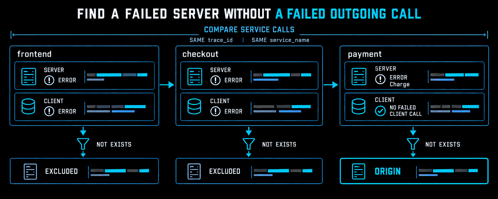
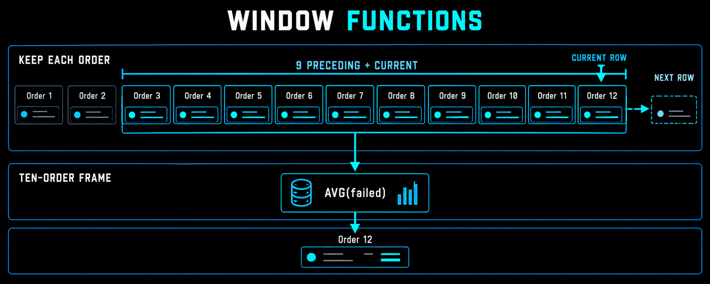
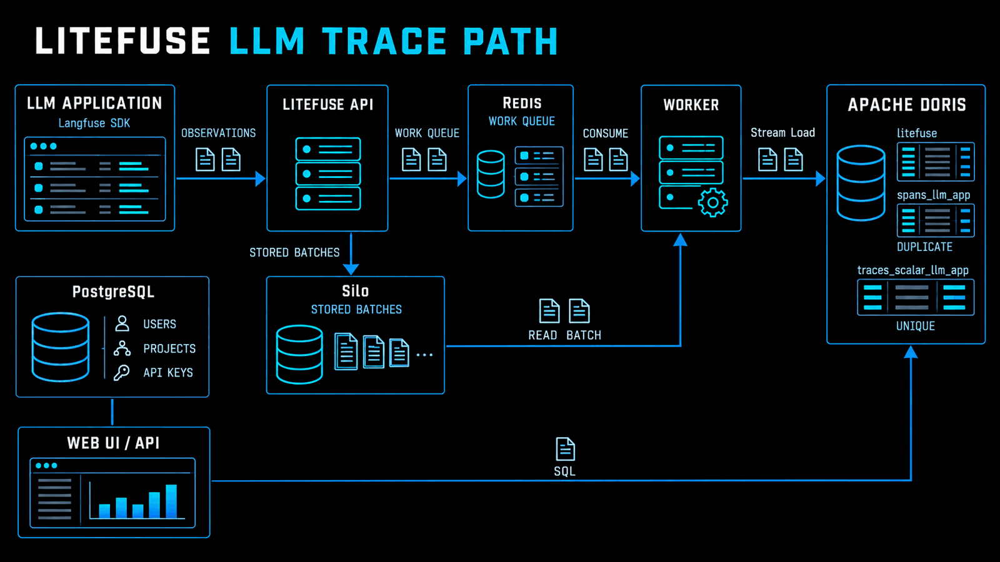

<a id="unit-u.e5343a5bec6643d3aec0bb937d039324"></a>

<a id="module-7-trace-analysis-and-litefuse"></a>

# 7-модуль: Трассаларды талдау және Litefuse

| Курс ақпараты | Мәні |
| --- | --- |
| Курс | Apache Doris көмегімен жүйені бақылау · 2-деңгей |
| Doris | Apache Doris 4.1.3 |
| Орта | Төлем ақауы қосылған 1-модульдің DOG стегі мен OpenTelemetry демосы; жұмыс іске қосатын Litefuse 26.3.0 |
| Болжалды уақыт | Шамамен 90 минут: оқу 30, зертханалық жұмыс 50 (алғашқы шамамен 1.2 GB бейнелерді жүктеу қосылады), тест 10 |

[Курс README файлы](../../README.md) · [7-зертханалық жұмысты ашу](lab07_data_analysis_litefuse.ipynb) · [7-тестті ашу](quiz07_analysis_and_litefuse.ipynb)

<a id="unit-u.0b332801a95f4cee8545a08042d8bcfe"></a>

<a id="module-goal"></a>

## Модуль мақсаты

Төлем инцидентін оның барлық трассасы бойынша SQL-мен өлшеу және үлкен тілдік модель (LLM) негізіндегі қолданбаны трассаларын Doris-те сақтайтын Litefuse арқылы трассалау.

<a id="unit-u.ab80da5ba2444f27893c38597355c1f4"></a>

<a id="learning-objectives"></a>

## Оқу мақсаттары

Модульді аяқтаған соң сіз:

1. Сервер span-дарынан әр операцияның сәтсіздік үлесі мен кідірісін есептей аласыз.
2. Кідіріс процентильдерін көрсеткенінен артық қорытынды жасамай түсіндіре аласыз.
3. Көп трассадағы әр ақау басталатын сервисті SQL-мен таба аласыз.
4. Терезелік функциямен әр жолға байланысты жолдардан мән есептей аласыз.
5. LLM трассасы сервис span-дары тіркемейтін нені тіркейтінін түсіндіре аласыз.
6. LLM қолданбасының трассаларын Doris-тен тауып, SQL-мен сұрай аласыз.

<a id="unit-u.56d1c55ea88f43b2a6d5be33720c9078"></a>

<a id="module-structure"></a>

## Модуль құрылымы

| Бөлім | Уақыт | Нәтиже |
| --- | ---: | --- |
| 7.1 Бір трассадан барлығына | 4 мин | Операция бойынша жиілік, қателер және ұзақтық |
| 7.2 Процентильдер | 4 мин | P50 мен P99 нені айтады және жасырады |
| 7.3 Ақаулар қайдан басталады | 6 мин | Әр сәтсіз тапсырыста өздігінен істен шыққан сервис |
| 7.4 Терезелік функциялар | 5 мин | Топтамай, байланысты жолдардан мән алу |
| 7.5 LLM қолданбасының трассалары | 5 мин | Промпттар, модельдер, токендер, құн және қадамдар |
| 7.6 Doris үстіндегі Litefuse | 6 мин | Litefuse трассаларын қалай сақтап ұсынады |
| 7-зертханалық жұмыс | 50 мин | Инцидентті SQL-мен өлшеу, LLM қолданбасын Litefuse арқылы трассалау |
| 7-тест | 10 мин | Осы мақсаттар бойынша алты сұрақ |

<a id="unit-u.6458ded2738f4e75aa4d23079641f6bf"></a>

<a id="71-from-one-trace-to-all-of-them"></a>

## 7.1 Бір трассадан барлығына

3-модульде бір сәтсіз тапсырысты трассасымен қадағаладыңыз. Трасса бір сұраудың қалай өткенін көрсетеді; инцидент сұрақтары барлық сұрауға қатысты: қаншасы сәтсіз, қай операцияларда, қаншалықты баяу, ақаулар бір жерден бастала ма. `otel_traces` бойынша SQL бұған әр span үшін бірден жауап береді.

Сервистің әдеттегі қорытындысы — операцияға үш сан, кейде RED деп аталады: сұрау **жиілігі**, ішіндегі **қателер** және **ұзақтығы**. Сервис өңдеген сұрау — сервер span-ы (`span_kind = 'SPAN_KIND_SERVER'`), сондықтан инцидент терезесінің сервер span-дарына бір `GROUP BY service_name, span_name` үшеуін береді:

| Сервис пен операция | Сұраулар | Сәтсіз | Сәтсіз % |
| --- | ---: | ---: | ---: |
| `checkout` `oteldemo.CheckoutService/PlaceOrder` | 57 | 31 | 54.4 |
| `payment` `grpc.oteldemo.PaymentService/Charge` | 57 | 31 | 54.4 |
| `frontend` `POST` | 207 | 30 | 14.5 |
| `frontend-proxy` `ingress` | 75,022 | 30 | 0.0 |

Бір ақаулар төрт жерде өте әртүрлі үлеспен көрінеді. Әр тапсырыс бір төлем жасайды, сәтсіз төлем тапсырысын сәтсіз етеді, сондықтан `PlaceOrder` мен `Charge` бірдей сәтсіз болады. Frontend `POST` дүкеннің басқа POST сұрауларын, прокси `ingress` барлық сұрауын қамтиды: бір операцияның ақауы шлюз үлесінде жоғалады. Бағаламас бұрын үлесті операция бойынша бөліңіз.

Ұзақтықтың бірлігі мен мағынасына мән беріңіз. Doris экспорттаушысы `duration` мәнін микросекундпен сақтайды, сондықтан 7-зертханалық жұмыс миллисекунд үшін 1,000-ға бөледі. Жылдамырақ әрдайым сау деген сөз емес: бір орындалуда сәтсіз тапсырыс медианасы шамамен 6 ms, сәттісі 11 ms болды; сәтсізі төлемде тоқтайды, сәттісі жөнелтуді жалғастырып, себетті босатады, растау хатын жіберіп, тапсырысты Kafka-ға жариялайды. Тек кідіріске ескерту бұл инцидентті байқамас еді.

<a id="unit-u.27f221ffb01d4a018f8505dd6fe8873b"></a>

<a id="72-percentiles"></a>

## 7.2 Процентильдер

Орташа мән жылдам сұраулардың арасында баяуларын жасырады. **Процентиль** берілген үлеске дейінгі сұраулар қанша уақыт алғанын айтады: жартысы ең көбі медиана, P50 уақытын; 99%-ы ең көбі P99 уақытын алған. P99 әр сұрау баяу демей-ақ, пайдаланушылар байқайтын баяу құйрықты көрсетеді. `PERCENTILE_APPROX(duration, 0.99)` барлық мәнді сұрыптамай, ықшам қорытындыдан есептейді; кідіріске жеткілікті дәл және миллиондаған span-да әлдеқайда арзан.

Процентильді артындағы сұрау санымен бірге оқыңыз. 57 тапсырыста P99-ды ең баяу бір-екі тапсырыс анықтайды; 75,000 сұрауда ол тұрақты өлшем. P50 — 90 ms, P99 — 2 секунд болса, сұраулардың шамамен 1%-ы 2 секунд не одан көп алғанын білдіреді; әр сұрау сонша алды не қанша пайдаланушы әсер көрді дегенді білдірмейді. Кей span мүлде сұрау емес: `flagd` жалауша ағындары 10 минутқа дейін ашық тұрады, сондықтан ұзақтығы ағынның ашық уақытын өлшейді; олар сервис кідірісіне емес, жеке жолға жатады.

<a id="unit-u.54348c8b80bd44218517c0833c6129f9"></a>

<a id="73-where-failures-start"></a>

## 7.3 Ақаулар қайдан басталады

Payment сәтсіз болса, пайдаланушыға қайтатын жолдағы әр span қате тіркейді: checkout-тың payment шақыруы, checkout `PlaceOrder`, frontend-тің checkout шақыруы мен өз span-дары, прокси және жүктеме генераторы. 3-модуль трасса көрінісі ең терең қатені көзбен табуға мүмкіндік береді. Жүздеген сәтсіз тапсырысқа SQL ережесі керек; айқын көрінген ережелер нақты трассада бұзылады:

- **Балалары қатесіз қате span-ы.** Frontend ішінде `POST /api/checkout` екі қате span-ының арасында тұр, бірақ өзі қате тіркемейді. Тек тікелей балаларға қарайтын ереже payment `Charge` ғана емес, frontend `POST` span-ында да тоқтайды.
- **Ең ерте аяқталған қате span-ы.** Трасса span-дары сағаттары мен SDK-лары миллисекундтың бір бөлігіне келіспеуі мүмкін әртүрлі сервистен келеді. Бір өлшенген трассада frontend-тің checkout шақыруы өзі күткен checkout span-ынан 0.7 ms бұрын аяқталған.

Сервистерді салыстыратын ереже екеуіне де төзімді: сервистің сервер span-ы сәтсіз, ал сол трассада өзі жасаған шақырулардың ешқайсысы сәтсіз емес. Мұндай сервис басқаның кесірінен істен шыққан жоқ. SQL ішінде `NOT EXISTS` ішкі сұрауы ештеңе таппаса ғана жолды қалдырады:

```sql
SELECT s.service_name, s.span_name, COUNT(DISTINCT s.trace_id) AS failed_orders
FROM otel_traces AS s
WHERE s.span_kind = 'SPAN_KIND_SERVER'
  AND s.status_code = 'STATUS_CODE_ERROR'
  AND s.trace_id IN (... the traces of the failed orders ...)
  AND NOT EXISTS (
      SELECT 1 FROM otel_traces AS c
      WHERE c.trace_id = s.trace_id
        AND c.service_name = s.service_name
        AND c.span_kind = 'SPAN_KIND_CLIENT'
        AND c.status_code = 'STATUS_CODE_ERROR')
GROUP BY s.service_name, s.span_name
```

7-зертханалық жұмыста нәтиже — барлық сәтсіз тапсырысты қамтитын `payment` сервисінің `Charge` атты бір жолы. Checkout, frontend және проксидің әр трассада өз сәтсіз шақыруы бар, сондықтан `NOT EXISTS` оларды алып тастайды. Сұрау соңғы минут тапсырыстарын қоспайды: барлық span-ы Doris-ке әлі жетпеген болуы мүмкін; payment span-ы әлі жолдағы трассада бастау сервисі мүлде болмас еді.



*Басқа сервис қатесін тек тарататын шақырушыларды алып тастау үшін әр сервис ішіндегі ақауларды салыстырыңыз.*

Сурет белгілері: FIND A FAILED SERVER WITHOUT A FAILED OUTGOING CALL — сәтсіз шығыс шақыруы жоқ сәтсіз серверді табу; COMPARE SERVICE CALLS — сервис шақыруларын салыстыру; SAME trace_id / SAME service_name — бірдей trace_id / service_name; SERVER — сервер; CLIENT — клиент; ERROR — қате; NO FAILED CLIENT CALL — сәтсіз клиент шақыруы жоқ; EXCLUDED — алып тасталды; ORIGIN — бастау. frontend, checkout, payment, Charge және NOT EXISTS — сервис, операция және SQL атаулары.

<a id="unit-u.f5dfd91b175d4767b440e8e2135cd087"></a>

<a id="74-window-functions"></a>

## 7.4 Терезелік функциялар

`GROUP BY` жолдарды әр топқа бір жол етіп жинайды. **Терезелік функция** әр жолға өзімен байланысты жолдар жиынынан, терезеден, мән есептеп, барлық жолды сақтайды. `OVER` сөйлемі қай жолдар екенін анықтайды:

- `ORDER BY` терезе жолдарын реттейді. `ROW_NUMBER() OVER (ORDER BY timestamp)` тапсырыстарды уақыт ретімен нөмірлейді.
- Жақтау терезені ағымдағы жолдың айналасымен шектейді. `AVG(x) OVER (ORDER BY timestamp ROWS BETWEEN 9 PRECEDING AND CURRENT ROW)` ағымдағы тапсырыс пен алдыңғы тоғызды орташалайды.
- `PARTITION BY` әр топқа терезені қайта бастайды. `ROW_NUMBER() OVER (PARTITION BY service_name ORDER BY duration DESC)` әр сервис span-дарын ең баяуынан нөмірлейді; сол нөмірге `<= 3` сүзгісі әр сервистің ең баяу үшеуін трасса ID-лерімен қалдырады. Жалпы `ORDER BY ... LIMIT 3` барлық сервистен ең баяу үшеуін ғана қалдырар еді.

Минутына бір-төрт тапсырыста бір минуттың сәтсіздік үлесі 0–100% арасында секіреді. Оның орнына 7-зертханалық жұмыс әр тапсырысқа соңғы он тапсырыстың үлесін есептейді: төлем ақауы кезінде шамамен 0.5 болып тұрады. 8-модуль сондай үлеске ескерту жасайды.



*Терезелік функциялар мәнді жақын, реттелген жолдардан есептеп, әр тапсырысты сақтайды.*

Сурет белгілері: WINDOW FUNCTIONS — терезелік функциялар; KEEP EACH ORDER — әр тапсырысты сақтау; 9 PRECEDING + CURRENT — алдыңғы 9 және ағымдағы; CURRENT ROW — ағымдағы жол; NEXT ROW — келесі жол; TEN-ORDER FRAME — он тапсырыстық жақтау; Order 1–12 — 1–12-тапсырыстар; AVG(failed) — сәтсіздік көрсеткішінің орташа мәні. Көрсетілген жақтау 3–12-тапсырыстарды қамтып, 12-тапсырыс үшін мән береді.

<a id="unit-u.6f6ec77ede6645c8a0841ca1b99e8011"></a>

<a id="75-traces-of-an-llm-application"></a>

## 7.5 LLM қолданбасының трассалары

`otel_traces` span-дары сервистер арасындағы сұрауларды сипаттайды. LLM негізіндегі қолданбаға әр сұрау туралы көбірек мәлімет керек: модельге жіберілген промпт, модель жауабы, модель мен параметрлері, модель санаған токендер мен құны, сондай-ақ промптқа қосылатын құжаттарды іздеу сияқты модель шақыруының айналасындағы қадамдар. LLM жүйесін бақылау платформалары әр сұрауға трасса, әр қадамға **бақылау жазбасын (observation)** тіркейді: сұрауға span, құжат іздеуге retriever, модель шақыруына generation.

**Langfuse** — бақылау жазбаларын OpenTelemetry span-дары ретінде жіберетін SDK-лары бар осындай платформа. **Litefuse** — трассаларын ClickHouse орнына Apache Doris-те сақтайтын Langfuse ашық форкі; API-ы бірдей, сондықтан қолданбалар Litefuse адресіне бағытталған Langfuse SDK-ларымен жібереді. Litefuse журналдар, хост метрикалары не сервис span-дарын жинамайды: LLM қолданбалары үшін DOG стегін толықтырады, алмастырмайды.

7-зертханалық жұмыс қолданбасы — осы курс туралы сұрақтарға жауап беретін шағын көмекші. Моделі ноутбукте имитацияланған, сондықтан API кілті керек емес: модель дайын жауап қайтарады, код промптты, модель атауын, токен санын және мысал құнын өзі хабарлайды. Нақты модельде бұларды Langfuse интеграциялары тіркейді; қосымша 7A жұмысы компьютеріңізде шағын ашық модель орындайды.

<a id="unit-u.1252be6fcc194da8884e292c82b3294d"></a>

<a id="76-litefuse-on-doris"></a>

## 7.6 Doris үстіндегі Litefuse

Litefuse бес контейнермен жұмыс істейді: веб-интерфейс пен API; трассаларды Doris-ке жүктейтін worker; пайдаланушы, жоба және API кілттеріне PostgreSQL; араларындағы кезектерге Redis; API алған пакеттерге S3-үйлесімді объектілік сақтау сервері Silo. API әр пакетті сақтап, кезекке қояды; worker Stream Load арқылы Doris-ке жүктейді; интерфейс пен API трассаларды SQL-мен қайта оқиды. Бұл курста Litefuse DOG стегінің Doris-ін, `litefuse` дерекқорын қолданады.

Ортаның екі ерекшелігі:

- Worker FE арқылы жүктейді; FE әр Stream Load-ты BE тіркелген адреске бағыттайды. Біріккен Doris BE-сін `127.0.0.1` деп тіркеген, ал басқа контейнер үшін бұл — өзінің адресі. BE-ге `ALTER SYSTEM MODIFY BACKEND ... SET ("tag.location" = "default", "tag.private_endpoint" = "doris-obs:8040")` жеке соңғы нүктесін беру FE-ні клиент қолданған хост атауына, сол нүктенің портымен бағыттатқызады.
- Жобаның алғашқы трассасы келгенде Litefuse ID-імен аталған кестелерін құрады: әр бақылау жазбасына бір жолы бар `spans_llm_app`, әр трассаға бір жолы бар `traces_scalar_llm_app`.

Құрылымы 4–6-модульдерді қолданады. `spans_llm_app` — бақылау жазбалары бірге сақталуы үшін `trace_id`, `start_time`, `span_id` кілтті DUPLICATE кестесі. `traces_scalar_llm_app` — UNIQUE, өйткені бақылау жазбалары келгенде Litefuse трасса жолын қайта жазады. Екеуі де AUTO PARTITION арқылы күнге, `BUCKETS AUTO` арқылы трасса ID-іне бөлінеді: бір трасса іздеуі әр сканерленген бөлімнің бір tablet-ін оқиды. `spans_llm_app` ішінде әр трассаның күндік токендері мен құнының синхронды материалданған көрінісі және 14 бағанға кері индекс бар; `input` пен `output` үшін `unicode` парсері қолданылады, сондықтан `input MATCH_ANY 'litefuse'` Litefuse аталған промпттарды табады. Пайдаланушы бойынша токен мен құн сияқты сұраулар Doris-тің кез келген кестесіндегідей SQL қолданады.



*Litefuse кезектегі пакеттерді жүктеу жолымен ортақ Doris дерекқорына LLM бақылау жазбаларын қосады.*

Сурет белгілері: LITEFUSE LLM TRACE PATH — Litefuse LLM трассасының жолы; LLM APPLICATION — LLM қолданбасы; OBSERVATIONS — бақылау жазбалары; WORK QUEUE — жұмыс кезегі; CONSUME — кезектен алу; WORKER — фондық жүктеуші; STORED BATCHES — сақталған пакеттер; READ BATCH — пакетті оқу; USERS — пайдаланушылар; PROJECTS — жобалар; API KEYS — API кілттері; WEB UI / API — веб-интерфейс/API. Langfuse SDK, Litefuse API, Redis, PostgreSQL, Silo, Apache Doris, Stream Load, SQL, litefuse, spans_llm_app, traces_scalar_llm_app, DUPLICATE және UNIQUE — өнімдер мен техникалық атаулар.

<a id="unit-u.3ed0e968f4db41288392a38e1938deb0"></a>

<a id="lab-7-analyze-traces-with-sql-and-litefuse"></a>

## 7-зертханалық жұмыс: Трассаларды SQL және Litefuse арқылы талдау

[7-зертханалық жұмыс: Трассаларды SQL және Litefuse арқылы талдау](lab07_data_analysis_litefuse.ipynb) файлын ашыңыз. Сіз:

1. Doris-тегі сервер span-дарын тексересіз.
2. Инцидентті өлшейсіз: әр операцияның сәтсіздік үлесі мен кідірісі, сәтсіз/сәтті тапсырыстар айырмасы, әр ақаудың бастауы және сәтсіз тапсырыстар үлесінің уақыт бойынша өзгерісі.
3. Litefuse іске қосып, Langfuse SDK арқылы шағын LLM қолданбасын трассалайсыз.
4. Трассаларын Doris-тен тауып, сол трассаларды Litefuse веб-интерфейсінде қарайсыз.
5. Litefuse кестелері Doris-ті қалай қолданатынын қарап, промпттардан іздейсіз.
6. Жаттығу: әр пайдаланушының трассалары, токендері мен құнын қосасыз.

[Қосымша 7A жұмысы](optional07_trace_a_real_model.ipynb) сол қолданбаға нақты модель береді: компьютеріңіздегі шағын ашық модель не өз кілтіңізбен OpenAI API-ы. Төлем ақауы қосылған 1-модульдің DOG стегі мен демосы және Litefuse үшін тағы шамамен 1 GB жады қажет.

<a id="unit-u.e582b5da49444a06a83e81f2234f625c"></a>

<a id="summary"></a>

## Қорытынды

- Сервер span-дарынан алынған операциялық сұрау жиілігі, қателер және ұзақтық инцидентті барлық сұрау бойынша өлшейді. Шлюз үлесі бір операцияның ақауын жасырады; ақау сұрауды жылдамдатуы мүмкін.
- Процентиль сұраулардың белгілі үлесі ең көбі қанша уақыт алғанын айтады: P99 баяу құйрықты, P50 әдеттегі сұрауды көрсетеді. Оны сұрау санымен бірге оқып, ұзақ ағындарды бөлек ұстаңыз.
- Ақау басталатын сервис — сервер span-ы сәтсіз, ал сол трассадағы өз шақыруларының ешқайсысы сәтсіз емес сервис; `NOT EXISTS` оны әр трассада табады. Тікелей бала не аяқталу уақытына сүйенген ережелер нақты трассада бұзылады.
- Терезелік функция байланысты жолдардан әр жолға мән есептейді: `ORDER BY` реттейді, жақтау шектейді, `PARTITION BY` әр топқа қайта бастайды.
- LLM трассасы промпт, жауап, модель, токен, құн және сұрау қадамдарын тіркейді; Langfuse форкі Litefuse оларды Doris-те сақтап, DOG стегін толықтырады.
- `litefuse` дерекқорындағы Litefuse кестелері әр жобаның бақылау жазбалары мен трассаларын күндік бөлімдерге, трасса ID-імен bucket-терге бөлінген DUPLICATE және UNIQUE кестелерінде сақтайды; кез келген SQL клиенті сұрай алады.

<a id="unit-u.3bee3d88da554310bac489a068532609"></a>

<a id="quiz-7"></a>

## 7-тест

[7-тест: Трассаларды талдау және Litefuse](quiz07_analysis_and_litefuse.ipynb) файлын ашыңыз. Бір жауап таңдалатын алты сұрақ бар; іске қосылған орта қажет емес.

Келесі модуль: [8-модуль: Grafana көмегімен ескерту](../module08-alerting/course.md).

<a id="unit-u.47fbb2b78ad04dd19b71edc8204fac0e"></a>

<a id="references"></a>

## Дереккөздер

- [OpenTelemetry: трассалар](https://opentelemetry.io/docs/concepts/signals/traces/)
- [Apache Doris: трассаларды талдау](https://doris.apache.org/docs/4.x/observability/trace/)
- [Apache Doris: терезелік функциялар](https://doris.apache.org/docs/4.x/query-data/window-function/) және [PERCENTILE_APPROX](https://doris.apache.org/docs/4.x/sql-manual/sql-functions/aggregate-functions/percentile-approx/)
- [Apache Doris: күрделі желілік ортадағы Stream Load тәжірибелері](https://doris.apache.org/docs/4.x/data-operate/import/load-best-practices/stream-load-in-complex-network/)
- [Litefuse](https://github.com/litefuse/litefuse) және [Langfuse: жүйені бақылауға шолу](https://langfuse.com/docs/observability/overview)
