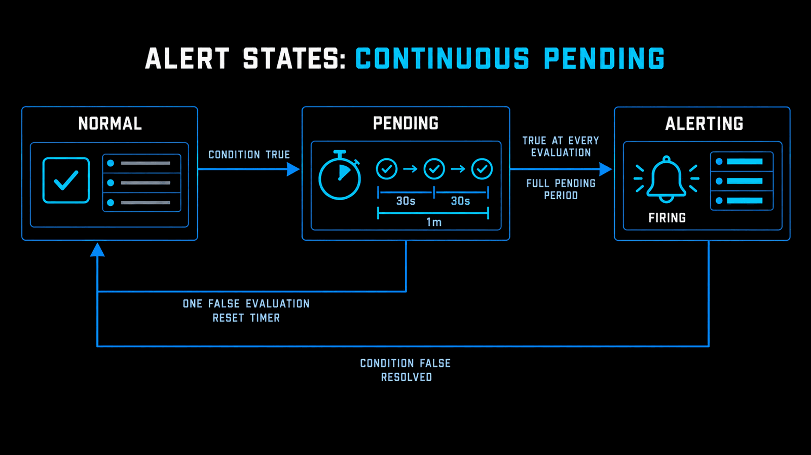
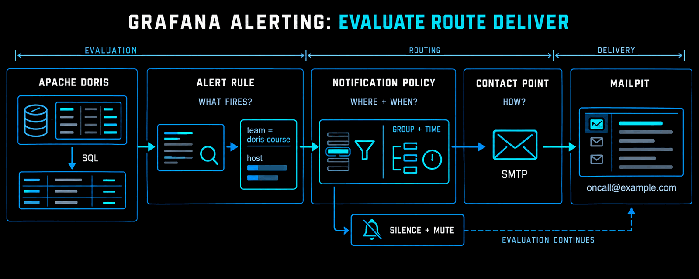
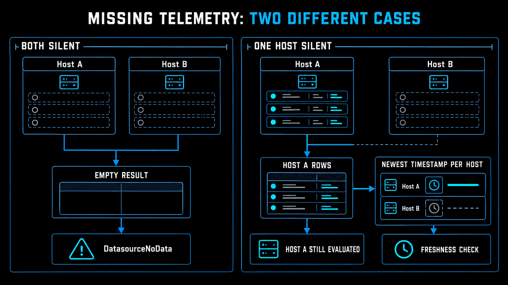

<a id="unit-u.b94eb0edac714dff8d69447510cf0cde"></a>

<a id="module-8-alerting-with-grafana"></a>

# 8-модуль: Grafana көмегімен ескерту

| Курс ақпараты | Мәні |
| --- | --- |
| Курс | Apache Doris көмегімен жүйені бақылау · 2-деңгей |
| Doris | Apache Doris 4.1.3 |
| Grafana | Жергілікті пошта сервері Mailpit бар Grafana 11.4.0 |
| Орта | Төлем ақауы қосылған 1-модульдің DOG стегі мен OpenTelemetry демосы |
| Болжалды уақыт | Шамамен 95 минут: оқу 30, зертханалық жұмыс 55 (3–6 минуттан үш күту), тест 10 |

[Курс README файлы](../../README.md) · [8-зертханалық жұмысты ашу](lab08_alerting.ipynb) · [8-тестті ашу](quiz08_alerting_rules.ipynb)

<a id="unit-u.d5fba7c17d744cca8d21386b65381ce4"></a>

<a id="module-goal"></a>

## Модуль мақсаты

Doris сұрайтын Grafana ережелерімен хост CPU-ы мен төлем инцидентіне ескерту жасау, хабарларын кіріс жәшігіне бағыттау, ережені кодпен сақтау және инцидентті аяқтап, ескертуінің шешілуін бақылау.

<a id="unit-u.1bcc831c637d45e1bce820dd0f9c062a"></a>

<a id="learning-objectives"></a>

## Оқу мақсаттары

Модульді аяқтаған соң сіз:

1. Ескерту тиісті шамасын өлшейтін сұрау жаза аласыз.
2. Дананың Normal, Pending, Alerting арасында және кері қалай ауысатынын болжай аласыз.
3. Байланыс нүктесі, саясат және ереже әрқайсысы нені шешетінін ажырата аласыз.
4. Ескертуге әрекет етуге қажет белгілерді сақтай аласыз.
5. Ереже жоқ деректі қалай өңдейтінін шешіп, есеп беруді тоқтатқан көзді таба аласыз.
6. Ережелерді код ретінде сақтап, Grafana-ға жібере аласыз.

<a id="unit-u.84776388eafa476cb0168f2a1a784e8e"></a>

<a id="module-structure"></a>

## Модуль құрылымы

| Бөлім | Уақыт | Нәтиже |
| --- | ---: | --- |
| 8.1 Бақылау тақтасынан ескертуге | 3 мин | Ескерту не қосады |
| 8.2 Ескерту сұрауы | 5 мин | Әр данаға дұрыс шаманы өлшейтін сұрау |
| 8.3 Ережелер, бағалау және күйлер | 6 мин | Ескерту қашан іске қосылып, шешіледі |
| 8.4 Байланыс нүктелері мен хабарландыру саясаттары | 5 мин | Кімге, қалай және қаншалықты жиі айтылады |
| 8.5 Дерек тоқтағанда | 4 мин | Дерек жоқтығы және үнсіз көздер |
| 8.6 Ережелерді код ретінде сақтау | 4 мин | Экспорт, баптау файлдары және HTTP API |
| 8.7 Пайдаланушылар көретінге ескерту | 3 мин | Сәтсіз тапсырыстар және инциденттің соңы |
| 8-зертханалық жұмыс | 55 мин | Іске қосылып шешілетін екі ереже, инциденттің соңы |
| 8-тест | 10 мин | Осы мақсаттар бойынша алты сұрақ |

<a id="unit-u.83bc75c945904c7fbd8125c4fb9e5937"></a>

<a id="81-from-a-dashboard-to-an-alert"></a>

## 8.1 Бақылау тақтасынан ескертуге

3-модуль тақтасы инцидентті қарағанға көрсетеді. Тақтаға ешкім түні бойы қарамайды, сондықтан сау қалуы керек жүйеге **ескертулер** қажет: жоспармен орындалып, нәтиже шектен асқанда біреуге хабарлайтын сұраулар. DOG стегінде Grafana оларды панельдермен бір дереккөз арқылы Doris-ке орындайды. Grafana ескертуінің үш бөлігі бар, 8-зертханалық жұмыс әрқайсысын баптайды:

| Бөлік | Нені шешеді |
| --- | --- |
| **Ескерту ережесі (Alert rule)** | Нені, қаншалықты жиі бағалау және нәтиже қашан іске қосылған болып саналады |
| **Хабарландыру саясаты (Notification policy)** | Қай ескерту қай байланыс нүктесіне, қандай топтаумен және уақытта барады |
| **Байланыс нүктесі (Contact point)** | Қалай хабарлау: адреске email, чат хабары, webhook |

<a id="unit-u.9298fe78d2214ede8f9abac86156f1bd"></a>

<a id="82-the-alert-query"></a>

## 8.2 Ескерту сұрауы

Ереже сұрауы ескертудің тиісті шамасын өлшеп, мәселе тууы мүмкін әр нысанға бір мән қайтаруы керек.

**Дұрыс шаманы өлшеу.** 8-зертханалық жұмыстың алғашқы ережесі хост CPU-ы жұмысбасты болып тұрса ескертеді. 3-модуль DOG Collector хост CPU-ын қалай сақтайтынын көрсетті: `otel_metrics_gauge` ішіндегі `system.cpu.utilization`, ядро мен күйге бір жол, әрқайсысы ядроның сол күйдегі уақыт үлесі. Әр жолды 90%-бен салыстырған ереже `idle` жолдары 1-ге жақын бос ядроларға іске қосылады; хост тынышырақ болған сайын көбірек жол өтеді. Сұрау жұмысбасты үлесті есептеуі керек: соңғы минуттағы ядролардың орташа `idle` үлесін 1-ден шегеру, әр хостқа бір дереккөзден — `host.name` бар DOG Collector хост метрикалары қабылдағышынан:

```sql
SELECT CAST(resource_attributes['host.name'] AS STRING) AS host,
       ROUND((1 - AVG(value)) * 100, 1) AS cpu_busy_percent
FROM otel_metrics_gauge
WHERE metric_name = 'system.cpu.utilization'
  AND attributes['state'] = 'idle'
  AND scope_name LIKE '%hostmetricsreceiver%'
  AND resource_attributes['host.name'] IS NOT NULL
  AND timestamp >= UTC_TIMESTAMP() - INTERVAL 1 MINUTE
GROUP BY host
```

**Данаға бір жол.** Grafana Table пішіміндегі сұраудың әр жолынан **ескерту данасын** жасап, мәтін бағандарымен белгілейді. `GROUP BY host` әр хостқа `host=...` белгісі бар өз данасын береді: хабарландыру қай хост бос емес екенін айтады, саясат хостпен топтайды, екі хост тәуелсіз іске қосылып шешіледі. Барлық хостты бір мәнге орташалаған сұрау орнын айтпай ескертер еді.

**Қазір аяқталатын терезе.** Сұрау бұрынғы талдау сұрауларындай ең жаңа жолдың алдындағы минутты емес, `UTC_TIMESTAMP()` алдындағы соңғы минутты оқиды. Хост тоқтаса, жолдары терезеден шығып, соңғы үлгілерін қайта-қайта шекпен салыстыру орнына сұрау оған ештеңе қайтармайды. 8.5-бөлім Grafana не істейтінін көрсетеді. Кестелер UTC сақтайды, сондықтан терезе уақыты `UTC_TIMESTAMP()` негізінде алынады.

<a id="unit-u.691916f1d42046a191db6b0a4ac32f4a"></a>

<a id="83-rules-evaluation-and-states"></a>

## 8.3 Ережелер, бағалау және күйлер

Ереже бумадағы **бағалау тобына** жатады; Grafana топтың әр ережесін оның аралығымен, 8-зертханалық жұмыста 30 секунд сайын бағалайды. Әр бағалау сұрауды (A), кейін өрнектерді орындайды: мұнда **Threshold** өрнегі (C), ереже шарты `A IS ABOVE 90`. Table сұрауы данаға бір сан береді, сондықтан Grafana ұсынған Reduce қажет емес.

Дана күйлер арасында ауысады:

- **Normal** (қалыпты): шарт жалған.
- **Pending** (күту): шарт ақиқат, бірақ толық **күту кезеңі** әлі аяқталмаған. Бір жалған бағалау Normal күйіне қайтарады, кезең қайта басталады.
- **Alerting** (ескерту іске қосылған): шарт күту кезеңінің әр бағалауында ақиқат болды. Grafana хабарландыру жібереді.
- Шарт қайта жалған болса **Normal** күйіне оралады; қайтар жолда күту кезеңі жоқ, Grafana шешілгені туралы хабарлайды.

Күту кезеңі жылдамдықты тыныштықпен теңгереді. Жұмыс бір минут қолданады, іске қосылуын көресіз; өндірісте қысқа шың біреуді оятпау үшін жиі 10 минут сияқты ұзағырақ күтеді. Шектен төмен кез келген бағалау үздіксіздікті бұзады, сондықтан он минуттағы үш жоғары үлгі — он минут бойы жоғары болу емес.

Шек маңында ауытқыған мән дананы **қайта-қайта ауыстырады**: іске қосылады, шешіледі, қайта іске қосылады. Threshold өрнегіндегі **қалпына келу шегі** көмектеседі: мысалы 90-нан жоғары іске қосылып, 80-нен төмен ғана шешіледі.



*Ескерту іске қосылуы үшін шарт күту кезеңінің әр бағалауында ақиқат қалуы керек.*

Сурет белгілері: ALERT STATES: CONTINUOUS PENDING — ескерту күйлері: үздіксіз күту; NORMAL — қалыпты; PENDING — күту; ALERTING/FIRING — іске қосылған; CONDITION TRUE — шарт ақиқат; TRUE AT EVERY EVALUATION — әр бағалауда ақиқат; FULL PENDING PERIOD — толық күту кезеңі; ONE FALSE EVALUATION RESET TIMER — бір жалған бағалау таймерді тастайды; CONDITION FALSE RESOLVED — шарт жалған, шешілді. 30s — 30 секунд, 1m — 1 минут.

<a id="unit-u.200ed6181663467fbdb8104050c4fde3"></a>

<a id="84-contact-points-and-notification-policies"></a>

## 8.4 Байланыс нүктелері мен хабарландыру саясаттары

**Байланыс нүктесі** қалай жіберуді анықтайды: жұмыста `doris-course-email` DOG стегі іске қосқан жергілікті Mailpit арқылы `oncall@example.com` адресіне хат жібереді, еш хат компьютерден шықпайды. Email жіберу үшін Grafana-ға SMTP баптаулары керек; DOG стегі `GF_SMTP_*` орта айнымалыларымен орнатады. Байланыс нүктесінің **Test** әрекеті сынақ хабарын жібереді: Grafana осы адреске бір рет жеткізе алатынын дәлелдейді. Ереже дұрыс іске қосылатынын, ескертулері осы бағытпен баратынын не шешілген хабар келетінін дәлелдемейді; жұмыс бұларды бөлек тексереді.

**Хабарландыру саясаты** ескерту белгілері бойынша қай байланыс нүктесіне баратынын, қалай топталып, қашан жіберілетінін шешеді. Өзге саясатқа сәйкес емес ескертулер әдепкісіне бағынады. Жұмыс `team = doris-course` сәйкестігі бар ішкі саясат қосады, курс ережелерінің бәрінде сол белгі бар:

| Саясат баптауы | 8-зертханалық жұмыс | Мағынасы |
| --- | --- | --- |
| Group by | `grafana_folder`, `alertname`, `host` | Бір ереженің әр хост ескертулері бір хабарландырулы топ болады |
| Group wait | 10s | Жаңа топтың алғашқы хабарына дейін басқаларын күту |
| Group interval | 1m | Шешілу сияқты топ өзгерісін хабарламас бұрын күту |
| Repeat interval | 4h | Іске қосылған күйде тұрған топ хабарын қайталау |

Ереже ненің іске қосылатынын, саясат қайда/қашан баратынын, байланыс нүктесі қалай жеткізілетінін шешеді. Оларды белгілер байланыстырады: жауап берушіге қажет `host` пен `severity` сияқты белгілерді сақтап, солармен бағыттаңыз.

Тағы екі құрал хабарландыруларды шектейді. **Silence** белгіге сәйкес ескертулердің хабарын бір уақытқа, мысалы мәселе жөнделіп жатқанда, басады; әр ескерту хатында жасау сілтемесі бар. **Mute timing** апталық қызмет көрсету сияқты қайталанатын уақытта саясат хабарларын басады. Екеуі де тек хабарландыруды тоқтатады: Grafana бағалауды жалғастырады, даналар күйлерін сақтайды.



*Ереже ненің іске қосылатынын таңдайды, белгілер саясат бағытын анықтайды, байланыс нүктесі жеткізеді.*

Сурет белгілері: GRAFANA ALERTING: EVALUATE ROUTE DELIVER — Grafana ескертулері: бағалау, бағыттау, жеткізу; EVALUATION — бағалау; ROUTING — бағыттау; DELIVERY — жеткізу; ALERT RULE — ескерту ережесі; WHAT FIRES? — не іске қосылады?; NOTIFICATION POLICY — хабарландыру саясаты; WHERE + WHEN? — қайда және қашан?; GROUP + TIME — топтау және уақыт; CONTACT POINT — байланыс нүктесі; HOW? — қалай?; SILENCE + MUTE — уақытша және кестелі үнсіз ету; EVALUATION CONTINUES — бағалау жалғасады; host — хост. Apache Doris, SQL, Mailpit, SMTP, team = doris-course және oncall@example.com — нақты техникалық атаулар мен мәндер.

<a id="unit-u.b09606ee8a534e8187d7dac164e0c2e2"></a>

<a id="85-when-data-stops"></a>

## 8.5 Дерек тоқтағанда

Хост есеп бермесе, CPU сұрауы ештеңе қайтармайды. Жол жоқта 90-мен салыстырар мән де жоқ; **Alert state if no data or all values are null** баптауы не болатынын шешеді. Әдепкі **No Data** кезінде ереже дерек жоқ деп хабарлайды, Grafana хост орнына дереккөз бен сұрау белгілері бар `DatasourceNoData` бөлек ескертуін сол саясатпен жібереді. Көру үшін 8-зертханалық жұмыс DOG Collector-ын тоқтатады. Әдепкі `Error` болатын **Alert state if execution error or timeout** сұраудың өзі сәтсіз болғанда соны істейді.

No Data тек сұрау мүлде ештеңе қайтармаса қолданылады. Бірнеше хосттың бірі тоқтаса, сұрау басқаларын қайтара береді: үнсіз хост данасы екі бағалаудан кейін хабарландырусыз жоғалады. Жоқ телеметрия төмен мән де, денсаулық дәлелі де емес; оны әр хосттың соңғы үлгісінен бергі секундтар сияқты жеке сұраумен бақылаңыз, жұмыстың жаттығуы солай істейді. Дерексіз күйді жоқ мәннің мағынасына қарай таңдаңыз: хост CPU-ына — мәселе; тапсырыс жоқтағы сәтсіз үлеске — ештеңе сәтсіз емес, сондықтан ол ереже `OK` қолданады.



*Басқа көздер сұрауды бос емес етіп тұрса, жоқ телеметрияға жеке тексеру керек.*

Сурет белгілері: MISSING TELEMETRY: TWO DIFFERENT CASES — жоқ телеметрияның екі жағдайы; BOTH SILENT — екеуі де үнсіз; ONE HOST SILENT — бір хост үнсіз; Host A/B — A/B хосты; EMPTY RESULT — бос нәтиже; HOST A ROWS — A хостының жолдары; HOST A STILL EVALUATED — A хосты әлі бағаланады; NEWEST TIMESTAMP PER HOST — әр хосттың соңғы уақыт белгісі; FRESHNESS CHECK — өзектілікті тексеру. DatasourceNoData — Grafana ескертуінің нақты атауы.

<a id="unit-u.1ee3c6b45c8d414e9c1d5ff4d530fc94"></a>

<a id="86-rules-as-code"></a>

## 8.6 Ережелерді код ретінде сақтау

Тек веб-бетте бар ережені тексеру, көшіру, қайта құру қиын. Grafana ережені баптау файлдарының пішімінде **экспорттай** алады: YAML ішінде топ, бума, аралық және форманың әр баптауы бар. Grafana іске қосылғанда `provisioning/alerting` каталогынан файлдарды оқып, ережелерді provisioned деп көрсетеді: жалғыз көзі файл болып қалады, веб-бет өңдетпейді.

**Provisioning HTTP API** сол мазмұнды JSON түрінде қабылдайды:

| Сұрау | Әрекеті |
| --- | --- |
| `POST /api/v1/provisioning/alert-rules` | Сіз таңдаған `uid` арқылы ереже құрады |
| `PUT /api/v1/provisioning/folder/{folder uid}/rule-groups/{group}` | Топ аралығы мен ережелерін орнатады: кейін топта дәл жіберген ережелер ғана қалады |
| `GET /api/v1/provisioning/alert-rules/{uid}/export` | Ережені файл пішімінде экспорттайды |

Топ `PUT` сұрауы тек `uid` бар ережелерді жаңартады, сондықтан жаңа тұрақты uid ережесі алдымен `POST` арқылы құрылады. Жазуға әкімші сияқты тиісті рұқсаты бар пайдаланушы керек. API құрғандары да provisioned болады; `X-Disable-Provenance: true` тақырыбы веб-бетте өңделетін күйде қалдырады. 8-зертханалық жұмыс екінші ережесін ноутбукте JSON ретінде жазып, әр сұрауды көрсететін `lab.provision_alert_rule_group(...)` арқылы жібереді. Топ мұндай файлдарды нұсқа бақылауында ұстап, өзгерісті кодтай тексеріп, әр Grafana-сына қолданады.

<a id="unit-u.92ea629729a54e9fba5771d1a95a2689"></a>

<a id="87-alerting-on-what-users-see"></a>

## 8.7 Пайдаланушылар көретінге ескерту

CPU ережесі мәселенің ықтимал себебін бақылайды. Екінші ереже мәселенің өзін қарайды: соңғы 5 минутта аяқталған тапсырыстардың сәтсіз үлесі 10%-дан жоғары ма. Бес минутта шамамен он тапсырыс бар, сондықтан әр тапсырыста үлес 0 мен 100 арасында секірмейді; 1 минут күту бір сәтсіз минутты сүзеді. Пайдаланушы сезетін сәтсіз тапсырыс белгісінің ережесі себебіне қарамастан ақауды ұстайды, соның ішінде хост бос, сервистер қате журналын жібермеген, дүкен тұтынушыға ештеңе көрсетпеген осы инцидентті де.

Инцидент 1-модульден бері жалғасқандықтан, ереже шамамен екі минутта іске қосылады. Кейін басталған жерінде аяқталады: жалауша бетінде `paymentFailure` мәнін `off` етесіз, әр жаңа тапсырыс сәтті болады. Терезеде соңғы 5 минуттың сәтсіздері әлі бар, сондықтан жеткілікті бөлігі шыққанда ғана, шамамен 5 минутта ескерту шешіліп, артынан хаты келеді. Бұл кідіріс — тұрақтылыққа жеткілікті ұзын терезенің құны.

<a id="unit-u.31032945c1e245c2bd8e9e87b8e35cc5"></a>

<a id="lab-8-configure-grafana-alerting"></a>

## 8-зертханалық жұмыс: Grafana ескертулерін баптау

[8-зертханалық жұмыс: Grafana ескертулерін баптау](lab08_alerting.ipynb) файлын ашыңыз. Сіз:

1. Хост метрикаларын тексеріп, бір жол неге хост жұмысбастылығын өлшемейтінін көріп, ескерту сұрауын орындайсыз.
2. Байланыс нүктесін құрып тексересіз, саясатпен курс ескертулерін бағыттайсыз.
3. `Host CPU busy` ережесін құрып, CPU-ды жүктеп, хаттарымен іске қосылып шешілуін бақылайсыз.
4. Хост метрикаларын тоқтатып, ереженің дерек жоқ деп хабарлауын көресіз.
5. Ережені код ретінде экспорттап, `Failed orders` ережесін кодпен жазып Grafana-ға жібересіз және іске қосылуын көресіз.
6. Төлем ақауын өшіріп, ескертудің шешілуін бақылайсыз.
7. Жаттығу: есеп беруді тоқтатқан хостты табасыз.

4–6 және 11-бөлімдер веб-беттерде өтеді. Төлем ақауы қосылған 1-модульдің DOG стегі мен демосы қажет.

<a id="unit-u.b677a354fe844681a32388bec329bd99"></a>

<a id="summary"></a>

## Қорытынды

- Ескерту сұрауы тиісті шаманы, мысалы 1-ден хост ядроларының орташа бос үлесін шегеруді өлшеп, әр данаға жауап берушіге қажет хост сияқты белгісі бар бір жол қайтаруы керек.
- Grafana топ ережелерін аралығымен бағалайды; шарт ақиқат болса дана Pending, бүкіл күту кезеңінен соң Alerting болады; шарт орындалмаған алғашқы бағалауда Normal күйіне қайтады. Қалпына келу шегі күйдің жиі ауысуын азайтады.
- Ереже ненің іске қосылатынын, хабарландыру саясаты белгілермен бағыт пен уақытты, байланыс нүктесі жеткізуді шешеді. Сынақ хабарландыруы тек жеткізуді дәлелдейді.
- Дерек жоқта ереже әдепкіде бөлек ескерту жасайды, бірақ сұрау мүлде ештеңе қайтармаса ғана; басқалардың арасында үнсіз қалған хостқа жеке тексеру қажет.
- Ережелер экспортталады, файлдармен жүктеледі, HTTP API арқылы құрылады; топ оларды код ретінде сақтайды.
- Пайдаланушылар көретін сәтсіз тапсырыс үлесінің ережесі себебіне қарамастан инцидентті ұстап, себеп кеткенде шешілді.

<a id="unit-u.ad230c0f36434493a02d7e41d2a07df2"></a>

<a id="quiz-8"></a>

## 8-тест

[8-тест: Grafana көмегімен ескерту](quiz08_alerting_rules.ipynb) файлын ашыңыз. Бір жауап таңдалатын алты сұрақ бар; іске қосылған орта қажет емес.

Әрі қарай: бұл — курстың соңғы модулі. Сегіз модульде инцидент бастап, дәлелін Doris-ке жинадыңыз, Grafana-да тексердіңіз, сандарын сұрақтарына сай кестелерде сақтадыңыз, SQL-мен өлшеп, ескерту жасадыңыз. [Курс README файлы](../../README.md) ортаны тоқтатып жоюды түсіндіреді.

<a id="unit-u.85da5b6e4ecf4fb08a6374b204013a7c"></a>

<a id="references"></a>

## Дереккөздер

- [Grafana: ескертулерге шолу](https://grafana.com/docs/grafana/v11.4/alerting/) және [сұраулар мен шарттар, қалпына келу шектерімен](https://grafana.com/docs/grafana/v11.4/alerting/fundamentals/alert-rules/queries-conditions/)
- [Grafana: ескертулердің күйі мен денсаулығы](https://grafana.com/docs/grafana/v11.4/alerting/fundamentals/alert-rule-evaluation/state-and-health/)
- [Grafana: хабарландыру саясаттары](https://grafana.com/docs/grafana/v11.4/alerting/fundamentals/notifications/notification-policies/), [үнсіз ету](https://grafana.com/docs/grafana/v11.4/alerting/configure-notifications/create-silence/) және [үнсіздік кестелері](https://grafana.com/docs/grafana/v11.4/alerting/configure-notifications/mute-timings/)
- [Grafana: ескерту ресурстарын HTTP API арқылы басқару](https://grafana.com/docs/grafana/v11.4/alerting/set-up/provision-alerting-resources/http-api-provisioning/) және [файлмен баптау](https://grafana.com/docs/grafana/v11.4/alerting/set-up/provision-alerting-resources/file-provisioning/)
- [Grafana: email (SMTP) баптау](https://grafana.com/docs/grafana/v11.4/setup-grafana/configure-grafana/#smtp)
- [Mailpit](https://mailpit.axllent.org/)
