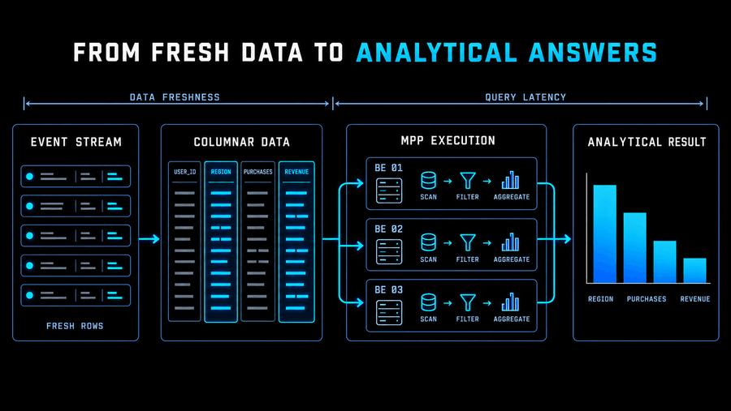

# Course Visual Generation and Insertion Prompt

Use the prompt below to design, generate, and insert instructional visuals into additional module course Markdown files. The visual reference below is the original illustration from `real-time-analytics / level-1 / module-1`, before the card-template redraw. It defines the visual language for every course illustration. Matching only its black background and blue palette is not enough.

## Authoritative Visual Reference



Reference file: `maintenance/visual-references/fresh-data-to-analytical-answers.png`.

This is the immutable style reference, copied without pixel changes from the original course illustration at commit `c66cec2`. Do not use a later replacement at the module image path as the style reference.

Use the `imagegen` skill and its built-in image-generation tool. Supply this actual image as a reference for every generation or edit call. Do not substitute SVG, Pillow drawing, HTML/CSS, or a generic flowchart renderer for the requested raster illustrations. Raster resizing and PNG compression are allowed after visual approval. If the built-in tool fails, follow the skill's explicit fallback policy; do not silently change generation methods.

## Reusable Prompt

```text
You are creating instructional visuals for an English-language VeloDB / Apache Doris course.

Target course Markdown:
<COURSE_MD_PATH>

Module identifier:
<MODULE_ID>

Style reference image:
maintenance/visual-references/fresh-data-to-analytical-answers.png

Use the imagegen skill and the built-in image-generation tool. Inspect and attach the style reference on every call. When redrawing an existing course image, also inspect and attach it as a separate content reference/edit target. Image 1 controls style; the target image and the course text control technical meaning. Do not copy the target's generic card-template styling, or copy the style reference's subject matter into unrelated lessons.

Read the entire target Markdown file, then complete the full workflow: analyze candidate locations, generate the visuals, insert them into the Markdown, and verify the result. Do not infer the course content from the title alone, and do not rewrite unrelated course text.

1. Select the visual locations

1. Choose three to five places where a visual would provide the most learning value. Use fewer than five for short content; never add visuals merely to meet a quota.
2. Prioritize content such as:
   - A core concept that is introduced for the first time and is difficult to model mentally from text alone.
   - Data, query, or control-signal flows that pass through several components.
   - The position of Apache Doris in a system or data pipeline.
   - Responsibility boundaries among FE, BE, storage, clients, and external systems.
   - Comparisons between architectures, execution strategies, or design choices.
   - Stage changes from ingestion and organization through execution and result delivery.
   - Existing ASCII or text-based diagrams that would be clearer as an image.
3. Do not add redundant visuals for ordinary definitions, simple lists, a single SQL statement, procedural steps, or passages already explained adequately by nearby content.
4. Give each image one explicit teaching objective. It should primarily help the learner answer one of these questions: Where is the data? Which component is responsible? What happens next? How do the alternatives differ?
5. Before generating images, provide a short plan for each one that includes:
   - Insertion anchor: the paragraph or subsection after which it should appear.
   - Visual topic.
   - Components and arrow relationships.
   - What the image explains in that passage.
   - Suggested filename and aspect ratio.
6. Every fact, component name, and arrow direction must be supported by the course text. Do not introduce capabilities, performance figures, deployment components, or causal claims that the course does not teach.

2. Match the reference's complete visual language

The target is a polished dark technical illustration with compact, meaningful pictograms and data structures, matching the supplied reference. It must look like another illustration in the same series, not a new family of generic presentation cards.

Mandatory style requirements:

- Use a solid black canvas and black or nearly black panel interiors. No background grid, photographic texture, vignette, or atmospheric lighting.
- Use thin electric-blue/cyan panel outlines, subtle small corner radii, and crisp blue-to-cyan directional connections. Match the reference's restrained line weights.
- Use a condensed, squared technical sans-serif appearance for the main title. Main titles and panel headings are uppercase with controlled letter spacing. Keep the title compact; it must not dominate the diagram.
- Use white title text with a short, meaningful cyan accent phrase when appropriate, as in the reference's title. Use cool blue-gray or pale cyan for secondary labels. Preserve exact spelling and readable typography.
- Keep the palette to white, cool gray, cyan, and blue. Do not introduce red, green, orange, or yellow for status indicators. Distinguish success, failure, exclusion, or pending states with short labels, check/X/stop shapes, line treatment, and cyan or cool-gray emphasis.
- Draw the concept itself: event rows, selected columns, tablets, rowsets, miniature tables, posting lists, paired records, timelines, trace spans, node groups, or a suitable result chart. The subject determines these structures.
- Use small, consistent technical line icons to explain responsibilities: for example a scan/storage symbol, filter funnel, aggregation symbol, document, table, queue, key, or result plot. Every icon must clarify a taught role; avoid decorative icon collections.
- Keep related components inside a meaningful outlined group. For example, an MPP EXECUTION panel can contain compact BE 01 / BE 02 / BE 03 worker panels, each showing scan, filter, and aggregate icons.
- FE and BE are named roles inside the appropriate Doris boundary. Label them FE / BE or Frontend / Backend as the lesson requires. Do not turn each FE or BE into a large repeated APACHE DORIS plaque.
- When a standalone Apache Doris system block is needed, APACHE DORIS may label that system once. An understated deep-blue fill is optional. Do not apply an obligatory deep-blue brand block to every internal node, table, operation, or process.
- Avoid logos and invented brands, including VELODB ENGINE. Exact system names from the lesson are sufficient.
- Use cyan highlights to distinguish selected columns, matching rows, active stages, and important connections. Small cyan-to-blue fills in data bars or marks are allowed when they match the reference; do not use decorative gradients across cards or the canvas.
- Maintain a flat, front-facing technical composition. No 3D, isometric objects, glass effects, photorealism, people, neon halos, or large shadows.
- Match the reference's compact information density and balanced use of space. Use clear margins and separation without leaving most of the canvas empty. The illustration should communicate through shapes, grouping, and visual structure as well as labels.
- Prefer 16:9 for ordinary concept illustrations and about 2.5:1 for genuinely horizontal flows or comparisons. Preserve an existing useful composition when restyling it. Do not make a montage.

Reject these regressions even if the colors are correct:

- Oversized ordinary Arial-like headings and large rounded boxes containing only text.
- A row of generic cards used for every topic, with the actual data structures or operations removed.
- Repeated large APACHE DORIS blocks standing in for individual BE/FE roles.
- Losing the column illustration, execution grouping, scan/filter/aggregate symbols, or analytical output merely to simplify the drawing.
- Huge empty regions, excessive padding, overly thick arrows, or a small diagram floating in a large black canvas.
- Unrelated toy records, invented SQL fields, fake performance figures, decorative charts, or additional arrows not supported by the lesson.

Text and technical accuracy requirements:

- Use English labels, short noun/verb phrases, and terminology from the course. Panel headings can use uppercase while SQL identifiers and field names preserve their required case.
- Supply a whitelist of exact labels for each image. Do not add explanatory sentences, sample IDs, fields, statuses, or numerical claims outside that whitelist.
- Keep body labels compact and legible. Do not place prose paragraphs inside the illustration.
- Represent data visually where useful; do not reduce a columnar-storage example to a card saying COLUMNAR DATA or a result visualization to a card saying ANALYTICAL RESULT.
- Schematic data marks may illustrate a relationship, but must be clearly illustrative and internally consistent. A chart must not imply measured values or a performance comparison unless the course supplies them.
- Verify every technical name, arrow, example row, join match, version, and calculation against the course. Do not copy example labels from the style reference into a different topic.
- Do not include garbled text, pseudo-text, misspellings, clipped labels, repeated accidental labels, watermarks, filenames, page numbers, or the word Figure.

3. Organize each diagram

1. Arrange a flow in the actual order described by the course, normally from left to right or from top to bottom.
2. When Apache Doris is the subject of the lesson, make it the visual center without implying that it is the only component if the text does not say so.
3. For comparisons, use clear left/right or top/bottom regions and keep both sides at the same visual scale.
4. In architecture diagrams, distinguish clients, coordination and planning, execution, storage, and results. Avoid crossing arrows and ambiguous connections.
5. For data-organization concepts, show relationships among columns, shards, partitions, tablets, nodes, or stages instead of relying on decorative abstract shapes.
6. Use the reference's compact condensed uppercase title treatment. A short subtitle is optional; devote most of the image to the visual explanation.
7. The main nodes, direction, and conclusion must remain immediately recognizable after scaling to course width.
8. For restyling work, preserve each existing image's teaching objective, meaningful detail, and correct relationships. Reconstruct those relationships in the reference style rather than deleting them to fit a shared template.
9. Genuine software screenshots are evidence, not conceptual illustrations. Preserve their actual UI and pixels unless the user explicitly requests replacing the screenshots; do not generate fictitious application screenshots.

4. Save the files and insert them into Markdown

1. Generate each visual as a separate, full-quality PNG source file.
2. The built-in tool initially saves images under its own generated-images directory. Copy working sources and compression attempts to an external task directory, for example:
   `/tmp/doris-course-visuals/<MODULE_ID>/`
   Do not generate uncompressed source files directly under the target module.
3. After visual review and compression, copy only the final web-ready files into the target module at:
   `images/`
4. Use a two-digit sequence followed by an English kebab-case name, for example:
   `01-ingestion-paths.png`
   `02-fe-be-query-flow.png`
5. Number the files in the order in which they appear in the course.
6. Insert each image using a relative Markdown path, for example:

   

   *FE plans and coordinates the query while BE nodes execute the distributed work.*

7. Write objective alt text that describes the relationship shown in the image. Do not use generic text such as `diagram` or `architecture`, and do not repeat the filename.
8. Add one italicized English caption below the image that states the conclusion the learner should take from it. Do not repeat the surrounding prose.
9. Normally place a visual after one or two paragraphs have introduced the relevant concept and before the next subsection heading. Do not place it between a heading and its opening paragraph unless it is genuinely an overview of the entire subsection.
10. If the source contains an ASCII or text diagram expressing the same relationship, replace that code block with the image and one caption while retaining the explanatory prose around it.
11. If no ASCII diagram exists, add only the image and caption. Do not delete or rewrite the course text.
12. Do not modify labs, quizzes, notebooks, course logic, or unrelated files. Updating this prompt and its immutable reference is allowed when the user requests a style-definition update.
13. Do not edit the synchronized copy under `apps/web/app/courses/content/` in the website repository. Modify only the Markdown and image assets in the course source repository.
14. Delete the temporary source and intermediate files only after the compressed assets, Markdown paths, and rendered result have been verified. Never commit temporary or uncompressed variants.

5. Compress the final assets to approximately 100 KB

Follow the Apache Doris Website [Image Compression Guide](https://github.com/apache/doris-website/blob/master/doc-tools/prompts/img-compression-guide.md).

1. Target approximately 100 KB per final image. Aim for 80–120 KB; allow up to 150 KB only when further compression would make labels, thin lines, or arrows difficult to read.
2. Retain PNG for the black background, technical line art, cyan accents, and sharp labels. Prefer TinyPNG where available. If the service returns a rate limit or is unavailable, stop requests and use local PNG optimization; record the method. Do not bypass limits or replace imagegen with a drawing script.
3. If an exceptional image does not rely on a solid-color or transparent background, it may be converted to JPEG with Pillow using `convert('RGB')`, `quality=85`, and `optimize=True`, as specified by the guide. Use a `.jpg` filename and update the Markdown path accordingly.
4. If a compressed PNG remains above 120 KB, first optimize its palette without dithering, then proportionally reduce dimensions if needed and compress again. Preserve cyan accents, readable labels, aspect ratio, and all content. Do not stretch or crop.
5. Compare the compressed result with the reviewed source at the intended course-content width. The compressed version must preserve readable labels, clean arrows, accurate colors, and an apparently solid black background.
6. Record the final byte size of every asset. Only the compressed final file may be copied to `images/` and committed. Keep screenshots, generated diagrams, and other course illustrations together in this module-local directory.

6. Verify image quality

Inspect the reference, the generated source, and the compressed final image side by side. Confirm both STYLE and CONTENT, not only palette and spelling:

- The title treatment, line icons, thin blue/cyan borders, compact labeling, grouped composition, and information density resemble the immutable original reference.
- Data and operations are drawn as meaningful structures or pictograms; the image has not become a generic text-card flowchart.
- The background is black, cyan is used purposefully, and there is no 3D, decorative glow, or photographic texture.
- Status markers also follow the white/cool-gray/cyan/blue palette; no red, green, orange, or yellow remains in failure or success highlights.
- Doris is represented at the correct system boundary; FE/BE workers are not mislabeled as separate APACHE DORIS systems.
- No logos, invented fields, extra nodes, unsupported arrows, fake measurements, or meaningless fine print appear.
- Technical names, examples, arrow directions, calculations, and responsibilities agree with the course and label whitelist.
- Text is spelled correctly and remains readable at the intended course width. Nothing overlaps or clips.
- The source and compressed final image retain the same useful detail, cyan highlights, clean lines, and apparently solid black background.
- The image advances its stated teaching objective and remains recognizably part of the reference series.
- The final PNG normally targets 80–120 KB, allowing up to 150 KB when readability needs it. Do not pad a smaller clear image to meet a minimum.
- Relative paths, sequential filenames, objective alt text, and italic captions remain correct.
- Only final compressed course assets are in module images directories. Sources, trials, and compression attempts stay outside the repository, except the intentionally committed immutable style reference.

Regenerate any image that fails these checks. Do not repair it by covering text in post-processing, stretching the image, or explaining an error in the Markdown.

7. Report the result

At completion, provide:

1. A list of all added images, including each final format and file size.
2. The section where each image was inserted and its teaching purpose.
3. The path of every modified course Markdown file.
4. A statement identifying any ASCII or text diagram that was replaced.
5. A statement identifying related files that were deliberately left unchanged, such as labs, quizzes, and screenshots.
6. The prompt set, the immutable reference used, the imagegen mode, and per-image compression method.
7. A style-review statement confirming comparison against the original reference, including typography, icons, data structures, grouping, and density.
```

## Addendum for Generating One Image at a Time

When the image-generation tool must be called separately for each image, append this template to the reusable prompt:

```text
Generate only image <N> in this call. Do not create a montage or a collection of alternatives.

Learning objective:
<THIS_IMAGE_LEARNING_GOAL>

Composition and flow:
<COMPONENTS_AND_FLOW>

Required English labels:
<REQUIRED_LABELS>

Forbidden or unsupported content:
<FORBIDDEN_OR_UNSUPPORTED_ELEMENTS>

Output aspect ratio:
<16:9_OR_WIDE>

Required input image:
maintenance/visual-references/fresh-data-to-analytical-answers.png
Role: authoritative STYLE reference, not a source of subject matter.

Optional second input image:
<CURRENT_COURSE_IMAGE_PATH>
Role: CONTENT reference/edit target. Preserve the correct teaching relationships while replacing its typography, icons, grouping, and visual treatment.

Reminder: use the built-in imagegen tool with the actual reference attached. Match the reference's condensed uppercase headings, white-and-cyan title treatment, thin blue/cyan outlines, compact technical line icons, visible data structures, and grouped execution panels. Keep FE/BE roles inside a meaningful system grouping. Do not substitute generic text-only SVG cards or repeated APACHE DORIS plaques. Generate one separate full-quality PNG.
```

## Usage Notes

- Replace `<COURSE_MD_PATH>` with the actual Markdown path in the course source repository.
- Set `<MODULE_ID>` to the course, level, and module, for example `real-time-analytics / level-2 / module-4`.
- To analyze candidate locations without generating visuals, explicitly change the scope to “Return only the visual placement plan; do not modify files.”
- If the placement plan is already approved, provide the learning objective and component relationships for each image and begin directly with generation.
